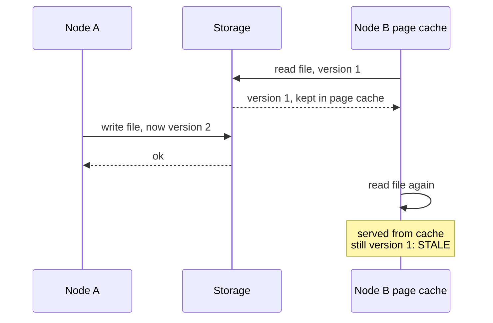
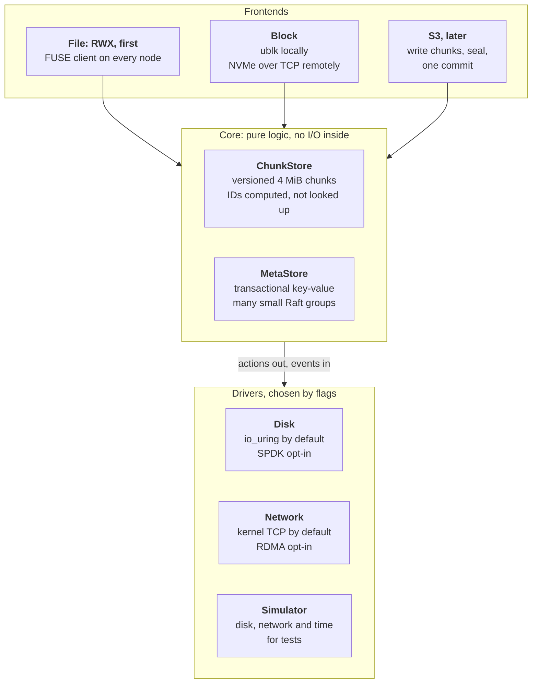
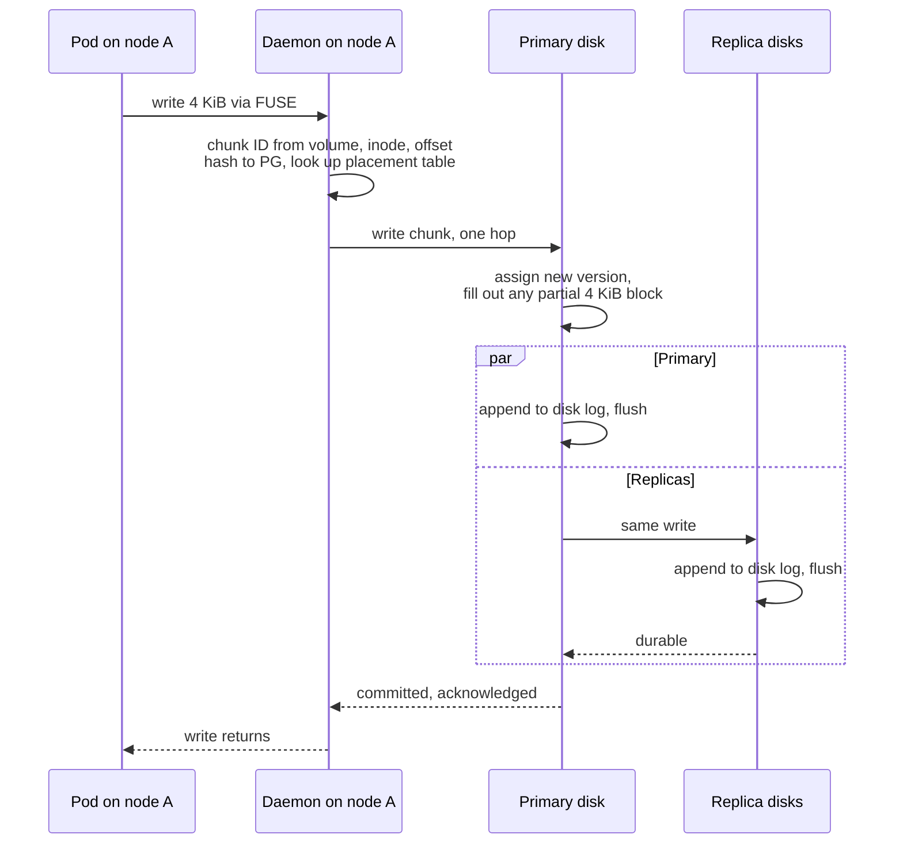
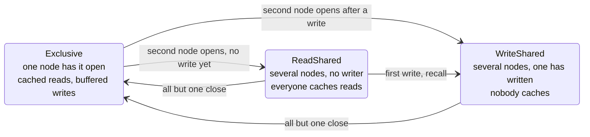

# The big picture: shared storage for a homelab, with no NFS server in the middle

rock-solid is a design for a distributed storage system, written in Go, for Kubernetes clusters of
3 to 10 nodes. Its headline feature is the shared filesystem: many pods on many nodes mounting one
directory read-write, with each node talking straight to the disks that hold the data. The first
release gives NFS-style close-to-open sharing; automatic per-file cache switching, which caches
while that is safe and turns caching off by itself the moment it is not, follows in the next phase.
Block volumes and, later, S3 object storage come from the same small core. The bet is that on
homelab hardware the network, not the kernel, limits throughput, so a short, correct code path wins
and kernel-bypass tricks stay optional. Nothing runs yet: this post, the first of twelve, tours the
design and the measurements behind it, and points to the post covering each part.

**How to read this series.** Every section opens with an **In plain words** box, then **How it
works** subsections with the design's real names and numbers. The boxes alone tell the whole story.

## Words you need

**Needed for this post**

- **ReadWriteMany (RWX) and ReadWriteOnce (RWO).** Kubernetes access modes: many nodes mount the
  volume read-write at once, or one node does. See [Kubernetes and volumes](../docs/glossary.md#kubernetes-and-volumes).
- **PersistentVolumeClaim (PVC), Container Storage Interface (CSI).** A PVC is a pod's request for
  storage; CSI is the plug-in interface through which Kubernetes asks a storage system to create and
  mount volumes.
- **Network File System (NFS).** One server shares a directory with many clients; every byte goes
  through the server.
- **Filesystem in Userspace (FUSE).** A Linux mechanism that forwards filesystem calls from the kernel
  to an ordinary process, at a few microseconds per request. See [Files and caching](../docs/glossary.md#files-and-caching).
- **Inode.** A file's identity: a number plus its attributes (size, owner, times). Names live
  separately, in directory entries that point at inode numbers.
- **Page cache, direct I/O, cache coherence.** The page cache is the kernel's in-memory copy of file
  contents; a read served from it never leaves the machine. Direct I/O skips it, so every read goes
  to the filesystem. Coherence means no node reads stale data from its cache after another node wrote.
- **Close-to-open consistency.** NFS's guarantee: if you open a file after another node closed it,
  you see everything it wrote. Fine for one writer at a time.
- **Chunk.** A 4 MiB piece of a file or block volume, the unit rock-solid stores, copies and moves.
- **Placement group (PG), primary, replica.** Chunks are hashed into placement groups, each living on
  a few disks. The primary orders every write to the PG's chunks; the others are replicas. See [Roles](../docs/glossary.md#roles-who-does-what).
- **Flush, durable.** A flush forces a drive's volatile write cache onto stable media; only then is a
  write durable: it survives a power cut. See
  [Drives and durability](../docs/glossary.md#drives-and-durability).

**Met briefly here, explained in later posts:** Raft and shards (groups of machines that agree on
one order of changes, [post 08](08-the-metastore.md)); kernel bypass with the Storage Performance
Development Kit (SPDK) and Remote Direct Memory Access (RDMA), which drive NVMe drives and network
cards directly ([post 11](11-runtime-in-go.md)); io_uring and ublk (Linux's
asynchronous I/O interface, and a user-space block device built on it,
[post 10](10-block-snapshots-and-clones.md)); erasure coding (parity pieces instead of full copies,
[post 07](07-pools-and-redundancy.md)).

## The problem: RWX in a homelab means an NFS server somewhere

> **In plain words.** Say you run Jellyfin on two nodes and want both to see one media library, or
> a CI system whose runners share a cache directory. Kubernetes calls that an RWX volume. Today,
> almost every way to get one in a small cluster puts a single file server in the middle. Every
> read and write from every node goes to that server, so it is the bottleneck, and when it dies or
> moves, every pod using the volume freezes until it comes back. The obvious fix, letting every node
> talk to the disks directly and cache what it reads, brings a new problem: node B can keep serving
> an old copy from its cache after node A changed the file.

### How it works: what goes wrong

The target user runs 3 to 10 nodes with several NVMe or SATA solid-state drives each and 10 to 25
Gigabit Ethernet (GbE). The picture compares today's gateway shape with rock-solid's. Look at where
the lines meet: on top, every pod's traffic meets in one pod; below, there is no meeting point.

```text
TODAY (Longhorn RWX): all traffic for a volume goes through one NFS pod

  node A               node B               node C
  [pod]  [pod]         [pod]                [pod]
    |      |             |                    |
    +------+--- NFS -----+------- NFS --------+
                         |
          [share-manager pod: NFS-Ganesha]   <- one per volume: bottleneck,
                         |                     and a pause when it fails over
              [the volume's replicas]


ROCK-SOLID (planned): any daemon talks to any disk, nothing in the middle

  [daemon A]   [daemon B]   [daemon C]     one daemon per node, serving its pods
      |  \    /    |  \    /    |          through FUSE
      |   \  /     |   \  /     |
      |    \/      |    \/      |          each chunk's I/O goes straight to that
      |    /\      |    /\      |          chunk's primary, wherever it lives
      |   /  \     |   /  \     |
      |  /    \    |  /    \    |          (daemon A reaches disks C the same way)
  [disks A ]   [disks B ]   [disks C ]
```

Removing the gateway is the easy half. The hard half is caching. Each node's kernel keeps pages of
the files it read in its page cache and serves later reads from memory without asking anyone. That
is what makes local reads fast: a cached 4 KiB read took 0.3 µs in the project's
[FUSE coherence spike](../docs/design.md#appendix-fuse-coherence-spike). It is also what goes wrong
when two nodes share a file. The spike's first test shows it, and the sequence below is that test.



*Nobody told node B that the file changed, so its kernel keeps answering from memory.*

The spike also found that a single "drop your cache" message is not enough on its own; the details
are in [post 09](09-rwx-filesystem-and-cache-coherence.md).

## The landscape: what exists and why none fills the gap

> **In plain words.** Plenty of open-source storage systems exist. Each is good at something:
> easy install, object storage, raw speed, full POSIX features. None of them gives a small cluster
> shared directories with no gateway, correct caching, a one-binary install and a permissive license
> all at once. That combination is the gap rock-solid aims at.

### How it works: system by system

The table lines up the systems the design compares itself with. "Not compared" means the design
weighs that system on other grounds only (Vitastor and Mayastor on latency, license and block
features).

| System | RWX data path | Extra systems to run | Caching of shared writes | Main cost for a homelab |
| --- | --- | --- | --- | --- |
| Longhorn RWX | One NFS pod per volume | None | NFS: close-to-open | Bottleneck, failover pause |
| [JuiceFS](https://github.com/juicedata/juicefs) | FUSE client, direct | Metadata database and object store | Close-to-open only | Two more systems to run |
| CephFS | Client, direct | None beyond Ceph | Full capabilities: per-client cache rights | ~1 ms writes, RAM, CPU, expertise |
| [SeaweedFS](https://github.com/seaweedfs/seaweedfs) | FUSE mount | None: single binary | No coherence protocol | Built around objects |
| [Vitastor](https://vitastor.io) | Not compared | Not compared | Not compared | Solo project; network-copyleft license |
| [OpenEBS Mayastor](https://github.com/openebs/mayastor) | Block only | Not compared | Not applicable | Hugepages and dedicated cores |
| Weka, DAOS, [3FS](https://github.com/deepseek-ai/3fs) | Direct, kernel bypass | 3FS: FoundationDB | Weka: per-file switch; DAOS: left to the user | GPU clusters; commercial or heavy |
| MinIO, RustFS, Garage | No file access | None | Not applicable | Object storage only |
| **rock-solid (planned)** | **FUSE client, direct** | **None: one binary plus CSI** | **Per-file mode switch** | **Not built yet** |

Four takeaways shape everything that follows:

1. Homelab RWX today means NFS somewhere in the path. Removing it is the visible win.
2. Weka shows that switching caching on and off per file gives most of the benefit of CephFS-style
   capabilities with a much smaller protocol, and the FUSE spike shows it can be done without a
   kernel module.
3. Vitastor, a Ceph-like system at around 0.1 ms, shows that one person can get a 10× latency win
   over Ceph by shortening the code path, without the Data Plane Development Kit (DPDK), kernel
   bypass for network cards. The same lean core serves block volumes.
4. Trust is the gate to adoption. Storage users wait years before trusting a new system, so
   correctness work is the product.

## The strategy: short code path, correct caching, bypass as an option

> **In plain words.** A fast NVMe drive moves data about six times faster than a 10 GbE link can
> carry it. So in a homelab the network is the narrow pipe for throughput, and tricks that speed up
> the disk or network stack mostly do not show up as more bytes per second. Where software hurts is
> latency: the time from "write" to "done" for one small write. On drives with power-loss
> protection that time is mostly the storage system's own code, so the plan is to keep that path
> short. On ordinary consumer SSDs the drive's own flush takes about 1 ms, so there every durable
> write costs about 1 ms, whatever the software; the 0.1 ms target is for drives with power-loss
> protection. Hardware tricks like SPDK and RDMA stay available as switches.

### How it works: the numbers behind the bet

The bars show how far below one drive the network links sit.

```text
Sequential bandwidth (design.md, Strategy). One '#' is about 0.14 GB/s.

one NVMe Gen4 drive  |#################################################|  ~7 GB/s
25 GbE link          |#####################                            |  ~3 GB/s
10 GbE link          |########                                         |  ~1.2 GB/s

The kernel TCP stack saturates a 10 to 25 GbE link with one or two cores.
```

So bypassing the kernel's network stack buys almost no throughput. Latency is different: a drive
accepts a 4 KiB write into its cache in about 0.04 ms, while Ceph takes around 1 ms at queue depth 1
(one write at a time). That gap is almost all software path; rock-solid's block target is around
0.1 ms, "Vitastor class".

The catch is durability. The [NVMe flush spike](../docs/design.md#appendix-nvme-flush-spike)
([spikes/nvme-flush](../spikes/nvme-flush/)) measured a DRAM-less consumer NVMe drive: a 4 KiB write
plus flush took 0.95 ms at p50 (the median), about 2 ms after 100 ms idle. So the 0.1 ms target
applies to drives with power-loss protection (PLP), capacitors that let a drive treat its cache as
durable.

```text
4 KiB write latency at queue depth 1. One '#' is 0.04 ms.

drive accepts a write into its cache     |#                          ~0.04 ms
rock-solid block target, PLP drive       |###                        ~0.1 ms
one consumer drive alone, write + flush  |########################   0.95 ms p50
  (spike, no network)
Ceph                                     |#########################  ~1 ms

A replicated rock-solid write on that consumer drive costs at least the
third row, plus a network round trip.
```

On a consumer drive a durable write at queue depth 1 floors at about 1 ms (2 ms after idle). What the
design wins there is exactly one flush per durable write: in the same spike, a second flush for a
record's header cost 1.93× one write plus one flush. So each disk keeps one log and makes a whole
batch of writes durable with one flush ([post 04](04-one-log-per-disk.md)).

### How it works: principles, goals and non-goals

The design's principles, in priority order:

1. **RWX first.** The file frontend is the first usable product. Block volumes (RWO, plus RWX block
   for KubeVirt live migration of virtual machines) come second, S3 later, all on the same core.
2. **Lean data path.** Client to chunk primary in one hop, a log append on the primary in parallel
   with sends to the replicas, then the acknowledgment.
3. **Cache where safe, never where unsafe.** Correctness never depends on timeouts alone.
4. **Easy to run.** One binary plus a CSI driver, no external database, and defaults that need no
   tuning: `io_uring` for disk, kernel TCP, FUSE. No hugepages, pinned cores or kernel modules.
5. **Opt-in fast paths.** SPDK and RDMA for those who have the hardware. DPDK stays a learning
   experiment.
6. **Correctness before features**, with deterministic simulation from day one, and **Apache 2.0**.

Not in v1: SMB (Server Message Block) file sharing for macOS and Windows clients, GPU-cluster scale,
shared-writable `mmap` across nodes, cross-directory hard links, a custom kernel module, and authentication or encryption between
daemons. A spike found that a Samba gateway can be added later on top of the file frontend
([post 09](09-rwx-filesystem-and-cache-coherence.md)).

## The architecture: two primitives, three frontends, pluggable drivers

> **In plain words.** Think of a library. One part is the stacks: numbered boxes on shelves, each box
> found by computing its shelf from its number, no catalogue lookup needed. The other part is the
> catalogue: titles, which box holds what, who has borrowed what. rock-solid splits storage the same
> way. The **ChunkStore** holds the boxes (4 MiB chunks of data) and knows nothing about files. The
> **MetaStore** is the catalogue (file names, directories, sizes, locks). A shared filesystem, a block
> device and an S3 bucket are three front desks over the same stacks and catalogue. Underneath, the
> code that actually touches disks and networks is a replaceable plug, so a simulator can stand in for
> all of it in tests. One program, the **daemon**, runs on every node and plays every role that node
> needs.

### How it works: the layers

Read the diagram top to bottom: frontends turn protocol requests into calls on the core, and the core
turns those into actions that drivers carry out. The core contains only logic, no I/O; a later
section explains why.



*Three frontends share one core; the simulator plugs into the same slot as the real drivers.*

- **The ChunkStore** is "dumb, fast and versioned". A chunk's ID is computed from the volume, the
  file's inode number and the offset, then hashed to a placement group, so finding data never needs
  a metadata query; each chunk has one primary that applies its writes in one order
  ([post 02](02-chunks-and-placement.md), and [post 03](03-epochs-leases-and-failures.md) for
  failures).
- **The MetaStore** is a transactional key-value store split into many small Raft groups. It needs
  consensus because locks and atomic `rename` are compare-and-set operations, which need one agreed
  winner. One more Raft group, the **control plane**, holds cluster-wide state: the pools, the
  placement table that says which disks hold which PGs, and every client's session
  ([post 08](08-the-metastore.md)).
- **Each disk** holds one append-only log for everything on it: chunk data, the Raft logs of the
  metadata shards placed there, and the indexes over both. The daemon embeds no database and a disk
  needs no filesystem ([posts 04](04-one-log-per-disk.md), [05](05-the-cleaner-and-free-space.md)
  and [06](06-the-lsm-tree.md)).
- **Pools** set redundancy per StorageClass, from one copy to three, or erasure coding
  ([post 07](07-pools-and-redundancy.md)).

### How it works: one daemon per node

The same single binary runs on every node. The layout shows what it does where.

```text
  storage node                         storage node            compute-only node
+------------------------------------+ +-------------------+ +-----------------------+
| rock-solid daemon                  | | rock-solid daemon | | rock-solid daemon     |
|  - FUSE client for RWX mounts      | |  (same roles)     | |  client-only mode:    |
|  - ublk server for block volumes   | |                   | |  FUSE client only,    |
|  - chunk primary or replica,       | |                   | |  no disks, no shards  |
|    one log per disk                | |                   | |                       |
|  - MetaStore shard replicas        | |                   | |                       |
|  disks: nvme0  nvme1  sata0        | |  disks: nvme0     | |  disks: none          |
+------------------------------------+ +-------------------+ +-----------------------+
  plus the CSI driver: a controller once per cluster, a node plugin on every node
```

Metadata always keeps three voting copies, so a cluster needs three nodes that hold metadata; a
two-node cluster can add a small third machine, such as a single-board computer with an SSD, that
holds metadata only. The CSI node plugin also holds every mount's `/dev/fuse` file descriptor, so the daemon can
crash or be upgraded without breaking mounts ([post 09](09-rwx-filesystem-and-cache-coherence.md)).

### How it works: one write, end to end

A pod on node A writes 4 KiB into a file that a pod on node B also writes. Follow the arrows: one hop
to the primary, then the primary's own log append runs in parallel with the copies to the replicas,
and the acknowledgment comes only once every live copy is durable.



*For a write inside the file's current size, nothing in this path asks the MetaStore anything: the
chunk's location is computed.*

A write that extends the file also records the new size in the MetaStore before it is
acknowledged. A write that covers only part of a 4 KiB block is filled out by the primary, which
reads the rest of the block and sends whole blocks on, so replicas never need the old bytes
([post 02](02-chunks-and-placement.md)). Had node A been the only node using the file, the daemon
would instead have kept the write in its own write-back buffer and sent it on at `close`, at
`fsync`, or when a chunk filled. It buffers only as much as its node's *space grant* from the
control plane covers, so a write it has acknowledged never fails later for lack of space; near a
full pool the grant shrinks and writes go straight to the primary, where a refusal reaches the
application as `ENOSPC` from `write()` itself.

## Caching that switches itself off

> **In plain words.** Picture a shared document that several people keep printed copies of. As long
> as nobody edits it, everyone reads their own printout, which is fast. The moment two people have it
> open and one starts editing, a coordinator tells everyone else to throw their printouts away, and
> from then on everyone reads the one live copy until only one person is left. rock-solid will do
> this per file, automatically. It ships in steps called tiers. The first release (Tier 1) gives
> NFS-style close-to-open sharing, enough when one node at a time writes a file. Tier 2 adds the
> automatic per-file switch, so several nodes can safely write one file at once.

### How it works: tiers and cache modes

| Tier | What | Correct for |
| --- | --- | --- |
| 0 | RWX block: several nodes attach one device, no daemon-side cache, fencing | KubeVirt live migration, cluster-aware apps |
| 1 | Close-to-open consistency, short attribute and directory timeouts, flock, unlink and rename of open files, fencing | One writer per file at a time: media, configs, uploads, datasets, CI caches |
| 2 | Per-file cache mode switch | Concurrent writers on one file, automatically, with no tuning |
| 3 | Byte-range locks, directory caching with pushed invalidations | SQLite-style apps, large directory trees |

Tier 1 already beats Longhorn RWX, because there is no NFS pod per volume. Tier 2 is the Weka idea:
the leader of the metadata shard holding a file's inode, its **inode owner**, tracks in memory which
nodes have the file open, and puts the file in one of three modes.



*Caching is off only while a file is write-shared, and comes back when one node remains.*

Entering WriteShared, the owner sends a **recall** to every other node that has the file open and
waits until each has flushed its buffered writes, dropped its cached pages, switched new opens to
direct I/O and made already-open files check for changes before every read. A node that never
answers is waited out until its session lease (10 s by default) expires, or for `recall_timeout`
(30 s) if it still renews its session, and it is then **fenced**: the control plane, which alone
keeps every session's lease, has every chunk primary reject its writes before its locks go to
anyone else. While a file is write-shared,
every read and write goes to the chunk primary, which orders them: one network round trip per I/O,
plus about 5 to 20 µs of FUSE overhead, acceptable because write-sharing is rare in homelabs
([post 09](09-rwx-filesystem-and-cache-coherence.md)).

## Three frontends on one core

> **In plain words.** A file, a block device and an S3 object all end up as chunks. What differs is
> how much they need the catalogue. A block device needs it only when it is attached. A shared
> filesystem needs it constantly, for every name, directory and open. S3 needs it once per upload and
> for listings.

### How it works: what each frontend pays for

- **Block volumes** use the same chunk path and never touch the MetaStore on the hot path. A pod's
  4 KiB write goes through the kernel block layer to a ublk device served by the node's daemon; remote
  clients use NVMe over Fabrics over TCP (NVMe-oF/TCP), the standard network protocol for NVMe drives.
  Crash-consistent snapshots and clones let backup tools such as Velero work through CSI
  ([post 10](10-block-snapshots-and-clones.md)).
- **S3**, later, streams an object into fresh chunks, seals them, and makes the object visible
  atomically with one MetaStore transaction; listing a bucket is a prefix scan.

The design's [frontend comparison](../docs/design.md#frontend-comparison) sums it up; these are its
rows that matter for a first read:

|  | File (RWX) | Block | Object (S3) |
| --- | --- | --- | --- |
| Write pattern | Byte-range writes, appends | 4K overwrites in place | Whole object, written once |
| MetaStore on hot path | Open, close, fsync, namespace operations; extending writes while write-shared | Never (attach only) | Once per PUT commit, and on LIST |
| Hot cost | Metadata round trips | Latency at queue depth 1 | Throughput, listing |

## A core that never touches I/O

> **In plain words.** All the decision-making code (who is primary, when to recall, whose writes are
> fenced) is written as a function that takes "something happened" and returns "do these things". It
> never reads a clock, opens a socket or writes a disk itself. That makes it possible to run a whole
> simulated cluster, crashes and all, inside one test process and replay any failure exactly. It also
> makes the disk and network code swappable, which is how kernel bypass stays a flag.

### How it works: events in, actions out

This pattern is called sans-IO, and each component written this way is a state machine: a piece of
state plus one function, `OnEvent`, that updates it. The diagram shows the two plugs the same core
fits into.

```text
           events in                                actions out
 NetRecv, DiskDone, Timer, PeerLost     NetSend, DiskWrite, DiskFsync, DiskTrim, SetTimer
              |                                          ^
              v                                          |
      +-----------------------------------------------------------+
      |  state machine: OnEvent(ctx, event, out) -> out           |
      |  ChunkStore replica, MetaStore shard, inode owner, ...    |
      |  no clock (time is ctx.Now), no goroutines, no sockets    |
      +-----------------------------------------------------------+
              ^                                          |
              |              either                      v
  +--------------------------------+    +--------------------------------------+
  | real drivers in event loops:   | or | simulator: simulated disk, network,  |
  | io_uring, kernel TCP, FUSE,    |    | clients and time; one seed replays   |
  | ublk; opt-in SPDK and RDMA     |    | the whole cluster run exactly        |
  +--------------------------------+    +--------------------------------------+
```

SPDK and RDMA plug into the same slots as io_uring and TCP; a node without RDMA simply uses TCP.
[Post 11](11-runtime-in-go.md) covers the event loops and drivers, and
[post 12](12-testing-for-trust.md) the simulator and the other tests this shape makes possible.

## Evidence: the spikes behind the big decisions

> **In plain words.** Before committing to a choice that depends on how a kernel, a library or a drive
> actually behaves, the project runs a small throwaway experiment, a spike, and records the numbers.
> The whole-system choices in this post rest on four of them.

- **FUSE can keep caches coherent per file, with no kernel module.** The
  [FUSE coherence spike](../docs/design.md#appendix-fuse-coherence-spike)
  ([spikes/fuse-coherence](../spikes/fuse-coherence/)) found FUSE features that keep even
  already-open files fresh, at about 15 to 17 µs per 4K read locally, and ruled out FUSE's own
  write-back cache, which hides writes from the daemon.
- **A consumer drive floors at about 1 ms per durable write**: the NVMe flush spike, in the strategy
  section above.
- **Kernel bypass fits as an add-on.** The
  [kernel-bypass drivers spike](../docs/design.md#appendix-kernel-bypass-drivers-spike)
  ([spikes/bypass-drivers](../spikes/bypass-drivers/)) ran SPDK and RDMA inside its own event loop
  without changing the core; SPDK in interrupt mode used 2.9 µs of CPU per I/O against 43 µs
  polling. RDMA ran on Soft-RoCE, a software emulation over Wi-Fi, which shows the driver fits, not
  that RDMA is fast. Real NVMe under SPDK still needs root and very likely hugepages, hence opt-in.
- **Go is close enough to Rust, with rules.** The
  [Go and Rust codegen spike](../docs/design.md#appendix-go-and-rust-codegen-spike)
  ([spikes/go-rust-codegen](../spikes/go-rust-codegen/)) and its siblings found Go at 1.07× Rust's
  CPU per replicated 4K write once the data path runs one event loop per core instead of a goroutine
  per connection, which costs 1.5 to 1.7× ([post 11](11-runtime-in-go.md)).

## Trade-offs: what the design accepts

> **In plain words.** Every design pays somewhere. rock-solid pays for its simplicity and its
> correctness guarantees with metadata latency, with uncached I/O on files several nodes write at
> once, and with a v1 that trusts your network completely.

- **Metadata speed is bounded by round trips.** Small-file workloads never match a local disk. Every
  shared POSIX system pays this.
- **Write-shared files lose caching**, and memory-mapped readers see other nodes' writes within one
  message delay, not instantly.
- **A daemon crash loses its unflushed write-back buffer**, as a kernel crash loses dirty pages, but
  never silently: the next `write()`, `fsync` or `close` on each handle that had the file open
  fails with `EIO`.
- **v1 has no authentication or encryption between daemons.** Any host that can reach a daemon's port
  can read and write any volume. Run it on a network you trust.
- **Three metadata nodes are mandatory**, whatever the data pools look like.
- **A volume spread over every disk is hit by any failure in its pool**: the price of a volume
  larger than any one drive.

## Alternatives considered at the whole-system level

> **In plain words.** For each big fork in the road, the design records what else was on the table and
> why it lost. The theme is the same throughout: a short hot path, a single binary and testable
> correctness win over peak features.

The design's [Alternatives considered](../docs/design.md#alternatives-considered) table indexes more
than sixty decisions; most belong to later posts. These six shape the whole system.

| Decision | Chosen | Alternatives weighed | Why |
| --- | --- | --- | --- |
| First product | RWX filesystem | Block first; S3 first | RWX is where homelab users have no good option; block alone competes with Longhorn v2 and Mayastor |
| Language | Go | Rust; C++ (Ceph, 3FS) | Easier to read, review and extend; the language of etcd-raft (the Raft library used) and the CSI tooling |
| File client | FUSE | Own kernel module (Weka, CephFS); NFS gateway pod (Longhorn RWX) | FUSE can switch caching per file, and a crash doesn't take down the kernel; a gateway funnels all traffic through one pod |
| Coherence | Tiers 1, then 2, then 3 | Close-to-open only (NFS, JuiceFS); full capabilities from the start (CephFS); caching left to the user (DAOS) | Ships useful RWX early; the mode switch gets most of the benefit of capabilities with three states and one message type |
| Kernel bypass | Opt-in flag | Mandatory DPDK and SPDK (Weka, Mayastor, Longhorn v2) | Homelab links are network-bound, so bypass buys latency, not throughput. Mandatory hugepages and pinned cores break "plug and play" |
| License | Apache 2.0 | AGPL (MinIO); network copyleft (Vitastor) | A license is part of the trust decision; anyone can embed, fork or ship Apache 2.0 code, and its patent grant covers contributors' patents |

The name states the priority behind all of it: correctness before features.

## Open directions: roadmap, status and open questions

> **In plain words.** The build order puts the simulator before any real disk or network code, and the
> first thing a user can run is the shared filesystem at Tier 1, in phase 6. Today the project is in
> phase 1: the foundations, the disk log and the index exist with their tests, and nothing runs as a
> storage system yet.

### How it works: the thirteen phases

Each phase ends with something that runs and is tested. Follow the chain left to right; phase 6 is the
first usable product. Phase 2 writes TLA+ models: precise descriptions of the protocols that a model
checker explores state by state, catching design bugs before code exists.

```mermaid
flowchart LR
    P1["Phase 1<br/>core, disk log,<br/>simulator"] --> P2["Phase 2<br/>TLA+ protocol<br/>models"]
    P2 --> P3["Phase 3<br/>replication,<br/>placement"]
    P3 --> P4["Phase 4<br/>embedded<br/>MetaStore"]
    P4 --> P5["Phase 5<br/>io_uring and<br/>TCP drivers"]
    P5 --> P6["<b>Phase 6</b><br/>FUSE + CSI, Tier 1<br/>first usable product"]
    P6 --> P7["Phase 7<br/>Tier 2<br/>cache modes"]
    P7 --> P8["Phase 8<br/>block volumes,<br/>RWX block"]
    P8 --> P9["Phase 9<br/>SPDK and RDMA"]
    P9 --> P10["Phase 10<br/>erasure-coded<br/>pools"]
    P10 --> P11["Phase 11<br/>snapshots, clones,<br/>pool moves"]
    P11 --> P12["Phase 12<br/>S3"]
    P12 --> P13["Phase 13<br/>scale-out, Tier 3"]
```



*Simulator first, real drivers fifth, the first thing you can mount sixth.*

Tier numbers are not build order: Tier 0 (RWX block) ships in phase 8, after Tiers 1 and 2, because
the file frontend is the first product.

**Where the build stands.** 18 of the 46 phase 1 items in the
[build checklist](../docs/build-checklist.md) are done: the tooling, the foundation types in
`internal/core`, the disk log, the index's memtable and sorted runs, and the chunk index. The
simulator and the single-node ChunkStore are next.

**Open questions.** The design settles open questions by measurement, not argument. Two touch the
whole system:

- **Drive classes.** Flush latency has been measured on one DRAM-less consumer NVMe drive only. Drives
  with DRAM, QLC drives, SATA SSDs and PLP drives are still to measure, including whether a PLP drive
  does better with writes that skip its cache (`durability: fua`) than with write plus flush.
- **FUSE over io_uring.** Linux 6.14 added a FUSE transport over io_uring, but it strands or fails
  requests when the daemon crashes, so the daemon never uses it. Once the kernel requeues those
  requests, does it cut CPU per request enough to adopt?

The rest belong to later posts. [docs/tech-debts.md](../docs/tech-debts.md) lists the current
workarounds and version pins, each with what must be true to remove it.

**A learning project too.** Each learning track (consensus, TLA+, io_uring, FUSE, SPDK, RDMA and
more) starts with a throwaway exercise and lands as a real component, in roadmap order.

## Where to go next

If shared directories are why you are here, jump to [post 09](09-rwx-filesystem-and-cache-coherence.md).
If you want to know how a byte finds its disk, start with [post 02](02-chunks-and-placement.md).

| Post | What it covers, in one line |
| --- | --- |
| [02 Chunks and placement](02-chunks-and-placement.md) | How a byte offset becomes a chunk ID, a placement group and a disk, with no lookup |
| [03 Epochs, leases and failures](03-epochs-leases-and-failures.md) | How the cluster notices a dead or slow disk and hands its work over without two primaries at once |
| [04 One log per disk](04-one-log-per-disk.md) | The on-disk format: one append-only log, group commit, crash recovery |
| [05 The cleaner and free space](05-the-cleaner-and-free-space.md) | Reclaiming space in a log, write amplification, and slowing writers before the disk fills |
| [06 The LSM tree](06-the-lsm-tree.md) | The index inside the log: memtable, sorted runs, Bloom filters, compaction |
| [07 Pools and redundancy](07-pools-and-redundancy.md) | Copies versus erasure coding, when chunks get encoded, and one-copy pools |
| [08 The MetaStore](08-the-metastore.md) | Many small Raft groups, a key layout that keeps `create` on one shard, leader leases |
| [09 RWX filesystem and cache coherence](09-rwx-filesystem-and-cache-coherence.md) | The FUSE client, the cache tiers, sessions and fencing, daemon restarts |
| [10 Block, snapshots and clones](10-block-snapshots-and-clones.md) | ublk volumes, crash-consistent snapshots, restore and clone, and S3 later |
| [11 Runtime in Go](11-runtime-in-go.md) | Sans-IO, one event loop per core, no allocation per operation, SPDK and RDMA drivers |
| [12 Testing for trust](12-testing-for-trust.md) | Deterministic simulation, metamorphic tests, the crash oracle, injected errors |

## Further reading

- Design sections: [Goals](../docs/design.md#goals), [Strategy](../docs/design.md#strategy),
  [Architecture overview](../docs/design.md#architecture-overview),
  [Cache coherence tiers](../docs/design.md#cache-coherence-tiers),
  [Frontend comparison](../docs/design.md#frontend-comparison),
  [Modularity](../docs/design.md#modularity-sans-io-core-pluggable-drivers),
  [Alternatives considered](../docs/design.md#alternatives-considered),
  [Roadmap and open questions](../docs/design.md#roadmap-and-open-questions).
- Spike appendices: [FUSE coherence](../docs/design.md#appendix-fuse-coherence-spike),
  [NVMe flush](../docs/design.md#appendix-nvme-flush-spike),
  [kernel-bypass drivers](../docs/design.md#appendix-kernel-bypass-drivers-spike),
  [Go and Rust codegen](../docs/design.md#appendix-go-and-rust-codegen-spike),
  [Samba gateway](../docs/design.md#appendix-samba-gateway-spike).
- Supporting docs: [glossary, starting with "One write, end to end"](../docs/glossary.md#one-write-end-to-end),
  [build checklist](../docs/build-checklist.md), [tech debts](../docs/tech-debts.md),
  [README](../README.md).
- Code so far: [internal/core](../internal/core/), [internal/disklog](../internal/disklog/),
  [internal/lsm](../internal/lsm/), [internal/chunkstore](../internal/chunkstore/).
