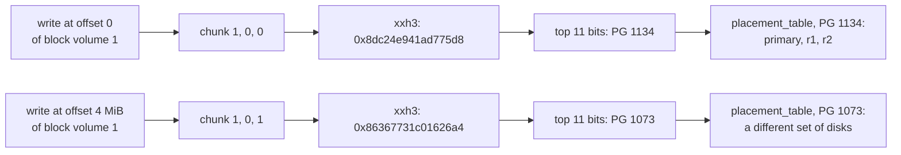
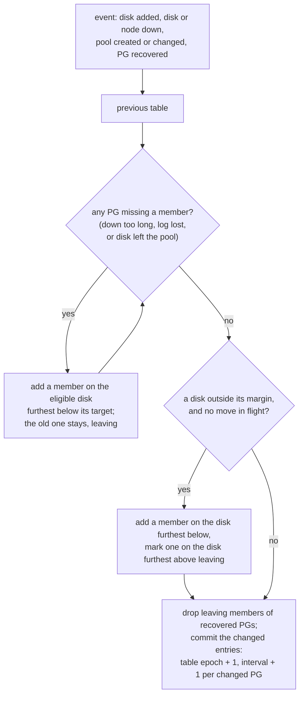
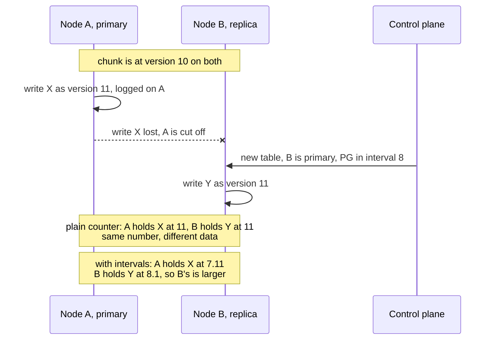
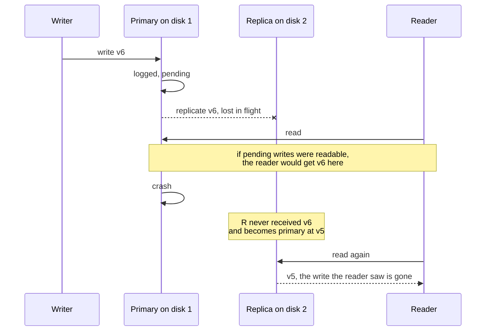

# Chunks and placement: where every byte of a volume lives

A storage cluster has to answer one question on every read and write: which disks hold these
bytes? If answering it costs a database lookup, every 4 KiB write pays for a second network round
trip before it even starts. rock-solid cuts every volume and file into 4 MiB chunks whose names are
computed from the write's position, hashes each chunk into one of a fixed (but doublable) number of
placement groups, and keeps a small table, computed by one leader and cached on every node, that
says which disks serve each group. The result is a hot path with no metadata lookup, exact balance
on small clusters with mismatched disks, and a table whose size does not depend on how much data
the cluster holds.

This is the second post in the series; [the big picture](01-the-big-picture.md) explains where the
ChunkStore sits. Each section opens with an **In plain words** box; the **How it works** parts
that follow give the mechanisms and edge cases.

## Words you need

The [glossary](../docs/glossary.md) has longer entries for all of these.

- **Chunk.** A 4 MiB piece of a file or block volume: the unit that is placed, replicated and
  versioned. See [Data model](../docs/glossary.md#data-model).
- **Inode.** A file's identity: a number plus its attributes. A block volume uses inode 0 for all
  of its chunks.
- **Placement group (PG).** A bucket of chunks that are placed together, an idea and a name from
  Ceph. See [Redundancy and placement](../docs/glossary.md#redundancy-and-placement).
- **Member, primary, replica.** The disks listed for a PG are its members. The first is the
  primary, which orders every write to the PG's chunks; the others are replicas.
- **Pool.** A set of PGs that share one redundancy scheme, such as `rep3` (three copies) or
  `ec4-2` (erasure coding: four data pieces plus two parity pieces, any four of which rebuild the
  chunk, [post 07](07-pools-and-redundancy.md)). Every volume belongs to one pool.
- **Failure domain.** Things that can fail together, such as one node. Copies of a chunk go to
  different failure domains.
- **Placement table, table epoch, interval.** The map from each PG to its members; its version
  number is the *table epoch*. A PG's *interval* is a run of tables in which that PG's members,
  their order and which of them are live stay the same, so it has one primary throughout. "Epoch"
  has two other meanings in the design; see
  [Words with more than one meaning](../docs/glossary.md#words-with-more-than-one-meaning).
- **Control plane.** The one Raft group (a set of nodes that agree on a log of changes) that holds
  cluster-wide state such as pools and the placement table.
- **Peering.** What a new primary does before it takes writes: it stops earlier intervals from
  completing writes and gathers the newest version of every chunk from the members
  ([post 03](03-epochs-leases-and-failures.md)).
- **Version, committed, pending.** A version is a number stamped on every write to a chunk, larger
  than every earlier one. A version is committed once every live member of the chunk's PG holds it,
  which is also when its write is acknowledged; until then it is pending.

## The problem: one volume, many disks, and no time to ask

> **In plain words.** Picture a 3-node homelab with two disks per node, and a pod writing 4 KiB
> into a 1 TiB volume. Somebody has to decide which disks get those 4 KiB, and every node has to
> find them again later. The obvious answers each break something: put the whole volume on one
> disk and it can never outgrow that disk; keep a list of where every piece lives and every write
> must ask the list first; hash every piece straight to a disk and adding one disk reshuffles the
> whole cluster.

Here are the three obvious layouts side by side. Look at what each one does to the 4 KiB write:

```text
 A) Whole volume per disk       B) Per-chunk lookup table       C) Hash chunk -> disk
                                                                   directly
 vol-1 ----------> disk 3       write(vol-1, off)               write(vol-1, off)
 vol-2 ----------> disk 5         |                               |
                                  v                               v
 vol-1 can never be bigger      metadata service:               disk = hash(chunk) % 6
 than disk 3. Disk 3 does       "chunk 7 is on 2, 4, 6"           |
 all of vol-1's I/O.              |   (extra round trip,          v
                                  |    table grows with data)   add a 7th disk:
                                  v                             "% 7" moves almost
                                disks 2, 4, 6                   every chunk
```

Layout B is what you would build first, and it puts a network hop in front of every write, to a
table that grows with every byte stored. rock-solid wants no hop before the data moves, nothing on
the hot path that grows with the data, and a layout that still balances when someone adds a 1 TB
disk to a cluster of 4 TB disks. The post follows a write from a byte offset to a chunk, a
placement group and a set of disks, then turns to what a chunk promises once you reach it.

## Chunks: why 4 MiB pieces

> **In plain words.** A chunk is a fixed-size piece of a file or volume, like the pages of a
> book. Cutting data into pieces lets different pieces live on different disks, so a volume can be
> larger and faster than any one disk. It also gives the system one unit to place, copy, version
> and repair. A chunk only exists once something is written into it, so an empty 1 TiB volume
> uses no space.

### How it works

A chunk is 4 MiB, the default object size of Ceph RBD (Ceph's block device): 1,024 blocks of
4 KiB. The chunk size is part of every chunk's name (below), so in effect it is disk format.
Chunks exist only after their first write, which makes thin provisioning free: creating a volume
allocates nothing.

## Chunk IDs: computed, never looked up

> **In plain words.** Think of a theater where your seat number is printed on your ticket. Nobody
> needs to look up where you sit; the ticket says it. rock-solid names a chunk by where it sits:
> which volume, which file, and which 4 MiB stretch of that file. Anyone who knows the write's
> offset can compute the name, so finding a chunk never needs a metadata query.

### How it works

```text
chunk_id = (volume_id, inode_id, offset / CHUNK_SIZE)
```

A write at offset 10 MiB into block volume 1 lands in chunk `(1, 0, 2)`, because 10 MiB ÷ 4 MiB
rounds down to 2. The same offset in the file with inode 42 on filesystem volume 7 lands in
`(7, 42, 2)`. The ID packs into 128 bits, a frozen disk format:

```text
 byte:  0           4                                   12          16
        +-----------+-----------------------------------+-----------+
        | volume_id |             inode_id              |   index   |
        |  32 bits  |              64 bits              |  32 bits  |
        +-----------+-----------------------------------+-----------+

 index = offset / 4 MiB, a 32-bit number -> files up to 2^32 x 4 MiB = 16 PiB
```

Volume and inode IDs are never handed out twice, so an ID always names the same data. Inode numbers
are per volume, and a [restored or cloned](../docs/design.md#snapshots-and-clones) volume keeps
every inode number, differing from its source only in `volume_id`. Because the ID is computed, the
hot path needs no metadata, and deleting needs no search: to free a file, rock-solid lists the
chunk IDs from 0 to the highest chunk that may hold data and punches them
([Freeing space](../docs/design.md#freeing-space)).

## Placement groups: hash chunks into buckets

> **In plain words.** A post office does not decide a route for every letter. It sorts letters
> into a fixed set of pigeonholes by postcode and assigns a carrier to each pigeonhole. rock-solid
> does the same: each chunk hashes into one of a fixed number of placement groups, and the cluster
> decides which disks serve each group, never each chunk. A cluster holding a billion chunks still
> makes only a few thousand placement decisions.

### How it works: from a write to its disks

The whole lookup is five lines, and only the second touches metadata, once per volume, when it is
attached or mounted:

```text
chunk_id = (volume_id, inode_id, offset / CHUNK_SIZE)        // computed
pool     = volume record -> pool                             // learned once, at attach or mount
h        = xxh3_64(chunk_id as 16 big-endian bytes, seed 0)  // computed
pg       = (pool, h >> (64 - log2(pool.pg_count)))           // top bits of the hash
members  = placement_table[pg]                               // in memory; rep3: [primary, r1, r2]
```

XXH3 is a fast non-cryptographic hash. The PG is the *top* bits of the hash, not the remainder of
a division, for a reason the doubling section shows. Here are the first two chunks of block volume
1, in a pool of 2,048 PGs, from the frozen test vectors:



Two neighbouring chunks land in unrelated PGs. That is the point: the hash spreads a volume's
chunks over every disk of its pool, so a sequential read pulls from many disks at once and a volume
is not bounded by any one drive. The PG is also the unit of recovery and rebalancing: adding a disk
moves whole PGs onto it, never single chunks. The hash and bit layout are disk format, so the hash
library's version is pinned and bumped only after the frozen vectors pass on the new one
([tech debts](../docs/tech-debts.md)). And each disk's chunk index sorts its keys by
`(pool, h, chunk_id)`, so every chunk of one PG sits in one contiguous key range.

### How it works: sizing `pg_count`

Each pool's `pg_count` is a power of two, sized for the largest expected cluster so that each disk
holds around a hundred PG members summed over all pools, as Ceph advises:

```text
PG members per disk = pg_count x width / disks        (width: 3 for rep3, data + parity for EC)

3-replica pool alone on 60 disks:   2048 x 3 / 60  =  about 102 per disk  ->  pg_count 2048
the same pool on 6 disks:           2048 x 3 / 6   =  1024 per disk
```

A small cluster carries more members per disk until it grows. That helps when a disk dies: its data
is spread over many PGs, and each missing member is placed separately, so the replacements land on
many disks instead of one.

### How it works: doubling without rewriting

`pg_count` can grow later by doubling. Because a PG is the top bits of the hash, each PG is one
contiguous range of hash values, and doubling splits PG `p` into `2p` and `2p + 1`. Follow chunk
`(1, 0, 0)` through three PG counts:

```text
 hash 0x8dc24e94... = 1000 1101 1100 0010 ...

 pg_count 1024  top 10 bits  1000110111         = PG  567
 pg_count 2048  top 11 bits  10001101110        = PG 1134   = 2 x 567      (next bit 0)
 pg_count 4096  top 12 bits  100011011100       = PG 2268   = 2 x 1134     (next bit 0)

 PG 567 (1024 PGs)  |--------------------- one hash range --------------------|
                    |    PG 1134 (2048 PGs)      |    PG 1135 (2048 PGs)      |
                    | PG 2268     | PG 2269      | PG 2270      | PG 2271     |
```

Since each disk's index is ordered by `(pool, h, …)`, the chunks of PGs `2p` and `2p + 1` are
already the two halves of PG `p`'s key range, so doubling rewrites nothing. Had the PG been
`h % pg_count`, a PG's chunks would be scattered through the whole index, and moving or splitting
one PG would mean walking every key on the disk. The count never halves, since that would merge
PGs.

## The options for deciding placement

> **In plain words.** Once chunks are in buckets, somebody still has to decide which disks hold
> each bucket. Either everyone runs the same formula and gets the same answer, or one coordinator
> writes the answer down in a table and everyone reads the table. A formula needs no coordinator
> but cannot be nudged; a table can say anything but needs someone to write it and everyone to
> receive it.

### How it works

| Approach | Used by | Lookup before each write | Size grows with | Small cluster, mismatched disks | Drain a disk or pin a PG by editing |
| --- | --- | --- | --- | --- | --- |
| Per-chunk table | Layout B above | Yes | Stored data | Any layout you choose | Yes |
| Computed function | Ceph CRUSH, Weka's algorithmic ownership | No | Cluster map only | Leaves disks unbalanced | No |
| Function plus exception table | Ceph with `pg-upmap` and its balancer | No | Number of exceptions | Patched by the exception table | Through the exceptions |
| PG table from one leader | rock-solid | No | PG count and width | Exact balance | Yes |

Ceph's CRUSH (Controlled Replication Under Scalable Hashing) computes placement from the cluster map
on every node, so there is nothing to store besides the map. But a pseudo-random function balances
only on average: on a small cluster with mismatched disks it leaves some disks fuller than others,
and it cannot be told "not this disk" for one PG. Ceph patches that with `pg-upmap` exception tables
written by a balancer, so in practice it runs a table too. rock-solid goes straight to the table:
the control-plane leader computes PG to members and publishes the result, and nodes only read it.

## The placement table rock-solid picked

> **In plain words.** One person writes the seating chart; everyone gets a photocopy. The chart is
> short because it seats groups, not individuals, so photocopying the whole thing is cheap. When
> someone leaves or a new chair arrives, the writer changes as few seats as possible, gives the
> chart a new number, and hands out new copies, sending only the changed lines. Each table group
> also has its own count of how often its seats changed. Someone holding an old copy is turned
> away only by a group whose seats changed since; the other groups carry on.

### How it works: the table

The table maps each PG to its members, primary first, to its current interval and its last
*activated* interval (the last one whose primary finished taking over), and to the members of any
intervals in between, which a new primary must reach ([post 03](03-epochs-leases-and-failures.md)).
Its size follows the pools' PG counts and widths: tens of KiB for a typical `rep3` pool, a few
hundred for a wide erasure-coded one, whether the cluster holds 1 GB or 100 TB.

So the table is **not sharded**. It lives in the control-plane Raft group, every node caches a full
copy, and it changes on control events, such as a pool, disk or node change or a primary's report
that a PG has taken over or recovered, never on the I/O path. Every change raises the table epoch,
but only a change that touches a PG itself, such as its members, their order or their live marks,
starts a new interval of that PG, and a member turns away only requests tagged with an earlier interval of
their PG. A rebalance step that moves one member of PG 7 leaves the writes in flight to every other
PG alone. How a PG moves safely from one interval to the next while writes are in flight is where
the hardest bugs live, and [post 03](03-epochs-leases-and-failures.md) is about exactly that.

### How it works: computing a new table

The leader commits each new table as one Raft entry holding only the PG entries it changes and a
checksum of the whole table. A node applies the change and checks the checksum; after a gap or a
mismatch it fetches the whole table, as Ceph's daemons do with incremental maps. Each PG entry
carries its own interval number, so a node that skips tables loses nothing. The computation is a
pure function of the previous table and the cluster's state, in the sans-IO core (code with no
network, disk or clock access, so tests drive it directly), in two steps:

1. **Refill** every missing member onto the eligible disk furthest below its target.
2. **Balance:** while any disk is outside its fill margin, move one member from the disk furthest
   above its target to the eligible disk furthest below. Only one move runs across the cluster at a
   time, since a move copies a whole PG while it serves, as Ceph limits backfills.

A member that is merely down is not missing. It stays in its PG, marked down, for some minutes, so a
reboot or a network hiccup costs only the writes it missed, never a copy of everything the node
holds and a second copy back. RADOS draws the same line between a device that is *down* and one that
is *out*. A member is missing once it has been down that long, or at once when its disk lost its log
or left the pool; a PG below its pool's `min_live` (the fewest live members it may write with)
replaces its down members sooner. An operator who reboots a node on purpose puts it in `maintenance`
first, and nothing is copied.

**A move adds before it removes.** Refill and balance both add the new member first and mark the one
it replaces *leaving*. Until the new member has every chunk, the PG is one member wider: the leaving
member still takes every write and can still be copied from, and only once the primary reports the
PG recovered does the next table drop it. A down member being replaced stays as a leaving member
too, because it may hold the last copy of something. Swapping in one step would leave every chunk
written before the move one copy short until recovery finished; Ceph keeps its old member set as
`pg_temp` until backfill ends, and CockroachDB adds a learner before removing a replica, for the
same reason.

A disk's target is its share of the pool's members in proportion to its *capacity*: what the pool's
write limit leaves of it after other pools' data, counting the pool's own data as used, so a
finished move does not shift the targets and set off moves back. Targets by free room shifted with
every move and took up to twice the moves to settle after a disk was added
([capacity conditions study](../studies/capacity-conditions/README.md)). Proportional to size is not
always possible: under `rep2` on two nodes of 0.7 and 2 GB, every PG needs one member on each node,
so the big node can never hold 74% of them. Targets are therefore *capped* per failure domain, and
what the cap cuts off is spread over the other domains, like water filling the lower vessels. In the
[capacity model spike](../docs/design.md#appendix-capacity-model-spike), a loop aiming at
size-proportional shares never converged on such layouts, while capped targets did; Ceph's balancer
warns it can end up "shuffling data forever as it endeavors to meet an impossible expectation".
Balance stops once every disk is within a small margin of its target, at least one member wide:
that is what "exact balance" means here.



A worked example, with made-up disks: a `rep3` pool with `failure_domain: node` on four nodes of two
disks each, and disk `c1` fails and stays down.

```text
 nodes:   A: a1 a2     B: b1 b2     C: c1 c2     D: d1 d2

 epoch 41                 epoch 42 (c1 marked down)
 PG 7:   [a1, c1, d2] i5  PG 7:   [a1, c1↓, d2] i6     writes go to a1 and d2
 PG 19:  [b1, c1, d1] i3  PG 19:  [b1, c1↓, d1] i4

 c1 down too long         epoch 43 (refill)
                          PG 7:   [a1, b2, d2] + c1↓ leaving  i7   A and D taken; b2 was
                                                                   furthest below target
                          PG 19:  [b1, c2, d1] + c1↓ leaving  i5   B and D taken; c2 was
                                                                   furthest below target
 b2 and c2 recovered      epoch 44: c1 dropped from PGs 7 and 19

 PG 23:  [b2, d1, a2] i9  untouched throughout: c1 was not a member
```

Only the PGs that listed `c1` change. Had `c1` come back in time, it would have been marked up in a
new interval and caught up on what it missed. Adding a disk works the other way round: the new,
empty disk is furthest below its target, so balance moves members onto it one at a time. Unlike
layout C, no chunk changes PG; roughly the new disk's share of the data moves, not almost all of it.

Operators can steer this. Pinning a PG fixes its members and balance leaves it alone (refill still
replaces a lost member, since a pin must not leave data on a dead disk). Draining a disk sets its
target to 0, so balance moves its members off while they keep serving; removing the disk is refused,
with the count of PGs still naming it, until the drain is done.

### How it works: why a table and not a function

- **Exact balance on small clusters with mismatched disks**, the normal homelab case, where a
  function leaves disks unbalanced. Ceph's own answer, `pg-upmap`, is a table.
- **Explicit, throttled moves.** A change moves only the members the algorithm chose, so moves can
  be staged and throttled, and an operator can drain a disk or pin a PG.
- **Simple to simulate.** The table epoch is a version and an interval a counter per PG, which keeps
  the simulator and the TLA+ models (formal models whose every state a checker explores) simple.

## Volume size and capacity

> **In plain words.** Because chunks spread over every disk of a pool, a volume can be larger than
> any one drive: the limit is the pool. How much a pool can still take is not simply its free space
> divided by how many times it stores each byte, because copies of a chunk must sit on different
> nodes. Two nodes with a small and a large disk, each holding a copy of everything, are full when
> the small one is. So a pool reports what its placement actually lets through before its first
> disk fills, and says how much space its layout leaves unusable.

### How it works

A disk's *room* for a pool is what the pool's *write limit* (a fill fraction just short of full)
leaves of it, less the data already there. Its *share* is the fraction of the pool's PGs it belongs
to. Chunks hash evenly over PGs, so the pool can take, before its first disk reaches the limit:

```text
 available = smallest over the pool's disks of   room ÷ share
```

Vitastor reports the same figure, and in the
[capacity model spike](../docs/design.md#appendix-capacity-model-spike) it predicted the first
refused write within 0.3% in every layout tried. The figure most systems report, total room divided
by the overhead (Ceph's `MAX AVAIL`, MinIO), holds only when every node can take a share
proportional to its size:

```text
 layout                                      room ÷ overhead    available
 rep3,  six empty 2 TB disks on six nodes    10.8 TB / 3 = 3.6  3.6 TB
 rep2,  nodes with 0.7 and 2 GB disks        2.43 GB / 2 = 1.2  0.63 GB   every chunk needs a copy on the 0.7 GB disk
 ec4-2 at 2 per node, nodes of 4, 4, 1 TB    8.1 TB / 1.5 = 5.4 1.8 TB    each node holds a third of every chunk
```

What the failure-domain rule leaves unusable, as most of the large disk in the `rep2` example, is
*stranded* space, and no rebalancing reaches it. `rock-solid pool create` and disk changes show it
per node and ask for confirmation when a node would strand more than half its capacity; the pool
warns (`Stranded`) only about stranding nobody confirmed, such as after a failed disk is marked out.
Placement never refuses a layout, since another pool on the same disks, such as a one-copy pool, can
use the space. Other warnings, raised as Kubernetes events and metrics, say when a disk nears or
reaches its limit (`NearFull`, `Full`), when placement has stopped short of balance (`Unbalanced`),
when the survivors of the likeliest loss could not hold every copy again (`CannotReprotect`), when a
PG's copying has stopped (`Stuck`), and when a PG cannot find some chunks (`Blocked`). Every warning
is measured against capacity, not room, since room shrinks on every healthy pool as it fills
([capacity conditions study](../studies/capacity-conditions/README.md)).

Available also subtracts the *space grants* outstanding: bytes the control plane lets each node's
daemon buffer and acknowledge before any disk holds them, so a buffered write never fails later for
lack of space. `Full`, an available figure of 0 and the first refused write coincide, because all
three count the grants.

Volumes are thin: by default volume sizes may add up to more than the pool holds (`overcommit`).
Writes that add data are refused once any disk holding one of their PG's members reaches the write
limit, because one full disk stalls every PG on it. Three kinds of write still pass: a flush of data
buffered under a space grant, already promised; an overwrite of blocks the chunk holds and no
snapshot shares, which frees as much as it writes; and punches, which free space. So a filesystem's
journal and preallocated database files keep working on a full pool. A file write then gets
`ENOSPC` from `write()`, and a block volume's write waits for space
([post 05](05-the-cleaner-and-free-space.md), [post 09](09-rwx-filesystem-and-cache-coherence.md),
[post 10](10-block-snapshots-and-clones.md)).

## What a chunk promises: the ChunkStore

> **In plain words.** You now know how a write finds its disks. The layer it lands in stores chunks
> and nothing else: it does not know what a file, a directory or a bucket is. It can write bytes
> into a chunk, zero a range, read, freeze a chunk so it never changes again, and wait until data
> is safely on disk. Files, block devices and (later) S3 objects are all built on these five
> operations.

### How it works

The whole interface fits on a screen ([Data layer: ChunkStore](../docs/design.md#data-layer-chunkstore)):

```go
type ChunkStore interface {
	Write(c ChunkID, off uint32, data []byte, expectVer *uint64) (uint64, error)
	// Punch zeroes a range; punching the whole chunk deletes it.
	Punch(c ChunkID, off, n uint32, expectVer *uint64) (uint64, error)
	Read(c ChunkID, off, n uint32, atVer *uint64) ([]byte, error)
	Seal(c ChunkID) error     // now immutable -> eligible for erasure coding
	Flush(cs []ChunkID) error // durability barrier
}
```

`Seal` is [post 07](07-pools-and-redundancy.md)'s topic. Each write and punch also carries the
client's session ID, so primaries can reject a client whose session has expired (fencing), and its
*incarnation*, which tells a restarted daemon from its dead predecessor
([post 03b](03b-leases-failure-detection-and-fencing.md#incarnations), [post 09](09-rwx-filesystem-and-cache-coherence.md)).
The next five sections are the promises behind these calls.

## Versions: an interval on top, a counter below

> **In plain words.** Every write to a chunk gets a stamped number, like the revision number on a
> wiki page. Revision numbers let you read an old revision, refuse an edit made against a page
> that changed meanwhile, and tell which copy of a page is newest. The catch: if two different
> servers can hand out revision numbers, both might hand out "revision 11" for different text,
> and then the number no longer tells you which is which. So the number starts with which editor's
> term it was written in, and terms only go up.

### How it works: the layout

```text
 63                                32 31                                 0
 +-----------------------------------+------------------------------------+
 | interval: 32 bits                 | counter: 32 bits                   |
 | the chunk's PG's interval number  | the chunk's writes in that         |
 | when its primary ordered it       | interval, from 1                   |
 +-----------------------------------+------------------------------------+
   example: interval 41, counter 7  ->  written "41.7" in posts 02 and 03
```

An interval has exactly one primary and a PG's interval numbers only go up, so a version written in
interval 8 is larger than any written in interval 7, whatever the counters say, and two primaries
can never give one version to different data. Ceph's `eversion_t` does the same with its map epoch,
and Vitastor with a per-PG epoch. When a PG splits, both halves start one interval above it.

Why the PG's own interval and not the table epoch? The table epoch moves whenever anything in the
cluster changes, and these bits are on disk forever. The
[PG epochs spike](../docs/design.md#appendix-pg-epochs-spike) modeled a homelab year and a flapping
node: table epochs would fill 32 bits within a year of flapping, the busiest PG's intervals not for
centuries. Running out of interval numbers would be fatal, since the PG could never change members
again; running out of the counter is routine, as the chunk's primary just asks for a new interval of
that one PG.

### How it works: why a plain counter fails



With a plain counter, node A returns holding a write the new primary never saw, stamped with the
same number as the current data, and a member comparing versions would take the stale write for the
current one. With the interval in the high bits, A's write is recognized as one from an old interval
by its version alone; [post 03](03-epochs-leases-and-failures.md) shows what peering does with it.

### How it works: what versions buy

- **Compare-and-set on data.** `expectVer` makes a write succeed only if the chunk is still at the
  version the writer last saw, compared with the newest version the primary has *ordered*, so a
  write cannot slip in behind a pending one it never saw.
- **Reads at a frozen version.** A read with `atVer` asks for one exact version, which never
  changes, so any member holding it can serve it without waiting for a writer.
- **Old versions only while pinned** by a [snapshot](../docs/design.md#snapshots-and-clones)
  ([post 10](10-block-snapshots-and-clones.md)).

## Reads see only acknowledged writes

> **In plain words.** Imagine a bank that shows you a deposit while the teller is still copying it
> into the backup ledger. If the main ledger burns down before the copy finishes, the deposit you
> saw is gone. rock-solid never shows a reader a write until every live copy has it, which is the
> same moment the writer hears "done". A reader can see stale data for a moment, but never data
> that a crash can still take back.

### How it works

A read without `atVer` returns the newest committed version, never one still being replicated:



So a primary maps a write into its chunk index (the per-disk map from a chunk's blocks to where they
sit on disk) only when it commits, and answers the writer only after mapping, so a read that follows
the answer finds the write. Until then a read finds the previous version's blocks without waiting. A
replica maps writes as they become durable, since it serves no live reads, and a restarted primary
peers before it serves anything. Commits are mapped in each chunk's version order: in the
[chunk epochs spike](../docs/design.md#appendix-chunk-epochs-spike), mapping them in any order left
the index wrong even without a crash ([post 04](04-one-log-per-disk.md) shows why).

## Single order per chunk

> **In plain words.** Two people edit the same sentence at the same time, one on the office copy
> and one on the home copy. Each copy applies the edits in the order it heard them, and the two
> copies end up disagreeing forever. The fix is to route every edit through one person who decides
> the order and tells every copy. And if someone, unsure whether their edit arrived, sends it
> again, that person must recognize the repeat instead of applying it twice.

### How it works

```text
 Without a primary: each replica applies writes to block 5 in the order they arrive

   replica 1 receives:  client 1 "A", then client 2 "B"   ->  block 5 holds B
   replica 2 receives:  client 2 "B", then client 1 "A"   ->  block 5 holds A   (disagree forever)

 With one primary per chunk: the primary picks the order and stamps versions

   client 1 "A" --+                       +--> replica 1: v8 = A, v9 = B  ->  holds B
                  +--> primary:  v8 = A --+
   client 2 "B" --+              v9 = B   +--> replica 2: v8 = A, v9 = B  ->  holds B
```

One order per chunk is what lets RWX block volumes and uncached shared files work with no
client-side protocol: two pods on two nodes writing the same bytes see one history. The primary
forwards each write to every replica in parallel, so replication adds one hop, not one per copy, and
any disk can be primary for some PGs and a replica for others.

Each write must also take effect once. A client resends whenever its first attempt may have
committed, for instance when the acknowledgment was lost with a connection or a crashed primary.
Applied again, the resend would let client 2's "B" land in between, and a reader would see A, then
B, then A once more. So every write carries an identity (session, incarnation and a request ID kept
across resends), and every disk keeps a *resend table* in its chunk index from identity to the
version it logged: a hit answers with the first attempt's version, a miss orders the write. Each
write also names its client's oldest unanswered request, so disks drop every entry below it and
refuse anything older as stale. Ceph answers resends from its PG log too, but keeps a fixed count of
request IDs per PG, so a busy PG can push out a write still unanswered; trimming by the client's own
oldest request cannot. The MetaStore's replay records do the same job for metadata
([post 08](08-the-metastore.md)).

## Writes smaller than a block: the primary merges

> **In plain words.** Disks, checksums and the chunk index all work in 4 KiB blocks, but a program
> may write 100 bytes in the middle of one. Something has to fetch the rest of that block, paste
> the 100 bytes in and store the whole block again. rock-solid gives that job to the chunk's
> primary, the one place that already decides the order of writes, and has it paste onto the
> newest version it has handed out, even one not yet safely stored, so two quick writes to the
> same block never erase each other.

### How it works

For every block a write covers only in part, the primary *merges* (a read-modify-write): it takes
the newest version of that block it has ordered, overlays the write's bytes, and sends the whole
block to the replicas and its own log. The base is a pending write's merged block if one covers it,
else the committed block read from disk with its checksum verified (fetched from another member if
it fails, so a merge never carries rot forward), else zeros.

```text
 Two 100-byte writes to block 5, the second arriving before the first commits

   committed  v7: block 5 = [ ....................... ]
   write A, bytes 0-99:      primary merges on v7  ->  v8 = [ AAAA................... ]  pending
   write B, bytes 100-199:   primary merges on v8  ->  v9 = [ AAAABBBB............... ]  (A survives)

   had B merged on the committed v7 instead:          v9 = [ ....BBBB............... ]  (A lost)
```

The [sub-block writes spike](../docs/design.md#appendix-sub-block-writes-spike) checked every place
a merge could live against an oracle of every acknowledged byte. Merging on the newest ordered
version never lost a byte; merging on the committed one lost bytes as soon as two writes to one
block were in flight. A client that merges and sends whole blocks (as VitastorFS does) loses another
client's bytes unless it compares versions and retries, which it then did about once per write.
Merging on every replica, as Ceph's BlueStore does, costs a disk read on each and needs their
histories to match exactly. The [sub-block writes study](../studies/sub-block-writes/README.md)
compares Ceph, Vitastor, JuiceFS and ZFS.

A write merged on a pending version is acknowledged only after that version commits, and refused if
it fails, so no byte of a write that never committed survives in a later one; for the same reason a
primary change must never keep one and drop the other ([post 03](03-epochs-leases-and-failures.md)).
Replicas log the bytes they receive and never need a base. The costs are up to two extra edge blocks
per write on the wire and, when no cache holds the base, one random 4 KiB read at the primary. The
file client avoids both in the common case: while no other node uses the file, it sends whole blocks
itself ([post 09](09-rwx-filesystem-and-cache-coherence.md)).

## Punch: deleting is a write too

> **In plain words.** Deleting part of a chunk is recorded the same way as writing it: as a new
> version that says "these bytes are now zeros". That keeps deletes in the same single order as
> writes, lets snapshots keep the old bytes, and lets a delete that was interrupted simply run
> again.

### How it works

`Punch` zeroes a byte range as a new version, merging a partly covered block with zeros like a
write. Its blocks are freed once no snapshot needs them. Punching a whole chunk deletes it and leaves
a tombstone, a "deleted" marker, so an older copy cannot bring it back. File unlink and truncate,
hole punches, block discard (a pod's filesystem telling the device which blocks are free) and volume
deletion all free space this way. A *purge* lists the computed chunk IDs and punches them, batched
per PG; a punch to a chunk that does not exist succeeds, so an interrupted purge simply runs again.
[Post 05](05-the-cleaner-and-free-space.md) follows the freed blocks down to the disk.

## Integrity: a checksum on every 4 KiB block

> **In plain words.** Disks sometimes return wrong data with no error: a bit flips years later,
> a power cut lands half a write, or the drive puts a block at the wrong address. A checksum
> stored with the data catches all three.

### How it works

Each 4 KiB block carries a CRC32C checksum (a fast checksum with dedicated CPU instructions) in its
record's header. Checking every block is cheap: Go's standard `hash/crc32` took 167 ns per block on
x86-64 ([Go CPU spike](../docs/design.md#appendix-go-cpu-per-operation-spike)), next to the
microseconds a replicated write costs. [Post 04](04-one-log-per-disk.md) shows where the checksums
sit and how recovery uses them.

## Evidence

Each choice above names the spike or study behind it:
[chunk epochs](../spikes/chunk-epochs/) (commits mapped in version order),
[sub-block writes](../spikes/sub-block-writes/) (merging at the primary),
[PG epochs](../spikes/pg-epochs/) (the version layout, per-PG request checks and table deltas, with
the [PG epochs study](../studies/pg-epochs/README.md) of Ceph and Vitastor), and
[capacity model](../spikes/capacity-model/) (capped targets and the available figure, with the
[capacity and ENOSPC study](../studies/capacity-and-enospc/README.md) of how Ceph, Vitastor,
Longhorn, CockroachDB and MinIO report capacity).

## Trade-offs: what this costs us

- **Some choices are forever.** The hash, its seed, the bit layout, the 128-bit ID, the version's
  32 + 32 split and, through the ID, the chunk size are disk format. No config change fixes them.
- **`pg_count` must be guessed ahead.** It is sized for the largest cluster you expect and only
  grows by doubling.
- **A leader computes placement.** Healthy PGs keep working from the cached table, but after a disk
  or node fails, writes to its PGs wait until the control plane publishes a new table.
- **Moves are slow on purpose.** One move at a time, each a PG wider until it has copied, keeps every
  copy safe at the price of a slow rebalance after a disk is added.
- **The table does not scale forever.** At thousands of disks, computed placement would be worth
  revisiting; that is outside the target.
- **Spreading widens the blast radius.** Every volume touches every disk of its pool, so losing more
  members of one PG than the pool survives hits every volume. Recovery starts with the most degraded
  PGs.
- **A partial block can cost a read**, and the chunk's later writes wait behind it.
- **Writes wait for every live member**, so a slow disk slows every PG it is in. Fail-slow detection
  ([post 03b](03b-leases-failure-detection-and-fencing.md#5-fail-slow-disks)) exists because of this.
- **Every write leaves a small index entry** in the resend table until its client's next write moves
  past it.

## Open directions

- **Admission across a PG.** Each disk slows its own writes when its cleaner falls behind, and one
  slowed member delays the whole PG. Should acknowledgments carry the members' admission rates, as
  CockroachDB's replication admission control returns tokens from followers?
- **The base read's cost** at queue depth 1 on NVMe and SATA, and how big a cache of recently merged
  blocks keeps write-shared appenders and 512-byte block writes from reading at all.
- **Short last blocks.** Storing only the bytes up to a small file's end would cut a tiny file's
  space several times over, at the cost of a stored length per extent. How much of a homelab volume
  is files under 4 KiB?

## Further reading

- Design: [Data layer: ChunkStore](../docs/design.md#data-layer-chunkstore),
  [Volume size and capacity](../docs/design.md#volume-size-and-capacity),
  [Pools and redundancy](../docs/design.md#pools-and-redundancy),
  [Freeing space](../docs/design.md#freeing-space),
  [Alternatives considered](../docs/design.md#alternatives-considered) (rows "Placement", "Pool
  capacity", "Stale requests", "Version layout" and "Sub-block writes"),
  [Roadmap and open questions](../docs/design.md#roadmap-and-open-questions).
- Glossary: [Data model](../docs/glossary.md#data-model),
  [Redundancy and placement](../docs/glossary.md#redundancy-and-placement),
  [Words with more than one meaning](../docs/glossary.md#words-with-more-than-one-meaning).
- Spikes and studies: [spikes/chunk-epochs](../spikes/chunk-epochs/),
  [spikes/pg-epochs](../spikes/pg-epochs/), [spikes/go-cpu-per-op](../spikes/go-cpu-per-op/),
  [spikes/sub-block-writes](../spikes/sub-block-writes/),
  [spikes/capacity-model](../spikes/capacity-model/),
  [studies/sub-block-writes](../studies/sub-block-writes/README.md),
  [studies/pg-epochs](../studies/pg-epochs/README.md),
  [studies/capacity-and-enospc](../studies/capacity-and-enospc/README.md),
  [studies/capacity-conditions](../studies/capacity-conditions/README.md).
- Code: [internal/core/ids.go](../internal/core/ids.go) (chunk IDs and the PG hash),
  [internal/chunkstore](../internal/chunkstore/) (the store and placement).
- Series: [01](01-the-big-picture.md), [03](03-epochs-leases-and-failures.md), [03b](03b-leases-failure-detection-and-fencing.md),
  [04](04-one-log-per-disk.md), [05](05-the-cleaner-and-free-space.md),
  [07](07-pools-and-redundancy.md), [08](08-the-metastore.md),
  [10](10-block-snapshots-and-clones.md).
