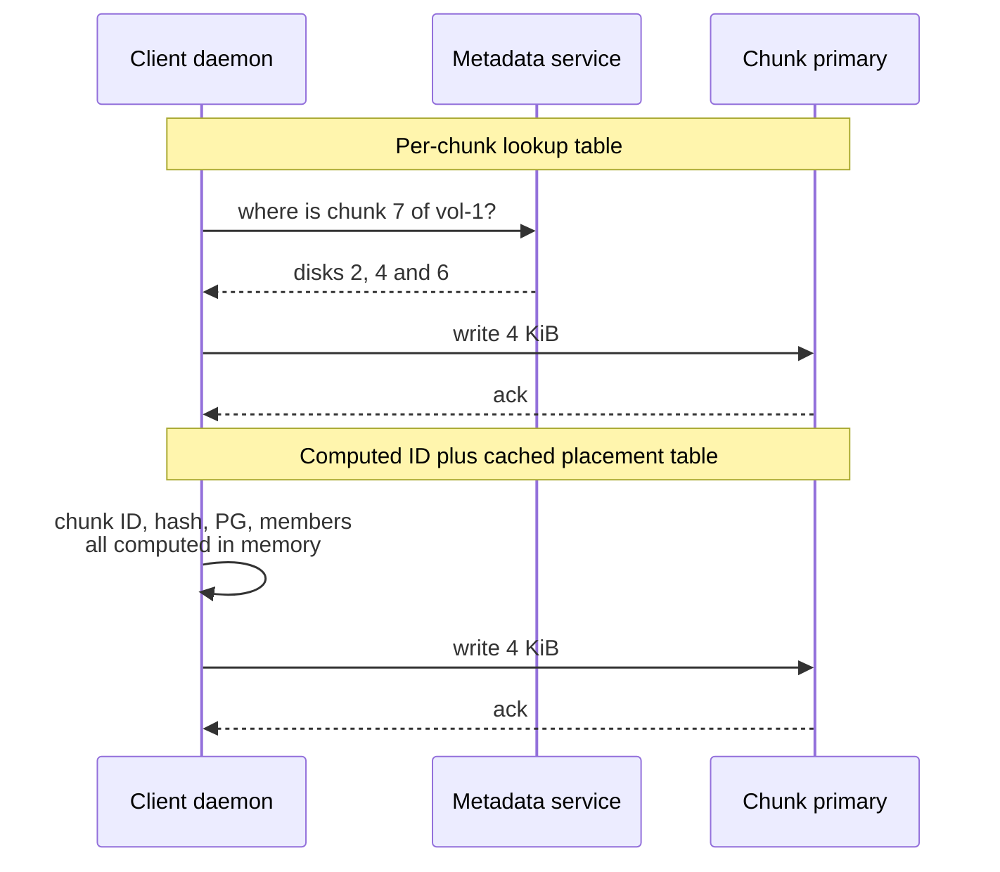
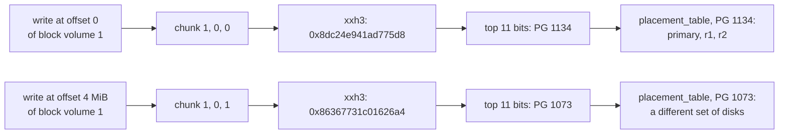
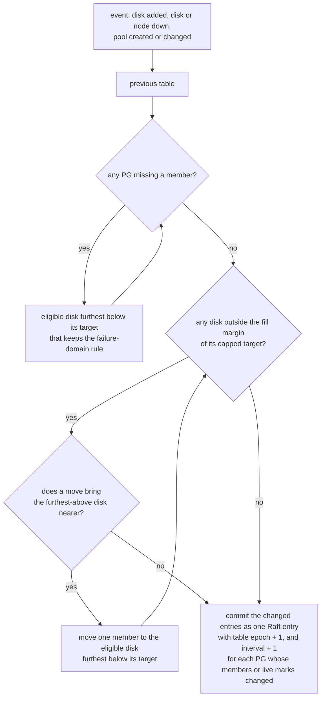
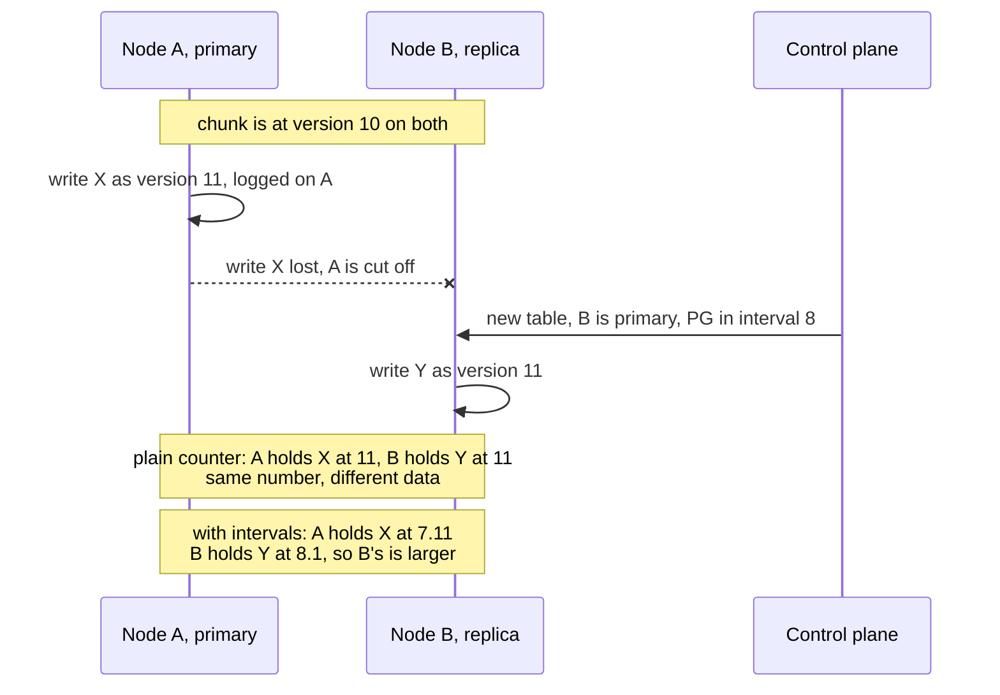
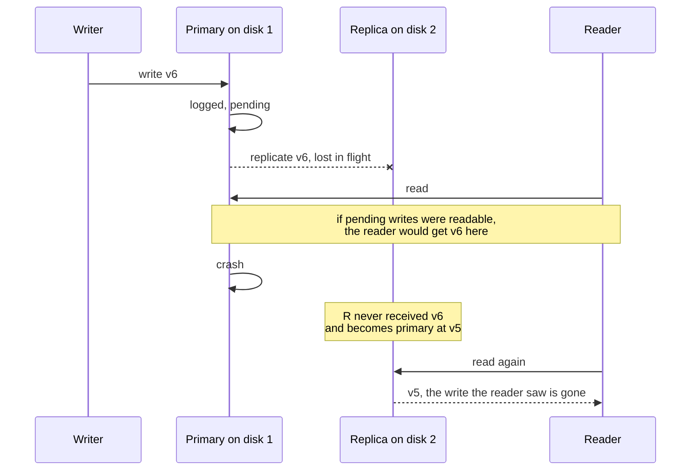

# Chunks and placement: where every byte of a volume lives

A storage cluster has to answer one question on every single read and write: which disks hold
these bytes? If answering it costs a database lookup, every 4 KiB write pays for a second network
round trip before it even starts. rock-solid cuts every volume and file into 4 MiB chunks whose
names are computed from the write's position, hashes each chunk into one of a fixed (but
doublable) number of placement groups, and keeps a small table, computed by one leader and cached
on every node, that says which disks serve each group. The result is a hot path with no metadata
lookup at all, exact balance on small clusters with mismatched disks, and a table that stays a few
hundred KiB whether the cluster holds 1 GB or 100 TB.

This is the second post in the series. [The big picture](01-the-big-picture.md) explains where
the ChunkStore sits in the whole system. Each concept section below starts with an **In plain
words** box; if you only read those, you still get the whole story. The **How it works** parts
that follow give the real names, numbers and edge cases.

> Status: rock-solid is in early development and nothing runs yet. The chunk ID packing, the
> placement hash, the CRC32C checksum and the per-disk chunk index exist as code and tests. Pools,
> replication and the placement computation are phase 3 of the
> [roadmap](../docs/design.md#roadmap-and-open-questions) and not built.

## Words you need

The [glossary](../docs/glossary.md) has longer entries for all of these.

- **Chunk.** A 4 MiB piece of a file or block volume. It is the unit that is placed, replicated
  and versioned. A 10 MiB file is three chunks. See [Data model](../docs/glossary.md#data-model).
- **Chunk ID.** The name of a chunk: `(volume_id, inode_id, offset / 4 MiB)`. It is computed, never
  looked up.
- **Inode.** A file's identity: a number plus its attributes. A block volume uses inode 0 for all
  of its chunks.
- **Hash.** A function that turns any input into a number that looks random but is always the same
  for the same input. rock-solid uses it to spread chunks evenly.
- **Placement group (PG).** A bucket of chunks that are placed together. The idea and the name
  come from Ceph. See [Redundancy and placement](../docs/glossary.md#redundancy-and-placement).
- **Member, primary, replica.** The disks listed for a PG are its members. The first one is the
  primary, which orders every write to the PG's chunks; the others are replicas.
- **Pool.** A set of PGs that share one redundancy scheme, such as `rep3` (three copies) or
  `ec4-2`. Every volume belongs to one pool.
- **Erasure coding.** Instead of full copies, a chunk is cut into `data` pieces and `parity`
  pieces are computed from them, so any `data` of the pieces rebuild it. `ec4-2` survives losing
  2 pieces at 1.5× the space, against 3× for three copies. Each piece is a **shard**.
  [Post 07](07-pools-and-redundancy.md) explains it.
- **Failure domain.** Things that can fail together, such as one node. Copies of a chunk go to
  different failure domains.
- **Placement table, table epoch and interval.** The map from each PG to its members. Its version
  number is the *table epoch*. A PG's *interval* is a run of tables in which that PG's members,
  their order and which of them are live stay the same, so it has one primary throughout; the
  table numbers each PG's intervals. The word "epoch" has two other meanings in the
  design; see
  [Words with more than one meaning](../docs/glossary.md#words-with-more-than-one-meaning).
- **Control plane.** The one replicated group (a Raft group, a set of nodes that agree on a log of
  changes) that holds cluster-wide state such as pools and the placement table.
- **Peering.** What a new primary does before it takes writes: it stops earlier intervals of the
  PG from completing writes and gathers the latest version of every chunk from the members. [Post 03](03-epochs-leases-and-failures.md) covers it.
- **Version and committed.** A version is a number stamped on every write to a chunk, larger than
  every earlier one. A version is committed once every live member of the chunk's PG holds it,
  which is also the moment its write is acknowledged. A version not yet committed is *pending*.
- **Merge (read-modify-write).** Turning a write that covers part of a 4 KiB block into a whole
  block: read the rest of the block, overlay the new bytes, write the block. See
  [Read-modify-write](../docs/glossary.md#redundancy-and-placement).
- **Punch and tombstone.** A punch zeroes a range of a chunk as a new version. Punching a whole
  chunk deletes it and leaves a tombstone, a marker that says "deleted".
- **CRC32C.** A fast checksum with dedicated CPU instructions, stored for every 4 KiB block so
  corrupted data is detected.

## The problem: one volume, many disks, and no time to ask

> **In plain words.** Picture a 3-node homelab with two disks per node, and a pod writing 4 KiB
> into a 1 TiB volume. Somebody has to decide which disks get those 4 KiB, and every node has to
> find them again later. The obvious answers each break something: put the whole volume on one
> disk and it can never outgrow that disk; keep a list of where every piece lives and every write
> must ask the list first; hash every piece straight to a disk and adding one disk reshuffles the
> whole cluster.

Here are the three obvious layouts side by side. Look at what each one does to the 4 KiB write:

```text
 A) Whole volume per disk       B) Per-chunk lookup table       C) Hash chunk -> disk
                                                                   directly
 vol-1 ----------> disk 3       write(vol-1, off)               write(vol-1, off)
 vol-2 ----------> disk 5         |                               |
                                  v                               v
 vol-1 can never be bigger      metadata service:               disk = hash(chunk) % 6
 than disk 3. Disk 3 does       "chunk 7 is on 2, 4, 6"           |
 all of vol-1's I/O.              |   (extra round trip,          v
                                  |    table grows with data)   add a 7th disk:
                                  v                             "% 7" moves almost
                                disks 2, 4, 6                   every chunk
```

Layout B is the most flexible, and it is what you would build first: a table with one row per
chunk. The trouble is the hot path. Every write first asks the table, and the table grows with
every byte stored. The sequence below shows the extra hop a per-chunk table puts in front of
every write, next to a client that computes the answer locally.



rock-solid wants the second shape: no network hop before the data moves, nothing on the hot path
that grows with the amount of data, and a layout that still balances well when someone adds a
1 TB disk to a cluster of 4 TB disks. The post first follows that path, from a byte offset to a
chunk, a placement group and a set of disks. Then it turns to what a chunk promises once you
reach it: versions, committed reads, one write order, punches and checksums.

## Chunks: why 4 MiB pieces

> **In plain words.** A chunk is a fixed-size piece of a file or volume, like the pages of a
> book. Cutting data into pieces lets different pieces live on different disks, so a volume can be
> larger and faster than any one disk. It also gives the system one unit to place, copy, version
> and repair. A chunk only exists once something is written into it, so an empty 1 TiB volume
> uses no space.

### How it works

`CHUNK_SIZE` is 4 MiB, the default object size of Ceph RBD, Ceph's block device; the design's
nightly benchmarks are meant to keep that choice honest. In code it is `core.ChunkSize = 4 << 20`,
which is 1,024 blocks of 4 KiB ([internal/core/ids.go](../internal/core/ids.go)).

The size has consequences. A 10 MiB file is three chunks. The largest file allowed by default,
16 TiB, is about 4 million chunks, which bounds how many chunk IDs a delete has to punch. And
because the chunk index in the ID is `offset / CHUNK_SIZE`, the chunk size is part of every
chunk's name. Chunks exist only after their first write, which is what makes thin provisioning
free: creating a volume allocates nothing.

## Chunk IDs: computed, never looked up

> **In plain words.** Think of a theater where your seat number is printed on your ticket. Nobody
> needs to look up where you sit; the ticket says it. rock-solid names a chunk by where it sits:
> which volume, which file, and which 4 MiB stretch of that file. Anyone who knows the write's
> offset can compute the name, so finding a chunk never needs a metadata query.

### How it works

The formula is:

```text
chunk_id = (volume_id, inode_id, offset / CHUNK_SIZE)
```

A block volume has no files, so all of its chunks use inode 0. A write at offset 10 MiB into
block volume 1 lands in chunk `(1, 0, 2)`, because 10 MiB ÷ 4 MiB rounds down to 2. A write at
offset 10 MiB into a file with inode 42 on filesystem volume 7 lands in chunk `(7, 42, 2)`.

The ID packs into 128 bits, big-endian, and the layout is frozen disk format. The diagram shows
the 16 bytes; the inode itself is a 24-bit *slot* plus a 40-bit sequence number, which
[post 08](08-the-metastore.md) explains:

```text
 byte:  0           4                                   12          16
        +-----------+-----------------------------------+-----------+
        | volume_id |             inode_id              |   index   |
        |  32 bits  |              64 bits              |  32 bits  |
        +-----------+-----------------------------------+-----------+
                    | slot: 24 bits | sequence: 40 bits |
                    +---------------+-------------------+

 index = offset / 4 MiB, at most 2^32 - 1   ->  files up to 2^32 x 4 MiB = 16 PiB
 inode 0 = every chunk of a block volume;  inode 1 = the root directory of a filesystem
```

A few rules make this safe to compute forever:

- **IDs are never reused.** Volume IDs, like inode IDs, are never handed out twice, so an ID
  always names the same volume or file.
- **Inode numbers are per volume.** Inode 42 in volume 7 and inode 42 in volume 9 are different
  files. A [restored or cloned](../docs/design.md#snapshots-and-clones) volume keeps every inode
  number and differs from its source only in `volume_id`.
- **Offsets past 16 PiB are an error.** `core.ChunkIndexOf` returns `ErrOffsetOverflow` for an
  offset whose index does not fit in 32 bits.

Because the ID is computed, the hot path needs no metadata. It also makes deleting easy: to free a
file, rock-solid lists the chunk IDs from 0 to the highest chunk that may hold data and punches
them, with no search ([Freeing space](../docs/design.md#freeing-space)).

## Placement groups: hash chunks into buckets

> **In plain words.** A post office does not decide a route for every letter. It sorts letters
> into a fixed set of pigeonholes by postcode and assigns a carrier to each pigeonhole. rock-solid
> does the same: each chunk hashes into one of a fixed number of placement groups, and the cluster
> decides which disks serve each group, never each chunk. A cluster holding a billion chunks still
> makes only a few thousand placement decisions.

### How it works: from a write to its disks

The whole lookup is five lines, and only the second one ever touches metadata, once per volume:

```text
chunk_id = (volume_id, inode_id, offset / CHUNK_SIZE)        // computed
pool     = volume record -> pool                             // learned once, at attach or mount
h        = xxh3_64(chunk_id as 16 big-endian bytes, seed 0)  // computed
pg       = (pool, h >> (64 - log2(pool.pg_count)))           // top bits of the hash
members  = placement_table[pg]                               // in memory; rep3: [primary, r1, r2]
```

The volume record is the volume's entry in the metadata store, read once when the volume is
attached or mounted. XXH3 is a fast non-cryptographic hash; rock-solid uses its 64-bit form with
seed 0 (`ChunkID.Hash` in [internal/core/ids.go](../internal/core/ids.go)). The PG is the *top*
bits of the hash, not the remainder of a division, for a reason the doubling section shows.

The flowchart traces one real example from the frozen test vectors in
`internal/core/testdata/chunk_id_golden.txt`: the first two chunks of block volume 1, in a pool
of 2,048 PGs.



Two neighbouring chunks of the same volume land in unrelated PGs. That is the point: the hash
spreads a volume's consecutive chunks over many PGs, and so over every disk of its pool. A
sequential read of a big file can pull from many disks at once, and a volume is not bounded by
any one drive.

Three more properties make PGs the right unit:

- **The PG is the unit of recovery and rebalancing.** Adding a disk moves whole PGs onto it, never
  individual chunks.
- **The hash is frozen forever.** The hash function and bit layout are part of the disk format and
  never change, because changing them would move every chunk. The `zeebo/xxh3` module is pinned in
  [tech debts](../docs/tech-debts.md) and may only be bumped after `TestChunkIDGoldenVectors`
  passes on the new version.
- **A PG's chunks are neighbours on disk.** Each disk's chunk index keys start with
  `(pool, h, chunk_id)`, big-endian, so every chunk of one PG sits in one contiguous key range.

### How it works: sizing `pg_count`

Each pool's `pg_count` is a power of two, sized for the largest expected cluster so that each disk
holds around 100 PG members summed over all pools. `width` is how many members each PG has: 3 for
`rep3`, `data + parity` for an erasure-coded pool.

```text
PG members per disk = pg_count x width / disks

3-replica pool alone on 60 disks:   2048 x 3 / 60  =  about 102 per disk  ->  pg_count 2048
the same pool on 6 disks:           2048 x 3 / 6   =  1024 per disk
```

Because the count is sized for the largest cluster you expect, a small cluster carries more
members per disk until it grows. Many members per disk also helps when a disk dies: its data is
spread over many PGs, and refill (below) places each missing member separately, so the
replacements can land on many different disks instead of one.

### How it works: doubling without rewriting

`pg_count` can grow later by doubling. Because a PG is the top bits of the hash, each PG is one
contiguous range of hash values, and doubling splits PG `p` into `2p` and `2p + 1`. Follow chunk
`(1, 0, 0)` from the example above through three PG counts; the brackets give PG 567's range as a
fraction of all 2^64 hash values:

```text
 hash 0x8dc24e94... = 1000 1101 1100 0010 ...

 pg_count 1024  top 10 bits  1000110111         = PG  567   hash range [567/1024, 568/1024)
 pg_count 2048  top 11 bits  10001101110        = PG 1134   = 2 x 567      (next bit 0)
 pg_count 4096  top 12 bits  100011011100       = PG 2268   = 2 x 1134     (next bit 0)

 PG 567 (1024 PGs)  |--------------------- one hash range --------------------|
                    |    PG 1134 (2048 PGs)      |    PG 1135 (2048 PGs)      |
                    | PG 2268     | PG 2269      | PG 2270      | PG 2271     |
```

Since each disk's index is ordered by `(pool, h, …)`, PG `p` is one key range, and the chunks of
PGs `2p` and `2p + 1` are already its two halves. That is why the design says doubling happens
"without rewriting the per-disk index". Had the PG been `h % pg_count`, a PG's chunks would be
every 2,048th hash value, scattered through the whole index. Moving, recovering or splitting one
PG would then mean walking every key on the disk instead of one range. A property test checks
the split for 64 chunk IDs and every count from 1 to 2^11 ([test scenarios](../docs/test-scenarios.md)).

## The options for deciding placement

> **In plain words.** Once chunks are in buckets, somebody still has to decide which disks hold
> each bucket. Either everyone runs the same formula and gets the same answer, or one coordinator
> writes the answer down in a table and everyone reads the table. A formula needs no coordinator
> but cannot be nudged; a table can say anything but needs someone to write it and everyone to
> receive it.

### How it works

Real systems use four shapes:

1. **A per-chunk table.** One row per chunk, listing its disks. Total freedom, but the table grows
   with the data, and every write must consult it. This is layout B from the problem section.
2. **A placement function every node computes.** Ceph's CRUSH (Controlled Replication Under
   Scalable Hashing) and Weka's algorithmic ownership compute where data goes from the cluster
   map, on every node. There is nothing to store besides the map. The price: a pseudo-random
   function balances well only on average. On a small cluster with mismatched disks it leaves
   some disks fuller than others, and you cannot tell it "not this disk" for one PG.
3. **A function plus exception tables.** Ceph patches that problem with `pg-upmap` exception
   tables and a balancer that writes them. In practice it then runs a table too, layered over the
   function.
4. **A table of PGs, computed by one leader.** The control-plane leader computes PG to members and
   publishes the result; nodes only read it. The table is small because it lists PGs, not chunks.

| Approach | Used by | Lookup before each write | Size grows with | Small cluster, mismatched disks | Drain a disk or pin a PG by editing |
| --- | --- | --- | --- | --- | --- |
| Per-chunk table | Layout B above | Yes | Stored data | Any layout you choose | Yes |
| Computed function | Ceph CRUSH, Weka's algorithmic ownership | No | Cluster map only | Leaves disks unbalanced | No |
| Function plus exception table | Ceph with `pg-upmap` and its balancer | No | Number of exceptions | Patched by the exception table | Through the exceptions |
| PG table from one leader | rock-solid | No | PG count and width | Exact balance | Yes |

## The placement table rock-solid picked

> **In plain words.** One person writes the seating chart; everyone gets a photocopy. The chart is
> short because it seats groups, not individuals, so photocopying the whole thing is cheap. When
> someone leaves or a new chair arrives, the writer changes as few seats as possible, gives the
> chart a new number, and hands out new copies, sending only the changed lines. Each table group
> also has its own count of how often its seats changed. Someone holding an old copy is turned
> away only by a group whose seats changed since; the other groups carry on.

### How it works: the table

The table maps each PG to its members, primary first, to its current *interval* number and its
last *activated* interval (the last one whose primary finished taking over), and to the members of
any intervals in between, which a new primary must reach ([post 03](03-epochs-leases-and-failures.md)).
The table as a whole carries a *table epoch*, its version. Its size depends on the pools' PG counts
and widths, not on how much data is stored:

```text
 2048 PGs x (3 replicas  x 4-byte disk ID + 8 bytes of interval numbers) =  40 KiB   (rep3)
 4096 PGs x (18 members  x 4-byte disk ID + 8 bytes of interval numbers) = 320 KiB   (ec16-2)

 the same whether the cluster holds 1 GB or 100 TB
```

So the table is **not sharded**. It lives in the single control-plane Raft group, every node
caches a full copy, and it changes only on pool, disk and node events, never on the I/O path. In
the daemon it is an immutable value published through an atomic pointer: a reader loads the
current table without a lock, and an update publishes a new one. Every change (pool created,
disk added, node failed, rebalance step) raises the table epoch, but only a change to a PG's
own members, their order or their live marks (or to its pool's `replicas` or `min_live`, a split,
or its primary asking) starts a new interval of that PG, and a member turns away only requests
tagged with an earlier interval of their PG. A rebalance step that moves one member of PG 7 therefore leaves the
writes in flight to the other 2,047 PGs alone. That check, and how a PG moves safely from one
interval to the next while writes are in flight, is where the hardest bugs live;
[post 03](03-epochs-leases-and-failures.md) is about exactly that.

What does grow with data lives elsewhere: each disk keeps its own index of the chunks and shards
it holds, and the mapping of file names to inodes lives in the sharded MetaStore.

### How it works: computing a new table

The control-plane leader computes each new table and commits it as one Raft entry with a new
table epoch, holding only the PG entries it changes and a CRC32C of the whole table it produces.
A node that holds the previous table applies the change and checks the CRC; after a gap or a
mismatch it fetches the whole table, as Ceph's daemons do with incremental maps. Because each PG
entry carries its own interval number, a node that skips tables loses nothing; the deltas only
save bytes, 105 MB pushed to 10 nodes over a modeled homelab year against up to 2.25 GB as whole
tables. Nodes never compute placement themselves. The computation is a pure function in the
sans-IO core (code with no network, disk or clock access, so tests can drive it directly), and it
starts from the previous table, never from scratch:

1. **Refill** every missing member onto the eligible disk furthest below its target.
2. **Rebalance:** while any disk is outside its fill margin, move one member from the disk
   furthest above its target, even one already inside its margin, to the eligible disk furthest
   below, and stop when no move brings that disk nearer.

A disk's target is its share of the pool's members, in proportion to its *capacity*: what the
pool's [`write_limit`](../docs/design.md#volume-size-and-capacity) leaves of it after the data
other pools keep there. The pool's own data counts as capacity, so a finished move does not shift
the targets and set off moves back. In a homelab with a 1, a 2 and a 4 TB disk, the 4 TB disk
should hold four times what the 1 TB one holds. Rebalance stops once every disk is within its
margin: 5% of its target, but at least one member, because on a small disk a single member is
already more than 5%. That is what "exact balance" means here, as opposed to the average-case
balance of a hash function.

Proportional to room is not always possible. Under `rep2` on two nodes of 0.7 and 2 GB, every PG
needs one member on each node, whatever their sizes, so the big node can never hold 74% of the
members. Targets are therefore *capped*: no failure domain is asked for more than `max_per_domain`
members of each PG, and what the cap cuts off is spread over the other domains by capacity, like
water filling the lower vessels. In the
[capacity model spike](../docs/design.md#appendix-capacity-model-spike), a loop aiming at
size-proportional shares never converged on such layouts, while capped targets converged within
2% and reached the pool's balanced capacity (next section) within 1%. Ceph's balancer meets the same wall and warns that it can end up "shuffling data forever as
it endeavors to meet an impossible expectation".

Both steps keep the pool's failure-domain rule: with the default `failure_domain: node`, two
members of one PG never sit on the same node. The flowchart shows the loop:



Here is a small worked example. The cluster, PG numbers and disk names are made up for
illustration; the rules are the design's. A `rep3` pool with `failure_domain: node` runs on four
nodes with two disks each, and disk `c1` fails:

```text
 nodes:   A: a1 a2     B: b1 b2     C: c1 c2     D: d1 d2

 table epoch 41             table epoch 42 (c1 marked down)
 PG 7:   [a1, c1, d2] i5    PG 7:   [a1, b2, d2] i6   refill: nodes A and D are taken, so
                                                      b1, b2 and c2 are eligible; b2 was
                                                      furthest below its target
 PG 19:  [b1, c1, d1] i3    PG 19:  [b1, c2, d1] i4   refill: nodes B and D are taken, so
                                                      a1, a2 and c2 are eligible; c2 was
                                                      furthest below its target
 PG 23:  [b2, d1, a2] i9    PG 23:  [b2, d1, a2] i9   untouched: c1 was not a member, so
                                                      its interval and writes carry on
```

Only the PGs that listed `c1` change, each by one member and one interval (`i5` to `i6`). Adding a disk works the
other way round: a new, empty disk `e1` on a fifth node is the eligible disk furthest below its target, so
rebalance moves members onto it one at a time from the fullest disks until every disk is within
the margin. Compare layout C from the problem section: adding a disk changes no chunk's PG. Only
the members that rebalance moves onto the new disk change, so roughly the new disk's share of
the data moves, not almost all of it.

Which member takes over the primary role, and how the new members catch up, is peering and
recovery ([post 03](03-epochs-leases-and-failures.md)). Recovery starts with the PGs that have
lost the most members.

### How it works: why a table and not a function

The design's reasons ([Alternatives considered](../docs/design.md#alternatives-considered)):

- **Exact balance on small clusters with mismatched disks**, the normal homelab case, where a
  function would leave disks unbalanced. Ceph's own answer, `pg-upmap`, is a table.
- **Explicit, throttled moves.** A table change moves only the members the algorithm chose, so
  moves can be staged and throttled, and an operator can drain a disk or pin a PG by editing it.
- **Simple to simulate.** The table epoch is simply the table's version and an interval a
  counter per PG, which keeps the simulator and the TLA+ models (formal models whose every state a
  checker explores) simple.

## Volume size and capacity

> **In plain words.** Because chunks spread over every disk of a pool, a volume can be larger than
> any one drive: the limit is the pool. How much a pool can still take is not simply its free space
> divided by how many times it stores each byte, because copies of a chunk must sit on different
> nodes. Two nodes with a small and a large disk, each holding a copy of everything, are full when
> the small one is. So a pool reports what its placement actually lets through before its first
> disk fills, and says how much space its layout leaves unusable.

### How it works

Each disk's *room* is what the pool's `write_limit` (90% by default) leaves of it after the data
already there, and the placement table says what *share* of new data each disk receives: the PGs it
belongs to, out of all of them. Chunks hash evenly over PGs, so the pool can take, before its first
disk reaches the limit:

```text
 available = smallest over the pool's disks of   room ÷ share
```

Vitastor reports the same figure. In the
[capacity model spike](../docs/design.md#appendix-capacity-model-spike), filling a table with
evenly hashed 4 MiB chunks hit the first refused write within 0.3% of it in every layout tried. The
figure everyone first reaches for, total room divided by the overhead (`replicas`, or
`(data + parity) ÷ data`), is what Ceph's `MAX AVAIL` and MinIO compute, and it holds only when
every node can take a share proportional to its size:

```text
 layout                                      room ÷ overhead    available
 rep3,  six empty 2 TB disks on six nodes    10.8 TB / 3 = 3.6  3.6 TB
 rep2,  nodes with 0.7 and 2 GB disks        2.43 GB / 2 = 1.2  0.63 GB   every chunk needs a copy on the 0.7 GB disk
 ec4-2 at 2 per node, nodes of 4, 4, 1 TB    8.1 TB / 1.5 = 5.4 1.8 TB    each node holds a third of every chunk
```

The pool also computes a *balanced* figure, the most any placement could make available under the
failure-domain rule, from a closed formula over the nodes' capacity. What the rule leaves unusable
is *stranded* space, which no rebalancing reaches: in the `rep2` example, 1.17 GB of the large
disk's 1.8 GB, or 48% of the pool's capacity. Stranding like that lasts until new hardware arrives,
so `rock-solid pool create` and disk changes show it and ask for confirmation when a node would
strand more than half its capacity, and the pool raises a `Stranded` warning only for stranding
nobody confirmed: over 10% of its capacity and 5 points above the confirmed figure, as when a
failed disk is marked out. It never refuses a layout: another pool on the same disks, such as a
one-copy pool, can use the space. Other warnings say when a disk is within 10 points of
`write_limit` (`NearFull`), at it (`Full`), when placement has finished moving members but left
available well short of balanced (`Unbalanced`), when losing the largest node, or a disk where no
node is spare, would leave recovery no room to restore every copy (`CannotReprotect`), and when a
placement group's copying has stalled for a minute (`Stuck`).

Available also subtracts the *space grants* outstanding on the pool: bytes the control plane lets
each node's daemon buffer and acknowledge before any disk holds them, so that a buffered write
never fails later for lack of space.

Volumes are thin: with the pool setting `overcommit` on (the default), volume sizes may add up to
more than the pool holds. With it off, a new volume is admitted only while every volume's size fits
the balanced figure. Writes that add data are refused once any disk holding one of their PG's
members is past `write_limit`, because one full disk stalls every PG on it. Three kinds of write
still pass: a flush of buffered data under a space grant, which was promised when the daemon
acknowledged it; an overwrite of blocks the chunk already holds live and does not share with a
snapshot, which frees as many blocks in the log as it writes; and punches, which free space. So a
filesystem's journal and preallocated database files keep working on a full pool. What a refusal
looks like depends on the frontend:
a file write gets `ENOSPC` from `write()`, and a block volume's write waits for space
([post 05](05-the-cleaner-and-free-space.md), [post 09](09-rwx-filesystem-and-cache-coherence.md),
[post 10](10-block-snapshots-and-clones.md); [Volume size and capacity](../docs/design.md#volume-size-and-capacity)
has the full list).

## What a chunk promises: the ChunkStore

> **In plain words.** You now know how a write finds its disks. The layer it lands in stores chunks
> and nothing else: it does not know what a file, a directory or a bucket is. It can write bytes
> into a chunk, zero a range, read, freeze a chunk so it never changes again, and wait until data
> is safely on disk. Files, block devices and (later) S3 objects are all built on these five
> operations.

### How it works

The whole interface fits on a screen
([Data layer: ChunkStore](../docs/design.md#data-layer-chunkstore)):

```go
type ChunkStore interface {
	Write(c ChunkID, off uint32, data []byte, expectVer *uint64) (uint64, error)
	// Punch zeroes a range; punching the whole chunk deletes it.
	Punch(c ChunkID, off, n uint32, expectVer *uint64) (uint64, error)
	Read(c ChunkID, off, n uint32, atVer *uint64) ([]byte, error)
	Seal(c ChunkID) error     // now immutable -> eligible for erasure coding
	Flush(cs []ChunkID) error // durability barrier
}
```

Every write and punch returns a new version; `expectVer` and `atVer` are optional and explained
below. `Seal` is [post 07](07-pools-and-redundancy.md)'s topic. Each write also carries the
client's session ID so primaries can reject a client whose session has expired (fencing), which
[post 03](03-epochs-leases-and-failures.md) covers. The next five sections are the promises
behind these calls.

## Versions: an interval on top, a counter below

> **In plain words.** Every write to a chunk gets a stamped number, like the revision number on a
> wiki page. Revision numbers let you read an old revision, refuse an edit made against a page
> that changed meanwhile, and tell which copy of a page is newest. The catch: if two different
> servers can hand out revision numbers, both might hand out "revision 11" for different text,
> and then the number no longer tells you which is which. So the number starts with which editor's
> term it was written in, and terms only go up.

### How it works: the layout

Every write and punch returns a new 64-bit version. Its high 32 bits are the number of the chunk's
PG *interval* in which its primary ordered the write, and its low 32 bits count the chunk's writes
in that interval, starting at 1:

```text
 63                                32 31                                 0
 +-----------------------------------+------------------------------------+
 | interval: 32 bits                 | counter: 32 bits                   |
 | the chunk's PG's interval number  | the chunk's writes in that         |
 | when its primary ordered it       | interval, from 1                   |
 +-----------------------------------+------------------------------------+
   example: interval 41, counter 7  ->  written "41.7" in posts 02 and 03
```

An interval has exactly one primary, and a PG's interval numbers only go up, so a version written
in interval 8 is larger than any version written in interval 7, whatever the counters say.
Versions therefore grow across primaries, and two primaries can never give the same version to
different data. Ceph's `eversion_t` does the same with its cluster map's epoch, and Vitastor with
a per-PG epoch in its versions' high bits. Version 0 means "no version yet", so intervals and
counters both start at 1. A primary takes the chunk's newest version, pending ones included, and
adds one, or starts at `interval.1` if that version is from an earlier interval. When a PG splits
in two, both halves start one interval above it, so a chunk's versions keep growing.

Why the PG's own interval and not the table epoch? The table epoch moves whenever anything in the
cluster changes, and these 32 bits are on disk forever. The
[PG epochs spike](../docs/design.md#appendix-pg-epochs-spike) modeled a homelab year and a
misbehaving node:

```text
 field counts                one node flapping every 10 s,     a homelab year,
                             members refilled one per table    10 nodes
 table epochs, 24 bits       full after 19 hours               2,040 years or more
 table epochs, 32 bits       full after 207 days               522,000 years or more
 busiest PG's intervals, 24  full after 1.1 years              70,000 years
 busiest PG's intervals, 32  full after 272 years              18 million years
```

Running out of interval numbers would be fatal: the PG could never change members again without
rewriting every version on disk. Running out of the counter is routine: after 4.3 billion writes
to one chunk in one interval, more than an hour even at a million writes a second, the chunk's
writes wait while its primary asks the control plane for a new interval of its PG, which touches
no other PG. So 32 bits go to the field whose end is fatal, and a 32-bit counter is plenty for
the field whose end is cheap. Note that none of the design's three *epochs* is in a version: the
table epoch versions the placement table, a *snapshot epoch* counts a volume's snapshots, and a
*support epoch* numbers a run of a lease between two nodes.

### How it works: why a plain counter fails

Here is the failure a plain per-chunk counter allows, and how the interval number cures it.
Follow the version numbers on the two nodes:



With a plain counter, node A returns holding a write that the new primary never saw, stamped with
the same number as the current data, and a member comparing versions would take the stale write
for the current one. With the interval in the high bits, B's version is larger whatever its
counter reads, and A's write is recognized as one from an old interval by its version alone. What
happens to such a write during peering is the subject of [post 03](03-epochs-leases-and-failures.md).

### How it works: what versions buy

- **Compare-and-set on data.** `expectVer` makes a write or punch succeed only if the chunk is
  still at the version the writer last saw.
- **Reads at a frozen version.** A read with `atVer` asks for one exact version. That version
  never changes, so the read needs no ordering against writes: any PG member holding that version
  can serve it, and it never waits for a writer.
- **Old versions only while pinned.** A primary keeps an old version only while a
  [snapshot](../docs/design.md#snapshots-and-clones) pins it ([post 10](10-block-snapshots-and-clones.md)).

## Reads see only acknowledged writes

> **In plain words.** Imagine a bank that shows you a deposit while the teller is still copying it
> into the backup ledger. If the main ledger burns down before the copy finishes, the deposit you
> saw is gone. rock-solid never shows a reader a write until every live copy has it, which is the
> same moment the writer hears "done". A reader can see stale data for a moment, but never data
> that a crash can still take back.

### How it works

A version is *committed* once every live member of the chunk's PG holds it, which is also when
its write is acknowledged. A read without `atVer` returns the newest committed version, never one
still being replicated. The failure this prevents needs a primary crash at the wrong moment.
Watch the reader:



So a primary maps a write into its chunk index (the per-disk map from a chunk's blocks to where
they sit on disk) only when the write commits. Until then the write is *pending*: its record is
in the disk log, and a read finds the previous version's blocks without waiting. A replica maps
writes as they become durable, since it serves no live reads. A primary that restarts takes
a new interval of each PG it leads and runs peering in it before it serves anything. A primary also maps a
chunk's writes in version order; [post 04](04-one-log-per-disk.md) shows why.

## Single order per chunk

> **In plain words.** Two people edit the same sentence at the same time, one on the office copy
> and one on the home copy. Each copy applies the edits in the order it heard them, and the two
> copies end up disagreeing forever. The fix is to route every edit through one person who
> decides the order and tells every copy.

### How it works

Each chunk has one primary that applies writes in one order. Without one, two writes to the same
block can reach two replicas in different orders:

```text
 Without a primary: each replica applies writes to block 5 in the order they arrive

   replica 1 receives:  client 1 "A", then client 2 "B"   ->  block 5 holds B
   replica 2 receives:  client 2 "B", then client 1 "A"   ->  block 5 holds A
                                                              (copies disagree forever)

 With one primary per chunk: the primary picks the order and stamps versions

   client 1 "A" --+                       +--> replica 1: v8 = A, v9 = B  ->  holds B
                  +--> primary:  v8 = A --+
   client 2 "B" --+              v9 = B   +--> replica 2: v8 = A, v9 = B  ->  holds B
```

This single order per chunk is what makes RWX (ReadWriteMany) block volumes and uncached shared
files correct without any client-side protocol: two pods on two nodes writing the same bytes see
one history. The primary forwards each write to every replica in parallel, so replication adds
one network hop, not one per copy. Primary is a role, not a kind of machine: any disk can be
primary for some PGs and a replica for others.

## Writes smaller than a block: the primary merges

> **In plain words.** Disks, checksums and the chunk index all work in 4 KiB blocks, but a program
> may write 100 bytes in the middle of one. Something has to fetch the rest of that block, paste
> the 100 bytes in and store the whole block again. rock-solid gives that job to the chunk's
> primary, the one place that already decides the order of writes, and has it paste onto the
> newest version it has handed out, even one not yet safely stored, so two quick writes to the
> same block never erase each other.

### How it works

The ChunkStore API takes byte ranges, but everything below it holds whole blocks: a record's write
entry names a block range, each block carries its own checksum, and the chunk index maps runs of
whole blocks. So for every block a write covers only in part, the primary *merges*: it takes the
newest version of that block it has ordered, overlays the write's bytes in a 4 KiB buffer, and
sends that whole block to the replicas and its own log. The base comes from the first of:

1. a **pending** write's merged block, if one covers it (ordered, not yet on every member);
2. the primary's **live map**, the committed version, read from disk with its checksum verified;
   a base that fails its checksum is fetched from another member first, so a merge never carries
   rot into a new version;
3. **zeros**, if the block was never written or was punched.

```text
 Two 100-byte writes to block 5, the second arriving before the first commits

   committed  v7: block 5 = [ ....................... ]
   write A, bytes 0-99:      primary merges on v7  ->  v8 = [ AAAA................... ]  pending
   write B, bytes 100-199:   primary merges on v8  ->  v9 = [ AAAABBBB............... ]
                                                              (A survives)

   had B merged on the committed v7 instead:          v9 = [ ....BBBB............... ]
                                                              (A lost when v9 commits)
```

The [sub-block writes spike](../spikes/sub-block-writes/) modeled exactly this, with random
unaligned writes of 1 to 300 bytes and an oracle replaying every acknowledged write's bytes. Merging
on the newest ordered version was right on every seed; merging on the committed one lost bytes on
**every seed**, from one client pipelining 4 writes or two clients with one write each. The other
places a merge could live do worse. A client that reads the block and sends it back whole loses the
other client's bytes, unless it compares versions and retries, which it then did 0.64 to 1.28 times
per write, because the version belongs to the whole chunk. Sending the bytes to every replica and
merging there, as Ceph's BlueStore does, costs a disk read on every replica and leaves the replicas
agreeing only if their histories match exactly.

Sending merged blocks keeps the replicas simple: they log the same bytes, need no base, and can
never disagree. It costs at most two extra 4 KiB edge blocks per write on the wire to each replica,
about 3.3 µs each at 10 GbE, and one random 4 KiB read at the primary when nothing has the base in
memory. The file client avoids even that in the common case: while no other node uses the file, it
sends whole blocks itself, padding a new small file with zeros and keeping a file's last partial
block so the next append goes out whole ([post 09](09-rwx-filesystem-and-cache-coherence.md)).
Because each merged version carries the bytes of the version below it, a primary change must never
keep one and drop the other; [post 03](03-epochs-leases-and-failures.md) shows why peering cannot.

## Punch: deleting is a write too

> **In plain words.** Deleting part of a chunk is recorded the same way as writing it: as a new
> version that says "these bytes are now zeros". That keeps deletes in the same single order as
> writes, lets snapshots keep the old bytes, and lets a delete that was interrupted simply run
> again.

### How it works

`Punch` zeroes a byte range as a new version: blocks inside the range get a punch entry, and a
block it covers only in part is merged with zeros like a write, in the same record. Its blocks are
freed once no snapshot needs them, and later reads of the range return zeros. Punching a whole chunk deletes it and leaves a
tombstone, so an older copy cannot bring the chunk back. File unlink and truncate, block discard
(the pod's filesystem telling the device that blocks are free) and volume deletion all free space
this way.

Because chunk IDs are computed, a delete never has to find chunks. A *purge* lists the IDs and
punches them, batched per PG. A punch to a chunk that does not exist succeeds, so a purge
interrupted by a crash simply runs again. [Post 05](05-the-cleaner-and-free-space.md) follows the
freed blocks down to the disk.

## Integrity: a checksum on every 4 KiB block

> **In plain words.** Disks sometimes return wrong data with no error: a bit flips years later,
> a power cut lands half a write, or the drive puts a block at the wrong address. A checksum
> stored with the data catches all three.

### How it works

Each 4 KiB block, and each 4 KiB block of an erasure-coded shard, carries a CRC32C checksum in
its record's header, computed with Go's `hash/crc32` at 167 ns per block
([Go CPU spike](../docs/design.md#appendix-go-cpu-per-operation-spike), C0). Where the checksums
sit and how recovery uses them is [post 04](04-one-log-per-disk.md)'s topic.

## Evidence

What backs these choices, with numbers exactly as the design and spikes give them:

- **Frozen ID and hash layout.** The chunk ID packing and the PG hash are built and tested in
  `internal/core`: ten frozen golden vectors in `internal/core/testdata/chunk_id_golden.txt` fix
  the packed bytes, the XXH3-64 hash and the PG index at 64 and 2,048 PGs (the examples above come
  from them), and a property test checks that doubling maps PG `p` to `2p` or `2p + 1` for 64
  chunk IDs at every count from 1 to 2^11.
- **Committed-only mapping.** The [chunk epochs spike](../spikes/chunk-epochs/) drove the real
  chunk index through a primary that maps writes only at commit. With a chunk's commits mapped in
  version order, replay differed from a rebuild in **0 of 200 seeds** (R1). Mapped in any order,
  the index was wrong in **200 of 200**, without a crash too (R2). This is where the version-order
  rule comes from.
- **Merging at the primary.** The [sub-block writes spike](../spikes/sub-block-writes/) checked
  every place a partial-block merge could live against a byte oracle, 500 seeds each: the primary
  merging on its newest ordered version, **0 seeds wrong**, also with 8 writes pipelined per client
  and 3,670 primary changes (M1, M6, M9); merging on the committed version, **500 of 500 wrong**
  (M2, M3); the client merging, 500 of 500 wrong without compare-and-set, and 0.64 to 1.28 retries
  per write with it (M4, M5). The [sub-block writes study](../studies/sub-block-writes/README.md)
  reads how Ceph, Vitastor, JuiceFS and ZFS do it.
- **Version layout and per-PG checks.** The [PG epochs spike](../spikes/pg-epochs/) modeled a
  year of homelab churn and a flapping node on 3 and 10 nodes. Table epochs in a 24-bit field ran
  out in **19 hours** under one node flapping with staged refills; the busiest PG's intervals take
  **272 years** to fill 32 bits. Checking requests per PG rather than against one table epoch
  disturbed 4.4 to 46 times fewer in-flight writes on 10 nodes, but hardly fewer on 3 nodes, where
  every PG has a member on every node. The [PG epochs study](../studies/pg-epochs/README.md) reads
  how Ceph and Vitastor do it.
- **Placement and capacity, modeled.** The [capacity model spike](../spikes/capacity-model/)
  built integer placement tables by the refill-and-rebalance steps on six layouts and filled them
  with evenly hashed chunks: size-proportional targets never converged on four of them (the worst
  disk 23 to 200% off), capped targets converged within 2% everywhere, and the available figure
  predicted the first refused write within 0.3%, where room ÷ overhead overstated it by 1.36 to
  3.3×. The [capacity and ENOSPC study](../studies/capacity-and-enospc/README.md) reads how Ceph,
  Vitastor, Longhorn, CockroachDB and MinIO report capacity.
- **Placement in code: not built.** Its review is planned as property tests: after any random
  add, remove and failure sequence, every PG keeps its pool's width with no more than
  `max_per_domain` members per failure domain, the balance loop converges with every disk within
  its fill margin, available plus what the pool holds then stays within that margin of balanced
  and never above it, and chunks moved stay near the minimum
  ([Testing strategy](../docs/design.md#testing-strategy),
  [build checklist](../docs/build-checklist.md), phase 3).

## Trade-offs: what this costs us

- **Some choices are forever.** The hash function, its seed, the bit layout, the 128-bit ID and
  the version's 32 + 32 split are disk format. So, in effect, is the chunk size, since it is part of every chunk ID. Getting them
  wrong cannot be fixed by a config change.
- **`pg_count` must be guessed ahead.** It is sized for the largest cluster you expect and can
  only grow by doubling.
- **A leader computes placement.** Nodes never compute placement themselves, so a placement change
  needs the control-plane Raft group to be up. Reads and writes to healthy PGs do not, since the
  table is cached. But after a disk or node fails, writes to its PGs wait until the control plane
  publishes the new table.
- **The table does not scale forever.** At thousands of disks, the table and its recomputation
  would grow enough to revisit computed placement. That is outside the target.
- **Spreading widens the blast radius.** Every volume touches every disk of its pool, so a
  failure that takes out more members of one PG than the pool survives hits every volume. Recovery
  therefore starts with the most degraded PGs.
- **A partial block can cost a read.** A write that covers part of a block the primary does not
  hold in memory waits for one random 4 KiB read, and the chunk's later writes wait behind it. Its
  latency is not measured yet.
- **Writes wait for every live member.** Committed means every live member holds the write, so a
  slow disk slows every PG it is in. Fail-slow detection ([post 03](03-epochs-leases-and-failures.md))
  exists because of this.

## Open directions

- **Computed placement at scale.** Revisit a placement function only if clusters of thousands of
  disks come into scope; the design places that outside the target.
- **Admission across a PG** (open question). Each disk slows its own writes when its cleaner falls
  behind, and one slowed member delays the whole PG's acknowledgments. Does the primary need its
  members' admission rates in their acknowledgments, as CockroachDB's replication admission
  control returns tokens from followers?
- **The base read's cost** (open question): its latency at queue depth 1 on NVMe and SATA, and
  how big a cache of recently merged blocks keeps write-shared appenders from reading at all.
- **Tech debt.** The `github.com/zeebo/xxh3` v1.1.0 pin is never removed, only bumped, and only
  after the golden vectors pass on the new version.
- **Build order.** Pools, the replica primary with committed-only reads, placement computation,
  peering and recovery per PG are phase 3, with a simulated authority standing in for the
  control-plane group until phase 4.

## Further reading

- Design: [Data layer: ChunkStore](../docs/design.md#data-layer-chunkstore) (chunk IDs, versions,
  committed reads, punch, integrity, placement groups, placement table),
  [Volume size and capacity](../docs/design.md#volume-size-and-capacity),
  [Pools and redundancy](../docs/design.md#pools-and-redundancy),
  [Freeing space](../docs/design.md#freeing-space),
  [Alternatives considered](../docs/design.md#alternatives-considered) (rows "Placement",
  "Pool capacity", "Stale requests", "Version layout" and "Sub-block writes"), [Roadmap and open questions](../docs/design.md#roadmap-and-open-questions).
- Glossary: [Data model](../docs/glossary.md#data-model),
  [Redundancy and placement](../docs/glossary.md#redundancy-and-placement),
  [Words with more than one meaning](../docs/glossary.md#words-with-more-than-one-meaning).
- Spikes: [spikes/chunk-epochs](../spikes/chunk-epochs/),
  [spikes/pg-epochs](../spikes/pg-epochs/),
  [spikes/go-cpu-per-op](../spikes/go-cpu-per-op/),
  [spikes/sub-block-writes](../spikes/sub-block-writes/),
  [spikes/capacity-model](../spikes/capacity-model/).
- Studies: [sub-block writes and small files](../studies/sub-block-writes/README.md),
  [PG epochs](../studies/pg-epochs/README.md),
  [pool capacity and ENOSPC](../studies/capacity-and-enospc/README.md).
- Code: [internal/core/ids.go](../internal/core/ids.go) (`ChunkID`, `ChunkIndexOf`, `Hash`,
  `PGIndexOf`, `CheckPGCount`), [internal/core/crc.go](../internal/core/crc.go),
  `internal/core/testdata/chunk_id_golden.txt`.
- Tests: the chunk ID and placement-group scenarios in
  [docs/test-scenarios.md](../docs/test-scenarios.md).
- Series: [01 The big picture](01-the-big-picture.md),
  [03 Epochs, leases and failures](03-epochs-leases-and-failures.md),
  [04 One log per disk](04-one-log-per-disk.md),
  [05 The cleaner and free space](05-the-cleaner-and-free-space.md),
  [07 Pools and redundancy](07-pools-and-redundancy.md),
  [08 The MetaStore](08-the-metastore.md),
  [10 Block snapshots and clones](10-block-snapshots-and-clones.md).
