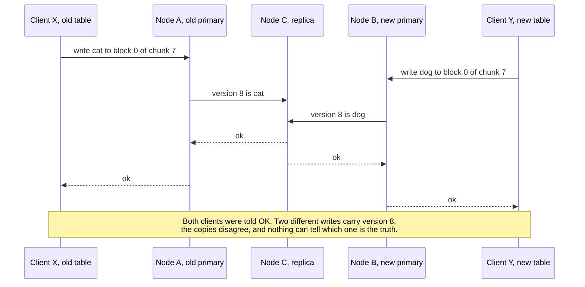
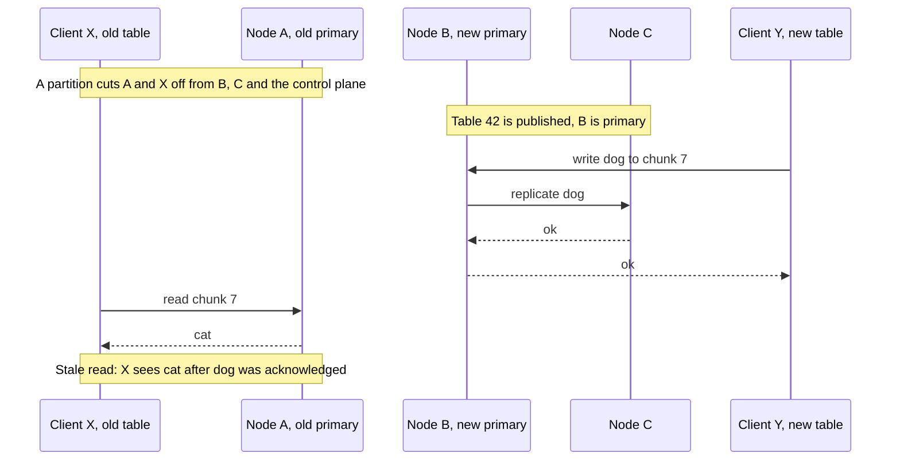
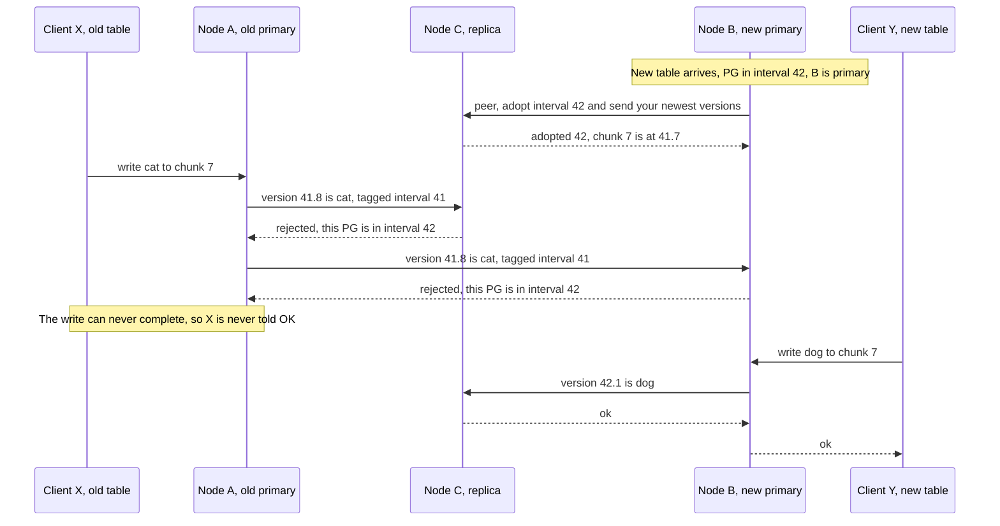
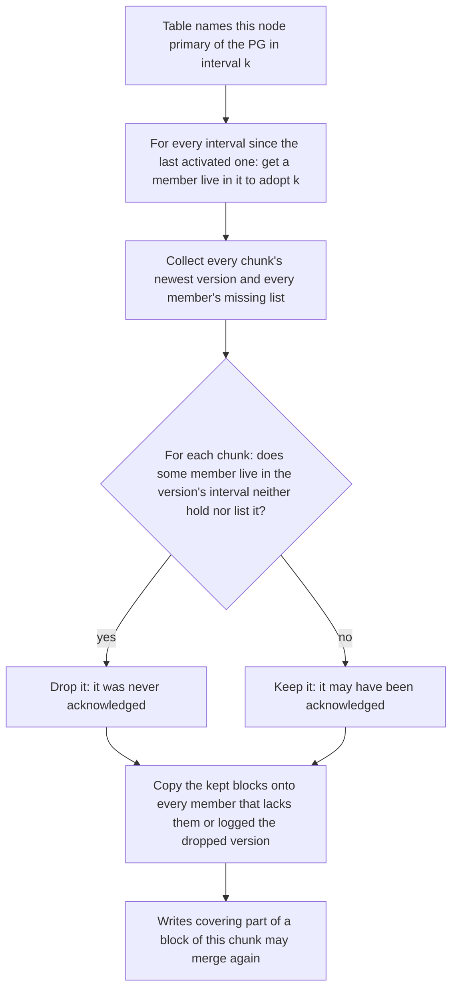

# Epochs, leases and failures: changing who is in charge while writes are in flight

Every chunk of data in rock-solid has one member in charge of it, the primary, and its node will
sometimes crash, hang, sleep or lose its network while clients are still writing. The obvious fix,
"if the primary stops answering, pick another one", is how storage systems lose data: for a while
two nodes both believe they are in charge, and a paused client can wake up and write over someone
else's data. rock-solid closes those windows with a small set of rules: membership numbered per
placement group, a new primary that *peers* before its first write, read leases counted on two
clocks and given up after a suspend or a VM pause, and client sessions that are *fenced* before
their locks move.

This post is in two parts. This first part covers the races, the options other systems chose, and
how a new primary takes over a placement group's writes: interval numbers, peering, which writes
survive, and recovery. [Part two](03b-leases-failure-detection-and-fencing.md) covers reads (read
leases and the clocks they count on), how failures and slow disks are detected, and how a paused
client is fenced.

## Words you need

- **Placement group (PG), member, primary, replica.** Chunks are grouped into PGs, and each PG
  lists a few disks on different nodes, its *members*. The *primary* takes every read and write and
  forwards writes to the *replicas*. A member is *live* until the control plane marks it down. See
  [roles](../docs/glossary.md#roles-who-does-what) and [post 02](02-chunks-and-placement.md).
- **Version, committed, acknowledged.** Every write to a chunk gets a new version. A version is
  *committed* once every live member holds it, and only then is the client told "OK"
  (*acknowledged*). See [data model](../docs/glossary.md#data-model).
- **Placement table, table epoch, control plane.** The table maps every PG to its members; each new
  table gets a higher *table epoch*. It lives in the *control plane*, one small Raft group (a few
  replicas that elect a leader and commit a change once a majority holds it), never on the I/O path.
- **Interval.** A run of tables in which one PG's members, their order and which of them are live
  stay the same, so the PG has one primary throughout. A change elsewhere in the cluster leaves a
  PG's interval alone (a Ceph term).
- **Peering.** What a new primary does before its first write: it stops the PG's earlier intervals
  from finishing writes and agrees with the members on the newest version of every chunk (a Ceph
  term).
- **Log, replay.** Each disk stores everything as one append-only log, and after a crash it rebuilds
  its index by *replaying* the log from a saved point ([post 04](04-one-log-per-disk.md)).
- **Lease.** A right that expires on its own unless renewed. A primary serves reads only under a
  *read lease* from its PG's other members ([part two](03b-leases-failure-detection-and-fencing.md)).
- **Session, fencing.** A client daemon's registration, kept alive by a lease; its locks belong to
  it. *Fencing* makes sure a client whose session expired can no longer write, even if it does not
  know yet. See [files and caching](../docs/glossary.md#files-and-caching).

## The problem: two nodes that both think they are in charge

> **In plain words.** Picture a shared spreadsheet with one editor at a time. The editor goes
> quiet, so the office hands the pen to someone else. But the first editor was only on a slow
> train, and the moment the train leaves the tunnel they keep typing. Now two people edit the
> same cell, both get a "saved" message, and the copies disagree. Every storage system that
> replaces a failed leader has to make the hand-over safe even though it cannot know whether the
> old leader is dead or merely slow.

Take one PG in a three-replica pool. Its members are disks on nodes A, B and C, and A is the
primary. A client writes 4 KiB into block 0 of chunk 7. A gives the write a version, appends it to
its disk's log, sends it to B and C in parallel, and acknowledges once all three hold it durably.

Now the control plane stops hearing from A and publishes a new placement table naming B as primary.
A table reaches nodes at different times, so for a while A may still act on the old table while B
acts on the new one. Without any further rule, this happens:



*Look at the two arrows into C: one node is told two different things under one version number.*

That is *split brain*: two nodes in charge at once. Reads have their own race, because a read needs
nothing from the other members. An old primary cut off from the cluster but still reachable by some
clients keeps answering with old data:



*The write path never touches A, so nothing in it can stop A from answering reads.*

Two more races get their own diagrams in part two: a primary that sleeps like a laptop with its lid
closed and wakes up believing no time has passed
([A holder that slept](03b-leases-failure-detection-and-fencing.md#a-holder-that-slept-gives-up-its-leases)),
and a client that pauses while holding a lock and writes after the lock has moved on
([Fencing](03b-leases-failure-detection-and-fencing.md#6-fencing-client-sessions)).

The common thread: **failure detection is a guess.** A slow node looks exactly like a dead one, so
every rule has to stay safe when the guess is wrong.

## The options

> **In plain words.** There are only a few ways to pick a new editor safely: let a referee
> appoint one and number every appointment, or let the editors vote among themselves. Reads need
> their own answer: check with the others before every read, or hold a permission slip that
> runs out on its own. And a client that went to sleep is stopped either by trusting it to watch
> the clock, or by telling the storage to refuse it.

Real systems combine answers to five questions, listed in the table; bold rows are what rock-solid
picked. Two rows need a word more. etcd-raft's tick-counted lease stops counting when an idle group
goes quiet and checks its quorum only once per election timeout, which is how an old leader can
overlap a new one. CockroachDB's older epoch leases hang every lease on one central liveness
record; its newer leader leases, like rock-solid's, rest on leases between pairs of nodes, and Ceph
added PG read leases for the same reason. Raft is covered in [post 08](08-the-metastore.md).

| Problem | Option | Gets right | Costs |
| --- | --- | --- | --- |
| Who is in charge | Timeouts alone | Nothing to build | Split brain |
| Who is in charge | Raft majority (etcd, rock-solid metadata) | No outside authority | 3 copies survive 1 failure |
| Who is in charge | **Appointed primary, numbered intervals, peering (Ceph, rock-solid data)** | An acknowledged write survives while any one member does; writes continue down to `min_live` members | Needs the control plane, peering before writes |
| Fresh reads | Ask a majority on every read (Raft's ReadIndex) | No clock assumptions | A round trip per read |
| Fresh reads | Tick-counted lease (etcd-raft) | No round trip | Stops when idle; overlap up to one election timeout |
| Fresh reads | Central liveness record (CockroachDB epoch leases) | One renewal per node | Its outage expires every lease at once |
| Fresh reads | **Leases between pairs of event loops, support epochs (CockroachDB leader leases)** | No central record, no synced clocks, cost independent of PG count | Clock rates must nearly agree, so each lease is counted on two clocks; a restarted node sits out one lease |
| Stale requests | One epoch for the whole table, every older one refused | Simple | Every table change makes every write in flight retry |
| Stale requests | **Each PG's interval, checked per request (Ceph)** | A table change disturbs only the PGs it changes | Every table entry carries an interval number; peering must reach every interval since the last activated one |
| Versions | Plain counter | Simple | Two primaries reuse a number |
| Versions | **PG interval + counter (Ceph `eversion_t`, Vitastor's per-PG epoch)** | Version alone tells writes apart, and the field grows only with the PG's own changes | Half of every version spent on the interval |
| Stale clients | Client-side timeout only | Simple | A paused client writes late |
| Stale clients | Each server expires its own clients (Lustre, CephFS's metadata servers) | No central authority | Safe only where one server holds both the locks and the data |
| Stale clients | **Expiry by the control plane, fence acknowledged by every storage node** | One verdict per session, late writes are rejected | Locks move only after every storage node confirms |

## What rock-solid picked

### 1. Table epochs, intervals and versions

> **In plain words.** Every time the office changes anyone's seat, it stamps a new edition number
> on the seating chart. But each table group also keeps its own count of how often *its* seats
> changed, and that count is printed next to it on the chart. An edit is labeled with its group's
> count, and a group member refuses only edits labeled with an old count of their own group, so
> moving someone at table 3 does not hold up the edits at table 7. Edits are also numbered
> "count.sequence", so two editors in different terms can never produce two different edits with
> the same label.

#### How it works

Only the control plane changes membership. Its leader computes each new placement table and
commits it as one Raft entry; every node caches the whole table, which is small because it maps
PGs, not chunks ([post 02](02-chunks-and-placement.md)). Every change raises the table epoch. Only
some changes start a new *interval* of a PG: a change to its members or their order (so its
primary), a member marked down or up, its pool's redundancy, a split of the PG, or its primary
asking for one. Every message about a PG carries the PG's interval number, and a member checks only
that:

```text
 member's table says PG 7 is in interval 42; a request about PG 7 arrives tagged with interval
   42  ->  accept, whether the sender's table epoch is older or newer than the member's
   41  ->  refuse, and answer with the member's table epoch and interval
   43  ->  the member's table is behind: fetch one at least as new as the sender's, then decide
```

*A table change makes only the writes of the PGs it changed retry.*

Comparing a PG's member lists in two tables would not be enough: a member removed and added back
leaves the lists equal, though it missed the writes in between, whereas its interval number has
gone up twice. Ceph checks the same way, with its own intervals. In the
[PG epochs spike](../docs/design.md#appendix-pg-epochs-spike)'s homelab year on 10 nodes, a table
change touched a fifth of the PGs on average, and only a few percent when moves were staged one per
table, so many times fewer writes had to retry than if every older table epoch were refused. On a
3-node cluster every PG has a member on every node, so a node reboot still changes every PG.

A client's write is judged a little more loosely, because nothing in it depends on who the PG's
replicas are. A primary takes it as long as its interval number is at least the one in which this
primary's own term began. A write it was holding when an interval ended under it, say because a
replica was replaced, it orders again once it has re-peered, but only if no interval since had
another primary. Otherwise it refuses the write and the client retries: a write held across another
primary's term could land after writes that primary acknowledged meanwhile.

The interval number also lives inside every version, as its high 32 bits
([post 02](02-chunks-and-placement.md#versions-an-interval-on-top-a-counter-below)):

```text
 63                                32 31                                 0
+------------------------------------+------------------------------------+
|  interval of the chunk's PG when   |  counter of the chunk's writes in  |
|  its primary ordered the write     |  that interval, from 1             |
+------------------------------------+------------------------------------+
  example: interval 41, counter 7  ->  written "41.7" in this post
```

*The high bits say which interval, and so which primary, assigned the version, so no two
primaries can ever produce the same one.*

In the first diagram, A's write would be 41.8 and B's 42.1: different numbers, and 42.1 is newer.
With a plain counter both would be 8, and the stale write could pass for the current one.

### 2. Peering: the new primary before its first write

> **In plain words.** Before the new editor makes a single change, they walk round to the people
> who sat at the group under its earlier counts, ask them to switch to the new count, and compare
> notes on what the latest saved state of every cell is. Once any one person from an earlier
> sitting has switched, that sitting's editor can no longer get a change saved, because saving
> needs everyone at that sitting to agree.

#### How it works

The write rule does most of the work. A write tagged with interval `j` completes only when every
member live in `j` acknowledges it, and a member whose table has moved the PG past `j` refuses it.
So before it accepts writes in a new interval `k`, the new primary *peers*:

1. For every interval of the PG since the last one whose primary finished peering (its last
   *activated* interval), it gets at least one member that was live in that interval to adopt a
   table with interval `k`.
2. It collects, from each member it reaches, the newest version of every chunk and that member's
   *missing list* (below).

After step 1 no write tagged with an earlier interval can complete, because each one needs the
acknowledgment of a member that will now refuse it. And every write already acknowledged in one of
those intervals is on that member, because acknowledgment needed every live member. Here is the
first race again, with the rule in place; the PG goes from interval 41 to 42:



*The rejections from B and C are the whole trick: the old primary is not stopped, it just can no
longer finish anything.*

So a crash does not need the old primary to cooperate. It can be dead, partitioned or asleep; once
one member from its interval has moved on, its writes are stuck.

Why every interval since the last activated one, not just the previous one? Tables can come faster
than peering. If PG 7 goes from interval 41 to 42 and, before 42's primary has peered, on to 43,
then a member live in 42 may never have been a member in 41. Getting it to adopt 43 stops interval
42's writes but not 41's. So 43's primary reaches a member of 41 too. An interval with too few live
members to accept writes is skipped; if no member of another can be reached, the PG waits, as Ceph's
waits in its `down` state. The table keeps, for each PG, its last activated interval, which
primaries report on their heartbeats, and the members of the intervals since; usually that is just
the previous one.

A primary that restarts, even with no membership change, asks for a new interval of each PG it leads
and peers in it before it serves anything. Peering again in its old interval would not be safe: a
write its previous run sent can still sit in a member's socket buffer and land after that member
answered peering, under a version the restarted primary is about to give to other data. In the new
interval the member refuses it. The cost is one table change and one peering per PG of the disk, as
Ceph peers every PG of a restarted daemon.

#### Which versions to keep

Step 2 is harder than it looks. A write that the old primary sent out just before it crashed may be
on some members and not others, and the client may or may not have been told OK. The new primary
cannot tell an acknowledged write from one that reached every member it sees but was never
acknowledged. So it uses the one fact it can prove:

**The keep rule: a version is kept unless some member that was live in its interval neither holds
it nor lists it as missing.** A member that lacks it proves the write was never acknowledged, since
acknowledgment needed every live member. Every version a kept one rests on is kept too.

Keeping an unacknowledged write is fine: a write whose client never heard back may land or not.
Losing an acknowledged one is not, and the rule never does. Here is chunk 7 after A crashed in the
middle of sending 41.8, which reached only B. Interval 42 makes B primary and adds a fresh disk D in
A's place:

```text
chunk 7 when B starts peering for interval 42

  member            live in 41?   newest version   its log holds
  A (old primary)   yes           crashed, cannot be reached
  B (new primary)   yes           41.8             ... 41.7, 41.8   <- A reached only B
  C                 yes           41.7             ... 41.7
  D (new disk)      no            none             nothing

  41.8: C was live in 41 and lacks it  ->  never acknowledged  ->  drop
  newest kept version: 41.7, held by C (the authoritative copy)
  recovery: copy C's blocks of 41.7 onto B (it logged the dropped 41.8)
            and D (it lacks them)
```

*The new primary's own newest write is the one thrown away: B cannot trust its own disk more than
the rule.* Had C already been marked down when interval 41 began, so not live in it, 41.8 on B alone
could have been acknowledged, and it would be kept. The rule hinges on who was live, not on who
holds the newest version.

One refinement keeps the proof from doing harm. Acting on a member's "I lack it" must never leave a
chunk with no source while every disk is up, as can happen when a drain, a restart during recovery
or a moved primary leaves a member holding only part of a version. So a member that is itself still
waiting for recovery of the chunk has no say when an up member of the current interval holds the
version whole. That is safe because a primary orders a write only after its own copy is clean, so
every version was first logged by a clean copy.

The decision for each chunk, as a flow:



*Peering is the first two boxes, and it must finish before the PG accepts writes; both branches end
in the same recovery step, which is what makes every member agree.* Until a chunk's kept version is
on the new primary, a write that covers only part of one of its blocks waits, because its merge
needs the kept block as its base ([post 02](02-chunks-and-placement.md)). A write of whole blocks
needs no base and goes ahead, as Ceph's primary holds writes only to objects it is still recovering.

#### What an activated interval decided stays decided

> **In plain words.** Each colleague keeps a to-do slip of the cells they still have to copy from
> the authoritative sheet. If the editor changes again before the copying is done, the next editor
> reads the slips and knows what was decided, even where nobody finished copying.

Recovery takes time, and the PG can change interval again before it is done. Say interval 42 keeps
version 41.7 of chunk 7 and starts copying it to the new disk D; then 42 ends, and the next primary
reaches only B and D, and D lacks 41.7. Had 42 already acknowledged a write merged on 41.7, dropping
it would lose acknowledged bytes. So before a primary *activates*, starting to accept writes, every
member persists a *missing list*: for each chunk it lacks, or holds a dropped version of, the kept
version it still has to receive. A member never serves a chunk on its list, and only recovery
removes an entry; a later peering may raise an entry but never clears one, because a write to
another block could land on a dropped version's bytes before recovery arrives. A later primary
starts from the newest decision any member it reaches persisted, so versions below it stay as that
decision kept them. A chunk whose kept version no reachable member can serve is reported unfound,
never replaced by an older one. Ceph's members keep a missing set for the same reason.

A listed member still logs and acknowledges new writes to the chunk, but serves nothing of it. That
opens one more hole: a write acknowledged on the primary and one listed member is really on one
clean copy, and losing that copy loses it, though the pool was meant to survive one loss. So a
primary holds a client write to a chunk with too few clean copies, unordered, until recovery (which
takes such chunks first) has cleaned enough of them, as Ceph's `wait_for_degraded_object` does.
Holding the order rather than the answer costs least: nothing is logged or sent while it waits.

#### Dropped versions are always a chunk's newest

> **In plain words.** A write of a few bytes is stored as a whole block that already contains the
> bytes of the write before it. So if peering threw away an older write but kept a newer one, the
> newer one would quietly carry the thrown-away bytes back. That cannot happen, because every disk
> stores a chunk's writes in order: a disk missing one write is missing every later one too.

A primary turns a write that covers part of a 4 KiB block into a whole block by merging the new
bytes onto the newest version it has handed out ([post 02](02-chunks-and-placement.md)). Version
41.9 of a block may therefore hold 41.8's bytes. If peering could drop 41.8 and keep 41.9, the kept
block would bring back bytes of a write that was never acknowledged; the
[sub-block writes spike](../docs/design.md#appendix-sub-block-writes-spike)'s model, letting
peering drop any subset of pending versions, went wrong on every seed.

Peering never does, for three reasons that chain together. A primary sends a chunk's writes to each
member in version order, over one connection, and again in that order after a reconnect. Each
member's log takes them in that order, and refuses a chunk's later versions once it fails to log
one. And durability is a prefix of a disk's log ([post 04](04-one-log-per-disk.md)): when a record
is durable, so is every record before it. So a member that lacks 41.8 lacks 41.9 as well, the keep
rule drops both, and the versions peering drops are always a suffix of each chunk's pending
versions. With that rule the spike's model stayed correct through thousands of primary changes.

#### Why recovery writes over the dropped version instead of deleting it

> **In plain words.** Each disk's log only ever appends, so the way to take back a write is to
> append something newer over it.

B, as a replica in interval 41, put 41.8 into its index as soon as it was durable (replicas do,
since they serve no live reads). After a crash, replay applies every logged record, and the dropped
write is still in B's log, so it would come back the next time B restarts unless a later record in
B's log covers the same blocks. A version check during replay would not help: 41.8 is newer than the
41.7 blocks it replaced. So recovery copies the kept blocks as a new record that covers the dropped
write's blocks and sets the chunk back to its kept version, then clears the member's missing-list
entry. This is Ceph's approach to divergent objects, and the
[chunk epochs spike](../docs/design.md#appendix-chunk-epochs-spike) showed both halves: without the
copy, replay brings the dropped write back; with it, replay converges.

Recovery is a write the primary orders like any other, sent only to the members that list the
chunk. It carries only the blocks no write of the current interval has covered since, chosen when
it is ordered, so a client write ordered in between is never overwritten with older bytes. It takes
no version of its own. The alternative, recovering under the chunk's next version, was rejected:
sent only to the members it recovers, that version would be one the next peering drops, so a move
would copy the PG twice; sent to every member, it would make clean members list the chunk too, and
two overlapping faults could leave it with no source.

#### Reads see only committed versions

> **In plain words.** A primary never lets a read see a write before every live member holds it.

A primary maps a write into its chunk index only when it commits; until then a read finds the
previous version's blocks without waiting. Otherwise a reader could see a write that a primary crash
then loses, since the new primary may be a member that never received it
([post 02](02-chunks-and-placement.md#reads-see-only-acknowledged-writes)). Serving reads at all
needs a read lease, the subject of [part two](03b-leases-failure-detection-and-fencing.md).

#### A disk is its log

Peering believes what a member says about the intervals it was live in. A disk that was formatted
again, or replaced by a new drive, would answer from an empty log under the old disk ID, prove
acknowledged writes "unacknowledged" and drop them. So the control plane records, beside each disk
ID, the disk's *log ID*, drawn at random when it was formatted, and the drive's stable hardware
identity, and every node reports both for each disk it opens. An unknown log ID is a new disk with a
new ID, and a drive formatted again retires its old ID, whose members are refilled at once. A known
log ID is accepted only on its recorded device, or on another node once the disk is down (a moved
disk); under another identity it can only be a copy, such as a cloned drive, whose stale answers
would be dangerous. A node refuses drives with no unique identity, such as virtio disks or cloned VM
images that share a serial.

#### Giving up what is lost

Sometimes no rule can help: both members of a `rep2` PG die together, or the only disk holding some
chunk's kept version never comes back. Ceph's `osd lost` then frees the PG at once, so a declaration
made in error loses data without a report. rock-solid instead keeps the PG stopped, or the chunk
unfound, and reports it (`Blocked`, with the down disks that might hold it) until an operator runs
`rock-solid pg give-up`, the one step that knowingly lets an acknowledged write go. It is refused
while any down disk that might hold the data could still return. Given up, the PG starts a new
interval, and every node drops the lost chunks, which then read as zeros: a hole the filesystem
above can repair or rewrite. Deleting rather than reverting to some older copy is deliberate: a
member's older bytes may lie under a later write, so there is no older image to trust, while an
empty chunk is one every member agrees on.

## Evidence

- **Recovery must be a later record.** The
  [chunk epochs spike](../docs/design.md#appendix-chunk-epochs-spike)
  ([spikes/chunk-epochs](../spikes/chunk-epochs/)) ran the real chunk index: a write peering dropped
  came back on replay from a checkpoint taken while it was pending, and a recovery copy logged after
  it made replay converge.
- **Peering must drop a suffix, and merges must wait.** The
  [sub-block writes spike](../docs/design.md#appendix-sub-block-writes-spike)
  ([spikes/sub-block-writes](../spikes/sub-block-writes/)) found that letting peering drop any
  subset of pending versions, or letting a new primary merge before it holds the kept version, loses
  acknowledged bytes.
- **Per-PG intervals.** The [PG epochs spike](../docs/design.md#appendix-pg-epochs-spike)
  ([spikes/pg-epochs](../spikes/pg-epochs/)) is why requests are checked per PG and why a version
  counts the PG's intervals; the [PG epochs study](../studies/pg-epochs/README.md) reads how Ceph
  and Vitastor do the same jobs.
- **The protocol is model-checked.** Epoch changes, peering, recovery, moves and read leases are one
  TLA+ model (a precise description of the protocol whose every reachable state the TLC model
  checker explores). It checks that no write tagged with an interval completes after a later
  interval activates, that no version an activated interval kept is dropped later unless an operator
  gave it up, that a move never loses a copy, and that no read returns a version that was not
  written. The Go code is then checked against the model's steps; [post 12](12-testing-for-trust.md)
  explains how.

## Trade-offs and what it costs us

- **A primary change pauses the PG's writes** until the new primary has peered, and a restart costs
  every PG of the disk one peering.
- **Peering can wait on a past interval.** If no member of an interval since the last activated one
  can be reached, and that interval could have taken writes, the PG waits for one or for an
  operator, as Ceph's does in its `down` state.
- **Peering grows with the data, not with what was missed.** A new primary compares the newest
  version of every chunk its members hold. On 3 nodes a node event re-peers every PG.
- **Loss is never silent, so it can stop a PG.** Unfound chunks and stopped PGs wait for a disk to
  return or for an operator's give-up, trading availability for never losing an acknowledged write
  behind anyone's back.
- **Recovery costs copies**: each dropped write costs a copy to every member that logged it or lacks
  its blocks, and writes to chunks with too few clean copies wait for it.
- **A disk needs a stable identity.** A disk moved into an enclosure that reports its own identity is
  refused, and its members refill.

## Open directions

- **What peering costs on real disks.** A reboot compares about a million chunk entries per 4 TB disk
  while writes wait. If that is too long, each member keeps a short per-PG log of recently written
  chunks, as RADOS does, with the full comparison as fallback.
- **Recovery sources across overlapping faults.** A member an earlier interval listed is never a
  recovery source, even when it holds the kept image, so two overlapping faults can leave a chunk
  unfound although a member holds it. Is it safe to let such a member prove itself?
- **A read at a primary that is itself still recovering a chunk**: wait for recovery, forward to a
  clean member, or return an error?
- **Filling an empty refilled member**: a PG is one key range of the chunk index, so a range scan of
  the source would fit.
- **A drive that loses flushed writes but keeps its log ID** cannot be caught this way.

## Further reading

- Design: [Epoch changes and failure detection](../docs/design.md#epoch-changes-and-failure-detection),
  [Data layer: ChunkStore](../docs/design.md#data-layer-chunkstore),
  [Testing strategy](../docs/design.md#testing-strategy),
  [Alternatives considered](../docs/design.md#alternatives-considered),
  [Roadmap and open questions](../docs/design.md#roadmap-and-open-questions).
- The model: [models/epoch](../models/epoch/).
- Spikes: [chunk epochs](../spikes/chunk-epochs/), [PG epochs](../spikes/pg-epochs/),
  [sub-block writes](../spikes/sub-block-writes/).
- Studies: [PG epochs](../studies/pg-epochs/README.md),
  [protocol models](../studies/protocol-models/README.md) (how the models are scoped).
- Glossary: [coordination and failure](../docs/glossary.md#coordination-and-failure).
- Other posts: [02](02-chunks-and-placement.md) (PGs, versions, the placement table),
  [03b](03b-leases-failure-detection-and-fencing.md) (leases, failure detection, fencing),
  [04](04-one-log-per-disk.md) (replay), [07](07-pools-and-redundancy.md) (`min_live`),
  [12](12-testing-for-trust.md) (model checking and conformance).

## Continued in part two

These sections moved to [part two](03b-leases-failure-detection-and-fencing.md).

### 3. Read leases

In [part two](03b-leases-failure-detection-and-fencing.md#3-read-leases).

#### Counting on clocks that never agree

In [part two](03b-leases-failure-detection-and-fencing.md#counting-on-clocks-that-never-agree).

#### Two clocks, because a time daemon can bend either one

In [part two](03b-leases-failure-detection-and-fencing.md#two-clocks-because-a-time-daemon-can-bend-either-one).

#### A holder that slept gives up its leases

In [part two](03b-leases-failure-detection-and-fencing.md#a-holder-that-slept-gives-up-its-leases).

#### Support epochs: a lease that lapsed never comes back

In [part two](03b-leases-failure-detection-and-fencing.md#support-epochs-a-lease-that-lapsed-never-comes-back).

#### The restart rule

In [part two](03b-leases-failure-detection-and-fencing.md#the-restart-rule).

#### One lease per pair of event loops, not per PG

In [part two](03b-leases-failure-detection-and-fencing.md#one-lease-per-pair-of-event-loops-not-per-pg).

### 4. Failure detection

In [part two](03b-leases-failure-detection-and-fencing.md#4-failure-detection).

### 5. Fail-slow disks

In [part two](03b-leases-failure-detection-and-fencing.md#5-fail-slow-disks).

### 6. Fencing client sessions

In [part two](03b-leases-failure-detection-and-fencing.md#6-fencing-client-sessions).

#### Who decides that a session has expired

In [part two](03b-leases-failure-detection-and-fencing.md#who-decides-that-a-session-has-expired).

#### How the fence lands

In [part two](03b-leases-failure-detection-and-fencing.md#how-the-fence-lands).

#### Incarnations

In [part two](03b-leases-failure-detection-and-fencing.md#incarnations).
