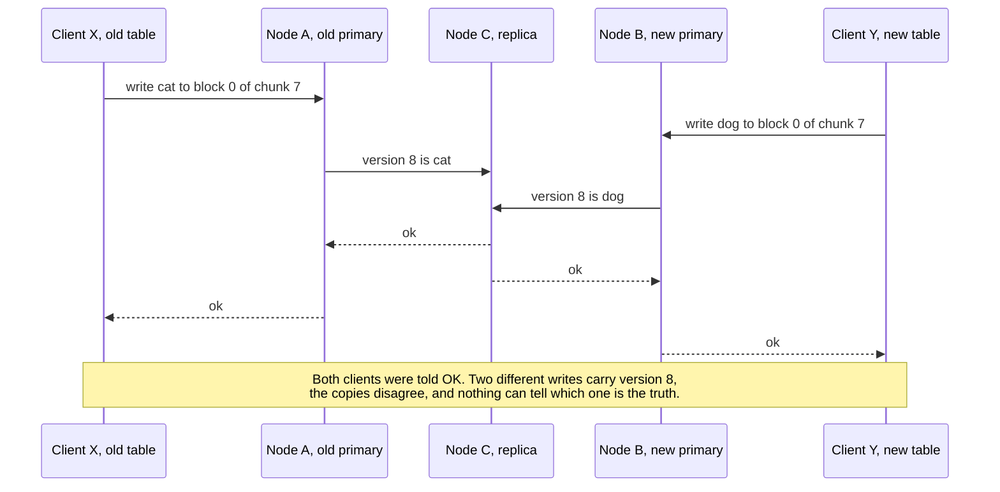
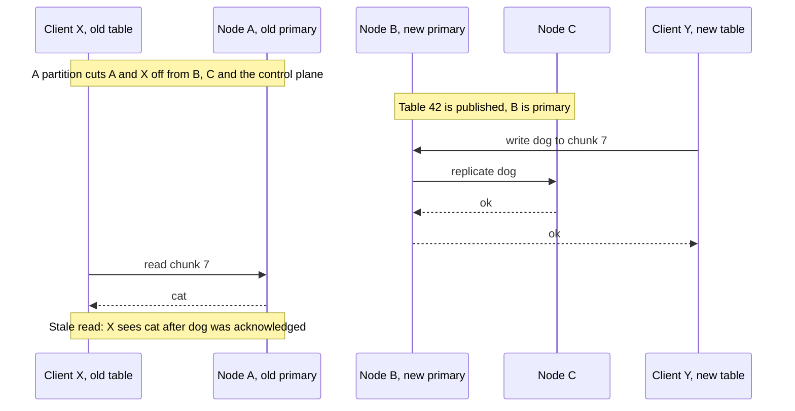
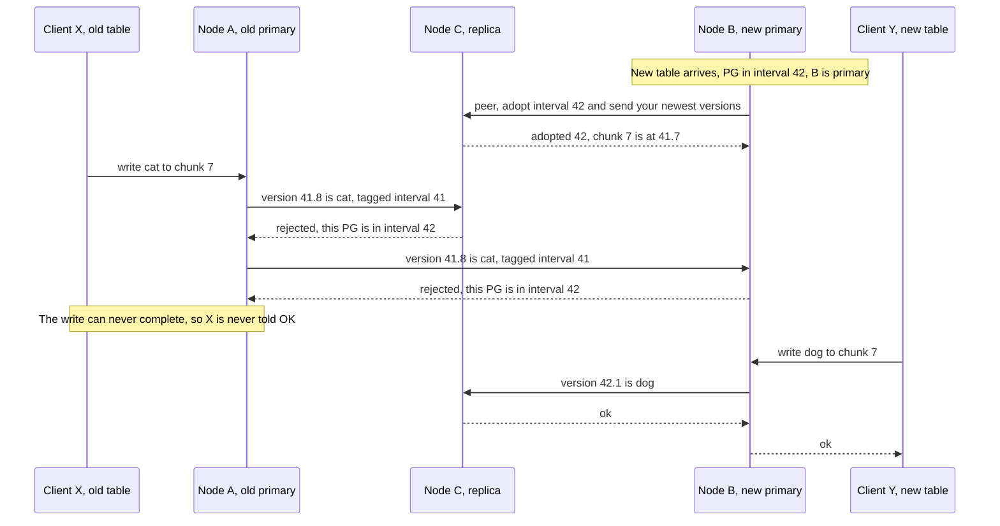
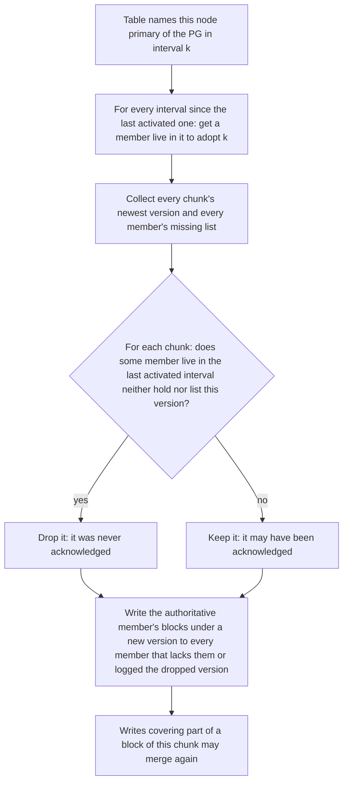
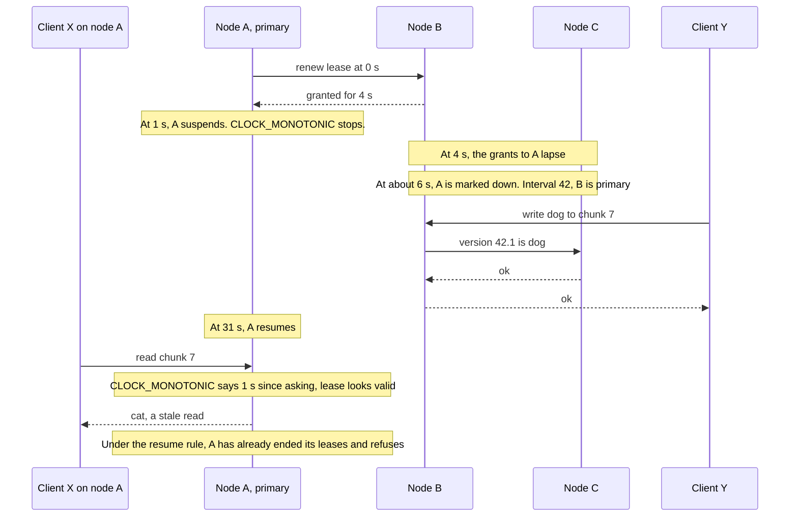
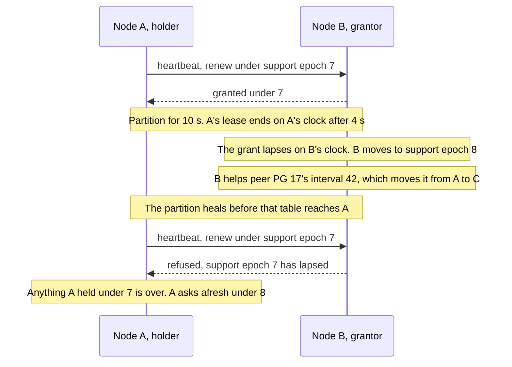
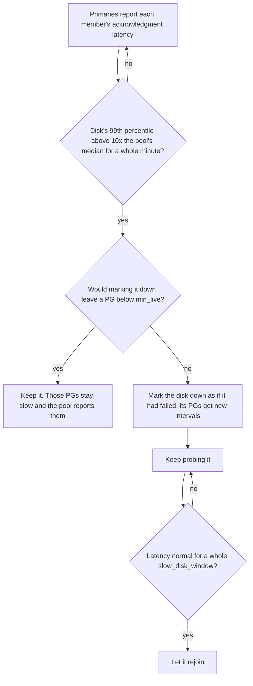
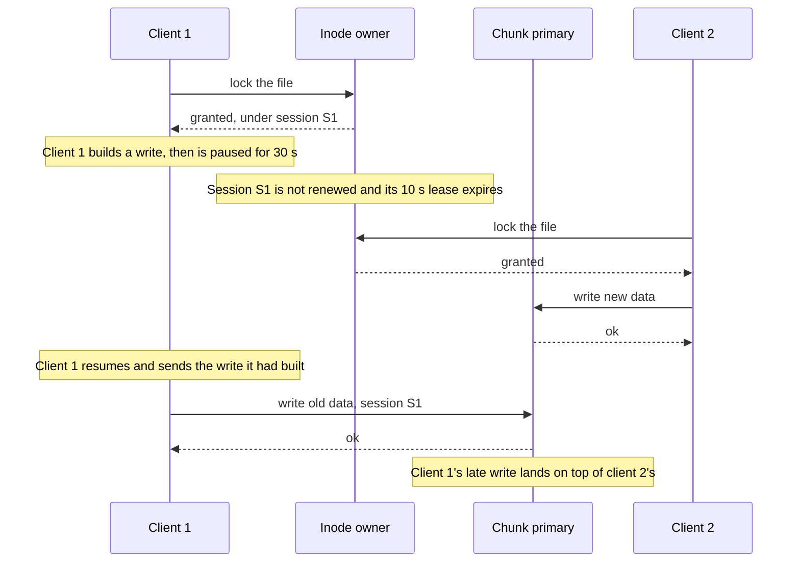
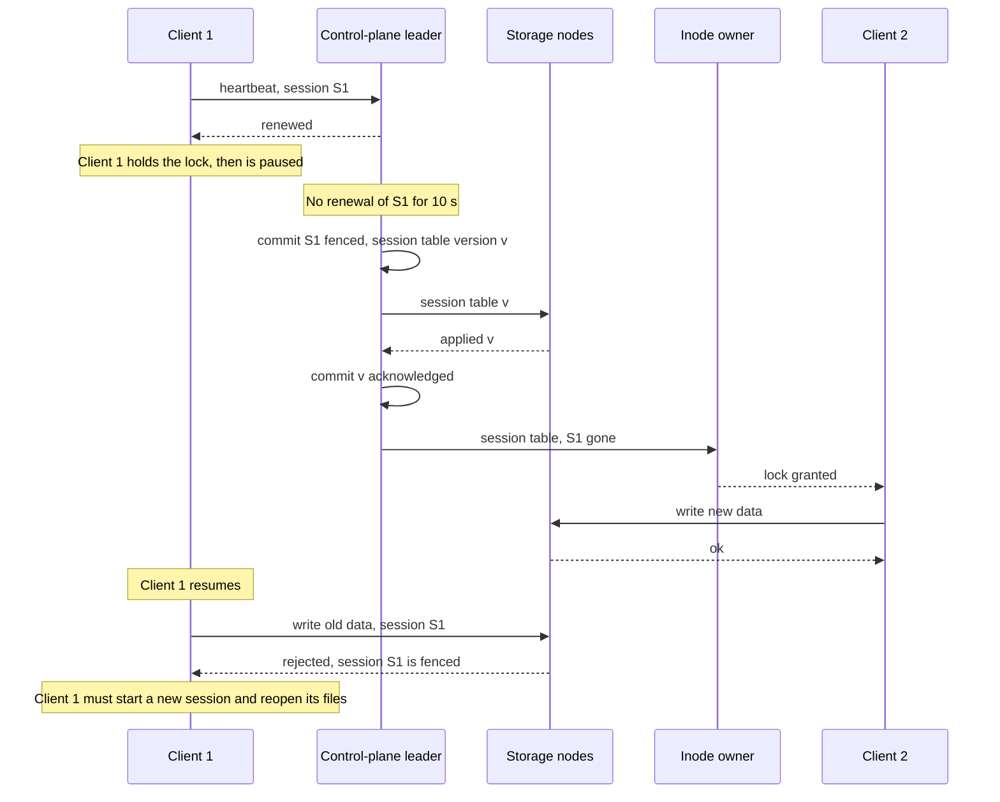

# Epochs, leases and failures: changing who is in charge while writes are in flight

Every chunk of data in rock-solid has one member in charge of it, the primary, and its node will
sometimes crash, hang, sleep or lose its network while clients are still writing. The obvious
fix, "if the primary stops answering, pick another one", is how storage systems lose data: for a
while two nodes both believe they are in charge, and a paused client can wake up and write over
someone else's data. rock-solid closes those windows with a small set of rules: membership
numbered per placement group, a new primary that *peers* before its first write, read leases counted on
two clocks so that no time daemon can stretch them, and given up after a suspend or a VM
pause, and client sessions
that are *fenced* before their
locks move. This post walks through each race, the rule that closes it, and what the rules
cost. None of it runs yet: the protocols are to be modeled in phase 2 of the roadmap and built
from phase 3 on.

## Words you need

- **Placement group (PG), member, primary, replica.** Chunks are grouped into PGs, and each PG
  lists a few disks on different nodes, its *members*. The *primary* takes every read and write
  and forwards writes to the *replicas*. A member is *live* until the control plane marks it
  down. See [roles](../docs/glossary.md#roles-who-does-what) and
  [02-chunks-and-placement.md](02-chunks-and-placement.md).
- **Version, committed, acknowledged.** Every write to a chunk gets a new version. A version is
  *committed* once every live member holds it, and only then is the client told "OK"
  (*acknowledged*). See [data model](../docs/glossary.md#data-model).
- **Placement table, table epoch, control plane.** The table maps every PG to its members; each
  new table gets a higher *table epoch*. It lives in the *control plane*, one small Raft group (a
  few replicas that elect a leader and commit a change once a majority holds it), never on the I/O
  path.
- **Interval.** A run of tables in which one PG's members, their order and which of them are
  live stay the same, so the PG has one primary throughout. The table numbers each PG's
  intervals; a change elsewhere in the cluster leaves a PG's interval alone (a Ceph term).
- **Peering.** What a new primary does before its first write: it stops the PG's earlier
  intervals from finishing writes and agrees with the members on the newest version of every
  chunk (a Ceph term).
- **Lease, support epoch.** A lease is a right that expires on its own unless renewed; a primary
  serves reads only under a *read lease* from its PG's other live members. A *support epoch*
  numbers one unbroken run of a lease between two nodes; it has nothing to do with the table
  epoch. See
  [coordination and failure](../docs/glossary.md#coordination-and-failure).
- **Monotonic clock, drift, slewing.** A monotonic clock only moves forward, unlike wall-clock
  time; *drift* is how differently fast two clocks run. A time daemon *slews* a clock when it
  runs it faster or slower for a while to correct its reading.
- **Fail-slow.** A disk that keeps working but becomes far slower instead of failing.
- **Session, fencing.** A client daemon's registration, kept alive by a lease; its locks belong
  to it. *Fencing* makes sure a client whose session expired can no longer write, even if it
  does not know yet. See [files and caching](../docs/glossary.md#files-and-caching).

## The problem: two nodes that both think they are in charge

> **In plain words.** Picture a shared spreadsheet with one editor at a time. The editor goes
> quiet, so the office hands the pen to someone else. But the first editor was only on a slow
> train, and the moment the train leaves the tunnel they keep typing. Now two people edit the
> same cell, both get a "saved" message, and the copies disagree. Every storage system that
> replaces a failed leader has to make the hand-over safe even though it cannot know whether the
> old leader is dead or merely slow.

Take one PG in a three-replica pool. Its members are disks on nodes A, B and C, and A is the
primary. A client on some node writes 4 KiB into block 0 of chunk 7. A gives the write a
version, appends it to its disk's log, sends it to B and C in parallel, and acknowledges once all
three hold it durably.

Now the control plane stops hearing from A and publishes a new placement table naming B as
primary. A table reaches nodes at different times, so for a while A may still be acting on the
old table while B acts on the new one. Without any further rule, this happens:



*Look at the two arrows into C: one node is told two different things under one version number.*

That is *split brain*: two nodes in charge at once. Reads have their own race, because a read
needs nothing from the other members. An old primary cut off from the cluster but still
reachable by some clients keeps answering with old data:



*The write path never touches A, so nothing in it can stop A from answering reads.*

Two more races get their own diagrams below: a client that pauses while holding a lock and
writes after the lock has moved on ([Fencing](#6-fencing-client-sessions)), and a primary that
sleeps like a laptop with its lid closed and wakes up believing no time has passed
([A holder that slept](#a-holder-that-slept-gives-up-its-leases)).

The common thread: **failure detection is a guess.** A slow node looks exactly like a dead one,
so every rule below has to stay safe when the guess is wrong.

## The options

> **In plain words.** There are only a few ways to pick a new editor safely: let a referee
> appoint one and number every appointment, or let the editors vote among themselves. Reads need
> their own answer: check with the others before every read, or hold a permission slip that
> runs out on its own. And a client that went to sleep is stopped either by trusting it to watch
> the clock, or by telling the storage to refuse it.

Real systems combine answers to four questions, listed in the table. Two rows need a word more.
etcd-raft's tick-counted lease stops counting when an idle group goes quiet and checks its quorum
only once per election timeout, which is how an old leader can overlap a new one. CockroachDB's
older epoch leases hang every lease on one central liveness record; its newer leader leases, like
rock-solid's, rest on leases between pairs of nodes, and Ceph added PG read leases for the same
reason. Raft is covered in [08-the-metastore.md](08-the-metastore.md).

| Problem | Option | Gets right | Costs |
| --- | --- | --- | --- |
| Who is in charge | Timeouts alone | Nothing to build | Split brain |
| Who is in charge | Raft majority (etcd, rock-solid metadata) | No outside authority | 3 copies survive 1 failure |
| Who is in charge | **Appointed primary, numbered intervals, peering (Ceph, rock-solid data)** | An acknowledged write survives while any one member does; writes continue down to `min_live` members | Needs the control plane, peering before writes |
| Fresh reads | Ask a majority on every read (Raft's ReadIndex) | No clock assumptions | A round trip per read |
| Fresh reads | Tick-counted lease (etcd-raft) | No round trip | Stops when idle; overlap up to one election timeout |
| Fresh reads | Central liveness record (CockroachDB epoch leases) | One renewal per node | Its outage expires every lease at once |
| Fresh reads | **Node-pair leases, support epochs (CockroachDB leader leases)** | No central record, no synced clocks, cost independent of PG count | Bounded oscillator drift needed, so each lease is counted on two clocks; a restarted node sits out one lease |
| Stale requests | One epoch for the whole table, every older one refused | Simple | Every table change makes every write in flight retry |
| Stale requests | **Each PG's interval, checked per request (Ceph)** | A table change disturbs only the PGs it changes | Every table entry carries an interval number; peering must reach every interval since the last activated one |
| Versions | Plain counter | Simple | Two primaries reuse a number |
| Versions | Table epoch + counter | Version alone tells writes apart | The epoch field fills at the whole cluster's rate |
| Versions | **PG interval + counter (Ceph `eversion_t` with its map epoch, Vitastor with a per-PG epoch)** | Version alone tells writes apart, and the field grows only with the PG's own changes | 32 bits of every version spent on the interval; a counter that runs out costs the PG a new interval |
| Stale clients | Client-side timeout only | Simple | A paused client writes late |
| Stale clients | Each server expires its own clients (Lustre, CephFS's metadata servers) | No central authority | Safe only where one server holds both the locks and the data (Lustre); otherwise one server's timeout must evict the client everywhere (CephFS) |
| Stale clients | **Expiry by the control plane, fence acknowledged by every storage node** | One verdict per session, late writes are rejected | Locks move only after every storage node confirms |

Bold rows are what rock-solid picked. The rest of the post explains each one.

## What rock-solid picked

### 1. Table epochs, intervals and versions

> **In plain words.** Every time the office changes anyone's seat, it stamps a new edition number
> on the seating chart. But each table group also keeps its own count of how often *its* seats
> changed, and that count is printed next to it on the chart. An edit is labeled with its group's
> count, and a group member refuses only edits labeled with an old count of their own group, so
> moving someone at table 3 does not hold up the edits at table 7. Edits are also numbered
> "count.sequence", so two editors in different terms can never produce two different edits with
> the same label.

#### How it works

Only the control plane changes membership. Its leader computes each new placement table and
commits it as one Raft entry with a new *table epoch*, holding only the PG entries that changed
and a CRC of the whole table it produces; nodes never compute placement themselves. Every node
caches the whole table (it maps PGs, not chunks, so it is small: 2048 PGs × 3 replicas × a
4-byte disk ID, plus 8 bytes of interval numbers each, is 40 KiB), applies each change to the
table before it and checks the CRC, and fetches the whole table if it missed one.

Every change raises the table epoch: a pool created, a disk added, a node failed, a rebalance
step. Only some changes start a new *interval* of a PG: a change to its members or their order
(so its primary), a member marked down or up, its pool's `replicas` or `min_live`, a split of
the PG, or its primary asking for one. Each PG entry in the table carries its interval number.
Every message about a PG carries the sender's table epoch and the PG's interval number, and a
member checks only the interval:

```text
 member's table says PG 7 is in interval 42; a request about PG 7 arrives tagged with interval
   42  ->  accept, whether the sender's table epoch is older or newer than the member's
   41  ->  refuse, and answer with the member's table epoch and interval
   43  ->  the member's table is behind: fetch one at least as new as the sender's, then decide
```

*A table change makes only the writes of the PGs it changed retry.*

Comparing a PG's member lists in two tables would not be enough: a member removed and added back
leaves the lists equal, though it missed the writes in between, whereas its interval number has
gone up twice. Ceph checks the same way, with its own intervals: a replica drops an operation
only if its PG started a new interval since the operation's map epoch. In the
[PG epochs spike](#evidence)'s homelab year on 10 nodes, a table change touched 22% of PGs on
average, and 2 to 4% when rebalancing moved one member per table, so 4.4 to 46 times fewer writes
had to retry than if every older table epoch were refused. On a 3-node cluster every PG has a
member on every node, so a node reboot still changes every PG. Table epochs and interval numbers
never go backwards on any node, one of the invariants the simulator is to check after every step.

A client's write is judged a little more loosely, because nothing in it depends on who the PG's
replicas are. A primary takes it as long as its interval number is at least the one in which this
primary's own term began. A write it was holding when an interval ended under it, say because a
replica was replaced, it orders again once it has re-peered, but only if no interval since had
another primary, which peering shows. Otherwise it refuses the write and the client retries with a
newer table: a write held across another primary's term could land after writes that primary
acknowledged meanwhile.

The interval number also lives inside every version. A version is 64 bits:

```text
 63                                32 31                                 0
+------------------------------------+------------------------------------+
|  interval of the chunk's PG when   |  counter of the chunk's writes in  |
|  its primary ordered the write     |  that interval, from 1             |
+------------------------------------+------------------------------------+
  example: interval 41, counter 7  ->  written "41.7" in this post
```

*The high bits say which interval, and so which primary, assigned the version, so no two
primaries can ever produce the same one.*

Versions therefore grow across primaries, and a member that comes back holding a write its new
primary never saw is told apart by the version alone. In the first diagram, A's write would be
41.8 and B's 42.1: different numbers, and 42.1 is newer. With a plain counter both would be 8,
and the stale write could pass for the current one. A chunk's counter runs out after 4.3 billion
writes in one interval, more than an hour even at a million writes a second; its primary then
asks for a new interval of that one PG. The table epoch could not take the counter's place in the
high bits: it moves with every change anywhere, and one node flapping every 10 seconds with its
members moved one per table would fill 32 bits of table epochs in 207 days, against 272 years for
the busiest PG's intervals ([post 02](02-chunks-and-placement.md)).

### 2. Peering: the new primary before its first write

> **In plain words.** Before the new editor makes a single change, they walk round to the people
> who sat at the group under its earlier counts, ask them to switch to the new count, and compare
> notes on what the latest saved state of every cell is. Once any one person from an earlier
> sitting has switched, that sitting's editor can no longer get a change saved, because saving
> needs everyone at that sitting to agree.

#### How it works

The write rule does most of the work. A write tagged with interval `j` completes only when every
member that is live in `j` acknowledges it, and a member whose table has moved the PG past `j`
refuses it. So before it accepts writes in a new interval `k`, the new primary *peers*:

1. For every interval of the PG since the last one whose primary finished peering (its last
   *activated* interval), it gets at least one member that was live in that interval to adopt a
   table with interval `k`.
2. It collects, from each member it reaches, the newest version of every chunk and that member's
   *missing list* (below).

After step 1 no write tagged with an earlier interval can complete, because each one needs the
acknowledgment of a member that will now refuse it. And every write already acknowledged in one
of those intervals is on that member, because acknowledgment needed every live member. Here is
the first race again, with the rule in place; the PG goes from interval 41 to 42:



*The rejections from B and C are the whole trick: the old primary is not stopped, it just can no
longer finish anything.*

A side benefit of this shape is that a crash does not need the old primary to cooperate. It can
be dead, partitioned or asleep; once one member from its interval has moved on, its writes are
stuck.

Why every interval since the last activated one, not just the previous one? Tables can come
faster than peering. If PG 7 goes from interval 41 to 42 and, before 42's primary has peered, on
to 43, then a member that was live in 42 may never have been a member in 41. Getting it to adopt
43 stops interval 42's writes but not 41's. So 43's primary reaches a member of 41 too. An
interval with fewer live members than `min_live` accepted no writes and is skipped; if no member
of another can be reached, the PG waits, as Ceph's waits in its `down` state. The table keeps,
for each PG, its last activated interval, which primaries report on their heartbeats, and the
members of the intervals since; usually that is just the previous one.

#### Which versions to keep

Step 2 is harder than it looks. A write that the old primary sent out just before it crashed may
be on some members and not others, and the client may or may not have been told OK. The new
primary cannot tell an acknowledged write from one that reached every member it sees but was
never acknowledged. So it uses the one fact it can prove:

**The keep rule: a version of the last activated interval is kept unless some member that was
live in that interval neither holds it nor lists it as missing.** A member that lacks it proves the
write was never acknowledged, since acknowledgment needed every live member. Every version below
a kept one is kept too.

Keeping an unacknowledged write is fine: a write whose client never heard back may land or not.
Losing an acknowledged one is not, and the rule never does. Here is chunk 7 after A crashed
in the middle of sending 41.8, which reached only B. Interval 42 makes B primary and adds a
fresh disk D in A's place:

```text
chunk 7 when B starts peering for interval 42

  member            live in 41?   newest version   its log holds
  A (old primary)   yes           crashed, cannot be reached
  B (new primary)   yes           41.8             ... 41.7, 41.8   <- A reached only B
  C                 yes           41.7             ... 41.7
  D (new disk)      no            none             nothing

  41.8: C was live in 41 and lacks it  ->  never acknowledged  ->  drop
  newest kept version: 41.7, held by C (the authoritative member)
  recovery: copy C's blocks of 41.7, as new version 42.1, to
            B (it logged the dropped 41.8) and D (it lacks them)
```

*The new primary's own newest write is the one thrown away: B cannot trust its own disk more than
the rule.* Had C already been marked down when interval 41 began, so not live in it, 41.8 on B alone could have
been acknowledged, and it would be kept. The rule hinges on who was live, not on who holds the
newest version.

The decision for each chunk, as a flow:



*Peering itself is the first two boxes, and it must finish before the PG accepts writes; both
branches end in the same recovery step, which is what makes every member agree.* Until a chunk's
kept versions are on the new primary, a write that covers only part of one of its blocks waits:
its merge needs the newest kept block as its base (next section). A write of whole blocks needs no
base and goes ahead, as Ceph's primary holds writes only to objects it is missing or still
recovering.

#### What an activated interval decided stays decided

> **In plain words.** Each colleague keeps a to-do slip of the cells they still have to copy from
> the authoritative sheet. If the editor changes again before the copying is done, the next editor
> reads the slips and knows what was decided, even where nobody finished copying.

Recovery takes time, and the PG can change interval again before it is done. Say interval 42
keeps version 41.7 of chunk 7 and starts copying it to the new disk D; then 42 ends, and the next
primary reaches only B and D, and D lacks 41.7. Had 42 already acknowledged a write merged on
41.7, dropping it would lose acknowledged bytes. So before a primary *activates*, starting to
accept writes, every member persists a *missing list*: for each chunk it lacks, or holds a
dropped version of, the kept version it still has to receive. Recovery removes an entry once it
has copied the blocks, and a member never serves a chunk on its list. A later peering then reads
the decision from the lists of any member live in the activated interval, and a chunk whose kept
version no reachable member holds is reported unfound, never replaced by an older one. Ceph's
members keep a missing set for the same reason. The rule across several intervals is a candidate
for now: the phase 2 model has to confirm it ([Evidence](#evidence)).

#### Dropped versions are always a chunk's newest

> **In plain words.** A write of a few bytes is stored as a whole block that already contains the
> bytes of the write before it. So if peering threw away an older write but kept a newer one, the
> newer one would quietly carry the thrown-away bytes back. That cannot happen, because every disk
> stores a chunk's writes in order: a disk missing one write is missing every later one too.

A primary turns a write that covers part of a 4 KiB block into a whole block by merging the new
bytes onto the newest version it has handed out ([post 02](02-chunks-and-placement.md)). Version
41.9 of a block may therefore hold 41.8's bytes. If peering could drop 41.8 and keep 41.9, the
kept block would bring back bytes of a write that was never acknowledged, and that is exactly
what the [sub-block writes spike](#evidence) saw when its model let peering drop any subset of
pending versions: every seed went wrong.

Peering never does, for three reasons that chain together. A primary sends a chunk's writes to
each member in version order, over one connection, and again in that order after a reconnect.
Each member's log takes them in that order. And durability is a prefix of a disk's log
([04-one-log-per-disk.md](04-one-log-per-disk.md)): when a record is durable, so is every record
before it. So a member that lacks 41.8 lacks 41.9 as well, the keep rule drops both, and the
versions peering drops are always a suffix of each chunk's pending versions. The spike's model
with that rule stayed correct through 3,670 primary changes with 8 writes pipelined per client.

#### Why recovery writes a new version instead of deleting the old one

> **In plain words.** Each disk's log only ever appends, so the way to take back a write is to
> append something newer over it.

B, as a replica in interval 41, put 41.8 into its index as soon as it was durable (replicas do,
since they serve no live reads), so the recovery copy fixes what B holds right away. It also
matters later. After a crash a disk rebuilds its index by replaying its log
([04-one-log-per-disk.md](04-one-log-per-disk.md)). Replay applies every logged record, and the
dropped write is still in B's log, so it would come back the next time B restarts unless a later
record in B's log covers the same blocks. The recovery copy under a new version is that later
record. A version check during replay would not help either: the dropped write's version, 41.8, is newer
than the 41.7 blocks it replaced. This is Ceph's approach to divergent objects, and the
[chunk epochs spike](#evidence) showed both halves: without the copy the dropped write comes
back; with it, replay converges.

A primary that restarts without any membership change asks for a new interval of each PG it
leads and peers in it before it serves anything. Peering again in its old interval would not be
safe: a write its previous run sent can still sit in a member's socket buffer and land after that
member answered peering, under a version the restarted primary is about to give to other data. In
the new interval the member refuses it. The table change touches only the PGs that node leads.

#### Reads see only committed versions

> **In plain words.** A primary never lets a read see a write before every live member holds it.

Making a write visible is called *mapping* it into the chunk index
([04-one-log-per-disk.md](04-one-log-per-disk.md)). A primary maps a write only when it commits.
Until then the write is *pending*: its record is in the log, and a read finds the previous
version's blocks without waiting. Otherwise a reader could see a write that a primary crash then
loses, since the new primary may be a member that never received it.

### 3. Read leases

> **In plain words.** Peering stops the old editor from saving, but not from *reading aloud* the
> old spreadsheet to anyone still listening. So the editor is only allowed to read aloud while
> holding a short permission slip from each colleague, and each colleague promises not to help a
> new editor take over until the slip they signed has run out. If the slip lasts four seconds,
> the old editor goes silent before the new one can start, even if nobody can talk to anybody.

#### How it works

A primary serves reads for a PG only while it holds an unexpired read lease from each of the PG's
other live members. A member that granted a lease does not take part in peering a new interval
that moves the PG's primary away from that node until the lease expires, or until the old primary
has adopted that interval itself. Peering needs at least one member that was live in the last
activated interval, the only one whose primary can have served reads, and every such member, the
new primary among them, granted that primary a lease, so peering cannot finish before those
leases run out. In every planned change the old primary adopts the new interval itself, so
planned moves never wait for a lease. A new interval that keeps the primary, such as a replaced
replica, needs no wait at all: the primary keeps serving reads and holds only writes while it
re-peers.

`primary_lease` defaults to 4 s, deliberately shorter than failure detection (below).

#### Counting on clocks that never agree

The holder and the grantor each count the lease on their own monotonic clocks. They never compare
readings, so the clocks need not be synchronized. What makes this safe is *when* each side starts
counting:

- The holder counts from when it **asked** for the lease.
- The grantor counts from when it **granted** it, which is later, since the request had to
  travel.
- The holder stops `lease_drift` early: by default 1% of the lease, 40 ms of the 4 s.

```text
real time  ---------------------------------------------------------------------------->

             A asks                                          A stops serving reads
             |                                               |  4 s - 40 ms on A's clock,
             v                                               v  counted from the ask
A (holder)   *===============================================*

                 B grants                                         B's grant lapses
                 |                                                |  4 s on B's clock,
                 v                                                v  counted from the grant
B (grantor)      *================================================*--> B may now peer an
                                                                       interval that moves
             <-->                                            <---->    the primary off A
             message delay                                   40 ms margin + delay
```

*A's interval ends before B's even if A's clock runs a little slow and B's a little fast:
message delay and the margin both push A's end earlier.*

The margin only has to cover a difference in clock *rates*. How large that difference can get
depends on which clock each side counts on.

#### Two clocks, because a time daemon can bend either one

> **In plain words.** Each colleague times the slip on two watches. The office time-keeper may
> quietly run the first a fifth fast or slow to put its time right; nobody touches the second,
> but it may have left the factory a little off. The editor stops reading aloud as soon as
> *either* of its watches says the slip is up, and a colleague helps a new editor only once
> *both* of theirs say so. Whichever watch is wrong, it can only make the editor stop sooner or
> the colleague wait longer.

A time daemon (chrony, systemd-timesyncd, ntpd) keeps the wall clock right by *slewing*: running
the clock faster or slower for a while instead of jumping it. On Linux, `CLOCK_MONOTONIC` and
`CLOCK_BOOTTIME` follow every slew. The kernel's `MAXFREQ` (500 ppm) bounds only one of the knobs
`adjtimex` offers: the tick can move ±10%, and the kernel's phase-locked loop and `adjtime()`
slew an offset on top. The [clock slew spike](#evidence) applied each in a throwaway kernel:

| What the daemon does | How far off `CLOCK_BOOTTIME` runs |
| --- | --- |
| ntpd at its defaults | about 0.1% at most |
| systemd-timesyncd correcting a 0.4 s offset | 5% in the first second |
| chrony correcting any offset after its first updates, default `maxslewrate` | 8.3%, for 12 s per second of offset |
| everything the kernel accepts at once | 22.6% |

A 1% margin covers none of the last three. With chrony slowing the holder's clock and speeding
the grantor's, a 4 s lease outlives its grant by 0.63 s, and at the kernel's limits by 1.85 s:
long enough for a new primary to accept a write while the old one still serves the value it
replaced.

`CLOCK_MONOTONIC_RAW` is the clock no daemon touches. It runs at the rate the kernel calibrated
for the processor's time-stamp counter at boot, which the kernel never checks against a bound
and only a daemon corrects, in `CLOCK_BOOTTIME`. On Intel CPUs that report their crystal frequency
the kernel trusts that number outright, and one wrong entry in its own table ran Skylake-X
workstations 4% slow until a 2017 fix; every virtual machine inherits its host's figure. So each lease is counted on both:

- The **holder** ends it when *either* clock shows the lease minus `lease_drift` since it asked.
- The **grantor** keeps it until *both* clocks show the whole lease since it granted.

A slew or a bad calibration can then only end a holder's lease early or make a grantor wait
longer, by at most 22.6% for a slew. What is left for the 40 ms margin is the two oscillators'
own difference, typically within ±100 ppm each.

The remaining gap is both of one node's clocks wrong the same way: a bad calibration that no
daemon corrects (ntpd and systemd-timesyncd fix at most 500 ppm of frequency and step the clock
for the rest). So each holder measures, from outside, how fast each grantor's clock can
be running. Every grant carries the grantor's `CLOCK_MONOTONIC_RAW` reading `g`, and the holder
notes on its own raw clock when it sent the request (`s`) and when the grant arrived (`r`). The
grantor read `g` somewhere between the two, so between two grants `a` and `b` at least `s_b − r_a`
passed on the holder:

```text
 grantor's clock rate, relative to the holder's  <=  (g_b - g_a) / (s_b - r_a)
```

That is a bound, not an estimate: no delayed or lopsided network path can make it too low. Over
`rate_window` (default 10 s) the holder pairs the grant with the shortest round trip in the
window's first third with the one in its last third, so one slow round trip loosens the bound only
if every grant in a third was slow. The bound overshoots by about two round trips over the third
of a window between them: 600 ppm with 1 ms round trips, 60 ppm on a quiet network's 100 µs,
against the 5,000 ppm that half the margin allows. Comparing the two raw clocks errs safe: a
grantor counts on the slower of its clocks, so no faster than its raw one, and a holder on the
faster, so no slower than its raw one. A grantor whose raw clock runs ρ times as fast as the
holder's needs a margin of `1 − 1/ρ`, a little under `ρ − 1`. A holder whose bound for a grantor
exceeds `1 + lease_drift / 2` widens its margin for that grantor by the excess, to
`lease_drift + (B − (1 + lease_drift / 2))`, and reports the pair. That always leaves at least half
a percent, 20 ms of a 4 s lease, to spare: headroom for a grantor whose rate changes after it was
measured, such as an oscillator warming up, the kernel switching the grantor to another
hardware clock after its watchdog stops trusting the current one, or a VM migrated onto a host with another calibration. A grantor
that would need a margin of `max_margin` (50%) or more, a bound of about 1.5, gets no lease at all,
and the pair is reported.

The bound does not need the whole window. Any two grants give one; grants close together only
give a looser one. So after the first grant from a grantor, the holder asks again `rate_gap`
(100 ms) later, and takes no lease from that grantor until it has those two. The first lease is a
little shorter (3.90 s instead of 3.96 s at 1 ms round trips, 3.18 s at the 10 ms of an event loop
at 90% load) and lengthens as the window fills. A holder keeps its window per grantor and per
boot: every grant and heartbeat carries the grantor's boot ID, because its raw clock starts again
near zero at every boot and a new boot may calibrate differently. A window starts again at a new
boot ID, at a raw reading below the last one, after a detected pause (below), and when the last
grant ages out of the window. So a holder goes about 100 ms without reads on a grantor's leases
when it starts, when that grantor reboots and after every pause it detects; a grantor's daemon
restarting within one boot costs nothing, since its raw clock and boot ID carry on
([lease margins study](../studies/lease-margins/README.md)).

#### A holder that slept gives up its leases

Go's monotonic clock reads `CLOCK_MONOTONIC` (`runtime/sys_linux_amd64.s`), and on Linux that
clock **stops while the machine is suspended**, as `CLOCK_MONOTONIC_RAW` does. A node that
suspends while holding a lease, the way a laptop does when its lid closes, wakes up believing
almost no time has passed:



*Every rule worked as designed on B and C; the hole is a clock on A that did not count the
sleep.*

`CLOCK_BOOTTIME` does count the sleep, but the kernel may measure it in whole seconds read from
the real-time clock chip, so no clock tells A exactly how long it slept. A virtual machine can
hide a pause altogether. A hypervisor, the program that runs virtual machines (QEMU and
Firecracker here), brings back a restored snapshot or a live-migrated VM with its clocks as they
were saved, so every clock in the guest stands still across the gap. QEMU stopping and continuing
a guest freezes every clock too when the guest's kernel reads time from kvm-clock, a counter the
hypervisor provides (its *clocksource*), rather than from the processor's own counter.
A pause matters once it outlasts `primary_lease` less a heartbeat, 3 s; a shorter one ends before
the grantor's lease, renewed within the last heartbeat, runs out.

So the event loop delivers a `Resumed` event, and a holder ends every lease it holds on it, in two
cases:

- **After a suspend**, which shows as `CLOCK_BOOTTIME` gaining on `CLOCK_MONOTONIC`.
- **When the hypervisor's VMClock disruption marker changes.** QEMU 10.0 and later (with
  `-device vmclock`) and Firecracker 1.15 and later expose a small device whose marker they change
  on every snapshot restore and live migration, before the guest runs again. The loop reads it
  from a mapped page, about 3 ns per pass.

A QEMU guest on kvm-clock that is stopped and continued in place, or snapshotted while it runs,
changes neither, and only the grantors' clocks saw the time go by. So every heartbeat a grantor
sends carries its `CLOCK_MONOTONIC_RAW`, not only its grants, and the holder checks each one: if
the grantor's clock moved further since the last grant than that lease's margin allows, more than
`1/(1 − margin)` times the holder's own, the holder lost time and ends its leases as on `Resumed`.
Tying the check to the margin matters: a fixed limit just above the 0.5% where widening starts would
trip on every heartbeat from a grantor slightly fast, and its bound would never form. A pause the
check misses fits inside the lease's headroom as long as the last grant is less than a lease old.
Messages sent to a stopped VM wait in the
hypervisor's network backend and arrive when it continues, ahead of any client request sent after
them, and the holder handles a pass's peer messages before its reads, so it ends the old leases
before it serves a request that waited behind them. After either, the holder asks every grantor
again at once and restarts its rate window, so a pause costs about 100 ms of reads. A grantor
needs none of this: a clock that stopped only makes it wait longer.

The core itself never reads a clock: a state machine gets time only from its driver, today as
`ctx.Now`, a `Tick` of one microsecond ([`internal/core/event.go`](../internal/core/event.go)).
The lease rules add `ctx.Raw` on `CLOCK_MONOTONIC_RAW` and the `Resumed` event kind to the core's
types (the phase 1 checklist item "Lease clocks in the context"), and the event loop's "Clock and
timers" item (phase 5) fills them: it reads the two clocks itself, about 140 ns each per pass,
since Go's own monotonic clock is `CLOCK_MONOTONIC`, and maps the VMClock page where the VM has
one. That keeps the choice of clocks in one place, and it lets the simulator slew one node's
clock, drift another's oscillator, suspend a leader's node past its lease and freeze a VM's
clocks with the messages sent to it queued or lost (planned placement and MetaStore faults).

#### Support epochs: a lease that lapsed never comes back

A is primary of PG 17 and holds B's grant under support epoch 7. A partition lasts 10 s. A's own
clock ends its lease after 4 s, so A stops serving reads; B's grant lapses on B's clock, and B
helps peer interval 42 of PG 17, which moves the PG to C. The partition heals before that table
reaches A, and
A's next heartbeat asks B to renew. If that renewal simply continued the old grant, everything
recorded under it would continue too, as if the gap never happened, though B spent the gap
helping a new primary. So each grant carries a *support epoch*, a number that belongs to the
node pair and has nothing to do with the table epoch or PG 17's interval. Once a grant lapses on the
grantor's clock, the grantor bumps the support epoch and never renews the old one:



*The number makes the gap visible: nothing granted under 7 survives the partition.*

What the design settles: a lease taken under a lapsed support epoch never comes back, and every
Raft promise made under it ends (post 08 explains those promises). What it leaves open is which
PGs a fresh grant under 8 covers: a grant covers "every PG the pair shares", but the design text
does not yet say by whose table, B's current one or A's stale one, and lists that as an
[open question](../docs/design.md#roadmap-and-open-questions) for the phase 2 model. The safe answer
is the grantor's current table: B, already holding PG 17 in interval 42, shares no primary role for
PG 17 with A, so A gets no lease for it and serves no stale read.

#### The restart rule

A node that restarts has forgotten what it granted. It may have granted node A a lease a moment
before it crashed; if it came straight back and joined peering for a new interval that moves A's PGs
elsewhere, A could still be serving reads under that forgotten grant. So until both its clocks
show one `primary_lease` (4 s) since it started, a node grants no vote and joins no peering. Every
grant it could have made before the crash has lapsed by then.

#### One lease per pair of nodes, not per PG

A three-replica pool of 2048 PGs on five nodes gives each of the ten node pairs hundreds of
shared PGs, so leases per PG would mean hundreds of renewals per pair. Instead, leases are granted
per node pair, covering every PG the pair shares, and ride on the heartbeats already flowing
between the two nodes:

```text
 per-PG leases (not chosen)               per-node-pair lease (chosen)

 node B -> node A                         node B -> node A
   lease for PG 17                          one grant, support epoch 7
   lease for PG 203                         covers every PG where a disk on A
   lease for PG 988                         is primary and a disk on B is a member
   ... one per shared PG,                   renewed by the B <-> A heartbeat
   each renewed on its own                  cost: one per pair, whatever the PG count
```

*The right-hand box does not grow when the pool's PG count doubles.*

The MetaStore's Raft groups reuse the same node-pair leases for their leader leases, which lets
an idle group stop heartbeating and keep its lease; see [08-the-metastore.md](08-the-metastore.md).

### 4. Failure detection

> **In plain words.** The office manager expects a "still here" text from everyone once a second.
> Five seconds of silence and you are presumed gone. Separately, if you are waiting on a colleague
> for more than a second, you can tell the manager, who phones that colleague directly and, if
> there is no answer, marks them gone at once.

#### How it works

Only the control plane changes membership. Every node sends it a heartbeat each second, and it
marks a node down after `node_down_after` (default 5 s) without one. A primary that waits more
than `member_timeout` (default 1 s) for a member's acknowledgment reports it, and the control plane
marks the member down at once if it also fails a direct probe. Marking down means publishing a new
table, which starts a new interval of every PG with a member on the node. Until that table, writes
to those PGs wait, so a crash pauses them for up to `node_down_after`; the other PGs never notice.

Here is a primary crash, end to end:

```text
 t = 0 s     node A crashes. It is primary for some PGs; B and C hold members of them.
             Writes to those PGs stop completing.
 t <= 4 s    every read-lease grant B and C made to A lapses on their own clocks
             (each grant runs 4 s from its last renewal, which was at or before 0 s;
             up to 5.2 s of real time while a time daemon slows a grantor's clock)
 t = 5 s     no heartbeat from A for node_down_after: the control plane marks A down
             and commits a new table: each of A's PGs gets a new interval, say 42,
             naming B its primary
 t > 5 s     B peers (C adopts 42, B collects the newest versions) before it accepts
             writes, and recovers divergent chunks. Reads resume once B holds read
             leases from C. A's member stays in the PG, marked down.
 t = 10 min  A still down for refill_after: its members are refilled onto other disks,
             each PG in a new interval, and recovery copies their data there. Had A come
             back sooner, it would have been marked up and caught up on what it missed.
```

*`primary_lease` (4 s) is shorter than `node_down_after` (5 s), so by the time A is marked down
its leases have run out: a crash adds no wait for the lease, and failure detection sets the
pause.*

While writes are flowing, a replica that crashes is usually caught sooner. Its primary notices
within `member_timeout` that a write is not being acknowledged and reports it; the control
plane's direct probe fails, so the member is marked down without waiting for 5 s of missing
heartbeats.

**Down is not gone.** A member marked down stays in its PGs for `refill_after` (default 10
minutes) before anything is copied elsewhere, so a reboot or a network hiccup costs only the
writes it missed. RADOS makes the same split between a device that is *down* and one that is
*out* of the mapping, and Ceph waits 10 minutes before marking it out. A disk whose log is gone
skips the wait, since there is nothing to wait for. A PG left below `min_live` accepts no writes,
so its down members wait only `degraded_refill_after` (1 minute): long enough that a 5 s hiccup or
a 1 s disk stall moves nothing, short enough that writes stop for about a minute, not ten. In a
`rep2` pool that is any PG with a member down, so a reboot there copies the node's PGs away and
back unless the operator put the node in `maintenance` first. The new member counts toward
`min_live` while it is still being filled: every write from then on lands on both members, so the
PG takes writes again as soon as it joins. No member that peering must wait for anyway, the only
holder of some interval's writes, is ever replaced, since its replacement would only wait too.

A node or disk marked down `flap_count` times (5) within `flap_window` (10 minutes) is held down
until it has been normal for a whole `flap_window`, so a flapping node cannot keep restarting its
PGs' intervals. The one exception is a PG that would stay below `min_live` with no disk to refill
onto, such as `rep2` on two storage nodes: there the damped member comes back at its first normal
heartbeat, since holding it would stop the PG's writes for the whole window. Ceph stops an OSD at the same count; rock-solid keeps the process running, so a
damped node still serves its clients and rejoins by itself.

One crash is slower than the rest: the control-plane leader's own. Nobody counts
`node_down_after` while the control plane elects a new leader, and the new leader starts the
count from its own lease, so that node's PGs wait for the control-plane failover, about 4 s
([post 08](08-the-metastore.md)), plus 5 s.

### 5. Fail-slow disks

> **In plain words.** A colleague who has quit is easy to replace. A colleague who still answers
> every question, but takes ten minutes each time, holds up every meeting they are in, and nobody
> ever files a complaint. Someone has to notice that they are always the slowest by far, for long
> enough that it is not a bad afternoon.

#### How it works

Because a write waits for every live member, one disk that slows down without failing stalls
every write of every PG it belongs to. No error is ever reported. So primaries report each
member's acknowledgment latency to the control plane, and it compares each disk against its
pool:



*Two guards: never trade slowness for unavailability, and never let a flapping disk churn its
PGs' intervals.*

The settings are `slow_disk_factor` (default 10×) and `slow_disk_window` (default 1 minute). The
`min_live` guard comes from the pool: a PG with fewer than `min_live` live members (default
`min(replicas, 2)`) rejects writes, so marking a slow disk down there would turn "slow" into
"stopped". Pools and `min_live` are covered in
[07-pools-and-redundancy.md](07-pools-and-redundancy.md).

### 6. Fencing client sessions

> **In plain words.** A client holds a lock, then freezes: a long pause, a stopped virtual
> machine, a network that drops it. Its lock times out and goes to someone else. Then the frozen
> client wakes up and finishes the write it had already started, right over the new lock
> holder's data. Telling the client "stop at the deadline" cannot help, because a frozen client
> cannot look at its watch. The storage itself has to refuse the late write.

Here is the race:



*The lock was correct the whole time; the problem is a write that was already on its way.*

#### Who decides that a session has expired

> **In plain words.** A client may deal with many desks at once: one per file it has open. If each
> desk kept its own stopwatch on the client, they would disagree, and a client that could reach
> one desk but not another would be "alive" and "dead" at once. So one desk keeps the only
> stopwatch: the office manager, who already gets a "still here" text from every machine once a
> second. That text also renews the machine's session, and only the manager ever declares a
> session over.

Each client daemon holds one session, `session_lease` (10 s by default), for its FUSE mounts and
block devices alike. Its locks, open registrations and cache rights all belong to the session,
and every chunk write carries its ID.

The session is a key in the control-plane group, `ctl/session/{id}`, and its lease is renewed
by the heartbeat each node already sends the control-plane leader every second
([Failure detection](#4-failure-detection)): the heartbeat names the session, the reply grants
the renewal. Renewals change only the leader's memory; the Raft log changes only when a session
starts or is fenced. The inode owners, the MetaStore leaders that track open files, hold the
session's locks and opens but never decide that it expired, so they cannot disagree, and an
owner that fails over leaves every session as it was.

Both sides count the lease the way every lease in this post is counted
([Counting on clocks](#counting-on-clocks-that-never-agree)), on two clocks: the client from when
it *sent* its last answered renewal, as a holder, the leader from when it *processed* that
renewal, which is later, as a grantor. The client keeps its rate bound per leader node and boot,
so a leader failover starts a new window: the client keeps its old lease, counted from its last
answered renewal, while it sends the new leader a second renewal `rate_gap` after the first, well
inside `session_lease`. A client daemon that starts holds its writes about 100 ms longer for the
same reason. Two more rules keep the leader from expiring a session too early:

- **Only a leader holding its leader lease answers renewals**, and a new leader gives every live
  session a full `session_lease` from the start of its own lease before expiring any. A renewal
  answered by a deposed leader was answered under a lease that ended before the new one began.
- **A leader that stalled restarts every session's timer** instead of expiring sessions it could
  not hear, as CephFS's metadata server skips expiries after it was itself slow.

Both only delay an expiry, never bring it forward. A client that cannot reach the control plane
at all stops writing when its lease ends, but holds its requests rather than failing them: if a
new leader answers in time, its applications see only a pause.

This is how Chubby, ZooKeeper, etcd and HDFS keep sessions too. The other shape, where each
server times out its own clients, works for Lustre and a single NFS server because the server
that holds a client's locks also holds the data they protect; CephFS, whose locks and data live
on different servers, turns the first server's timeout into a cluster-wide blocklist. The
[session expiry study](../studies/session-expiry/README.md) compares them.

#### How the fence lands

Three rules work together:

1. **The client stops itself early, as far as it can.** It issues no write after its lease ends,
   and no attribute or directory-entry timeout it hands the kernel reaches past that instant. So
   when the lease ends, the next `read()` on a paused node asks the daemon for attributes, and
   the daemon, seeing its lease has lapsed, drops the file's cached pages first.
2. **The control plane fences, and every storage node confirms.** When a session's lease runs out
   on the leader's clock, or an owner reports a recall the session left unanswered for
   `recall_timeout` (30 s), or an operator evicts it, the leader commits it as fenced in a new
   version of the *session table*. One version fences every session due at that moment, so a
   switch failure that strands many nodes costs one version, not one each. Every storage node
   applies the version, rejects from then on every write from that session, including ones
   already queued, and acknowledges.
3. **Locks move only after every storage node has confirmed.** Once every storage node has
   acknowledged, or has been marked down in a committed table, the leader commits the version as
   acknowledged and the session leaves the table. Only then do owners free its locks, drop its
   open registrations and count its recalls as answered.



*Rule 3 is the ordering that matters: the lock moves only after every storage node has applied
the fence or been marked down.*

A write the fenced client got applied before the fence is therefore ordered before every write of
the next lock holder. A storage node that was marked down instead of acknowledging cannot finish
an old write either: marking it down started a new interval of each of its PGs, and once their
new primaries have peered, no write tagged with an earlier interval completes. In every other PG
each member has applied the fence and checks it on every write it receives, replicated ones
included. It is marked up again only once its heartbeat reports the current session table. The
session table has its own version, not a change to the placement table, so its acknowledgments
count fences alone and a fence never waits behind a rebalance. The fenced
client must start a new session and reopen its files, and its applications get errors, never
silently stale data. The same machinery serves file locks (`flock`), cache recalls, snapshot cuts
and shared block volumes; see
[09-rwx-filesystem-and-cache-coherence.md](09-rwx-filesystem-and-cache-coherence.md) for how
sessions fit into cache coherence.

The session table is read on every write, so in the runtime it is an immutable table published
through an `atomic.Pointer`, like the placement table: a reader loads the current one without a
lock.

#### Incarnations

A restarted daemon resumes its session, so bytes the dead process left queued on a socket could
still reach a primary after its successor's writes, and land after the successor's reissue of the
same write and the application's next one. So each connection's hello names the session and an
*incarnation*, the daemon's start time on `CLOCK_BOOTTIME`, and so does every chunk write and
punch, in 8 bytes. A primary that has seen a newer incarnation of a session closes the older one's
connections and rejects their writes, and it checks when it *orders* a write, not only when one
arrives, so a write it is already holding is caught too. The incarnation rides in every write
rather than only in the hello because with one event loop per core the old connection, the new
one and the chunk's loop can be three different loops.

A primary's table of newest incarnations does not need to survive a primary change: the old
copy is bound to its connection, which dies if the primary process restarts; a reissue that
completed on another primary means the copy's interval was stopped before that primary activated;
and a held write is ordered again only if no other primary led the PG since (the client-write rule
in [section 1](#1-table-epochs-intervals-and-versions)). That reasoning is for the phase 2 model to
confirm; [10-block-snapshots-and-clones.md](10-block-snapshots-and-clones.md) shows where reissues
come from.

## Evidence

Most of this post is protocol, not performance, and the design's evidence for it is mostly
reasoning plus planned model checking. Here is what exists today, and what does not.

**The chunk epochs spike** ([appendix](../docs/design.md#appendix-chunk-epochs-spike),
[`spikes/chunk-epochs/`](../spikes/chunk-epochs/)) ran the real `internal/chunkstore` index on
Linux 6.18.44 with Go 1.27.0; nothing in it is timed. A *checkpoint* is a saved copy of a disk's
index, so a restart replays only the log after its *replay point*. Two of its tests are about
peering, and one about the cost:

| Test | Result |
| --- | --- |
| R3: a write peering dropped, replayed from a checkpoint taken while it was pending | **Comes back**: replay maps the dropped write (block 0 at v2; the live index holds v1) |
| R3b: the primary also logs the recovery copy of the authoritative blocks under a new version | Replay ends at the recovered blocks (v3, a copy of v1's) |
| R1: replay past pending writes, a chunk's commits in version order, 200 seeds | **0 of 200 seeds** differ from a rebuild |

R3 and R3b are why recovery writes a new version to every member that logged a dropped write,
the new primary included. R1 shows that replaying committed records again is harmless provided a
primary maps a chunk's writes in version order, and the spike's conclusions put a bound on the
cost: while a write is pending, replay grows by what the disk logs meanwhile, at most
`node_down_after` (5 s) of writes during a member failure.

**The sub-block writes spike** ([appendix](../docs/design.md#appendix-sub-block-writes-spike),
[`spikes/sub-block-writes/`](../spikes/sub-block-writes/)) modeled a primary that merges partial
blocks onto pending versions, two clients pipelining 8 unaligned writes each into one chunk, and a
primary change in about 2% of steps, against an oracle that replays every acknowledged write's
bytes; 500 seeds per test, no I/O:

| Test | Result |
| --- | --- |
| M6: peering drops a suffix of each chunk's pending versions | 0 of 500 seeds wrong, 3,670 primary changes |
| M7: peering may drop any subset | **500 of 500 wrong**: a kept version carries a dropped one's bytes |
| M8: the new primary merges before it holds a version peering kept | **458 of 500 wrong** |

M7 is why the in-order logging behind the suffix rule matters, and M8 why a partial-block write
waits for its chunk's recovery.

**The PG epochs spike** ([appendix](../docs/design.md#appendix-pg-epochs-spike),
[`spikes/pg-epochs/`](../spikes/pg-epochs/)) is a model with no I/O: it builds a placement table
of 2,048 PGs by the design's refill-and-rebalance rules on 3 and 10 nodes, then counts table
epochs and per-PG interval changes over a homelab year (24 reboots per node, outages, disk
failures and additions, fail-slow marks) and under a flapping node. The
[PG epochs study](../studies/pg-epochs/README.md) reads how Ceph and Vitastor do the same jobs.

| Test | Result |
| --- | --- |
| A year on 10 nodes, one table per step | 778 tables; a table changes 22% of PGs on average: **4.4 times fewer writes disturbed** than refusing every older table epoch |
| Same, one table per moved member | 4,277 to 8,226 tables, 2 to 4% of PGs each: **24 to 46 times fewer** |
| A year on 3 nodes | A node event changes every PG; per-PG checks save 1.35 times with one table per step |
| One node flapping every 10 s, members moved one per table | Table epochs fill 24 bits in **19 hours** and 32 bits in 207 days; the busiest PG's intervals fill 32 bits in **272 years** |
| A 32-bit counter per chunk | Runs out after 1.2 hours at a million writes a second, 50 days at a thousand |

The first rows are why requests are checked per PG; the flapping row is why a version's high half
counts the PG's intervals, not table epochs.

**The clock slew spike** ([appendix](../docs/design.md#appendix-clock-slew-spike),
[`spikes/clock-slew/`](../spikes/clock-slew/)) asked how far a time daemon can bend the clocks
leases count on. Changing the host's clock was ruled out, so it built Linux 6.18 as User-Mode
Linux, a kernel that runs as an ordinary process, and applied every adjustment `adjtimex`
accepts inside it, measuring `CLOCK_MONOTONIC` and `CLOCK_BOOTTIME` against
`CLOCK_MONOTONIC_RAW`. The daemons' own calls come from the chrony 4.9 and systemd v258 sources,
and chronyd and systemd-timesyncd then ran for real in a throwaway virtual machine.

| Test | Result |
| --- | --- |
| Tick 9000 and 11000 (±10%) | −100,000 and +100,000 ppm |
| Frequency asked for +1,000 ppm | Clamped to 500 ppm: the only knob `MAXFREQ` bounds |
| chrony's call for its default `maxslewrate` | **±83,333 ppm**, steady |
| systemd-timesyncd's call for a 0.399 s offset | −49,870 ppm in the first second |
| Every knob at its limit | **±226,000 ppm** in the first second |
| chronyd after a 1 s step | Settled in 13 s against a clean source; 142 s against internet servers, slewing three times at up to the full rate |
| A laptop's own timesyncd, no event | Up to about 1,900 ppm while slewing an ordinary poll's offset |
| Wall-clock steps of 1 and 2 s | No change in `CLOCK_MONOTONIC`'s rate |
| Reading `CLOCK_MONOTONIC_RAW` from Go | 140 ns, the same as `CLOCK_BOOTTIME` |

The slew rows are why one clock is not enough, and the minutes a slew can last are why leases
are not simply stopped while the two clocks disagree; the last two rows are why counting on two
is cheap and steps are harmless.

**The VM pause spike** ([appendix](../docs/design.md#appendix-vm-pause-spike),
[`spikes/vm-pause/`](../spikes/vm-pause/)) stopped, snapshotted, restored and live-migrated a
guest under QEMU 10.2 (in software emulation and under KVM, on both clocksources) and
Firecracker 1.17, printing every guest clock and the VMClock fields every 100 ms; the guest had
no network card. A Python model then applied the lease rules to pauses of 0.5 to 30 s.

| Test | Result |
| --- | --- |
| Restore from a snapshot, live migration | Every guest clock frozen, **marker changed** before the guest ran, on every hypervisor and clocksource |
| QEMU `stop` 10 s, then `cont`, guest on kvm-clock | **Every clock frozen, marker unchanged** |
| The same with `+invtsc`, or a Firecracker pause | Every clock gained the 10 s |
| Reading the marker | Under 3 ns; `ptp_kvm`'s host clock 1.6 to 1.8 µs |
| Model: the rate bound alone | Up to 0.99 s of stale reads after a pause over 3 s |
| Model: marker plus the step check, peer messages before reads | No stale reads at any pause length, whether messages are queued or lost; one round trip of reads lost |

The first rows are why the loop watches the marker; the kvm-clock row is why heartbeats carry the
grantor's raw clock. The spike had no network card, so whether a hypervisor queues or drops the
messages sent during a stop is the open question below.

**Leases for metadata.** The case against etcd-raft's own lease (read from its v3.6.0 source)
and the idle cost that per-node-pair leases let Raft groups shed, 13% of a core for 3,000 idle
raft-rs replicas at the design's timing (36% at raft-rs's default heartbeat) down to 0.07% when quiesced, are the evidence for post
[08-the-metastore.md](08-the-metastore.md); see the [multi-Raft spike README](../spikes/multi-raft/)
and [Metadata layer](../docs/design.md#metadata-layer-metastore).

**What is not measured yet.** No spike exercises peering, read leases or fencing; the chunk
epochs spike lists "peering itself" as not covered, the clock slew and VM pause spikes measured
the clocks leases count on, not the leases, and the PG epochs spike counts tables, not messages. The roadmap's
answer is phase 2: TLA+ models (a formal specification language, checked by its model checker,
TLC) before the real protocols are written. Epoch changes and leases are one model, because its
central property needs both: a lease-heavy CI configuration (`ci-leases`: 3 nodes, one chunk of
one block, both of each node's clocks in full) and a peering-heavy one (`ci-peering`: 2 PGs and 2
chunks, with lease expiry left open), each checked exhaustively in
under 5 minutes, plus a `deep` configuration holding both at 4 nodes. Sessions and fencing get a
model of their own. Their properties are fixed: no PG serves reads from two primaries at once, no write
tagged with an interval completes after a later interval of its PG activates, no version an
activated interval kept is dropped later, a table that leaves a PG's interval alone never fails
its writes, no fenced session's write is applied, and no lock reaches a new holder while a
primary would still accept the old holder's writes. The model must also find the counterexamples
behind this post's rules: peering that stops only the previous interval, a member removed and
added back, a restarted primary peering in its old interval, and a primary that activates before
the missing lists are durable. Phase 3 then checks the same invariants in the
deterministic simulator under faults such as a partitioned old primary, clock drift, a crash
during peering and a node restarted within a lease it granted.

## Trade-offs and what it costs us

- **A crash pauses writes for up to 5 s** (`node_down_after`) on every PG with a member on the
  crashed node, since a write waits for every live member; under write load the direct probe
  marks its disks down sooner, as for the replica crash above. On a 3-node cluster that is every
  PG, since every PG has a member on every node.
- **Peering can wait on a past interval.** If no member of an interval since the last activated
  one can be reached, and that interval had at least `min_live` live members, the PG waits for
  one or for an operator, as Ceph's does in its `down` state.
- **A down member leaves its PGs degraded for 10 minutes.** Until `refill_after`, a `rep3` PG
  with a member down keeps two copies of new writes, not three. The wait is what spares a
  reboot from copying a node's whole data away and back; an operator who prefers earlier
  re-protection lowers it.
- **A flapping node still pauses its PGs five times.** Each of its first 5 flaps in 10 minutes
  gives its PGs two new intervals, and every one pauses their writes; then damping holds it
  down.
- **A partitioned primary stops serving reads within 4 s**, even if its disk is fine.
- **Correctness depends on oscillators, not on the time daemon.** Counting each lease on two
  clocks means a daemon's slew, up to 22.6%, only shortens a holder's lease or lengthens a
  grantor's wait, so a crash can wait up to 5.2 s for its lease instead of 4 s. The 1% margin
  then covers two oscillators at ±100 ppm about fifty times over, and heartbeats watch for one
  that is further off. It costs the loop one more clock read, about 140 ns, per pass.
- **A paused virtual machine is covered only in part.** A hypervisor that restores a snapshot or
  live-migrates a VM stops every clock in the guest, `CLOCK_MONOTONIC_RAW` included, so a holder
  gives up its leases when the VMClock disruption marker changes. A stop in place leaves the
  marker alone: under Firecracker, or QEMU with `+invtsc`, the holder's own clocks show it, but
  a QEMU guest on kvm-clock freezes every clock, and only the grantors' next heartbeats show the
  lost time; if the hypervisor dropped the messages sent during the stop, a holder can serve on a
  lapsed lease for up to a heartbeat.
- **A restarted node sits out one `primary_lease`** (4 s) before it votes or peers.
- **Every write waits for every live member**, so a slow disk hurts every PG it is in. Fail-slow
  detection is deliberately sluggish and never goes below `min_live`: those PGs stay slow.
- **A dead client's locks are held for a while**: its 10 s session lease, then every storage
  node's fence acknowledgment, or a down mark for one that cannot be reached. Its applications get
  errors and must reopen their files.
- **Mapped pages are not covered.** A paused node's memory-mapped (`mmap`) readers can see stale
  pages until its daemon runs again, since the kernel does not revalidate them.
- **Replay and recovery cost extra writes.** A pending write can add up to `node_down_after` of
  log to the next restart's replay, and each dropped write costs a copy to every member that
  logged it or lacks its blocks.

## Open directions

- **Everything here is planned, not built.** The checklist items "Lease clocks in the context"
  (phase 1), "Epoch change model" and "Sessions and fencing model" (phase 2), "Replica primary",
  "Peering and read leases" (in a sans-IO `internal/lease` package) and "Failure and fail-slow
  detection" (phase 3), and "Clock and timers" (phase 5) are all open. The one finished piece is "Peer requests" in
  [`internal/core/peer.go`](../internal/core/peer.go): it tracks each request to another node
  with its deadline, and a timeout keeps the request's buffer, since the peer may be slow rather
  than gone.
- **Open question: which PGs a node-pair grant covers.** Whether a fresh grant covers PGs by the
  grantor's current table or the holder's. The epoch change model's lease-heavy configuration
  decides it before phase 3 builds the Grant message.
- **Open question: incarnation fencing in the epoch-change model.** A dead daemon's write could
  be delivered late to an old primary, or held by a primary that stalls while another primary
  leads the PG. The design's expected answer is that each primary's table of newest incarnations
  need not survive a primary change: every chunk write carries its incarnation, the primary checks
  it when it orders the write, and it orders a held write again only if no other primary led the
  PG meanwhile. The model is to confirm it; the design lists this under [open
  questions](../docs/design.md#roadmap-and-open-questions).
- **Open question: the keep rule across several intervals.** Is "keep a version of the last
  activated interval unless a member live in it neither holds nor lists it, and keep everything
  below a kept version" complete when recovery is cut short by the next interval, or when a
  member the activated interval never reached comes back? The phase 2 model checks it.
- **Open question: what peering costs.** A new primary compares the newest version of every chunk
  its members hold, so on 3 nodes a reboot compares every chunk in the cluster while each PG's
  writes wait. If that takes too long on several TB per node, each member keeps a short per-PG log
  of recently written chunks, as RADOS does, and a member back from a short outage is compared on
  those alone.
- **Open question: admission across a placement group.** A disk whose cleaner falls behind
  slows its own writes, and so its acknowledgments. Should members report admission rates to the
  primary, as CockroachDB's followers return tokens, so one cleaning disk does not stall a whole
  PG? It is the polite cousin of a fail-slow disk.
- **Open question: a grantor whose rate rises past the headroom.** If a grantor's raw rate rises
  by more than `lease_drift / 2` after it was measured, as after a clocksource switch or a live
  migration, while its heartbeats are lost or delayed, a lease can outlast its grant by up to
  `(Δρ − lease_drift / 2) · primary_lease`, Δρ being how much the rate rose, until the next heartbeat's step check ends it. Does the
  phase 2 model exclude this with a stated assumption, or must a grantor that sees a VMClock marker
  change count its outstanding grants from the resume, a full `primary_lease` on both clocks?
- **Open question: a stopped QEMU guest on kvm-clock.** Under KVM and Firecracker, a restore or
  migration changes the VMClock marker, and a stop shows in the guest's own clocks, except on QEMU
  with a guest on kvm-clock, where every clock freezes. Peers' heartbeats catch that stop only if
  the messages sent during it wait for the guest. If the hypervisor drops them, must such hosts
  run with `+invtsc`, or should a node read the host clock through `ptp_kvm` (1.6 µs) before
  serving reads?
- **Tech debts:** none of the entries in `docs/tech-debts.md` covers epochs, leases or fencing.

## Further reading

- Design: [Epoch changes and failure detection](../docs/design.md#epoch-changes-and-failure-detection),
  [Data layer: versions, committed reads and fencing](../docs/design.md#data-layer-chunkstore),
  [Sessions and fencing](../docs/design.md#sessions-and-fencing),
  [Daemon restart and upgrade](../docs/design.md#daemon-restart-and-upgrade) (incarnations),
  [Reads and leader leases](../docs/design.md#metadata-layer-metastore),
  [Pools and redundancy](../docs/design.md#pools-and-redundancy) (`min_live`),
  [Testing strategy](../docs/design.md#testing-strategy) (faults and invariants),
  [Alternatives considered](../docs/design.md#alternatives-considered),
  [Roadmap and open questions](../docs/design.md#roadmap-and-open-questions).
- Spikes: [chunk epochs](../spikes/chunk-epochs/), [PG epochs](../spikes/pg-epochs/),
  [multi-Raft](../spikes/multi-raft/),
  [raft rounds](../spikes/raft-rounds/), [clock slew](../spikes/clock-slew/),
  [VM pause](../spikes/vm-pause/), [sub-block writes](../spikes/sub-block-writes/).
- Studies: [PG epochs](../studies/pg-epochs/README.md),
  [session expiry](../studies/session-expiry/README.md),
  [lease margins](../studies/lease-margins/README.md) (the startup window and the widening rule),
  [protocol models](../studies/protocol-models/README.md) (how the phase 2 models are scoped),
  [clock skew](../studies/clock-skew/README.md) (CockroachDB's bounded clock offset against
  rock-solid's bounded clock rate).
- Code: [`internal/core/peer.go`](../internal/core/peer.go) and
  [`peer_test.go`](../internal/core/peer_test.go), [`internal/core/event.go`](../internal/core/event.go)
  (`Tick` and `Context`).
- Glossary: [coordination and failure](../docs/glossary.md#coordination-and-failure),
  [consensus and metadata](../docs/glossary.md#consensus-and-metadata).
- Other posts: [02-chunks-and-placement.md](02-chunks-and-placement.md) (PGs, versions, the
  placement table), [04-one-log-per-disk.md](04-one-log-per-disk.md) (replay),
  [07-pools-and-redundancy.md](07-pools-and-redundancy.md) (`min_live`),
  [08-the-metastore.md](08-the-metastore.md) (leader leases and fortification),
  [09-rwx-filesystem-and-cache-coherence.md](09-rwx-filesystem-and-cache-coherence.md) (sessions),
  [10-block-snapshots-and-clones.md](10-block-snapshots-and-clones.md) (incarnations),
  [11-runtime-in-go.md](11-runtime-in-go.md) (the sans-IO core),
  [12-testing-for-trust.md](12-testing-for-trust.md) (simulation and model checking).
