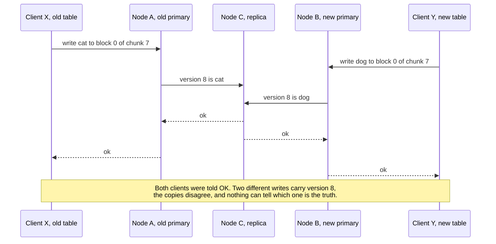
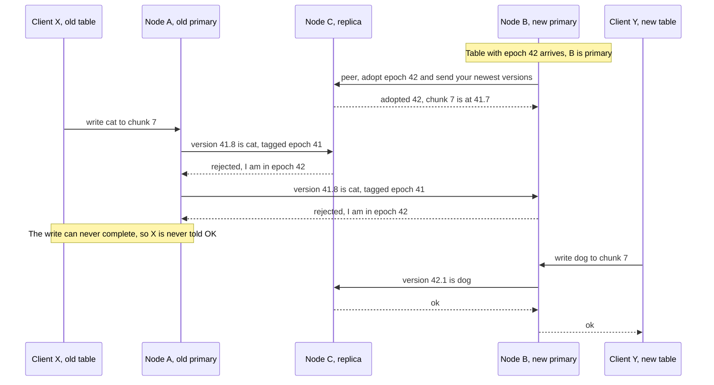
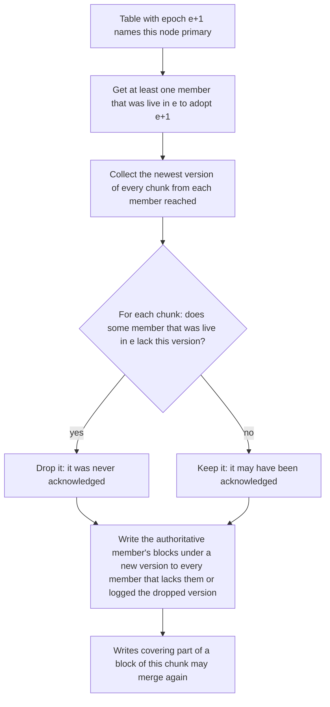
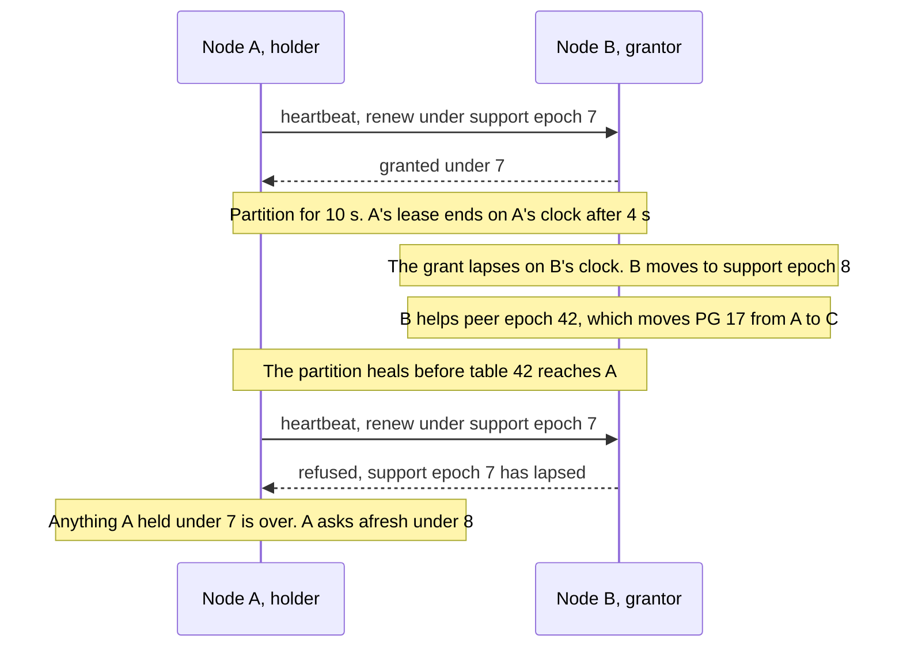
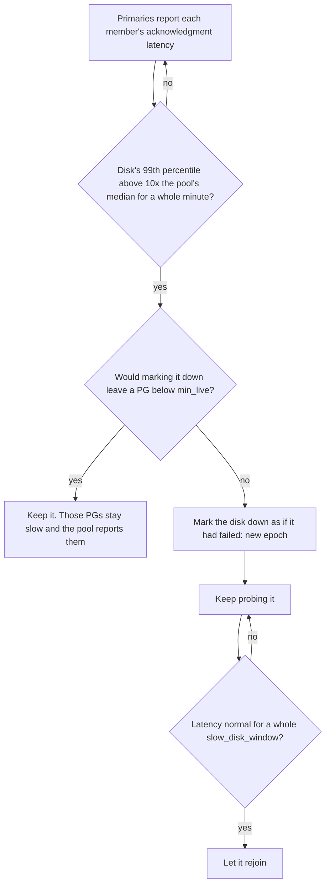
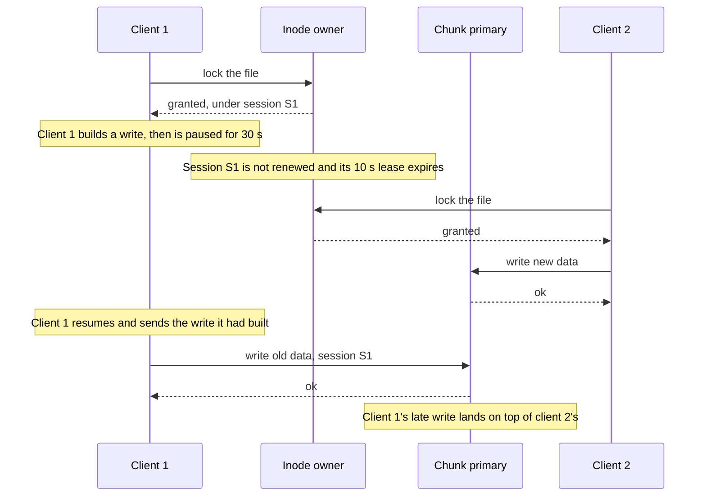
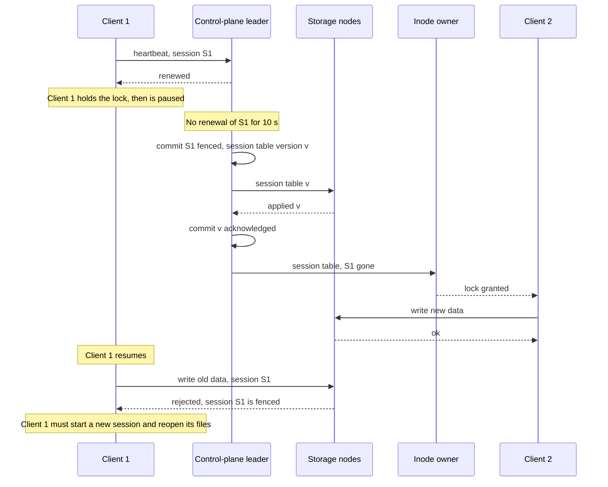

# Epochs, leases and failures: changing who is in charge while writes are in flight

Every chunk of data in rock-solid has one member in charge of it, the primary, and its node will
sometimes crash, hang, sleep or lose its network while clients are still writing. The obvious
fix, "if the primary stops answering, pick another one", is how storage systems lose data: for a
while two nodes both believe they are in charge, and a paused client can wake up and write over
someone else's data. rock-solid closes those windows with a small set of rules: numbered
membership epochs, a new primary that *peers* before its first write, read leases counted on
two clocks so that neither a time daemon nor a suspend can stretch them, and client sessions
that are *fenced* before their
locks move. This post walks through each race, the rule that closes it, and what the rules
cost. None of it runs yet: the protocols are to be modeled in phase 2 of the roadmap and built
from phase 3 on.

## Words you need

- **Placement group (PG), member, primary, replica.** Chunks are grouped into PGs, and each PG
  lists a few disks on different nodes, its *members*. The *primary* takes every read and write
  and forwards writes to the *replicas*. A member is *live* until the control plane marks it
  down. See [roles](../docs/glossary.md#roles-who-does-what) and
  [02-chunks-and-placement.md](02-chunks-and-placement.md).
- **Version, committed, acknowledged.** Every write to a chunk gets a new version. A version is
  *committed* once every live member holds it, and only then is the client told "OK"
  (*acknowledged*). See [data model](../docs/glossary.md#data-model).
- **Placement table, epoch, control plane.** The table maps every PG to its members; each new
  table gets a higher *epoch*. It lives in the *control plane*, one small Raft group (a few
  replicas that elect a leader and commit a change once a majority holds it), never on the I/O
  path.
- **Peering.** What a new primary does before its first write: it stops the old epoch from
  finishing writes and agrees with the members on the newest version of every chunk (a Ceph term).
- **Lease, support epoch.** A lease is a right that expires on its own unless renewed; a primary
  serves reads only under a *read lease* from its PG's other live members. A *support epoch*
  numbers one unbroken run of a lease. See
  [coordination and failure](../docs/glossary.md#coordination-and-failure).
- **Monotonic clock, drift, slewing.** A monotonic clock only moves forward, unlike wall-clock
  time; *drift* is how differently fast two clocks run. A time daemon *slews* a clock when it
  runs it faster or slower for a while to correct its reading.
- **Fail-slow.** A disk that keeps working but becomes far slower instead of failing.
- **Session, fencing.** A client daemon's registration, kept alive by a lease; its locks belong
  to it. *Fencing* makes sure a client whose session expired can no longer write, even if it
  does not know yet. See [files and caching](../docs/glossary.md#files-and-caching).

## The problem: two nodes that both think they are in charge

> **In plain words.** Picture a shared spreadsheet with one editor at a time. The editor goes
> quiet, so the office hands the pen to someone else. But the first editor was only on a slow
> train, and the moment the train leaves the tunnel they keep typing. Now two people edit the
> same cell, both get a "saved" message, and the copies disagree. Every storage system that
> replaces a failed leader has to make the hand-over safe even though it cannot know whether the
> old leader is dead or merely slow.

Take one PG in a three-replica pool. Its members are disks on nodes A, B and C, and A is the
primary. A client on some node writes 4 KiB into block 0 of chunk 7. A gives the write a
version, appends it to its disk's log, sends it to B and C in parallel, and acknowledges once all
three hold it durably.

Now the control plane stops hearing from A and publishes a new placement table naming B as
primary. A table reaches nodes at different times, so for a while A may still be acting on the
old table while B acts on the new one. Without any further rule, this happens:



*Look at the two arrows into C: one node is told two different things under one version number.*

That is *split brain*: two nodes in charge at once. Reads have their own race, because a read
needs nothing from the other members. An old primary cut off from the cluster but still
reachable by some clients keeps answering with old data:


*The write path never touches A, so nothing in it can stop A from answering reads.*

Two more races get their own diagrams below: a client that pauses while holding a lock and
writes after the lock has moved on ([Fencing](#6-fencing-client-sessions)), and a primary that
sleeps like a laptop with its lid closed and wakes up believing no time has passed
([A holder that slept](#a-holder-that-slept-gives-up-its-leases)).

The common thread: **failure detection is a guess.** A slow node looks exactly like a dead one,
so every rule below has to stay safe when the guess is wrong.

## The options

> **In plain words.** There are only a few ways to pick a new editor safely: let a referee
> appoint one and number every appointment, or let the editors vote among themselves. Reads need
> their own answer: check with the others before every read, or hold a permission slip that
> runs out on its own. And a client that went to sleep is stopped either by trusting it to watch
> the clock, or by telling the storage to refuse it.

Real systems combine answers to four questions, listed in the table. Two rows need a word more.
etcd-raft's tick-counted lease stops counting when an idle group goes quiet and checks its quorum
only once per election timeout, which is how an old leader can overlap a new one. CockroachDB's
older epoch leases hang every lease on one central liveness record; its newer leader leases, like
rock-solid's, rest on leases between pairs of nodes, and Ceph added PG read leases for the same
reason. Raft is covered in [08-the-metastore.md](08-the-metastore.md).

| Problem | Option | Gets right | Costs |
| --- | --- | --- | --- |
| Who is in charge | Timeouts alone | Nothing to build | Split brain |
| Who is in charge | Raft majority (etcd, rock-solid metadata) | No outside authority | 3 copies survive 1 failure |
| Who is in charge | **Appointed primary, epochs, peering (Ceph, rock-solid data)** | An acknowledged write survives while any one member does; writes continue down to `min_live` members | Needs the control plane, peering before writes |
| Fresh reads | Ask a majority on every read (Raft's ReadIndex) | No clock assumptions | A round trip per read |
| Fresh reads | Tick-counted lease (etcd-raft) | No round trip | Stops when idle; overlap up to one election timeout |
| Fresh reads | Central liveness record (CockroachDB epoch leases) | One renewal per node | Its outage expires every lease at once |
| Fresh reads | **Node-pair leases, support epochs (CockroachDB leader leases)** | No central record, no synced clocks, cost independent of PG count | Bounded oscillator drift needed, so each lease is counted on two clocks; a restarted node sits out one lease |
| Versions | Plain counter | Simple | Two primaries reuse a number |
| Versions | **Epoch + counter (Ceph `eversion_t`)** | Version alone tells writes apart | 24 bits of every version spent on the epoch |
| Stale clients | Client-side timeout only | Simple | A paused client writes late |
| Stale clients | Each server expires its own clients (Lustre, CephFS's metadata servers) | No central authority | Safe only where one server holds both the locks and the data (Lustre); otherwise one server's timeout must evict the client everywhere (CephFS) |
| Stale clients | **Expiry by the control plane, fence acknowledged by every storage node** | One verdict per session, late writes are rejected | Locks move only after every storage node confirms |

Bold rows are what rock-solid picked. The rest of the post explains each one.

## What rock-solid picked

### 1. Epochs and versions

> **In plain words.** Every time the office changes who holds the pen, it stamps a new edition
> number on the seating chart. Every edit is labeled with the edition its author was working
> from, and everyone refuses edits labeled with an old edition. Edits are also numbered
> "edition.sequence", so two editors in different editions can never produce two different edits
> with the same label.

#### How it works

Only the control plane changes membership. Its leader computes each new placement table and
commits it as one Raft entry with a new epoch; nodes never compute placement themselves. Any
change bumps the epoch: a pool created, a disk added, a node failed, a rebalance. Every node
caches the whole table (it maps PGs, not chunks, so it is small: 2048 PGs × 3 replicas × a 4-byte
disk ID is 24 KiB), and nodes reject requests carrying a stale epoch. Epochs never go backwards
on any node, one of the invariants the simulator is to check after every step.

The epoch also lives inside every version number. A version is 64 bits:

```text
 63                       40 39                                                 0
+---------------------------+----------------------------------------------------+
|  epoch of the primary     |  counter, counted up by that primary               |
|  that assigned it, 24 bit |  40 bit                                            |
+---------------------------+----------------------------------------------------+
  example: epoch 41, counter 7  ->  written "41.7" in this post
```

*The high bits say who assigned the version, so no two primaries can ever produce the same one.*

A primary that runs out of its 40-bit counter (about 1.1 trillion writes) asks the control plane
for a new epoch. Versions therefore grow across primaries, and a member that comes back holding a
write its new primary never saw is told apart by the version alone. In the first diagram, A's
write would be 41.8 and B's 42.1: different numbers, and 42.1 is newer. With a plain counter both
would be 8, and the stale write could pass for the current one.

### 2. Peering: the new primary before its first write

> **In plain words.** Before the new editor makes a single change, they walk round to the people
> who were in the room under the old edition, ask them to switch to the new edition, and compare
> notes on what the latest saved state of every cell is. Once any one person who was in the old
> room has switched, the old editor can no longer get a change saved, because saving needs
> everyone in the old room to agree.

#### How it works

The write rule does most of the work. A write tagged with epoch `e` completes only when every
member that is live in `e` acknowledges it, and a member that has adopted `e + 1` rejects anything
tagged `e`. So before it accepts writes, the new primary *peers*:

1. It gets at least one member that was live in `e` to adopt `e + 1`.
2. It collects the newest version of every chunk from each member it reaches.

After step 1 no write tagged `e` can complete, because each one needs that member's
acknowledgment, which it will now refuse. And every write already acknowledged in `e` is on that
member, because acknowledgment needed every live member. Here is the first race again, with the
rule in place:



*The rejections from B and C are the whole trick: the old primary is not stopped, it just can no
longer finish anything.*

A side benefit of this shape is that a crash does not need the old primary to cooperate. It can
be dead, partitioned or asleep; once one member from its epoch has moved on, its writes are
stuck.

#### Which versions to keep

Step 2 is harder than it looks. A write that the old primary sent out just before it crashed may
be on some members and not others, and the client may or may not have been told OK. The new
primary cannot tell an acknowledged write from one that reached every member it sees but was
never acknowledged. So it uses the one fact it can prove:

**The keep rule: a version is kept unless some member that was live in `e` lacks it.** A member
that lacks it proves the write was never acknowledged, since acknowledgment needed every live
member.

Keeping an unacknowledged write is fine: a write whose client never heard back may land or not.
Losing an acknowledged one is not, and the rule never does. Here is chunk 7 after A crashed
in the middle of sending 41.8, which reached only B. The new epoch 42 makes B primary and adds a
fresh disk D in A's place:

```text
chunk 7 when B starts peering for epoch 42

  member            live in 41?   newest version   its log holds
  A (old primary)   yes           crashed, cannot be reached
  B (new primary)   yes           41.8             ... 41.7, 41.8   <- A reached only B
  C                 yes           41.7             ... 41.7
  D (new disk)      no            none             nothing

  41.8: C was live in 41 and lacks it  ->  never acknowledged  ->  drop
  newest kept version: 41.7, held by C (the authoritative member)
  recovery: copy C's blocks of 41.7, as new version 42.1, to
            B (it logged the dropped 41.8) and D (it lacks them)
```

*The new primary's own newest write is the one thrown away: B cannot trust its own disk more than
the rule.* Had C been marked down during epoch 41, so not live in it, 41.8 on B alone could have
been acknowledged, and it would be kept. The rule hinges on who was live, not on who holds the
newest version.

The decision for each chunk, as a flow:



*Peering itself is the first two boxes, and it must finish before the PG accepts writes; both
branches end in the same recovery step, which is what makes every member agree.* Until a chunk's
kept versions are on the new primary, a write that covers only part of one of its blocks waits:
its merge needs the newest kept block as its base (next section). A write of whole blocks needs no
base and goes ahead, as Ceph's primary holds writes only to objects it is missing or still
recovering.

#### Dropped versions are always a chunk's newest

> **In plain words.** A write of a few bytes is stored as a whole block that already contains the
> bytes of the write before it. So if peering threw away an older write but kept a newer one, the
> newer one would quietly carry the thrown-away bytes back. That cannot happen, because every disk
> stores a chunk's writes in order: a disk missing one write is missing every later one too.

A primary turns a write that covers part of a 4 KiB block into a whole block by merging the new
bytes onto the newest version it has handed out ([post 02](02-chunks-and-placement.md)). Version
41.9 of a block may therefore hold 41.8's bytes. If peering could drop 41.8 and keep 41.9, the
kept block would bring back bytes of a write that was never acknowledged, and that is exactly
what the [sub-block writes spike](#evidence) saw when its model let peering drop any subset of
pending versions: every seed went wrong.

Peering never does, for three reasons that chain together. A primary sends a chunk's writes to
each member in version order, over one connection, and again in that order after a reconnect.
Each member's log takes them in that order. And durability is a prefix of a disk's log
([04-one-log-per-disk.md](04-one-log-per-disk.md)): when a record is durable, so is every record
before it. So a member that lacks 41.8 lacks 41.9 as well, the keep rule drops both, and the
versions peering drops are always a suffix of each chunk's pending versions. The spike's model
with that rule stayed correct through 3,670 primary changes with 8 writes pipelined per client.

#### Why recovery writes a new version instead of deleting the old one

> **In plain words.** Each disk's log only ever appends, so the way to take back a write is to
> append something newer over it.

B, as a replica in epoch 41, put 41.8 into its index as soon as it was durable (replicas do,
since they serve no live reads), so the recovery copy fixes what B holds right away. It also
matters later. After a crash a disk rebuilds its index by replaying its log
([04-one-log-per-disk.md](04-one-log-per-disk.md)). Replay applies every logged record, and the
dropped write is still in B's log, so it would come back the next time B restarts unless a later
record in B's log covers the same blocks. The recovery copy under a new version is that later
record. A version check during replay would not help either: the dropped write's version, 41.8, is newer
than the 41.7 blocks it replaced. This is Ceph's approach to divergent objects, and the
[chunk epochs spike](#evidence) showed both halves: without the copy the dropped write comes
back; with it, replay converges.

The same rule covers a primary that restarts without any membership change. It peers again, in
its own epoch or a new one, before it serves anything.

#### Reads see only committed versions

> **In plain words.** A primary never lets a read see a write before every live member holds it.

Making a write visible is called *mapping* it into the chunk index
([04-one-log-per-disk.md](04-one-log-per-disk.md)). A primary maps a write only when it commits.
Until then the write is *pending*: its record is in the log, and a read finds the previous
version's blocks without waiting. Otherwise a reader could see a write that a primary crash then
loses, since the new primary may be a member that never received it.

### 3. Read leases

> **In plain words.** Peering stops the old editor from saving, but not from *reading aloud* the
> old spreadsheet to anyone still listening. So the editor is only allowed to read aloud while
> holding a short permission slip from each colleague, and each colleague promises not to help a
> new editor take over until the slip they signed has run out. If the slip lasts four seconds,
> the old editor goes silent before the new one can start, even if nobody can talk to anybody.

#### How it works

A primary serves reads for a PG only while it holds an unexpired read lease from each of the PG's
other live members. A member that granted a lease does not take part in peering a new epoch that
moves the primary away from that node until the lease expires, or until the old primary has
adopted the new epoch itself. Peering needs at least one member that was live in the old epoch,
and every such member, the new primary among them, granted the old primary a lease, so peering
cannot finish before those leases run out. In every planned change the old primary adopts the
new epoch itself, so planned moves never wait for a lease.

`primary_lease` defaults to 4 s, deliberately shorter than failure detection (below).

#### Counting on clocks that never agree

The holder and the grantor each count the lease on their own monotonic clocks. They never compare
readings, so the clocks need not be synchronized. What makes this safe is *when* each side starts
counting:

- The holder counts from when it **asked** for the lease.
- The grantor counts from when it **granted** it, which is later, since the request had to
  travel.
- The holder stops `lease_drift` early: by default 1% of the lease, 40 ms of the 4 s.

```text
real time  ---------------------------------------------------------------------------->

             A asks                                          A stops serving reads
             |                                               |  4 s - 40 ms on A's clock,
             v                                               v  counted from the ask
A (holder)   *===============================================*

                 B grants                                         B's grant lapses
                 |                                                |  4 s on B's clock,
                 v                                                v  counted from the grant
B (grantor)      *================================================*--> B may now peer an
                                                                       epoch that moves
             <-->                                            <---->    the primary off A
             message delay                                   40 ms margin + delay
```

*A's interval ends before B's even if A's clock runs a little slow and B's a little fast:
message delay and the margin both push A's end earlier.*

The margin only has to cover a difference in clock *rates*. How large that difference can get
depends on which clock each side counts on.

#### Two clocks, because a time daemon can bend either one

> **In plain words.** Each colleague times the slip on two watches. The office time-keeper may
> quietly run the first a fifth fast or slow to put its time right; nobody touches the second,
> but it may have left the factory a little off. The editor stops reading aloud as soon as
> *either* of its watches says the slip is up, and a colleague helps a new editor only once
> *both* of theirs say so. Whichever watch is wrong, it can only make the editor stop sooner or
> the colleague wait longer.

A time daemon (chrony, systemd-timesyncd, ntpd) keeps the wall clock right by *slewing*: running
the clock faster or slower for a while instead of jumping it. On Linux, `CLOCK_MONOTONIC` and
`CLOCK_BOOTTIME` follow every slew. The kernel's `MAXFREQ` (500 ppm) bounds only one of the knobs
`adjtimex` offers: the tick can move ±10%, and the kernel's phase-locked loop and `adjtime()`
slew an offset on top. The [clock slew spike](#evidence) applied each in a throwaway kernel:

| What the daemon does | How far off `CLOCK_BOOTTIME` runs |
| --- | --- |
| ntpd at its defaults | about 0.1% at most |
| systemd-timesyncd correcting a 0.4 s offset | 5% in the first second |
| chrony correcting any offset after its first updates, default `maxslewrate` | 8.3%, for 12 s per second of offset |
| everything the kernel accepts at once | 22.6% |

A 1% margin covers none of the last three. With chrony slowing the holder's clock and speeding
the grantor's, a 4 s lease outlives its grant by 0.63 s, and at the kernel's limits by 1.85 s:
long enough for a new primary to accept a write while the old one still serves the value it
replaced.

`CLOCK_MONOTONIC_RAW` is the clock no daemon touches. It runs at the rate the kernel calibrated
for the processor's time-stamp counter at boot, which the kernel never checks against a bound
and only a daemon corrects, in `CLOCK_BOOTTIME`. So each lease is counted on both:

- The **holder** ends it when *either* clock shows the lease minus `lease_drift` since it asked.
- The **grantor** keeps it until *both* clocks show the whole lease since it granted.

A slew or a bad calibration can then only end a holder's lease early or make a grantor wait
longer, by at most 22.6% for a slew. What is left for the 40 ms margin is the two oscillators'
own difference, typically within ±100 ppm each. The remaining gap, both of one node's clocks
wrong the same way (a bad calibration with no daemon to correct it), is watched from outside:
heartbeats carry the sender's `CLOCK_MONOTONIC_RAW`, each node estimates its peers' rates
against its own, and a holder that finds a grantor more than half the margin faster widens its
margin by the difference and reports the pair.

#### A holder that slept gives up its leases

Go's monotonic clock reads `CLOCK_MONOTONIC` (`runtime/sys_linux_amd64.s`), and on Linux that
clock **stops while the machine is suspended**, as `CLOCK_MONOTONIC_RAW` does. A node that
suspends while holding a lease, the way a laptop does when its lid closes, wakes up believing
almost no time has passed:


*Every rule worked as designed on B and C; the hole is a clock on A that did not count the
sleep.*

`CLOCK_BOOTTIME` does count the sleep, but the kernel may measure it in whole seconds read from
the real-time clock chip, so no clock tells A exactly how long it slept. A holder that resumes
from suspend therefore ends every lease it holds and asks again. A grantor needs no such rule: a
clock that stopped only makes it wait longer.

The core itself never reads a clock: a state machine gets time only from its driver, today as
`ctx.Now`, a `Tick` of one microsecond ([`internal/core/event.go`](../internal/core/event.go)).
The lease rules add `ctx.Raw` on `CLOCK_MONOTONIC_RAW` and a `Resumed` event, both for the
"Clock and timers" checklist item to build; the loop reads the two clocks itself, about 140 ns
each per pass, since Go reaches neither through its fast path. That keeps the choice of clocks
in one place, and it lets the simulator slew one node's clock, drift another's oscillator and
suspend a leader's node past its lease (planned placement and MetaStore faults).

#### Support epochs: a lease that lapsed never comes back

A is primary of PG 17 and holds B's grant under support epoch 7. A partition lasts 10 s. A's own
clock ends its lease after 4 s, so A stops serving reads; B's grant lapses on B's clock, and B
helps peer epoch 42, which moves PG 17 to C. The partition heals before table 42 reaches A, and
A's next heartbeat asks B to renew. If that renewal simply continued the old grant, everything
recorded under it would continue too, as if the gap never happened, though B spent the gap
helping a new primary. So each grant carries a *support epoch*. Once a grant lapses on the
grantor's clock, the grantor bumps the support epoch and never renews the old one:



*The number makes the gap visible: nothing granted under 7 survives the partition.*

What the design settles: a lease taken under a lapsed support epoch never comes back, and every
Raft promise made under it ends (post 08 explains those promises). What it leaves open is which
PGs a fresh grant under 8 covers: a grant covers "every PG the pair shares", but the design text
does not say by whose table, B's current one or A's stale one. The safe reading, which is this
post's and not the design's, is the grantor's current table: B, already in epoch 42, shares no
primary role for PG 17 with A, so A gets no lease for it and serves no stale read.

#### The restart rule

A node that restarts has forgotten what it granted. It may have granted node A a lease a moment
before it crashed; if it came straight back and joined peering for a new epoch that moves A's PGs
elsewhere, A could still be serving reads under that forgotten grant. So for one `primary_lease`
(4 s) after it starts, a node grants no vote and joins no peering. Every grant it could have made
before the crash has lapsed by then.

#### One lease per pair of nodes, not per PG

A three-replica pool of 2048 PGs on five nodes gives each of the ten node pairs hundreds of
shared PGs, so leases per PG would mean hundreds of renewals per pair. Instead, leases are granted
per node pair, covering every PG the pair shares, and ride on the heartbeats already flowing
between the two nodes:

```text
 per-PG leases (not chosen)               per-node-pair lease (chosen)

 node B -> node A                         node B -> node A
   lease for PG 17                          one grant, support epoch 7
   lease for PG 203                         covers every PG where a disk on A
   lease for PG 988                         is primary and a disk on B is a member
   ... one per shared PG,                   renewed by the B <-> A heartbeat
   each renewed on its own                  cost: one per pair, whatever the PG count
```

*The right-hand box does not grow when the pool's PG count doubles.*

The MetaStore's Raft groups reuse the same node-pair leases for their leader leases, which lets
an idle group stop heartbeating and keep its lease; see [08-the-metastore.md](08-the-metastore.md).

### 4. Failure detection

> **In plain words.** The office manager expects a "still here" text from everyone once a second.
> Five seconds of silence and you are presumed gone. Separately, if you are waiting on a colleague
> for more than a second, you can tell the manager, who phones that colleague directly and, if
> there is no answer, marks them gone at once.

#### How it works

Only the control plane changes membership. Every node sends it a heartbeat each second, and it
marks a node down after `node_down_after` (default 5 s) without one. A primary that waits more
than `member_timeout` (default 1 s) for a member's acknowledgment reports it, and the control plane
marks the member down at once if it also fails a direct probe. Marking down means publishing a new
table, so a new epoch. Until that new epoch, writes to the affected PGs wait, so a crash pauses
those writes for up to `node_down_after`.

Here is a primary crash, end to end:

```text
 t = 0 s     node A crashes. It is primary for some PGs; B and C hold members of them.
             Writes to those PGs stop completing.
 t <= 4 s    every read-lease grant B and C made to A lapses on their own clocks
             (each grant runs 4 s from its last renewal, which was at or before 0 s;
             up to 5.2 s of real time while a time daemon slows a grantor's clock)
 t = 5 s     no heartbeat from A for node_down_after: the control plane marks A down
             and commits a new table, epoch 42, naming B primary of A's PGs
 t > 5 s     B peers (C adopts 42, B collects the newest versions) before it accepts
             writes, and recovers divergent chunks. Reads resume once B holds read
             leases from C and the new members.
```

*`primary_lease` (4 s) is shorter than `node_down_after` (5 s), so by the time A is marked down
its leases have run out: a crash adds no wait for the lease, and failure detection sets the
pause.*

While writes are flowing, a replica that crashes is usually caught sooner. Its primary notices
within `member_timeout` that a write is not being acknowledged and reports it; the control
plane's direct probe fails, so the member is marked down without waiting for 5 s of missing
heartbeats.

### 5. Fail-slow disks

> **In plain words.** A colleague who has quit is easy to replace. A colleague who still answers
> every question, but takes ten minutes each time, holds up every meeting they are in, and nobody
> ever files a complaint. Someone has to notice that they are always the slowest by far, for long
> enough that it is not a bad afternoon.

#### How it works

Because a write waits for every live member, one disk that slows down without failing stalls
every write of every PG it belongs to. No error is ever reported. So primaries report each
member's acknowledgment latency to the control plane, and it compares each disk against its
pool:



*Two guards: never trade slowness for unavailability, and never let a flapping disk churn epochs.*

The settings are `slow_disk_factor` (default 10×) and `slow_disk_window` (default 1 minute). The
`min_live` guard comes from the pool: a PG with fewer than `min_live` live members (default
`min(replicas, 2)`) rejects writes, so marking a slow disk down there would turn "slow" into
"stopped". Pools and `min_live` are covered in
[07-pools-and-redundancy.md](07-pools-and-redundancy.md).

### 6. Fencing client sessions

> **In plain words.** A client holds a lock, then freezes: a long pause, a stopped virtual
> machine, a network that drops it. Its lock times out and goes to someone else. Then the frozen
> client wakes up and finishes the write it had already started, right over the new lock
> holder's data. Telling the client "stop at the deadline" cannot help, because a frozen client
> cannot look at its watch. The storage itself has to refuse the late write.

Here is the race:



*The lock was correct the whole time; the problem is a write that was already on its way.*

#### Who decides that a session has expired

> **In plain words.** A client may deal with many desks at once: one per file it has open. If each
> desk kept its own stopwatch on the client, they would disagree, and a client that could reach
> one desk but not another would be "alive" and "dead" at once. So one desk keeps the only
> stopwatch: the office manager, who already gets a "still here" text from every machine once a
> second. That text also renews the machine's session, and only the manager ever declares a
> session over.

Each client daemon holds one session, `session_lease` (10 s by default), for its FUSE mounts and
block devices alike. Its locks, open registrations and cache rights all belong to the session,
and every chunk write carries its ID.

The session is a key in the control-plane group, `ctl/session/{id}`, and its lease is renewed
by the heartbeat each node already sends the control-plane leader every second
([Failure detection](#4-failure-detection)): the heartbeat names the session, the reply grants
the renewal. Renewals change only the leader's memory; the Raft log changes only when a session
starts or is fenced. The inode owners, the MetaStore leaders that track open files, hold the
session's locks and opens but never decide that it expired, so they cannot disagree, and an
owner that fails over leaves every session as it was.

Both sides count the lease the way every lease in this post is counted
([Counting on clocks](#counting-on-clocks-that-never-agree)): the client from when it
*sent* its last answered renewal, as a holder, the leader from when it *processed* that
renewal, which is later, as a grantor. Two more rules keep the leader from expiring a session
too early:

- **Only a leader holding its leader lease answers renewals**, and a new leader gives every live
  session a full `session_lease` from the start of its own lease before expiring any. A renewal
  answered by a deposed leader was answered under a lease that ended before the new one began.
- **A leader that stalled restarts every session's timer** instead of expiring sessions it could
  not hear, as CephFS's metadata server skips expiries after it was itself slow.

Both only delay an expiry, never bring it forward. A client that cannot reach the control plane
at all stops writing when its lease ends, but holds its requests rather than failing them: if a
new leader answers in time, its applications see only a pause.

This is how Chubby, ZooKeeper, etcd and HDFS keep sessions too. The other shape, where each
server times out its own clients, works for Lustre and a single NFS server because the server
that holds a client's locks also holds the data they protect; CephFS, whose locks and data live
on different servers, turns the first server's timeout into a cluster-wide blocklist. The
[session expiry study](../studies/session-expiry/README.md) compares them.

#### How the fence lands

Three rules work together:

1. **The client stops itself early, as far as it can.** It issues no write after its lease ends,
   and no attribute or directory-entry timeout it hands the kernel reaches past that instant. So
   when the lease ends, the next `read()` on a paused node asks the daemon for attributes, and
   the daemon, seeing its lease has lapsed, drops the file's cached pages first.
2. **The control plane fences, and every storage node confirms.** When a session's lease runs out
   on the leader's clock, or an owner reports a recall the session left unanswered for
   `recall_timeout` (30 s), or an operator evicts it, the leader commits it as fenced in a new
   version of the *session table*. One version fences every session due at that moment, so a
   switch failure that strands many nodes costs one version, not one each. Every storage node
   applies the version, rejects from then on every write from that session, including ones
   already queued, and acknowledges.
3. **Locks move only after every storage node has confirmed.** Once every storage node has
   acknowledged, or has been marked down in a committed epoch, the leader commits the version as
   acknowledged and the session leaves the table. Only then do owners free its locks, drop its
   open registrations and count its recalls as answered.



*Rule 3 is the ordering that matters: the lock moves only after every storage node has applied
the fence or been marked down.*

A write the fenced client got applied before the fence is therefore ordered before every write of
the next lock holder. A storage node that was marked down instead of acknowledging cannot finish
an old write either: once its PGs' new primaries have peered, no write tagged with the old epoch
completes. It is marked up again only once its heartbeat reports the current table. The fenced
client must start a new session and reopen its files, and its applications get errors, never
silently stale data. The same machinery serves file locks (`flock`), cache recalls, snapshot cuts
and shared block volumes; see
[09-rwx-filesystem-and-cache-coherence.md](09-rwx-filesystem-and-cache-coherence.md) for how
sessions fit into cache coherence.

The session table is read on every write, so in the runtime it is an immutable table published
through an `atomic.Pointer`, like the placement table: a reader loads the current one without a
lock.

#### Incarnations

A restarted daemon resumes its session, so bytes the dead process left queued on a socket could
still reach a primary after its successor's writes. Each connection therefore names an
*incarnation*, the daemon's start time on `CLOCK_BOOTTIME`, and a primary that has seen a newer
one rejects the older one's writes; see
[10-block-snapshots-and-clones.md](10-block-snapshots-and-clones.md).

## Evidence

Most of this post is protocol, not performance, and the design's evidence for it is mostly
reasoning plus planned model checking. Here is what exists today, and what does not.

**The chunk epochs spike** ([appendix](../docs/design.md#appendix-chunk-epochs-spike),
[`spikes/chunk-epochs/`](../spikes/chunk-epochs/)) ran the real `internal/chunkstore` index on
Linux 6.18.44 with Go 1.27.0; nothing in it is timed. A *checkpoint* is a saved copy of a disk's
index, so a restart replays only the log after its *replay point*. Two of its tests are about
peering, and one about the cost:

| Test | Result |
| --- | --- |
| R3: a write peering dropped, replayed from a checkpoint taken while it was pending | **Comes back**: replay maps the dropped write (block 0 at v2; the live index holds v1) |
| R3b: the primary also logs the recovery copy of the authoritative blocks under a new version | Replay ends at the recovered blocks (v3, a copy of v1's) |
| R1: replay past pending writes, a chunk's commits in version order, 200 seeds | **0 of 200 seeds** differ from a rebuild |

R3 and R3b are why recovery writes a new version to every member that logged a dropped write,
the new primary included. R1 shows that replaying committed records again is harmless provided a
primary maps a chunk's writes in version order, and the spike's conclusions put a bound on the
cost: while a write is pending, replay grows by what the disk logs meanwhile, at most
`node_down_after` (5 s) of writes during a member failure.

**The sub-block writes spike** ([appendix](../docs/design.md#appendix-sub-block-writes-spike),
[`spikes/sub-block-writes/`](../spikes/sub-block-writes/)) modeled a primary that merges partial
blocks onto pending versions, two clients pipelining 8 unaligned writes each into one chunk, and a
primary change in about 2% of steps, against an oracle that replays every acknowledged write's
bytes; 500 seeds per test, no I/O:

| Test | Result |
| --- | --- |
| M6: peering drops a suffix of each chunk's pending versions | 0 of 500 seeds wrong, 3,670 primary changes |
| M7: peering may drop any subset | **500 of 500 wrong**: a kept version carries a dropped one's bytes |
| M8: the new primary merges before it holds a version peering kept | **458 of 500 wrong** |

M7 is why the in-order logging behind the suffix rule matters, and M8 why a partial-block write
waits for its chunk's recovery.

**The clock slew spike** ([appendix](../docs/design.md#appendix-clock-slew-spike),
[`spikes/clock-slew/`](../spikes/clock-slew/)) asked how far a time daemon can bend the clocks
leases count on. Changing the host's clock was ruled out, so it built Linux 6.18 as User-Mode
Linux, a kernel that runs as an ordinary process, and applied every adjustment `adjtimex`
accepts inside it, measuring `CLOCK_MONOTONIC` and `CLOCK_BOOTTIME` against
`CLOCK_MONOTONIC_RAW`. The daemons' own calls come from the chrony 4.9 and systemd v258 sources;
the daemons themselves were not run.

| Test | Result |
| --- | --- |
| Tick 9000 and 11000 (±10%) | −100,000 and +100,000 ppm |
| Frequency asked for +1,000 ppm | Clamped to 500 ppm: the only knob `MAXFREQ` bounds |
| chrony's call for its default `maxslewrate` | **±83,333 ppm**, steady |
| systemd-timesyncd's call for a 0.399 s offset | −49,870 ppm in the first second |
| Every knob at its limit | **±226,000 ppm** in the first second |
| Wall-clock steps of 1 and 2 s | No change in `CLOCK_MONOTONIC`'s rate |
| Reading `CLOCK_MONOTONIC_RAW` from Go | 140 ns, the same as `CLOCK_BOOTTIME` |

The first rows are why one clock is not enough; the last two are why counting on two is cheap
and steps are harmless.

**Leases for metadata.** The case against etcd-raft's own lease (read from its v3.6.0 source)
and the idle cost that per-node-pair leases let Raft groups shed, 36% of a core for 3,000 idle
raft-rs replicas down to 0.07% when quiesced, are the evidence for post
[08-the-metastore.md](08-the-metastore.md); see the [multi-Raft spike README](../spikes/multi-raft/)
and [Metadata layer](../docs/design.md#metadata-layer-metastore).

**What is not measured yet.** No spike exercises peering, read leases or fencing; the chunk
epochs spike lists "peering itself" as not covered, and the clock slew spike measured the clocks
leases count on, not the leases. The roadmap's answer is phase 2: TLA+ models
(a formal specification language, checked by its model checker, TLC) of epoch changes, leases and
sessions with fence acknowledgments, before the real protocols are written. Their properties are
fixed: no PG serves reads from two primaries at once, no write tagged `e` completes after `e + 1`
activates, no fenced session's write is applied, and no lock reaches a new holder while a primary
would still accept the old holder's writes. Phase 3 then checks the same invariants in the
deterministic simulator under faults such as a partitioned old primary, clock drift, a crash
during peering and a node restarted within a lease it granted.

## Trade-offs and what it costs us

- **A crash pauses writes for up to 5 s** (`node_down_after`) on the crashed primary's PGs.
- **A partitioned primary stops serving reads within 4 s**, even if its disk is fine.
- **Correctness depends on oscillators, not on the time daemon.** Counting each lease on two
  clocks means a daemon's slew, up to 22.6%, only shortens a holder's lease or lengthens a
  grantor's wait, so a crash can wait up to 5.2 s for its lease instead of 4 s. The 1% margin
  then covers two oscillators at ±100 ppm about fifty times over, and heartbeats watch for one
  that is further off. It costs the loop one more clock read, about 140 ns, per pass.
- **A paused virtual machine is not covered.** A hypervisor that pauses a VM, snapshots it or
  live-migrates it can stop every clock in the guest, `CLOCK_MONOTONIC_RAW` included, so a holder
  that resumes still trusts leases its grantors have let lapse.
- **A restarted node sits out one `primary_lease`** (4 s) before it votes or peers.
- **Every write waits for every live member**, so a slow disk hurts every PG it is in. Fail-slow
  detection is deliberately sluggish and never goes below `min_live`: those PGs stay slow.
- **A dead client's locks are held for a while**: its 10 s session lease, then every storage
  node's fence acknowledgment, or a down mark for one that cannot be reached. Its applications get
  errors and must reopen their files.
- **Mapped pages are not covered.** A paused node's memory-mapped (`mmap`) readers can see stale
  pages until its daemon runs again, since the kernel does not revalidate them.
- **Replay and recovery cost extra writes.** A pending write can add up to `node_down_after` of
  log to the next restart's replay, and each dropped write costs a copy to every member that
  logged it or lacks its blocks.

## Open directions

- **Everything here is planned, not built.** The checklist items "Epoch change model" and
  "Sessions and fencing model" (phase 2), "Replica primary", "Peering and read leases" (in a
  sans-IO `internal/lease` package) and "Failure and fail-slow detection" (phase 3) are all
  open. The one finished piece is "Peer requests" in
  [`internal/core/peer.go`](../internal/core/peer.go): it tracks each request to another node
  with its deadline, and a timeout keeps the request's buffer, since the peer may be slow rather
  than gone.
- **A gap in the design text, not listed among its open questions.** Whether a fresh node-pair
  grant covers PGs by the grantor's current table or the holder's.
- **Open question: incarnation fencing in the epoch-change model.** A dead daemon's write could
  be delivered late to an old primary in epoch `e`, or to a new primary that has not yet seen the
  successor's incarnation. Does each primary's table of newest incarnations need to survive a
  primary change, or does the epoch rule already reject every such write? The design lists this
  under [open questions](../docs/design.md#roadmap-and-open-questions).
- **Open question: admission across a placement group.** A disk whose cleaner falls behind
  slows its own writes, and so its acknowledgments. Should members report admission rates to the
  primary, as CockroachDB's followers return tokens, so one cleaning disk does not stall a whole
  PG? It is the polite cousin of a fail-slow disk.
- **Open question: leases across a VM pause.** QEMU and Firecracker restore a paused guest's
  clock to where it stopped. Can a node notice, from the VMClock device or its peers' next
  heartbeats, before it serves a read, or must storage nodes run on hosts that never pause them?
- **Tech debts:** none of the entries in `docs/tech-debts.md` covers epochs, leases or fencing.

## Further reading

- Design: [Epoch changes and failure detection](../docs/design.md#epoch-changes-and-failure-detection),
  [Data layer: versions, committed reads and fencing](../docs/design.md#data-layer-chunkstore),
  [Sessions and fencing](../docs/design.md#sessions-and-fencing),
  [Daemon restart and upgrade](../docs/design.md#daemon-restart-and-upgrade) (incarnations),
  [Reads and leader leases](../docs/design.md#metadata-layer-metastore),
  [Pools and redundancy](../docs/design.md#pools-and-redundancy) (`min_live`),
  [Testing strategy](../docs/design.md#testing-strategy) (faults and invariants),
  [Alternatives considered](../docs/design.md#alternatives-considered),
  [Roadmap and open questions](../docs/design.md#roadmap-and-open-questions).
- Spikes: [chunk epochs](../spikes/chunk-epochs/), [multi-Raft](../spikes/multi-raft/),
  [raft rounds](../spikes/raft-rounds/), [clock slew](../spikes/clock-slew/),
  [sub-block writes](../spikes/sub-block-writes/).
- Code: [`internal/core/peer.go`](../internal/core/peer.go) and
  [`peer_test.go`](../internal/core/peer_test.go), [`internal/core/event.go`](../internal/core/event.go)
  (`Tick` and `Context`).
- Glossary: [coordination and failure](../docs/glossary.md#coordination-and-failure),
  [consensus and metadata](../docs/glossary.md#consensus-and-metadata).
- Other posts: [02-chunks-and-placement.md](02-chunks-and-placement.md) (PGs, versions, the
  placement table), [04-one-log-per-disk.md](04-one-log-per-disk.md) (replay),
  [07-pools-and-redundancy.md](07-pools-and-redundancy.md) (`min_live`),
  [08-the-metastore.md](08-the-metastore.md) (leader leases and fortification),
  [09-rwx-filesystem-and-cache-coherence.md](09-rwx-filesystem-and-cache-coherence.md) (sessions),
  [10-block-snapshots-and-clones.md](10-block-snapshots-and-clones.md) (incarnations),
  [11-runtime-in-go.md](11-runtime-in-go.md) (the sans-IO core),
  [12-testing-for-trust.md](12-testing-for-trust.md) (simulation and model checking).
