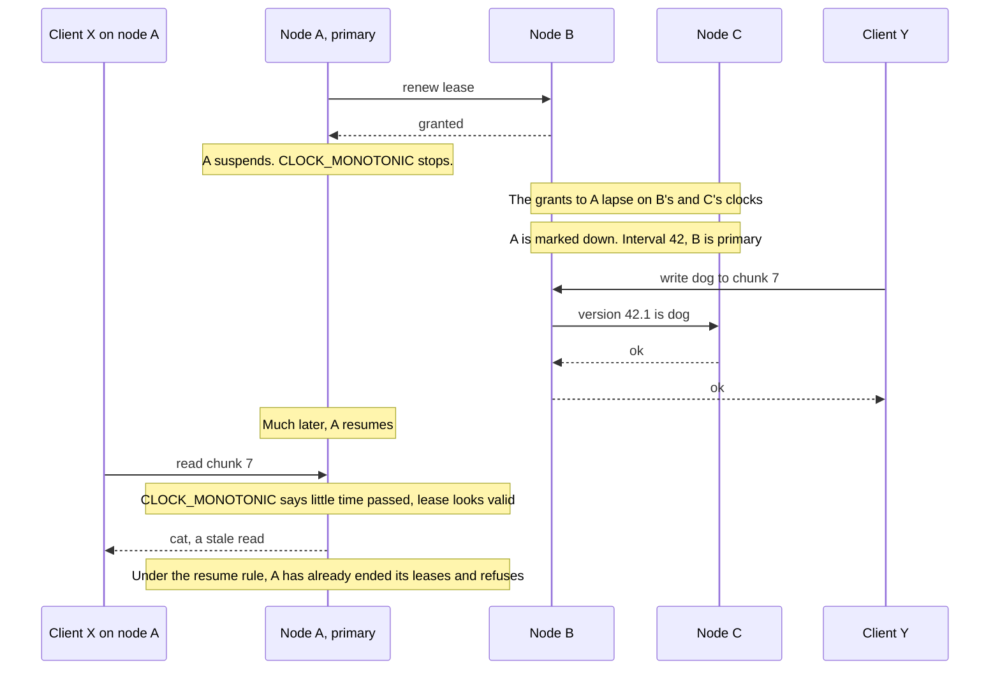
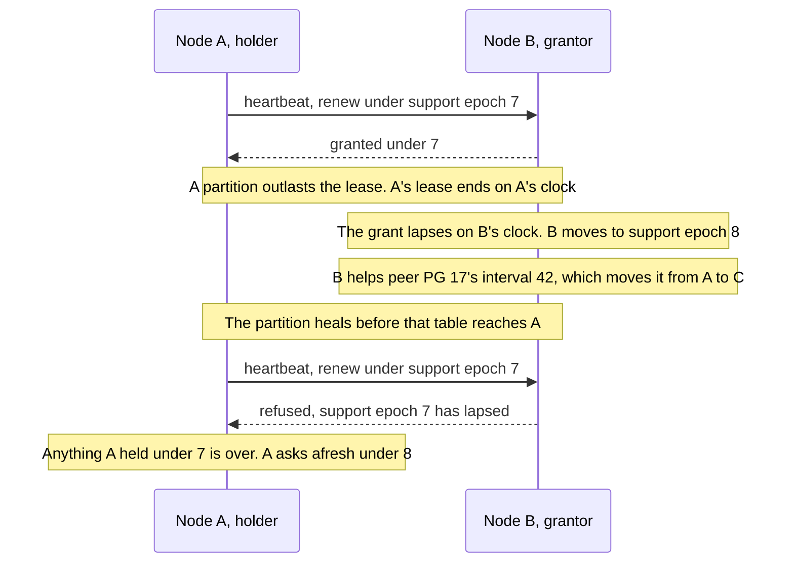
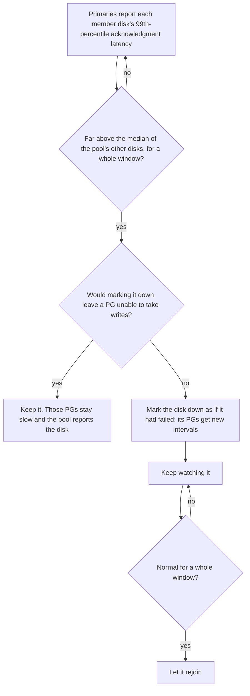
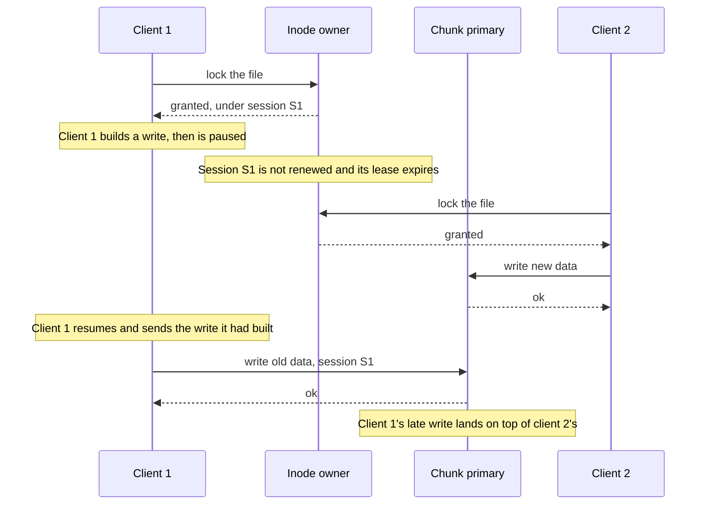
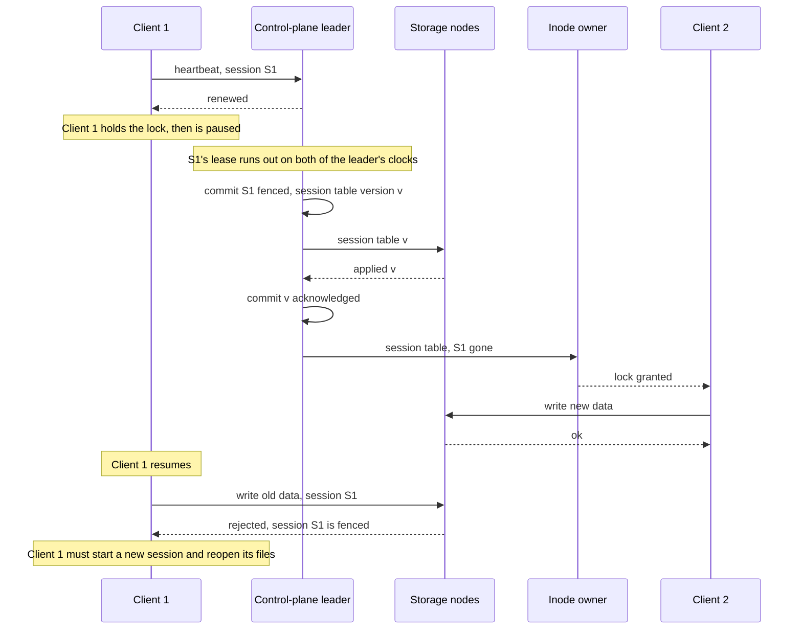

# Leases, failure detection and fencing: stopping the old primary and the paused client

[Part one](03-epochs-leases-and-failures.md) showed how a new primary takes over a placement group's
writes: once peering has moved one member of every earlier interval on, the old primary can no
longer finish a write. That leaves three gaps. An old primary can still *read* to anyone who reaches
it. Someone has to decide that a node is dead or a disk is slow, knowing the guess may be wrong. And
a client that paused while holding a lock can wake up and finish a write after the lock has moved
on. This part covers the rules that close them: read leases counted on two clocks and given up
after a suspend or a VM pause, failure and fail-slow detection, and client sessions that are fenced
before their locks move.

## Words you need

- **Lease.** A right that expires on its own unless renewed. The *holder* uses it; the *grantor*
  promises not to act against it until it expires.
- **Support epoch.** A number for one unbroken run of a lease between two parties; it has nothing to
  do with the table epoch. See [coordination and failure](../docs/glossary.md#coordination-and-failure).
- **Monotonic clock, drift, slewing.** A monotonic clock only moves forward, unlike wall-clock time;
  *drift* is how differently fast two clocks run. A time daemon (chrony, ntpd, systemd-timesyncd)
  *slews* a clock when it runs it faster or slower for a while to correct its reading.
- **Event loop.** rock-solid runs one loop per CPU core, each owning its own share of the work
  ([post 11](11-runtime-in-go.md)). A node is several loops.
- **Fail-slow.** A disk that keeps working but becomes far slower instead of failing.
- **Session, fencing, incarnation.** A client daemon's registration, kept alive by a lease; its
  locks belong to it. *Fencing* makes sure a client whose session expired can no longer write, even
  if it does not know yet. An *incarnation* tells one run of a client daemon from the next. See
  [files and caching](../docs/glossary.md#files-and-caching).

## 3. Read leases

> **In plain words.** Peering stops the old editor from saving, but not from *reading aloud* the
> old spreadsheet to anyone still listening. So the editor is only allowed to read aloud while
> holding a short permission slip from each colleague, and each colleague promises not to help a
> new editor take over until the slip they signed has run out. Since the slip is short, the old
> editor goes silent before the new one can start, even if nobody can talk to anybody.

### How it works

A primary serves reads for a PG only while it holds an unexpired read lease from each of the PG's
other live members, and only while its interval has enough live members to take writes. The rules
around it:

- **A grantor waits out its grant.** A member that granted a lease joins no peering of an interval
  that moves the primary away until the grant expires, or until the old primary has adopted that
  interval itself, which its next lease request shows. Every member that could finish a new
  primary's peering granted the old one a lease, so peering cannot finish before those leases run
  out. In a planned change the old primary adopts the new interval itself, so planned moves wait at
  most a heartbeat.
- **A grantor grants only a holder that is up to date.** A grant or renewal goes only to a holder
  that reported a table at least as new as the grantor's own. An old primary that still reaches its
  members but not the control plane therefore loses its leases within one lease length.
- **Keeping the primary costs nothing.** A new interval that keeps the primary, such as one that
  replaces a replica, needs no wait: the primary keeps serving committed versions and holds only
  writes while it re-peers.

The lease is deliberately shorter than failure detection (below), so by the time a crashed primary
is marked down its leases have run out, and a crash adds no lease wait unless a time daemon slows a
grantor's clock.

### Counting on clocks that never agree

The holder and the grantor each count the lease on their own clocks. They never compare readings,
so the clocks need not be synchronized. What makes this safe is *when* each side starts counting:

- The holder counts from when it **asked** for the lease.
- The grantor counts from when it **granted** it, which is later, since the request had to travel.
- The holder stops a small *margin* early.

```text
real time  ---------------------------------------------------------------------------->

             A asks                                          A stops serving reads
             |                                               |  lease - margin on A's
             v                                               v  clock, from the ask
A (holder)   *===============================================*

                 B grants                                         B's grant lapses
                 |                                                |  the whole lease on
                 v                                                v  B's clock, from the grant
B (grantor)      *================================================*--> B may now peer an
                                                                       interval that moves
             <-->                                            <---->    the primary off A
             message delay                                   margin + delay
```

*A's lease ends before B's grant even if A's clock runs a little slow and B's a little fast:
message delay and the margin both push A's end earlier.*

The margin only has to cover a difference in clock *rates*. How large that difference can get
depends on which clock each side counts on.

### Two clocks, because a time daemon can bend either one

> **In plain words.** Each colleague times the slip on two watches. The office time-keeper may
> quietly run the first a fifth fast or slow to put its time right; nobody touches the second,
> but it may have left the factory a little off. The editor stops reading aloud as soon as
> *either* of its watches says the slip is up, and a colleague helps a new editor only once
> *both* of theirs say so. Whichever watch is wrong, it can only make the editor stop sooner or
> the colleague wait longer.

A time daemon keeps the wall clock right by slewing instead of jumping it. On Linux,
`CLOCK_MONOTONIC` and `CLOCK_BOOTTIME` follow every slew, and the kernel lets a daemon slew much
further than most people assume. The [clock slew spike](../docs/design.md#appendix-clock-slew-spike)
applied each adjustment in a throwaway kernel:

| What the daemon does | How far off `CLOCK_BOOTTIME` runs |
| --- | --- |
| ntpd at its defaults | about 0.1% at most |
| systemd-timesyncd correcting a 0.4 s offset | 5% in the first second |
| chrony correcting an offset at its default slew rate | 8.3%, for 12 s per second of offset |
| everything the kernel accepts at once | 22.6% |

A margin of a percent or so covers none of the last three. With chrony slowing the holder's clock
and speeding the grantor's, a lease would outlive its grant by a large fraction of a second: long
enough for a new primary to accept a write while the old one still serves the value it replaced.

`CLOCK_MONOTONIC_RAW` is the clock no daemon touches. But it runs at the rate the kernel calibrated
for the processor's time-stamp counter at boot, which nothing checks: on Intel CPUs that report
their crystal frequency the kernel trusts that number outright, one wrong entry in its own table ran
Skylake-X workstations 4% slow until a 2017 fix, and every virtual machine inherits its host's
figure ([lease margins study](../studies/lease-margins/README.md)). So each lease is counted on
both:

- The **holder** ends it when *either* clock shows the lease, less its margin, since it asked.
- The **grantor** keeps it until *both* clocks show the whole lease since it granted.

A slew or a bad calibration can then only end a holder's lease early or make a grantor wait longer.
What is left for the margin is the two oscillators' own difference, typically a hundred parts per
million or less.

The remaining gap is both of one node's clocks wrong the same way: a bad calibration that no daemon
corrects. So each holder measures, from outside, how fast each grantor's raw clock can be running.
Every grant carries the grantor's raw reading `g`, and the holder notes on its own raw clock when it
sent the request (`s`) and when the grant arrived (`r`). The grantor read `g` somewhere between the
two, so between two grants `a` and `b` at least `s_b − r_a` passed on the holder:

```text
 grantor's clock rate, relative to the holder's  <=  (g_b - g_a) / (s_b - r_a)
```

That is a bound, not an estimate: no delayed or lopsided network path can make it too low. A holder
whose bound for a grantor is above what the margin allows widens its margin for that grantor by the
excess and reports the pair; a grantor that would need a margin of half the lease gets no lease at
all. The margin always keeps some headroom for a rate that changes after it was measured, such as a
warming oscillator, a switch to another hardware clock, or a VM migrated onto a host with another
calibration.

A bound needs two grants, so after the first grant from a grantor the holder asks again a moment
later and takes no lease until it has a bound. A bound is kept per grantor and per *run*: every grant
carries a run ID the grantor draws when its daemon starts and after every pause it detects, since a
reboot restarts the raw clock and may calibrate it differently. So a holder goes a fraction of a
second without reads on a grantor's leases when either of them starts, reboots or resumes.

### A holder that slept gives up its leases

Go's monotonic clock reads `CLOCK_MONOTONIC`, and on Linux that clock **stops while the machine is
suspended**, as `CLOCK_MONOTONIC_RAW` does. A node that suspends while holding a lease, the way a
laptop does when its lid closes, wakes up believing almost no time has passed:



*Every rule worked as designed on B and C; the hole is a clock on A that did not count the sleep.*

`CLOCK_BOOTTIME` does count the sleep, but no clock tells A exactly how long it slept, and a virtual
machine can hide a pause altogether. A hypervisor (QEMU, Firecracker) brings back a restored
snapshot or a live-migrated VM with its clocks as they were saved, and QEMU stopping and continuing a
guest freezes every clock too when the guest reads time from kvm-clock, a counter the hypervisor
provides. So the event loop delivers a `Resumed` event, and a holder ends every lease it holds on
it, in two cases:

- **After a suspend**, which shows as `CLOCK_BOOTTIME` gaining on `CLOCK_MONOTONIC`.
- **When the hypervisor's VMClock disruption marker changes.** Recent QEMU and Firecracker expose a
  small device whose marker they change on every snapshot restore and live migration, before the
  guest runs again; the loop reads it from a mapped page, nearly free.

A QEMU guest on kvm-clock that is stopped and continued in place changes neither, and only the
grantors' clocks saw the time go by. So every heartbeat a grantor sends carries its raw clock, not
only its grants, and the holder checks each one: if the grantor's clock moved further since the last
grant than the lease's margin allows, the holder lost time and ends its leases as on `Resumed`.
Messages sent to a stopped VM wait in the hypervisor's network backend and arrive when it continues,
ahead of any client request sent after them, and the holder handles peer messages before reads, so
it ends the old leases before it serves a request that waited behind them. A grantor needs none of
this: a clock that stopped only makes it wait longer.

The core never reads a clock itself: a state machine gets both times from its event loop, which
reads the two clocks once per pass, so the simulator can slew one node's clock, drift another's
oscillator, suspend a node past its lease or freeze a VM's clocks with its messages queued or lost.

### Support epochs: a lease that lapsed never comes back

A is primary of PG 17 and holds B's grant under support epoch 7. A partition outlasts the lease. A's
own clock ends its lease, so A stops serving reads; B's grant lapses on B's clock, and B helps peer
interval 42 of PG 17, which moves the PG to C. The partition heals before that table reaches A, and
A's next heartbeat asks B to renew. If that renewal simply continued the old grant, everything
recorded under it would continue too, as if the gap never happened. So once a grant lapses on the
grantor's clocks, the grantor bumps the support epoch and never renews the old one:



*The number makes the gap visible: nothing granted under 7 survives the partition.*

For primary read leases the table check alone would do: B grants nothing to a holder whose table is
older than its own. Support epochs matter for the MetaStore's Raft leader leases, which rest on the
same leases: a leader counts a follower's promise only in the support epoch it was made under, so
without the bump a partitioned old leader could serve reads beside a new one
([post 08](08-the-metastore.md)).

### The restart rule

A node that restarts has forgotten what it granted. It may have granted node A a lease a moment
before it crashed; if it came straight back and joined peering for an interval that moves A's PGs
elsewhere, A could still be serving reads under that forgotten grant. So until both its clocks show
one lease length since it started, a node grants no vote, joins no peering and asks for no lease.
Every grant it could have made before the crash has lapsed by then, and Raft groups it led fail
over.

### One lease per pair of event loops, not per PG

A three-replica pool of 2,048 PGs on five nodes gives each node pair hundreds of shared PGs, so
leases per PG would mean hundreds of renewals per pair. Instead, a lease is granted per pair of
event loops, covering every PG and Raft group with members on both, and rides on the heartbeats
already flowing between them:

```text
 per-PG leases (not chosen)               per-loop-pair lease (chosen)

 loop B1 -> loop A1                       loop B1 -> loop A1
   lease for PG 17                          one grant, support epoch 7
   lease for PG 203                         covers every PG where A1 is primary
   lease for PG 988                         and B1 holds a member
   ... one per shared PG,                   renewed by the B1 <-> A1 heartbeat
   each renewed on its own                  cost: one per loop pair, whatever the PG count
```

*The right-hand box does not grow when the pool's PG count doubles.*

A lease per node pair would cost less on a node with many loops, but its state would be shared by
loops that otherwise own their state outright, or kept by one loop at a cross-core hop on every read
([post 11](11-runtime-in-go.md)). The MetaStore's Raft groups reuse the same leases for their leader
leases, which lets an idle group stop heartbeating and keep its lease
([post 08](08-the-metastore.md)).

## 4. Failure detection

> **In plain words.** The office manager expects a "still here" text from everyone once a second.
> A few seconds of silence and you are presumed gone. Separately, if you are waiting on a colleague
> for more than a second, you can tell the manager, who phones that colleague directly and, if
> there is no answer, marks them gone at once.

### How it works

Only the control plane changes membership; its leader runs the failure detector. Each disk's loop
sends a heartbeat every second, naming its disk by log ID, so one rule covers a crashed node and a
stopped loop: a disk silent for a few seconds is marked down, and up again at its next heartbeat that
shows nothing wrong. Marking down means publishing a new table, which starts a new interval of every
PG with a member on that disk. Until then writes to those PGs wait; the other PGs never notice. The
detector counts on the leader's clock alone, because a down mark changes liveness, never safety,
which leases and peering carry.

A node's heartbeats say nothing about its disks: a drive whose I/O never completes leaves its node
running while every PG on it waits. So each disk's loop tracks the age of the disk's oldest
unfinished I/O, and every heartbeat carries it; a disk whose oldest I/O passes about a second is
*stalled* and marked down. A primary that waits that long for a member's acknowledgment also reports
it, and the control plane sends the member's loop a *direct probe*, answered from memory, never
with disk I/O; a stalled answer, or no answer, marks the member down at once. A hung disk therefore
stops its PGs for a second or two plus a table.

Here is a primary crash, end to end:

```text
 t = 0          node A crashes. It is primary for some PGs; B and C hold members of them.
                Writes to those PGs stop completing.
 within a lease every read-lease grant B and C made to A lapses on their own clocks
 a few s later  no heartbeat from A: the control plane marks A's disks down and commits
                a new table: each of A's PGs gets a new interval naming, say, B primary
 then           B peers (C adopts the interval, B collects the newest versions), recovers
                divergent chunks, and takes writes; reads resume once B holds leases from C.
                A's members stay in their PGs, marked down.
 minutes later  A still down: its members are refilled onto other disks. Had A come back
                sooner, it would have been marked up and caught up on what it missed.
```

*The lease is shorter than detection, so A's leases have usually run out by the time it is marked
down: failure detection, not the lease, sets the pause.*

**Down is not gone.** A member marked down stays in its PGs for some minutes before anything is
copied elsewhere, so a reboot or a network hiccup costs only the writes it missed; RADOS makes the
same split between a device that is *down* and one that is *out*. A disk whose log is gone skips the
wait, and a PG left unable to take writes replaces its down members sooner. When the replacement
comes, the old member stays as a *leaving* member until the PG has recovered, since it may hold a
chunk's last copy ([post 02](02-chunks-and-placement.md#how-it-works-computing-a-new-table)). A
down mark records its age in the control plane, so a control-plane failover neither re-marks a dead
disk nor restarts its wait.

**Flap damping.** A node or disk marked down several times within a few minutes is held down until
it has been normal for a while, so a flapping node cannot keep restarting its PGs' intervals; Ceph
stops an OSD at the same count. The one exception is a PG that cannot serve without the member and
has no disk to refill onto, such as `rep2` on two storage nodes: there the damped member comes back
at its first normal heartbeat. Unlike Ceph, rock-solid does not stop a damped node's daemon, so the
node rejoins by itself once its heartbeats have stayed normal.

One crash is slower than the rest: the control-plane leader's own. Nobody counts silence while the
control plane elects a new leader, and the new leader starts the count from its own lease, so that
node's PGs wait for the control-plane failover plus detection ([post 08](08-the-metastore.md)).

## 5. Fail-slow disks

> **In plain words.** A colleague who has quit is easy to replace. A colleague who still answers
> every question, but takes ten minutes each time, holds up every meeting they are in, and nobody
> ever files a complaint. Someone has to notice that they are always the slowest by far, for long
> enough that it is not a bad afternoon.

### How it works

Because a write waits for every live member, one disk that slows down without failing stalls every
write of every PG it belongs to, and no error is ever reported. So primaries report each member
disk's acknowledgment latency on their heartbeats, and the control plane compares each disk with the
other disks of its pool:



*Two guards: never trade slowness for unavailability, and never let a flapping disk churn its PGs'
intervals.*

The bar is a large multiple of the median, and the median leaves the disk's own figure out, so a slow
disk cannot raise its own bar. Only members acknowledge, so a disk is judged by the PGs it does not
lead. A stalled disk (above) is different: it counts as failed, not slow, and is marked down even
when that stops a PG, since a PG waiting on it accepts no writes anyway. Pools and `min_live` are
covered in [post 07](07-pools-and-redundancy.md).

## 6. Fencing client sessions

> **In plain words.** A client holds a lock, then freezes: a long pause, a stopped virtual
> machine, a network that drops it. Its lock times out and goes to someone else. Then the frozen
> client wakes up and finishes the write it had already started, right over the new lock
> holder's data. Telling the client "stop at the deadline" cannot help, because a frozen client
> cannot look at its watch. The storage itself has to refuse the late write.

Here is the race:



*The lock was correct the whole time; the problem is a write that was already on its way.*

### Who decides that a session has expired

> **In plain words.** A client may deal with many desks at once: one per file it has open. If each
> desk kept its own stopwatch on the client, they would disagree, and a client that could reach
> one desk but not another would be "alive" and "dead" at once. So one desk keeps the only
> stopwatch: the office manager, who hears from every client once a second anyway. Only the
> manager ever declares a session over.

Each client daemon holds one session for its FUSE mounts and block devices alike. Its locks, open
registrations and cache rights all belong to the session, and every chunk write carries its ID. The
session is a record in the control-plane group, renewed by a heartbeat the daemon sends the
control-plane leader about once a second. Renewals change only the leader's memory; the Raft log
changes only when a session starts, when a restarted daemon's successor registers, and when a
session is fenced. So renewal costs one message per daemon per second, whatever the number of
metadata shards. The inode owners, the MetaStore leaders that track open files, hold the session's
locks and opens but never decide that it expired, so they cannot disagree, and an owner that fails
over leaves every session as it was.

Both sides count the lease on two clocks, as every lease here is counted: the client as holder, from
when it *sent* its last answered renewal, the leader as grantor, from when it *processed* it. The
hard case is a new leader: it starts counting on a clock the client's lease was never measured
against. So every leader bounds its own raw clock's rate against each client's, from the times the
client's heartbeats carry, the same trick as the lease rate bound turned around, and waits the lease
times that bound before fencing. A session it has not measured yet it fences only after twice the
lease, and no measured session waits longer than that either, so a client that stood still does not
keep its locks for hours. More rules keep a leader from fencing early, and each only delays an
expiry:

- **Only a leader holding its leader lease answers renewals** or commits a session change, and each
  new leader gives every live session a full lease from the start of its own before expiring any.
- **A leader that stalled restarts every session's timer** instead of expiring sessions it could not
  hear, as CephFS's metadata server skips expiries after it was itself slow.

A client that cannot reach the control plane stops writing when its lease ends, but holds its
requests rather than failing them: if a new leader answers in time, its applications see only a
pause, as in Chubby's grace period. This is how Chubby, ZooKeeper, etcd and HDFS keep sessions too.
The other shape, where each server times out its own clients, works for Lustre and a single NFS
server because the server that holds a client's locks also holds the data they protect; CephFS,
whose locks and data live on different servers, turns the first server's timeout into a
cluster-wide blocklist ([session expiry study](../studies/session-expiry/README.md)).

### How the fence lands

Four rules work together:

1. **The client stops itself, as far as it can.** It issues no write after its lease ends, and no
   attribute or directory-entry timeout it hands the kernel reaches past that instant. So when the
   lease ends, the next `read()` on a paused node asks the daemon for attributes, and the daemon,
   seeing its lease has lapsed, drops the file's cached pages first.
2. **Only the lease's end fences.** An inode owner whose recall the session left unanswered, or an
   operator who evicts it, only stops its renewals; the leader fences once the lease has run out on
   its clocks. Fencing at once would break the rule every fence keeps, that the client's own lease
   has ended, since a client that still renews trusts its cached pages and locks until then.
3. **Every storage node confirms.** The leader commits every session due as fenced in one new
   version of the *session table*, so a switch failure that strands many nodes costs one version.
   Every storage node applies the version, rejects from then on every write from a fenced session,
   queued ones included, and acknowledges on its heartbeat.
4. **Locks move only after that.** Once every storage node has acknowledged, or has been marked down
   in every PG that names its disks, the leader commits the version as acknowledged and the session
   leaves the table. Only then do owners free its locks, drop its open registrations and count its
   recalls as answered.



*Rule 4 is the ordering that matters: the lock moves only after every storage node has applied the
fence or been marked down.*

A storage node that was marked down instead of acknowledging cannot finish an old write either:
marking it down started a new interval of each of its PGs, and once their new primaries have peered,
no write tagged with an earlier interval completes. It is marked up again only once its heartbeat
reports the current session table. The session table has its own version, separate from the
placement table, so a fence never waits behind a rebalance. The fenced client starts a new session,
and every call on a handle opened under the old one fails with `EIO`, so applications get errors,
never silently stale data. The same machinery serves file locks, cache recalls, snapshot cuts and
shared block volumes ([post 09](09-rwx-filesystem-and-cache-coherence.md)).

### Incarnations

A restarted daemon resumes its session, so bytes the dead process left queued on a socket could
still reach a primary after its successor's writes, and land after the successor's reissue of the
same write and the application's next one. So each connection's hello names the session and an
*incarnation*, the daemon's start time, and so does every chunk write. The successor's first
heartbeat names its new incarnation, the control plane commits it in a new session-table version,
and every storage node rejects the older incarnation's writes from then on, as for a fence. A
primary checks the incarnation when it *orders* a write, not only when one arrives, so a write it is
already holding is caught too. The incarnation rides in every write rather than only in the hello
because with one event loop per core the old connection, the new one and the chunk's loop can be
three different loops. [Post 10](10-block-snapshots-and-clones.md) shows where reissues come from.

## Evidence

- **Two clocks.** The [clock slew spike](../docs/design.md#appendix-clock-slew-spike)
  ([spikes/clock-slew](../spikes/clock-slew/)) applied every adjustment the kernel accepts inside a
  throwaway kernel and ran chrony and systemd-timesyncd for real: the slews in the table above are
  why one clock is not enough, and the minutes a slew can last are why leases are not simply
  stopped while the two clocks disagree. Reading the extra clock costs well under a microsecond, and
  wall-clock steps move neither clock.
- **Pauses.** The [VM pause spike](../docs/design.md#appendix-vm-pause-spike)
  ([spikes/vm-pause](../spikes/vm-pause/)) stopped, snapshotted, restored and migrated guests under
  QEMU and Firecracker. A restore or migration froze every guest clock and changed the marker; a
  QEMU stop with a kvm-clock guest froze every clock and left the marker alone, which is why
  heartbeats carry the grantor's raw clock. Its model of the lease rules found stale reads after a
  long pause with the rate bound alone, and none with the marker plus the step check.
- **Margins and sessions.** The [lease margins study](../studies/lease-margins/README.md) derives
  the startup window and the widening rule; the [session expiry study](../studies/session-expiry/README.md)
  compares how Chubby, ZooKeeper, etcd, HDFS, CephFS and Lustre expire clients; the
  [clock skew study](../studies/clock-skew/README.md) compares CockroachDB's bounded clock offset
  with rock-solid's bounded clock rate.
- **Models.** Read leases share the epoch change model with peering, because its central property,
  no stale read, needs both; it models both clocks of every node, slews, oscillator drift, suspends
  and VM stops. Sessions and fencing have a model of their own, which checks that no fenced
  session's write is applied and no lock reaches a new holder while a primary would still accept the
  old holder's writes ([post 12](12-testing-for-trust.md)).

## Trade-offs and what it costs us

- **A crash pauses writes** on every PG with a member on the crashed node until it is marked down,
  a few seconds; under write load the direct probe catches it sooner. On a 3-node cluster that is
  every PG.
- **A down member leaves its PGs degraded for minutes.** Until it is replaced, a `rep3` PG with a
  member down keeps two copies of new writes, not three; the wait is what spares a reboot from
  copying a node's whole data away and back.
- **A flapping node still pauses its PGs several times** before damping holds it down.
- **A partitioned primary stops serving reads within one lease**, even if its disk is fine.
- **Correctness depends on oscillators, not on the time daemon.** A slew only shortens a holder's
  lease or lengthens a grantor's wait, so a crash can wait up to a fifth longer for its lease while a
  daemon slows a grantor's clock.
- **A paused virtual machine is covered only in part.** A QEMU guest on kvm-clock that is stopped in
  place freezes every clock; only the grantors' next heartbeats show the lost time, and if the
  hypervisor dropped the messages sent during the stop, a holder can serve on a lapsed lease for up
  to a heartbeat.
- **A restarted node sits out one lease** before it votes or peers, and every holder loses reads on
  its leases for a moment after either side starts.
- **Fail-slow detection never goes below `min_live`**, so those PGs stay slow, and the pool reports
  them.
- **A dead client's locks are held for a while**: its lease (twice that just after a control-plane
  failover), then every storage node's fence acknowledgment, or a down mark for one that cannot be
  reached.
- **Mapped pages are not covered.** A paused node's memory-mapped (`mmap`) readers can see stale
  pages until its daemon runs again, since the kernel does not revalidate them.

## Open directions

- **Stops no clock shows.** A QEMU guest on kvm-clock hides a stop from every clock and from the
  marker. How many messages does a hypervisor's network backend queue before it drops them? If it
  drops them, must such hosts run with an invariant TSC, or should a node read the host's clock
  through `ptp_kvm` before serving reads?
- **A grantor whose rate rises after it was measured** (a clocksource switch, a migration) while its
  heartbeats are lost can let a lease outlast its grant by part of the headroom. Must a grantor that
  resumes from a marker change count its outstanding grants from the resume?
- **A link down between a primary and one member** while both reach the control plane: the probe
  answers healthy and the PG's writes wait as long as the link stays down. Mark the member down for
  that primary's PGs, move the primary, or count reports from several primaries as Ceph does?
- **The stall threshold is a default, not a measurement.** How long do healthy consumer NVMe, QLC and
  SATA drives hold an I/O under load at worst?
- **A clock that goes backwards** after a clocksource switch or a VM restore: the loop holds its
  clocks and delivers `Resumed`; is that cheaper than stopping, as TigerBeetle does?
- **A write whose client heard a final error while another attempt still waits at another primary**
  can still be ordered afterwards. Hold the error until every primary it was sent to has answered,
  or let the next write's mark of the client's oldest outstanding request refuse the waiting one?

## Further reading

- Design: [Epoch changes and failure detection](../docs/design.md#epoch-changes-and-failure-detection)
  (reads, lease time, failure detection, hung disks, fail-slow),
  [Sessions and fencing](../docs/design.md#sessions-and-fencing),
  [Daemon restart and upgrade](../docs/design.md#daemon-restart-and-upgrade) (incarnations),
  [Metadata layer](../docs/design.md#metadata-layer-metastore) (leader leases),
  [Runtime in Go](../docs/design.md#runtime-in-go) (the loop's clocks),
  [Roadmap and open questions](../docs/design.md#roadmap-and-open-questions).
- Models: [models/epoch](../models/epoch/), [models/sessions](../models/sessions/).
- Spikes: [clock slew](../spikes/clock-slew/), [VM pause](../spikes/vm-pause/),
  [multi-Raft](../spikes/multi-raft/).
- Studies: [lease margins](../studies/lease-margins/README.md),
  [session expiry](../studies/session-expiry/README.md), [clock skew](../studies/clock-skew/README.md).
- Glossary: [coordination and failure](../docs/glossary.md#coordination-and-failure),
  [consensus and metadata](../docs/glossary.md#consensus-and-metadata).
- Other posts: [03](03-epochs-leases-and-failures.md) (intervals, peering, recovery),
  [07](07-pools-and-redundancy.md) (`min_live`), [08](08-the-metastore.md) (leader leases),
  [09](09-rwx-filesystem-and-cache-coherence.md) (sessions in cache coherence),
  [11](11-runtime-in-go.md) (event loops), [12](12-testing-for-trust.md) (models and simulation).
