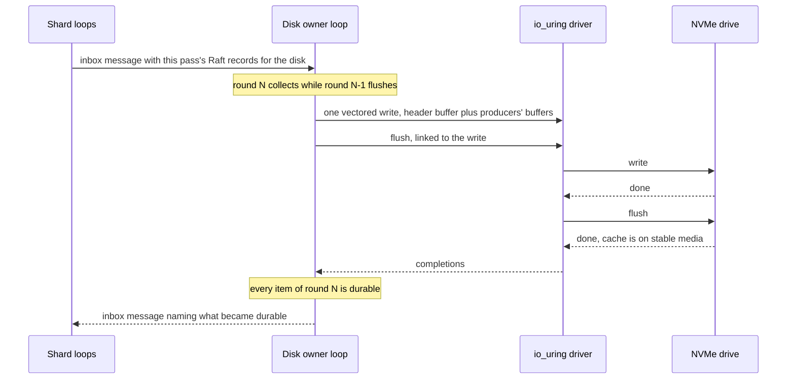
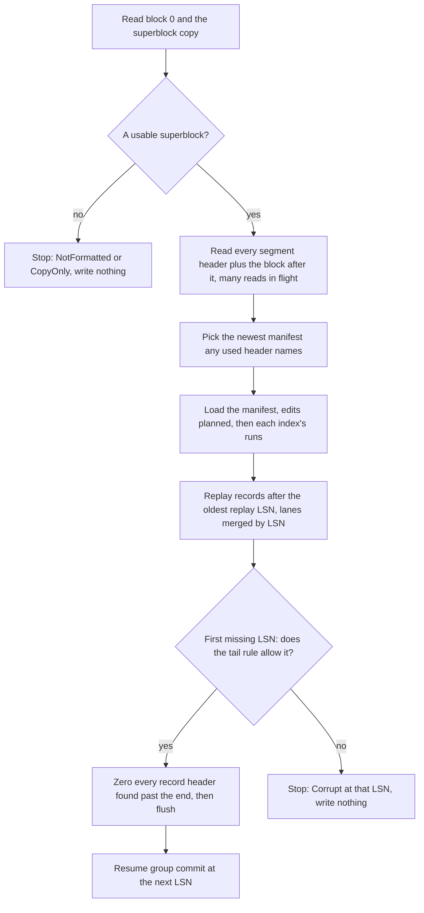

# One log per disk: how rock-solid puts bytes on a drive

Every disk in rock-solid holds exactly one append-only log, and everything stored on that disk
goes into it: chunk data, the Raft logs of the metadata shards, and the indexes over both. There
is no filesystem under it and no embedded key-value engine beside it. The reason is cost: on the
consumer NVMe drive measured, a durable write costs about 1 ms, almost all of it caused by the
*flush* that makes it survive a power cut, and the obvious stack of files, engines and per-shard
logs pays that flush many times over. One log lets every writer on the disk share one write and
one flush per round, and its format gives checksums, torn-write detection and crash recovery for
every byte. This post explains the layout, how a write becomes durable, and how the log finds
its own end after a crash.

Each concept starts with an **In plain words** box, the idea with an everyday example. The
**How it works** part that follows has the real names, numbers and edge cases. If you read only
the boxes, you still get the whole story.

**Status.** The README says nothing runs yet, and that is true here too. The disk log in
[`internal/disklog`](../internal/disklog/) exists as a state machine, tested against a simulated
disk that tears writes, loses unflushed data and flips bits. Anything marked *(planned)* in this
post is designed but not in the code:

| Built and tested in simulation | Planned |
| --- | --- |
| Superblock and its copy, segments, record codec with per-block CRC32C | The durable LSN in record headers |
| Group commit: one write and one flush per round, `commit_depth` | Third (metadata) stream and its lanes; the code has hot and cold |
| Hot and cold streams | Manifest edits and `NextSeq`; the code writes a full manifest each time |
| Checkpoints with a full manifest, recovery, the tail rule, quarantine | Checkpoint backpressure, the cleaner and its copy entry |
| The chunk index's live map | Chunk slots (phase 6) |
| | The `io_uring` driver, event loops and inboxes (phase 5) |

## Words you need

Drives and the kernel:

- **Block, LBA.** A drive reads and writes fixed-size blocks; rock-solid uses 4 KiB blocks. A
  logical block address (LBA) is a block's number on the drive.
- **Page cache.** Kernel RAM that holds file data. A plain `write()` returns once your bytes are
  copied there; nothing has reached the drive yet.
- **`O_DIRECT`.** A flag that skips the page cache, so a write goes straight to the drive.
- **Write cache.** RAM inside the drive. The drive answers "done" once a write sits there, before
  it reaches flash. A power cut loses whatever is still in it.
- **Flush, `fdatasync`, `fsync`.** A flush tells the drive to move its write cache onto stable
  media and answers only once that is done. `fdatasync` writes out a file's data from the page
  cache and then sends a flush; `fsync` also commits file metadata such as timestamps, which on
  ext4 means a journal commit.
- **Durable.** Survives a crash or power cut: only after a flush that covers it.
- **FUA (Force Unit Access).** A flag on one write that makes it skip the drive's write cache, so
  it is durable when it completes, without a separate flush.
- **PLP (power-loss protection).** Capacitors on enterprise drives that save the write cache
  when power fails. On such a drive a flush is nearly free. Most consumer drives lack it.
- **Torn write.** A drive promises only that a single 512-byte sector lands whole. When power
  fails during a multi-block write, any subset of its blocks may have landed, not just the first.
- **Bit rot, misdirected write.** Data that changed on the media after it was written, and a
  write the drive put at the wrong address. Both return wrong data without an error.
- **CRC32C.** A fast checksum with dedicated CPU instructions. rock-solid stores one for every
  4 KiB data block, which catches all three of the above on read.
- **`io_uring`, vectored write.** `io_uring` is Linux's interface for submitting I/O in batches
  through shared memory. A vectored write writes several separate memory buffers to one
  contiguous place on disk in a single request.

rock-solid's data:

- **Chunk, version.** Files and volumes are cut into 4 MiB chunks. Every write to a chunk gets a
  new version: a 64-bit number whose high half numbers its placement group's current *interval*
  (a stretch with unchanged members and primary) and whose low half counts the chunk's writes in
  it. See [02-chunks-and-placement.md](02-chunks-and-placement.md).
- **MetaStore, shard, Raft.** File metadata lives in the MetaStore, split into shards. Each shard
  is replicated over a few nodes with Raft, a protocol that keeps a log of changes which each
  replica must make durable before it acknowledges. See [08-the-metastore.md](08-the-metastore.md).
- **LSM tree, memtable, sorted run.** An index structure: new entries collect in an in-memory
  memtable, which is written out as an immutable sorted run when it grows; runs are merged in the
  background. See [06-the-lsm-tree.md](06-the-lsm-tree.md).
- **Write amplification.** Bytes the drive actually writes divided by bytes users wrote.

The log itself:

- **Segment.** A fixed-size piece of the disk, written front to back, later cleaned and reused.
- **Record.** One append to the log: header blocks that describe what follows, then the data.
- **LSN (log sequence number).** A record's position in the log's order: 1, 2, 3, and so on.
- **Group commit, round.** Gathering everything that arrived while the previous flush ran and
  making it all durable with one write and one flush. Each batch is a round.
- **Event loop, owner.** One thread per CPU core that serves many connections. Each disk's log
  belongs to one loop, the disk's *owner*.

Superblock, checkpoint, manifest and the tail rule each get their own section below.

The [glossary's "Drives and durability"](../docs/glossary.md#drives-and-durability) and
["On-disk structures"](../docs/glossary.md#on-disk-structures) sections have longer versions.

## The problem: durability is expensive, and the obvious stack pays for it many times

> **In plain words.** `write()` returning does not mean your data is on disk. It means your data
> is in RAM: first the kernel's, and then, if you skip the kernel, the drive's own. Pull the plug
> and RAM forgets. Only a flush puts the data on flash, and on a consumer drive that takes about a
> millisecond. A storage system that promises "acknowledged means safe" must pay that millisecond
> before every acknowledgment, so the whole game is paying it as rarely as possible.

Your 4 KiB passes two caches on its way to flash. Look at where each call returns:

```text
                  kernel RAM           drive RAM              stable media
your process --> page cache --------> drive write cache --flush--> flash

plain write()       returns here
O_DIRECT write()                       returns here (~14 us)
+ fdatasync()                                                     returns here (~1 ms)

a power cut loses everything that has not reached the right-hand column
```

A plain `write()` returns once the kernel has copied the bytes into the page cache. `O_DIRECT`
skips that copy and sends them to the drive, which says "done" once they are in *its* RAM.
`fdatasync` pushes both: it writes out the page cache and then sends the drive a flush.
rock-solid uses `O_DIRECT`, so only the drive's cache is left to deal with. Here is what a power
cut does with and without the flush:

```text
time ->

without a flush
  app:    write A --- "ok" after ~14 us ------------------------ power cut
  drive:  A sits in RAM cache ................................... X   A is lost

with write + flush
  app:    write A --- ok --- flush ---- "ok" after ~1 ms -------- power cut
  drive:  A in RAM cache --- A copied to flash ------------------ X   A survives
```

Read the second line as the contract: only after the flush returns may a storage system tell a
client "your write is safe".

**How it works: what a flush costs.** The [NVMe flush spike](../spikes/nvme-flush/) measured a
common DRAM-less consumer drive (UMIS RPEYJ512MML1QWQ, 512 GB, volatile write cache, no PLP):

- A 4 KiB `O_DIRECT` write plus `fdatasync` at queue depth 1: **p50 0.95 ms, p99 2.4 ms, about
  1,090 durable writes per second**, exactly one device flush each.
- 98% of that time is inside the drive; the kernel adds 20 µs. The drive splits it oddly: either
  a ~1.1 ms flush and a fast next write, or a ~0.2 ms flush and a next write of 0.3 to 1 ms,
  against 9 µs for a write with no flush before it. So durability must always be measured as
  write plus flush, and no faster driver can buy much of it back.
- After the drive idles 100 ms or more, the next durable write takes 1.9 to 2.1 ms.

So a homelab drive floors at about 1 ms per durable write, 2 ms after idling. Drives with PLP are
another world: the spike README cites published flushes of 0.7 to 10 µs on them.

Now look at the obvious way to build a storage daemon on one disk, where each piece makes itself
durable on its own:

```text
Obvious stack: every component makes itself durable on its own

  shard 1 Raft log ---- write + flush --+
  shard 2 Raft log ---- write + flush --+
  ...                                   +--> one drive: 100+ separate flushes
  shard 100 Raft log -- write + flush --+    when every shard commits once,
  KV engine (index) --- write + flush --+    ~1 ms each, at most 2 overlap
  chunk file ---------- write + flush --+    plus filesystem journal commits

One log per disk: everything joins one round

  entries of shards 1..100 --+
  index runs ----------------+--> one record --> one write + one flush --> drive
  chunk blocks --------------+
```

The spikes measured how badly the top half goes:

- **Separate commits do not merge.** 100 shards committing one 256-byte entry each took 114 to
  120 ms as 100 separate commits, and 1.2 ms as one combined commit in a shared file
  ([KV engines spike](../spikes/kv-engines/), K4).
- **Neither does the kernel.** Threads on different CPUs each get their own flush; the drive
  overlaps two flush streams at unchanged latency, four or more add latency, and it completes at
  most about 2,800 flushes a second however many are queued (N7).
- **Filesystems add flushes.** Writing into allocated but never-written file space makes
  `fdatasync` commit the ext4 journal too: 2.5 ms instead of 0.95 ms (N2d).
- **A second flush per record doubles the cost.** Flushing data first and its header second, so
  a header never points at missing data, took 1.93 times one write plus one flush (N3b).

The crash side is just as hard. If a write tears, which blocks are new? If a header landed but
its data did not, can recovery tell? Each component answers its own way, and none of them is
something rock-solid's simulator can crash on purpose.

## The options

> **In plain words.** There are three broad ways to store data on a disk you own. Write data in
> place and keep a journal for safety. Hand everything to a ready-made database engine. Or append
> everything to one log and clean up old space later. Each one moves the hard part somewhere else.

**Journal plus in-place data.** Vitastor (a Ceph-like distributed block store) and BlueStore
(Ceph's storage backend, for its *deferred* small writes) append a small write to a journal,
acknowledge it, and copy it into place later. There is no log to clean. But small writes are
written twice, big writes must skip the journal or media bandwidth doubles, and sharing blocks
with snapshots needs a per-chunk extent map with reference counts, BlueStore's most complex part.

**An embedded key-value engine** (a copy-on-write B-tree such as `redb` or bbolt, an LSM tree
such as `fjall` or Pebble) for indexes, shard state and Raft logs. It saves writing an engine. But
it opens and flushes its own files, so it cannot run on a drive that SPDK (the opt-in
kernel-bypass driver) owns, the simulator cannot crash it, and its flushes add to the chunk log's.
As a Raft log, `redb` wrote 2 to 112 times the payload, and `fjall` stalled about 100 ms during
memtable flushes and kept 179 MB on disk for 4.9 MB of live log
([KV engines spike](../spikes/kv-engines/)).

**A log per core.** ScyllaDB keeps a commit log per CPU core and avoids the flush cost by
acknowledging writes before a periodic sync. Flushing before every acknowledgment instead would
mean a flush stream per core, past the two a consumer drive overlaps.

**One log for everything (value separation).** Append chunk data, Raft entries and index pieces
to one log, keep the index in an LSM tree whose runs also live in the log, and copy live data out
of old segments with a *cleaner*, as WiscKey introduced and RocksDB's BlobDB, TiKV's Titan and
Pebble ship. The cost is the cleaner and the LSM tree, and the cleaner's copying grows as the
disk fills.

| Approach | Used by | Gets right | Costs |
| --- | --- | --- | --- |
| Journal plus in-place data | Vitastor, BlueStore deferred writes | Data stays in place; no log to clean | Small writes written twice; big writes must bypass the journal; snapshots need a reference-counted extent map |
| Embedded KV engine | `redb`, bbolt, `fjall`, Pebble | Ready-made engine | Its own files and flushes; no SPDK; not crashable in simulation; poor as a Raft log |
| A log per core | ScyllaDB's commit log | Each core owns its log | Flushing before acknowledging means a flush stream per core |
| **One log per disk** (rock-solid) | Value separation: WiscKey, BlobDB, Titan, Pebble | One write and one flush per round for everything; the driver sees every byte; checksums and torn-write detection built in | A cleaner and an LSM tree; write amplification near full |

## What rock-solid picked: one log per disk

> **In plain words.** One log writes every byte once, flushes once per batch for everyone on the
> disk, and gets checksums and snapshot sharing from its format. The bill comes later, as cleaning.

Why it wins here: one write and one flush per durable write, shared by every shard on the disk;
the driver touches every byte, so SPDK can own the drive and the simulator can crash every durable
byte, metadata included. Snapshots need no reference count per block: a `freeze` entry copies the
chunk's block map under the frozen version's key, and both maps point at the same blocks
([post 10](10-block-snapshots-and-clones.md)). Large segments written sequentially and trimmed
whole also suit a consumer SSD's own garbage collection. The price: the cleaner, the LSM tree, and
no Raft library that does its own storage I/O.

The rest of this section walks through the log from the outside in.

### The layout: superblock, segments, records

> **In plain words.** Think of the disk as a notebook with numbered chapters of equal length.
> The inside cover (the superblock) says how long each chapter is and how many there are, and
> there is a copy on the last page of the first chapter in case the cover gets torn. Each chapter
> is filled from its first line to its last, never edited in the middle. When a chapter is full of
> crossed-out entries, the cleaner copies the few live ones forward and the chapter is reused.

**How it works.** The disk is a sequence of fixed-size segments:

```text
disk = segment 0:     superblock in its first and last block (log id, segment size and count)
       segments 1..n: segment header (log id, stream, lane, open sequence, newest manifest) + records
```

The segment size is min(64 MiB, disk size ÷ 4096), rounded down to a power of two: 64 MiB on disks
of 256 GiB and up, so a disk has 4,096 to 262,144 segments. The *count* matters more than the
size because the cleaner keeps a fixed reserve of free segments: 8 of them cost nothing on 4,096
segments, but on 256 segments they raised write amplification at 95% full from 17 to 70.

Here is a 1 GiB disk, which gets 256 KiB segments of 64 blocks each. Look at where segment 0's
two superblocks sit and how each later segment starts with its header:

```text
1 GiB disk: 4 KiB blocks, 64-block (256 KiB) segments, 4,096 segments

LBA 0                                                            LBA 63
+--------+----------------------------------------------------+--------+
| super- |  segment 0: nothing else                           | super- |
| block  |                                                    | block  |
|        |                                                    | copy   |
+--------+----------------------------------------------------+--------+
LBA 64
+--------+-----------+-----------+-------------+-------------+---------+
| seg    | record    | record    | record      |  ...        | not yet |  segment 1, hot
| header | LSN 1     | LSN 2     | LSN 4       |             | written |
+--------+-----------+-----------+-------------+-------------+---------+
LBA 128
+--------+-----------+----------------------------+----------+---------+
| seg    | record    | record                     |  ...     | not yet |  segment 2, cold
| header | LSN 3     | LSN 6                      |          | written |
+--------+-----------+----------------------------+----------+---------+
  ...                                                    up to segment 4,095
```

The superblock ([`superblock.go`](../internal/disklog/superblock.go)) holds a magic string, the
format version, a CRC32C, a random 64-bit **log id** drawn at format time, and the geometry. The
segment header ([`segment.go`](../internal/disklog/segment.go)) adds the stream, the lane within
it (a byte the code reserves today; *planned*), its own index, the newest manifest's position, and
an **open sequence**, a counter that rises every time any
segment is opened, so a reused segment's second life is told apart from its first. It uses 52
bytes, so it fits in one sector and a torn write leaves it whole or as it was.

Format writes the superblock to block 0, flushes, writes the copy, and flushes again. That is all
it writes, so a raw device that held other data must be discarded or zeroed first. A disk can
also be a plain file; each segment is then written in full once when the file is created
*(planned)*, because writing into never-written file space makes `fdatasync` commit the
filesystem journal as well.

### Records: one header, many items, a checksum per block

> **In plain words.** A record is like a shipping box with a packing slip taped on top. The slip
> lists every item inside (this block belongs to chunk C, version 7; these 300 bytes are Raft
> entries for shard 12) and a fingerprint of every 4 KiB block. If only some of the box arrived,
> the fingerprints do not match and you know it.

**How it works.** A record is header blocks followed by data blocks, written together in one
write ([`record.go`](../internal/disklog/record.go)):

```text
one record = header block(s) + data blocks, written in one write

+---------------------------- header block(s) -----------------------------+
| prelude (48 B): magic "RSRC", format version, header-block count,        |
|   header CRC32C, log id, segment open sequence, offset in segment, LSN,  |
|   entry count, data-block count   (+ durable LSN, 8 B: planned)          |
| entries: write  (pool, chunk id, version, first block, count)    33 B    |
|          punch  (same fields: zero this range)                   33 B    |
|          freeze (pool, chunk id, version, snapshot epoch)        37 B    |
|          blob   (kind, owner, length)                            14 B    |
|          copy   (a write's fields + its source; planned)         41 B    |
| CRC32C of data block 0 | CRC32C of data block 1 | ...   4 B per block    |
| zero padding to the end of the last header block                         |
+------------------------------- data blocks ------------------------------+
| the written chunk blocks, in entry order                                 |
| then blob payloads packed back to back: Raft entries and state,          |
|   sorted-run pieces, manifests; zero padded to a whole block             |
+--------------------------------------------------------------------------+
```

A **write** puts blocks of a chunk version on disk; a **punch** zeroes a range as a new version
(the whole chunk deletes it); a **freeze** pins a chunk version for a snapshot, so the snapshot
keeps reading that version's blocks after later writes; a **blob** carries everything else, Raft
entries and state, sorted-run pieces and manifests, with an owner field naming its shard or index.
The cleaner's **copy** entry, for blocks it moves, also names where it copied them from, so the
move applies only where the index still points there; it is *(planned)* with the cleaner
([post 05](05-the-cleaner-and-free-space.md)). Of a write entry's 33 bytes, 8 are the version,
and a write into a chunk slot *(planned)* adds 6 bytes naming the slot.

A concrete size: a single 4 KiB write is a 2-block record, with 48 + 33 + 4 = 85 header bytes
padded to one block. One header block has room for a write of up to 1,003 data blocks
(48 + 33 + 4 × 1,003 = 4,093 bytes), more than a default 1 MiB round can carry: that is 256
blocks, at least one of them a header.

The header's own CRC32C covers every header byte, and each data block has its own CRC32C in the
header. That pair lets the header and its data go in the *same* write and the *same* flush: if the
write tears, either the header does not decode or some block's checksum fails, and recovery treats
the record as never written. The codec's property test lands every subset of a record's blocks
over three kinds of old content and checks the decoder returns the whole new record, the whole old
one, or an error, never a mixture ([test scenarios](../docs/test-scenarios.md#record-codec)).

### Whole blocks only: small files and small appends

> **In plain words.** The box only holds whole 4 KiB blocks of chunk data. A program that writes
> 100 bytes still gets a whole block stored, because the chunk's primary has already pasted those
> bytes into the rest of their block ([post 02](02-chunks-and-placement.md)). So a 1.5 KiB file
> takes a whole block on each copy, and a log file that adds one line and calls `fsync` rewrites
> its last block every time. rock-solid accepts both costs for now, because the cheaper layouts
> make every other part of the log more complicated.

**How it works.** A write entry names whole blocks and each data block has its own CRC32C, so the
record format never sees a partial block; nothing about it changes for small writes. What that
costs, from the [sub-block writes spike](../spikes/sub-block-writes/)'s models with this record
layout (checked against `LayoutOf`):

```text
1.5 KiB file, rep3, its entry and CRC in a shared round:  3 x (4,096 + 37) = 12,399 B   8.1x
same file in ec4-2: files up to 8 KiB stay copies          12,399 B, 5.4x what ec4-2 promises
100-byte append + fsync, alone on the disk:                header block + data block per copy
                                                            = 8,288 B per append       83x
same, 8 appenders sharing each round, 80% full:            7,924 B per append          79x
```

The append's old tail block dies at once, yet it does not cost just one block: in a log shared
with live data, its space comes back only when the cleaner empties segments that also hold live
blocks, so one append per round among 15 random overwrites cost 4.9 blocks at 80% full and 8.4 at
90%, about the log's [write amplification](05-the-cleaner-and-free-space.md). Local filesystems
pay about the same per fsync: ext4 rewrites the data block and commits its journal, XFS writes the
block and a log record (from general knowledge, not measured here).

Three cheaper layouts were weighed and left out for now:

| Layout | What it saves | What it costs |
| --- | --- | --- |
| Inline data in the inode, as CephFS, ext4, Btrfs and F2FS do | A small file's block | The MetaStore's sorted runs live in memory: 1.5 KiB inline costs 12.5× the per-file budget, 3.4 million files per 16 GiB instead of 43 million. CephFS deprecated its version in Octopus |
| Patch entries: the appended bytes, merged on read, folded later, as the ZFS intent log and JuiceFS slices do | Nothing at queue depth 1, unless the bytes ride in the header block: 83× → 42×. With 8 appenders, 79× → 25×, or 5.8× in the header | Header blocks that hold live data, a patch list per block for reads and snapshots, and a fold step |
| Short last blocks: only a file's bytes up to its end | A 1.5 KiB file 12,399 → 4,725 B; 8 appenders 79× → 58× | A stored length in every write entry and extent, and liveness counted in bytes |

Old write entries stay valid under the last two, so either can come later without a migration if
measurements of real volumes call for it.

### Every header names its place

> **In plain words.** Every packing slip also says "warehouse 17, shelf 3, position 12, 5th use of
> that shelf". A box on the wrong shelf, or left over from a previous tenant, gives itself away.

**How it works.** A record header repeats the log id, its segment's open sequence and its own
offset in the segment, and decoding refuses a record whose place does not match where it was read.
That rejects a record left from an earlier use of the segment (other open sequence), from an
earlier format of the disk (other log id), or written by the drive at the wrong address (other
offset). Since the log id is random, a user's data block crafted to look like a header fails too.

### Making a record durable: write, then flush

> **In plain words.** There are two ways to make a write safe: write it and then say "flush
> everything", or mark the write itself "skip the cache" (FUA). The second sounds faster. On the
> drive measured it was more than twice as slow.

**How it works.** The driver makes a round durable with a write followed by a flush command:
`IORING_FSYNC_DATASYNC` through `io_uring`, or an NVMe Flush under SPDK. It never uses FUA writes
or `O_DSYNC`:

| Way to make a 4 KiB write durable | p50 on the measured drive |
| --- | --- |
| `O_DIRECT` write + `fdatasync` | **0.95 ms** |
| `O_DIRECT` + `O_DSYNC` write (Linux turns it into a FUA write) | 2.2 ms |
| write + `fsync` (also commits the ext4 journal for the timestamp) | 2.5 ms |

A flush makes durable every write that *completed* before it runs. So when the round's write is
the only one outstanding, the log emits the write and its flush together, and the `io_uring`
driver submits them linked (`IOSQE_IO_LINK`): one system call per round and no wakeup between the
two. Otherwise the flush waits until the writes it must cover have completed. The write is one
vectored write that gathers the round's buffers in place: a header buffer the log fills, each
producer's chunk blocks in the buffer the producer submitted (never copied), and one buffer into
which the log packs the round's blobs.

A disk error fails the log: queued items fail, and the items of rounds in flight are *in doubt*,
since their writes may still land, so recovery decides. Any flush error fails the log, even one
reported late, because the kernel reports a failed write-back to only one caller: a later flush
that returns success does not prove the data reached the disk.

On a drive with PLP, FUA may well be faster, so `durability` is a per-disk driver setting
*(planned, phase 5)*: `flush` (default) or `fua`.

### Group commit: one flush per round

> **In plain words.** A flush costs about the same whether it covers one write or a hundred. So
> while one flush runs, everything that arrives waits at the door, and when it ends, the whole
> crowd goes through together in the next one. That is a round.

**How it works.** Each round takes what arrived from every producer during the last round, up to
`max_group_commit_bytes` (default 1 MiB), builds one record, appends it to one stream's open
segment in one write (after the segment header, if the round opens a new segment), flushes once,
and acknowledges every item. A round writes one record to one *lane* of one stream (see Three
streams), and rounds take the lanes that have work in turn. Follow one round from top to bottom; the event loops and the
`io_uring` driver around the log are *(planned, phase 5)*:



Why 1 MiB? On the measured drive a commit costs the same 0.95 ms from 4 KiB to 64 KiB, 1.2 to 1.9
ms at 256 KiB and 2.3 ms at 1 MiB. Past 1 MiB, latency grows faster than throughput. The cap also
bounds how long a large chunk write delays a metadata commit. It is the only bound on a round: in
the [raft rounds spike](../docs/design.md#appendix-raft-rounds-spike), rounds under open load
stayed below 574 KiB, a 256 KiB cap cost a third of the throughput, and a time bound changed
nothing.

### Durability is a prefix

> **In plain words.** Round 6 is not flushed until round 5's write has landed, so whenever record
> 6 is safe, so is everything before it. After a crash, only the newest record can be
> half-written; a hole earlier in the log is damage, not the crash.

**How it works.** A round is *in flight* from its write until its flush completes. At most
`commit_depth` rounds are in flight at once, 1 by default, and a round's flush is submitted only
once its own write and every earlier round's write have completed. So when a record is durable,
every record before it is too, and at a crash only the last `commit_depth` records can be torn or
missing. Pebble and RocksDB make the same choice: one sync in flight per log, with throughput
coming from the group collected while it runs ([durability study](../spikes/lsm-study-durability/)).

A second round in flight would not pay on a consumer drive anyway. A flush drains the drive's
whole write cache, so in the [stream overlap spike](../docs/design.md#appendix-stream-overlap-spike)
a hot 4K commit next to a stream of 1 MiB cold records took 2.3 ms with two rounds in flight:
no better than the 2.35 ms of putting both records in one round under one flush, and far from
the 0.95 ms it takes alone. So `commit_depth` stays 1.

### One owner loop per disk

> **In plain words.** A disk has one clerk who writes in its notebook. Other clerks drop a note in
> the clerk's tray once per pass, and the clerk writes everything in the tray as one entry.

**How it works** *(planned, phase 5: the event loops; the log itself takes items from any
caller)*. rock-solid runs one event loop per CPU core ([11-runtime-in-go.md](11-runtime-in-go.md)).
A disk's log belongs to one of them, the disk's *owner*, which also owns that disk's chunk index
and serves its chunk writes. A shard replica may run on any loop. Once per pass, a loop hands each
disk's owner one *inbox* message (a queue between loops) holding its shards' records for that
disk, and the owner hands back one message per round naming what became durable: two wakeups per
loop per round, not per operation.

On a cloud VM with a virtio disk, the [log per core spike](../spikes/log-per-core/) measured an
inbox hop at **13.6 µs of CPU**, but **0.07 µs per item** when 64 items share one hop. One owner
fed by 8 loops wrote **39 items per flush** where a log per loop wrote 8, at the same CPU per
item. TiKV works the same way (its raftstore threads hand every region's writes to one store
writer), and CockroachDB runs every range of a store through one Pebble write-ahead log.

### Three streams

> **In plain words.** If you keep milk and canned food on the same shelf, you have to sort through
> the cans every time the milk goes off. Put things that expire together on the same shelf and
> whole shelves empty at once.

**How it works.** Records go to one of three streams, each with its own open segment, so a
segment holds data of one kind, which tends to die together:

```text
          open segment of each stream (each round writes one record to one lane of one stream)

hot       [hdr][new chunk writes + Raft entries][....][....]--> appending
cold      [hdr][cleaner copies][erasure-coded chunk pieces]--> appending
metadata  [hdr][sorted runs][compaction output][manifest]--> appending  (planned)

LSNs are global: hot 1, 2, 4 ... cold 3, 6 ... metadata 5 ... merge back into one order
```

- **Hot** takes new chunk writes and the Raft entries of the same round.
- **Cold** takes blocks the cleaner moves and erasure-coded pieces of chunks.
- **Metadata** *(planned)* takes sorted runs, compaction output and manifests, which are written
  whole and die whole when a compaction or a newer manifest replaces them. Until the stream lands,
  checkpoint pieces go to the cold stream.

*(Planned:)* a stream fills its segments in **lanes**. A lane is a sequence of segments filled one
after another, at most one open at a time, so LSNs rise along it. Lane 0 of each stream is its
shared segment, and merge worker *w* writes its output to lane *w* of the metadata stream, so a
merge's pieces never share a segment with flush pieces and a merge's consumed inputs free whole
segments ([post 06](06-the-lsm-tree.md)). When a merge ends, its worker's segment stays open and the
worker's next merge continues it, so no unused tail is stranded behind run pieces the cleaner
cannot move. Group commit keeps a queue per lane and takes turns round the lanes: three plus the
merge workers.

Raft entries stay in the hot stream because a round writes one record to one stream: a Raft
stream would split a commit's chunk write and its Raft entries into two rounds and two flushes. It
would lower write amplification by only about 6% (6.40 to 6.03 at 80% full, in a stand-in where
Raft entries are a quarter of the data). Keeping sorted runs away from the cleaner's copies pays
much more: mixed in, they raised block-volume write amplification by 25 to 54% at 80 to 90% full,
against 3 to 15% in a stream of their own
([cleaner streams spike](../docs/design.md#appendix-cleaner-streams-spike)).

### Chunk slots for whole-chunk writes *(planned, phase 6)*

> **In plain words.** When a program writes a big file from start to finish, each 4 MiB chunk
> arrives whole. If a whole chunk lands in its own 4 MiB box, deleting the file frees the box
> outright, and nobody has to sift through it later.

**How it works.** A chunk written whole goes to a **chunk slot**, one of 16 data-only slots in a
64 MiB slot segment, instead of the log. Its record still goes to the hot stream, naming the slot
and carrying the slot blocks' CRCs, so recovery checks slot data as it checks log data. A slot is
free once the record that rewrote or deleted its chunk is durable, so whole chunks deleted at
random cost a write amplification of **1.004 at any fill**, against 4.9 at 90% full in the log.
More in [post 05](05-the-cleaner-and-free-space.md).

### LSNs and the durable LSN

> **In plain words.** Every record gets a ticket number, one higher than the last, across all
> three streams. *(Planned:)* each new ticket will also say "everything up to ticket N was already
> safe when I was printed". After a crash, that sentence tells recovery whether a missing ticket
> was lost or merely never finished.

**How it works.** The LSN orders records across the streams; replay merges the streams back into
one order by LSN. *(Planned:)* a record header also names the newest LSN that was durable when its
round was built, as Pebble writes the offset its write-ahead log had synced into every chunk
header. That lets recovery tell a missing record that was durable (corruption) from one still in
flight (a torn tail). It adds 8 bytes to the prelude, taking it to 56, so one header block then
holds a write of up to 1,001 data blocks instead of 1,003.

### The chunk index: where every block lives

> **In plain words.** The log is a pile of boxes in arrival order. The index is the catalogue:
> "chunk C, blocks 0 to 9, are at shelf 5000". Overwrite block 10 and the catalogue gets a new
> line for block 10; the old line is trimmed so each block appears exactly once.

**How it works.** Each disk's chunk index ([`index.go`](../internal/chunkstore/index.go)) is an
LSM tree holding, for every chunk, a **live map**: one entry per run of consecutive blocks written
by one record, giving version, location, block count and the record's header. A write inserts its
extent and trims or splits what it covers, as BlueStore's extent map and Btrfs do:

```text
live map of chunk C (1,024 blocks of 4 KiB)

after v1: a 64 KiB write of blocks 0-15, stored from LBA 5000
    [ v1  blocks 0-15  @ LBA 5000                       ]

after v2: block 10 rewritten, stored at LBA 9000
    [ v1  0-9  @ 5000 ][ v2  10  @ 9000 ][ v1  11-15  @ 5011 ]
```

A primary maps a write into the index only once it *commits* (every live member of its placement
group holds it); until then its record is in the log and reads see the previous version. A member
that is not the primary serves no live reads, so it maps writes as soon as they are durable. Either
way a chunk's writes are mapped in version order, or an older write could trim a newer one away. If
the index is lost, a scan of the record headers rebuilds it. Keys, filters and compaction are in
[post 06](06-the-lsm-tree.md).

### Checkpoints and manifests

> **In plain words.** Replaying the whole log after every crash would get slower forever. So every
> so often the system writes down "here is everything as of ticket 80,000", and after a crash it
> starts from that note and replays only the tickets after it.

**How it works.** The chunk index and each shard's state are LSM trees inside the log. A
memtable holds what was applied since its contents were last written out. A **checkpoint** writes
out (in LSM terms, *flushes*; nothing to do with a drive flush) the memtable of every index on the
disk as sorted runs, in pieces of at most one record each, then writes a **manifest**: each
index's runs, the LSN each replays from, and the segment usage table (which segments are in use;
[post 05](05-the-cleaner-and-free-space.md)).

- **What else a manifest records.** *(Planned:)* every manifest also records `NextSeq`, the open
  sequence number the first segment opened after its base LSN will take. A segment the cleaner
  freed keeps its old header of this log until it is reused, so a header alone cannot say whether
  its segment was opened after the manifest (used, replay rebuilds its row) or freed before it
  (the usage table decides). An open sequence at or past `NextSeq` means after; below it, the table rules.
  That holds in every crash order of freeing, reusing and TRIM, which is what lets a freed segment
  be reused at once, under conditions [post 05](05-the-cleaner-and-free-space.md) gives
  ([log segments study](../studies/log-segments/)).
- **When.** A checkpoint is due once `max_replay_bytes` (default 64 MiB) of records follow the
  last manifest, which bounds replay after a crash and the Raft entries a shard keeps in memory.
  *(Planned:)* if they reach twice that, rounds take items only from the checkpoint and the
  cleaner until a manifest is durable, as Pebble and RocksDB stop writes at two memtables, which
  makes that bound hard. Replay can still run a little past it: up to a segment per lane, the
  records written while the checkpoint's runs streamed out, and, on a disk holding replicated
  primaries, everything logged while the oldest uncommitted write waited, since a replay point
  never passes a write that has not committed.
- **Full manifests and edits.** The code writes a full manifest every time. *(Planned:)* most
  checkpoints write an *edit* holding only what changed (runs added and removed, replay LSNs, the
  usage rows that changed), and a full one (which Pebble and RocksDB call a snapshot, unrelated
  to volume snapshots) only by Pebble's rule: once the edits since the last snapshot would
  outgrow the smaller of that snapshot and the next. Snapshots are then at most half of what
  manifests write, and recovery reads at most twice a snapshot. The full usage table grows with
  the disk: in every manifest it would cost 0.42% of the log on a 1 TiB disk at
  90% full and 6.6% on 16 TiB, against 0.13% and about 0.16% with edits
  ([durability study](../spikes/lsm-study-durability/)).
- **Finding it.** A manifest larger than a record is written in pieces; its last piece lists the
  pieces of its snapshot and of every edit since. Each segment header names the newest manifest
  when the segment opens, so the headers do the job of RocksDB's `CURRENT` file, the small file
  that names the current manifest.

### Crash recovery and the tail rule

> **In plain words.** After a crash, recovery reads the notebook to find where it ends. If the
> very last entry is smudged, that was the sentence being written when the lights went out: cross
> it out and carry on. If an entry in the middle is smudged and clean entries follow it, something
> that was already safe got damaged. Pretending the notebook ends there would silently throw away
> acknowledged writes, so recovery refuses and reports corruption.

**How it works.** Recovery ([`recovery.go`](../internal/disklog/recovery.go)) runs in these steps:



Each lane is read from the last of its segments whose first record is at or before the first
record to replay, and resumes appending in its newest segment. Since LSNs rise along a lane, every
segment after that one holds only records to replay. The same rule per stream would miss records:
a merge's segment opens before shared metadata segments opened later and keeps filling after them.
In a model of the log it missed a record past the replay point in 74% of crashes with one merge
worker and 99% with four, usually reported as corruption at every start, and silently lost when the
merge's records were the newest durable ones; per lane it missed none
([log segments study](../studies/log-segments/)). Merge lanes are read for their records' LSNs,
which the tail rule needs; their entries go to no index until a manifest names their pieces.

Recovery writes only when it repairs a damaged superblock in the first step (next section) and in
the final zero-and-flush. A disk has 4,096 to 262,144 segment headers, so recovery reads them 64 at
a time by default. A scan that finds no valid record at a block reads on through its segment, so a
damaged header cannot hide the records behind it. Two valid records with one LSN are corruption.

**The tail rule.** Replay stops at the first LSN it does not find; call it *g*. The log ends at g
only if all three of these hold:

1. every record header found from g onward, whole or torn, has an LSN below g + `commit_depth`.
   At depth 1 that allows only g's own header (its header landed, its data did not);
2. no segment header names a manifest at or past g;
3. *(planned)* no record header found past g names a durable LSN at or past g.

Then g and anything after it were rounds in flight, and are dropped. Otherwise the log is corrupt
at g, and recovery reports it instead of cutting the log short, as the
[Protocol-Aware Recovery](https://www.usenix.org/conference/fast18/presentation/alagappan) paper
argues. The two cases at the default `commit_depth` of 1:

```text
commit_depth 1: at most one round in flight, so only the newest record can be torn

case 1: torn tail                          case 2: hole in the middle
LSN:   1    2    3    4    5               LSN:   1    2    3    4    5
     [ok] [ok] [ok] [ok] [~~]                   [ok] [ok] [XX] [ok] [ok]
                          ^ torn                           ^ damaged, g = 3
 g = 5, window = LSN 5 only,               window = LSN 3 only, but records
 nothing else found past it                4 and 5 were found past it
 -> round 5 was in flight:                 (planned: 4's header also says
    drop it, the log ends at 4              "durable up to 3")
                                           -> report Corrupt(3), write nothing
```

The planned durable LSN is the stronger proof because it does not depend on the configured
window. If any later header says LSN 3 was already durable, record 3 was not in flight. A log
written at depth 1 builds every round after the previous one is durable, so every later header
carries that proof, even if the disk is reopened with `commit_depth` 2, where the window alone
would let the gap pass. Pebble confirms WAL corruption the same way. RocksDB's default instead
opens with the prefix before any corruption; rock-solid does not, because a replica that silently
lost acknowledged writes must not rejoin its group as intact.

One honest limit: damage in the *last* record cannot be told from a torn write, so it recovers
as a crash.

**Zeroing past the end.** A dropped round's record may have landed whole, and the log will reuse
its LSN. A later start could then find the old record behind the new tail and replay it. So
recovery zeroes the first block of every record header it found past the end, then flushes. That
flush matters even without a power cut: if only the process crashed, its unflushed writes are
still readable from the drive's cache, and recovery has just replayed them, so it must make them
durable before a later power cut erases them.

Recovery also decides which segments are free and quarantines damaged ones that may hold records;
that belongs with free space, in [post 05](05-the-cleaner-and-free-space.md).

### The superblock and its copy

> **In plain words.** If the notebook's cover is torn, rebuild it from the copy on the back page.
> But if the cover has been replaced by someone else's, the notebook may now belong to someone
> else, and "repairing" it would scribble over their work. So recovery repairs only damage it can
> recognize as its own.

**How it works.** The copy's position comes from the geometry, which comes from the disk's size,
so a disk keeps the size it was formatted with. What block 0 holds decides what recovery does
([superblock repair](../docs/design.md#superblock-repair)):

| Block 0 | Recovery |
| --- | --- |
| A valid superblock | Uses it, and rewrites the copy if the copy differs |
| Unreadable, or this format's magic and version with a bad checksum or inconsistent contents | Uses the copy if it is valid and sits where its own geometry puts it, and rewrites block 0 |
| Zeros, another magic or another format version | Writes nothing. Reports `CopyOnly` when the copy is valid, else `NotFormatted` |

The last row is cautious because a partition table, a new filesystem or a partial `wipefs` writes
at the start of a disk and leaves the copy alone, and device names such as `/dev/nvme1n1` can
change across reboots: writing the copy back would destroy a new owner's data, so restoring it is
an operator's repair command, as ext4, XFS and Btrfs leave their copies to offline tools.

### Format upgrades

> **In plain words.** Every page says which edition of the rules it was written under, and a new
> edition is only written once every machine can read it, so you can always roll back.

**How it works.** Segment headers, record headers, sorted runs and manifests carry a format
version (today 1), and golden byte fixtures in [`testdata/`](../internal/disklog/testdata/) make
any accidental change fail a test. A daemon reads the current and the previous format, but writes
the new one only after the operator raises the cluster's format level, a `ctl/` key in the
control-plane Raft group *(planned)*, once every node runs the new release. A node on an older
release that heartbeats after the level was raised is not marked up, and a condition names it.
The cleaner rewrites old segments over time.

## Evidence

All numbers are as the design's appendices and the spike READMEs give them.

| Claim | Measurement | Source |
| --- | --- | --- |
| Durable-write floor on a consumer drive | 4K write + `fdatasync`: p50 0.95 ms, p99 2.4 ms, ~1,090/s; 1.9 to 2.1 ms after 100 ms to 3 s idle | [NVMe flush spike](../docs/design.md#appendix-nvme-flush-spike), N2, N6 |
| One write + one flush, not two flushes | Data + flush, then header + flush: 1.93× one write + flush | NVMe flush, N3b |
| Write + flush, not FUA | `O_DSYNC` (FUA) 2.2 ms; `fsync` 2.5 ms; write + `fdatasync` 0.95 ms | NVMe flush, N5, N5c |
| 1 MiB round cap | 0.95 ms flat from 4 to 64 KiB, 1.2 to 1.9 ms at 256 KiB, 2.3 ms at 1 MiB, 4.3 ms at 4 MiB | NVMe flush, N3 |
| No time bound on rounds | 256 KiB cap lost a third of throughput; rounds ≤ 574 KiB under open load | [raft rounds spike](../docs/design.md#appendix-raft-rounds-spike) |
| One flush stream per disk | Kernel merges no flushes across CPUs; 2 streams overlap, 4+ add latency | NVMe flush, N7 |
| Share one flush across shards | 100 shards: one combined commit 1.2 ms, 100 separate 114 to 120 ms | [KV engines spike](../docs/design.md#appendix-kv-engines-spike), K4 |
| Engines are poor Raft logs | `redb` write amplification up to 112; `fjall` 179 MB on disk for 4.9 MB live, ~100 ms stalls | KV engines, K1, K1c |
| Bound replay | `fjall` replays 0.53 s at 16 MB, 2.8 s at 64 MB | KV engines, K5 |
| One owner loop per disk | Hop 13.6 µs CPU, 0.07 µs per batched item; 39 items per flush vs 8 (cloud VM, virtio disk) | [log per core spike](../docs/design.md#appendix-log-per-core-spike) |
| Depth 1, durable LSN, manifest edits | Pebble and RocksDB keep one sync in flight; full table 0.415% of the log per checkpoint at 1 TiB vs 0.129% with edits | [durability study](../docs/design.md#appendix-lsm-study-durability-spike), M2 |
| Depth 1 on a consumer drive | Hot 4K commit next to 1 MiB cold records: 2.3 ms with two rounds in flight, 2.35 ms in one round, 3.04 ms alternating, 0.95 ms alone | [stream overlap spike](../docs/design.md#appendix-stream-overlap-spike), H1 to H4 |
| Streams | Runs mixed with cleaner copies: +25 to 54% write amplification at 80 to 90% full; own stream: +3 to 15% | [cleaner streams spike](../docs/design.md#appendix-cleaner-streams-spike) |
| Chunk slots | 1.004 at any fill vs 4.9 (90%) and 9.0 (95%) in the log | cleaner streams spike |
| Whole blocks for small writes | 100-byte append + fsync alone: 8,288 B per copy (83×), 4,196 B with the bytes in the header; 1.5 KiB file in rep3: 12,399 B (8.1×) | [sub-block writes spike](../docs/design.md#appendix-sub-block-writes-spike), A1, S1 |

The KV engines spike measured `redb` and `fjall` as candidates. Its README's per-use picks (an
own Raft log per core, `redb` for shard state, `fjall` for the chunk index) are what embedding
would have meant. The design keeps one log per disk and its own LSM tree, and uses the spike's
numbers as the bar to match: shard gets around 7 µs, about 50 bytes per chunk-index entry.

The disk log's [test scenarios](../docs/test-scenarios.md#recovery) crash it on purpose: torn
tails over every combination of landed blocks, damaged middle records, 50 seeds of random
crash-and-reopen cycles, and bit flips anywhere in the log.

## Trade-offs: what it costs us

- **A cleaner, and its write amplification.** Overwritten data leaves dead blocks in old segments,
  and the cleaner must copy live data out to free them. The fuller the disk, the more it copies
  ([post 05](05-the-cleaner-and-free-space.md)).
- **An LSM tree to build and maintain,** instead of an embedded engine
  ([post 06](06-the-lsm-tree.md)).
- **Headers are capacity.** Header blocks are dead to the cleaner, so near full they cost more
  than their bytes: at 95% full the headers of 64 KiB records raise write amplification from 11.4
  to 17.3, and at 90% full queue-depth-1 4K writes, one header block per data block, double it.
- **Small files and small appends pay a whole block.** A 1.5 KiB file costs 8.1 times its size
  in `rep3` and in `ec4-2` alike, and a fsync'd 100-byte append writes two blocks per copy when it
  is alone on the disk.
- **Fragmented chunks read as random I/O.** A chunk overwritten at random 4K keeps one index entry
  per write, so its sequential reads become random 4K reads, fine on NVMe, worse on SATA and HDDs
  ([post 06](06-the-lsm-tree.md)).
- **A millisecond floor.** One shared flush means more items per millisecond, not fewer
  milliseconds per item. And a hot 4K commit can wait behind a cold 1 MiB round: 3.0 ms with
  alternating rounds against 0.95 ms alone.
- **Recovery reads a lot, and sometimes refuses.** Every start reads every segment header and the
  unused tail of each open segment. A disk whose damage the tail rule cannot explain does not come
  back on its own: availability traded for never silently losing acknowledged writes.
- **Format rules reach operators.** A raw device must be discarded or zeroed before format, a disk
  keeps the size it was formatted with, and restoring a superblock over a foreign block 0 is a
  manual repair.

## Open directions

From the design's [roadmap and open questions](../docs/design.md#roadmap-and-open-questions):

- **Other drives.** Flush latency has been measured on one DRAM-less consumer NVMe drive only.
  DRAM, QLC, SATA and PLP drives are open, and on PLP drives `durability: fua` may win.
- **Hard disks, later.** On an HDD alone every flush and every turn between open segments is a
  seek, so the MetaStore commits on that disk run at HDD speed. The way in is one log over two
  devices, as BlueStore's DB device and ZFS's special vdev do: hot and metadata segments on a
  flash partition, cold segments and chunk slots on the HDD. Every address the format stores is a
  block of the log's own address space, today one device block for block, so that tier rewrites
  no index entry. It still needs a faster recovery than reading every segment header from the HDD,
  a stall threshold per drive class, and a refusal of drive-managed SMR disks
  ([addresses belong to the log](../docs/design.md#on-disk-format)).
- **One flush for both streams.** A second round in flight does not help on a consumer drive: a
  flush waits for every byte in the drive's cache, so a hot 4K commit next to 1 MiB cold records
  took 2.3 ms with two rounds in flight
  ([stream overlap spike](../docs/design.md#appendix-stream-overlap-spike)). Putting one record
  per stream in one round under one flush gets 2.35 ms with one round, against 3.0 ms with
  alternating rounds. Should rounds do that, and should a round cap its cold bytes while a hot
  commit waits?
- **Shorter commits at depth 1,** collecting work while a round is in flight, as Pebble and
  RocksDB apply while their sync runs.
- **One loop and a fast drive.** On a PLP drive the owner loop may become CPU-bound; the drive
  could then be split into two partitions, each a disk with its own log, in one failure domain.
- **Header patches for fsync'd appends** and **short last blocks for small files**: worth it only
  if real homelab traces show many fsync'd sub-block appends or much space in small files and
  tails.
- **Rebuild after cleaning.** A rebuild of a lost index replays every record from LSN 1, but the
  cleaner's freed segments take their LSNs with them. Should a rebuild check LSN continuity only
  past the manifest's base and rely below it on each listed segment's records following one
  another, so a damaged header still shows as a hole?
- **Merge lanes shared between merges.** A worker's next merge continues the segment its last one
  left, so one segment can hold the tail of one merge and the head of the next, possibly another
  index's. How much does that strand?
- **Chunk slots for erasure-coded pieces** (4 MiB ÷ k, so several slot sizes), **regrouping
  fragmented chunks** into slots, **in-drive write amplification** by segment size, and
  **registered `io_uring` buffers on a real NVMe drive.**

[`docs/tech-debts.md`](../docs/tech-debts.md) has no entry for the disk log.

## Further reading

Design:

- [On-disk format](../docs/design.md#on-disk-format) and
  [Superblock repair](../docs/design.md#superblock-repair)
- [Alternatives considered](../docs/design.md#alternatives-considered): the rows "On-disk
  format", "Log streams", "Whole-chunk layout", "Disk logs and event loops", "Manifest", "Tail
  rule", "Stale records past a recovered tail", "Rounds in flight" and "Small files and fsync'd
  appends"
- Appendices: [NVMe flush](../docs/design.md#appendix-nvme-flush-spike),
  [KV engines](../docs/design.md#appendix-kv-engines-spike),
  [log per core](../docs/design.md#appendix-log-per-core-spike),
  [io_uring registered buffers](../docs/design.md#appendix-io_uring-registered-buffers-spike),
  [LSM study: durability](../docs/design.md#appendix-lsm-study-durability-spike),
  [stream overlap](../docs/design.md#appendix-stream-overlap-spike),
  [sub-block writes](../docs/design.md#appendix-sub-block-writes-spike)
- [Glossary: drives and durability](../docs/glossary.md#drives-and-durability),
  [on-disk structures](../docs/glossary.md#on-disk-structures)
- Test scenarios: [segments and superblock](../docs/test-scenarios.md#segments-and-superblock),
  [record codec](../docs/test-scenarios.md#record-codec),
  [group commit](../docs/test-scenarios.md#group-commit),
  [recovery](../docs/test-scenarios.md#recovery),
  [superblock copy](../docs/test-scenarios.md#superblock-copy)

Spikes: [`spikes/nvme-flush/`](../spikes/nvme-flush/),
[`spikes/kv-engines/`](../spikes/kv-engines/),
[`spikes/log-per-core/`](../spikes/log-per-core/),
[`spikes/uring-registered/`](../spikes/uring-registered/),
[`spikes/lsm-study-durability/`](../spikes/lsm-study-durability/),
[`spikes/stream-overlap/`](../spikes/stream-overlap/),
[`spikes/sub-block-writes/`](../spikes/sub-block-writes/); studies:
[sub-block writes and small files](../studies/sub-block-writes/README.md),
[log segments](../studies/log-segments/) (lanes, `NextSeq`, freed segments)

Code: [`internal/disklog/`](../internal/disklog/): `geometry.go`, `superblock.go`, `segment.go`,
`record.go`, `groupcommit.go`, `manifest.go`, `recovery.go`; and
[`internal/chunkstore/index.go`](../internal/chunkstore/index.go)

Other posts in this series:

- [01-the-big-picture.md](01-the-big-picture.md): where the disk log sits in the architecture
- [02-chunks-and-placement.md](02-chunks-and-placement.md): chunks, versions and placement groups
- [05-the-cleaner-and-free-space.md](05-the-cleaner-and-free-space.md): cleaning, free space,
  TRIM and backpressure
- [06-the-lsm-tree.md](06-the-lsm-tree.md): the memtable, sorted runs and compaction inside the log
- [08-the-metastore.md](08-the-metastore.md): the Raft shards whose logs share this one
- [10-block-snapshots-and-clones.md](10-block-snapshots-and-clones.md): freezes and shared blocks
- [11-runtime-in-go.md](11-runtime-in-go.md): event loops, inboxes, `io_uring` and SPDK
- [12-testing-for-trust.md](12-testing-for-trust.md): the simulator that crashes this log on purpose
