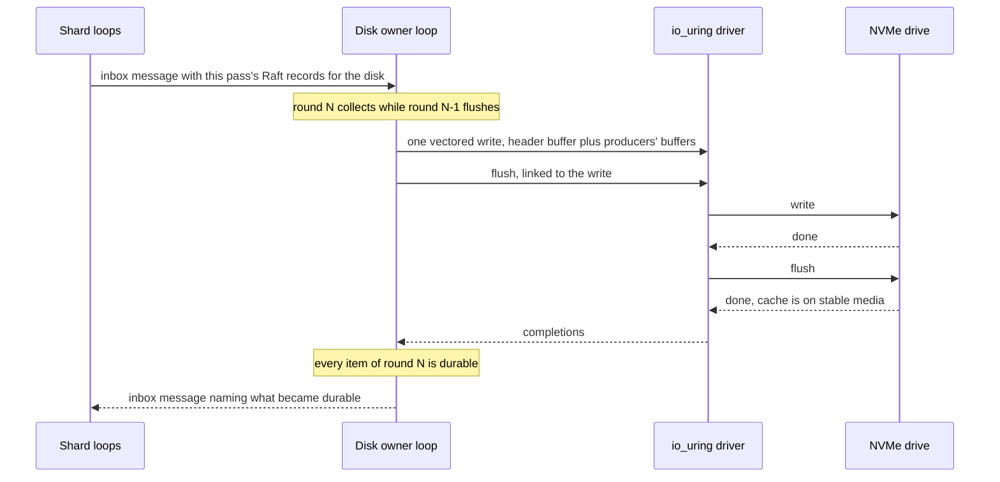
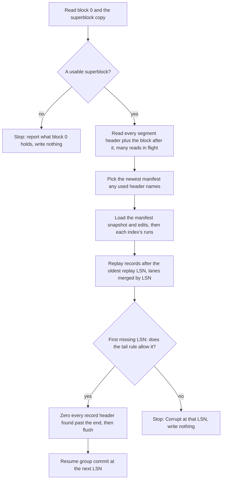

# One log per disk: how rock-solid puts bytes on a drive

Every disk in rock-solid holds exactly one append-only log, and everything stored on that disk goes
into it: chunk data, the Raft logs of the metadata shards, and the indexes over both. There is no
filesystem under it and no embedded key-value engine beside it. The reason is cost: on the consumer
NVMe drive measured, a durable write costs about 1 ms, almost all of it caused by the *flush* that
makes it survive a power cut, and the obvious stack of files, engines and per-shard logs pays that
flush many times over. One log lets every writer on the disk share one write and one flush per
round, and its format gives checksums, torn-write detection and crash recovery for every byte. This
post explains the layout, how a write becomes durable, and how the log finds its own end after a
crash.

Each concept starts with an **In plain words** box, the idea with an everyday example. The **How it
works** part that follows has the mechanisms and edge cases. If you read only the boxes, you still
get the whole story.

## Words you need

Drives and the kernel:

- **Block, LBA.** A drive reads and writes fixed-size blocks; rock-solid uses 4 KiB blocks. A
  logical block address (LBA) is a block's number on the drive.
- **Page cache, `O_DIRECT`.** The page cache is kernel RAM that holds file data; a plain `write()`
  returns once your bytes are copied there. `O_DIRECT` skips it, so a write goes straight to the
  drive.
- **Write cache.** RAM inside the drive. The drive answers "done" once a write sits there, before it
  reaches flash. A power cut loses whatever is still in it.
- **Flush, `fdatasync`, `fsync`.** A flush tells the drive to move its write cache onto stable media
  and answers only once that is done. `fdatasync` writes out a file's data from the page cache and
  then sends a flush; `fsync` also commits file metadata such as timestamps, which on ext4 means a
  journal commit.
- **Durable.** Survives a crash or power cut: only after a flush that covers it.
- **FUA, PLP.** Force Unit Access is a flag on one write that makes it skip the drive's write cache.
  Power-loss protection is capacitors on enterprise drives that save the write cache when power
  fails; on such a drive a flush is nearly free. Most consumer drives lack it.
- **Torn write.** A drive promises only that a single 512-byte sector lands whole. When power fails
  during a multi-block write, any subset of its blocks may have landed, not just the first.
- **Bit rot, misdirected write.** Data that changed on the media after it was written, and a write
  the drive put at the wrong address. Both return wrong data without an error.
- **`io_uring`, vectored write.** `io_uring` is Linux's interface for submitting I/O in batches
  through shared memory. A vectored write writes several separate memory buffers to one contiguous
  place on disk in a single request.

rock-solid's data, from earlier posts:

- **Chunk, version.** Files and volumes are cut into 4 MiB chunks, and every write to a chunk gets a
  new version ([post 02](02-chunks-and-placement.md)).
- **MetaStore, shard, Raft.** File metadata lives in the MetaStore, split into shards, each
  replicated with Raft, which keeps a log of changes that each replica must make durable before it
  acknowledges ([post 08](08-the-metastore.md)).
- **LSM tree, memtable, sorted run.** An index structure: new entries collect in an in-memory
  memtable, which is written out as an immutable sorted run when it grows; runs are merged in the
  background ([post 06](06-the-lsm-tree.md)).
- **Write amplification.** Bytes the drive actually writes divided by bytes users wrote.

The log itself:

- **Segment.** A fixed-size piece of the disk, written front to back, later cleaned and reused.
- **Record.** One append to the log: header blocks that describe what follows, then the data.
- **LSN (log sequence number).** A record's position in the log's order: 1, 2, 3, and so on.
- **Group commit, round.** Gathering everything that arrived while the previous flush ran and making
  it all durable with one write and one flush. Each batch is a round.
- **Event loop, owner.** One thread per CPU core that serves many connections. Each disk's log
  belongs to one loop, the disk's *owner*.

The [glossary's "Drives and durability"](../docs/glossary.md#drives-and-durability) and
["On-disk structures"](../docs/glossary.md#on-disk-structures) sections have longer versions.

## The problem: durability is expensive, and the obvious stack pays for it many times

> **In plain words.** `write()` returning does not mean your data is on disk. It means your data
> is in RAM: first the kernel's, and then, if you skip the kernel, the drive's own. Pull the plug
> and RAM forgets. Only a flush puts the data on flash, and on a consumer drive that takes about a
> millisecond. A storage system that promises "acknowledged means safe" must pay that millisecond
> before every acknowledgment, so the whole game is paying it as rarely as possible.

Your 4 KiB passes two caches on its way to flash. Look at where each call returns:

```text
                  kernel RAM           drive RAM              stable media
your process --> page cache --------> drive write cache --flush--> flash

plain write()       returns here
O_DIRECT write()                       returns here
+ fdatasync()                                                     returns here (~1 ms)

a power cut loses everything that has not reached the right-hand column
```

rock-solid uses `O_DIRECT`, so only the drive's cache is left to deal with, and only after a flush
returns may a storage system tell a client "your write is safe".

**How it works: what a flush costs.** The [NVMe flush spike](../docs/design.md#appendix-nvme-flush-spike)
([spikes/nvme-flush](../spikes/nvme-flush/)) measured a common DRAM-less consumer drive: a 4 KiB
`O_DIRECT` write plus `fdatasync` took 0.95 ms at the median, 98% of it inside the drive, and about
2 ms after the drive had idled. So a homelab drive floors at about 1 ms per durable write, and no
faster driver can buy much of it back. Drives with PLP are another world, with published flushes of
microseconds.

Now look at the obvious way to build a storage daemon on one disk, where each piece makes itself
durable on its own:

```text
Obvious stack: every component makes itself durable on its own

  shard 1 Raft log ---- write + flush --+
  shard 2 Raft log ---- write + flush --+
  ...                                   +--> one drive: 100+ separate flushes
  shard 100 Raft log -- write + flush --+    when every shard commits once,
  KV engine (index) --- write + flush --+    ~1 ms each, at most 2 overlap
  chunk file ---------- write + flush --+    plus filesystem journal commits

One log per disk: everything joins one round

  entries of shards 1..100 --+
  index runs ----------------+--> one record --> one write + one flush --> drive
  chunk blocks --------------+
```

The spikes measured how badly the top half goes:

- **Separate commits do not merge.** 100 shards committing one small entry each took over 100 ms as
  separate commits, and 1.2 ms as one combined commit in a shared file
  ([KV engines spike](../docs/design.md#appendix-kv-engines-spike)).
- **Neither does the kernel.** Threads on different CPUs each get their own flush; the drive overlaps
  two flush streams at unchanged latency, and four or more add latency.
- **Filesystems add flushes.** Writing into allocated but never-written file space makes `fdatasync`
  commit the ext4 journal too, more than doubling the cost.
- **A second flush per record doubles the cost.** Flushing data first and its header second, so a
  header never points at missing data, took nearly twice one write plus one flush.

The crash side is just as hard. If a write tears, which blocks are new? If a header landed but its
data did not, can recovery tell? Each component answers its own way, and none of them is something
rock-solid's simulator can crash on purpose.

## The options

> **In plain words.** There are three broad ways to store data on a disk you own. Write data in
> place and keep a journal for safety. Hand everything to a ready-made database engine. Or append
> everything to one log and clean up old space later. Each one moves the hard part somewhere else.

**Journal plus in-place data.** Vitastor (a Ceph-like distributed block store) and BlueStore (Ceph's
storage backend, for its *deferred* small writes) append a small write to a journal, acknowledge it,
and copy it into place later. There is no log to clean. But small writes are written twice, big
writes must skip the journal or media bandwidth doubles, and sharing blocks with snapshots needs a
per-chunk extent map with reference counts, BlueStore's most complex part.

**An embedded key-value engine** (a copy-on-write B-tree such as `redb` or bbolt, an LSM tree such
as `fjall` or Pebble) for indexes, shard state and Raft logs. It saves writing an engine. But it
opens and flushes its own files, so it cannot run on a drive that SPDK (the opt-in kernel-bypass
driver) owns, the simulator cannot crash it, and its flushes add to the chunk log's. As a Raft log,
`redb` wrote up to a hundred times the payload, and `fjall` stalled for about 100 ms during memtable
flushes ([KV engines spike](../docs/design.md#appendix-kv-engines-spike)).

**A log per core.** ScyllaDB keeps a commit log per CPU core and avoids the flush cost by
acknowledging writes before a periodic sync. Flushing before every acknowledgment instead would mean
a flush stream per core, past the two a consumer drive overlaps.

**One log for everything (value separation).** Append chunk data, Raft entries and index pieces to
one log, keep the index in an LSM tree whose runs also live in the log, and copy live data out of
old segments with a *cleaner*, as WiscKey introduced and RocksDB's BlobDB, TiKV's Titan and Pebble
ship. The cost is the cleaner and the LSM tree, and the cleaner's copying grows as the disk fills.

## What rock-solid picked: one log per disk

> **In plain words.** One log writes every byte once, flushes once per batch for everyone on the
> disk, and gets checksums and snapshot sharing from its format. The bill comes later, as cleaning.

Why it wins here: one write and one flush per durable write, shared by every shard on the disk; the
driver touches every byte, so SPDK can own the drive and the simulator can crash every durable
byte, metadata included. Snapshots need no reference count per block: a `freeze` entry copies the
chunk's block map under the frozen version's key, and both maps point at the same blocks
([post 10](10-block-snapshots-and-clones.md)). Large segments written sequentially and trimmed
whole also suit a consumer SSD's own garbage collection. The price: the cleaner, the LSM tree, and
no Raft library that does its own storage I/O.

The rest of this section walks through the log from the outside in.

### The layout: superblock, segments, records

> **In plain words.** Think of the disk as a notebook with numbered chapters of equal length.
> The inside cover (the superblock) says how long each chapter is and how many there are, and
> there is a copy on the last page of the first chapter in case the cover gets torn. Each chapter
> is filled from its first line to its last, never edited in the middle. When a chapter is full of
> crossed-out entries, the cleaner copies the few live ones forward and the chapter is reused.

**How it works.** The disk is a sequence of fixed-size segments. Segment 0 holds the superblock in
its first and last block; every later segment starts with a segment header, then records. The disk
is always cut into thousands of segments, their size following the disk's. The *count*
matters more than the size, because the cleaner keeps a fixed number of segments free, which costs
nothing among thousands and a lot among a few hundred
([post 05](05-the-cleaner-and-free-space.md#segment-count-matters-segment-size-does-not)).

Here is a small disk. Look at where segment 0's two superblocks sit and how each later segment starts
with its header:

```text
LBA 0                                                            LBA 63
+--------+----------------------------------------------------+--------+
| super- |  segment 0: nothing else                           | super- |
| block  |                                                    | block  |
|        |                                                    | copy   |
+--------+----------------------------------------------------+--------+
LBA 64
+--------+-----------+-----------+-------------+-------------+---------+
| seg    | record    | record    | record      |  ...        | not yet |  segment 1, hot
| header | LSN 1     | LSN 2     | LSN 4       |             | written |
+--------+-----------+-----------+-------------+-------------+---------+
LBA 128
+--------+-----------+----------------------------+----------+---------+
| seg    | record    | record                     |  ...     | not yet |  segment 2, cold
| header | LSN 3     | LSN 6                      |          | written |
+--------+-----------+----------------------------+----------+---------+
  ...
```

The superblock holds a magic string, the format version, a checksum, a random 64-bit **log id**
drawn at format time, and the geometry. The segment header adds the stream and lane it belongs to,
the newest manifest's position, and an **open sequence**, a counter that rises every time any segment
is opened, so a reused segment's second life is told apart from its first. It fits in one sector,
so a torn write leaves it whole or as it was. A disk can also be a plain file; each segment is then
written in full once when the file is created, because writing into never-written file space makes
`fdatasync` commit the filesystem journal as well.

### Records: one header, many items, a checksum per block

> **In plain words.** A record is like a shipping box with a packing slip taped on top. The slip
> lists every item inside (this block belongs to chunk C, version 7; these 300 bytes are Raft
> entries for shard 12) and a fingerprint of every 4 KiB block. If only some of the box arrived,
> the fingerprints do not match and you know it.

**How it works.** A record is header blocks followed by data blocks, written together in one write:

```text
one record = header block(s) + data blocks, written in one write

+---------------------------- header block(s) -----------------------------+
| prelude: log id, segment open sequence, offset in segment, LSN,          |
|   durable LSN, entry count, data-block count, header checksum            |
| entries: write / punch  a chunk version's block range (or zeros)         |
|          copy           blocks the cleaner moved, with their source      |
|          freeze         pin a chunk version for a snapshot               |
|          missing        a chunk this disk still has to recover           |
|          decision       a placement group's peering decision             |
|          writer         who sent a write, for answering resends          |
|          blob           anything else: Raft entries, runs, manifests     |
| CRC32C of data block 0 | CRC32C of data block 1 | ...                     |
+------------------------------- data blocks ------------------------------+
| the written chunk blocks, in entry order                                 |
| then blob payloads packed back to back, zero padded to a whole block     |
+--------------------------------------------------------------------------+
```

A **write** puts blocks of a chunk version on disk; a **punch** zeroes a range as a new version; a
**freeze** pins a chunk version for a snapshot; the cleaner's **copy** names where it copied blocks
from, so the move applies only where the index still points there
([post 05](05-the-cleaner-and-free-space.md)). The **missing**, **decision** and **writer** entries
carry the replication state of [post 02](02-chunks-and-placement.md#single-order-per-chunk) and
[post 03](03-epochs-leases-and-failures.md), so it survives a crash with the data it describes. A
**blob** carries everything else, with an owner field naming its shard or index. A single 4 KiB
write is a 2-block record: one header block, one data block.

The header's own checksum covers every header byte, and each data block has its own CRC32C in the
header. That pair lets the header and its data go in the *same* write and the *same* flush: if the
write tears, either the header does not decode or some block's checksum fails, and recovery treats
the record as never written. Landed over old content in any subset of its blocks, a record decodes as the whole new record, the
whole old one, or an error, never a mixture.

### Whole blocks only: small files and small appends

> **In plain words.** The box only holds whole 4 KiB blocks of chunk data. A program that writes
> 100 bytes still gets a whole block stored, because the chunk's primary has already pasted those
> bytes into the rest of their block ([post 02](02-chunks-and-placement.md)). So a 1.5 KiB file
> takes a whole block on each copy, and a log file that adds one line and calls `fsync` rewrites
> its last block every time. rock-solid accepts both costs for now, because the cheaper layouts
> make every other part of the log more complicated.

**How it works.** A write entry names whole blocks and each data block has its own checksum, so the
record format never sees a partial block. The [sub-block writes spike](../docs/design.md#appendix-sub-block-writes-spike)
priced this layout: a 1.5 KiB file in `rep3` stores about 8 times its size, as much in an
erasure-coded pool (small files stay as copies there), and a 100-byte append plus `fsync`, alone on
the disk, writes a header block and a data block per copy, about 80 times its size. Local
filesystems pay about the same per fsync: ext4 rewrites the data block and commits its journal.

Three cheaper layouts were weighed and left out for now:

| Layout | What it saves | What it costs |
| --- | --- | --- |
| Inline data in the inode, as CephFS, ext4, Btrfs and F2FS do | A small file's block | The MetaStore keeps its sorted runs in memory, so inline data would cut the files a node can hold roughly tenfold; CephFS deprecated its version |
| Patch entries: the appended bytes, merged on read, folded later, as the ZFS intent log and JuiceFS slices do | Half of a small fsync'd append's cost, if the bytes ride in the header block | Header blocks that hold live data, a patch list per block for reads and snapshots, and a fold step |
| Short last blocks: only a file's bytes up to its end | Most of a tiny file's space | A stored length in every write entry and extent, and liveness counted in bytes |

Old write entries stay valid under the last two, so either can come later without a migration if
measurements of real volumes call for it.

### Every header names its place

> **In plain words.** Every packing slip also says "warehouse 17, shelf 3, position 12, 5th use of
> that shelf". A box on the wrong shelf, or left over from a previous tenant, gives itself away.

**How it works.** A record header repeats the log id, its segment's open sequence and its own offset
in the segment, and decoding refuses a record whose place does not match where it was read. That
rejects a record left from an earlier use of the segment (other open sequence), from an earlier
format of the disk (other log id), or written by the drive at the wrong address (other offset).
Since the log id is random, a user's data block crafted to look like a header fails too.

### Making a record durable: write, then flush

> **In plain words.** There are two ways to make a write safe: write it and then say "flush
> everything", or mark the write itself "skip the cache" (FUA). The second sounds faster. On the
> drive measured it was more than twice as slow.

**How it works.** The driver makes a round durable with a write followed by a flush command (through
`io_uring`, or an NVMe Flush under SPDK). It never uses FUA writes or `O_DSYNC`:

| Way to make a 4 KiB write durable | Median on the measured drive |
| --- | --- |
| `O_DIRECT` write + `fdatasync` | **0.95 ms** |
| `O_DIRECT` + `O_DSYNC` write (Linux turns it into a FUA write) | 2.2 ms |
| write + `fsync` (also commits the ext4 journal for the timestamp) | 2.5 ms |

A flush makes durable every write that *completed* before it runs. So when the round's write is the
only one outstanding, the `io_uring` driver submits the write and its flush linked: one system call
per round and no wakeup between the two. The write is one vectored write that gathers the round's
buffers in place: a header buffer the log fills, each producer's chunk blocks in the buffer the
producer submitted (never copied), and one buffer into which the log packs the round's blobs.

A disk error fails the log: queued items fail, and the items of rounds in flight are *in doubt*,
since their writes may still land, so recovery decides. Any flush error fails the log, even one
reported late, because the kernel reports a failed write-back to only one caller: a later flush that
returns success does not prove the data reached the disk.

On a drive with PLP, FUA may well be faster, so the durability method is a per-disk driver setting.

### Group commit: one flush per round

> **In plain words.** A flush costs about the same whether it covers one write or a hundred. So
> while one flush runs, everything that arrives waits at the door, and when it ends, the whole
> crowd goes through together in the next one. That is a round.

**How it works.** Each round takes what arrived from every producer during the last round, up to a
size cap, builds one record, appends it to one lane's open segment in one write, flushes once, and
acknowledges every item. Follow one round from top to bottom:



The size cap is about a megabyte. On the measured drive a commit costs the same from 4 KiB to
64 KiB, and more than twice that at 1 MiB, so past that latency grows faster than throughput; the
cap also bounds how long a large chunk write delays a metadata commit. It is the only bound on a round: in the
[raft rounds spike](../docs/design.md#appendix-raft-rounds-spike), rounds under open load stayed
well below the cap, a smaller cap cost a third of the throughput, and a time bound changed nothing.

### Durability is a prefix

> **In plain words.** Round 6 is not flushed until round 5's write has landed, so whenever record
> 6 is safe, so is everything before it. After a crash, only the newest record can be
> half-written; a hole earlier in the log is damage, not the crash.

**How it works.** A round is *in flight* from its write until its flush completes. By default only
one round is in flight at a time, and a round's flush is submitted only once its own write and every
earlier round's write have completed. So when a record is durable, every record before it is too,
and at a crash only the newest record can be torn or missing. Pebble and RocksDB make the same
choice: one sync in flight per log, with throughput coming from the group collected while it runs
([durability study](../docs/design.md#appendix-lsm-study-durability-spike)).

A second round in flight would not pay on a consumer drive anyway. A flush drains the drive's whole
write cache, so in the [stream overlap spike](../docs/design.md#appendix-stream-overlap-spike) a hot
4K commit next to a stream of 1 MiB cold records took about 2.3 ms with two rounds in flight: no
better than putting both records in one round under one flush, and far from the 0.95 ms it takes
alone.

### One owner loop per disk

> **In plain words.** A disk has one clerk who writes in its notebook. Other clerks drop a note in
> the clerk's tray once per pass, and the clerk writes everything in the tray as one entry.

**How it works.** rock-solid runs one event loop per CPU core ([post 11](11-runtime-in-go.md)). A
disk's log belongs to one of them, the disk's *owner*, which also owns that disk's chunk index and
serves its chunk writes. A shard replica may run on any loop. Once per pass, a loop hands each
disk's owner one *inbox* message (a queue between loops) holding the records of its shards that
changed, and the owner hands back one message per round naming what became durable: two wakeups per
loop per round, not per operation, and a pass costs the same with a thousand idle shards as with
ten. In the [log per core spike](../docs/design.md#appendix-log-per-core-spike), one owner fed by 8
loops wrote 39 items per flush where a log per loop wrote 8, at the same CPU per item. TiKV works
the same way (its raftstore threads hand every region's writes to one store writer), and CockroachDB
runs every range of a store through one Pebble write-ahead log.

### Three streams

> **In plain words.** If you keep milk and canned food on the same shelf, you have to sort through
> the cans every time the milk goes off. Put things that expire together on the same shelf and
> whole shelves empty at once.

**How it works.** Records go to one of three streams, each with its own open segments, so a segment
holds data of one kind, which tends to die together:

```text
          open segment of each stream (each round writes one record to one lane of one stream)

hot       [hdr][new chunk writes + Raft entries][....][....]--> appending
cold      [hdr][cleaner copies][erasure-coded chunk pieces]--> appending
metadata  [hdr][sorted runs][compaction output][manifest]--> appending

LSNs are global: hot 1, 2, 4 ... cold 3, 6 ... metadata 5 ... merge back into one order
```

- **Hot** takes new chunk writes and the Raft entries of the same round.
- **Cold** takes blocks the cleaner moves and erasure-coded pieces of chunks.
- **Metadata** takes sorted runs, compaction output and manifests, which are written whole and die
  whole when a compaction or a newer manifest replaces them.

A stream fills its segments in **lanes**: a lane is a sequence of segments with at most one open at
a time, so LSNs rise along it, which is what recovery reads it by. Each stream has a shared lane;
the others keep apart what dies on its own schedule. Each merge worker writes its output to a lane
of the metadata stream of its own, so a merge's consumed inputs free whole segments
([post 06](06-the-lsm-tree.md)); the cleaner's copies get a cold lane of their own, so ordinary
writes never append to a segment opened from the reserve; and whole-chunk writes get a hot lane of
their own (next section).

Raft entries stay in the hot stream because a round writes one record to one stream: a Raft stream
would split a commit's chunk write and its Raft entries into two rounds and two flushes, to lower
write amplification by only about 6%. Keeping sorted runs away from the cleaner's copies pays much
more ([post 05](05-the-cleaner-and-free-space.md#three-streams-keep-data-that-dies-together)).

### Chunk slots for whole-chunk writes

> **In plain words.** When a program writes a big file from start to finish, each 4 MiB chunk
> arrives whole. If a whole chunk lands in its own 4 MiB box, deleting the file frees the box
> outright, and nobody has to sift through it later.

**How it works.** A chunk written whole goes to a **chunk slot** in a slot segment, which holds
nothing but slots, instead of the log. Its record goes alone to the hot stream's slot lane, naming
the slot and carrying the slot blocks' checksums, so recovery checks slot data as it checks log
data, and the round's flush covers both. A slot is free once the record that rewrote or deleted its
chunk is durable, so whole chunks deleted at random cost almost no cleaning
([post 05](05-the-cleaner-and-free-space.md#three-streams-keep-data-that-dies-together)). A round
carries at most one slot write, so it delays the commits behind it by at most a chunk.

### LSNs and the durable LSN

> **In plain words.** Every record gets a ticket number, one higher than the last, across all
> three streams. Each new ticket also says "everything up to ticket N was already safe when I was
> printed". After a crash, that sentence tells recovery whether a missing ticket was lost or
> merely never finished.

**How it works.** The LSN orders records across the streams; replay merges the streams back into
one order by LSN. A record header also names the newest LSN that was durable when its round was
built, as Pebble writes the offset its write-ahead log had synced into every chunk header. That lets
recovery tell a missing record that was durable (corruption) from one still in flight (a torn tail).

### The chunk index: where every block lives

> **In plain words.** The log is a pile of boxes in arrival order. The index is the catalogue:
> "chunk C, blocks 0 to 9, are at shelf 5000". Overwrite block 10 and the catalogue gets a new
> line for block 10; the old line is trimmed so each block appears exactly once.

**How it works.** Each disk's chunk index is an LSM tree. Under each chunk's key prefix it keeps the
chunk's entry (its current version, its last freeze, any missing-list entry) and its **live map**:
one entry per run of consecutive blocks written by one record, giving version, location and block
count. A write inserts its extent and trims or splits what it covers, as BlueStore's extent map and
Btrfs do:

```text
live map of chunk C (1,024 blocks of 4 KiB)

after v1: a 64 KiB write of blocks 0-15, stored from LBA 5000
    [ v1  blocks 0-15  @ LBA 5000                       ]

after v2: block 10 rewritten, stored at LBA 9000
    [ v1  0-9  @ 5000 ][ v2  10  @ 9000 ][ v1  11-15  @ 5011 ]
```

So the map holds at most one entry per block however many versions wrote it, and a read costs one
lookup per block. A primary maps a write into the index only once it *commits* (every live member of
its placement group holds it); a member that is not the primary maps writes as soon as they are
durable. Either way a chunk's writes are mapped in version order, or an older write could trim a
newer one away. If the index is lost, a scan of the record headers rebuilds it. Keys, filters and
compaction are in [post 06](06-the-lsm-tree.md).

### Checkpoints and manifests

> **In plain words.** Replaying the whole log after every crash would get slower forever. So every
> so often the system writes down "here is everything as of ticket 80,000", and after a crash it
> starts from that note and replays only the tickets after it.

**How it works.** The chunk index and each shard's state are LSM trees inside the log. A memtable
holds what was applied since its contents were last written out. A **checkpoint** writes out (in LSM
terms, *flushes*; nothing to do with a drive flush) the memtable of every index on the disk as
sorted runs, then writes a **manifest**: each index's runs, the LSN each replays from, and the
segment usage table (which segments are in use; [post 05](05-the-cleaner-and-free-space.md)).

- **When.** A checkpoint is due once a fixed amount of log follows the last manifest, which bounds
  replay after a crash and the Raft entries a shard keeps in memory. If twice that piles up, rounds
  take items only from the checkpoint and the cleaner until a manifest is durable, as Pebble and
  RocksDB stop writes at two memtables, which makes the bound hard.
- **Snapshots and edits.** Most checkpoints write an *edit* holding only what changed (runs added
  and removed, replay LSNs, the usage rows that changed), and a full manifest (which Pebble and
  RocksDB call a snapshot, unrelated to volume snapshots) only by Pebble's rule: once the edits
  since the last snapshot would outgrow the smaller of that snapshot and the next. Recovery then
  reads at most twice a snapshot. Writing the whole usage table every time would cost a share of the
  log that grows with the disk, several percent on a 16 TiB disk
  ([durability study](../docs/design.md#appendix-lsm-study-durability-spike)).
- **Freed and reused segments.** Every manifest also records the open sequence the next segment
  will take, which tells a segment opened since the manifest from one freed before it, so a freed
  segment can be reused at once ([post 05](05-the-cleaner-and-free-space.md#the-segment-usage-table)).
- **Finding it.** A manifest larger than a record is written in pieces; its last piece lists the
  pieces of its snapshot and of every edit since. Each segment header names the newest manifest when
  the segment opens, so the headers do the job of RocksDB's `CURRENT` file.

### Crash recovery and the tail rule

> **In plain words.** After a crash, recovery reads the notebook to find where it ends. If the
> very last entry is smudged, that was the sentence being written when the lights went out: cross
> it out and carry on. If an entry in the middle is smudged and clean entries follow it, something
> that was already safe got damaged. Pretending the notebook ends there would silently throw away
> acknowledged writes, so recovery refuses and reports corruption.

**How it works.** Recovery runs in these steps:



Each lane is read from the last of its segments whose first record is at or before the first record
to replay. Since LSNs rise along a lane, every segment after that one holds only records to replay.
The same rule per stream would miss records, because a merge's segment opens before shared segments
opened later and keeps filling after them: in a model of the log it missed records in most crashes
with merges running, sometimes silently ([log segments study](../studies/log-segments/)). A scan that
finds no valid record at a block reads on through its segment, so a damaged header cannot hide the
records behind it.

**The tail rule.** Replay stops at the first LSN it does not find; call it *g*. The log ends at g
only if all three of these hold:

1. every record header found from g onward, whole or torn, lies within the rounds that could have
   been in flight (by default, only g's own header: its header landed, its data did not);
2. no segment header names a manifest at or past g;
3. no record header found past g names a durable LSN at or past g.

Then g and anything after it were rounds in flight, and are dropped. Otherwise the log is corrupt at
g, and recovery reports it instead of cutting the log short, as the
[Protocol-Aware Recovery](https://www.usenix.org/conference/fast18/presentation/alagappan) paper
argues:

```text
one round in flight at a time, so only the newest record can be torn

case 1: torn tail                          case 2: hole in the middle
LSN:   1    2    3    4    5               LSN:   1    2    3    4    5
     [ok] [ok] [ok] [ok] [~~]                   [ok] [ok] [XX] [ok] [ok]
                          ^ torn                           ^ damaged, g = 3
 g = 5, nothing else found past it         records 4 and 5 were found past it,
 -> round 5 was in flight:                 and 4's header says "durable up to 3"
    drop it, the log ends at 4             -> report Corrupt(3), write nothing
```

The durable LSN is the stronger proof because it does not depend on how many rounds may be in
flight: if any later header says LSN 3 was already durable, record 3 was not in flight. Pebble
confirms write-ahead-log corruption the same way. RocksDB's default instead opens with the prefix
before any corruption; rock-solid does not, because a replica that silently lost acknowledged writes
must not rejoin its group as intact. One honest limit: damage in the *last* record cannot be told
from a torn write, so it recovers as a crash.

**Zeroing past the end.** A dropped round's record may have landed whole, and the log will reuse its
LSN. A later start could then find the old record behind the new tail and replay it. So recovery
zeroes the first block of every record header it found past the end, then flushes. That flush
matters even without a power cut: if only the process crashed, its unflushed writes are still
readable from the drive's cache, and recovery has just replayed them, so it must make them durable
before a later power cut erases them.

Recovery also decides which segments are free and quarantines damaged ones that may hold records;
that belongs with free space, in [post 05](05-the-cleaner-and-free-space.md). At start, a node opens
each disk whose log recovers. A disk that reads as all zeros is formatted as a new disk with a new
log ID; anything else that does not recover (a corrupt log, a foreign block 0, a read error) is never
formatted, since it may hold the only copy of something, and is reported failed for the operator
while the node's other disks serve.

### The superblock and its copy

> **In plain words.** If the notebook's cover is torn, rebuild it from the copy on the back page.
> But if the cover has been replaced by someone else's, the notebook may now belong to someone
> else, and "repairing" it would scribble over their work. So recovery repairs only damage it can
> recognize as its own.

**How it works.** The copy's position comes from the geometry, which comes from the disk's size, so a
disk keeps the size it was formatted with. What block 0 holds decides what recovery does
([superblock repair](../docs/design.md#superblock-repair)):

| Block 0 | Recovery |
| --- | --- |
| A valid superblock | Uses it, and rewrites the copy if the copy differs |
| Unreadable, or this format's magic and version with a bad checksum or inconsistent contents | Uses the copy if it is valid and sits where its own geometry puts it, and rewrites block 0 |
| Zeros, another magic or another format version | Writes nothing, and reports whether the copy is valid, the disk is blank, or block 0 is something else |

The last row is cautious because a partition table, a new filesystem or a partial `wipefs` writes at
the start of a disk and leaves the copy alone, and device names such as `/dev/nvme1n1` can change
across reboots: writing the copy back would destroy a new owner's data, so restoring it is an
operator's repair command, as ext4, XFS and Btrfs leave their copies to offline tools.

### Format upgrades

> **In plain words.** Every page says which edition of the rules it was written under, and a new
> edition is only written once every machine can read it, so you can always roll back.

**How it works.** Segment headers, record headers, sorted runs and manifests carry a format version.
A new kind of log entry takes an
entry kind of its own rather than changing an entry's size, so old records still decode. A daemon
reads the current and the previous format, but writes the new one only after the operator raises the
cluster's format level, once every node runs the new release. A node on an older release that
heartbeats after the level was raised is not marked up, and a condition names it. The cleaner
rewrites old segments over time.

## Evidence

Each choice above names the measurement behind it. In one place:

| Claim | Source |
| --- | --- |
| A consumer drive floors at about 1 ms per durable write; write + flush beats FUA and `fsync`; a second flush per record nearly doubles the cost | [NVMe flush spike](../docs/design.md#appendix-nvme-flush-spike) |
| One combined commit for 100 shards beats 100 separate ones by two orders of magnitude; embedded engines are poor Raft logs | [KV engines spike](../docs/design.md#appendix-kv-engines-spike) |
| A size cap, not a time bound, on rounds | [raft rounds spike](../docs/design.md#appendix-raft-rounds-spike) |
| One owner loop per disk fills rounds several times fuller than a log per loop | [log per core spike](../docs/design.md#appendix-log-per-core-spike) |
| One round in flight, the durable LSN, manifest edits | [durability study](../docs/design.md#appendix-lsm-study-durability-spike), [stream overlap spike](../docs/design.md#appendix-stream-overlap-spike) |
| Streams, lanes and chunk slots | [cleaner streams spike](../docs/design.md#appendix-cleaner-streams-spike), [log segments study](../studies/log-segments/) |
| Whole blocks for small writes | [sub-block writes spike](../docs/design.md#appendix-sub-block-writes-spike), [study](../studies/sub-block-writes/README.md) |

The disk log is tested against a simulated disk that tears writes over every combination of landed
blocks, loses unflushed data, damages records in the middle and flips bits anywhere
([post 12](12-testing-for-trust.md)).

## Trade-offs: what it costs us

- **A cleaner, and its write amplification.** Overwritten data leaves dead blocks in old segments,
  and the cleaner must copy live data out to free them. The fuller the disk, the more it copies
  ([post 05](05-the-cleaner-and-free-space.md)).
- **An LSM tree to build and maintain,** instead of an embedded engine ([post 06](06-the-lsm-tree.md)).
- **Headers are capacity.** Header blocks are dead to the cleaner, so near full they cost more than
  their bytes ([post 05](05-the-cleaner-and-free-space.md#header-blocks-are-capacity)).
- **Small files and small appends pay a whole block**, in copies and erasure-coded pools alike.
- **Fragmented chunks read as random I/O.** A chunk overwritten at random 4K keeps one index entry
  per write, so its sequential reads become random 4K reads, fine on NVMe, worse on SATA and HDDs.
- **A millisecond floor.** One shared flush means more items per millisecond, not fewer milliseconds
  per item, and a hot 4K commit can wait behind a cold 1 MiB round.
- **Recovery reads a lot, and sometimes refuses.** Every start reads every segment header. A disk
  whose damage the tail rule cannot explain does not come back on its own: availability traded for
  never silently losing acknowledged writes.
- **Format rules reach operators.** A disk keeps the size it was formatted with, and restoring a
  superblock over a foreign block 0 is a manual repair.

## Open directions

From the design's [roadmap and open questions](../docs/design.md#roadmap-and-open-questions):

- **Other drives.** Flush latency has been measured on one DRAM-less consumer NVMe drive only. DRAM,
  QLC, SATA and PLP drives are open, and on PLP drives FUA may win. Does a consumer drive without
  PLP even honour a flush? Only a power-cut test shows it, and recovery assumes it does.
- **Hard disks, later.** On an HDD alone every flush and every turn between open segments is a seek,
  so the MetaStore commits on that disk would run at HDD speed. Every address the format stores is a
  block of the log's own address space, so one log can later span two devices, as BlueStore's DB
  device and ZFS's special vdev do: hot and metadata segments on flash, cold segments and chunk slots
  on the HDD, with no index entry rewritten.
- **The shape of a round.** One record per stream in one round under one flush would cut a hot
  commit's wait behind cold records, at the cost of the "one record per round" rule; collecting work
  while a round is in flight, as Pebble and RocksDB apply while their sync runs, would shorten
  commits; and a whole chunk among small writes splits them into two rounds, one more flush per slot
  write.
- **One loop and a fast drive.** On a PLP drive the owner loop may become CPU-bound; the drive could
  then be split into two partitions, each a disk with its own log, in one failure domain.
- **Header patches for fsync'd appends** and **short last blocks for small files**: worth it only if
  real homelab traces show many fsync'd sub-block appends or much space in small files and tails.
- **Merge lanes shared between merges**, **chunk slots for erasure-coded pieces** (4 MiB ÷ k, so
  several slot sizes) and **in-drive write amplification** by segment size.

## Further reading

- Design: [On-disk format](../docs/design.md#on-disk-format),
  [Superblock repair](../docs/design.md#superblock-repair),
  [Alternatives considered](../docs/design.md#alternatives-considered) (the rows "On-disk format",
  "Log streams", "Whole-chunk layout", "Disk logs and event loops", "Manifest", "Tail rule", "Rounds
  in flight" and "Small files and fsync'd appends").
- Glossary: [drives and durability](../docs/glossary.md#drives-and-durability),
  [on-disk structures](../docs/glossary.md#on-disk-structures).
- Spikes: [nvme-flush](../spikes/nvme-flush/), [kv-engines](../spikes/kv-engines/),
  [log-per-core](../spikes/log-per-core/), [lsm-study-durability](../spikes/lsm-study-durability/),
  [stream-overlap](../spikes/stream-overlap/), [sub-block-writes](../spikes/sub-block-writes/).
  Studies: [sub-block writes](../studies/sub-block-writes/README.md),
  [log segments](../studies/log-segments/).
- Code: [internal/disklog](../internal/disklog/), [internal/chunkstore](../internal/chunkstore/).
- Other posts: [01](01-the-big-picture.md), [02](02-chunks-and-placement.md),
  [05](05-the-cleaner-and-free-space.md), [06](06-the-lsm-tree.md), [08](08-the-metastore.md),
  [10](10-block-snapshots-and-clones.md), [11](11-runtime-in-go.md), [12](12-testing-for-trust.md).
