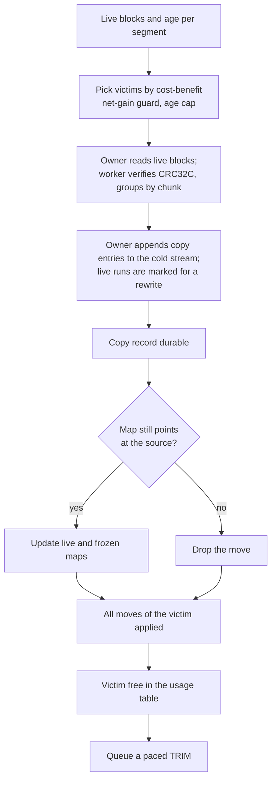
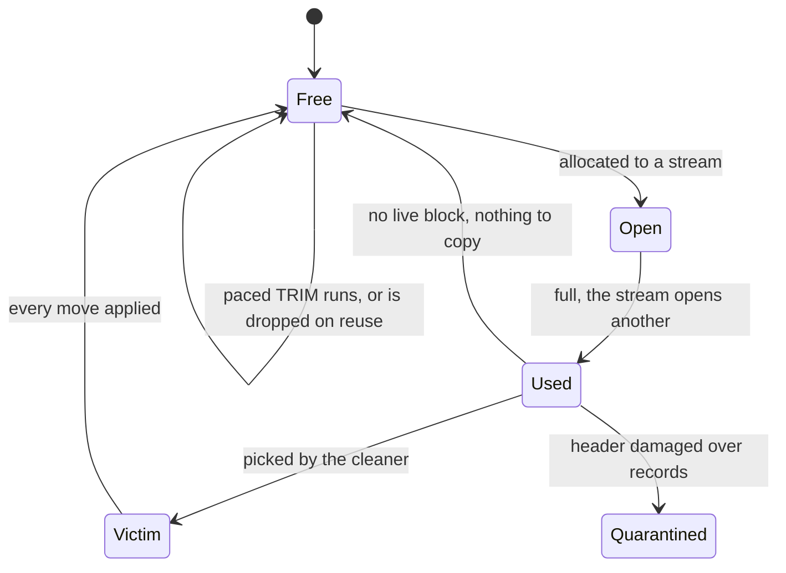
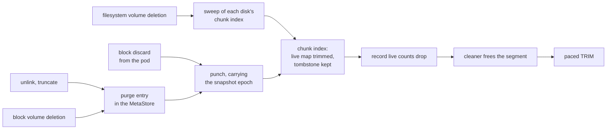

# The cleaner and free space: garbage collection in a log-structured disk

rock-solid never overwrites anything on a disk. Every write, from a 4 KiB block of a database
file to a Raft entry of the metadata store, is appended to one log per disk, and the old copy is
left behind as garbage. That makes writes fast and crashes easy to reason about, but it means a
background *cleaner* must keep copying the still-useful data out of old parts of the log so they
can be reused. This post explains what makes data dead, why that copying gets dramatically more
expensive as a disk fills, and what rock-solid designs around it so that a nearly full disk slows
down instead of wedging.

Each section starts with an **In plain words** box, which is enough to follow the whole post.
The **How it works** part after it has the mechanisms and edge cases.

## Words you need

- **Log, segment, record.** The disk is cut into fixed-size *segments*, thousands per disk.
  Writes are appended as *records*: a few header blocks describing what follows, with a checksum
  per data block, then the data blocks. A segment is filled front to back once, then later freed and reused as a
  whole. See [On-disk structures](../docs/glossary.md#on-disk-structures).
- **Live, dead, cleaner, victim.** A block is *live* while something can still read it, *dead*
  once nothing will. The *cleaner* picks a mostly-dead segment (the *victim*), copies its live
  blocks to the end of the log and frees it. Unrelated to Go's garbage collector.
- **Write amplification (WA).** Bytes the log writes to the drive divided by bytes the user
  wrote. A WA of 7 means every 4 KiB you write costs 28 KiB of writes. The SSD's own internal
  garbage collection multiplies this again.
- **Fill.** The share of the disk holding live data.
- **Stream, lane.** A stream is a kind of data the log keeps in segments of its own: *hot* (new
  writes), *cold* (the cleaner's copies) and *metadata* (sorted runs and manifests). A stream fills
  its segments in *lanes*, each a chain of segments with one open at a time
  ([post 04](04-one-log-per-disk.md#three-streams)).
- **Segment usage table.** A small table, saved with every checkpoint, of which segments are in
  use and how many live blocks each holds.
- **TRIM, discard.** Telling an SSD that blocks no longer hold data, so it can erase them ahead of
  time. See [Drives and durability](../docs/glossary.md#drives-and-durability).
- **Punch, tombstone, purge.** A punch zeroes a range of a chunk and frees the blocks it covers
  whole; punching a whole chunk deletes it and leaves a tombstone. A purge is the background job
  that punches every chunk of a deleted or truncated file. See [Data model](../docs/glossary.md#data-model).
- **Chunk, placement group.** Files and block volumes are cut into 4 MiB *chunks*. Each chunk
  belongs to a *placement group*, a small set of disks on different nodes that hold its copies
  ([post 02](02-chunks-and-placement.md)).
- **LSN, sorted run, compaction, checkpoint, manifest.** An LSN (log sequence number) orders
  records. A *checkpoint* writes the indexes' recent changes out as immutable *sorted runs*, then a
  *manifest* saying where the runs are and where replay starts after a crash; *compaction* merges
  runs into fewer, larger ones ([post 04](04-one-log-per-disk.md), [post 06](06-the-lsm-tree.md)).

## A short recap of the log

Each disk is one long notebook that you only ever write at the end of
([post 04](04-one-log-per-disk.md)): a newer version is written further on, and an index remembers
where the newest version of everything is. The disk's *owner*, one event loop, owns the disk's
chunk index, which maps each chunk's blocks to their place in the log, and the metadata store
(MetaStore) puts its Raft entries in the same records. So the log holds
chunk blocks, Raft entries, sorted runs and manifests, and each dies in its own way.

## The problem: an append-only disk fills with garbage

> **In plain words.** Picture the notebook again. You never erase, you cross out and write the
> new version at the end. After a while, most old pages are mostly crossed out, but each still
> has a few valid lines, so you cannot throw any page away. To get blank pages back you copy the
> valid lines from a few messy pages to the end, then recycle those pages. That copying is extra
> work that never helps the user. The fuller the notebook, the more valid lines each messy page
> has, and the more you copy for each page you get back.

Here is a small disk after a while of random overwrites. `L` is a live block, `.` a dead one, `_`
not yet written. Every written segment holds some live data, so none can be reused as is:

```text
before cleaning                               after cleaning segments 2 and 4

seg 1  [L L . L L L . L]  6 live              seg 1  [L L . L L L . L]
seg 2  [. L . . L . . .]  2 live  <- victim   seg 2  [_ _ _ _ _ _ _ _]  free
seg 3  [L L L . L L L L]  7 live              seg 3  [L L L . L L L L]
seg 4  [. . L . . . L .]  2 live  <- victim   seg 4  [_ _ _ _ _ _ _ _]  free
seg 5  [L . L L L L . L]  6 live              seg 5  [L . L L L L . L]
seg 6  [L L L L _ _ _ _]  open, hot           seg 6  [L L L L _ _ _ _]
seg 7  [_ _ _ _ _ _ _ _]  free                seg 7  [L L L L _ _ _ _]  open, cold: 4 copies

copy 4 blocks, get 16 blocks of space back: 12 blocks of net room for new writes
```

Without a cleaner, the log reaches the end of the disk and stops, however much of it is dead.

### What makes data dead

> **In plain words.** A block is garbage when nothing will ever read it again. For a file's data
> that means a newer write replaced it and no snapshot still needs the old version. For the
> system's own bookkeeping it means a newer, saved copy of that bookkeeping exists.

**How it works.** The design gives each kind of data its own rule
([On-disk format](../docs/design.md#on-disk-format), the *Cleaning* bullet):

| Kind of data | Dead once |
| --- | --- |
| Chunk block | no map still points at it: not the live version, not a snapshot's *frozen map* (the block list a snapshot keeps for each chunk it pinned), not an unflattened clone (a clone still reading its parent's blocks) |
| Raft entry | the memtable that applied it has been flushed as a sorted run |
| Sorted run | compaction has replaced it |
| Manifest, its pieces, the runs it names, every record after its replay points | a segment header naming a newer manifest is durable |
| Record header block | always, for the cleaner: it writes fresh headers for what it moves |

Records after the newest manifest's replay points stay live because recovery replays them from
the log after a crash.

For chunk blocks, the chunk index counts per record how many blocks its maps still refer to (a
block the live map and a frozen map share counts twice); a record is dead to the cleaner once its
count reaches zero, and every change to a count reaches the segment usage table (below), so a
segment counts what the index counts.

## Write amplification, from scratch

> **In plain words.** Suppose the cleaner picks a segment that is 80% live. To free it, it must
> first copy that 80% somewhere else. What you gain is only the 20% that was dead. So for every
> 2 blocks of new user data you make room for, you also write 8 blocks of copies: 10 blocks
> written for 2 blocks of user data, a write amplification of 5.

The worked example in blocks, one segment of 10:

```text
victim segment: [L L . L L L . L L L]   8 live, 2 dead (80% live)

  cleaner copies the 8 live blocks  ->  8 blocks written to the cold stream
  victim freed                      -> 10 blocks of space back
  net room for new data             -> 10 - 8 = 2 blocks

  user writes 2 blocks into that room:
      blocks written = 2 (user) + 8 (copies) = 10
      WA = 10 / 2 = 5      in general: WA = 1 / (1 - live share of victims)
```

### Why it explodes near full

> **In plain words.** At half full, half of everything on disk is garbage, so some segment is
> always mostly garbage and cheap to clean. At 95% full, only 5% of the disk is garbage, spread
> thinly everywhere, so even the best segment the cleaner can find is still mostly live. It copies
> a lot to gain a little.

**How it works.** The dead space on a disk is at most `1 − fill`. As the fill rises, the live
share of the best victims climbs toward 1, and `1 / (1 − x)` climbs toward infinity.

For uniform random overwrites and a greedy cleaner (always take the emptiest segment) there is a
closed form, which the [cleaner spike](../spikes/cleaner-wa/) checked its simulator against: the
victim's live share `x` solves `x = e^(−(1−x)/u)` at fill `u`, and WA is `1/(1−x)` (Desnoyers,
SYSTOR 2012). The simulator matched it within 0.9% from 50 to 95% full. Working backwards (our
arithmetic, on this greedy model without record headers), the best victims at 90% full are still
about 81% live, and at 95% about 90%.

The chart shows the design as specified, measured in simulation: cost-benefit cleaning with two
streams and real record headers (both explained below), next to the model. Each `#` is 0.25 of
WA:

```text
fill  design: cost-benefit, 2 streams, headers (simulated)        model   design
50%   ######                                                       1.26     1.41
70%   #########                                                    1.88     2.23
80%   #############                                                2.69     3.35
85%   ##################                                           3.52     4.54
90%   #############################                                5.18     7.15
95%   ############################################################...
                                                                  10.17    17.30
```

Going from 90% to 95% full more than doubles the cost. At 95%, 94% of everything the disk writes
would be cleaning, and the cleaner would spend about 20 µs of CPU per user 4K write, by the
[cleaner spike](../spikes/cleaner-wa/)'s estimate. That is why a pool's
[write limit](../docs/design.md#volume-size-and-capacity) is 90% by default: a write that adds data
is refused once any disk holding one of its placement group's members reaches it, counting its
live blocks plus the space already promised to buffered writes. The limit is checked per disk,
because one full disk stalls every placement group on it, and the writes that add no live data
still pass, so a filesystem's journal and a database's preallocated files keep working on a full
pool ([post 02](02-chunks-and-placement.md#volume-size-and-capacity)).

Skewed workloads do better: with Zipf-distributed overwrites, cost-benefit cleaning reaches 9.3 at
95% rather than 17.3. Snapshots lower WA slightly at the same fill (pinned data is perfectly cold:
6.72 against 7.15 at 90%) but raise the fill itself, so snapshot space counts toward the limit.

### Header blocks are capacity

> **In plain words.** Every page of the notebook starts with a table-of-contents line for that
> page. Once you copy the page's valid lines elsewhere, that line is useless, and it is never
> copied. So each page carries a sliver of space that is garbage from the start. Near full, those
> slivers add up to a disk that is effectively fuller than it looks.

**How it works.** Header blocks are dead to the cleaner from the moment they are written: when
the cleaner moves blocks, it writes new headers for them. The spike modeled this as an effective
fill of `u / (1 − h)`, where `h` is the header share of written blocks, and reproduced the greedy
results within 3%. The effect is large. At 95% full, the headers of 64 KiB records raise WA from
11.4 to 17.3. At 90% full, queue-depth-1 4K writes, one header block per
data block, double it: 10.98 against 5.64. So the header encoding is part of the format and must
stay compact.

## The options

> **In plain words.** Once you append, there are two broad ways to get space back. Clean the
> simplest way: always take the emptiest segment. Or clean cleverly: prefer old segments, and keep
> data that will die together in the same segments, so whole segments empty on their own and the
> cleaner copies less.

Not appending at all, with a journal and data written in place as Vitastor and BlueStore's
deferred writes do, or an embedded key-value engine that reclaims its own space, are weighed in
[post 04](04-one-log-per-disk.md#the-options). Here the question is how to clean a log:

- **A log with a greedy cleaner.** Always take the emptiest segment. It ignores age, so on skewed
  workloads it can clean a young segment whose data would soon have died anyway.
- **A log with a cost-benefit cleaner and two streams** (the original log-structured file system,
  LFS, Rosenblum and Ousterhout 1992). Prefer old segments with some dead space, and send the
  cleaner's copies to a separate stream from new writes. Without guards, it can livelock.
- **More temperature streams** (F2FS multi-head logging by move count, SepBIT by age class). Split
  the cleaner's copies further by how long they have survived.

| Approach | Used by | Gets right | Costs |
| --- | --- | --- | --- |
| Log, greedy cleaner | The classic baseline | Lowest WA on uniform overwrites | Cost-benefit writes 36 to 45% less on strongly skewed overwrites |
| **Log, cost-benefit, two streams, two guards** | LFS; **rock-solid** | 36 to 45% less WA than greedy on strongly skewed overwrites | 3 to 14% more WA than greedy on uniform overwrites |
| Log, more temperature streams | F2FS, SepBIT | Up to −30% WA on hot/cold | Up to +63% WA on uniform |

## What rock-solid picked

rock-solid appends, and cleans cleverly: a log with a cost-benefit cleaner, two guards and
separate streams, every piece sized from simulation. The rest of this section walks through it
from the disk's geometry to the moment a freed segment is trimmed.

### Segment count matters, segment size does not

> **In plain words.** A segment is the unit the cleaner frees. You might think its size is the
> key tuning knob. It barely matters. What matters is how many segments the disk has, because the
> cleaner always keeps a handful of them free, and on a disk with few segments that handful is a
> big slice of the disk.

**How it works.** At a fixed number of segments, the [cleaner spike](../spikes/cleaner-wa/) found
WA the same within 3% for segments from 1 to 256 MiB. But with 8 segments kept free (the spike's
setting, not the design's full free pool), the segment *count* at 95% full gave:

| Segments per disk | Share kept free | WA at 95% full |
| --- | --- | --- |
| 256 | 3.12% | **70** |
| 1,024 | 0.78% | 20.3 |
| 4,096 | 0.20% | 17.3 |
| 16,384 | 0.05% | 16.7 |

So a segment's size follows the disk's, so that every disk has at least 4,096 of them.

### Picking victims: cost-benefit with two guards

> **In plain words.** The cleaner prefers segments that free a lot for little copying, and among
> similar ones, older segments: data that has survived a long time will probably survive longer,
> so cleaning it once is a good deal, while a young segment may empty by itself if you wait. Two
> safety rules stop it from getting stuck: never clean a segment if copying it costs more space
> than it frees, and stop counting age after a while.

**How it works.** A pass takes a few victims. Segments with nothing live come first: they cost
nothing to free, and a metadata segment that merges just emptied would otherwise score zero while
the cleaner copied nearly full victims. The rest are scored by free space × age ÷ copy cost,
`(1 − u) × age / (1 + u)` for live share `u`, the original log-structured file system's rule, where
a segment's age is the writes since its youngest block and copies keep their source's age. Two
guards keep it from livelocking:

- **Net gain.** A victim must free more space than copying it costs, header blocks included. The
  [cleaner streams spike](../spikes/cleaner-streams/) found the guard must round header blocks up
  per record: estimated in exact bytes, it let the cleaner pick victims 98.9% live whose copy cost
  exactly what they freed.
- **Age cap.** Age counts up to one disk capacity of writes at most, so old, nearly full segments,
  such as snapshot data, stop looking attractive forever. Even with the net-gain guard on, uncapped
  age livelocked in the cleaner spike: it cleaned on and on without gaining a free segment. The cap
  fixed it and never raised WA.

The cleaner copies a victim's live contents *grouped by chunk*, which keeps a chunk's blocks that
die together side by side and wrote 6 to 7% less than copying in log order under hot/cold
overwrites. It does not try to regroup a chunk overwritten at random: a pass copies about 0.2
blocks of any one chunk on a 1 TB disk, and merging moved extents with their neighbours removed at
most 0.7% of the index's entries
([value separation spike](../docs/design.md#appendix-value-separation-spike)).

Two kinds of data are never copied. A manifest piece waits for the next manifest snapshot, which a
checkpoint writes early when the cleaner asks for its segment. A piece of a live sorted run is not
copied either: the cleaner marks the run for a *rewrite*, a merge of that run alone, so no piece is
ever named by two index roots at once ([post 06](06-the-lsm-tree.md)).

### Three streams: keep data that dies together

> **In plain words.** If one segment holds only data that will be deleted at about the same time,
> it empties all at once and the cleaner frees it for nothing. So rock-solid writes three kinds of
> data into three separate open segments: fresh writes, the cleaner's copies of old data, and
> index files. Each kind tends to die with its neighbours.

**How it works.** [Post 04](04-one-log-per-disk.md#three-streams) describes the streams and their
lanes: *hot* for new chunk writes and the Raft entries of the same round, *cold* for the cleaner's
copies and erasure-coded pieces, *metadata* for sorted runs and manifests. Here is what they buy the
cleaner.

The metadata stream earns its place. Sorted runs are written whole and die whole when a
compaction or a newer manifest replaces them, so their segments empty without copies. Mixed in
with the cleaner's copies, runs raised block-volume WA by 25 to 54% at 80 to 90% full, and from 17
to 50 at 95%; in a stream of their own, by 3 to 15% at 80 to 90% full
([cleaner streams spike](../docs/design.md#appendix-cleaner-streams-spike)). Within it, each merge
worker writes to a lane of its own, and merges install their output in steps
([post 06](06-the-lsm-tree.md)), so a merge's consumed input pieces die together and free whole
segments: mixed into the shared segment, they left 30 to 57 segments stranded instead of 8 to 10.
A worker's next merge continues its open segment, so no unused tail is left behind pieces the
cleaner cannot move.

More streams by temperature are not worth it yet: age classes for the cleaner's copies helped
hot/cold overwrites but hurt uniform ones (see the options table), and with headers counted,
perfect hot/cold separation is only 1.1 to 1.6× below two streams.

**Chunk slots: data that dies alone.** One kind of data defeats streams: whole 4 MiB chunks of
large files, deleted at random. Random deletes leave their segments partly live, so they clean
like small writes: 4.9 at 90% and 9.0 at 95% full. So a chunk written whole goes to a *chunk slot*
of its own ([post 04](04-one-log-per-disk.md#chunk-slots-for-whole-chunk-writes)), which frees once
the record that rewrote or deleted its chunk is durable; a slot segment is freed with its last
slot. Whole chunks then cost a WA of about 1 at any fill, so a pool of large files, such as
backups, can raise its write limit.

### The cleaner runs beside the writer, not on it

> **In plain words.** Copying is real work. If the thread that serves your writes also checked
> every copied block, your writes would wait behind it, so a helper thread does that part. Each
> move then says "chunk 7 blocks 0 to 3 used to be at A, now also at B", and the owner updates its
> index only if the blocks are still at A. If you overwrote them meanwhile, your write wins and the
> copy is simply garbage.

**How it works.** The expensive part of cleaning, checking every copied block, runs on a worker
goroutine, never on the event loop that owns the disk's chunk index and serves its writes. A pass
goes like this:

1. the owner lists a victim's live blocks and reads them into pool buffers, which become the copy
   items' buffers, so nothing is copied in memory;
2. the worker verifies each block's CRC32C against its record header and sorts the blocks by chunk;
3. the owner hands them to the log as `copy` entries in the cold stream, each naming the location
   it copied from, and applies each move once its record is durable.

The owner applies a move only where a map, live or frozen, still points at that location. The same
check runs in recovery's replay and in an index rebuild, so a write that lands during cleaning wins
in every order the records are applied. A victim holding a block that fails its checksum is
quarantined instead, since a single disk holds no other copy of it. This is the race, and why the
write wins (an LBA, logical block address, is a block's position on the disk):

```mermaid
sequenceDiagram
    participant W as Cleaner worker
    participant O as Owner loop and chunk index
    participant C as Client
    O->>W: chunk 7 block 3, read from LBA 100
    W->>W: verify its CRC32C, sort by chunk
    C->>O: write chunk 7 block 3
    O->>O: live map now says block 3 is at LBA 900
    W->>O: verified block 3, copied from LBA 100
    O->>O: append copy entry: block 3 from LBA 100 to LBA 5000
    O->>O: copy record durable; map points at 900, not 100, so skip the move
    Note over O: the client's write wins and the copy at 5000 is dead at once
```

A whole pass, from victim to free segment, looks like this:



A victim is freed once its copies are durable and no read in flight still reads from it, since a
reused segment could hand such a read another record's bytes. Applying costs the owner about one
index entry per moved block, as much as applying a write, and the index stays single-writer.

WiscKey and TiKV's Titan update the index per move the same way. Pebble's remap table instead
sent 63 to 96% of reads through an extra lookup in the value separation spike, and RocksDB's
BlobDB moves values only in compactions, which here would rewrite the whole index.

The [parallel cleaner spike](../spikes/parallel-cleaner/) measured why the worker matters. Inline,
cleaning cost the writing thread 5.9 to 11 µs per write at 90 to 95% full and gave its writes a
p99 of 250 to 540 µs; with a worker, 1.6 to 1.8 µs and about 6 µs. The price is 7 to 30% more total
CPU, so a disk gets one worker, and a second only once free segments start to run low (below).

### The segment usage table

> **In plain words.** The cleaner and recovery both need to know which segments are free and how
> full the others are. Guessing from what is on disk is dangerous: a segment whose header got
> damaged would look empty and be overwritten. So the log keeps a small ledger, one line per
> segment in use, and saves it with every checkpoint.

**How it works.** Each manifest carries the table as of the point its replay starts from: one row
per segment that is not free, giving its state (used, a slot segment with a bitmap of its slots, or
quarantined), its live block count and its newest record's LSN. A segment with no row is free. A
manifest edit carries only the rows that changed since the manifest before it, and a full copy of
the table is written from time to time ([post 04](04-one-log-per-disk.md#checkpoints-and-manifests)).
The live count is every data block of a durable record, lowered by the index owners as data dies.
The counts a manifest holds are only advice: at every open they are set again from the index, since
counts carried across a crash drift as replay applies records again.

A segment is free because the table says so, never because its header is unreadable, as in F2FS
and LFS. A segment whose header is damaged but which holds records of this log is *quarantined*:
never reused, reported for repair from a replica, and kept quarantined by every later table.

A segment the cleaner frees keeps its old header until it is reused, so a header alone cannot say
whether a segment was opened after the manifest or freed before it. Every manifest therefore
records the open sequence number the next segment will take (each segment header carries the number
it was opened under, [post 04](04-one-log-per-disk.md#the-layout-superblock-segments-records)). At
recovery, a header at or past that number belongs to a segment opened since the manifest, so the
segment is used whatever the table says; below it, the table decides, and a segment the
table leaves out is free with a stale header. That makes a freed segment reusable at once, with no
waiting state like F2FS's *prefree*, under two conditions: the cleaner never frees a segment holding
what the newest manifest named by a durable segment header still needs (its pieces, its runs, the
records after its replay points), and no index's replay point passes a copy record whose moves its
runs do not yet hold. The [log segments study](../studies/log-segments/) walks every crash order of
freeing, reusing and TRIM.

The life of a segment. The table records Used and Quarantined, and Free by a row's absence; Open
and Victim are states of the running log and cleaner:



### The reserve: room for the work that frees room

> **In plain words.** Cleaning needs free space to copy into. A checkpoint needs space to write the
> manifest that makes a freed segment official. If ordinary writes could use up every last
> segment, the disk would wedge: full, and unable to clean. So a few segments are held back and
> only the jobs that free space may touch them.

**How it works.** Three kinds of work may use the reserve: checkpoints, the cleaner and merge
steps. Each frees at least what it writes once its manifest is durable. The design sizes the
reserve to hold each at its largest, never smaller than the free pool the cleaner spikes ran with:

```text
reserve = room for the largest checkpoint
        + one merge step per merge worker
        + one cleaner pass's victims
```

A checkpoint has a hard size bound, because producers wait beyond it (below). A merge holds at most
one step beyond what the manifests name: installed whole, a merge held 65 to 258 segments on a
256 GiB disk; in steps, 2 ([LSM space spike](../spikes/lsm-study-space/)). RocksDB's file manager
reserves the same three things, and ZFS's slop space keeps room for freeing space the same way.

The reserve and the cleaner's free segments sit below the pool's write limit, so a disk at its limit
still cleans, checkpoints and merges. The reserve is computed when the disk is opened, and a disk too
small to hold it is refused rather than run with less.

### Writers slow down before the log runs out

> **In plain words.** If new writes arrive faster than the cleaner can free space, free segments
> drain. Rather than run full speed into a wall and start failing writes, the disk eases off:
> first it adds a second cleaner, then it lets chunk writes through only as fast as the cleaner
> frees space, and only at the very end does it make writers wait. Below the pool's write limit,
> your application sees this as slower writes, not errors.

**How it works.** The cleaner keeps a target number of free segments outside the reserve, and the
disk's owner checks how many are left every round. Those free segments play the part of RocksDB's
*level 0*, the unmerged files waiting at the top of its tree: RocksDB starts compacting at 4 of
them, adds compaction threads at 8, slows writes at 20 and stops them at 36. rock-solid borrows
those proportions, reading one used-up free segment as two level-0 files (our mapping, not a
measurement):

```text
free segments outside the reserve   RocksDB level 0           what happens
 target |################|          4 files: compaction       one cleaner worker
        |##############  |          8: more threads           a second worker joins
   half |########        |         20: writes slow            chunk writes go through
        |                |                                    a token bucket
   none |                |         36: writes stop            ordinary items wait
 =======+================+== reserve: checkpoints, cleaner, merge steps only ====
```

Once half the target is used up, chunk write blocks pass through a token bucket refilled at the rate
the cleaner measurably frees space, net of everything it spent (copies, checkpoints, merges,
headers), so the rate is the room left for ordinary writes; it is smoothed over one-second windows
and scaled down as free segments fall to none. That is how CockroachDB's admission control hands
out write tokens from the bytes compacted out of level 0. (RocksDB slows to a fixed rate that needs
tuning per drive, and Pebble only stops, which gives a latency cliff.) Raft entries,
punches and freezes are not charged: they are small, and punches free space.

A chunk write the bucket refuses stays with its connection, and the loop stops reading that
connection until the bucket refills, so clients see ordinary TCP backpressure. Waiting items keep
their buffers and are written in submit order once a segment frees.

Unlike RocksDB and Pebble, whose level 0 also stops writes when it holds too many files, the
number of sorted runs never slows anyone here: an index over its run limit only makes lookups
cost more ([post 06](06-the-lsm-tree.md)).

A full disk can therefore show up in three ways, in this order:

| Condition | What the client sees |
| --- | --- |
| A disk holding a member of the write's placement group is past the pool's write limit, and the write adds data | Refused: `ENOSPC` from `write()` on a file volume ([post 09](09-rwx-filesystem-and-cache-coherence.md)), a wait until the pool has room on a block volume ([post 10](10-block-snapshots-and-clones.md)) |
| Below the limit, the cleaner falls behind | Slower writes, then waiting |
| The cleaner has no victim that passes its net-gain guard: nothing more can be freed | A no-space error from the disk log, which reaches a file's writer late, at its next `write()`, `fsync` or `close` |

The first row is the only one the application normally meets, and the design is careful about
how. A file's buffered writes are acknowledged against a space grant so that `write()` itself
reports a full pool. A block volume's write is never failed for space, because the filesystem
inside the volume would stop: in the
[block ENOSPC spike](../docs/design.md#appendix-block-enospc-spike), ext4 aborted its journal when
a refused write was its own metadata, while the same writes held until the pool grew completed and
the filesystem checked clean ([post 10](10-block-snapshots-and-clones.md)).

The same wait applies to a lagging checkpoint: once the records after the newest manifest reach
twice the checkpoint interval, group commit takes items only from the checkpoint and the cleaner
until a manifest is durable.

Small disks fill less. The net-gain guard charges a victim's copies in whole records, a large share
of a small segment, so it caps a victim's live share lower there, and once every segment is fuller
than that cap writes would fail below the write limit. So a pool that leaves its write limit unset
gives each disk a default that follows its segment size: 90% on large disks, lower on small ones
([Volume size and capacity](../docs/design.md#volume-size-and-capacity)).

### TRIM, paced

> **In plain words.** When a segment is freed, rock-solid tells the SSD that the space is empty so
> the drive can erase it in the background. But some SSDs stall when told about lots of freed
> space at once. Since the segment is already usable by the log the moment the table says it is
> free, there is no hurry: TRIMs trickle out at a steady rate, and only once the disk's own
> records can no longer mistake the trimmed segment for damage.

**How it works.** TRIMs are paced, one per segment, at a steady rate borrowed from CockroachDB's
file deletion rate. They run faster only to clear an old backlog, as Pebble's delete pacer does.
Unlike deleting a file in Pebble, a TRIM frees no space in the log, so low space never speeds it up.

A freed segment's TRIM is queued only once a segment header naming the manifest that freed it is
durable. Before that, a crash would load the older manifest, which still lists the segment, and a
listed segment whose header reads as zeros is damage. A segment allocated again drops its TRIM if
it is still queued and waits for one already issued, as F2FS does, so a late discard cannot erase
new records. A drive whose discarded blocks do not read back as zeros would leave an undecodable
header that recovery reads in full at every start, so on such a drive the freed segment's header is
zeroed instead. A disk that is a file instead of a raw device ignores TRIM, since punching holes in the file would undo writing it in full when it
was created ([post 04](04-one-log-per-disk.md)).

## Freeing space: from `rm` to a free segment

> **In plain words.** Deleting a file does not erase anything on the spot. It writes small "this
> is gone" markers. Those markers make blocks dead in the index, and eventually the cleaner
> reclaims the segments they sat in. The one exception: a block a snapshot still needs stays
> live, however many times you delete the file.

**How it works.** A chunk's ID is computed from its volume, its inode and its offset
([post 02](02-chunks-and-placement.md)), so freeing data never needs to search for chunks: a *purge* lists the IDs and punches them, batched per
placement group ([Freeing space](../docs/design.md#freeing-space)). A punch to a chunk that does
not exist succeeds, so a purge interrupted by a crash simply runs again. The path:



- **Unlink and truncate** add a purge entry in the same metadata transaction that removes or
  shrinks the file; a background purger punches the chunks
  ([post 09](09-rwx-filesystem-and-cache-coherence.md) has the file-side details). A punch that
  covers part of a block, such as the rest of a truncated file's last block, frees nothing; it
  writes a new block of zeros there. A second truncate, or an unlink before the purger has run,
  widens the inode's pending purge instead of replacing it, which would leak the chunks the first
  one covered.
- **Block discard** from the pod's filesystem reaches the daemon through ublk and becomes a punch.
  The CSI driver mounts the filesystems it creates with `discard`, because without it
  deleting files frees nothing in the pool: in the block ENOSPC spike, a write after `rm` still
  failed until the mount used `discard`. **Deleting a block volume** purges every chunk up to its
  size; **deleting a filesystem volume** removes its metadata keys with one range removal and has
  every disk of the pool sweep its chunk index for the volume's ID, which is cheaper than purging
  millions of small files one by one.
- **Tombstones.** Punching a whole chunk keeps the chunk's entry, its tombstone, and removes its
  live map. Punches are recorded in record headers like writes, so an index rebuilt from the
  headers cannot bring a deleted chunk back.
- **Snapshots pin blocks.** Punches carry the snapshot epoch, so a purge never frees a block a
  snapshot's frozen map still refers to. Deleting a snapshot starts a sweep that drops frozen
  versions nothing needs. Until then, past the write limit even an overwrite of a block a snapshot
  shares is refused like a new write, because it needs new space.

## Evidence

Every measured number above comes from a spike, a simulation, or a study of other engines' source.
The level-0 mapping is arithmetic on those, not a measurement.

| Spike | What it settled |
| --- | --- |
| [Cleaner WA](../docs/design.md#appendix-cleaner-write-amplification-spike), [`spikes/cleaner-wa`](../spikes/cleaner-wa/) | A simulator checked against the greedy model; cost-benefit against greedy; segment count, the two guards and the cost of headers |
| [Cleaner streams](../docs/design.md#appendix-cleaner-streams-spike), [`spikes/cleaner-streams`](../spikes/cleaner-streams/) | The metadata stream, merge lanes, chunk slots, and no temperature streams |
| [Parallel cleaner](../docs/design.md#appendix-parallel-cleaner-spike), [`spikes/parallel-cleaner`](../spikes/parallel-cleaner/) | A worker beside the owner loop rather than cleaning inline |
| [LSM space](../docs/design.md#appendix-lsm-space-spike), [`spikes/lsm-study-space`](../spikes/lsm-study-space/) | Merge steps and the reserve, from a source study of Pebble, RocksDB, CockroachDB and ScyllaDB; slowdown, stop and TRIM pacing practices |

The cleaner in the real log is held to the cleaner spike's figures, and the simulator's invariant
checker holds every simulated run to three rules: each cleaner pass frees more segments than it
fills, a cleaner move never replaces a write that landed during cleaning, and a disk full except for
its reserve still finishes a checkpoint and a cleaner pass ([post 12](12-testing-for-trust.md)).

## Trade-offs and what it costs us

- **Disks cannot be filled.** The default 90% write limit keeps 10% of every disk away from user
  data, and block volumes still pay a WA of about 7 there, with SSD wear to match.
- **The worst workload gets no help.** Cost-benefit loses to greedy on uniform overwrites (see the
  options table) to win on skewed ones.
- **Extra CPU.** The worker costs more total CPU than inline cleaning, and near full the cleaner's
  CPU is large.
- **Index churn.** The cleaner's moves cause 55, 76 and 92% of the chunk index's entries at 80, 90
  and 95% full under uniform overwrites.
- **Fragmentation stays.** A chunk overwritten at random 4K keeps one extent per write
  ([post 04](04-one-log-per-disk.md#trade-offs-what-it-costs-us)), and a block volume can push a
  1 TB disk toward 270 million index entries.
- **Slowed, not failed.** A write can wait as long as the cleaner needs, and a slowed member delays
  the acknowledgments of every placement group it belongs to.
- **Thresholds are borrowed** from RocksDB, not measured.

## Open directions

From the design's [Roadmap and open questions](../docs/design.md#roadmap-and-open-questions):

- **Temperature separation that never loses to two streams**, for example age classes turned on
  only when the cleaner sees skew. Needs block-volume and small-file traces.
- **Cleaner moves once the chunk index outgrows memory**: the owner's check before each move can
  then miss the block cache and read the disk.
- **Regrouping chunks overwritten at random**, for example rewriting a chunk with too many extents
  whole into a chunk slot. Each regroup writes 4 MiB, so it needs traces.
- **Admission across a placement group**, so one cleaning disk does not fill a primary's whole
  replication queue.
- **Cleaning-debt thresholds.** Does the measured-rate bucket keep latency bounded under bursty
  overwrites at 90 to 95% full, and should the thresholds scale with the current WA?
- **Deletes on a full disk.** Punches pass the pool's write limit, but with no free segment
  outside the reserve they, and the MetaStore's unlinks, wait like any write. Should they draw on a
  slice of the reserve? Every system studied keeps one: ext4 for punches, XFS a reserve pool, Btrfs
  for `unlink`, ZFS its slop space, CockroachDB a ballast file an operator deletes.
- **Merge lanes shared between merges** and **the drive's own WA by segment size**, as in
  [post 04](04-one-log-per-disk.md#open-directions).
- **Write amplification of the Go log under write admission** runs above the cleaner streams
  spike's at 90% full: admission makes rounds smaller, and the chunk index writes more than the
  spike modelled. Should a round wait for more writes while admission holds them?

## Further reading

- Design: [On-disk format](../docs/design.md#on-disk-format) (the *Cleaning*, *The cleaner runs
  beside the writer*, *Writers slow down*, *Free space is recorded*, *Segment count matters* and
  *Headers are capacity* bullets), [Freeing space](../docs/design.md#freeing-space),
  [Volume size and capacity](../docs/design.md#volume-size-and-capacity),
  [Snapshots and clones](../docs/design.md#snapshots-and-clones),
  [Alternatives considered](../docs/design.md#alternatives-considered).
- Appendices:
  [cleaner write amplification](../docs/design.md#appendix-cleaner-write-amplification-spike),
  [cleaner streams](../docs/design.md#appendix-cleaner-streams-spike),
  [parallel cleaner](../docs/design.md#appendix-parallel-cleaner-spike),
  [stream overlap](../docs/design.md#appendix-stream-overlap-spike),
  [LSM space](../docs/design.md#appendix-lsm-space-spike),
  [value separation](../docs/design.md#appendix-value-separation-spike),
  [block ENOSPC](../docs/design.md#appendix-block-enospc-spike).
- Spikes: [`spikes/cleaner-wa/`](../spikes/cleaner-wa/),
  [`spikes/cleaner-streams/`](../spikes/cleaner-streams/),
  [`spikes/parallel-cleaner/`](../spikes/parallel-cleaner/),
  [`spikes/stream-overlap/`](../spikes/stream-overlap/),
  [`spikes/lsm-study-space/`](../spikes/lsm-study-space/),
  [`spikes/block-enospc/`](../spikes/block-enospc/).
- Studies: [pool capacity and ENOSPC](../studies/capacity-and-enospc/README.md),
  [log segments](../studies/log-segments/README.md).
- Code: [internal/disklog](../internal/disklog/) (segments, the usage table, the cleaner),
  [internal/chunkstore](../internal/chunkstore/) (the chunk index and its conditional move).
- Glossary: [on-disk structures](../docs/glossary.md#on-disk-structures).
- Series: [01 The big picture](01-the-big-picture.md),
  [02 Chunks and placement](02-chunks-and-placement.md),
  [04 One log per disk](04-one-log-per-disk.md), [06 The LSM tree](06-the-lsm-tree.md),
  [09 RWX filesystem and cache coherence](09-rwx-filesystem-and-cache-coherence.md),
  [10 Block snapshots and clones](10-block-snapshots-and-clones.md),
  [11 Runtime in Go](11-runtime-in-go.md), [12 Testing for trust](12-testing-for-trust.md).
