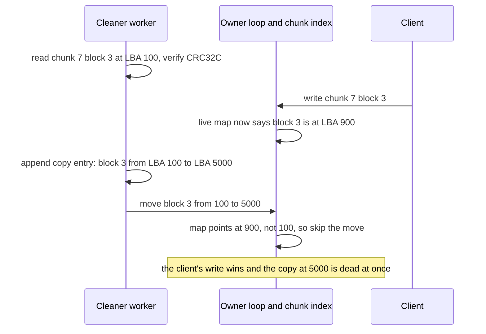
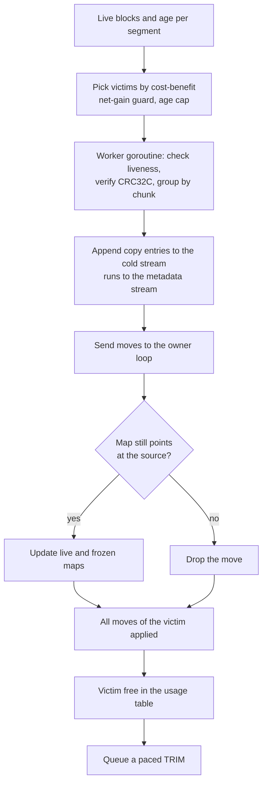
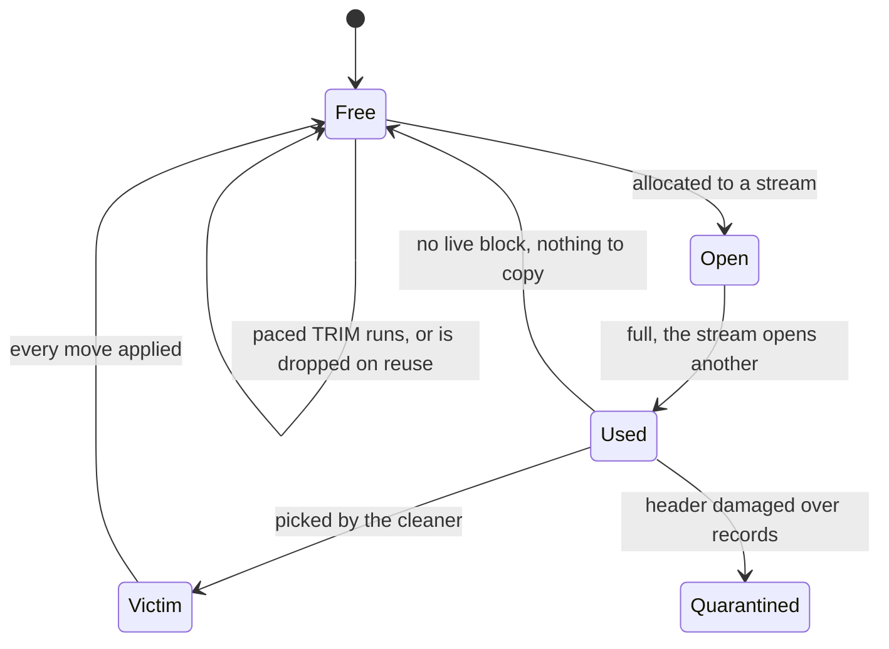
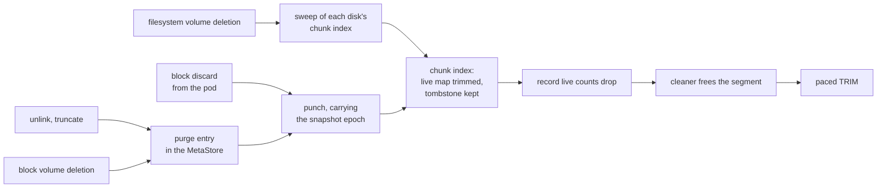

# The cleaner and free space: garbage collection in a log-structured disk

rock-solid never overwrites anything on a disk. Every write, from a 4 KiB block of a database
file to a Raft entry of the metadata store, is appended to one log per disk, and the old copy is
left behind as garbage. That makes writes fast and crashes easy to reason about, but it means a
background *cleaner* must keep copying the still-useful data out of old parts of the log so they
can be reused. This post explains what makes data dead, why that copying gets dramatically more
expensive as a disk fills, and what rock-solid designs around it so that a nearly full disk slows
down instead of wedging. Most of this is still design: the segment usage table is built, and the
cleaner itself is planned for phase 1.

Each section starts with an **In plain words** box, which is enough to follow the whole post.
The **How it works** part after it has the real names, numbers and edge cases.

## Words you need

- **Log, segment, record.** The disk is cut into fixed-size *segments* (64 MiB on disks of
  256 GiB and up). Writes are appended as *records*: a few header blocks describing what follows,
  then the data blocks. A segment is filled front to back once, then later freed and reused as a
  whole. See [On-disk structures](../docs/glossary.md#on-disk-structures).
- **Live, dead, cleaner, victim.** A block is *live* while something can still read it, *dead*
  once nothing will. The *cleaner* picks a mostly-dead segment (the *victim*), copies its live
  blocks to the end of the log and frees it. Unrelated to Go's garbage collector.
- **Write amplification (WA).** Bytes the log writes to the drive divided by bytes the user
  wrote. A WA of 7 means every 4 KiB you write costs 28 KiB of writes. The SSD's own internal
  garbage collection multiplies this again.
- **Fill.** The share of the disk holding live data.
- **Stream.** A sequence of segments the log appends to. The design has three, each with its own
  open segment: *hot* (new writes), *cold* (the cleaner's copies) and *metadata* (sorted runs and
  manifests). The code has the first two; the third is planned.
- **Segment usage table.** A small table, saved with every checkpoint, of which segments are in
  use and how many live blocks each holds.
- **TRIM, discard.** Telling an SSD that blocks no longer hold data, so it can erase them ahead of
  time. See [Drives and durability](../docs/glossary.md#drives-and-durability).
- **Punch, tombstone, purge.** A punch zeroes a range of a chunk and frees its blocks; punching a
  whole chunk deletes it and leaves a tombstone. A purge is the background job that punches every
  chunk of a deleted or truncated file. See [Data model](../docs/glossary.md#data-model).
- **Chunk, placement group.** Files and block volumes are cut into 4 MiB *chunks*. Each chunk
  belongs to a *placement group*, a small set of disks on different nodes that hold its copies
  ([post 02](02-chunks-and-placement.md)).
- **LSN, memtable, sorted run, compaction, checkpoint, manifest.** An LSN (log sequence number)
  orders records. Indexes keep recent changes in an in-memory *memtable*; a *checkpoint* writes
  memtables out as immutable *sorted runs* and then a *manifest* saying where the runs are and
  where replay starts after a crash. *Compaction* merges runs into fewer, larger ones
  ([post 04](04-one-log-per-disk.md), [post 06](06-the-lsm-tree.md)).

## A short recap of the log

> **In plain words.** Each disk is one long notebook that you only ever write at the end of.
> Many writers hand their pages to one owner, who writes a batch at the end and makes it durable
> with one flush. Nothing is ever corrected in place: a newer version is simply written further
> on, and an index remembers where the newest version of everything is.

[Post 04](04-one-log-per-disk.md) covers the log in depth. This post needs only its shape:

```text
disk = segment 0      superblock
       segment 1..n   [segment header][record][record][record] ...   one stream per segment

record = [header blocks: what follows, a CRC per data block]  <- dead to the cleaner
         [data blocks]                                         <- live until overwritten
```

The disk's *owner*, one event loop, also owns the disk's chunk index, which maps each chunk's
blocks to their place in the log. The metadata store (MetaStore), which runs on Raft, puts its
replicas' Raft entries in the same records. So the log holds chunk blocks, Raft entries, sorted
runs and manifests, and each dies in its own way.

## The problem: an append-only disk fills with garbage

> **In plain words.** Picture the notebook again. You never erase, you cross out and write the
> new version at the end. After a while, most old pages are mostly crossed out, but each still
> has a few valid lines, so you cannot throw any page away. To get blank pages back you copy the
> valid lines from a few messy pages to the end, then recycle those pages. That copying is extra
> work that never helps the user. The fuller the notebook, the more valid lines each messy page
> has, and the more you copy for each page you get back.

Here is a small disk after a while of random overwrites. `L` is a live block, `.` a dead one, `_`
not yet written. Every written segment holds some live data, so none can be reused as is:

```text
before cleaning                               after cleaning segments 2 and 4

seg 1  [L L . L L L . L]  6 live              seg 1  [L L . L L L . L]
seg 2  [. L . . L . . .]  2 live  <- victim   seg 2  [_ _ _ _ _ _ _ _]  free
seg 3  [L L L . L L L L]  7 live              seg 3  [L L L . L L L L]
seg 4  [. . L . . . L .]  2 live  <- victim   seg 4  [_ _ _ _ _ _ _ _]  free
seg 5  [L . L L L L . L]  6 live              seg 5  [L . L L L L . L]
seg 6  [L L L L _ _ _ _]  open, hot           seg 6  [L L L L _ _ _ _]
seg 7  [_ _ _ _ _ _ _ _]  free                seg 7  [L L L L _ _ _ _]  open, cold: 4 copies

copy 4 blocks, get 16 blocks of space back: 12 blocks of net room for new writes
```

Without a cleaner, the log reaches the end of the disk and stops, however much of it is dead.

### What makes data dead

> **In plain words.** A block is garbage when nothing will ever read it again. For a file's data
> that means a newer write replaced it and no snapshot still needs the old version. For the
> system's own bookkeeping it means a newer, saved copy of that bookkeeping exists.

**How it works.** The design gives each kind of data its own rule
([On-disk format](../docs/design.md#on-disk-format), the *Cleaning* bullet):

| Kind of data | Dead once |
| --- | --- |
| Chunk block | no map still points at it: not the live version, not a snapshot's *frozen map* (the block list a snapshot keeps for each chunk it pinned), not an unflattened clone (a clone still reading its parent's blocks) |
| Raft entry | the memtable that applied it has been flushed as a sorted run |
| Sorted run | compaction has replaced it |
| Manifest, its pieces, the runs it names, every record after its replay points | a segment header naming a newer manifest is durable |
| Record header block | always, for the cleaner: it writes fresh headers for what it moves |

Two details matter. The cleaner never copies a manifest piece: a segment holding one waits for
the next manifest snapshot, which a checkpoint writes early when the cleaner asks for that
segment. And records after the newest manifest's replay points stay live, because recovery
replays them from the log after a crash.

For chunk blocks, the chunk index counts per record how many blocks its maps still refer to (a
block the live map and a frozen map share counts twice); a record is dead to the cleaner once its
count reaches zero. These counts are built (`internal/chunkstore`). The segment usage table, below,
counts per segment; how the per-record counts reach the cleaner's victim choice is part of the
planned cleaner.

## Write amplification, from scratch

> **In plain words.** Suppose the cleaner picks a segment that is 80% live. To free it, it must
> first copy that 80% somewhere else. What you gain is only the 20% that was dead. So for every
> 2 blocks of new user data you make room for, you also write 8 blocks of copies: 10 blocks
> written for 2 blocks of user data, a write amplification of 5.

The worked example in blocks, one segment of 10:

```text
victim segment: [L L . L L L . L L L]   8 live, 2 dead (80% live)

  cleaner copies the 8 live blocks  ->  8 blocks written to the cold stream
  victim freed                      -> 10 blocks of space back
  net room for new data             -> 10 - 8 = 2 blocks

  user writes 2 blocks into that room:
      blocks written = 2 (user) + 8 (copies) = 10
      WA = 10 / 2 = 5      in general: WA = 1 / (1 - live share of victims)

same thing at full size: a 64 MiB victim, 80% live
  copy 51.2 MiB to make room for 12.8 MiB of user data: WA 5
```

### Why it explodes near full

> **In plain words.** At half full, half of everything on disk is garbage, so some segment is
> always mostly garbage and cheap to clean. At 95% full, only 5% of the disk is garbage, spread
> thinly everywhere, so even the best segment the cleaner can find is still mostly live. It copies
> a lot to gain a little.

**How it works.** The dead space on a disk is at most `1 − fill`. As the fill rises, the live
share of the best victims climbs toward 1, and `1 / (1 − x)` climbs toward infinity.

For uniform random overwrites and a greedy cleaner (always take the emptiest segment) there is a
closed form, which the [cleaner spike](../spikes/cleaner-wa/) checked its simulator against: the
victim's live share `x` solves `x = e^(−(1−x)/u)` at fill `u`, and WA is `1/(1−x)` (Desnoyers,
SYSTOR 2012). The simulator matched it within 0.9% from 50 to 95% full. Working backwards (our
arithmetic, on this greedy model without record headers), the best victims at 90% full are still
about 81% live, and at 95% about 90%.

The chart shows the design as specified, measured in simulation: cost-benefit cleaning with two
streams and real record headers (both explained below), next to the model. Each `#` is 0.25 of
WA:

```text
fill  design: cost-benefit, 2 streams, headers (simulated)        model   design
50%   ######                                                       1.26     1.41
70%   #########                                                    1.88     2.23
80%   #############                                                2.69     3.35
85%   ##################                                           3.52     4.54
90%   #############################                                5.18     7.15
95%   ############################################################...
                                                                  10.17    17.30
```

Going from 90% to 95% full more than doubles the cost. At 95%, 94% of everything the disk writes
would be cleaning, and the cleaner would spend about 20 µs of CPU per user 4K write (cleaner
spike, C7, an order of magnitude on a shared machine). That is why a pool's
[`write_limit`](../docs/design.md#volume-size-and-capacity) defaults to 90%: a write fails with
`ENOSPC` once any disk holding one of its placement group's members is fuller than that, and the
pool warns 10 points earlier. The limit is checked per disk, because one full disk stalls every
placement group on it.

Skewed workloads do better: with Zipf-distributed overwrites, cost-benefit cleaning reaches 9.3 at
95% rather than 17.3. Snapshots lower WA slightly at the same fill (pinned data is perfectly cold:
6.72 against 7.15 at 90%) but raise the fill itself, so snapshot space counts toward the limit.

### Header blocks are capacity

> **In plain words.** Every page of the notebook starts with a table-of-contents line for that
> page. Once you copy the page's valid lines elsewhere, that line is useless, and it is never
> copied. So each page carries a sliver of space that is garbage from the start. Near full, those
> slivers add up to a disk that is effectively fuller than it looks.

**How it works.** Header blocks are dead to the cleaner from the moment they are written: when
the cleaner moves blocks, it writes new headers for them. The spike modeled this as an effective
fill of `u / (1 − h)`, where `h` is the header share of written blocks, and reproduced the greedy
results within 3%. The effect is large. At 95% full, the headers of 64 KiB records with 32-byte
entries raise WA from 11.4 to 17.3. At 90% full, queue-depth-1 4K writes, one header block per
data block, double it: 10.98 against 5.64. So the header encoding is part of the format and must
stay compact.

## The options

> **In plain words.** There are three broad answers to "how do I get space back". Do not append
> at all: write in place, so nothing needs cleaning. Append, and clean the simplest way: always
> take the emptiest segment. Or append, and clean cleverly: prefer old segments, and keep data
> that will die together in the same segments, so whole segments empty on their own and the
> cleaner copies less.

- **Write in place with a journal** (Vitastor, BlueStore's deferred writes). A small write is
  journaled, acknowledged and copied into place later, so there is no cleaner. But big writes must
  skip the journal or media bandwidth doubles, and snapshots need a per-chunk extent map with
  reference counts, which the design calls BlueStore's most complex part.
- **An embedded key-value engine for metadata** (redb, fjall, Pebble). It reclaims its own space,
  but flushes files through the kernel itself: it cannot run on a drive SPDK owns, the simulator
  cannot crash it, and its flushes come on top of the chunk log's.
- **A log with a greedy cleaner.** Always take the emptiest segment. It ignores age, so on skewed
  workloads it can clean a young segment whose data would soon have died anyway.
- **A log with a cost-benefit cleaner and two streams** (the original log-structured file system,
  LFS, Rosenblum and Ousterhout 1992). Prefer old segments with some dead space, and send the
  cleaner's copies to a separate stream from new writes. Without guards, it can livelock.
- **More temperature streams** (F2FS multi-head logging by move count, SepBIT by age class). Split
  the cleaner's copies further by how long they have survived.

| Approach | Used by | Gets right | Costs |
| --- | --- | --- | --- |
| Journal plus in-place data | Vitastor, BlueStore deferred writes | No cleaner | Small writes written twice; reference-counted extent maps for snapshots |
| Embedded KV engine for metadata | redb, fjall, Pebble | Mature, ready-made | Own flushes; no SPDK; simulator cannot crash it; fjall 179 MB for 4.9 MB live |
| Log, greedy cleaner | The classic baseline | Lowest WA on uniform overwrites | Cost-benefit writes 36 to 45% less on strongly skewed overwrites |
| **Log, cost-benefit, two streams, two guards** | LFS; **rock-solid** | 36 to 45% less WA than greedy on strongly skewed overwrites | 3 to 14% more WA than greedy on uniform overwrites |
| Log, more temperature streams | F2FS, SepBIT | Up to −30% WA on hot/cold | Up to +63% WA on uniform |

## What rock-solid picked

rock-solid appends, and cleans cleverly: a log with a cost-benefit cleaner, two guards and
separate streams, every piece sized from simulation. The rest of this section walks through it
from the disk's geometry to the moment a freed segment is trimmed.

### Segment count matters, segment size does not

> **In plain words.** A segment is the unit the cleaner frees. You might think its size is the
> key tuning knob. It barely matters. What matters is how many segments the disk has, because the
> cleaner always keeps a handful of them free, and on a disk with few segments that handful is a
> big slice of the disk.

**How it works.** At a fixed number of segments, the [cleaner spike](../spikes/cleaner-wa/) found
WA the same within 3% for segments from 1 to 256 MiB. But with 8 segments kept free (the spike's
setting, not the design's full free pool), the segment *count* at 95% full gave:

| Segments per disk | Share kept free | WA at 95% full |
| --- | --- | --- |
| 256 | 3.12% | **70** |
| 1,024 | 0.78% | 20.3 |
| 4,096 | 0.20% | 17.3 |
| 16,384 | 0.05% | 16.7 |

So a segment is `min(64 MiB, disk size ÷ 4096)`, rounded down to a power of two
([`GeometryFor` in internal/disklog/geometry.go](../internal/disklog/geometry.go)): 64 MiB on
disks of 256 GiB and up, which then have 4,096 segments or more. Smaller disks get smaller
segments and 4,096 to 8,191 of them: a 255 GiB disk gets 8,160 segments of 32 MiB.

### Picking victims: cost-benefit with two guards

> **In plain words.** The cleaner prefers segments that free a lot for little copying, and among
> similar ones, older segments: data that has survived a long time will probably survive longer,
> so cleaning it once is a good deal, while a young segment may empty by itself if you wait. Two
> safety rules stop it from getting stuck: never clean a segment if copying it costs more space
> than it frees, and stop counting age after a while.

**How it works.** The cleaner scores segments by free space × age ÷ copy cost, as LFS did (the
spike used `(1 − u) × age / (1 + u)`). Two guards keep it from livelocking:

- **Net gain.** A victim must free more space than copying it costs, header blocks included. The
  [cleaner streams spike](../spikes/cleaner-streams/) found the guard must round header blocks up
  per record: estimated in exact bytes, it let the cleaner pick victims 98.9% live whose copy cost
  exactly what they freed.
- **Age cap.** Age counts up to one disk capacity of writes at most, so old, nearly full segments,
  such as snapshot data, stop looking attractive forever. Even with the net-gain guard on, uncapped
  age livelocked in the cleaner spike: 1,000 cleaning passes without gaining a free segment. The
  cap fixed it and never raised WA.

The cleaner copies a victim's live contents *grouped by chunk*, which keeps a chunk's blocks that
die together side by side and wrote 6 to 7% less than copying in log order under hot/cold
overwrites. It does not try to regroup a chunk overwritten at random: a pass copies about 0.2
blocks of any one chunk on a 1 TB disk, and merging moved extents with their neighbours removed at
most 0.7% of the index's entries
([value separation spike](../docs/design.md#appendix-value-separation-spike)). A used segment with
no live block at all is freed without copying anything.

### Three streams: keep data that dies together

> **In plain words.** If one segment holds only data that will be deleted at about the same time,
> it empties all at once and the cleaner frees it for nothing. So rock-solid writes three kinds of
> data into three separate open segments: fresh writes, the cleaner's copies of old data, and
> index files. Each kind tends to die with its neighbours.

**How it works.** Each stream has its own open segment, and each round of group commit writes one
record to one stream:

```text
hot stream       new chunk writes + the Raft entries of the same round
                 [seg 41: new data, dies at the next overwrite      ] ...
cold stream      blocks the cleaner moves + erasure-coded shards
                 [seg 17: data that already survived one cleaning   ] ...
metadata stream  sorted runs, compaction output, manifests; one open segment per running merge
                 [seg 63: runs, written whole, die whole            ] ...
```

The metadata stream earns its place. Sorted runs are written whole and die whole when a
compaction or a newer manifest replaces them, so their segments empty without copies. Mixed in
with the cleaner's copies, runs raised block-volume WA by 25 to 54% at 80 to 90% full, and from 17
to 50 at 95%; in a stream of their own, by 3 to 15% at 80 to 90% full
([cleaner streams spike](../docs/design.md#appendix-cleaner-streams-spike)). The code's segment
header knows two stream tags today, `Hot` and `Cold`
([internal/disklog/segment.go](../internal/disklog/segment.go)); the metadata stream is a planned
build item, and the tag is a whole byte, so it needs only a new format version.

Raft entries stay in the hot stream even though a stream of their own saved 6%: a round writes one
record to one stream, so a Raft stream would split a commit's chunk write and its Raft entries into
two rounds and two flushes.

More streams by temperature are not worth it yet: age classes for the cleaner's copies helped
hot/cold overwrites but hurt uniform ones (see the options table), and with headers counted,
perfect hot/cold separation is only 1.1 to 1.6× below two streams. A hot 4K commit can also wait
behind a cold 1 MiB record, since rounds take the streams in turn; that group-commit question is
in [post 04](04-one-log-per-disk.md) and the
[stream overlap spike](../docs/design.md#appendix-stream-overlap-spike).

**Chunk slots: data that dies alone.** One kind of data defeats streams: whole 4 MiB chunks of
large files, deleted at random. A 64 MiB segment holds 16 of them, and random deletes leave it
partly live, so they clean like small writes: 4.9 at 90% and 9.0 at 95% full. The fix is a *chunk
slot* (planned for phase 6): a slot segment is 16 slots of exactly one chunk's data, a slot frees
once the record that rewrote or deleted its chunk is durable, and the segment is freed with its
last slot. Whole chunks then cost a WA of 1.004 at any fill, so a pool of large files, such as
backups, can raise its `write_limit` to 95%.

### The cleaner runs beside the writer, not on it

> **In plain words.** Copying is real work: reading blocks, checking their checksums, writing them
> again. If the same thread that serves your writes also did the copying, your writes would wait
> behind it. So a helper thread does the copying and sends a short note to the owner for each
> move: "chunk 7 blocks 0 to 3 used to be at A, now also at B". The owner updates its index only
> if the blocks are still at A. If you overwrote them in the meantime, your write wins and the
> copy is simply garbage.

**How it works.** The cleaner's copying runs on a worker goroutine, never on the event loop that
owns the disk's chunk index. The cleaner is its own sans-IO state machine, which the daemon runs
on that worker; its moves reach the owner as an event. The worker:

1. checks liveness and verifies each block's CRC32C,
2. copies the block into a record of `copy` entries in the cold stream, each naming the location
   it copied from,
3. sends its moves to the index's owner.

The owner applies a move only where a map, live or frozen, still points at that location. The
same check runs in recovery's replay and in an index rebuild, so a write that lands during
cleaning wins in every order the records are applied. This is the race, and why the write wins
(an LBA, logical block address, is a block's position on the disk):



A whole pass, from victim to free segment, looks like this:



The owner frees a victim only after all its moves are applied, and a segment holding moves not yet
applied is not a victim candidate. Applying costs the owner 42 to 72 ns per move, about one index
entry per moved block, and the index stays single-writer. The owner's conditional apply is built:
`Move` in [internal/chunkstore/index.go](../internal/chunkstore/index.go).

WiscKey and TiKV's Titan update the index per move the same way. Pebble's remap table instead
sent 63 to 96% of reads through an extra lookup in the value separation spike, and RocksDB's
BlobDB moves values only in compactions, which here would rewrite the whole index.

The [parallel cleaner spike](../spikes/parallel-cleaner/) measured why the worker matters. Inline,
cleaning cost the writing thread 5.9 to 11 µs per write at 90 to 95% full and gave its writes a
p99 of 250 to 540 µs; with a worker, 1.6 to 1.8 µs and about 6 µs. The price is 7 to 30% more total
CPU, so a disk gets one worker, and a second once free segments fall to 14.

### The segment usage table

> **In plain words.** The cleaner and recovery both need to know which segments are free and how
> full the others are. Guessing from what is on disk is dangerous: a segment whose header got
> damaged would look empty and be overwritten. So the log keeps a small ledger, one line per
> segment in use, and saves it with every checkpoint.

**How it works.** Each manifest carries the table as of its base LSN: one row per segment that is
not free ([`SegmentUsage` in internal/disklog/manifest.go](../internal/disklog/manifest.go)):

```text
one row, 17 bytes
+-----------+-------+-------------+--------------------+
| segment   | state | live blocks | newest record LSN  |
| 4 bytes   | 1     | 4 bytes     | 8 bytes            |
+-----------+-------+-------------+--------------------+
state: used or quarantined; a segment with no row is free
```

**Built today:** a full table in every manifest, with used and quarantined rows. The live count is
every data block of a durable record; header blocks are never counted, and in the code it grows as
records are written. **Planned with manifest edits:** an edit carries only the rows that changed
since the manifest before it, a freed segment as a row in state free, with a full snapshot of the
table written from time to time.

How big is a full table? The design gives at most 68 KiB on disks under 256 GiB, counting 4,096
segments, and 272 KiB per TiB above that. The code's segment-size rule gives disks under 256 GiB
between 4,096 and 8,191 segments, which at 17 bytes a row comes to at most about 136 KiB (our
arithmetic). Either way, the table is small.

A segment is free because the table says so, never because its header is unreadable. That is how
an index rebuild can tell a segment the cleaner freed from a damaged one, as F2FS and LFS do. A
segment whose header is damaged but which holds records of this log is *quarantined*: never
reused, reported for repair from a replica, and kept quarantined by every later table.

The life of a segment. The table records Used and Quarantined, and Free by a row's absence; Open
and Victim are states of the running log and cleaner:



### The reserve: room for the work that frees room

> **In plain words.** Cleaning needs free space to copy into. A checkpoint needs space to write the
> manifest that makes a freed segment official. If ordinary writes could use up every last
> segment, the disk would wedge: full, and unable to clean. So a few segments are held back and
> only the jobs that free space may touch them.

**How it works.** Three kinds of work may use the reserve: checkpoints, the cleaner and merge
steps. Each frees at least what it writes once its manifest is durable. The design sizes the
reserve to hold each at its largest: a checkpoint, one merge step per merge worker and one cleaner
pass.

```text
reserve = ceil((2 x max_replay_bytes + merge workers x compaction_step_bytes) / segment)
          + victims per pass

design:   7 segments on a disk of 64 MiB segments with one merge worker, 8 by default

our arithmetic, with max_replay_bytes = compaction_step_bytes = 64 MiB (both defaults):
          ceil((2 x 64 MiB + 1 x 64 MiB) / 64 MiB) = 3 segments
          + victims per pass                       = 7 only if a pass takes 4 victims,
                                                     which is what the spikes' cleaner took
```

The design does not state a victims-per-pass default; the spikes all ran with 4 victims per pass
and 8 segments kept free. A checkpoint is at most twice `max_replay_bytes`, because producers wait
beyond that (below). A merge holds at most one step beyond what the manifests name: installed
whole, a merge held 65 to 258 segments of 64 MiB on a 256 GiB disk; in steps, 2
([LSM space spike](../spikes/lsm-study-space/)). RocksDB's `SstFileManager` reserves the same
three things, and ZFS's slop space keeps room for freeing space the same way.

The reserve and the cleaner's free segments sit below the pool's `write_limit`, so a disk at its
limit still cleans, checkpoints and merges.

### Writers slow down before the log runs out

> **In plain words.** If new writes arrive faster than the cleaner can free space, free segments
> drain. Rather than run full speed into a wall and start failing writes, the disk eases off:
> first it adds a second cleaner, then it lets chunk writes through only as fast as the cleaner
> frees space, and only at the very end does it make writers wait. Below the pool's write limit,
> your application sees this as slower writes, not errors.

**How it works.** The cleaner keeps `clean_free` free segments outside the reserve (default 16),
and the disk's owner checks how many are left every round. The thresholds borrow RocksDB's
proportions. RocksDB counts the unmerged files waiting at the top of its tree (*level 0*): it
starts compacting at 4, adds compaction threads at 8, slows writes at 20 and stops them at 36.
rock-solid reuses those proportions over its 16 spare segments; read as one used-up free segment
standing for two level-0 files (our mapping, not a measurement), 16 free ↔ 4 files, 14 ↔ 8,
8 ↔ 20, 0 ↔ 36:

```text
free segments outside the reserve   RocksDB level-0 files   what happens
 16 |################|  clean_free   4: compaction starts    one cleaner worker
 14 |##############  |               8: more threads         a second worker joins
  8 |########        |              20: writes slow          chunk writes go through
    |                |                                       a token bucket
  0 |                |              36: writes stop          ordinary items wait
 ===+================+== reserve (8 segments): checkpoints, cleaner, merge steps only ====
```

Below 8, chunk write blocks pass through a token bucket refilled at the rate the cleaner
measurably frees space, net of what it copies, averaged over one-second windows and scaled from 1
down to 0.5 as free segments fall from 8 to none. That is how CockroachDB's admission control
hands out write tokens from the bytes compacted out of level 0. (RocksDB slows to a fixed rate
that needs tuning per drive, and Pebble only stops, which gives a latency cliff.) Raft entries,
punches and freezes are not charged: they are small, and punches free space.

A chunk write the bucket refuses stays with its connection, and the loop stops reading that
connection until the bucket refills, so clients see ordinary TCP backpressure. Waiting items keep
their buffers and are written in submit order once a segment frees.

A full disk can therefore show up in three ways, in this order:

| Condition | What the client sees |
| --- | --- |
| A disk holding a member of the write's placement group is past the pool's `write_limit` | `ENOSPC` |
| Below the limit, the cleaner falls behind | Slower writes, then waiting |
| The cleaner has no victim that passes its net-gain guard: nothing more can be freed | `NoSpace` from the disk log |

The same wait applies to a lagging checkpoint: once the records after the newest manifest reach
twice `max_replay_bytes` (default 64 MiB, so 128 MiB), group commit takes items only from the
checkpoint and the cleaner until a manifest is durable.

Today's group commit code has neither the reserve nor admission yet: when the disk is full it
fails the stream's queued items with `NoSpace`, and a pending checkpoint with them. These planned
build items turn "full disk fails" into "full disk waits".

### TRIM, paced

> **In plain words.** When a segment is freed, rock-solid tells the SSD that the space is empty so
> the drive can erase it in the background. But some SSDs stall when told about lots of freed
> space at once. Since the segment is already usable by the log the moment the table says it is
> free, there is no hurry: TRIMs trickle out at a steady rate.

**How it works.** TRIMs are paced: one per segment, at `trim_rate` (default 128 MiB/s,
CockroachDB's file deletion rate, so two 64 MiB segments a second). They run faster only to clear
a backlog older than 5 minutes within 5 minutes, as Pebble's delete pacer does. Unlike deleting a
file in Pebble, a TRIM frees no space in the log, so low space never speeds it up, and a segment
allocated again before its TRIM ran drops it. A disk that is a file instead of a raw device
ignores TRIM.

## Freeing space: from `rm` to a free segment

> **In plain words.** Deleting a file does not erase anything on the spot. It writes small "this
> is gone" markers. Those markers make blocks dead in the index, and eventually the cleaner
> reclaims the segments they sat in. The one exception: a block a snapshot still needs stays
> live, however many times you delete the file.

**How it works.** Chunk IDs are computed, `(volume_id, inode_id, offset / CHUNK_SIZE)`, so freeing
data never needs to search for chunks: a *purge* lists the IDs and punches them, batched per
placement group ([Freeing space](../docs/design.md#freeing-space)). A punch to a chunk that does
not exist succeeds, so a purge interrupted by a crash simply runs again. The path:



- **Unlink and truncate** add a purge entry in the same metadata transaction that removes or
  shrinks the file; a background purger punches the chunks
  ([post 09](09-rwx-filesystem-and-cache-coherence.md) has the file-side details).
- **Block discard** from the pod's filesystem reaches the daemon through ublk and becomes a punch
  (phase 8). **Deleting a block volume** purges chunks `0 .. size ÷ CHUNK_SIZE`; **deleting a
  filesystem volume** has every disk of the pool sweep its chunk index for the volume's ID.
- **Tombstones.** Punching a whole chunk keeps the chunk's entry, its tombstone, and removes its
  live map. Punches are recorded in record headers like writes, so an index rebuilt from the
  headers cannot bring a deleted chunk back.
- **Snapshots pin blocks.** Punches carry the snapshot epoch, so a purge never frees a block a
  snapshot's frozen map still refers to. Deleting a snapshot starts a sweep that drops frozen
  versions nothing needs. Until then, near full even an overwrite can fail with `ENOSPC`, because
  the first write to a pinned block needs new space.

## Evidence

Every measured number above comes from a spike, a simulation, or a study of other engines'
source. A few, marked as ours, are arithmetic on those: the victims' live share, the reserve sum,
the level-0 mapping and the usage-table size from the code's segment rule. Each spike is a model,
not the finished system: the cleaner itself is not built yet.

| Spike | Setup | What it settled |
| --- | --- | --- |
| [Cleaner WA](../docs/design.md#appendix-cleaner-write-amplification-spike), [`spikes/cleaner-wa`](../spikes/cleaner-wa/) | Rust simulation, 16 GiB disk of 4,096 × 4 MiB segments standing in for 256 GiB of 64 MiB | Uniform overwrites at 80 / 90 / 95%: greedy 3.1 / 6.5 / 15.1, cost-benefit with two streams 3.4 / 7.2 / 17.3. Segment count, guards, headers |
| [Cleaner streams](../docs/design.md#appendix-cleaner-streams-spike), [`spikes/cleaner-streams`](../spikes/cleaner-streams/) | The same simulator, extended with metadata, slots and more streams | Metadata stream, chunk slots, no temperature streams |
| [Parallel cleaner](../docs/design.md#appendix-parallel-cleaner-spike), [`spikes/parallel-cleaner`](../spikes/parallel-cleaner/) | Rust, 1 GiB in-memory disk, 4 vCPUs, greedy cleaner | Owner work per write at 90 / 95%: inline 5.86 / 10.96 µs, worker 1.56 / 1.78 µs |
| [LSM space](../docs/design.md#appendix-lsm-space-spike), [`spikes/lsm-study-space`](../spikes/lsm-study-space/) | Source study of Pebble, RocksDB, CockroachDB, ScyllaDB; Go model of the metadata stream | Merge steps and the reserve; slowdown, stop and TRIM pacing practices |

When the cleaner is built, the simulator must land near the cleaner spike's 3.4 / 7.2 / 17.3
([build checklist](../docs/build-checklist.md)), and the phase 1 invariant checker adds rules to
every simulated run: each cleaner pass frees more segments than it fills, a cleaner move never
replaces a write that landed during cleaning, and a disk full except for its reserve still
finishes a checkpoint and a cleaner pass.

## Trade-offs and what it costs us

- **Disks cannot be filled.** The default 90% `write_limit` keeps 10% of every disk away from user
  data, and block volumes still pay a WA of about 7 there, with SSD wear to match.
- **The worst workload gets no help.** Cost-benefit loses to greedy on uniform overwrites (see the
  options table) to win on skewed ones.
- **Extra CPU.** The worker costs more total CPU than inline cleaning, and near full the cleaner's
  CPU is large (about 20 µs per user 4K write at 95% in the cleaner spike's estimate).
- **Index churn.** The cleaner's moves cause 55, 76 and 92% of the chunk index's entries at 80, 90
  and 95% full under uniform overwrites.
- **Fragmentation stays.** A chunk overwritten at random 4K keeps one extent per write, so its
  sequential reads become random 4K reads, and a block volume can push a 1 TB disk toward 270
  million index entries.
- **Slowed, not failed.** A write can wait as long as the cleaner needs, and a slowed member delays
  the acknowledgments of every placement group it belongs to.
- **Thresholds are borrowed** from RocksDB, not measured.

## Open directions

From the design's [Roadmap and open questions](../docs/design.md#roadmap-and-open-questions):

- **Temperature separation that never loses to two streams**, for example age classes turned on
  only when the cleaner sees skew. Needs block-volume and small-file traces.
- **Cleaner moves once the chunk index outgrows memory**: the owner's check before each move can
  then miss the block cache, 0.15 to 1.4 ms cold.
- **Regrouping chunks overwritten at random**, for example rewriting a chunk with too many extents
  whole into a chunk slot. Each regroup writes 4 MiB, so it needs traces.
- **Admission across a placement group**, so one cleaning disk does not fill a primary's whole
  replication queue.
- **Cleaning-debt thresholds.** Does the measured-rate bucket keep latency bounded under bursty
  overwrites at 90 to 95% full, and should the thresholds scale with the current WA?
- **Deletes on a full disk.** With no free segment outside the reserve, punches and unlinks wait
  like any write. Should they draw on a slice of the reserve, as ZFS's slop space lets `rm`
  through?
- **The drive's own WA under this log** with 16, 64 or 256 MiB segments, measured with SMART
  host-writes and NAND-writes counters.

From the [build checklist](../docs/build-checklist.md), still to build: the cleaner, the segment
reserve, write admission, merge steps, the metadata stream, manifest edits and checkpoint
backpressure. The segment usage table with full tables, quarantine, and the chunk index's
per-record counts and conditional `Move` are built. [docs/tech-debts.md](../docs/tech-debts.md)
has no entry for the cleaner or free space today.

## Further reading

- Design: [On-disk format](../docs/design.md#on-disk-format) (the *Cleaning*, *The cleaner runs
  beside the writer*, *Writers slow down*, *Free space is recorded*, *Segment count matters* and
  *Headers are capacity* bullets), [Freeing space](../docs/design.md#freeing-space),
  [Volume size and capacity](../docs/design.md#volume-size-and-capacity),
  [Snapshots and clones](../docs/design.md#snapshots-and-clones),
  [Alternatives considered](../docs/design.md#alternatives-considered).
- Appendices:
  [cleaner write amplification](../docs/design.md#appendix-cleaner-write-amplification-spike),
  [cleaner streams](../docs/design.md#appendix-cleaner-streams-spike),
  [parallel cleaner](../docs/design.md#appendix-parallel-cleaner-spike),
  [stream overlap](../docs/design.md#appendix-stream-overlap-spike),
  [LSM space](../docs/design.md#appendix-lsm-space-spike),
  [value separation](../docs/design.md#appendix-value-separation-spike).
- Spikes: [`spikes/cleaner-wa/`](../spikes/cleaner-wa/),
  [`spikes/cleaner-streams/`](../spikes/cleaner-streams/),
  [`spikes/parallel-cleaner/`](../spikes/parallel-cleaner/),
  [`spikes/stream-overlap/`](../spikes/stream-overlap/),
  [`spikes/lsm-study-space/`](../spikes/lsm-study-space/).
- Code: [`internal/disklog/geometry.go`](../internal/disklog/geometry.go) (segment size),
  [`internal/disklog/segment.go`](../internal/disklog/segment.go) (segment header and stream tag),
  [`internal/disklog/manifest.go`](../internal/disklog/manifest.go) (segment usage table),
  [`internal/disklog/usage_test.go`](../internal/disklog/usage_test.go) (quarantine and usage
  scenarios), [`internal/chunkstore/index.go`](../internal/chunkstore/index.go) (`Move`, the
  owner's conditional apply).
- Tests and terms: [Segment usage table scenarios](../docs/test-scenarios.md#segment-usage-table),
  [glossary: on-disk structures](../docs/glossary.md#on-disk-structures).
- Series: [01 The big picture](01-the-big-picture.md),
  [02 Chunks and placement](02-chunks-and-placement.md),
  [04 One log per disk](04-one-log-per-disk.md), [06 The LSM tree](06-the-lsm-tree.md),
  [09 RWX filesystem and cache coherence](09-rwx-filesystem-and-cache-coherence.md),
  [10 Block snapshots and clones](10-block-snapshots-and-clones.md),
  [11 Runtime in Go](11-runtime-in-go.md), [12 Testing for trust](12-testing-for-trust.md).
