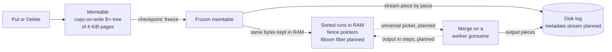
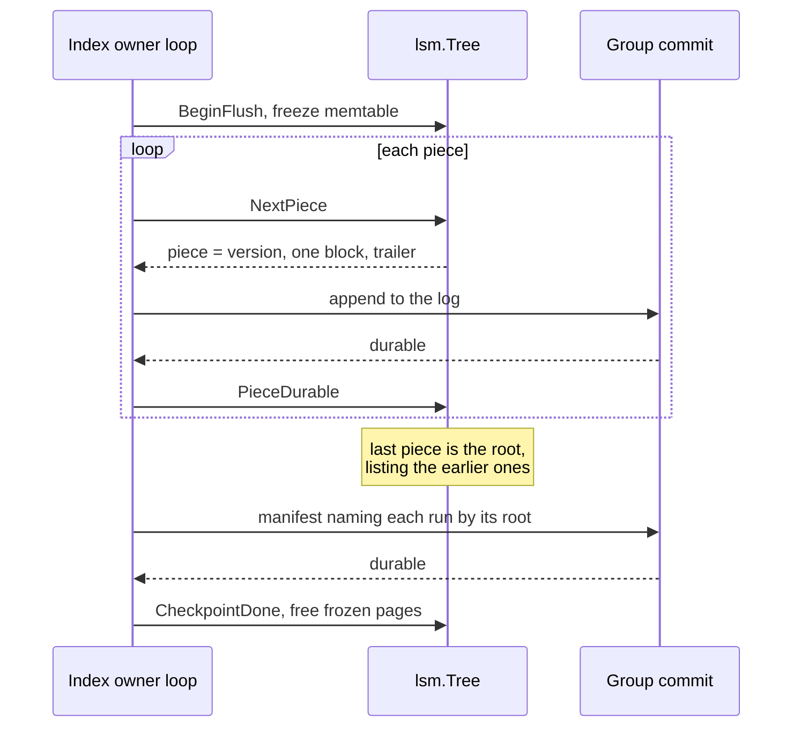
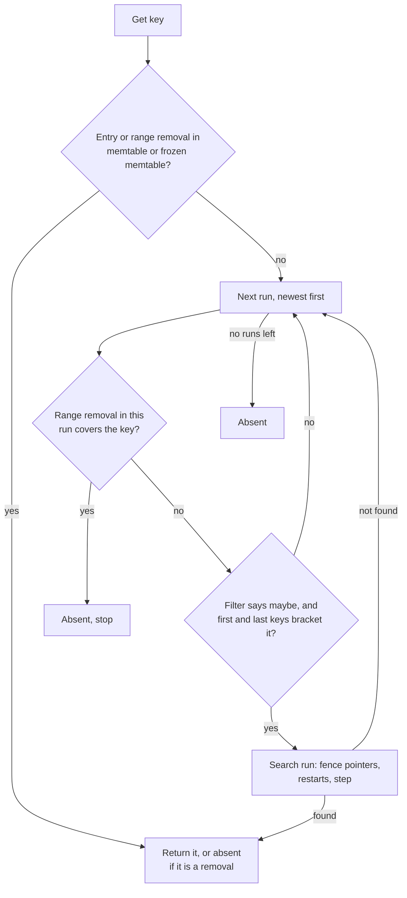

# The LSM tree: a write-optimized index that lives inside the log

Every disk in rock-solid keeps two kinds of index: a **chunk index** that says where each 4 KiB
block of user data sits in the disk's log, and the state of every **MetaStore shard** placed on
that disk (file names, attributes, locks). Both change on almost every write, both must survive a
crash, and both must answer lookups in microseconds. rock-solid does not embed RocksDB, Pebble or
any other key-value engine for this. It builds its own small log-structured merge (LSM) tree,
`internal/lsm`, whose sorted runs are written into the same per-disk log as the data and held in
memory, compacted with RocksDB's universal rules. This post explains why an LSM tree, why our own,
and how each part works, with the measurements that shaped it.

**Status.** Nothing in rock-solid runs yet. Built in `internal/lsm` today: the memtable, flushes to
sorted runs, fence pointers, point-in-time views, restore, and merges whose work can run on a
worker goroutine while the owner installs the result. Planned for phase 1 and not yet built:
universal compaction (the code still uses an older bucket rule), Bloom filters, range removals,
merge steps, run checks, the heap merge, the metadata stream and checkpoint backpressure. The block
cache comes in phase 8. Each section marks what is planned.

## Words you need

- **Chunk, extent.** A chunk is a 4 MiB unit of user data. An extent is a run of consecutive
  blocks of a chunk written together; the chunk index keeps one key per extent
  ([glossary](../docs/glossary.md#data-model)).
- **Log, segment, group commit, checkpoint.** Each disk is one append-only log in fixed-size
  segments. Group commit makes a batch of writes durable with one flush. A checkpoint writes the
  in-memory indexes into the log, then a manifest naming them and where crash replay starts
  ([post 04](04-one-log-per-disk.md)).
- **Key-value (KV) engine.** A library that stores keys and values in its own files: RocksDB,
  Pebble, bbolt, redb, fjall.
- **B-tree.** The classic sorted tree of fixed-size pages, updated in place; a B+-tree keeps all
  entries in its leaves.
- **LSM tree.** An index that never updates in place: new entries go into an in-memory
  **memtable**, later written out whole as an immutable **sorted run**; **compaction** merges runs
  in the background. RocksDB and Pebble call their on-disk sorted files **sstables**
  ([glossary](../docs/glossary.md#on-disk-structures)).
- **Piece.** A sorted run is written to the log in pieces of at most one log record (1 MiB) each.
- **Amplification.** *Write*: bytes written to the drive per byte the user changed. *Read*: runs a
  lookup searches. *Space*: bytes stored per byte of live data.
- **Removal, range removal, fragment.** A removal is the entry that deletes a key (other engines
  say "tombstone"; rock-solid keeps that word for a deleted chunk). A range removal deletes every
  key from one key up to another, stored as non-overlapping pieces called fragments.
- **Fence pointer.** The first key of each block of a run; searching them finds the one block that
  can hold a key.
- **Bloom filter.** A small bit array that answers "is this key possibly in this run?" with no
  false negatives and a few false positives.
- **Garbage collector (GC).** Go's automatic memory manager, which scans the heap for pointers;
  the more pointers, the more CPU it burns.
- **Raft log.** The ordered list of changes a MetaStore shard's replicas agree on
  ([post 08](08-the-metastore.md)). It lives in the same disk log.

## Where this tree sits

> **In plain words.** Each disk is one append-only log ([post 04](04-one-log-per-disk.md)). User
> data, Raft logs and the indexes over them are all appended to it. The LSM tree is the index
> part: it lives in RAM while it works and writes itself into the log at each checkpoint, so a
> crash can rebuild it from the log.

There is one tree per index: the disk's chunk index, and one per MetaStore shard replica on that
disk. Each tree belongs to one event loop, its *owner* ([post 11](11-runtime-in-go.md)), so it
never needs a lock. Both users see one interface: `Put`, `Delete`, `Get`, `Floor` (the greatest
key at or below a key), ordered iteration and point-in-time views
([`tree.go`](../internal/lsm/tree.go)).

## The problem: keeping a sorted index on disk

> **In plain words.** Imagine a phone book you must keep sorted while people keep moving house.
> You can rub out and rewrite the right line on the right page each time (a B-tree), which means
> rewriting a whole page for every change. Or you can jot each change on a notepad, and every so
> often type the notepad up as a fresh sorted booklet (an LSM tree). Writing is now cheap, but a
> lookup must check the notepad and every booklet, newest first, and someone has to merge
> booklets now and then or you drown in them.

#### How it works

A B-tree updates in place. Changing one 54-byte chunk-index entry rewrites the 4 KiB page that
holds it, and in a copy-on-write B-tree such as redb or bbolt every page on the path to the root.
The diagram shows why a small change drags whole pages with it.

```text
 B-tree, update in place                     LSM tree, append and merge later
 -----------------------                     --------------------------------
 change 1 entry (54 B)                       change 1 entry (54 B)
        |                                            |
        v                                            v
 +----------- root page 4 KiB ----------+    +-- memtable (RAM) --+
 |  rewritten (copy-on-write)           |    | entry added        |  no disk write yet
 +--------------------------------------+    +--------------------+
        |                                            | many changes later, one flush:
 +---------- inner page 4 KiB ----------+            v
 |  rewritten                           |    +-- sorted run, written once, sequentially --+
 +--------------------------------------+    | thousands of entries, packed               |
        |                                    +--------------------------------------------+
 +---------- leaf page 4 KiB -----------+            | later, compaction merges runs
 |  54 B changed, 4 KiB rewritten       |            v
 +--------------------------------------+    each entry rewritten a few times in its life
 => several 4 KiB pages for 54 B             => measured 5x (fjall) against 160x (redb)
```

The obvious fix inside a log, "keep the whole index in memory and write a full copy at every
checkpoint", fails differently. A checkpoint is due every `max_replay_bytes` (default 64 MiB) of
log, so a full copy of a 16 GiB shard writes its entries 256 times over for every 64 MiB of new
ones. A checkpoint should cost what changed since the last one, which is exactly what a sorted run
is.

No design is free. Every index trades three costs, and at most two can be cheap:

| Design | Cheap | Expensive |
| --- | --- | --- |
| B-tree, updated in place | Reads: one path from root to leaf | Writes: pages rewritten for small changes |
| Leveled LSM (Pebble, RocksDB default) | Reads and space: few runs | Writes: entries rewritten many times |
| Tiered LSM (universal, Cassandra) | Writes: entries rewritten a few times | Reads and space: more runs, stale copies wait longer |

An LSM tree is write-optimized; the rest of this post keeps its read and space costs in check.

## The options

> **In plain words.** You can borrow someone else's engine, skip the tree and write snapshots, or
> build an LSM tree into your own log. An embedded engine keeps its own files and does its own
> flushes. rock-solid wants one log per disk that a kernel-bypass driver can own and the test
> simulator can crash at any point, with one flush covering every index. So it borrows the
> engines' ideas and formats, not the engines. That still leaves a choice: how runs get merged.

#### How it works

The [KV engines spike](../docs/design.md#appendix-kv-engines-spike) ran two embedded engines on a
consumer NVMe drive. **redb**, a copy-on-write B-tree like bbolt, had the fastest reads, but wrote
39 to 160 times the payload in the index tests and 112 times as a Raft log. **fjall**, an LSM tree
like Pebble and RocksDB, wrote 1.75 to 5 times, but stalled for about 100 ms on memtable flushes,
kept 179 MB on disk for 4.9 MB live and took 2.8 s to replay a 64 MB journal.

The deeper problem is shared by every embedded engine: it flushes its own files through the
kernel. It cannot run on a drive that SPDK owns (kernel bypass, [post 11](11-runtime-in-go.md)),
the deterministic simulator cannot crash it, and its flushes come on top of the chunk log's. One
combined commit for 100 shards took 1.2 ms in a shared log; 100 separate commits took 114 to
120 ms, and neither engine merged concurrent commits on its own.

Inside the log, three compaction shapes were weighed: **leveled** (Pebble, RocksDB's default: runs
cut into key ranges, merged level by level), **size-tiered buckets** (Cassandra: merge runs of
similar size) and **universal** (RocksDB: merge only runs adjacent in age), which was chosen.

| Option | Bytes written per byte changed | Lookup | Space per live byte | One log, SPDK, simulator |
| --- | --- | --- | --- | --- |
| B-tree engine (redb) | 39 to 160 | 7.2 µs get, 147 µs cold | file grew 26 → 419 MB under one long reader | No |
| LSM engine (fjall) | 1.75 to 5 | 17.8 µs get, 1.4 ms cold | 179 MB for 4.9 MB live | No |
| Memtable + full snapshots | the whole index per checkpoint | memtable only | 1× | Yes |
| Own LSM, leveled | 2.8 to 17.7 | 1.5 to 3.5 runs | 1.0 to 2.1× | Yes, runs die piecewise |
| Own LSM, size-tiered buckets | 2.8 when flushes are steady | a run per flush when sizes vary | up to 419× | Yes, but unbounded |
| **Own LSM, universal** | **2.3 to 6.3** | **2.3 to 6.7 runs, filtered to about 1** | **1.3 to 1.7×** | **Yes** |

Engine lookups are timed in µs; the in-log rows, from the
[LSM compaction study](../docs/design.md#appendix-lsm-compaction-study), count the runs a lookup
searches.

## What rock-solid picked

> **In plain words.** A notepad in RAM takes every write. At each checkpoint it is typed up as a
> booklet, which goes into the disk's log for safety and also stays in RAM for reading. Booklets
> are merged with their neighbours in age by fixed rules, and each carries a sticky note that lets
> a lookup skip booklets that cannot hold the name.

The flow of one write through the tree. Solid arrows exist today; dotted ones are planned:



Look at the two arrows leaving the frozen memtable: the same run goes to the log, for crash
safety, and stays in memory, for reads. Runs are never read back from disk while the process
lives; that is the biggest difference from RocksDB and Pebble.

### The memtable: a B+-tree of pages the garbage collector cannot see

> **In plain words.** The memtable is the notepad: a sorted tree in RAM that takes every new
> write. rock-solid builds it from 4 KiB pages that hold raw bytes and refer to each other by page
> number, never by Go pointer. To Go's garbage collector, millions of entries look like a few big
> byte arrays with nothing inside to scan.

#### How it works

A page is 4 KiB: a 16-byte header, then 2-byte slot offsets growing up from the front, and entries
growing down from the end ([`page.go`](../internal/lsm/page.go)). A leaf entry is
`key_len | value_len | key | kind | value`, where the kind byte says "set" or "removal". An inner
entry is `key_len | child page number | key`.

```text
 one 4 KiB page
 +--------+------------------------+.................+----------------------------+
 | header | slot0 slot1 slot2 ...  |   free space    | ..entry2 | entry1 | entry0 |
 | 16 B   | u16 offsets, grow  --> |                 | <-- entries grow from end  |
 +--------+------------------------+.................+----------------------------+
   kind, count, free, dead bytes, generation, left child

 slab = 256 pages (1 MiB)         page number 517 = slab 2, page 5
 +-------+-------+-------+----+   inner entries name children by number, so a page
 | p0    | p1    | p2    | .. |   holds no Go pointer and the collector never scans it
 +-------+-------+-------+----+
```

Why go to this trouble? The [Go memtable spike](../docs/design.md#appendix-go-memtable-spike)
loaded 10 and 20 million files of metadata into three layouts. With one heap pointer per entry,
the collector took **23% of process CPU at 10 million files and 35% at 20 million** under request
load. A goroutine trying to allocate 256 MB/s of short-lived garbage managed 161 MB/s at 10
million files and only 10 MB/s at 20 million, because Go charges marking work to whoever
allocates. The page tree cost under 3 ms per collection and 0.0% of CPU under the same load, and
answered gets fastest.

The design puts the slabs **outside** the Go heap, mapped with `mmap`, because even unscanned heap
memory counts toward the collector's heap goal: 16 GiB of memtable on the heap would let the heap
grow toward 32 GiB ([Runtime in Go](../docs/design.md#runtime-in-go)). Those slabs are not built
yet; until then pages are pointer-free Go slices, a [tech debt](../docs/tech-debts.md).

Three details make the page tree work as an LSM memtable:

- **A removal is an entry.** Deleting a key writes an entry of kind "removal", which hides the key
  in older runs. A memtable never drops a key.
- **Leaves share before they split.** Pages filled in creation order were only 63% full in the
  spike. A full leaf therefore hands entries to a neighbour before it splits; leaves filled in random
  order are 80% full.
- **Copy-on-write for views.** Each page carries a generation number. While a point-in-time view
  is open, a write copies any page that view can reach instead of changing it; the old page is
  freed when the last view that could reach it closes.

A key is at most 1,032 bytes and a value at most 1,000, so two entries always fit a page: room for
an S3 key of 1,024 bytes plus its prefix. (The code allows 1,024-byte keys today; the limit rises
with range removals.) A range removal stores both its ends, so each end is kept
to 1,000 bytes, and the MetaStore splits a larger value, such as a 64 KiB extended attribute, over
several keys. An entry too large to fit one run piece (next section) is refused with `ErrTooLarge`
when it is written, not later when a flush meets it.

### Flushes: streaming a sorted run into the log, one piece at a time

> **In plain words.** At each checkpoint the notepad is frozen, a blank one takes new writes, and
> the frozen one is typed up as a sorted booklet. The booklet goes to disk one page at a time,
> each page sent only after the previous one is safely written, so memory never holds two copies
> of the whole thing.

#### How it works

A checkpoint is due once `max_replay_bytes` of records follow the last manifest. It flushes the
memtable of every index on the disk that holds anything, then writes a manifest. A flush freezes
the memtable and starts an empty one, so writes never wait. It streams the frozen tree out as a
sorted run in pieces of at most one log record (1 MiB, `max_group_commit_bytes`), each built at its
final size and handed to the log only once the piece before it is durable. The last piece, the
**root**, lists the earlier ones, so a manifest names a whole run by its root.



Read it top to bottom: only one piece is ever in flight, so a flush's memory peak is one piece
above the frozen tree and the run it becomes, 1.0004× the tree for 10 million files in the
[MetaStore memory spike](../docs/design.md#appendix-metastore-memory-spike). A root lists up to about
58,000 pieces, so a run holds up to about 58 GiB ([`run.go`](../internal/lsm/run.go)).

A checkpoint names again the runs already durable and writes only the frozen memtable and any runs
a merge made since. A failed checkpoint keeps the frozen memtable, and the next one writes it again
from its first piece. Planned: once the records after the newest manifest reach twice
`max_replay_bytes`, group commit takes items only from the checkpoint and the cleaner until a
manifest is durable, as Pebble and RocksDB stop writes at two memtables. That bounds memtables and
kept Raft entries at 128 MiB per disk.

Planned run checks, always on, catch a bad run before it spreads: a flush checks that the run holds
as many entries and range-removal fragments as the frozen memtable, a merge that its output and
what it dropped add up to its inputs, as RocksDB does by default, and every piece in memory keeps a
CRC32C of its bytes that a merge verifies before reading it (4 bytes per piece, 167 ns per 4 KiB).
Runs are never read back from disk, so without that check a flipped bit in RAM would be merged into
the next run. A failed check fails the flush or merge, and the index is rebuilt from the log.

### Runs in memory: fence pointers

> **In plain words.** A booklet has a thumb index: the first name on each page printed on the
> edge. You jump to the right page by the thumb index, then scan a few lines. Inside a page, a name
> that shares a beginning with the one before is written as "same first 8 letters, then ...", with
> every 16th name spelled out in full so you can start reading there.

#### How it works

Runs stay in memory, pointer-free, as the blocks of their pieces. Each block uses LevelDB's
format, which Pebble keeps ([`block.go`](../internal/lsm/block.go)): entries prefix-compressed
against the one before, a *restart* every 16 entries storing its key whole, and the restart
offsets at the block's end. A block's first key and its restart keys are its fence pointers.

```text
 one sorted run in memory (blocks of its pieces)
 fence pointers:  "fs/1/100"      "fs/1/7340"      "fs/2/12"       ... last key
                     |               |                |
                 +---v-----------+---v-----------+----v----------+
                 | block 0       | block 1       | block 2       | ...
                 +---------------+---------------+---------------+
                         |
                         v
   block 1: [R] fs/1/7340 | [8 shared]"1" = fs/1/7341 | [8 shared]"5" = fs/1/7345 | ...
            restart offsets at the end: [0, 412, 830]          (R = restart, key whole)

 lookup("fs/1/7351"): binary search fence pointers -> block 1
                      binary search restarts      -> restart 0
                      step forward <= 16 entries  -> found or absent
```

The diagram shows a lookup that never leaves memory: two binary searches and a short walk. A cold
lookup from disk in the KV engines spike cost 0.15 to 1.4 ms; here a search costs about 0.3 µs for
a key the run holds and 0.6 µs for a miss
([LSM runs spike](../docs/design.md#appendix-lsm-runs-spike)), with no allocation. Prefix
compression also makes runs cheap to hold: 133 B per file of the spike's file model, against 199 B
in the memtable.

### Bloom filters: skipping runs that cannot hold the key (planned)

> **In plain words.** With 16 booklets, a lookup for a name nobody has would open all 16. A Bloom
> filter is a sticky note on each booklet's cover that answers "definitely not here" or "maybe
> here". It is never wrong when it says "not here". For a name that is not in the booklet, it
> still says "maybe" about once in a hundred lookups. You only open the booklets whose note says
> "maybe".

#### How it works

Not built yet; today's code searches every run. Adding a key to a Bloom filter hashes it to *k* bit
positions and sets them. Testing a key checks its *k* bits: any 0 means never added; all 1 means
probably added, or other keys happened to set those bits (a false positive). The textbook estimate
for *m* bits and *n* keys:

```text
   false positive rate  p ≈ (1 − e^(−k·n/m))^k

   at m/n = 10 bits per key, the best k is about 10 · ln 2 ≈ 7:
   p ≈ (1 − e^(−0.7))^7 ≈ (0.503)^7 ≈ 0.8%
```

rock-solid's filter puts all of a key's probes in one 64-byte CPU cache line, so a probe costs one
memory fetch instead of seven. Some lines get more keys than others, which costs a little
accuracy: about 1.2% at 10 bits per key, 1.16% measured in the
[LSM read path spike](../docs/design.md#appendix-lsm-read-path-spike). The format is RocksDB's
full-filter format, to be ported from Pebble.

The planned lookup:



The range-removal check sits **before** the filter, because a filter holds a run's entries, never
its range removals; RocksDB twice returned deleted keys by getting this wrong.

A filter is filled as the run streams out, sized from the entry count the flush or merge already
knows, and written after the run's entries in blocks of its own, so a restart loads it instead of
hashing every key again. Every run keeps its filter, the oldest too: RocksDB and Pebble often leave
the largest run's filter out to avoid reading big filter blocks from disk, but these filters are in
memory, and misses (a `create` checking that a name is free, a read of unwritten blocks) are common.

**What the filter holds depends on the index.** The chunk index reads by *floor* ("the extent at or
below block 37 of chunk X"), and block 37 is usually not a key, so its filter holds each chunk's
prefix `(pool, h, chunk_id)`, where `h` is the hash that picks the chunk's placement group. The
MetaStore's filter holds whole keys plus each inode's prefix, which also serves `readdir`. A read of
several blocks of one chunk takes one reader for the chunk: it probes the filters once with the
chunk's prefix, then serves ascending blocks by stepping forward from the last one, as Pebble's
`TrySeekUsingNext` does.

| Lookup over 24 runs | No filter | Bloom, 10 bits per key |
| --- | --- | --- |
| MetaStore lookup of an absent name | 13.3 µs, 24 searches | **1.9 µs, 0.22 searches** |
| Chunk-index read of a chunk written whole | 31.5 µs | **5.1 µs, 1.18 runs searched** |
| Chunk-index read under random 4 KiB overwrites | 33.2 µs | 19.8 µs, 7.2 runs searched |
| Filter memory, share of run bytes | | 0.8% chunk index, 2.9% MetaStore |

The third row is the weak spot: under random overwrites every large run holds every hot chunk, so
the filter cannot rule them out.

Scans cannot use filters at all; they merge every run. A scan will merge them with a heap, as
Pebble's and RocksDB's merging iterators do (planned): today's code compares every source at
every step, which cost 95 ns a step over 6 runs and 360 ns over 24.

### Universal compaction: when to merge runs (planned)

> **In plain words.** Every checkpoint adds a booklet. Merge too eagerly and you spend all day
> retyping; merge too lazily and lookups and memory suffer. The simpler rule, "merge four booklets
> of similar size", stops working when booklets come in very different sizes, and ours do.
> Universal compaction keeps booklets in age order and merges only neighbours, by three rules:
> "the young booklets together have grown to twice the oldest one, so much of the pile is
> out-of-date copies: merge everything"; "these young ones are about the same size: merge them";
> and "too many booklets: merge the youngest".

#### How it works

Planned, not yet built (phase 1). Today [`compact.go`](../internal/lsm/compact.go) uses
Cassandra's bucket rule, described below.

rock-solid's runs are what RocksDB's universal compaction calls sorted runs: each spans the whole
key range, they are ordered newest first, and a merge takes only neighbours in age and puts its
output in their place. So **entries carry no sequence number**: the newest value of a key is in the
newest run that has it, and each run's own sequence number orders the runs. Merging runs that are
not neighbours would need 8 more bytes per entry.

Once an index holds four runs, the picker tries three rules in order, as RocksDB's does:

1. **Size amplification.** Merge every run once the runs newer than the oldest hold 200% of its
   bytes. This bounds space.
2. **Size ratio.** Walk from the newest run; take the next one while it is at most 1% larger than
   the runs taken so far; merge the first span of two or more.
3. **Run limit.** If neither applies and there are more runs than the limit, merge the newest runs
   beyond it, whatever their sizes. The limit is RocksDB's auto-tuned `max_read_amp`, about
   2 + log2(largest run ÷ 1 MiB): 8 runs for a 44 MB chunk index, 13 for a 1.6 GB shard, 16 for
   16 GiB.

An illustration of rule 2 with invented sizes in MiB, newest first, to show the rule; the study's
measured results follow:

```text
 runs (newest -> oldest):   [4]  [4]  [8]  [20]  [100]

 rule 1, size amplification: newer runs 4+4+8+20 = 36 MiB = 36% of 100  -> no
 rule 2, size ratio:          take 4
                              next 4  <= 4  x 1.01  -> take, total 8
                              next 8  <= 8  x 1.01  -> take, total 16
                              next 20 >  16 x 1.01  -> stop
                              span of 3 runs        -> merge [4][4][8]

 after:                     [16]  [20]  [100]
```

**Why not Cassandra's buckets?** The current code merges four neighbouring runs of similar size.
That works only while flushes are steady, and checkpoints are not: in the study's model a flush
carrying a cleaner pass's index moves is 25 times one carrying ordinary writes. At the
study's S4 scale (a 44 MB index, flushes alternating 1.3 MB and 33 MB):

```text
 newest -> oldest
 [1.3] [33] [1.3] [33] [1.3] [33] [1.3] [33] ...
   ^     ^
   a small run between two large ones splits them; four similar neighbours never form
   => no merge ever runs: 2,001 runs after 2,000 flushes, 419x the live index in space
```

The [LSM compaction study](../docs/design.md#appendix-lsm-compaction-study) found one run per flush
under alternating, bursty and log-uniform sizes alike. Universal kept 2.3 to 6.7 runs on
average under every sequence, rewrote 2.3 to 6.3 times the flushed bytes (9 to 27 times on the
whole-chunk index's tiny flushes, 0.4% of the log's bytes), and its runs took 1.3 to 1.7 times the
live index.

**Why not leveled?** It rewrote up to 17.7 times the flushed bytes, and replaces runs one key
range at a time, where universal runs die whole, so their segments free without cleaning
([post 05](05-the-cleaner-and-free-space.md)). A fixed run limit is possible per index, but four
runs cost **100 times** the flushed bytes on a 1.6 GB index under steady flushes, because the
second-oldest run absorbs every flush, and 9 to 33 times under the other flush sequences.

A merge reads only immutable inputs, so it runs on a worker goroutine, off the owner's event loop;
that part is built. Planned: the picker skips runs a running merge holds, so a small merge can run
beside a large one, and one scheduler per disk runs its indexes' merges, the index furthest over
its run limit first (RocksDB's universal score).

### Merge steps: never holding a whole index twice (planned)

> **In plain words.** A merge of everything rewrites the whole index. If the old booklets could be
> thrown away only once the new one is finished, the disk would need room for the index twice. So
> the merge hands over its output a chapter at a time, and the old booklets give up the pages that
> chapter replaced.

#### How it works

Planned, not yet built. A step merges up to `compaction_step_bytes` (default 64 MiB) of output and
raises each input's **bound** to the step's last key; the next checkpoint writes the step's pieces
and a manifest edit holding the bounds. A run holds only its keys above its bound, so output
and inputs never hold the same key, and still no sequence number is needed.

```text
 merging inputs A (newer) and B (older) into O, in steps; keys run a .. z

 step 1 done, bound = "f"
   O:  [a........f]
   A:   xxxxxxxxxx[g...............z]     x = below the bound: dead once the manifest
   B:   xxxxxxxxxx[g...............z]         naming bound "f" is durable
 step 2 done, bound = "m"
   O:  [a........f][g.....m]
   A:   xxxxxxxxxxxxxxxxxxx[n......z]
   B:   xxxxxxxxxxxxxxxxxxx[n......z]
 a lookup of "h" reads O; a lookup of "q" reads A, then B
```

Each key lives in exactly one of O or the inputs at any moment, and a restart resumes from the
bound. An input piece wholly below the bound is dead once the manifest naming that bound is
durable, and leaves memory too unless a view holds it, so a merge's memory peak is also one step;
the piece the bound falls in stays whole. Each merge worker writes its output into a lane of its
own in the metadata stream, one segment at a time that its next merge continues, so a later
merge's steps free whole segments: sharing the open segment with
flush pieces left 30 to 57 segments stranded instead of 8 to 10. The [LSM space
spike](../docs/design.md#appendix-lsm-space-spike) measured space held beyond what the manifests
name: installed whole, a merge of everything held up to the whole index, 258 segments of 64 MiB on
a 256 GiB disk; in steps, 2 segments. This is ScyllaDB's incremental compaction.

### Deletions: removals and range removals

> **In plain words.** You cannot cross a name out of a booklet that is already printed. So deleting
> means writing "deleted" in the notepad, which hides the name in every older booklet. That note
> must stay until no older booklet still has the name. Deleting a whole street at once gets one
> note, "everything from number 1 to number 999 is gone", instead of 999 notes.

#### How it works

A flush or merge drops a removal unless a run older than what it writes holds the key, since
otherwise there is nothing left for it to hide; that rule is built.

A **range removal** (planned) hides every key from one key up to another, as RocksDB's and Pebble's
`DeleteRange` do. The chunk index needs it: when a write covers many old extents of a chunk, the
old extent keys must disappear. With point removals, a chunk rewritten whole over 1,024 one-block
extents leaves 1,023 removals for every floor to step over:

```text
 chunk index keys for one chunk, after a whole-chunk rewrite (layers newest first)

 memtable   new extent (0..1023)  removal 1  removal 2  ...  removal 1023
 run 7      old extent 0  old extent 1  old extent 2  ...  old extent 1023
            floor(block 500): steps over hundreds of removals -> 200 to 730 µs

 with one range removal:
 memtable   new extent (0..1023)   range removal [extent 1 .. extent 1024)
 run 7      old extents ...  <- hidden; the older layer skips past them in one search
            floor(block 500): about two searches -> 0.4 to 1.8 µs
```

The [LSM runs spike](../docs/design.md#appendix-lsm-runs-spike) measured both rows. With point
removals the cost lasted: 731 µs per lookup after 192 GiB of further writes, because size tiering
never merged the removals into the old extents' run.

A memtable keeps its range removals as non-overlapping fragments in a second copy-on-write page
tree, and a later write cuts its key out of its fragment. A fragment hides every older layer and
none of its own layer's entries. A get stops at a covering fragment; a floor or a scan skips past
it in one search. In a run, fragments are stored after the entries in blocks of their own, and the
run's own entries win over them. A flush or merge drops a fragment unless an older run holds a key
it hides, checking each older run with a cursor that only moves forward, since removals arrive in
key order.
Range removals also delete a punched chunk's extents, a released snapshot version, a dropped
volume's keys and a queue's consumed head
([LSM deletions study](../docs/design.md#appendix-lsm-deletions-study)).

### Value separation: why the tree holds no big values

> **In plain words.** If the booklets contained whole letters instead of addresses, every merge
> would retype every letter. Value separation keeps the letters in a filing cabinet and only the
> drawer number in the booklet. rock-solid does this for the whole disk: user data sits in the
> log, and the LSM tree only ever holds small entries saying where.

#### How it works

The disk log *is* value separation, as the WiscKey research paper introduced it and RocksDB's
BlobDB, TiKV's Titan and Pebble ship it: the index holds locations, the data stays in a log, and a
cleaner copies live data and updates the index
([value separation spike](../docs/design.md#appendix-value-separation-spike)). A tree value is
capped at 1,000 bytes and MetaStore values are small (92 B per inode's attributes), so the tree has
no blob layer of its own.

When the cleaner ([post 05](05-the-cleaner-and-free-space.md)) moves a block, the index learns the
new location as in WiscKey and Titan: one index write per move, applied only if the key still
points at the old place. The index is in memory, so that is one put, 42 to 72 ns. At 90% full under uniform overwrites the cleaner's moves cause 76% of the chunk index's entries, yet
the index's runs add only about 6% to the disk's total writes.

### The block cache that comes later (phase 8)

> **In plain words.** Holding every booklet in RAM works until an index is bigger than RAM. Then
> booklets stay on disk and a small shelf of recently used pages sits in RAM, while the thumb
> indexes and sticky notes always stay in RAM so you know which single page to fetch.

#### How it works

Planned for phase 8, before the block frontend, because a block volume's chunk index outgrows
memory: a chunk overwritten at random 4 KiB holds one extent per write, so a 1 TB disk can reach
toward 270 million entries, more than 10 GB. Fence pointers and filters stay in memory outside
the cache, as RocksDB keeps them by default. Those runs cut each piece into data blocks of 4 to
32 KiB, so a miss reads one block rather than a 1 MiB piece, and each piece's filter becomes a
partition of its own. The cache is one CLOCK cache (a cheap
approximation of least-recently-used eviction) over off-heap buffers, owned by the index's event
loop, so it needs no locks.

### The memory budget

> **In plain words.** Because the whole tree lives in RAM, "how many files can a node hold?" is a
> question about bytes per file.

#### How it works

| Item | Cost |
| --- | --- |
| A file in the memtable (spike file model) | 199 B |
| A file in a sorted run | 133 B, plus about 3.5 B of filter (planned) |
| An xattr stored as its own key | about 125 B |
| Runs against the live index | 1.3 to 1.7× under universal compaction |
| Memtables plus kept Raft entries | at most 128 MiB per disk (planned backpressure) |
| Chunk index, whole 4 MiB chunks | about a million entries per TB of data |

Most of an index sits in runs, so the design's arithmetic uses the run figure: **16 GiB holds
roughly 120 million file replicas, 40 million distinct files per node at three replicas**.

## Evidence

Numbers are as the design's appendices give them; results shown above are not repeated. The KV
engines spike ran on a consumer NVMe drive, the MetaStore memory spike on an Apple M4 Pro, the
rest on a shared 4-vCPU cloud VM, where counts (runs, bytes) are more robust than times. Each
appendix links its spike directory under [`spikes/`](../spikes/).

- [KV engines](../docs/design.md#appendix-kv-engines-spike): as a Raft log, only a plain log of
  prewritten segments reached the drive's flush floor.
- [Go memtable](../docs/design.md#appendix-go-memtable-spike): pauses stayed under 1 ms in every
  layout; the pointer layout's cost is CPU, not pauses.
- [MetaStore memory](../docs/design.md#appendix-metastore-memory-spike): prefix-compressed runs are
  1.7× smaller than the memtable on the same allocator.
- [LSM compaction](../docs/design.md#appendix-lsm-compaction-study): a size model and the real
  `internal/lsm` gave identical run counts and bytes, so the model's policy results transfer.
- [LSM read path](../docs/design.md#appendix-lsm-read-path-spike),
  [LSM deletions](../docs/design.md#appendix-lsm-deletions-study),
  [LSM durability](../docs/design.md#appendix-lsm-study-durability-spike),
  [value separation](../docs/design.md#appendix-value-separation-spike),
  [LSM space](../docs/design.md#appendix-lsm-space-spike): the filter, removal, cleaner and
  merge-step figures above. The durability study also found that RocksDB counts entries on every
  flush and compaction, and both engines verify block checksums on compaction reads; the planned
  run checks copy that.
- [Metamorphic testing](../docs/design.md#appendix-metamorphic-testing-spike): 200 seeds × 3,000
  ops × 7 option sets showed no divergence, and all 5 planted bugs were found, 2 only under the
  most extreme option set. A metamorphic test runs the same operations under settings that must
  not change any read and compares the results ([post 12](12-testing-for-trust.md)).

## Trade-offs: what it costs us

- **We own an LSM tree.** RocksDB and Pebble carry a decade of fixes; ours starts from scratch,
  borrowing their formats, picker, filter and test cases.
- **Everything is in RAM.** Runs take 1.3 to 1.7 times the live index in memory. Until the block
  cache exists, an index that outgrows memory has nowhere to go, and a block volume's will.
- **Universal sometimes rewrites the whole index.** Steps bound its space, not its bytes.
- **More runs than leveled.** Scans merge every run, and filters cannot help a block volume under
  random overwrites.
- **Deletes free space late.** A dropped volume's keys stay in older runs until a merge reaches them,
  possibly a merge of everything.
- **No sequence numbers, so no arbitrary snapshots.** Reading the tree as of a past moment works only
  through a view opened then, which pins pages and runs. That is all rock-solid needs.
- **Manual memory.** Off-heap pages are freed by hand, so a use after free reads another page's
  data instead of crashing; handles carry a generation to catch it.

## Open directions

From the design's [Roadmap and open questions](../docs/design.md#roadmap-and-open-questions) and
[tech-debts.md](../docs/tech-debts.md):

- **Block-volume reads.** Would a finer prefix filter (a chunk plus a range of its blocks), or
  merges triggered by reads, bring the 7 of 24 runs near one?
- **One hash per lookup.** Hashing the key once for every run's filter, instead of once per run:
  does it bring a miss over 16 runs under 0.5 µs?
- **Pieces shared between runs.** Dropping the blocks a range removal covers, as Pebble drops whole
  tables, freed 22 of a dropped volume's 28 MB at the first checkpoint, but pays only once a run can
  share pieces with the run it replaces; written again whole, the kept blocks cost 85.6 MB.
- **Merge lanes shared between merges.** A merge worker's next merge continues the segment its last
  one left, so one segment can hold the end of one merge and the start of another; the LSM space
  spike measured a segment per merge, not this mixing.
- **Regrouping fragmented chunks** into a whole-chunk slot once their extent map grows too long.
- **Revisit leveled** when runs are read from disk.
- **Tech debt:** memtable pages and runs on the Go heap until the off-heap slabs exist (phase 5).

## Further reading

- Design: [On-disk format](../docs/design.md#on-disk-format) (the "log is the source of truth"
  and "The LSM tree" bullets), [Runtime in Go](../docs/design.md#runtime-in-go), [Alternatives considered](../docs/design.md#alternatives-considered).
- Code: [`internal/lsm/`](../internal/lsm/) ([`memtable.go`](../internal/lsm/memtable.go),
  [`page.go`](../internal/lsm/page.go), [`run.go`](../internal/lsm/run.go),
  [`block.go`](../internal/lsm/block.go), [`compact.go`](../internal/lsm/compact.go),
  [`tree.go`](../internal/lsm/tree.go), [`iter.go`](../internal/lsm/iter.go)).
- Tests and terms: [test scenarios, "LSM tree"](../docs/test-scenarios.md#lsm-tree),
  [glossary](../docs/glossary.md#on-disk-structures), [build checklist](../docs/build-checklist.md),
  [tech debts](../docs/tech-debts.md).
- Series: [04 One log per disk](04-one-log-per-disk.md),
  [05 The cleaner and free space](05-the-cleaner-and-free-space.md),
  [08 The MetaStore](08-the-metastore.md), [11 Runtime in Go](11-runtime-in-go.md),
  [12 Testing for trust](12-testing-for-trust.md).
