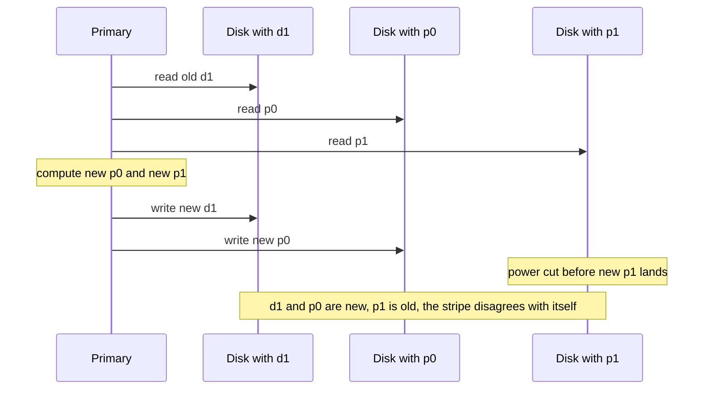
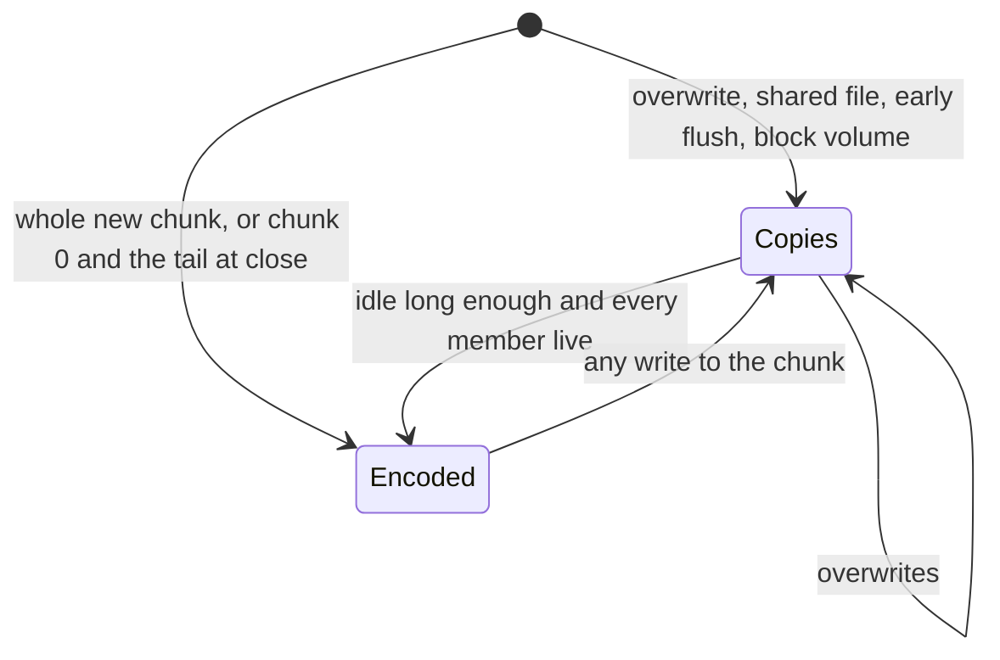
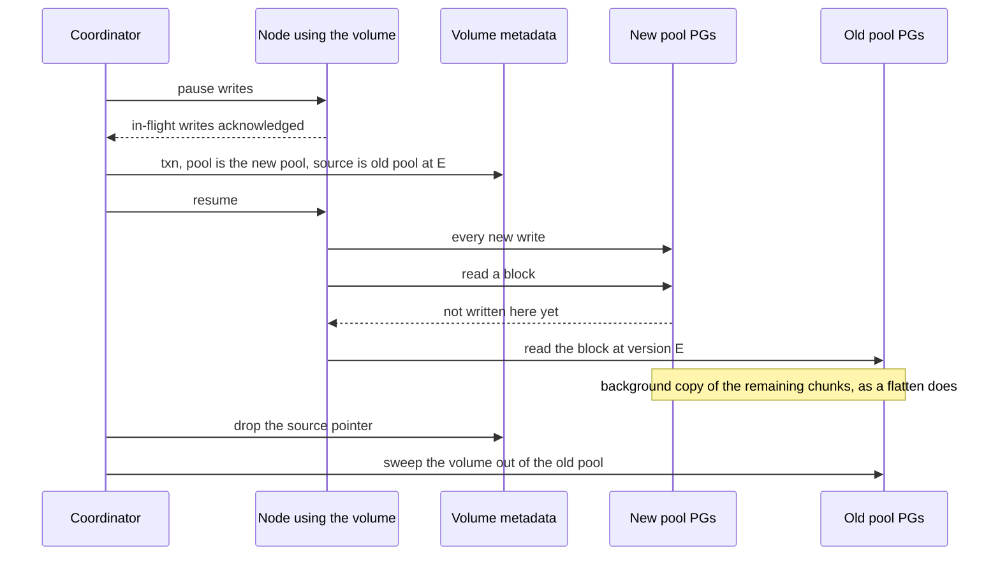
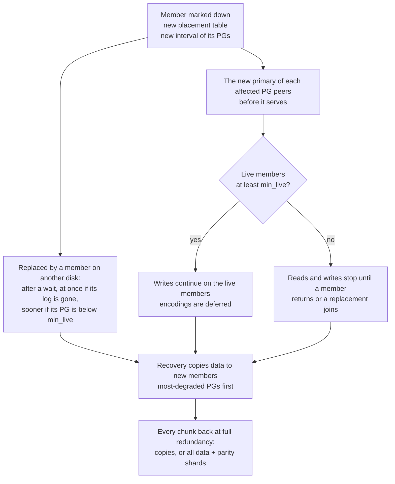

# Pools and redundancy: copies, erasure coding and rebuilds

Every storage system has to decide how many times to store each byte, and where. Store it once
and a dead disk loses data; store it three times and you pay for three disks to get one disk of
space. rock-solid lets you choose per **pool**: a named set of placement groups with one redundancy
scheme, from a single copy for scratch data, through two or three full copies, to erasure coding,
which in `ec4-2` survives the same two failures as three copies at half the space. The hard part is
erasure coding of data that changes, and rock-solid's answer is simple: it never edits encoded
data in place. Chunks are written as plain copies and encoded only once they are whole or have gone
idle. This post explains replication and erasure coding from scratch, then shows how pools,
failure domains, `min_live`, sealing, one-copy pools, pool moves and rebuilds fit together.

Each section starts with an **In plain words** callout; the **How it works** part after it gives
the mechanism and its edge cases.

## Words you need

- **Chunk.** A 4 MiB piece of a file or block volume, the unit that is placed, copied and encoded.
  See [Data model](../docs/glossary.md#data-model).
- **Placement group (PG).** A bucket of chunks that are placed together. Each chunk hashes into one
  PG, and the cluster decides which disks hold each PG.
- **Member, primary, replica.** The disks listed for a PG are its members. The primary orders and
  coordinates every write to the PG's chunks; the others are replicas.
  See [Roles](../docs/glossary.md#roles-who-does-what).
- **Pool.** A set of PGs sharing one redundancy scheme, one failure-domain rule and optionally one
  class of disk. Every volume belongs to exactly one pool.
- **Width.** How many members each PG of a pool has: the copy count, or `data + parity` shards.
- **Erasure coding (EC).** Cutting data into `data` pieces and computing `parity` extra pieces from
  them, so that any `data` of the pieces rebuild the whole. Each piece is a **shard**; one set of
  data and parity shards is a **stripe**. **Reed-Solomon** is the standard code that does this.
- **Failure domain.** A group of things that fail together: a disk, a node. Copies of one chunk go
  to different failure domains.
- **`min_live`.** The number of live members a PG needs before it serves reads and writes.
- **Seal.** Treating a chunk as finished, which makes it eligible for erasure coding. A later write
  to it turns it back into copies.
- **Locality.** Whether a volume's chunks stay on one node or spread over every disk of its pool.
- **Degraded, recovery.** A PG is degraded while it has fewer copies or shards than its pool asks
  for. Recovery copies data back until it is whole again. In this post "recovery" always means this
  PG recovery, not a disk's crash recovery from its log ([post 04](04-one-log-per-disk.md)).

All of these, and the **write hole** this post explains below, are in the glossary's
[Redundancy and placement](../docs/glossary.md#redundancy-and-placement) section.

## A placement group recap

> **In plain words.** Tracking where each of a billion chunks lives would need a huge, constantly
> changing table. Instead, rock-solid drops every chunk into one of a few thousand buckets by
> hashing its name, and only tracks which disks hold each bucket. Those buckets are placement
> groups. [Post 02](02-chunks-and-placement.md) covers them in full.

### How it works

A chunk's ID is computed from its volume, file and offset. A fixed hash function turns the ID into
a 64-bit number, and its top bits pick one of the pool's PGs. The **placement table**, computed by
the control plane (the small Raft group that runs the cluster) and cached on every node, lists each
PG's members. Each version of the table is a **table epoch**, and each PG's run of tables with the
same members is one of its **intervals**.

Two facts matter for this post. The PG is the unit of recovery and rebalancing: adding a disk
moves whole PGs onto it, never single chunks. And the pool is part of a PG's identity, so the same
chunk ID lands in different PGs in different pools, which is what lets a volume move between pools.

## The problem: erasure coding meets overwrites

> **In plain words.** Keep three copies of everything on three machines and any two can die. The
> price is that 3 TB of disks hold 1 TB of data. Fine for a database; painful for 20 TB of camera
> footage you write once.
>
> Erasure coding is the way out. Picture cutting a photo into 4 pieces and painting 2 extra "magic"
> pieces, such that any 4 of the 6 let you redraw the whole photo. You can lose any 2 pieces, and
> 6 quarter-size pieces cost 1.5 photos, not 3. The simplest version is RAID 5: with two data disks
> and one parity disk, parity is `d0 XOR d1`, and a lost `d0` comes back as `parity XOR d1`.
>
> The catch is editing. Every magic piece depends on every real piece, so changing one piece means
> repainting the magic ones too, on other machines, and a crash halfway leaves them disagreeing.

### How it works

Reed-Solomon generalises the XOR trick to several parity pieces, using a special arithmetic on
bytes (a Galois field) in which division always works, so the equations always have a solution.
Here is one 4 MiB chunk stored two ways. Look at the right-hand column: the same two-failure
protection, at half the bytes.

```text
rep3: three full copies, one per node                       stored: 12 MiB (3.0x)
  node A  [ whole chunk, 4 MiB ]   primary
  node B  [ whole chunk, 4 MiB ]
  node C  [ whole chunk, 4 MiB ]
  survives any 2 lost nodes: 1 copy is enough

ec4-2: 4 data shards + 2 parity shards, one per node        stored:  6 MiB (1.5x)
  node A  [ s0  bytes 0 to 1 MiB ]
  node B  [ s1  bytes 1 to 2 MiB ]
  node C  [ s2  bytes 2 to 3 MiB ]
  node D  [ s3  bytes 3 to 4 MiB ]
  node E  [ p0  parity, 1 MiB    ]
  node F  [ p1  parity, 1 MiB    ]
  survives any 2 lost nodes: any 4 of the 6 shards rebuild the chunk
```

Copies are cheap to change: a 4 KiB overwrite in a three-copy pool is 3 writes and 0 reads. A
4 KiB overwrite inside an encoded stripe is not, because each parity shard must be fixed using the
old value:

```text
stripe = [d0 d1 d2 d3 | p0 p1], overwrite d1:
  read old_d1, p0, p1
  delta = old_d1 ^ new_d1
  p0' = p0 ^ gf_mul(coef[0][1], delta)
  p1' = p1 ^ gf_mul(coef[1][1], delta)
  write new_d1, p0', p1'      // must land together on 3 nodes
```

`coef` is the code's fixed table of multipliers; the point is only that each parity shard needs the
old value of `d1`. That is 3 reads plus 3 cross-node writes, where copies needed 3 writes. Worse is
the comment on the last line: nothing makes those three writes land together. The sequence below
shows a crash in the middle.



*The failure is silent: every shard has a valid checksum, but the set is inconsistent.* Months later
the disk holding `d0` dies. A rebuild from `d1`, `d2`, `d3` and `p0` would be correct, but one that
happens to use the stale `p1` produces a garbage `d0`, which is why the bug can hide for so long.
This is the **write hole**. Systems that encode in place close it with two-phase commits or
journals across shards, and those are hard to get right: Vitastor's own chaos test failed on every
seed of its two-phase erasure-coded configurations before its
[3.2.0 fixes](https://vitastor.io/en/blog/2026-08-31-v3.2.0.html).

## The options real systems use

> **In plain words.** There are two questions. Where do you choose the redundancy: for the whole
> cluster, per volume, or per group of volumes? And if you erasure-code, what do you do when
> someone edits encoded data?

### How it works

**Where redundancy is chosen.**

- **One scheme for the whole cluster.** Simple, but scratch space then pays photo-grade protection.
- **A replica count per volume** (Longhorn). It does not fit placement groups: one PG holds chunks
  of many volumes, so a redundancy scheme has to belong to a whole set of PGs.
- **Per pool** (Ceph, rock-solid). Each pool is its own set of PGs with its own scheme, and a
  Kubernetes StorageClass names the pool. One cluster can mix scratch, block and media data.

**What erasure coding does with edits.** Ceph (with `allow_ec_overwrites`) and Vitastor overwrite
stripes in place and close the write hole with extra protocol. Weka erasure-codes everything but
never edits a stripe: a write goes into a new stripe, and the cluster garbage-collects half-dead
stripes across nodes. Windows Azure Storage, and rock-solid, keep new and edited data as copies and
encode it only once it has stopped changing, so edits never touch encoded data.

| Approach | Small overwrite cost | Write hole | Extra machinery | Space while data is fresh |
| --- | --- | --- | --- | --- |
| Copies only (`rep3`) | 3 writes, 0 reads | None | None | 3× |
| EC in place (Ceph overwrites, Vitastor) | 3 reads + 3 cross-node writes in 4+2 | Must be closed by protocol | Two-phase writes or journals | 1.5× in 4+2 |
| EC with redirect-on-write (Weka) | A new stripe write | None | Cluster-wide stripe garbage collection | 1.5× in 4+2, plus garbage |
| Copies, then encode when whole or idle (WAS, rock-solid) | 3 writes, 0 reads; a full chunk re-copy if the chunk was encoded | None | A background encoder | The copy count until encoded |

rock-solid takes the last row because the workloads it targets split cleanly: block volumes and
databases overwrite in place and are best served by copies anyway, while media, photos and backups
are written once and never edited. Encoding only finished data gives the second group erasure
coding's space saving without adding any cross-node commit protocol to the first.

## What rock-solid picked: pools

> **In plain words.** You pick a pool when you pick a StorageClass. The pool decides how many copies
> or shards each chunk gets, which disks may hold them, and how many machines can fail before data
> is at risk. Installation creates one pool, `rep3`, so you get three copies until you ask for
> something else.

### How it works

A pool is a cluster object: a `Pool` custom resource (a Kubernetes object type the project defines)
stored in the control-plane Raft group. A StorageClass points at it:

```yaml
kind: StorageClass
metadata: { name: footage }
parameters: { pool: ec4-2 }
```

Every pool setting is yours to choose. The defaults follow one rule: **never lower how many failures
data survives, and otherwise pick the option that uses less space.** What you choose:

- **How many copies** a chunk gets while it is being written, and whether a finished chunk stays as
  copies or is **sealed** into `data + parity` shards.
- **When to encode:** whole new chunks straight away as they are written, and the rest once they
  have been idle for a while (much longer for block volumes than for files, for a reason the
  encoding section gives).
- **`min_live`:** how many live members a PG needs to keep serving.
- **The failure domain** (`node` or `disk`) and how many shards of one PG one domain may hold.
- **Locality:** keep each volume on one node, or spread it over every disk.
- **A disk class,** such as NVMe only.

Three more settings are about space rather than redundancy: whether volume sizes may add up to more
than the pool holds, the disk fill past which writes that add data are refused (`write_limit`), and
the PG count. Posts [02](02-chunks-and-placement.md) and [05](05-the-cleaner-and-free-space.md)
cover them, and the recovery section below shows what `write_limit` still lets through.

Names follow `rep<copies>` and `ec<data>-<parity>`. The presets below are starting points; any
combination within the creation rules is allowed. "Usable / raw" is how much of the raw disk space
holds your data once it is encoded.

| Pool | Copies | Shards | Survives | Failure domains needed | Usable / raw, encoded | Suits |
| --- | --- | --- | --- | --- | --- | --- |
| `none` | 1 | None | Nothing | 1 | 1 | Caches, CI scratch, apps that replicate themselves |
| `rep2` | 2 | None | 1 failure | 2 | 1/2 | Two storage nodes plus a metadata-only node; re-creatable data |
| `rep3` (default) | 3 | None | 2 failures | 3 | 1/3 | Block volumes, databases |
| `ec2-1` | 2 | 2 + 1 | 1 failure | 3 | 2/3 | Media, photos and backups on a 3-node cluster |
| `ec4-2` | 3 | 4 + 2 | 2 failures | 6, or 3 at 2 per node (then 1 node) | 2/3 | Media, backups and S3 |
| `ec16-2` | 3 | 16 + 2 | 2 failures | 18, or 9 at 2 per node (then 1 node) | 8/9 | Archives on a large cluster |

Notice the "Copies" column for the erasure-coded pools. An erasure-coded pool still holds chunks as
copies while they are being written, and it keeps `parity + 1` copies by default, so a chunk
survives the same number of failures in either form: `ec4-2` survives 2 failures as shards, and 3
copies also survive 2.

## Erasure coding, worked through

> **In plain words.** The wider the code, the less space it wastes, but the more pieces a repair has
> to read. Very small chunks are not worth encoding at all.

### How it works

rock-solid uses Reed-Solomon through `klauspost/reedsolomon`, a pure Go library with SIMD
(single instruction, multiple data: one CPU instruction working on many bytes at once) assembly.
Shard `i` of a chunk is simply the chunk's `i`-th contiguous byte range, and the parity shards are
computed from them:

| Pool | Shard size | Shards stored | Bytes stored for 4 MiB | Overhead | Usable / raw |
| --- | --- | --- | --- | --- | --- |
| `rep3` | (whole copies) | 3 copies | 12 MiB | 3× | 1/3 |
| `ec2-1` | 2 MiB | 2 + 1 | 6 MiB | 1.5× | 2/3 |
| `ec4-2` | 1 MiB | 4 + 2 | 6 MiB | 1.5× | 2/3 |
| `ec16-2` | 256 KiB | 16 + 2 | 4.5 MiB | 1.125× | 8/9 |

The overhead is `(data + parity) ÷ data`, but dividing free space by it overstates capacity
whenever the failure-domain rule stops a node taking a share in proportion to its size. `ec4-2` at
2 per node on three nodes puts a third of every chunk on each node, so with nodes of 4, 4 and 1 TB
the small node fills first and most of each large node is *stranded*: space this pool cannot use. A
pool therefore reports what it can still take before its first disk fills, and asks for
confirmation before a change strands much ([post 02](02-chunks-and-placement.md#volume-size-and-capacity)
explains the figures; the [capacity model spike](../spikes/capacity-model/) measured them).

Because shards are contiguous byte ranges, a 4 KiB read of an encoded chunk touches one disk, the
one holding the shard that contains those bytes. No decoding is needed while that shard is healthy.
If it is lost, the read fetches `data` other shards and decodes: a **degraded read**.

#### Small chunks stay as copies

A chunk is encoded only if its shards, each rounded up to a 4 KiB block (the smallest unit a disk
writes), take less space than its copies. Worked example: a 16 KiB file in `ec16-2`. Each of its 16
data shards would hold 1 KiB, rounded up to a 4 KiB block, so 18 shards cost 72 KiB on disk. Three
copies cost 48 KiB. The copies win, so that file's only chunk stays as copies. The same file in
`ec4-2` has 4 KiB shards, 6 of them, 24 KiB against 48 KiB of copies, so it is encoded. Up to 8 KiB
even `ec4-2` keeps copies, and a tiny file pays far more than the pool's promise: the
[sub-block writes spike](../spikes/sub-block-writes/) measured a 1.5 KiB file at 8.1 times its size
on three copies, against the 1.5 that `ec4-2` advertises.

#### What a rebuild reads

Space is half the story. The other half is what it costs to get a lost piece back:

```text
The node holding one piece of a 4 MiB chunk fails. What restores full protection?

  rep3, one copy lost                      ec4-2, one shard lost
  --------------------------------         ---------------------------------------
  read  4 MiB from one surviving copy      read  4 x 1 MiB = 4 MiB from 4 survivors
  write 4 MiB to the new member            decode, write 1 MiB to the new member
  bytes read per byte rebuilt: 1           bytes read per byte rebuilt: 4

  ec16-2, one shard lost: read 16 x 256 KiB = 4 MiB, write 256 KiB: 16 per byte rebuilt
```

*Look at the bottom line of each column: erasure coding is cheap to store and expensive to repair.*
This is Reed-Solomon arithmetic, not a measurement: restoring a shard, like a degraded read, needs
`data` surviving shards, so repair traffic grows with `data`. Scaled up, a failed disk that held
1 TiB of `ec4-2` shards means reading about 4 TiB from the surviving disks to write 1 TiB, where
1 TiB of three-copy data reads 1 TiB. `ec16-2` also needs 18 failure domains, or 9 at 2 per node,
which is why it is listed for large clusters.

## Failure domains: where the pieces may go

> **In plain words.** Three copies on three disks of one machine do not survive that machine's
> power supply dying. A failure domain is "the things that die together". Copies must sit in
> different ones. By default the domain is a node.

### How it works

The failure domain is `node` (the default) or `disk`. Two rules are checked when a pool is created,
and a refused setting is named in the error:

- **Width fits.** Copies always sit in distinct failure domains. Shards may share a domain, up to
  the pool's per-domain limit, but never a disk, so a domain takes at most min(limit, its disks)
  shards of a PG, and that summed over the domains must reach `data + parity`, counting only disks
  of the pool's class.
- **Node tolerance is printed.** With more than one shard per domain, one node failure takes out
  several shards of a PG, and an encoded chunk survives `⌊parity ÷ shards per node⌋` node failures.
  The CLI and `rock-solid pool status` state, for every pool, how many node failures its copies and
  its shards survive, and name each single loss after which the survivors cannot hold a PG's width,
  such as any node of `rep3` on three nodes: "losing node A leaves its PGs degraded until it
  returns". That is a fact of the layout, stated once, not an alarm.

That second rule is what makes `ec4-2` usable on a three-node homelab. Six shards cannot go on six
nodes you do not have, but at 2 per node they fit on 3. The diagram shows one PG of such a pool;
the copies of a chunk not yet encoded sit on the first three members, one per node.

```text
ec4-2, failure_domain node, 2 shards per node, three nodes: one PG, member i holds shard i

        node A               node B               node C
  +---------------+    +---------------+    +---------------+
  | m0: s0        |    | m1: s1        |    | m2: s2        |
  | m3: s3        |    | m4: p0        |    | m5: p1        |
  +---------------+    +---------------+    +---------------+
  copies (m0, m1, m2): one per node, survive 2 lost nodes

  lose node A: s0, s3 gone, 4 shards left -> still readable       floor(2 / 2) = 1 node
  lose A and B: 2 shards left, fewer than 4 -> encoded data lost
```

*Compare the two tolerances: shards survive one node here, copies two.* So `ec4-2` at 2 per node
survives one node failure, as Ceph's `crush-osds-per-failure-domain` does; `ec16-2` at 3 per node
fits on 6 nodes and survives none, which is exactly why the CLI prints the number. Under
`failure_domain: disk` no PG's members are kept on distinct nodes, so the printed node tolerance is
zero.

## `min_live`: when to stop accepting writes

> **In plain words.** If two of three copies are down, should a write go to the one copy that is
> left? It keeps the application running, but the next failure loses that write for good. rock-solid
> says no by default: a PG needs at least two live members to serve, and below that it stops reads
> as well as writes.

### How it works

A write is acknowledged once **every live member** of the chunk's PG holds it (primary replication,
explained in [post 03](03-epochs-leases-and-failures.md); a member is live until the control plane
marks it down). A PG with fewer than `min_live` live members rejects writes rather than accept them
onto too few copies. It rejects reads too. When the PG next changes hands, the new primary's
agreement with the members (*peering*) skips an interval that was below `min_live`, because nothing
could have been written in it; a primary left alone in such an interval could otherwise go on
serving reads after the rest of the PG had moved on without it. The default is `min(copies, 2)`:

| Pool | Copies | Default `min_live` | The PG keeps serving with |
| --- | --- | --- | --- |
| `none` | 1 | 1 | The one disk |
| `rep2` | 2 | 2 | Both members; a PG stops while either is down |
| `rep3` | 3 | 2 | One member down |

A stopped PG waits for a member to return or for a replacement to be added. Its down members are
replaced sooner than usual, after about a minute rather than the usual wait (the recovery section
below), and a replacement counts as live from the table that adds it, while it still copies.

A subtler case sits between "enough members" and "enough copies". A member that joined after a
write's interval holds no copy of that chunk until recovery reaches it. A write to a chunk with fewer
than `min_live` copies that can serve it waits for that recovery, so a fresh, empty member never
lets a write land on fewer copies than the pool promises.

`rep2` is the awkward pool: a planned reboot of either node would stop its PGs. The answer is the
CLI command `maintenance <node>`, which an operator runs before a planned reboot. The mark takes the
node's members out of the live set, so writes stop waiting for them, but they still count toward
`min_live`, so the node's PGs accept writes on one copy until it returns and catches up. The operator
chose that exposure for a bounded time. Setting `min_live: 1` permanently takes it for unplanned
failures too, and the design is blunt about it: it is the setting Ceph users most often report
losing data with.

#### Encoded chunks need no write quorum

An encoding commits only once **all** `data + parity` shards are durable, and only then are any
copies dropped. A PG with a member down writes copies and defers encoding until recovery. So there
is never a moment when an encoded stripe is being written with some shards missing, and an encoded
chunk stays readable while any `data` of its shards survive. Ceph recommends setting its `min_size`
(its version of `min_live`) to `k + 1` for erasure-coded pools, where `k` is the number of data
shards, because Ceph accepts writes to a stripe while only `min_size` shards are live. Here an
encoding waits for every shard, so that rule does not arise.

## When chunks are encoded

> **In plain words.** Fresh data is kept as plain copies, because it might still change. Once a
> chunk is complete, or nobody has touched it for a while, it is converted to the compact encoded
> form. If someone edits it later, it goes back to copies first. Edits never touch encoded data, so
> the write hole cannot happen.

### How it works

In an erasure-coded pool, a chunk's copies sit on the first few members of its PG and its shards on
all `data + parity` members. Changing form therefore moves no data between PGs: the same members
just hold a different layout. A chunk is in exactly one form at a time, and the state diagram shows
how it moves between them.



*Follow the arrows into `Encoded`: neither is an overwrite.*

**1. On write.** The daemon's write-back buffer (the memory where the file client collects a file's
writes before sending them, covered in [post 09](09-rwx-filesystem-and-cache-coherence.md)) works
chunk by chunk. When a chunk that held no data when the file was opened fills up, the daemon encodes
it and sends each shard straight to its member; the primary commits the encoded version once every
member holds its shard.

- **Chunk 0 waits until `close`.** Many writers patch a file's header last: the `mdat` size in MP4
  and MOV, WAV sizes, zip local headers. A patch to an encoded chunk would send it back to copies,
  so chunk 0 stays in the buffer. At `close`, chunk 0 and the file's last partial chunk are encoded
  the same way. If buffer pressure flushes chunk 0 early, it is written as copies and encoded once
  idle.
- **The network cost drops.** In `ec4-2` the data crosses the network once, at 1.5× its size.
  Copies first and encoding later would cost 3× and then 1.5× more.

S3 objects take this path too. It is the path for write-once data such as a studio's footage and
photos.

**2. When idle.** Everything else is written as copies: overwrites, files several nodes are
writing, chunks flushed early by `fsync` or a full buffer, and block volumes. Each primary encodes
the chunks that have not been written for a while:

```text
seal(chunk), PG members m[0 .. data+parity]:
  s[0 .. data]   = chunk split into contiguous byte ranges
  p[0 .. parity] = reed_solomon_encode(s)
  send each shard to its member in parallel, wait until all are durable
  commit the encoded version; each member replaces its copy, if any, with its shard
```

The order in the last two lines is the safety argument: copies are dropped only after every shard
is durable, so a crash at any point leaves either the old copies or a complete encoding.

**3. Back to copies on overwrite.** "Sealed" means finished for now, not forever. A write to an
encoded chunk first turns it back into copies: the primary reads `data` shards, writes the copies,
then applies the write, and the chunk is encoded again once idle. That costs a full chunk read and
a replicated chunk write. Editors write new files rather than patch footage, so media rarely pays
it. A database on a block volume pays it on the first write to each idle chunk, which is why block
chunks wait much longer (a day by default, against an hour for files) before they are encoded.

Snapshot versions keep the form their chunk has. While a chunk is held as copies its frozen
versions are copies too, sharing every untouched block with the live version, and when the chunk
seals every version, live and frozen, is encoded with it, each into shards of its own. Encoding a
frozen version on its own would cost a whole-chunk read and write on the first small write after a
snapshot ([post 10](10-block-snapshots-and-clones.md)).

On each disk, encoded shards go to the log's *cold* stream, while new copies go to the *hot* stream
([post 04](04-one-log-per-disk.md)): data that will rarely change is kept apart from data that
will, so the cleaner wastes less work on it.

## One-copy pools and locality

> **In plain words.** Some data does not deserve copies: a build cache, scratch space, or a database
> like Cassandra that already replicates itself. For those, `none` stores one copy. Then the
> question becomes how much one dead disk should hurt. rock-solid keeps each one-copy volume on a
> single node by default, so a dead disk hurts only that node's volumes.

### How it works

`none` keeps one copy of everything. With node locality, its default, each node has its own PGs,
and a volume is placed on one node, the node of its first pod (through CSI's
`WaitForFirstConsumer`, which delays creating the volume until Kubernetes has scheduled a pod that
uses it), with its chunks hashed over that node's PGs only. Pods on other nodes can still reach the
volume over the network. With spread locality, the default for every other pool, a volume uses
every disk.

```text
pool none, locality: node                    pool none, locality: spread

  node A        node B        node C           node A        node B        node C
  [vol-1 ]      [vol-2 ]      [vol-3 ]         [1 2 3 ]      [1 2 3 ]      [1 2 3 ]

  a disk on A dies:                            a disk on A dies:
    part of vol-1 lost, vol-2 and vol-3 fine     part of vol-1, vol-2 and vol-3 lost
```

*A node-local volume uses only its node's disks: less bandwidth, but a small blast radius.* With
locality, reads of lost chunks return `EIO` (an I/O error) and the pool lists the volumes affected.
With spread, any disk loss takes part of every volume in the pool.

Replicated pools make the same trade further out: a spread volume is hit by any failure in its pool
that takes out more members of one PG than the pool survives.

**Metadata is not pooled.** Pools set the redundancy of data only. MetaStore shards and the control
plane are always 3-voter Raft groups, whatever pool their files use: metadata is small, and losing a
directory loses every file under it. A cluster therefore needs three nodes that hold metadata.
Every node holds metadata, and a node can hold metadata without data disks (started with
`rock-solid node -role meta`, after which the control plane drains its disks and places no data on
them). So a two-node cluster adds a small third machine, such as a single-board computer with an
SSD, and runs `rep2` or `none` pools on the other two. That is the "metadata-only node" in the
`rep2` preset row ([post 08](08-the-metastore.md)).

## Moving a volume to another pool

> **In plain words.** You started a volume on `rep3` and now want it on `ec4-2`. Changing the
> encoding shape of a pool in place is not allowed, so the volume moves house instead. It keeps its
> name, its PVC (PersistentVolumeClaim, the Kubernetes object an application uses to ask for
> storage) and every file, and the application keeps running while the data is copied over in the
> background.

### How it works

A pool's `data` and `parity` are fixed at creation, as in Ceph. Every other setting can change
later; a change to the copy count or `min_live` starts a new interval of each of the pool's PGs. To
change the shape, you move each volume to another pool.

Snapshot and restore could do that, but the result is a new PVC, and Kubernetes does not let a PVC
change its StorageClass, so the application would have to stop and rebind its claim. Instead a
volume moves in place, keeping its volume ID, PVC and inode numbers, by reusing the snapshot
machinery of [post 10](10-block-snapshots-and-clones.md): a short pause at a snapshot epoch E, one
metadata transaction that points the volume at the new pool with the old pool at E as its source,
and a background copy like a clone's *flatten*. Chunk IDs are the same in both pools; only the PG
changes, so versions in the new pool are never compared with the old pool's.



*From the cut on, writes go only to the new pool; the old pool only serves reads at E.*

Snapshots taken before the move stay in the old pool, since each snapshot record names its pool,
and keep their space there until they are deleted. Until the copy finishes, the volume uses space in
both pools, and reads of uncopied blocks take an extra hop.

In Kubernetes, a move starts when a `VolumeAttributesClass` with a different `pool` parameter is
applied to the PVC: the CSI (Container Storage Interface, the plugin API Kubernetes uses to talk to
storage) driver advertises the `MODIFY_VOLUME` capability and starts the move in
`ControllerModifyVolume`. The CLI can start one too. Moves reuse the cut, read-through and flatten
code and the simulation that covers it, so they arrive together with snapshots.

## Recovery and rebuild, per placement group

> **In plain words.** When a disk dies, every PG that had a member on it is short one member. The
> cluster picks a replacement disk for those PGs and copies the missing data onto it, worst-off PGs
> first. Until that finishes, the affected PGs are "degraded": still working, but one more failure
> away from trouble.

### How it works

Detecting the failure, publishing a new table that starts a new interval of each affected PG,
and peering belong to [post 03](03-epochs-leases-and-failures.md); refilling members in the
placement table belongs to [post 02](02-chunks-and-placement.md). The flowchart shows how they
connect to pools.



*Read the diamond: whether the PG keeps serving depends only on `min_live`, while recovery runs
either way.*

Until the new table, writes to the affected PGs wait, so a crash pauses those writes for the few
seconds failure detection takes. **Down is not gone:** a down member keeps its place for a while
and is replaced only after that, so a node that reboots catches up on only what it missed instead of
being rebuilt from scratch. Two cases replace it sooner: at once when its disk's log is gone, since
there is nothing to wait for, and after about a minute when its PG has fallen below `min_live`,
since that PG serves nothing until then (a `rep2` PG falls there on any reboot outside
`maintenance`). A node in `maintenance` keeps its place however long it is marked, and catches up
when it returns. The design's [Failure detection](../docs/design.md#epoch-changes-and-failure-detection)
section has the timings.

**A replacement joins before anything leaves.** An empty replacement counts toward `min_live`
from the moment it joins and takes every write from then on, while recovery fills in the older data.
A member that is merely down stays listed beside it, because it may hold the last copy of some
chunk, and goes only once the PG reports itself recovered. Ceph's `pg_temp` and CockroachDB's
learners exist for the same reason ([post 02](02-chunks-and-placement.md) has the details).

**Per PG, worst first.** A disk holds around a hundred PG members, so the loss of one disk becomes
about a hundred separate PG repairs, not one giant copy, and table changes can be staged and
throttled. A disk's chunk index is keyed by PG first, so a disk lists a PG's chunks with one range scan. Recovery runs most-degraded PGs
first, because a PG that has lost two members is one failure from loss in `rep3` or `ec4-2`.

**Filling a member.** For a copy, the data comes from a surviving copy. For a shard, Reed-Solomon
requires `data` surviving shards to compute it, as the rebuild diagram showed.

**Deferred encodings.** Chunks written while a member was down are still copies, so they are encoded
once idle, like any other.

**Headroom.** Recovery needs free space on the disks it writes to. A pool's `write_limit` refuses
writes that add data once any disk holding one of the PG's members reaches it, counting the space
already promised to clients. Three kinds of write still pass: an overwrite of blocks a chunk
already holds as copies that no snapshot shares, which frees as much as it writes; a *punch* (a
write that deletes a range), which frees space; and a flush of data a daemon buffered under a *space
grant*, which was promised when the daemon acknowledged it
([post 09](09-rwx-filesystem-and-cache-coherence.md#a-full-pool-space-grants)). The headroom above
the limit serves recovery, those granted flushes and the cleaner
([post 05](05-the-cleaner-and-free-space.md)). Recovery may pass `write_limit`, but it leaves room
for the grants already out, so a refill never refuses a flush a daemon had already acknowledged.

**What the operator sees.** A pool raises conditions on its `Pool` resource, as Kubernetes events
and metrics: as a member disk nears or reaches `write_limit`; when the pool holds more than its
survivors could re-protect after losing its largest failure domain; and when a PG that needs copying
has stopped making progress, typically because the disk it copies to is full, naming the PG and the
members that may hold its missing copies. A fact of the layout, such as `rep3` on exactly three
nodes having no spare node, is stated once at creation and in the pool's status instead of raising
an alarm on every healthy pool.

The simulator checks, after every step, that every chunk reaches its pool's redundancy once
recovery settles, that copies are dropped only after all shards are durable, and that a chunk with
too few survivors returns an error, never wrong data ([post 12](12-testing-for-trust.md)).

## Evidence

There is no rock-solid spike that measures erasure coding. The choice of "copies first, encode when
whole or idle" rests on the cost arithmetic at the top of this post and on other systems'
experience:

- **Windows Azure Storage** ([USENIX ATC 2012](https://www.usenix.org/system/files/conference/atc12/atc12-final181_0.pdf))
  encodes extents once sealed, which is the model rock-solid follows.
- **Whole chunks cost no cleaning.** A chunk written whole goes to a *chunk slot* rather than the
  log. In the [cleaner streams spike](../spikes/cleaner-streams/), whole chunks rewritten at random
  cost almost no write amplification in slots at any fill, against nearly five times at 90% full in
  log segments. The spike did not model erasure-coded shards and their slot sizes, which is an open
  question below.

## Trade-offs and what it costs us

- **Fresh data pays copy prices:** the copy count times its size until encoded, 3× in `ec4-2`.
- **Editing encoded data is expensive:** a full chunk read and a replicated chunk write on the first
  write to each encoded chunk.
- **Rebuilds read more:** `data` times the rebuilt bytes, 4× in `ec4-2`, 16× in `ec16-2`.
- **Small clusters trade node tolerance for width:** `ec4-2` at 2 per node survives one node, not two.
- **`rep2` stops serving on a single failure** unless you use `maintenance` or accept `min_live: 1`.
- **The shape is fixed:** changing `data` or `parity` means moving volumes, using space in both
  pools meanwhile.
- **Spreading widens the blast radius:** any failure in the pool can touch a spread volume.
- **Metadata always costs three nodes,** even for a `none` pool.
- **Small data stays as copies:** files up to 8 KiB in `ec4-2` and up to 24 KiB in `ec16-2` pay
  copy prices.

## Open directions

- **Chunk slots for encoded shards.** A shard is 4 MiB ÷ `data`, so pools with different `data` need
  slot segments of different slot sizes. How much space do partly used slot segments of several
  sizes strand, and must the cleaner empty them when the log runs short?
- **Admission across a placement group.** A disk whose cleaner falls behind slows its own writes,
  which delays its acknowledgments until the primary's capped replication queue stops reading
  clients. Should acknowledgments carry the members' admission rates, as CockroachDB's replication
  admission control does, so one cleaning disk does not hold up the whole PG?
- **A learning track.** The design's erasure-coding exercise is to write Reed-Solomon over GF(2^8)
  from scratch (encode, lose shards, decode), then benchmark it against `klauspost/reedsolomon` and
  ISA-L.

The design's [Roadmap and open questions](../docs/design.md#roadmap-and-open-questions) tracks
both questions.

## Further reading

- Design: [Pools and redundancy](../docs/design.md#pools-and-redundancy),
  [When chunks are encoded](../docs/design.md#when-chunks-are-encoded),
  [One-copy pools and locality](../docs/design.md#one-copy-pools-and-locality),
  [Moving a volume to another pool](../docs/design.md#moving-a-volume-to-another-pool),
  [Volume size and capacity](../docs/design.md#volume-size-and-capacity),
  [Data layer: ChunkStore](../docs/design.md#data-layer-chunkstore) (placement groups and the
  placement table), [Epoch changes and failure detection](../docs/design.md#epoch-changes-and-failure-detection),
  [Snapshots and clones](../docs/design.md#snapshots-and-clones),
  [Alternatives considered](../docs/design.md#alternatives-considered).
- Glossary: [Redundancy and placement](../docs/glossary.md#redundancy-and-placement),
  [Words with more than one meaning](../docs/glossary.md#words-with-more-than-one-meaning)
  ("shard", "recovery", "seal, freeze").
- Spikes: [`spikes/cleaner-streams/`](../spikes/cleaner-streams/),
  [`spikes/capacity-model/`](../spikes/capacity-model/),
  [`spikes/sub-block-writes/`](../spikes/sub-block-writes/).
- Studies: [pool capacity and ENOSPC](../studies/capacity-and-enospc/README.md),
  [capacity conditions](../studies/capacity-conditions/README.md).
- Other posts: [02 Chunks and placement](02-chunks-and-placement.md),
  [03 Epochs, leases and failures](03-epochs-leases-and-failures.md),
  [10 Block, snapshots and clones](10-block-snapshots-and-clones.md).
