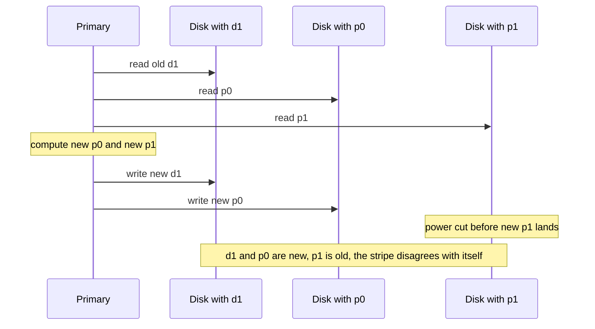
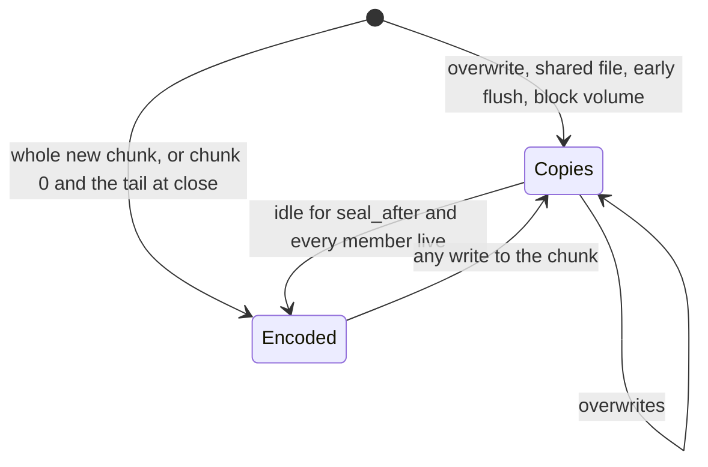
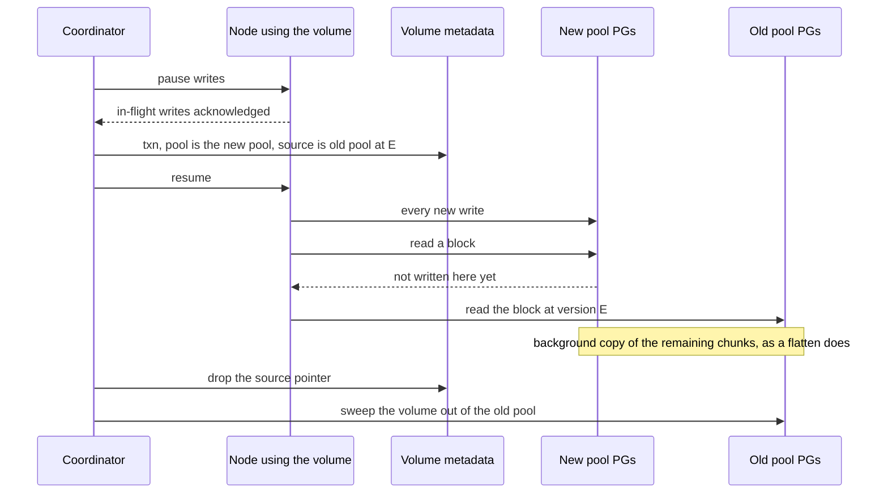
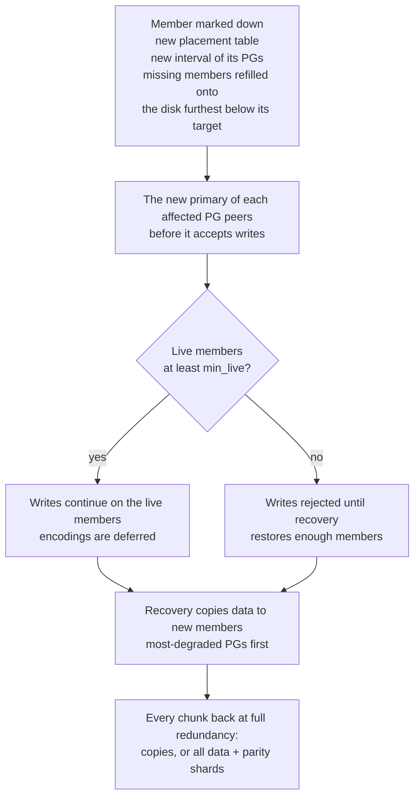

# Pools and redundancy: copies, erasure coding and rebuilds

Every storage system has to decide how many times to store each byte, and where. Store it once
and a dead disk loses data; store it three times and you pay for three disks to get one disk of
space. rock-solid lets you choose per **pool**: a named set of placement groups with one redundancy
scheme, from a single copy for scratch data, through two or three full copies, to erasure coding,
which in `ec4-2` survives the same two failures as three copies at half the space. The hard part is
erasure coding of data that changes, and rock-solid's answer is simple: it never edits encoded
data in place. Chunks are written as plain copies and encoded only once they are whole or have gone
idle. This post explains replication and erasure coding from scratch, then shows how pools,
failure domains, `min_live`, sealing, one-copy pools, pool moves and rebuilds fit together.

Nothing here runs yet. Pools with one to three copies are phase 3 of the
[roadmap](../docs/design.md#roadmap-and-open-questions), erasure-coded pools phase 10 and pool
moves phase 11. What follows is the design.

Each section starts with an **In plain words** callout; the **How it works** part after it gives
the real names, numbers and edge cases.

## Words you need

- **Chunk.** A 4 MiB piece of a file or block volume, the unit that is placed, copied and encoded.
  See [Data model](../docs/glossary.md#data-model).
- **Placement group (PG).** A bucket of chunks that are placed together. Each chunk hashes into one
  PG, and the cluster decides which disks hold each PG.
- **Member, primary, replica.** The disks listed for a PG are its members. The primary orders and
  coordinates every write to the PG's chunks; the others are replicas.
  See [Roles](../docs/glossary.md#roles-who-does-what).
- **Pool.** A set of PGs sharing one redundancy scheme, one failure-domain rule and optionally one
  class of disk. Every volume belongs to exactly one pool.
- **Width.** How many members each PG of a pool has: the copy count, or `data + parity` shards.
- **Erasure coding (EC).** Cutting data into `data` pieces and computing `parity` extra pieces from
  them, so that any `data` of the pieces rebuild the whole. Each piece is a **shard**; one set of
  data and parity shards is a **stripe**. **Reed-Solomon** is the standard code that does this.
- **Failure domain.** A group of things that fail together: a disk, a node. Copies of one chunk go
  to different failure domains.
- **`min_live`.** The number of live members a PG needs before it accepts writes.
- **Seal.** Treating a chunk as finished, which makes it eligible for erasure coding. A later write
  to it turns it back into copies.
- **Locality.** Whether a volume's chunks stay on one node or spread over every disk of its pool.
- **Degraded, recovery.** A PG is degraded while it has fewer copies or shards than its pool asks
  for. Recovery copies data back until it is whole again. In this post "recovery" always means this
  PG recovery, not a disk's crash recovery from its log ([post 04](04-one-log-per-disk.md)).
All of these, and the **write hole** this post explains below, are in the glossary's
[Redundancy and placement](../docs/glossary.md#redundancy-and-placement) section.

## A placement group recap

> **In plain words.** Tracking where each of a billion chunks lives would need a huge, constantly
> changing table. Instead, rock-solid drops every chunk into one of a few thousand buckets by
> hashing its name, and only tracks which disks hold each bucket. Those buckets are placement
> groups. [Post 02](02-chunks-and-placement.md) covers them in full.

### How it works

A chunk's ID is computed from its volume, file and offset. XXH3, a fast hash function that never
changes, turns the ID into a 64-bit number, and its top bits pick one of the volume's pool's PGs.
The **placement table**, computed by the control plane and cached on every node, lists each PG's
members. Each version of the table is a **table epoch**, and each PG's run of tables with the
same members is one of its **intervals**, numbered in the table.

Two facts matter for this post. First, the PG is the unit of recovery and rebalancing: adding a
disk moves whole PGs onto it, never single chunks. Second, a pool's `pg_count` is a power of two
sized so each disk holds around 100 PG members summed over all pools (`pg_count × width ÷ disks`):
2048 PGs for a three-copy pool alone on 60 disks. The table stays small either way: even a 4096-PG
`ec16-2` pool is about 320 KiB with its interval numbers.

## The problem: erasure coding meets overwrites

> **In plain words.** Keep three copies of everything on three machines and any two can die. The
> price is that 3 TB of disks hold 1 TB of data. Fine for a database; painful for 20 TB of camera
> footage you write once.
>
> Erasure coding is the way out. Picture cutting a photo into 4 pieces and painting 2 extra "magic"
> pieces, such that any 4 of the 6 let you redraw the whole photo. You can lose any 2 pieces, and
> 6 quarter-size pieces cost 1.5 photos, not 3. The simplest version is RAID 5: with two data disks
> and one parity disk, parity is `d0 XOR d1`, and a lost `d0` comes back as `parity XOR d1`.
>
> The catch is editing. Every magic piece depends on every real piece, so changing one piece means
> repainting the magic ones too, on other machines, and a crash halfway leaves them disagreeing.

### How it works

Reed-Solomon generalises the XOR trick to several parity pieces, using a special arithmetic on
bytes (a Galois field) in which division always works, so the equations always have a solution.
Here is one 4 MiB chunk stored two ways. Look at the right-hand column: the same two-failure
protection, at half the bytes.

```text
rep3: three full copies, one per node                       stored: 12 MiB (3.0x)
  node A  [ whole chunk, 4 MiB ]   primary
  node B  [ whole chunk, 4 MiB ]
  node C  [ whole chunk, 4 MiB ]
  survives any 2 lost nodes: 1 copy is enough

ec4-2: 4 data shards + 2 parity shards, one per node        stored:  6 MiB (1.5x)
  node A  [ s0  bytes 0 to 1 MiB ]
  node B  [ s1  bytes 1 to 2 MiB ]
  node C  [ s2  bytes 2 to 3 MiB ]
  node D  [ s3  bytes 3 to 4 MiB ]
  node E  [ p0  parity, 1 MiB    ]
  node F  [ p1  parity, 1 MiB    ]
  survives any 2 lost nodes: any 4 of the 6 shards rebuild the chunk
```

Copies are cheap to change: a 4 KiB overwrite in a three-copy pool is 3 writes and 0 reads. A
4 KiB overwrite inside an encoded stripe is not, because each parity shard must be fixed using the
old value:

```text
stripe = [d0 d1 d2 d3 | p0 p1], overwrite d1:
  read old_d1, p0, p1
  delta = old_d1 ^ new_d1
  p0' = p0 ^ gf_mul(coef[0][1], delta)
  p1' = p1 ^ gf_mul(coef[1][1], delta)
  write new_d1, p0', p1'      // must land together on 3 nodes
```

`coef` is the code's fixed table of multipliers; the point is only that each parity shard needs the
old value of `d1`. That is 3 reads plus 3 cross-node writes, where copies needed 3 writes. Worse is
the comment on the last line: nothing makes those three writes land together. The sequence below
shows a crash in the middle.



*The failure is silent: every shard has a valid checksum, but the set is inconsistent.* Months later
the disk holding `d0` dies. A rebuild from `d1`, `d2`, `d3` and `p0` would be correct, but one that
happens to use the stale `p1` produces a garbage `d0`, which is why the bug can hide for so long.
This is the **write hole**. Systems that encode in place close it with two-phase commits or
journals across shards, and those are hard to get right: the design cites Vitastor's chaos test
failing on every seed of its two-phase erasure-coded configurations before its 3.2.0 fixes.

## The options real systems use

> **In plain words.** There are two questions. Where do you choose the redundancy: for the whole
> cluster, per volume, or per group of volumes? And if you erasure-code, what do you do when
> someone edits encoded data?

### How it works

**Where redundancy is chosen.**

- **One scheme for the whole cluster.** Simple, but scratch space then pays photo-grade protection.
- **A replica count per volume** (Longhorn). It does not fit placement groups: one PG holds chunks
  of many volumes, so a redundancy scheme has to belong to a whole set of PGs.
- **Per pool** (Ceph, rock-solid). Each pool is its own set of PGs with its own scheme, and a
  StorageClass names the pool. One cluster can mix scratch, block and media data.

**What erasure coding does with edits.**

- **Overwrite stripes in place** (Ceph's `allow_ec_overwrites`, Vitastor). Any data can be encoded,
  but every small write pays read-modify-write, and the write hole must be closed with extra
  protocol.
- **Erasure-code everything with redirect-on-write** (Weka). A write never edits a stripe; it goes
  into a new stripe and the old blocks become garbage. No read-modify-write and no write hole, but
  the cluster now needs garbage collection of half-dead stripes across nodes.
- **Encode only data that has stopped changing** (Windows Azure Storage, rock-solid). New and
  edited data lives as copies; it is encoded once it is whole or idle. Edits never touch encoded
  data, so neither a stripe's read-modify-write nor the write hole can occur, and nothing needs stripe garbage
  collection. The cost: data pays copy prices until it is encoded, and editing an encoded chunk
  first turns it back into copies.

| Approach | Small overwrite cost | Write hole | Extra machinery | Space while data is fresh |
| --- | --- | --- | --- | --- |
| Copies only (`rep3`) | 3 writes, 0 reads | None | None | 3× |
| EC in place (Ceph overwrites, Vitastor) | 3 reads + 3 cross-node writes in 4+2 | Must be closed by protocol | Two-phase writes or journals | 1.5× in 4+2 |
| EC with redirect-on-write (Weka) | A new stripe write | None | Cluster-wide stripe garbage collection | 1.5× in 4+2, plus garbage |
| Copies, then encode when whole or idle (WAS, rock-solid) | 3 writes, 0 reads; a full chunk re-copy if the chunk was encoded | None | A background encoder | `replicas`× until encoded |

## What rock-solid picked: pools

> **In plain words.** You pick a pool when you pick a StorageClass. The pool decides how many copies
> or shards each chunk gets, which disks may hold them, and how many machines can fail before data
> is at risk. Installation creates one pool, `rep3`, so you get three copies until you ask for
> something else.

### How it works

A pool is a cluster object: a `Pool` custom resource, stored under `ctl/pool/` in the control-plane
Raft group. A StorageClass points at it:

```yaml
kind: StorageClass
metadata: { name: footage }
parameters: { pool: ec4-2 }
```

Every pool setting is yours to choose. The defaults follow one rule: **never lower how many failures
data survives, and otherwise pick the option that uses less space.**

| Setting | Default | Meaning |
| --- | --- | --- |
| `replicas` | 3; `parity + 1` in an erasure-coded pool | Copies of a mutable chunk, 1 to 3 |
| `sealed` | `replicated` | Layout of a chunk no longer being written: copies, or `ec` with `data` and `parity` shards |
| `encode_on_write` | On | Encode whole new chunks as they are written, skipping the copies stage |
| `seal_after` | 1 hour for files, 24 hours for block | Idle time before a chunk held as copies is encoded |
| `min_live` | `min(replicas, 2)` | Live PG members needed to accept writes |
| `failure_domain` | `node` | `node` or `disk` |
| `max_per_domain` | 1 | Shards of one PG allowed in one failure domain |
| `locality` | `node` with one copy, `spread` otherwise | Keep each volume on one node, or spread it over every disk |
| `disk_class` | Any | Only disks of one class, such as NVMe |

Three more settings are about space and placement rather than redundancy: `overcommit` (on),
`write_limit` (90%, the disk fill past which writes that add data are refused) and `pg_count` (a
power of two sized from the disk count); posts 02 and 05 cover them, and the recovery section below
shows what `write_limit` lets through.

Names follow `rep<copies>` and `ec<data>-<parity>`. The presets below are starting points; any
combination within the creation rules is allowed. "Usable / raw" is how much of the raw disk space
holds your data once it is encoded.

| Pool | Copies | Shards | Survives | Failure domains needed | Usable / raw, encoded | Suits |
| --- | --- | --- | --- | --- | --- | --- |
| `none` | 1 | None | Nothing | 1 | 1 | Caches, CI scratch, apps that replicate themselves |
| `rep2` | 2 | None | 1 failure | 2 | 1/2 | Two storage nodes plus a metadata-only node; re-creatable data |
| `rep3` (default) | 3 | None | 2 failures | 3 | 1/3 | Block volumes, databases |
| `ec2-1` | 2 | 2 + 1 | 1 failure | 3 | 2/3 | Media, photos and backups on a 3-node cluster |
| `ec4-2` | 3 | 4 + 2 | 2 failures | 6, or 3 at 2 per node (then 1 node) | 2/3 | Media, backups and S3 |
| `ec16-2` | 3 | 16 + 2 | 2 failures | 18, or 9 at 2 per node (then 1 node) | 8/9 | Archives on a large cluster |

Notice the "Copies" column for the erasure-coded pools. An erasure-coded pool still holds chunks as
copies while they are being written, and it keeps `parity + 1` copies by default, so a chunk
survives the same number of failures in either form: `ec4-2` survives 2 failures as shards, and 3
copies also survive 2.

## Erasure coding, worked through

> **In plain words.** The wider the code, the less space it wastes, but the more pieces a repair has
> to read. Very small chunks are not worth encoding at all.

### How it works

rock-solid uses Reed-Solomon through `klauspost/reedsolomon`, a pure Go library with SIMD
(single instruction, multiple data) assembly. Shard `i` of a chunk is simply the chunk's `i`-th
contiguous byte range, and the parity shards are computed from them:

| Pool | Shard size | Shards stored | Bytes stored for 4 MiB | Overhead | Usable / raw |
| --- | --- | --- | --- | --- | --- |
| `rep3` | (whole copies) | 3 copies | 12 MiB | 3× | 1/3 |
| `ec2-1` | 2 MiB | 2 + 1 | 6 MiB | 1.5× | 2/3 |
| `ec4-2` | 1 MiB | 4 + 2 | 6 MiB | 1.5× | 2/3 |
| `ec16-2` | 256 KiB | 16 + 2 | 4.5 MiB | 1.125× | 8/9 |

The overhead formula is `(data + parity) ÷ data`. Dividing a pool's free space by it gives its
capacity only when every node can take a share of each chunk in proportion to its size, and the
failure-domain rule often forbids that. `ec4-2` at 2 per node on three nodes puts exactly two shards
of every chunk on each node, a third of the chunk, whatever the nodes hold. With nodes of 4, 4 and
1 TB the small node fills first: room ÷ overhead says 5.4 TB, the pool holds 1.8 TB, and 3.6 TB of
the large nodes is *stranded*. So a pool reports as *available* what its placement table lets
through before its first disk fills, next to the *balanced* figure the best placement could reach,
and `rock-solid pool create` and disk changes show what each failure domain strands and ask for
confirmation when one would strand more than half of what the pool could use there. The `Stranded`
warning is kept for stranding nobody confirmed, such as after a failed disk is marked out
([post 02](02-chunks-and-placement.md#volume-size-and-capacity) has the formulas and the
[capacity model spike](../docs/design.md#appendix-capacity-model-spike) the measurements). Placement
never refuses such a layout, because a one-copy pool on the same disks can still use stranded space.

Because shards are contiguous byte ranges, a 4 KiB read of an encoded chunk touches one disk, the
one holding the shard that contains those bytes. No decoding is needed while that shard is healthy.
If it is lost, the read fetches `data` other shards and decodes: a **degraded read**.

#### Small chunks stay as copies

A chunk is encoded only if its shards, each rounded up to a 4 KiB block, take less space than its
copies. Worked example: a 16 KiB file in `ec16-2`. Each of its 16 data shards would hold 1 KiB,
rounded up to a 4 KiB block, so 18 shards cost 72 KiB on disk. Three copies cost 48 KiB. The copies
win, so that file's only chunk stays as copies. The same file in `ec4-2` has 4 KiB shards, 6 of
them, 24 KiB against 48 KiB of copies, so it is encoded. Up to 8 KiB even `ec4-2` keeps copies:
a 1.5 KiB file takes a 4 KiB block on each of 3 copies, 12,399 bytes with its log entries, 8.1
times its size where the pool promises 1.5 ([sub-block writes spike](../docs/design.md#appendix-sub-block-writes-spike)).

#### What a rebuild reads

Space is half the story. The other half is what it costs to get a lost piece back:

```text
The node holding one piece of a 4 MiB chunk fails. What restores full protection?

  rep3, one copy lost                      ec4-2, one shard lost
  --------------------------------         ---------------------------------------
  read  4 MiB from one surviving copy      read  4 x 1 MiB = 4 MiB from 4 survivors
  write 4 MiB to the new member            decode, write 1 MiB to the new member
  bytes read per byte rebuilt: 1           bytes read per byte rebuilt: 4

  ec16-2, one shard lost: read 16 x 256 KiB = 4 MiB, write 256 KiB: 16 per byte rebuilt
```

*Look at the bottom line of each column: erasure coding is cheap to store and expensive to repair.*
This is Reed-Solomon arithmetic, not a measurement: restoring a shard, like a degraded read, needs
`data` surviving shards, so repair traffic grows with `data`. Scaled up, a failed disk that held
1 TiB of `ec4-2` shards means reading about 4 TiB from the surviving disks to write 1 TiB, where
1 TiB of three-copy data reads 1 TiB. `ec16-2` also needs 18 failure domains, or 9 at 2 per node,
which is why it is listed for large clusters.

## Failure domains: where the pieces may go

> **In plain words.** Three copies on three disks of one machine do not survive that machine's
> power supply dying. A failure domain is "the things that die together". Copies must sit in
> different ones. By default the domain is a node.

### How it works

`failure_domain` is `node` (the default) or `disk`. Two rules are checked when a pool is created:

- **Width fits.** Copies always sit in distinct failure domains. Shards may share one, up to
  `max_per_domain`, so `data + parity ≤ domains × max_per_domain`, counting only disks of the pool's
  `disk_class`.
- **Node tolerance is printed.** With `max_per_domain` above 1, one node failure takes out several
  shards of a PG, and an encoded chunk survives `⌊parity ÷ max_per_domain⌋` node failures. The CLI
  states, for every pool, how many node failures its copies and its shards survive.

That second rule is what makes `ec4-2` usable on a three-node homelab. Six shards cannot go on six
nodes you do not have, but at 2 per node they fit on 3. The diagram shows one PG of such a pool;
the copies of a chunk not yet encoded sit on the first three members, one per node.

```text
ec4-2, failure_domain node, max_per_domain 2, three nodes: one PG, member i holds shard i

        node A               node B               node C
  +---------------+    +---------------+    +---------------+
  | m0: s0        |    | m1: s1        |    | m2: s2        |
  | m3: s3        |    | m4: p0        |    | m5: p1        |
  +---------------+    +---------------+    +---------------+
  copies (m0, m1, m2): one per node, survive 2 lost nodes

  lose node A: s0, s3 gone, 4 shards left -> still readable       floor(2 / 2) = 1 node
  lose A and B: 2 shards left, fewer than 4 -> encoded data lost
```

*Compare the two tolerances: shards survive one node here, copies two.* So `ec4-2` at 2 per node
survives one node failure, as Ceph's `crush-osds-per-failure-domain` does; `ec16-2` at 3 per node
fits on 6 nodes and survives none, which is exactly why the CLI prints the number. The placement
computation in [post 02](02-chunks-and-placement.md) keeps the failure-domain rule whenever it
places or moves a member, and it aims each disk at a target built from the same rule: the disk's
capacity for the pool, with no failure domain asked for more than `max_per_domain` members of a PG.
Under `rep2` on a 0.7 GB and a 2 GB node, each node holds one copy of every PG whatever its size,
so a target proportional to size could never be met; the capped targets are what let placement
settle on mismatched disks.

## `min_live`: when to stop accepting writes

> **In plain words.** If two of three copies are down, should a write go to the one copy that is
> left? It keeps the application running, but the next failure loses that write for good. rock-solid
> says no by default: a PG needs at least two live members to accept writes.

### How it works

A write is acknowledged once **every live member** of the chunk's PG holds it (primary replication,
explained in [post 03](03-epochs-leases-and-failures.md); a member is live until the control plane
marks it down). A PG with fewer than `min_live` live members rejects writes until recovery restores
it, rather than accept writes onto too few copies. The default is `min(replicas, 2)`:

| Pool | `replicas` | Default `min_live` | Writes continue with |
| --- | --- | --- | --- |
| `none` | 1 | 1 | The one disk |
| `rep2` | 2 | 2 | Both members; a PG stops writing while either is down |
| `rep3` | 3 | 2 | One member down |

`rep2` is the awkward one: a planned reboot of either node would stop its PGs' writes. The answer is
the CLI command `maintenance <node>`, which an operator runs before a planned reboot: until the node
returns, its PGs accept writes on one copy, and they resync first when it is back. Setting
`min_live: 1` permanently does the same for unplanned failures too, and the design is blunt about
it: it is the setting Ceph users most often report losing data with. `min_live` also guards
fail-slow detection: a disk that turns slow is marked down as if it had failed, but never when that
would drop a PG below `min_live`.

#### Encoded chunks need no write quorum

An encoding commits only once **all** `data + parity` shards are durable, and only then are any
copies dropped. A PG with a member down writes copies and defers encoding until recovery. So there
is never a moment when an encoded stripe is being written with some shards missing, and an encoded
chunk stays readable while any `data` of its shards survive. Ceph recommends setting its `min_size`
(its version of `min_live`) to `k + 1` for erasure-coded pools, where `k` is the number of data
shards, because Ceph accepts writes to a stripe while only `min_size` shards are live. Here an
encoding waits for every shard, so that rule does not arise.

## When chunks are encoded

> **In plain words.** Fresh data is kept as plain copies, because it might still change. Once a
> chunk is complete, or nobody has touched it for a while, it is converted to the compact encoded
> form. If someone edits it later, it goes back to copies first. Edits never touch encoded data, so
> the write hole cannot happen.

### How it works

In an erasure-coded pool, a chunk's copies sit on the first `replicas` members of its PG and its
shards on all `data + parity` members. Changing form therefore moves no data between PGs: the same
members just hold a different layout. A chunk is in exactly one form at a time, and the state
diagram shows how it moves between them.



*Follow the arrows into `Encoded`: there are only two, and neither is an overwrite.*

**1. On write (`encode_on_write`, on by default).** The daemon's write-back buffer (the memory where
the file client collects a file's writes before sending them, covered in
[post 09](09-rwx-filesystem-and-cache-coherence.md)) works chunk by chunk. When a chunk that held no
data when the file was opened fills up, the daemon encodes it and sends each shard straight to its
member; the primary commits the encoded version once every member holds its shard.

- **Chunk 0 waits until `close`.** Many writers patch a file's header last: the `mdat` size in MP4
  and MOV, WAV sizes, zip local headers. A patch to an encoded chunk would send it back to copies,
  so chunk 0 stays in the buffer. At `close`, chunk 0 and the file's last partial chunk are encoded
  the same way. If buffer pressure flushes chunk 0 early, it is written as copies and encoded once
  idle.
- **The network cost drops.** In `ec4-2` the data crosses the network once, at 1.5× its size.
  Copies first and encoding later would cost 3× and then 1.5× more.

S3 objects take this path too. It is the path for write-once data such as a studio's footage and
photos.

**2. When idle (`seal_after`).** Everything else is written as copies: overwrites, files several
nodes are writing, chunks flushed early by `fsync` or a full buffer, and block volumes. Each primary
encodes chunks that have not been written for `seal_after`, 1 hour for files and 24 hours for block:

```text
seal(chunk), PG members m[0 .. data+parity]:
  s[0 .. data]   = chunk split into contiguous byte ranges
  p[0 .. parity] = reed_solomon_encode(s)
  send each shard to its member in parallel, wait until all are durable
  commit the encoded version; each member replaces its copy, if any, with its shard
```

The order in the last two lines is the safety argument: copies are dropped only after every shard
is durable, so a crash at any point leaves either the old copies or a complete encoding.

**3. Back to copies on overwrite.** "Sealed" means finished for now, not forever. A write to an
encoded chunk first turns it back into copies: the primary reads `data` shards, writes the copies,
then applies the write, merging any partial block against the chunk it just decoded, and the chunk
is encoded again once idle. That costs a full chunk read and a replicated chunk write. Editors
write new files rather than patch footage, so media rarely pays it. A database on a block volume
pays it on the first write to each idle chunk, which is why block chunks wait 24 hours before
encoding.

Snapshot versions are the one thing truly frozen. They never change, so in an erasure-coded pool
they are encoded at once without waiting for `seal_after`, and a return to copies keeps the encoded
version as the frozen one instead of dropping it ([post 10](10-block-snapshots-and-clones.md)).

On each disk, encoded shards go to the log's *cold* stream, while new copies go to the *hot* stream
([post 04](04-one-log-per-disk.md)).

## One-copy pools and locality

> **In plain words.** Some data does not deserve copies: a build cache, scratch space, or a database
> like Cassandra that already replicates itself. For those, `none` stores one copy. Then the
> question becomes how much one dead disk should hurt. rock-solid keeps each one-copy volume on a
> single node by default, so a dead disk hurts only that node's volumes.

### How it works

`none` keeps one copy of everything. With `locality: node`, its default, each node has its own PGs,
and a volume is placed on one node, the node of its first pod (through CSI's
`WaitForFirstConsumer`, which delays provisioning until a pod is scheduled), with its chunks hashed
over that node's PGs only. Pods on other nodes can still reach the volume over the network. With
`locality: spread`, the default for every other pool, a volume uses every disk.

```text
pool none, locality: node                    pool none, locality: spread

  node A        node B        node C           node A        node B        node C
  [vol-1 ]      [vol-2 ]      [vol-3 ]         [1 2 3 ]      [1 2 3 ]      [1 2 3 ]

  a disk on A dies:                            a disk on A dies:
    part of vol-1 lost, vol-2 and vol-3 fine     part of vol-1, vol-2 and vol-3 lost
```

*A node-local volume uses only its node's disks: less bandwidth, but a small blast radius.* With
locality, reads of lost chunks return `EIO` (an I/O error) and the pool lists the volumes affected.
With spread, any disk loss takes part of every volume in the pool.

The same trade applies to replicated pools, just further out. A volume spread over every disk is hit
by any failure, anywhere in its pool, that takes out more members of one PG than the pool survives.
That is why recovery starts with the PGs that have lost the most members.

**Metadata is not pooled.** Pools set the redundancy of data only. MetaStore shards and the control
plane are always 3-voter Raft groups, whatever pool their files use: metadata is small, and losing a
directory loses every file under it. A cluster therefore needs three nodes that hold metadata. A
node can hold metadata without data disks (`role: meta`), so a two-node cluster adds a small third
machine, such as a single-board computer with an SSD, and runs `rep2` or `none` pools on the other
two. That is the "metadata-only node" in the `rep2` preset row ([post 08](08-the-metastore.md)).

## Moving a volume to another pool

> **In plain words.** You started a volume on `rep3` and now want it on `ec4-2`. Changing the
> encoding shape of a pool in place is not allowed, so the volume moves house instead. It keeps its
> name, its PVC (PersistentVolumeClaim) and every file, and the application keeps running while the
> data is copied over in the background.

### How it works

A pool's `data` and `parity` are fixed at creation, as in Ceph. Every other setting can change
later; a change to `replicas` adds or drops copies per PG and starts a new interval of each. To
change the shape, you move each volume to another pool.

Snapshot and restore could do that, but the result is a new PVC, and Kubernetes does not let a PVC
change its StorageClass, so the application would have to stop and rebind its claim. Instead a
volume moves in place, keeping its `volume_id`, PVC and inode numbers, by reusing the snapshot
machinery ([post 10](10-block-snapshots-and-clones.md)): a cut at snapshot epoch E that pauses
every node using the volume, a transaction that points the volume at the new pool with the old
pool at E as its source, reads that fall through to the source, and a background copy like a clone's *flatten*.
Chunk IDs are the same in both pools; only the PG changes, because the pool is part of the PG. The
sequence below follows one move.



*From the cut on, writes go only to the new pool; the old pool only serves reads at E.*

Snapshots taken before the move stay in the old pool, since each snapshot record names its pool,
and keep their space there until they are deleted. Until the copy finishes, the volume uses space in
both pools, and reads of uncopied blocks take an extra hop.

In Kubernetes, a move starts when a `VolumeAttributesClass` with a different `pool` parameter is
applied to the PVC: the CSI (Container Storage Interface) driver advertises the `MODIFY_VOLUME`
capability and starts the move in `ControllerModifyVolume`. The CLI can start one too. Moves reuse
the cut, read-through and flatten code and its simulation coverage, so they ship with snapshots in
phase 11.

## Recovery and rebuild, per placement group

> **In plain words.** When a disk dies, every PG that had a member on it is short one member. The
> cluster picks a replacement disk for those PGs and copies the missing data onto it, worst-off PGs
> first. Until that finishes, the affected PGs are "degraded": still working, but one more failure
> away from trouble.

### How it works

Detecting the failure, publishing a new table that starts a new interval of each affected PG,
and making the new primary agree with the surviving members (*peering*) belong to
[post 03](03-epochs-leases-and-failures.md); refilling members in the placement table belongs to [post 02](02-chunks-and-placement.md). The flowchart shows how they
connect to pools.



*Read the diamond: whether writes pause depends only on `min_live`, while recovery runs either way.*

Until the new table, writes to the affected PGs wait, so a crash pauses those writes for up to
`node_down_after` (default 5 s). The design does not yet say how long a down member waits before it
is replaced, nor whether an empty replacement takes writes before it is filled. A node in
`maintenance` keeps its place and resyncs when it returns.

**Per PG, worst first.** A disk holds around 100 PG members, so the loss of one disk becomes about
100 separate PG repairs, not one giant copy, and table changes can be staged and throttled. The
disk's chunk index is keyed by `(pool, h, chunk_id)`, so a PG's chunks form one contiguous key range
that a disk can list with a single range scan
([`internal/chunkstore/index.go`](../internal/chunkstore/index.go)). Recovery runs most-degraded PGs
first, because a PG that has lost two members is one failure from loss in `rep3` or `ec4-2`.

**Filling a member.** For a copy, the data comes from a surviving copy. For a shard, Reed-Solomon
requires `data` surviving shards to compute it, as the rebuild diagram showed; the phase 10 plan
lists "shard recovery" without detailing the flow.

**Deferred encodings.** Chunks written while a member was down are still copies, so they are encoded
once idle for `seal_after`.

**Headroom.** Recovery needs free space on the disks it writes to. A pool's `write_limit` (default
90%) refuses writes that add data once any disk holding one of the PG's members passes it. Three
kinds of write still pass: an overwrite of blocks a chunk already holds live as copies that no
snapshot shares, which frees as much as it writes; a punch, which frees space; and a flush of data
a daemon buffered under a *space grant*, which was promised when the daemon acknowledged it
([post 09](09-rwx-filesystem-and-cache-coherence.md#a-full-pool-space-grants)). The headroom above
the limit serves recovery, those granted flushes and the cleaner
([post 05](05-the-cleaner-and-free-space.md)). A pool raises `NearFull` once a member disk is within
10 points of `write_limit` and `Full` once one reaches it, counting space grants. Recovery also
needs the surviving nodes to have room for every copy: a pool raises `CannotReprotect` when it holds
more than its balanced capacity without its largest failure domain. `rep3` on nodes of 4, 4, 2 and
1 TB holds 2.7 TB, but after losing a 4 TB node the other three can re-protect only 0.9 TB. On
exactly three nodes, where losing a node leaves too few for the copies whatever the data, the pool
says so at creation and in its status instead, and `CannotReprotect` looks at losing one disk; a
one-copy pool never raises it.

The simulator checks, after every step, that every chunk reaches its pool's redundancy once
recovery settles, that copies are dropped only after all shards are durable, and that a chunk with
too few survivors returns an error, never wrong data ([post 12](12-testing-for-trust.md)). The test
matrix covers `none`, `rep2`, `rep3`, `ec2-1` and `ec4-2` at 2 per node.

## Evidence

There is no rock-solid spike that measures erasure coding yet. The choice of "copies first, encode
when whole or idle" rests on arithmetic and on other systems' experience:

- **The cost arithmetic** in [Pools and redundancy](../docs/design.md#pools-and-redundancy): a 4K
  overwrite in a 4 + 2 stripe costs 3 reads plus 3 cross-node writes and risks the write hole; three
  copies cost 3 writes and 0 reads. Encoding on write sends 1.5× the data over the network where
  copies-then-encode sends 3× and then 1.5× more.
- **Windows Azure Storage** ([USENIX ATC 2012](https://www.usenix.org/system/files/conference/atc12/atc12-final181_0.pdf))
  encodes extents once sealed, which is the model rock-solid follows.
- **Vitastor's** chaos test failed on every seed of its two-phase erasure-coded configurations before
  its [3.2.0 fixes](https://vitastor.io/en/blog/2026-08-31-v3.2.0.html), the design's example of how
  hard closing the write hole in place is.
- **Whole chunks cost no cleaning.** A chunk written whole goes to a *chunk slot* rather than the
  log. In the [cleaner streams spike](../spikes/cleaner-streams/), whole chunks rewritten at random
  cost a write amplification of 1.004 at any fill in slots, against 4.93 at 90% full in 64 MiB log
  segments ([appendix](../docs/design.md#appendix-cleaner-streams-spike)). The spike did not model
  erasure-coded shards and their slot sizes, which is an open question below.

What is built today is the groundwork: chunk IDs, the PG hash and the power-of-two PG count
([`internal/core/ids.go`](../internal/core/ids.go), with frozen golden vectors), and the chunk index
keyed by pool and hash. The **Pools** and **Recovery per PG** items in the
[build checklist](../docs/build-checklist.md#phase-3-replication-and-placement) are still open, and
[test scenarios](../docs/test-scenarios.md) has no pools or PG-recovery section yet (its "Recovery"
section is a disk's crash recovery); its PG scenarios are the hashing ones under "IDs and hashing".

## Trade-offs and what it costs us

- **Fresh data pays copy prices:** `replicas`× its size until encoded, 3× in `ec4-2`.
- **Editing encoded data is expensive:** a full chunk read and a replicated chunk write on the first
  write to each encoded chunk.
- **Rebuilds read more:** `data` times the rebuilt bytes, 4× in `ec4-2`, 16× in `ec16-2`.
- **Small clusters trade node tolerance for width:** `ec4-2` at 2 per node survives one node, not two.
- **`rep2` stops writing on a single failure** unless you use `maintenance` or accept `min_live: 1`.
- **The shape is fixed:** changing `data` or `parity` means moving volumes, using space in both
  pools meanwhile.
- **Spreading widens the blast radius:** any failure in the pool can touch a spread volume.
- **Metadata always costs three nodes,** even for a `none` pool.
- **Small data stays as copies:** files up to 8 KiB in `ec4-2` and up to 24 KiB in `ec16-2` pay
  copy prices.

## Open directions

- **Erasure-coded pools are phase 10**: encoding on write and when idle, return to copies on
  overwrite, Reed-Solomon with `klauspost/reedsolomon`, degraded reads, shard recovery, several
  shards per node. **Pool moves are phase 11**, with snapshots. Pools with 1 to 3 copies, `min_live`
  and recovery per PG are phase 3.
- **Chunk slots for encoded shards** (open question). A shard is 4 MiB ÷ `data`, so pools with
  different `data` need slot segments of different slot sizes. How much space do partly used slot
  segments of several sizes strand, and must the cleaner empty the emptiest slot segment when the log
  runs short?
- **Admission across a placement group** (open question). A disk whose cleaner falls behind slows
  its own writes, which delays its acknowledgments until the primary's capped replication queue
  stops reading clients. Does the primary need its members' admission rates in their
  acknowledgments, as CockroachDB's replication admission control does, so one cleaning disk does
  not fill the whole cap?
- **A learning track.** The design's erasure-coding exercise is to write Reed-Solomon over GF(2^8)
  from scratch (encode, lose shards, decode), then benchmark it against `klauspost/reedsolomon` and
  ISA-L, before phase 10.

No entry in [`docs/tech-debts.md`](../docs/tech-debts.md) covers pools today.

## Further reading

- Design: [Pools and redundancy](../docs/design.md#pools-and-redundancy),
  [When chunks are encoded](../docs/design.md#when-chunks-are-encoded),
  [One-copy pools and locality](../docs/design.md#one-copy-pools-and-locality),
  [Moving a volume to another pool](../docs/design.md#moving-a-volume-to-another-pool),
  [Volume size and capacity](../docs/design.md#volume-size-and-capacity),
  [Data layer: ChunkStore](../docs/design.md#data-layer-chunkstore) (placement groups and the
  placement table), [Epoch changes and failure detection](../docs/design.md#epoch-changes-and-failure-detection),
  [Snapshots and clones](../docs/design.md#snapshots-and-clones),
  [Testing strategy](../docs/design.md#testing-strategy),
  [Alternatives considered](../docs/design.md#alternatives-considered) (rows "Redundancy",
  "Erasure coding of mutable data", "Changing a volume's pool", "Pool capacity"),
  [Roadmap and open questions](../docs/design.md#roadmap-and-open-questions).
- Glossary: [Redundancy and placement](../docs/glossary.md#redundancy-and-placement),
  [Words with more than one meaning](../docs/glossary.md#words-with-more-than-one-meaning)
  ("shard", "recovery", "seal, freeze").
- Spikes: [`spikes/cleaner-streams/`](../spikes/cleaner-streams/),
  [`spikes/capacity-model/`](../spikes/capacity-model/).
- Study: [pool capacity and ENOSPC](../studies/capacity-and-enospc/README.md).
- Code: [`internal/core/ids.go`](../internal/core/ids.go),
  [`internal/chunkstore/index.go`](../internal/chunkstore/index.go).
- Other posts: [01 The big picture](01-the-big-picture.md),
  [02 Chunks and placement](02-chunks-and-placement.md),
  [03 Epochs, leases and failures](03-epochs-leases-and-failures.md),
  [04 One log per disk](04-one-log-per-disk.md),
  [05 The cleaner and free space](05-the-cleaner-and-free-space.md),
  [08 The MetaStore](08-the-metastore.md),
  [09 RWX filesystem and cache coherence](09-rwx-filesystem-and-cache-coherence.md),
  [10 Block, snapshots and clones](10-block-snapshots-and-clones.md),
  [12 Testing for trust](12-testing-for-trust.md).
