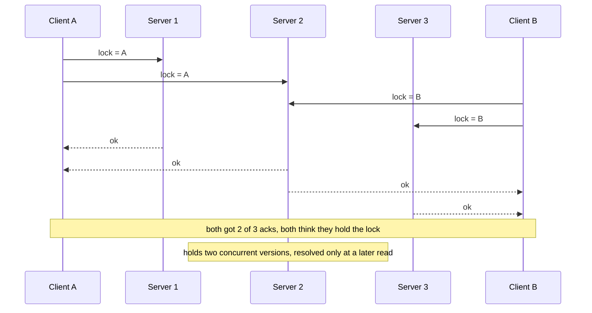
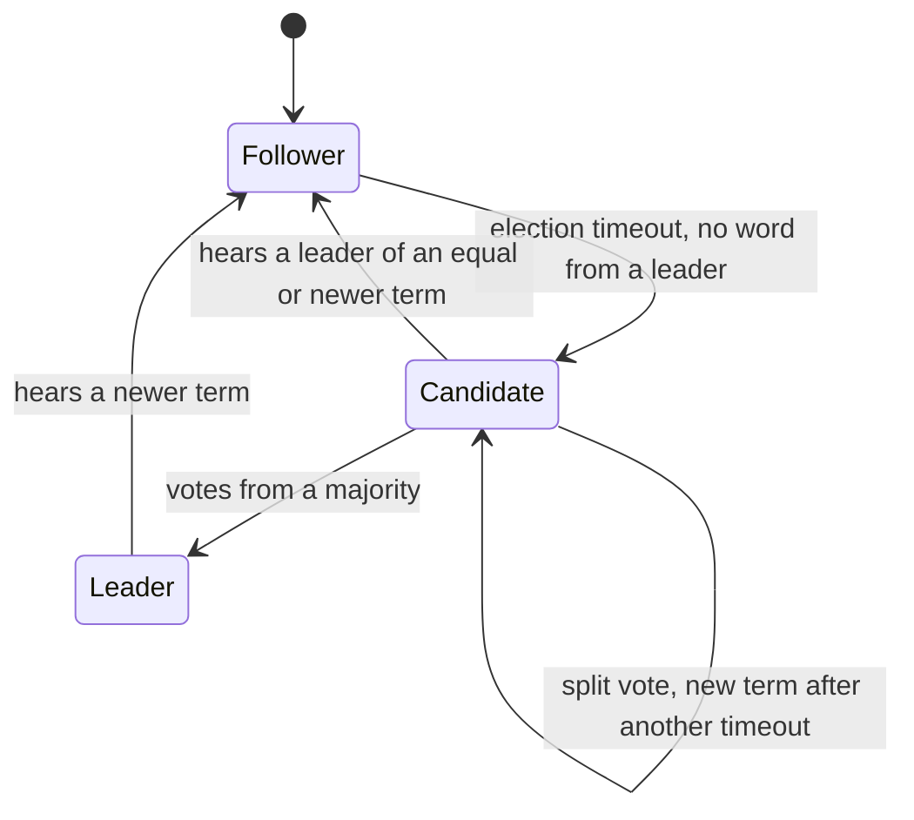
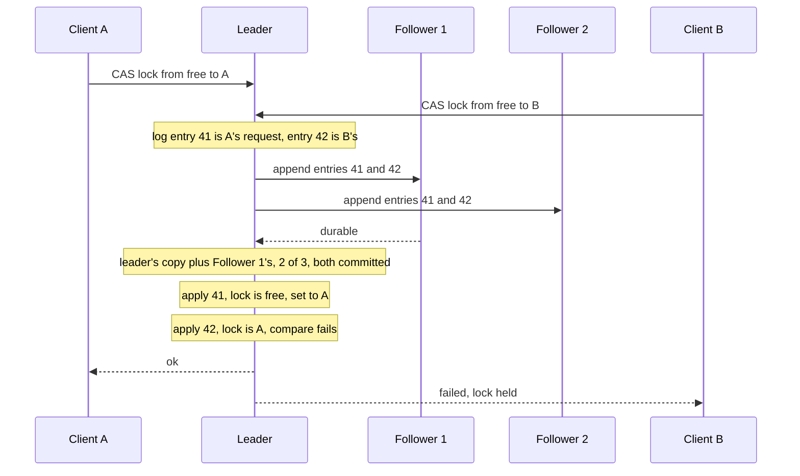
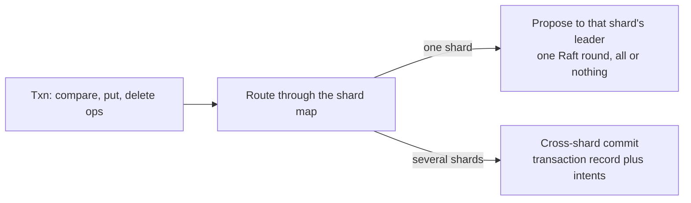
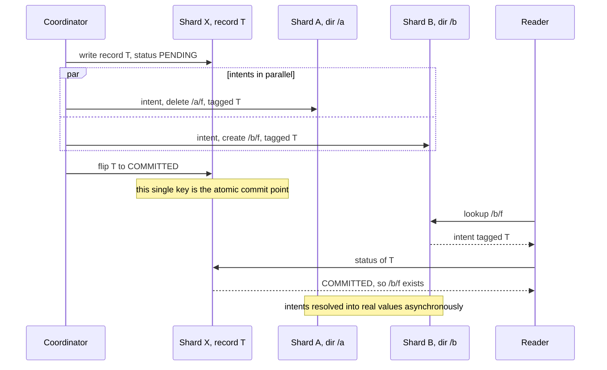
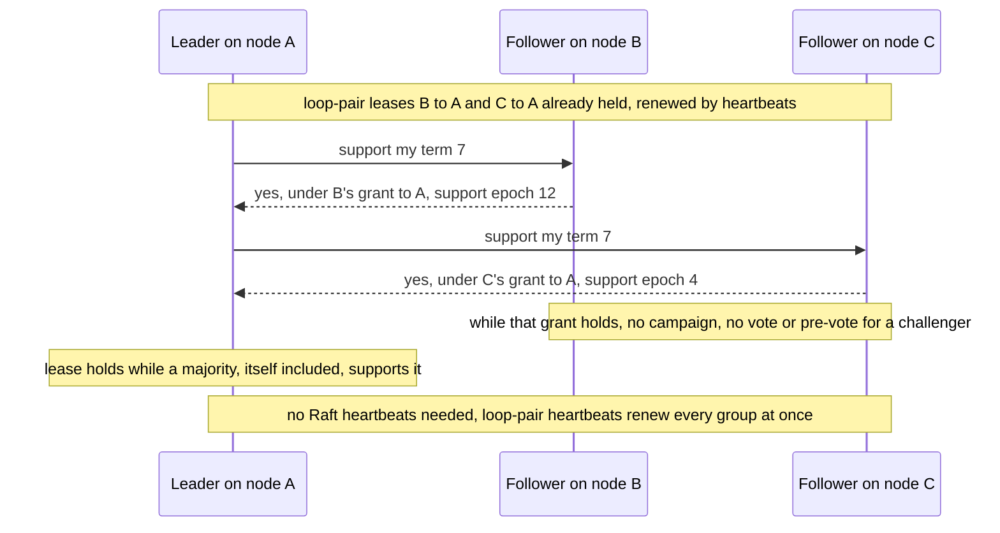

# The MetaStore: many small Raft groups for filesystem metadata

A file is two things: its bytes, and the facts about its bytes (its name, its size, who may open
it, who holds a lock on it). rock-solid stores the bytes in the ChunkStore and the facts in the
**MetaStore**, an ordered, transactional key-value store split into many small Raft groups, each
with its own leader, all embedded in the one daemon binary. Metadata needs a different store
because it needs something chunk data does not: when two clients race for the same lock or the
same file name, exactly one must win, on every replica, even across crashes, and that is a
consensus problem. This post explains why, how Raft solves it, and how rock-solid keeps Raft cheap
enough to run hundreds of groups per node on homelab hardware.

## Words you need

- **Metadata.** Data about data: names, directories, sizes, permissions, locks. Small, but every
  operation needs it. ([glossary](../docs/glossary.md#consensus-and-metadata))
- **Inode, directory entry, attributes.** An inode is a file's identity: a number plus its
  attributes (what `stat` returns: size, mode, owner, times). A directory entry maps a name to an
  inode number. ([glossary](../docs/glossary.md#data-model))
- **Compare-and-set (CAS).** "Set this key to X only if it is still Y." Locks, `rename` and S3's
  create-if-absent are all CAS.
- **Consensus, majority.** Getting several machines, some of which may crash, to agree on one
  order of operations. Any two majorities of a group (2 of 3, 3 of 5) share a member.
- **Raft, shard.** Raft is a consensus algorithm with an elected **leader** (explained below). A
  shard is one Raft group over one range of keys; multi-Raft runs many of them.
- **Slot.** A range of inode numbers that always stays in one shard.
- **Lease.** A right that expires on its own unless renewed.
  ([glossary](../docs/glossary.md#coordination-and-failure))
- **Event loop.** One thread pinned to a core that handles every event for the disks and shards it
  owns, in turn, with no locks ([post 11](11-runtime-in-go.md)).
- **LSM tree.** A log-structured merge tree: an in-memory sorted table plus immutable sorted runs.
  Each shard's state is one. See [06-the-lsm-tree.md](06-the-lsm-tree.md).
- **Group commit, round.** Making every write that arrived during the last flush durable with one
  write and one flush. See [04-one-log-per-disk.md](04-one-log-per-disk.md).

## What metadata is, and why it is not chunk data

> **In plain words.** Think of a library. The books are the data. The card catalogue is the
> metadata: which shelf, which title, who has it checked out. Books are big and you mostly read
> them; catalogue cards are tiny but you consult and change them all the time, and two librarians
> must never check out the same copy to two people. You would not store the cards the same way
> you store the books.

Here is what happens when a pod runs `echo hi > /data/notes.txt` on a rock-solid RWX volume. The
small writes on the left go to the MetaStore; the one on the right goes to the ChunkStore.

```text
MetaStore (metadata, a few hundred bytes)        ChunkStore (data)
-----------------------------------------        -----------------------------------
create, one transaction:
  check            /data has no "notes.txt" yet
  directory entry  /data -> "notes.txt"
  inode record     size 0, mode, uid, times
  /data's times    mtime and ctime moved forward
before the first chunk write, one transaction:
  inode record     raise the allocated end         write chunk (volume, inode, 0):
                                                   3 bytes "hi\n" at offset 0
                                                   to the chunk's placement group,
                                                   primary + replicas, in parallel
close / fsync, one transaction:
  inode record     size 3, mtime (never earlier than the stored one)
```

Chunk data is addressed by a computed ID (volume, inode, offset ÷ 4 MiB), so the data path never
asks the MetaStore where a chunk lives ([02-chunks-and-placement.md](02-chunks-and-placement.md)).
Each chunk has one primary that orders its writes, and an outside authority, the control plane,
decides who the primary is.

Metadata is different in three ways:

1. **It is tiny and hot.** A file's attributes are under a hundred bytes. Every `open`, `stat`,
   `readdir` and `create` touches them.
2. **It needs transactions.** A `create` writes two keys (the entry in the parent, the new inode)
   that must appear together or not at all.
3. **It needs a single winner.** Two clients creating the same name, or grabbing the same `flock`,
   must not both succeed. That is a compare-and-set, and as the next section shows, it requires
   consensus.

Writes to file data mostly skip the MetaStore: a daemon raises a file's *allocated end* (how far
the file may have data) in growing steps, so a file being written touches metadata now and then,
not on every 4 KiB write ([Freeing space](../docs/design.md#freeing-space)).

### How it works: the interface

The MetaStore offers two calls: `Txn`, a transaction that checks some keys and then writes, all or
nothing, and `Scan`, which reads a key range from one point-in-time view, a bounded page at a time.
A point read such as `stat` is a `Scan` of one key, and the place a `Scan` stopped doubles as a
`readdir` cookie and S3's `start-after`.

A `Txn` is a list drawn from a deliberately small set of operations: put, delete, delete a range,
*check* that a key holds exactly a value (or is absent), *check empty* (no key in a range, which
`rmdir` needs for `ENOTEMPTY`), and *update*, which changes one number inside a value: set it, add
to it, or bump it so that it only ever moves forward. Every replica evaluates the `Txn` when it
applies the log entry, in log order: every check first, against the state before the transaction;
if one fails, nothing changes and the result names it, and otherwise the writes apply in order, so
none can fail halfway.

*Update* exists because many clients write some keys at once. Every `create` in a directory moves
the directory's modification time. With compare-and-set alone, only one of many parallel creators
would win each round and the rest would retry; with an update that only bumps the time forward, all
of them commit together, and the bound becomes the shard's loop rather than the retry storm
([MetaStore API study](../studies/metastore-api/README.md)).

A `Txn` is bounded in size and never split, since splitting would break all-or-nothing; a large
value, such as a 64 KiB extended attribute, is stored as numbered pieces in one `Txn`.

**Internal transactions are guarded.** A client's request is safe to resend because its *replay
record* returns the first result ([post 09](09-rwx-filesystem-and-cache-coherence.md)). A `Txn`
with no replay record, from the control-plane leader or the background purger, checks every key or
range it read, so a repeat after an election, or a writer that got there first, fails instead of
doing harm. Being idempotent is not enough: a blind delete retried after an election can remove an
entry written after its first attempt applied.

Inodes, directories, sessions, locks and purge lists are all keys and transactions on this one
store. Shards and the control plane are always 3-voter Raft groups whatever pool their files use,
because losing a directory loses every file under it
([One-copy pools and locality](../docs/design.md#one-copy-pools-and-locality)).

## The problem: two clients, one lock

> **In plain words.** Suppose you keep the lock table on three servers and accept a write once
> two of them confirm it. Client A asks servers 1 and 2 to record "lock held by A". Client B, at
> the same moment, asks servers 2 and 3 to record "lock held by B". Each client gets two
> confirmations. Both believe they hold the lock. Each server accepted the write on its own
> because nobody asked it to compare.

This is how Dynamo-style stores (quorum writes with no leader) behave. Watch server 2, which
accepts both writes.



Quorum stores and CRDTs (conflict-free replicated data types, values designed so concurrent
updates merge automatically) scale without a leader and are excellent for counters and sets. But
a merge happens *after* both writers were told they succeeded, and a lock or a file name cannot be
merged after the fact.

### How it works: why consensus is unavoidable

The design puts it in one sentence: "Leases, atomic rename and S3 `if-not-exists` are
compare-and-set (CAS) operations, and agreeing on one CAS winner among replicas that can crash is
consensus." In rock-solid that covers `flock`, `create` and `mkdir` (which must fail with
`EEXIST`), `rename` (which must move an entry exactly once), session leases and, later, S3's
`if-not-exists` upload. The open choices are which consensus protocol, where it runs, and how to
keep it cheap.

## Raft from scratch

> **In plain words.** Three notaries keep identical ledgers. One of them is the chair. Every
> change goes to the chair, who writes it as the next numbered line and sends the line to the
> other two. As soon as two of the three ledgers (a majority) have the line in ink, the line is
> final, and everyone applies the lines in number order. If two clients race, the chair simply
> writes one request before the other: the second one's "only if the lock is free" check then
> fails. If the chair goes silent, a notary waits a random while, then calls an election for a
> new *term* (a numbered era). Each notary votes once per term, only for a candidate whose ledger
> is at least as complete as its own. Because any two majorities share a notary, the new chair
> always has every final line.

That is Raft. Each replica is in one of three roles; this diagram shows how it moves between them.



Here is the lock race from the previous section, replayed through a Raft group. Look at how the
leader's log order decides the winner, and how B is told "no" instead of "ok".



Three properties make this safe:

- **One leader per term.** A replica votes at most once per term, and a winner needs a majority,
  so two leaders in one term would need two majorities with no shared member. Impossible.
- **Committed means majority-durable.** An entry is committed once a majority holds it on disk,
  so any later majority, and so any later leader, includes a replica that has it.
- **Apply in log order.** Every replica applies the same entries in the same order, so every
  replica reaches the same state.

The cost: a group of three survives one failure, not two, and every write waits for a majority
round trip plus a flush.

### How it works: Raft in rock-solid

rock-solid does not write its own Raft. The shard uses etcd-raft: the Raft inside etcd, the
datastore behind every Kubernetes API server you already run, and the base of CockroachDB's Raft
fork. A Raft written from scratch would have to find again the edge cases etcd-raft has fixed over
years in etcd and CockroachDB.

etcd-raft already has the shape rock-solid's core needs. Every core package is *sans-IO*: a state
machine that takes events and returns actions, with no clock, disk or network of its own
([11-runtime-in-go.md](11-runtime-in-go.md)). etcd-raft's `RawNode` is the same idea:

1. The driver feeds it ticks (clock steps) and messages from peers.
2. It returns a `Ready`: entries to persist, messages to send, committed entries to apply.
3. The driver persists, sends and applies, then calls `Advance`.

Because ticks, messages and persistence belong to the driver, it can share one flush across all
shards on a disk, batch messages per connection and silence idle shards: the three things that
make many groups cheap. etcd-raft's own `Node` wrapper and hashicorp/raft run their own goroutines
or own their storage, which rules both out.

Election timeouts are randomized on a fine tick, so followers rarely time out together and split
the vote. A leader that crashes is noticed through the leases described below rather than through
a missed Raft heartbeat, and its followers campaign soon after, so a group fails over a few seconds
after its leader's node dies. That budget is reasoned from the lease timings, not yet measured over
many groups at once (an open direction below).

## The options: where can metadata live?

> **In plain words.** Every distributed filesystem has to put its catalogue somewhere. You can
> rent a separate database, run dedicated catalogue servers, put everything in one replicated
> log, or cut the catalogue into many independently replicated pieces.

| Approach | Example | CAS and transactions | Extra system to run | Write bottleneck | Fits single binary |
| --- | --- | --- | --- | --- | --- |
| External KV or SQL | JuiceFS on Redis, TiKV, SQL | Yes, via the database | Yes | The database | No |
| Metadata server daemons | CephFS MDS | Yes | Separate MDS daemons, heavy on CPU and RAM | One server per busy directory without fragmentation | No |
| Global transaction service | 3FS on FoundationDB | Yes, central sequencer | Yes | Sequencer | No |
| One Raft group | external etcd | Yes | Yes | One leader | No |
| Multi-Raft, timestamp oracle | TiKV | Yes, Percolator | Central timestamp oracle | None central | Possible |
| Multi-Raft, record plus intents | CockroachDB, **rock-solid** | Yes | No | None central | Yes |
| Ordered writes plus GC | Tectonic | No cross-shard transaction | No | None central | Possible |
| Quorum or CRDT | Garage, Dynamo | No CAS | No | None | Yes, but unsafe for locks |

JuiceFS on TiKV also runs one global transaction per create, and CephFS (like HopsFS) stores
inodes inside directory entries. Leaderless consensus (Egalitarian Paxos, Accord) is deferred:
per-shard leaders already remove the single-leader bottleneck.

## What rock-solid picked

Embedded multi-Raft over an ordered transactional key-value space, with CockroachDB-style
cross-shard transactions, a key layout that makes almost every file operation single-shard, Raft
entries stored in each disk's single log, and leader leases that ride on the same leases chunk
primaries use. Every row above that needs an extra system is out, because rock-solid ships as one
binary; of the rest, only multi-Raft gives both compare-and-set and no central bottleneck.

### Multi-Raft: many small groups

> **In plain words.** One notary chair for the whole library would be a queue. So the catalogue
> is cut into drawers, each drawer has its own three notaries and its own chair, and the chairs
> are spread over the nodes so every node does some of the chairing.

This layout shows three nodes, the control-plane group and three shards; look at how each node
leads one group and follows the others.

```text
              node A           node B           node C
control       [ctl   leader]   [ctl   follow]   [ctl   follow]   pools, placement, members
shard 1       [s1    leader]   [s1    follow]   [s1    follow]   one key range
shard 2       [s2    follow]   [s2    leader]   [s2    follow]   the next key range
shard 3       [s3    follow]   [s3    follow]   [s3    leader]   the next key range
```

#### How it works: routing a transaction

Every key a `Txn` reads or writes routes through the *shard map*, which gives each group the first
key of its range. One shard is the fast path, one Raft round; several shards take the slow path, a
cross-shard commit that is rare by design. Until that protocol exists, a `Txn` or `Scan` that
reaches two groups is refused before anything is sent, so nothing comes to depend on an unmodelled
path. The work, in the next section, is making the one-shard branch the common one.

A daemon sends each `Txn` to the shard's leader from its route cache. A follower never forwards
it: it answers "not the leader" with the leader it knows of, and the daemon updates its cache and
resends, as CockroachDB and TiKV clients do. Forwarding would add a hop and bypass the open-file
registry that lives at the leader (below). During an election a `Txn` fails and is retried; since
a leader never re-proposes on its own, a resend is safe under the same replay key. The control
plane's keys go through the same API: the shard map pins their range to the control-plane group,
which never splits.



**Shard count.** A shard splits, at a slot boundary, once it grows past a size borrowed from
CockroachDB's ranges, so a 3 to 10 node cluster runs tens of groups per node. Splitting by load
comes with leader balancing. The Raft shard is still built to stay cheap at about 1,000 groups per
node, so that per-group cost never limits splitting. A planned leader transfer moves leadership
without an election, for balancing, a rolling upgrade or draining a node.

**Replacing a voter.** The control-plane leader places every group's three voters, one per node
that holds metadata, and records them in the shard map; the map is the plan, and each group's
leader drives its own Raft configuration toward it. A voter whose disk has been down for as long as
a PG member is given ([post 07](07-pools-and-redundancy.md#recovery-and-rebuild-per-placement-group))
is replaced, and one whose disk lost its log is replaced at once. The Raft paper warns about the
obvious way: adding the new, empty replica as a fourth voter while one of the three is dead makes
the quorum three, and every commit then waits for the newcomer to copy a whole shard. So the new
replica joins as a *learner*, which receives the log but has no vote, and once it has caught up,
one joint configuration change removes the dead voter and promotes the learner in a single step.
The two survivors are a majority of both the old and the new set, so the swap never waits on
anyone who is missing:

```text
 voters {A, B, C}, C down           add D as learner     D caught up        one joint change
 quorum 2 of 3: A, B                 D copies the log;    .                  {A,B,C} + {A,B,D}:
                                     commits still need   .                  A and B are a majority
                                     only A and B         .                  of both -> {A, B, D}
```

With only three metadata nodes there is nowhere to put D, so a group whose voter's node is down
runs on two voters, and survives no further failure, until the node returns.

### Key layout: keep a directory and its files together

> **In plain words.** If a file's name card and its details card sit in different drawers, every
> `create` needs two chairs to agree, which is slow and complicated. So rock-solid numbers files
> so that a file's cards always land in the same drawer as its directory's cards.

The trick is in the inode number. Look at the bit layout, then at how the keys of one directory
sort next to each other.

```text
inode ID, 64 bits
+--------------------------+---------------------------------------------------+
|  slot      (24 bits)     |  sequence number   (40 bits)                      |
+--------------------------+---------------------------------------------------+

written below as slot:seq. Volume 5, directory /photos got slot 2.

fs/5/2:0/n                    slot counters: next sequence number, bytes used
fs/5/2:1/a                    attributes of /photos
fs/5/2:1/d/beach.jpg   -> 2:2, file
fs/5/2:1/d/cat.jpg     -> 2:3, file
fs/5/2:2/a                    attributes of beach.jpg (size, allocated end, ...)
fs/5/2:2/x/user.DOSATTRIB     an extended attribute, next to the attributes
fs/5/2:3/a                    attributes of cat.jpg
fs/5/2:3/l/x/{session}        an exclusive flock held on cat.jpg
- - - - - - - - - - - - - - - a shard may split here, between slots - - - - - -
fs/5/3:0/n                    the next slot begins
```

#### How it works: keys and inode IDs

**Encoding.** Each `word/` is a one-byte tag on disk, and integers are fixed-width and big-endian
(most significant byte first), so numeric order is byte order. Only the last component (a file
name, xattr name or S3 key) has variable length, so keys need no escaping and a prefix scan is a
plain byte-prefix scan.

**Inode IDs.** Every key of an inode starts with `fs/{volume}/{inode}`, so a slot is one
contiguous key range, and shards split only at slot boundaries.

- A new file takes a sequence number in its parent's slot: entry and inode, one shard. Its daemon
  reserves numbers in batches with an *update* of their own and hands them out from memory. The
  reservation cannot ride in the create, whose keys already contain the new number.
- A new directory takes a free slot from the same shard's range, so `mkdir` is single-shard and a
  later split can move whole subtrees. Its `mkdir` also hands the creating daemon a first batch of
  sequence numbers, so creating files in a new directory needs no reservation round. With no free
  slot left it shares its parent's slot; when a slot's numbers run out, new files go to a fresh
  slot.
- IDs are never reused. The root is inode 1; sequence 0 of each slot holds the slot's own keys.

The main keys (the [design's table](../docs/design.md#metadata-layer-metastore) also lists replay
records, volume records, case-folded names for SMB and the later S3 index):

| Data | Key | Shard rule |
| --- | --- | --- |
| Pools, placement table, membership, sessions | `ctl/...` | The control-plane group, not sharded |
| Inode attributes, including size and allocated end | `fs/{volume}/{inode}/a` | The inode's slot |
| Directory entries | `fs/{volume}/{dir}/d/{name}` → inode, type | The directory's slot, so `readdirplus` is one request to one shard |
| A directory's parent | `fs/{volume}/{dir}/P` → parent | Its own key, so a cross-directory rename can check that a directory never moves under itself without creates in an ancestor failing that check |
| Extended attributes | `fs/{volume}/{inode}/x/{name}` | Next to the attributes |
| flock and whole-file locks | `fs/{volume}/{inode}/l/{mode}/{session}` | The inode's slot |
| Slot counters, orphans, purge list | under `fs/{volume}/{slot · 0}/` | The slot itself |

The volume prefix makes a filesystem one contiguous key range, which a snapshot copies and a
deletion drops with one range removal. Result: `create`, `mkdir`, `unlink` and `readdirplus` touch
one shard, and a split never cuts a directory away from its files.

### Cross-shard transactions: one switch flips everything

> **In plain words.** Moving a file from `/a` to `/b` when the two directories live in different
> drawers is like a bank transfer between two branches. You first pencil in both changes, each
> marked "pending, see slip T". Then you flip one slip, kept in one place, from PENDING to
> COMMITTED. That flip is the instant the transfer happens. Anyone who later finds a pencilled
> change looks up slip T to learn whether it counts.

This sequence shows a cross-directory `rename` whose source and target directories are in
different shards. Look at the single commit point and at what a reader does if it arrives before
cleanup.



#### How it works: the four steps

1. The coordinator writes a transaction record `{id: T, status: PENDING}` in shard X.
2. Each touched shard gets an *intent*: a provisional value tagged T, written in parallel.
3. Once the intents are written, T's record flips to COMMITTED. This single key is the atomic
   commit point, and it rides on one shard's ordinary Raft commit.
4. Intents are resolved into real values asynchronously. A reader that meets an intent checks T's
   record, so anyone can finish or abort T after a coordinator crash.

This is CockroachDB's scheme, which needs no central service. The alternatives each add one:
Percolator with a central timestamp oracle (TiKV), and a central sequencer (FoundationDB). Cross-directory `rename` is the
main file operation that takes this path, and it keeps the inode in its old slot, so locality
decays slowly over time without affecting correctness.

The four steps leave out exactly where other systems' bugs came from: what a reader or writer that
meets a PENDING intent does (wait, or abort T, and how the coordinator learns it lost), when a
record may be removed, how a rename checks ancestors on other shards, and how a snapshot's markers
commit with its record. Models of CockroachDB's parallel commits and of MongoDB's two-shard
transactions found exactly such bugs ([protocol models study](../studies/protocol-models/README.md)).
So the protocol gets a TLA+ model as its first precise form, before its code, and it is needed only
once range splitting makes a second data shard: until then every volume's keys sit on one data
shard, and no designed operation writes the control-plane group and a data shard in one
transaction.

### Where the bytes go: shards share the disk log

> **In plain words.** A flush (making written data survive a power cut) costs a consumer NVMe
> drive about a millisecond whether it covers one write or a hundred. If each of 100 shards on a
> disk kept its own log file and flushed it, you would pay 100 flushes. rock-solid puts every
> shard's log entries, and the chunk writes, into one log per disk and flushes it once per round.

Each disk holds one log for everything stored on it: chunk data, the Raft logs of the shard
replicas placed on it, and the LSM trees over both
([04-one-log-per-disk.md](04-one-log-per-disk.md)). This picture shows one node with three event
loops; look at how every loop's shard entries end up in one record and one flush.

```text
node B: one NVMe disk, three event loops (one per core)

  loop 0 (owns the disk)     loop 1                     loop 2
  chunk writes               shard 7  (leader)          shard 3  (follower)
  shard 12 (follower)        shard 9  (follower)        shard 21 (leader)
        |                         |                          |
        |      one inbox message per pass with their Ready records
        |<------------------------+--------------------------+
        v
  +--------------------------- disk log, hot stream ---------------------------+
  | record: chunk write | s12 entry | s7 entry | s9 entry | s3 entry | s21 ... |
  +----------------------------------------------------------------------------+
        |   one vectored write, one flush
        +------> one durable notice back to each loop; followers now ack,
                 leaders count the round toward their majority
```

#### How it works: storage and group commit

**Storage.** Each shard replica lives on one disk of its node. Its Raft log and its LSM tree are
part of that disk's log, so the daemon embeds no key-value engine and SPDK drives (NVMe drives
driven from user space, without the kernel) hold metadata too. Raft entries and the Raft *hard
state* (term, vote, commit index) join the round's record next to the chunk writes of the same
round.

**Group commit inside Raft.** Each leader batches whatever arrived during the last round into
*one* log entry and one network round (so entries 41 and 42 in the race diagram would really be
one). Only the leader's appends leave before the round's flush. Everything else waits for it: a
follower's acknowledgments, since an acknowledged entry must survive its crash, and a vote or a
new term, since Raft needs both durable before a reply. Only a pre-vote, which changes nothing,
goes out at once. The loop collects work only from shards that changed
([11-runtime-in-go.md](11-runtime-in-go.md)).

**Commit latency.** A commit waits for about three rounds: the leader's append, the follower's
append and flush, and the leader's apply, each behind its loop's round in flight. So latency
follows how busy the loops are, not round size, and a node plans its shard leaders so that no loop
runs above about half busy ([raft rounds spike](../spikes/raft-rounds/)).

**Snapshots and reads.** A Raft snapshot or a reader uses a point-in-time view of the shard's LSM
tree, which never blocks the writer. The view pins the memtable and sorted runs it reads, so a
view held open holds back the cleaner, and anything long-lived, such as a volume snapshot's
metadata, is copied out instead.

### Cheap idle groups: batching and quiescence

> **In plain words.** A Raft leader normally sends "I'm still here" several times a second to each
> follower. With 1,000 groups on a node that is a lot of chatter for groups that are doing nothing.
> So idle groups go quiet, and the machines vouch for each other once, for all groups at a time.

- **Batching per connection.** The driver sends every group's messages for one peer loop as one
  batch over their connection.
- **Quiescence.** A group with no writes stops ticking and heartbeating. In the
  [multi-raft spike](../spikes/multi-raft/) this cut the idle cost of thousands of replicas from a
  noticeable share of a core to almost nothing. The loop-pair leases (next section) keep its
  leader's lease and its followers' loyalty, so it sends nothing until it writes again or a lease
  lapses. TiKV's hibernate regions work the same way.

### Leader leases and lease reads

> **In plain words.** A leader answering a read from memory has a problem: maybe it was replaced a
> moment ago and does not know yet, and a new leader already accepted a write. Plain Raft fixes
> this by asking a majority "am I still leader?" before every read, which costs a round trip. A
> lease is cheaper: each follower promises "I will not help elect anyone else in this group until
> time X". While a majority's promises hold, nobody else can become leader, so the leader may
> answer from memory.

rock-solid already has leases between every pair of event loops that share a group: they back
chunk primaries' read leases and are renewed by heartbeats that flow between the loops anyway
([03-epochs-leases-and-failures.md](03-epochs-leases-and-failures.md)). Raft leaders ride on those
instead of running their own, as CockroachDB's leader leases ride on its store liveness, so the
cost does not grow with the number of groups. This diagram shows a new leader *fortifying* its
term; look at what each follower records and what it then refuses to do.



#### How it works: fortification

- A **support epoch** is a counter on each loop's grant to another loop. Once a grant lapses, the
  grantor bumps the counter and never renews the old one, so support given under it can never
  come back after a partition heals.
- A follower that supports a leader records the leader's term and the support epoch of its own
  loop's grant to the leader's loop. While that grant holds in that support epoch, it neither
  campaigns nor grants a vote or pre-vote in the group, except to a planned transfer target.
- The leader holds its lease while a majority of voters, itself included, support it under grants
  that have not expired. During a membership change, both the old and the new configuration must
  each give a majority.
- Each expiry is counted on two clocks, ending at whichever runs faster for the holder while the
  grantor waits for the slower, so a time daemon's slew cannot stretch a lease and the clocks need
  not be synchronized ([03-epochs-leases-and-failures.md](03-epochs-leases-and-failures.md#two-clocks-because-a-time-daemon-can-bend-either-one)).
  A holder that cannot yet bound how fast a grantor's clock runs takes no expiry from it, so
  groups led from a freshly started node read through ReadIndex for their first moments.
- Until a new leader is fortified and has committed an entry of its own term, it answers reads
  through etcd-raft's **ReadIndex** round (a majority round trip that confirms leadership).

**Failure.** When a grant lapses on the grantor's clocks, every fortification under it ends, and
the groups led from that node wake up and campaign after a short random delay rather than a whole
election timeout. The timeline for a crashed leader node:

```text
time ->   0                      one lease later                 + short campaign
          |                      |                               |
node A    X crashes              .                               .
grants    B->A, C->A still valid | lapse on B's and C's clocks   .
                                 | support epochs bumped         .
followers loyal, timers stopped  | campaign after a short delay  | new leader, reads via
                                                                 | ReadIndex until fortified
```

Campaigning that early is safe: by the lease-time rule the leader's lease ended before the grant
did, and a follower whose grant still holds drops the pre-vote of anyone challenging a live leader.
A restarted node has forgotten what it granted, so for one lease period it grants no vote.

**Why not just use etcd-raft's built-in lease?** Because it relies on timer ticks that idle groups
stop taking. etcd-raft's `CheckQuorum` lease counts ticks, and it checks the quorum only once per
election timeout, so a leader that lost its quorum can believe it leads for up to two election
timeouts while followers refuse votes for one. So `CheckQuorum` stays off. `PreVote` stays on: a
replica asks whether it could win before raising the term, so a node back from a partition does
not depose a healthy leader. The shard implements fortification around `RawNode`, dropping
challengers' (pre-)votes before they reach etcd-raft. CockroachDB's fork of etcd-raft has the same
mechanism under the CockroachDB Software License, so rock-solid takes the design, not the code.

### The inode owner

> **In plain words.** The leader of the shard holding a file also keeps a scratch list of who has
> that file open. It is not written down, so `open` is fast; after a crash, clients tell the new
> leader again.

The leader of an inode's shard is that inode's *owner*. Its open-file state (who has the file
open, who has written, the cache mode) is not written to the Raft log, so `open` costs one round
trip and no disk write. A planned leader transfer hands it over; after a crash, clients
re-register during a grace period of about one session lease, as in NFS version 4, while reads
and writes on open handles carry on. See
[09-rwx-filesystem-and-cache-coherence.md](09-rwx-filesystem-and-cache-coherence.md).

### The control-plane group

> **In plain words.** One special Raft group holds the cluster's own settings: which disks exist,
> which pools there are, which disks hold which placement group, which client sessions are
> alive. Its leader also keeps track of how much space each pool has left. It changes rarely and
> is never on the I/O path.

The `ctl/...` keys live in one dedicated control-plane Raft group, not sharded. It stays small
because it maps placement groups, not chunks ([02-chunks-and-placement.md](02-chunks-and-placement.md)).
Its leader's logic is a sans-IO machine that proposes ordinary `Txn`s on `ctl/` keys, so the shard
state machine, its tests and its model cover the control plane too. Its leader commits each new
placement table as one Raft entry holding only the changed PG entries, sends nodes the change
rather than the whole table, and marks a node down when its heartbeats stop. A new leader starts
that count from its own lease, so when the old leader's node crashed, its PGs wait for the
failover plus the usual detection time.

Each node's heartbeat also renews its client sessions, reports its disks' fill and asks for the
node's *space grant*: the bytes of each pool its daemon may buffer before flushing
([09-rwx-filesystem-and-cache-coherence.md](09-rwx-filesystem-and-cache-coherence.md#a-full-pool-space-grants)).
Renewals and grants live only in the leader's memory, and only a leader holding its leader lease
answers them, so they cost no Raft writes. The Raft log changes only when a session starts or is
fenced: the leader commits expired sessions as fenced in a new version of the *session table*. From
the reported fills it computes each pool's capacity figures
([07-pools-and-redundancy.md](07-pools-and-redundancy.md)).

Chunk primaries need an outside authority to say who is live and who is primary; a Raft group
elects its own leader and needs none, "which breaks the circle".

### etcd-raft as the library, and its patch

> **In plain words.** rock-solid uses a well-tested open-source Raft, an older version of it on
> purpose, with two small changes: random election timers come from a seed the tests control, and
> one bug fix from the newer version is copied in.

**Which version.** An older release, because the newer one's generated message code allocates
several times as much per message and costs much more CPU per proposal, measured in the
[raft rounds spike](../spikes/raft-rounds/). The pin goes once a release keeps messages lean.

**The fork.** A Go `replace` builds etcd-raft from a pinned fork in `third_party/raft` with two
changes:

1. **Seeded election timeouts.** Upstream draws them from `crypto/rand` behind a mutex. The fork
   gives each replica a seeded source, so the simulator can replay a shard exactly from one seed
   ([12-testing-for-trust.md](12-testing-for-trust.md)).
2. **The newer release's ReadIndex retry fix,** without which late acknowledgments of a retried
   ReadIndex can confirm a read at a deposed leader's stale commit index.

etcd-raft's own tests run on the fork in CI and before every update. The fork goes once upstream
accepts a configurable random source; the
[tech debts](../docs/tech-debts.md#workaround-etcd-raft-fork-in-third_partyraft) list says what
removes the pin and the fork.

**Synchronous storage writes.** etcd-raft's asynchronous storage writes stay off: with them, a
restored snapshot can overtake committed configuration changes still queued for apply, which
panics upstream ([study](../studies/etcd-raft-async-snapshot-apply/README.md)).

A mature library is no guarantee of safety, so etcd-raft's tests, the simulator and a TLA+ model
all cover the shard.

### Memory budget

> **In plain words.** The MetaStore keeps its tables in RAM, so how many files a node can hold
> depends on how many bytes each file costs.

Most of a shard's index sits in prefix-compressed sorted runs in memory, where a file (its
attributes plus its directory entry) costs well under its memtable size. From the
[MetaStore memory spike](../spikes/metastore-memory/)'s file model, the design budgets that a
16 GiB node holds roughly 40 million distinct files at three replicas
([On-disk format](../docs/design.md#on-disk-format)). SMB-shared volumes, whose clients store
extended attributes such as `user.DOSATTRIB` on every file, fit fewer. Past that, a block cache
that reads runs from the log instead of memory takes over.

## Evidence

The decisions above rest on four spikes:

- **Many groups per node are affordable,** if the library leaves ticks, I/O and threads to the
  caller: the [multi-raft spike](../spikes/multi-raft/) found a `Ready`-style library at a few KiB
  per group and one flush covering thousands of groups' appends, against hundreds of KiB per group
  for a library that runs its own tasks.
- **One entry per group per round,** not one per proposal: the [raft rounds spike](../spikes/raft-rounds/)
  measured an order of magnitude more throughput at a fraction of the latency, and is why the
  etcd-raft version is pinned.
- **No embedded key-value engine as the Raft log:** the [KV engines spike](../spikes/kv-engines/)
  showed one shared commit for 100 shards costing about a hundredth of 100 separate commits, and
  the engines it tried writing many times the payload or keeping far more on disk than was live.
- **Bytes per file** come from the [MetaStore memory spike](../spikes/metastore-memory/).

## Trade-offs: what it costs us

- **Three copies of all metadata**, one failure tolerated per group, even in a one-copy pool.
- **Failover takes seconds,** most of it the lease; new opens on a crashed owner's inodes wait one
  session lease more.
- **A commit costs about three rounds**, so leaders must be planned to keep loops under half busy.
- **Cross-directory rename is the slow path** and slowly erodes locality; one huge, busy
  directory is bounded by one shard.
- **Limits of the layout:** a finite count of IDs per slot (years at a high create rate), 64-bit
  `st_ino` that can overflow 32-bit programs, one extra key per create on SMB volumes.
- **Leases need bounded oscillator drift**, so each is counted on two clocks, and a holder gives
  up its leases when its machine resumes from suspend. A paused VM can stop every clock in the
  guest; [post 03](03-epochs-leases-and-failures.md) explains what catches it and what does not.
- **A fork to maintain**, an older library version, and an in-house lease around `RawNode`.
- **Metadata lives in RAM** until the block cache arrives.

## Open directions

- **Shorter commits.** Can a loop collect, during its round in flight, the work of shards that
  only send messages or apply entries, as Pebble and RocksDB apply while a sync runs, and so cut
  commits to two rounds?
- **Deletes on a full disk.** Should Raft entries and punches draw on a slice of the log's
  reserve, as ZFS's slop space lets `rm` through?
- **Failover with lapse campaigns.** The failover budget is reasoned, not measured: how many of
  hundreds of groups that lose their leader collide and wait out an election timeout? Rerunning
  the multi-raft spike with campaigns on a lapse answers it, and also how often a control-plane
  failover outlasts a fast-clocked client's session.
- **Asynchronous storage writes** stay off until two guards exist: drop apply work a restored
  snapshot covers, and never compact past the durable commit index.
- **Follower reads with ReadIndex** if leaders get hot; **leaderless consensus** is deferred.

The design's [Roadmap and open questions](../docs/design.md#roadmap-and-open-questions) tracks
each of these.

## Further reading

- Design: [Metadata layer: MetaStore](../docs/design.md#metadata-layer-metastore),
  [Epoch changes and failure detection](../docs/design.md#epoch-changes-and-failure-detection),
  [On-disk format](../docs/design.md#on-disk-format),
  [Sessions and fencing](../docs/design.md#sessions-and-fencing),
  [Alternatives considered](../docs/design.md#alternatives-considered).
- Spikes and studies: [`spikes/multi-raft/`](../spikes/multi-raft/),
  [`spikes/raft-rounds/`](../spikes/raft-rounds/),
  [`spikes/metastore-memory/`](../spikes/metastore-memory/),
  [`spikes/kv-engines/`](../spikes/kv-engines/),
  [`studies/etcd-raft-async-snapshot-apply/`](../studies/etcd-raft-async-snapshot-apply/README.md),
  [`studies/metastore-api/`](../studies/metastore-api/README.md),
  [`studies/protocol-models/`](../studies/protocol-models/README.md).
- Glossary: [Consensus and metadata](../docs/glossary.md#consensus-and-metadata).
- Series: [03-epochs-leases-and-failures.md](03-epochs-leases-and-failures.md),
  [06-the-lsm-tree.md](06-the-lsm-tree.md),
  [09-rwx-filesystem-and-cache-coherence.md](09-rwx-filesystem-and-cache-coherence.md),
  [11-runtime-in-go.md](11-runtime-in-go.md).
