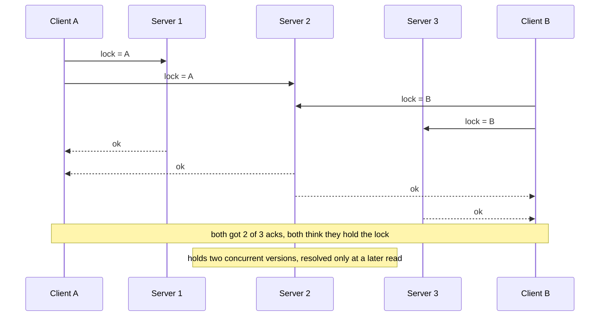
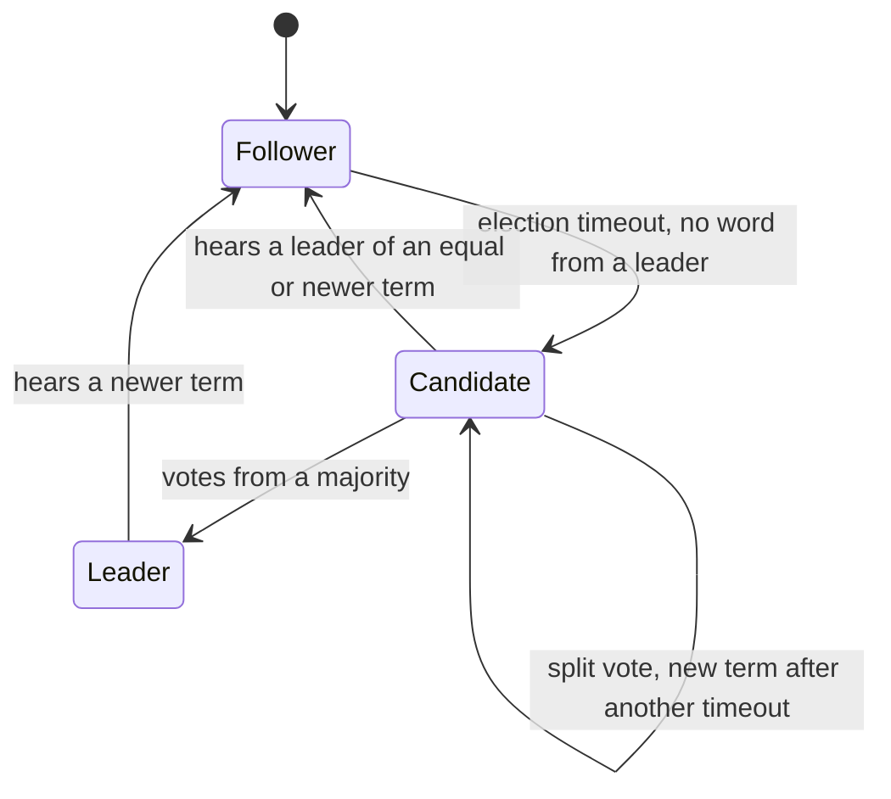
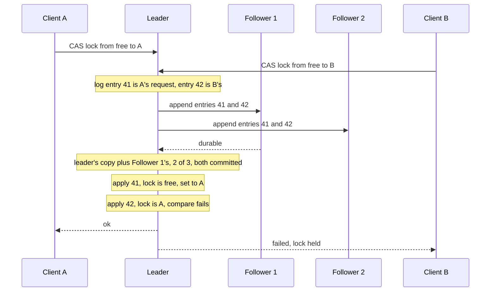
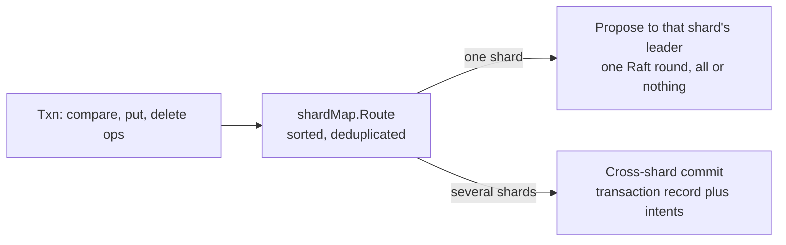
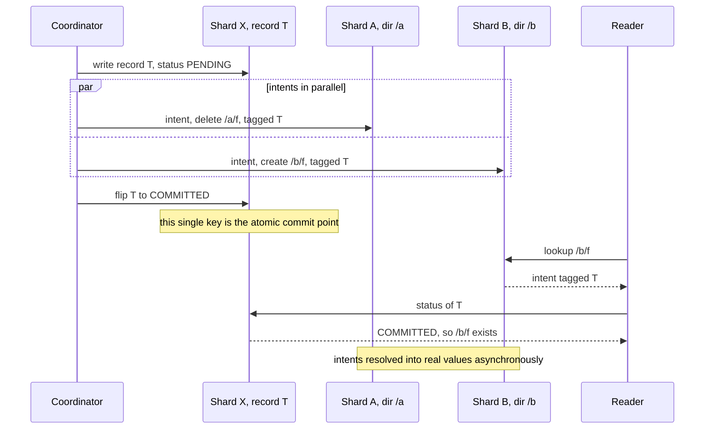
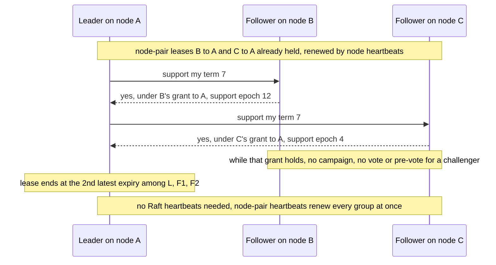

# The MetaStore: many small Raft groups for filesystem metadata

A file is two things: its bytes, and the facts about its bytes (its name, its size, who may open
it, who holds a lock on it). rock-solid stores the bytes in the ChunkStore and the facts in the
**MetaStore**, an ordered, transactional key-value store split into many small Raft groups, each
with its own leader, all embedded in the one daemon binary. Metadata needs a different store
because it needs something chunk data does not: when two clients race for the same lock or the
same file name, exactly one must win, on every replica, even across crashes, and that is a
consensus problem. This post explains why, how Raft solves it, and how rock-solid keeps Raft cheap
enough to run hundreds of groups per node on homelab hardware. None of this runs yet: the
MetaStore is phase 4 of the roadmap, and everything here is the design plus the spikes that
measured it.

## Words you need

- **Metadata.** Data about data: names, directories, sizes, permissions, locks. Small, but every
  operation needs it. ([glossary](../docs/glossary.md#consensus-and-metadata))
- **Inode, directory entry, attributes.** An inode is a file's identity: a number plus its
  attributes (what `stat` returns: size, mode, owner, times). A directory entry maps a name to an
  inode number. ([glossary](../docs/glossary.md#data-model))
- **Compare-and-set (CAS).** "Set this key to X only if it is still Y." Locks, `rename` and S3's
  create-if-absent are all CAS.
- **Consensus, majority.** Getting several machines, some of which may crash, to agree on one
  order of operations. Any two majorities of a group (2 of 3, 3 of 5) share a member.
- **Raft, shard.** Raft is a consensus algorithm with an elected **leader** (explained below). A
  shard is one Raft group over one range of keys; multi-Raft runs many of them.
- **Slot.** A range of inode numbers that always stays in one shard.
- **Lease.** A right that expires on its own unless renewed.
  ([glossary](../docs/glossary.md#coordination-and-failure))
- **LSM tree.** A log-structured merge tree: an in-memory sorted table plus immutable sorted runs.
  Each shard's state is one. See [06-the-lsm-tree.md](06-the-lsm-tree.md).
- **Group commit, round.** Making every write that arrived during the last flush durable with one
  write and one flush. See [04-one-log-per-disk.md](04-one-log-per-disk.md).

## What metadata is, and why it is not chunk data

> **In plain words.** Think of a library. The books are the data. The card catalogue is the
> metadata: which shelf, which title, who has it checked out. Books are big and you mostly read
> them; catalogue cards are tiny but you consult and change them all the time, and two librarians
> must never check out the same copy to two people. You would not store the cards the same way
> you store the books.

Here is what happens when a pod runs `echo hi > /data/notes.txt` on a rock-solid RWX volume. The
small writes on the left go to the MetaStore; the one on the right goes to the ChunkStore.

```text
MetaStore (metadata, a few hundred bytes)        ChunkStore (data)
-----------------------------------------        -----------------------------------
create, one transaction:
  directory entry  /data -> "notes.txt"
  inode record     size 0, mode, uid, times
before the first chunk write, one transaction:
  inode record     raise alloc_end               write chunk (volume, inode, 0):
                                                   3 bytes "hi\n" at offset 0
                                                   to the chunk's placement group,
                                                   primary + replicas, in parallel
close / fsync, one transaction:
  inode record     size 3, mtime
```

Chunk data is addressed by a computed ID (volume, inode, offset ÷ 4 MiB), so the data path never
asks the MetaStore where a chunk lives ([02-chunks-and-placement.md](02-chunks-and-placement.md)).
Each chunk has one primary that orders its writes, and an outside authority, the control plane,
decides who the primary is.

Metadata is different in three ways:

1. **It is tiny and hot.** A file's attributes are 92 bytes in the memory spike's model. Every
   `open`, `stat`, `readdir` and `create` touches it.
2. **It needs transactions.** A `create` writes two keys (the entry in the parent, the new inode)
   that must appear together or not at all.
3. **It needs a single winner.** Two clients creating the same name, or grabbing the same `flock`,
   must not both succeed. That is a compare-and-set, and as the next section shows, it requires
   consensus.

Writes to file data mostly skip the MetaStore: a daemon raises a file's `alloc_end` in steps that
double up to 16 chunks, so a file being written touches metadata now and then, not on every 4 KiB
write ([Freeing space](../docs/design.md#freeing-space)).

### How it works: the interface

The MetaStore offers two calls:

```go
type MetaStore interface {
	Txn(ops []Op) error                                // compare-and-set, put, delete, all-or-nothing
	Scan(prefix, after []byte, limit int) ([]KV, error)
}
```

Inodes, directories, sessions, locks and purge lists are all keys and transactions on this one
store. Shards and the control plane are always 3-voter Raft groups whatever pool their files use,
because "losing a directory loses every file under it"
([One-copy pools and locality](../docs/design.md#one-copy-pools-and-locality)).

## The problem: two clients, one lock

> **In plain words.** Suppose you keep the lock table on three servers and accept a write once
> two of them confirm it. Client A asks servers 1 and 2 to record "lock held by A". Client B, at
> the same moment, asks servers 2 and 3 to record "lock held by B". Each client gets two
> confirmations. Both believe they hold the lock. Each server accepted the write on its own
> because nobody asked it to compare.

This is how Dynamo-style stores (quorum writes with no leader) behave. Watch server 2, which
accepts both writes.



Quorum stores and CRDTs (conflict-free replicated data types, values designed so concurrent
updates merge automatically) scale without a leader and are excellent for counters and sets. But
a merge happens *after* both writers were told they succeeded, and a lock or a file name cannot be
merged after the fact.

### How it works: why consensus is unavoidable

The design puts it in one sentence: "Leases, atomic rename and S3 `if-not-exists` are
compare-and-set (CAS) operations, and agreeing on one CAS winner among replicas that can crash is
consensus." In rock-solid that covers `flock`, `create` and `mkdir` (which must fail with
`EEXIST`), `rename` (which must move an entry exactly once), session leases and, later, S3's
`if-not-exists` upload. The open choices are which consensus protocol, where it runs, and how to
keep it cheap.

## Raft from scratch

> **In plain words.** Three notaries keep identical ledgers. One of them is the chair. Every
> change goes to the chair, who writes it as the next numbered line and sends the line to the
> other two. As soon as two of the three ledgers (a majority) have the line in ink, the line is
> final, and everyone applies the lines in number order. If two clients race, the chair simply
> writes one request before the other: the second one's "only if the lock is free" check then
> fails. If the chair goes silent, a notary waits a random while, then calls an election for a
> new *term* (a numbered era). Each notary votes once per term, only for a candidate whose ledger
> is at least as complete as its own. Because any two majorities share a notary, the new chair
> always has every final line.

That is Raft. Each replica is in one of three roles; this diagram shows how it moves between them.



Here is the lock race from the previous section, replayed through a Raft group. Look at how the
leader's log order decides the winner, and how B is told "no" instead of "ok".



Three properties make this safe:

- **One leader per term.** A replica votes at most once per term, and a winner needs a majority,
  so two leaders in one term would need two majorities with no shared member. Impossible.
- **Committed means majority-durable.** An entry is committed once a majority holds it on disk,
  so any later majority, and so any later leader, includes a replica that has it.
- **Apply in log order.** Every replica applies the same entries in the same order, so every
  replica reaches the same state.

The cost: a group of three survives one failure, not two, and every write waits for a majority
round trip plus a flush.

### How it works: Raft in rock-solid

rock-solid does not write its own Raft. The shard uses etcd-raft (`go.etcd.io/raft/v3`, v3.6.0):
the Raft inside etcd, the datastore behind every Kubernetes API server you already run, and the
base of CockroachDB's Raft fork. "A Raft written from scratch would have to find again the edge
cases etcd-raft has fixed over years in etcd and CockroachDB."

etcd-raft already has the shape rock-solid's core needs. Every core package is *sans-IO*: a state
machine that takes events and returns actions, with no clock, disk or network of its own
([11-runtime-in-go.md](11-runtime-in-go.md)). etcd-raft's `RawNode` is the same idea:

1. The driver feeds it ticks (clock steps) and messages from peers.
2. It returns a `Ready`: entries to persist, messages to send, committed entries to apply.
3. The driver persists, sends and applies, then calls `Advance`.

Because ticks, messages and persistence belong to the driver, it can share one flush across all
shards on a disk, batch messages per connection and silence idle shards: the three things that
make many groups cheap. etcd-raft's own `Node` wrapper and hashicorp/raft run their own goroutines
or own their storage, which rules both out.

| Setting | Default | Why |
| --- | --- | --- |
| `raft_heartbeat` | 100 ms | Leader's keepalive to followers while the group is active |
| `raft_election_timeout` | random 1 to 2 s | How long a follower waits before campaigning |
| Election tick | 10 ms | Finer than the heartbeat, so timeouts take many distinct values and followers rarely time out together and split the vote |

Failover is set by the slowest of the groups that lost their leader, so the design budgets 1.5 to
5× the maximum election timeout: 3 to 10 s with the defaults.

## The options: where can metadata live?

> **In plain words.** Every distributed filesystem has to put its catalogue somewhere. You can
> rent a separate database, run dedicated catalogue servers, put everything in one replicated
> log, or cut the catalogue into many independently replicated pieces.

| Approach | Example | CAS and transactions | Extra system to run | Write bottleneck | Fits single binary |
| --- | --- | --- | --- | --- | --- |
| External KV or SQL | JuiceFS on Redis, TiKV, SQL | Yes, via the database | Yes | The database | No |
| Metadata server daemons | CephFS MDS | Yes | Separate MDS daemons, heavy on CPU and RAM | One server per busy directory without fragmentation | No |
| Global transaction service | 3FS on FoundationDB | Yes, central sequencer | Yes | Sequencer | No |
| One Raft group | external etcd | Yes | Yes | One leader | No |
| Multi-Raft, timestamp oracle | TiKV | Yes, Percolator | Central timestamp oracle | None central | Possible |
| Multi-Raft, record plus intents | CockroachDB, **rock-solid** | Yes | No | None central | Yes |
| Ordered writes plus GC | Tectonic | No cross-shard transaction | No | None central | Possible |
| Quorum or CRDT | Garage, Dynamo | No CAS | No | None | Yes, but unsafe for locks |

JuiceFS on TiKV also runs one global transaction per create, and CephFS (like HopsFS) stores
inodes inside directory entries. An external etcd stays an option for early prototypes only.
Leaderless consensus (Egalitarian Paxos, Accord) is deferred: per-shard leaders already remove the
single-leader bottleneck.

## What rock-solid picked

Embedded multi-Raft over an ordered transactional key-value space, with CockroachDB-style
cross-shard transactions, a key layout that makes almost every file operation single-shard, Raft
entries stored in each disk's single log, and leader leases that ride on the same per-node-pair
leases chunk primaries use.

### Multi-Raft: many small groups

> **In plain words.** One notary chair for the whole library would be a queue. So the catalogue
> is cut into drawers, each drawer has its own three notaries and its own chair, and the chairs
> are spread over the nodes so every node does some of the chairing.

This layout shows three nodes, the control-plane group and three shards; look at how each node
leads one group and follows the others.

```text
              node A           node B           node C
control       [ctl   leader]   [ctl   follow]   [ctl   follow]   pools, placement, members
shard 1       [s1    leader]   [s1    follow]   [s1    follow]   one key range
shard 2       [s2    follow]   [s2    leader]   [s2    follow]   the next key range
shard 3       [s3    follow]   [s3    follow]   [s3    leader]   the next key range
```

#### How it works: routing a transaction

`Txn` routes its operations through the shard map. One shard is the fast path, one Raft round;
several shards take the slow path, a cross-shard commit that is "rare by design". The work, in
the next section, is making the one-shard branch the common one.



**Shard count.** A shard splits, at a slot boundary, once it holds more than `shard_split_size`
(default 512 MiB, as CockroachDB's ranges), so a 3 to 10 node cluster runs tens of groups per
node. Splitting by load comes with leader balancing. The Raft shard is still built to stay cheap
at about 1,000 groups per node, "so per-group cost never limits splitting".

**Moves and balancing.** A planned leader transfer moves leadership without an election, for
balancing, a rolling upgrade or draining a node. Replicas change through joint configurations
(Raft's two-step membership change); the design does not yet spell out when they move. Phase 4
ships one shard with the sharded API; range splitting and leader balancing are phase 13.

### Key layout: keep a directory and its files together

> **In plain words.** If a file's name card and its details card sit in different drawers, every
> `create` needs two chairs to agree, which is slow and complicated. So rock-solid numbers files
> so that a file's cards always land in the same drawer as its directory's cards.

The trick is in the inode number. Look at the bit layout, then at how the keys of one directory
sort next to each other.

```text
inode ID, 64 bits
+--------------------------+---------------------------------------------------+
|  slot      (24 bits)     |  sequence number   (40 bits)                      |
+--------------------------+---------------------------------------------------+

written below as slot:seq. Volume 5, directory /photos got slot 2.

fs/5/2:0/n                    slot counters: next sequence number, bytes used
fs/5/2:1/a                    attributes of /photos
fs/5/2:1/d/beach.jpg   -> 2:2, file
fs/5/2:1/d/cat.jpg     -> 2:3, file
fs/5/2:2/a                    attributes of beach.jpg (size, alloc_end, ...)
fs/5/2:2/x/user.DOSATTRIB     an extended attribute, next to the attributes
fs/5/2:3/a                    attributes of cat.jpg
fs/5/2:3/l/{session}          an flock held on cat.jpg
- - - - - - - - - - - - - - - a shard may split here, between slots - - - - - -
fs/5/3:0/n                    the next slot begins
```

#### How it works: keys and inode IDs

**Encoding.** Each `word/` is a one-byte tag on disk, and integers are fixed-width and big-endian,
so numeric order is byte order. Only the last component (a file name, xattr name or S3 key) has
variable length, so a prefix scan is a plain byte-prefix scan.

**Inode IDs.** Every key of an inode starts with `fs/{volume}/{inode}`, so a slot is one
contiguous key range, and shards split only at slot boundaries.

- A new file takes the next sequence number in its parent's slot: entry and inode, one shard.
- A new directory takes a free slot from the same shard's range, so `mkdir` is single-shard and a
  later split can move whole subtrees. With no free slot left it shares its parent's slot; when a
  slot's 2^40 IDs run out, new files go to a fresh slot.
- IDs are never reused. The root is inode 1; sequence 0 of each slot holds the slot's own keys.

The main keys (the [design's table](../docs/design.md#metadata-layer-metastore) also lists replay
records, volume attachments, case-folded names for SMB and the later S3 index):

| Data | Key | Shard rule |
| --- | --- | --- |
| Pools, placement table, membership, sessions | `ctl/...` | The control-plane group, not sharded |
| Inode attributes, including size and `alloc_end` | `fs/{volume}/{inode}/a` | The inode's slot |
| Directory entries | `fs/{volume}/{dir}/d/{name}` → inode, type | The directory's slot, so `readdirplus` is one request to one shard |
| Extended attributes | `fs/{volume}/{inode}/x/{name}` | Next to the attributes |
| flock and whole-file locks | `fs/{volume}/{inode}/l/{session}` | The inode's slot |
| Slot counters, orphans, purge list | `fs/{volume}/{slot · 0}/n`, `…/u`, `…/o/{inode}`, `…/p/{inode}` | The slot itself |

The volume prefix makes a filesystem one contiguous key range, which a snapshot copies and a
deletion drops with one range removal. Result: `create`, `mkdir`, `unlink` and `readdirplus` touch
one shard, and a split never cuts a directory away from its files.

### Cross-shard transactions: one switch flips everything

> **In plain words.** Moving a file from `/a` to `/b` when the two directories live in different
> drawers is like a bank transfer between two branches. You first pencil in both changes, each
> marked "pending, see slip T". Then you flip one slip, kept in one place, from PENDING to
> COMMITTED. That flip is the instant the transfer happens. Anyone who later finds a pencilled
> change looks up slip T to learn whether it counts.

This sequence shows a cross-directory `rename` whose source and target directories are in
different shards. Look at the single commit point and at what a reader does if it arrives before
cleanup.



#### How it works: the four steps

1. The coordinator writes a transaction record `{id: T, status: PENDING}` in shard X.
2. Each touched shard gets an *intent*: a provisional value tagged T, written in parallel.
3. Once the intents are written, T's record flips to COMMITTED. This single key is the atomic
   commit point, and it rides on one shard's ordinary Raft commit.
4. Intents are resolved into real values asynchronously. A reader that meets an intent checks T's
   record, so anyone can finish or abort T after a coordinator crash.

This is CockroachDB's scheme, which needs no central service. The alternatives each add one:
Percolator with a central timestamp oracle (TiKV), and a central sequencer (FoundationDB).
Cross-directory `rename` is the main file operation that takes this path, and it keeps the inode
in its old slot, so locality decays slowly over time without affecting correctness.

The design does not yet spell out what a reader does on a PENDING record, or when it may abort
one; the cross-shard commit is one of the protocols to be model-checked in TLA+. Phase 4's API
only "leaves room for cross-shard transactions"; they matter once ranges split, in phase 13.

### Where the bytes go: shards share the disk log

> **In plain words.** A flush (making written data survive a power cut) costs a consumer NVMe
> drive about a millisecond whether it covers one write or a hundred. If each of 100 shards on a
> disk kept its own log file and flushed it, you would pay 100 flushes. rock-solid puts every
> shard's log entries, and the chunk writes, into one log per disk and flushes it once per round.

Each disk holds one log for everything stored on it: chunk data, the Raft logs of the shard
replicas placed on it, and the LSM trees over both
([04-one-log-per-disk.md](04-one-log-per-disk.md)). This picture shows one node with three event
loops; look at how every loop's shard entries end up in one record and one flush.

```text
node B: one NVMe disk, three event loops (one per core)

  loop 0 (owns the disk)     loop 1                     loop 2
  chunk writes               shard 7  (leader)          shard 3  (follower)
  shard 12 (follower)        shard 9  (follower)        shard 21 (leader)
        |                         |                          |
        |      one inbox message per pass with their Ready records
        |<------------------------+--------------------------+
        v
  +--------------------------- disk log, hot stream ---------------------------+
  | record: chunk write | s12 entry | s7 entry | s9 entry | s3 entry | s21 ... |
  +----------------------------------------------------------------------------+
        |   one vectored write, one flush
        +------> one durable notice back to each loop; followers now ack,
                 leaders count the round toward their majority
```

#### How it works: storage and group commit

**Storage.** Each shard replica lives on one disk of its node. Its Raft log and its LSM tree are
part of that disk's log, so the daemon embeds no key-value engine and SPDK drives hold metadata
too. Raft entries and hard state (term, vote, commit index) join the round's record in the *hot*
stream, next to the chunk writes of the same round.

**Group commit inside Raft.** Each leader batches whatever arrived during the last round into
*one* log entry and one network round (so entries 41 and 42 in the race diagram would really be
one). A follower holds its acknowledgments until its round's flush completes, since an
acknowledged entry must survive its crash. Rounds are bounded by size only, at
`max_group_commit_bytes` (1 MiB), and the loop collects `Ready` only from shards that changed
([11-runtime-in-go.md](11-runtime-in-go.md)).

**Commit latency.** A commit waits for about three rounds: the leader's append, the follower's
append and flush, and the leader's apply, each behind its loop's round in flight. So latency
follows how busy the loops are, not round size, and a node plans its shard leaders so that no loop
runs above about half busy.

**Snapshots and reads.** A Raft snapshot or a reader uses a point-in-time view of the shard's LSM
tree, which never blocks the writer. The view pins the memtable and sorted runs it reads, so a
view held open holds back the cleaner, and anything long-lived, such as a volume snapshot's
metadata, is copied out instead.

### Cheap idle groups: batching and quiescence

> **In plain words.** A Raft leader normally sends "I'm still here" every 100 ms to each follower.
> With 1,000 groups on a node that is a lot of chatter for groups that are doing nothing. So idle
> groups go quiet, and the nodes vouch for each other once, for all groups at a time.

- **Batching per connection.** The driver sends every group's messages for one peer loop as one
  batch over their connection. In the multi-raft spike, 80,000 Raft messages per second fit in
  240 batches.
- **Quiescence.** A group with no writes stops ticking and heartbeating. In the spike that cut the
  idle cost of 3,000 replicas from 36% of a core to 0.07%. The per-node-pair leases (next
  section) keep its leader's lease and its followers' loyalty, so it sends nothing until it writes
  again or a node-pair lease lapses. TiKV's hibernate regions work the same way.

Both are roadmap phase 13 work; the shard is built so they slot in.

### Leader leases and lease reads

> **In plain words.** A leader answering a read from memory has a problem: maybe it was replaced a
> moment ago and does not know yet, and a new leader already accepted a write. Plain Raft fixes
> this by asking a majority "am I still leader?" before every read, which costs a round trip. A
> lease is cheaper: each follower promises "I will not help elect anyone else in this group until
> time X". While a majority's promises hold, nobody else can become leader, so the leader may
> answer from memory.

rock-solid already has leases between every pair of nodes: they back chunk primaries' read leases
and are renewed by the heartbeats that flow between nodes anyway
([03-epochs-leases-and-failures.md](03-epochs-leases-and-failures.md)). Raft leaders ride on those
instead of running their own. This diagram shows a new leader *fortifying* its term; look at what
each follower records and what it then refuses to do.



#### How it works: fortification

- A **support epoch** is a counter on each node's grant to another node. Once a grant lapses, the
  grantor bumps the counter and never renews the old one, so support given under it can never
  come back after a partition heals.
- A follower that supports a leader records the leader's node and the support epoch of its own
  node's grant to that node. While that grant holds in that epoch, it neither campaigns nor grants
  a vote or pre-vote in the group, except to a planned transfer target.
- The leader's lease ends at the **quorum-th latest expiry** among the voters that fortified it,
  itself included. With three voters and one follower fortified, the lease runs to that
  follower's expiry: leader plus follower make two of three.
- Each expiry is counted from when the leader's node asked for the grant, as every node-pair
  lease is: on two clocks, `CLOCK_BOOTTIME` and `CLOCK_MONOTONIC_RAW`, ending at whichever
  runs faster, while the grantor waits for the slower. A time daemon's slew then cannot stretch
  a lease, and the clocks need not be synchronized
  ([03-epochs-leases-and-failures.md](03-epochs-leases-and-failures.md#two-clocks-because-a-time-daemon-can-bend-either-one)).
- Until a new leader is fortified and has committed an entry of its own term, it answers reads
  through etcd-raft's **ReadIndex** round (a majority round trip that confirms leadership). A
  planned transfer ends the old leader's lease the moment it sends `MsgTimeoutNow`.

**Failure.** When a grant lapses on the grantor's clocks, every fortification under it ends, and
the groups led from that node wake up and elect. The timeline for a crashed leader node:

```text
time ->   0 s                    about 4 s                       + election
          |                      |                               |
node A    X crashes              .                               .
grants    B->A, C->A still valid | lapse on B's and C's clocks   .
          (primary_lease = 4 s)  | support epochs bumped         .
followers loyal, timers stopped  | campaign (pre-vote, vote)     | new leader, reads via
                                                                 | ReadIndex until fortified
```

So a crashed leader's groups fail over after `primary_lease` (4 s) plus an election. A restarted
node has forgotten what it granted, so for one `primary_lease` it grants no vote.

**Why not just use etcd-raft's built-in lease?** Because it relies on timer ticks that idle groups
stop taking. etcd-raft's `CheckQuorum` lease counts ticks, and it checks the quorum only once per
election timeout, so a leader that lost its quorum can believe it leads for up to two election
timeouts while followers refuse votes for one. So `CheckQuorum` stays off. `PreVote` stays on: a
replica asks whether it could win before raising the term, so a node back from a partition does
not depose a healthy leader. The shard implements fortification around `RawNode`, dropping
challengers' (pre-)votes before they reach etcd-raft. CockroachDB's fork of etcd-raft has the same
mechanism under the CockroachDB Software License, so rock-solid takes the design, not the code.

### The inode owner

> **In plain words.** The leader of the shard holding a file also keeps a scratch list of who has
> that file open. It is not written down, so `open` is fast; after a crash, clients tell the new
> leader again.

The leader of an inode's shard is that inode's *owner*. Its open-file state (who has the file
open, who has written, the cache mode) is not written to the Raft log, so `open` costs one round
trip and no disk write. A planned leader transfer hands it over; after a crash, clients
re-register during a grace period of one session lease (default 10 s), as in NFS version 4, while
reads and writes on open handles carry on. See
[09-rwx-filesystem-and-cache-coherence.md](09-rwx-filesystem-and-cache-coherence.md).

### The control-plane group

> **In plain words.** One special Raft group holds the cluster's own settings: which disks exist,
> which pools there are, which disks hold which placement group, which client sessions are
> alive. It changes rarely and is never on the I/O path.

The `ctl/...` keys live in one dedicated control-plane Raft group, not sharded. It stays small
because it maps placement groups, not chunks: 2048 PGs × 3 replicas × a 4-byte disk ID is 24 KiB
([02-chunks-and-placement.md](02-chunks-and-placement.md)). Its leader commits each new placement
table as one Raft entry with a new epoch, marks a node down after `node_down_after` (5 s) without
a heartbeat, renews each node's client session on that same heartbeat, and publishes expired
sessions as fenced. Every node caches its tables.

Chunk primaries need an outside authority to say who is live and who is primary; a Raft group
elects its own leader and needs none, "which breaks the circle". It arrives with the MetaStore in
phase 4.

### etcd-raft as the library, and its patch

> **In plain words.** rock-solid will use a well-tested open-source Raft, an older version of it
> on purpose, with two small changes: random election timers come from a seed the tests control,
> and one bug fix from the newer version is copied in.

**Which version.** v3.6.0, not the newer v3.7.0, whose protobuf-generated messages allocate about
6× as much per message and cost 1.64× the CPU per proposal (see Evidence).

**The fork.** etcd-raft is not a dependency yet; it arrives in phase 4. A `replace` will point
`go.etcd.io/raft/v3` at a pinned fork of v3.6.0 with two changes:

1. **Seeded election timeouts.** Upstream draws them from `crypto/rand` behind a mutex
   (`raft.go`, `globalRand`). The fork gives each replica a seeded source, so the simulator can
   replay a shard exactly from one seed ([12-testing-for-trust.md](12-testing-for-trust.md)). A
   simulator test will replay a seed twice and compare histories, which catches any other source
   of nondeterminism.
2. **v3.7.0's ReadIndex retry fix** (etcd-io/raft#397), cherry-picked.

etcd-raft's own unit tests and datadriven testdata will run on the fork at every tag update
([build checklist, phase 4](../docs/build-checklist.md#phase-4-embedded-metastore)). The version
pin goes once an etcd-raft release keeps messages without per-field allocations (at most 3 per
message in `spikes/raft-rounds`). The fork goes once upstream accepts a configurable random
source.

**Synchronous `Ready` and `Advance`.** etcd-raft's asynchronous storage writes stay off: with
them, a restored snapshot can overtake committed configuration changes still queued for apply,
which panics upstream ([study](../studies/etcd-raft-async-snapshot-apply/README.md)). Turning them
on needs two guards first: drop apply work that a restored snapshot covers, and never compact past
the durable commit index.

A mature library is no guarantee of safety, so etcd-raft's tests, the simulator and a TLA+ model
all cover the shard.

### Memory budget

> **In plain words.** The MetaStore keeps its tables in RAM, so how many files a node can hold
> depends on how many bytes each file costs.

The MetaStore memory spike measured one file (attribute record plus directory entry, real
file-name lengths, mean 20 B) at **235 B** (263 B in its model of Linux's allocator), plus 101 to
117 B per extended attribute. From the Linux model it budgets **270 B per file plus about 125 B
per xattr** for a shard held in a memtable alone: 21 million distinct files per node with 16 GiB.

The current design goes further, because most of an index sits in prefix-compressed sorted runs
in memory. With the Go LSM tree a file costs 199 B in the memtable but **133 B in a run**, plus
about 3.5 B of Bloom filter ([On-disk format](../docs/design.md#on-disk-format)), so "a 16 GiB
budget holds roughly 120 million file replicas, 40 million distinct files per node at three
replicas". SMB-shared volumes, whose clients store xattrs such as `user.DOSATTRIB`, fit fewer.

## Evidence

Numbers exactly as the design's appendices and spike READMEs give them. The multi-raft and raft
rounds spikes ran on hosts shared with other benchmarks, so their CPU figures move about ±30%;
the multi-raft spike measured third-party Rust libraries (raft-rs, openraft). The memory spike ran
on an Apple M4 Pro under macOS against rock-solid's earlier Rust tree, since deleted.

| Question | Result | Source |
| --- | --- | --- |
| Can a Raft library run 1,000 groups per node? | raft-rs (`Ready` API, copied from etcd-raft) 13 KiB per group; openraft 150 to 300 KiB and growing, 11 tokio tasks per group. Idle 3,000 replicas: 13% of a core against 47% | [multi-raft spike](../docs/design.md#appendix-multi-raft-spike) |
| One flush for many groups? | One fsync covered 534 to 3,000 groups' appends | multi-raft spike, M5 |
| Failover | 334 groups re-elected in 1.4 to 5× the maximum election timeout; a 10 ms tick halved it at default timing | multi-raft spike, M3 |
| One entry per proposal vs per group per round | 164,000/s at p50 178 ms, against 1.98 M/s at p50 15 ms (32,000 in flight) | [raft rounds spike](../docs/design.md#appendix-raft-rounds-spike) |
| Commit latency, open load | 4 loops per node: p50 2.9 to 3.6 ms, p99 4.6 to 5.8 ms on a 0.95 ms flush; 1 loop: 90% busy at 60,000/s, p99 10 to 51 ms | raft rounds spike |
| Scanning every group each round | `HasReady` took 54% of loop CPU | raft rounds spike, P1 |
| etcd-raft v3.7.0 vs v3.6.0 | 16.2 vs 2.7 allocations per message, 43.8 vs 26.7 µs CPU per proposal, collection 22% vs 14% | raft rounds spike, A1 |
| Heap per idle group | 2.8 KiB, 2.7 MiB per node for 1,000 groups | raft rounds spike |
| Embedded engine as a Raft log? | 100 shards in one shared commit: 1.2 ms; 100 separate commits: 114 to 120 ms. redb wrote 112× the payload; fjall kept 179 MB on disk for 4.9 MB live | [KV engines spike](../docs/design.md#appendix-kv-engines-spike) |
| Bytes per file, memtable | 235 B (263 B modelled for Linux); +101 to 117 B per xattr; an earlier tree's 373 B stayed flat from 1M to 30M files; get p50 about 1 µs | [MetaStore memory spike](../docs/design.md#appendix-metastore-memory-spike) |
| Bytes per file, sorted runs | 133 B against 199 B in the memtable, plus 3.5 B of filter; the spike's prefix-compressed blocks gave 135 B (F4) | [On-disk format](../docs/design.md#on-disk-format) |

Two spike conclusions were later revised, and the design is the authority: the multi-raft spike
recommended writing an own Raft shard, and the raft rounds spike started from v3.7.0 as the pin.

## Trade-offs: what it costs us

- **Three copies of all metadata**, one failure tolerated per group, even in a one-copy pool.
- **Failover takes seconds:** 3 to 10 s budgeted; new opens on a crashed owner's inodes wait one
  session lease.
- **A commit costs about three rounds**, so leaders must be planned to keep loops under half busy.
- **Cross-directory rename is the slow path** and slowly erodes locality; one huge, busy
  directory is bounded by one shard.
- **Limits of the layout:** 2^40 IDs per slot (about 3.5 years at 10,000 creates per second),
  64-bit `st_ino` that can overflow 32-bit programs, one extra key per create on SMB volumes.
- **Leases need bounded oscillator drift**, so each is counted on both `CLOCK_BOOTTIME` and
  `CLOCK_MONOTONIC_RAW`, and a holder gives up its leases when its machine resumes from suspend.
  A paused VM, which stops every clock in the guest, is not covered.
- **A fork to maintain**, an older library version, and an in-house lease around `RawNode`.
- **Metadata lives in RAM:** about 40 million distinct files per node at 16 GiB.

## Open directions

- **Shorter commits.** Can a loop collect, during its round in flight, the `Ready` of shards that
  only send messages or apply entries, as Pebble and RocksDB apply while a sync runs, and so cut
  commits to two rounds? (open question)
- **Deletes on a full disk.** Should Raft entries and punches draw on a slice of the log's
  reserve, as ZFS's slop space lets `rm` through? (open question)
- **Asynchronous storage writes** stay off until two guards exist; the study is not yet reported
  upstream.
- **The fork's tech-debt entry.** The build checklist's "etcd-raft module" item says the pin and
  the patches go into `docs/tech-debts.md`; that entry arrives with the dependency in phase 4.
- **Follower reads with ReadIndex** if leaders get hot; **leaderless consensus** is deferred.
- **Roadmap.** Phase 2: TLA+ models, including Raft leader fortification on the node-pair leases.
  Phase 4: the embedded MetaStore, one shard, sharded API. Phase 13: range splitting, leader
  balancing, per-connection batching and quiescent shards.

## Further reading

- Design: [Metadata layer: MetaStore](../docs/design.md#metadata-layer-metastore),
  [Epoch changes and failure detection](../docs/design.md#epoch-changes-and-failure-detection),
  [On-disk format](../docs/design.md#on-disk-format),
  [Sessions and fencing](../docs/design.md#sessions-and-fencing),
  [Alternatives considered](../docs/design.md#alternatives-considered),
  [Roadmap and open questions](../docs/design.md#roadmap-and-open-questions)
- Appendices: [multi-Raft spike](../docs/design.md#appendix-multi-raft-spike),
  [raft rounds spike](../docs/design.md#appendix-raft-rounds-spike),
  [KV engines spike](../docs/design.md#appendix-kv-engines-spike),
  [MetaStore memory spike](../docs/design.md#appendix-metastore-memory-spike)
- Spikes and studies: [`spikes/multi-raft/`](../spikes/multi-raft/),
  [`spikes/raft-rounds/`](../spikes/raft-rounds/),
  [`spikes/metastore-memory/`](../spikes/metastore-memory/),
  [`spikes/kv-engines/`](../spikes/kv-engines/),
  [`studies/etcd-raft-async-snapshot-apply/`](../studies/etcd-raft-async-snapshot-apply/README.md)
- Build plan: [Phase 4 in the build checklist](../docs/build-checklist.md#phase-4-embedded-metastore);
  glossary: [Consensus and metadata](../docs/glossary.md#consensus-and-metadata)
- Code: the LSM tree each shard's state will use is in [`internal/lsm`](../internal/lsm/); the
  planned packages are `internal/raftshard`, `internal/meta` and `internal/lease`.
- Series: [01-the-big-picture.md](01-the-big-picture.md),
  [02-chunks-and-placement.md](02-chunks-and-placement.md),
  [03-epochs-leases-and-failures.md](03-epochs-leases-and-failures.md),
  [04-one-log-per-disk.md](04-one-log-per-disk.md),
  [05-the-cleaner-and-free-space.md](05-the-cleaner-and-free-space.md),
  [06-the-lsm-tree.md](06-the-lsm-tree.md),
  [09-rwx-filesystem-and-cache-coherence.md](09-rwx-filesystem-and-cache-coherence.md),
  [11-runtime-in-go.md](11-runtime-in-go.md),
  [12-testing-for-trust.md](12-testing-for-trust.md)
