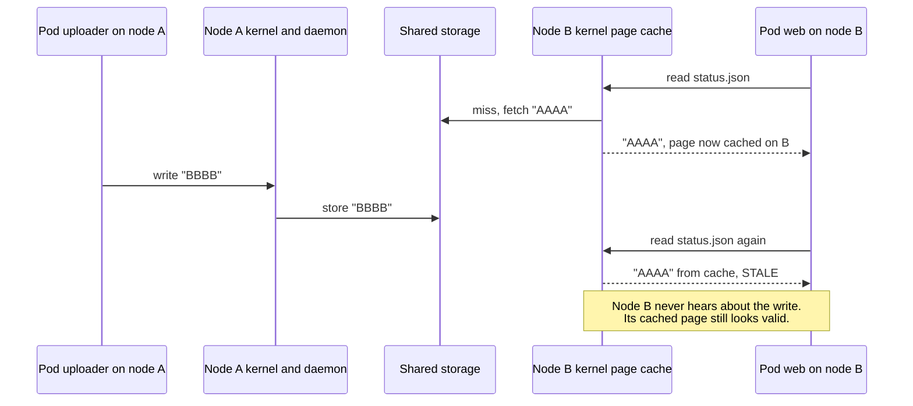
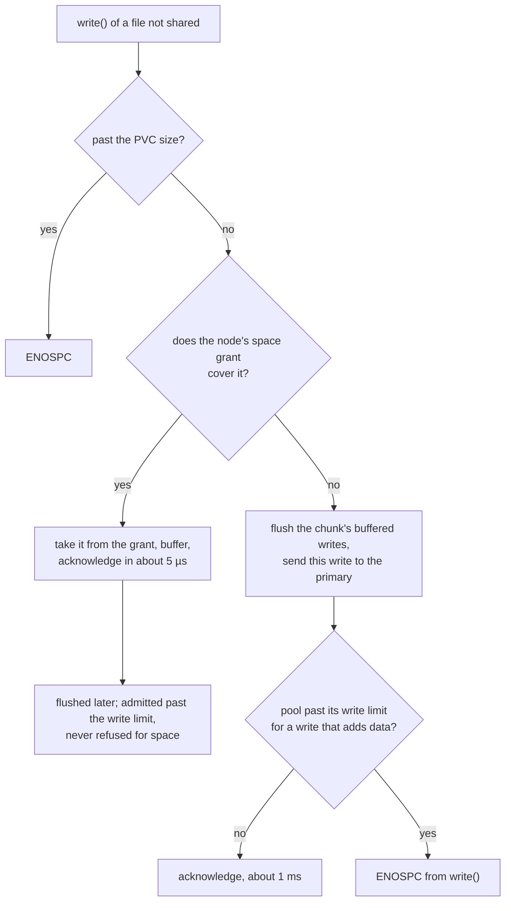
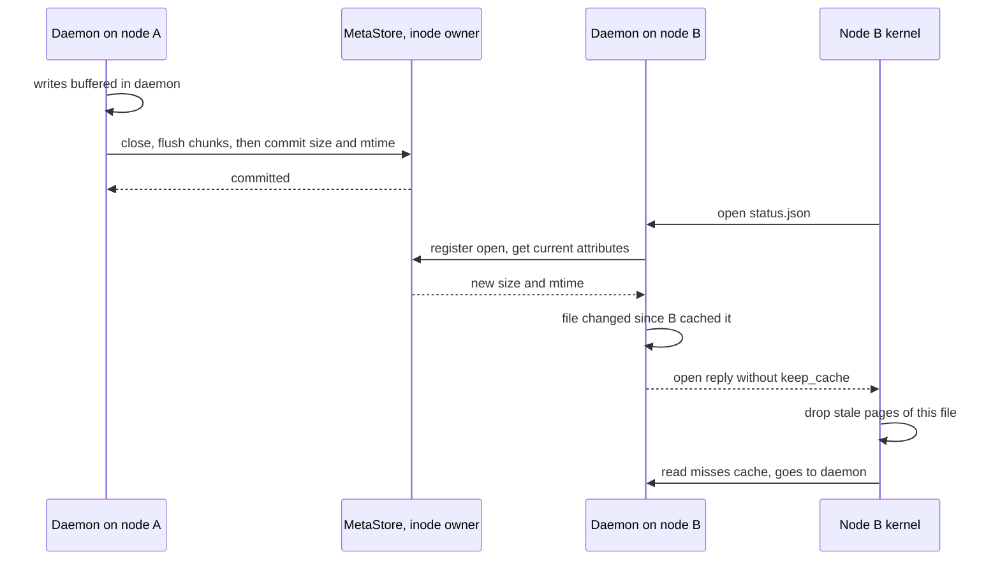
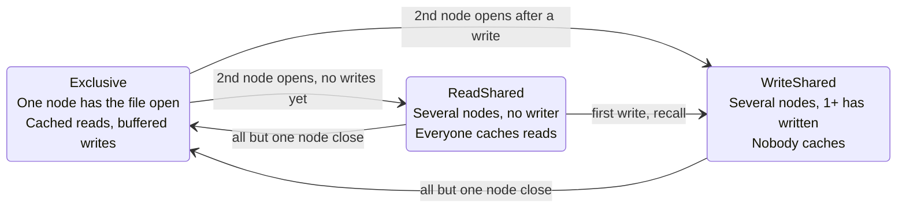
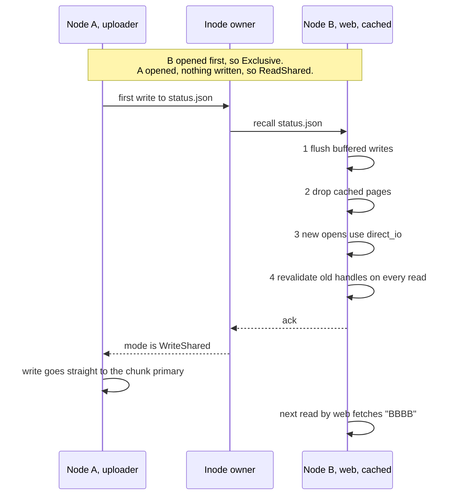
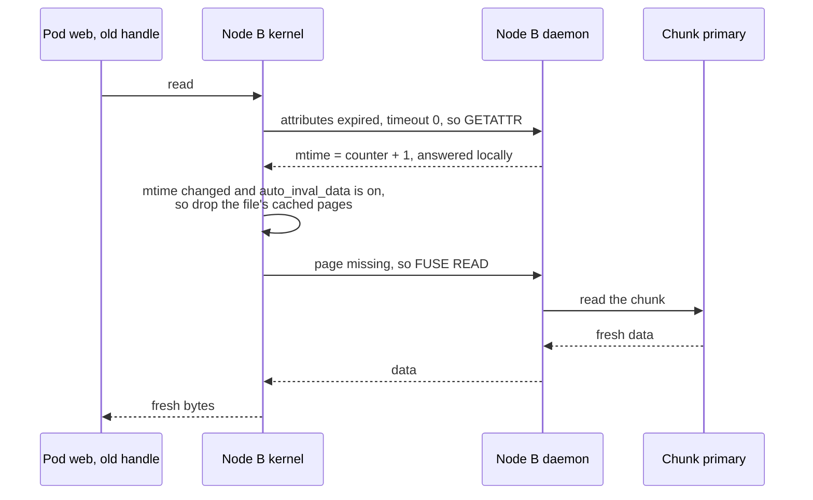
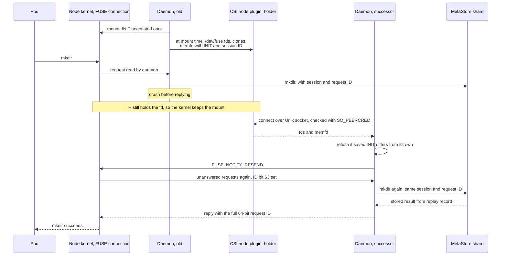

# One directory, many nodes, no gateway: rock-solid's RWX filesystem and cache coherence

A ReadWriteMany (RWX) volume, one directory mounted read-write by pods on many nodes, almost
always means an NFS server in the path: one process that every byte squeezes through, and that
every pod waits on when it fails over. rock-solid removes that server: every node's daemon is
also a FUSE client that talks to the storage nodes directly, and the kernel's page cache keeps
reads at memory speed. The hard part is that nodes caching one file can disagree about what it
contains, so rock-solid switches caching off per file, automatically, exactly while two nodes
share a file and one of them writes. Sessions, fencing and a descriptor handoff keep that correct
when nodes pause, crash or upgrade.

## Words you need

Each term is explained again where it first matters; the glossary has longer entries.

- **FUSE (Filesystem in Userspace).** A Linux mechanism that forwards a filesystem's operations
  from the kernel to an ordinary process through the device `/dev/fuse`. Here that process is
  the rock-solid daemon. See [Files and caching](../docs/glossary.md#files-and-caching).
- **Page cache.** The kernel's in-memory copy of file contents. A read that hits it never
  leaves the kernel.
- **Handle.** The open file behind a file descriptor. Each `open()` creates one.
- **Direct I/O.** Opening a file so that reads and writes skip the page cache and every one
  reaches the filesystem, here the daemon.
- **Cache coherence.** Every node's cache agrees with the latest writes. **Close-to-open
  consistency**, the guarantee NFS gives, is a weaker form: an `open` that starts after another
  node's `close` sees everything written before that close.
- **Inode and inode owner.** An inode is a file's identity: a number plus attributes such as
  size and modification time (`mtime`). The inode owner is the MetaStore node currently leading
  the shard that holds the inode; it also tracks who has the file open. See
  [Roles](../docs/glossary.md#roles-who-does-what).
- **Cache mode and recall.** The per-file state the owner tracks (Exclusive, ReadShared,
  WriteShared), and the message it sends to make other nodes stop caching a file.
- **Chunk, primary, MetaStore.** File data is stored in 4 MiB chunks, each with one primary node
  that orders its writes ([post 02](02-chunks-and-placement.md)); names, sizes and locks live in
  the replicated MetaStore ([post 08](08-the-metastore.md)).
- **Session, lease, fencing.** A session is a daemon's registration with the cluster, kept alive
  by a lease that the control plane renews on the node's heartbeat and alone declares expired.
  Fencing stops a daemon whose session expired from writing, even if it does not know yet
  ([03b](03b-leases-failure-detection-and-fencing.md#6-fencing-client-sessions)).
- **CSI (Container Storage Interface).** How Kubernetes drives a storage system; its node plugin
  mounts volumes into pods.

## The problem

### Where a read goes: FUSE and the page cache

> **In plain words.** When a program reads a file, it asks the kernel. For ext4 the kernel finds
> the bytes itself; for a filesystem written as an ordinary program, FUSE carries each request out
> of the kernel to that program and the answer back. That trip costs microseconds, so the kernel
> keeps what it fetched, the page cache, and answers repeat reads from memory, like a librarian
> handing out a photocopy instead of walking to the archive. The photocopy is only useful while
> nobody edits the original.

The picture shows the two ways one 4 KiB `read()` can end: in the page cache, or as a FUSE
request to the daemon, which fetches the data over the network.

```text
  pod process on node B:   read(fd, buf, 4096)
                                |
+------------------------------ v ---- Linux kernel --------------------------------+
|  VFS --> FUSE filesystem driver                                                   |
|              |                                                                    |
|              +-- page in page cache? --- yes --> copy 4 KiB, return (~0.3 us)     |
|              |                                                                    |
|              no                                                                   |
|              v                                                                    |
|          request queue  <------------->  /dev/fuse                                |
+--------------------------------------------|--------------------------------------+
                                             | the daemon read()s the request and
                                             | write()s the reply (~5 us per trip)
                                             v
                    rock-solid daemon on node B (user space)
                    FUSE codec --> file frontend
                         |                         |
                         v  TCP                    v  TCP
                 chunk primary for          MetaStore shard leader
                 this 4 MiB chunk           for this inode (size, mtime)
```

In the [FUSE coherence spike](../spikes/fuse-coherence/), a 4 KiB read from the page cache was
about twenty times faster than one through FUSE, with the daemon on the same machine and before
the network is even counted. That gap is why the design keeps the page cache wherever it is safe.

### Caching makes it fast, and wrong: two pods, one file

> **In plain words.** If two nodes each keep a photocopy of the same page, and one node edits
> the original, the other node keeps handing out its old copy. Nothing fails, nothing logs an
> error. The application just reads yesterday's data.

Pod `uploader` on node A and pod `web` on node B mount the same RWX volume at `/data`. `web`
has `/data/status.json` open and polls it; `uploader` rewrites the file. The coherence spike
reproduced exactly this with two FUSE mounts of one backing file standing in for two nodes.



Look at the last three arrows: node B's kernel has no reason to doubt its copy, so it never asks
anyone, and `web` serves stale data indefinitely.

The obvious fixes each break something else. Turning the page cache off everywhere makes every
read a network round trip, even for the many files only one node touches. Caching for one second
is correct only if the application tolerates a second of staleness, and a paused node can blow
past any timeout. One server in front of the files is NFS again, with its bottleneck.

The design's principle instead: *a file is cached on a node only while no other node writes it,
and correctness never depends on timeouts alone* ([Strategy](../docs/design.md#strategy)).

## The options

> **In plain words.** Real systems pick one of four answers: send everything through one server,
> accept close-to-open and let applications cope, build a full protocol of per-client cache
> permissions, or switch caching off per file only while it is actually contended.

CephFS clients hold *capabilities*, per-client rights to cache or buffer each file, granted and
revoked as access changes: the most complete answer, with its own kernel module. Weka, a
commercial GPU-cluster filesystem, bypasses the page cache for a file only while several servers
access it and one writes. NFS-Ganesha is a user-space NFS server.

| System | Clients talk to | Coherence for shared files | What else you run | Main cost |
| --- | --- | --- | --- | --- |
| NFS server, Longhorn RWX | One NFS server; one share-manager pod per volume | Close-to-open | NFS-Ganesha pod per volume | Single-server bottleneck, failover pause |
| JuiceFS | Object store and metadata engine, through FUSE | Close-to-open only | Redis, TiKV or SQL, plus an object store | Two external systems |
| CephFS | Its servers, through its own kernel module | Full client capabilities | Ceph | Around 1 ms writes, heavy CPU, RAM and operations |
| SeaweedFS | Its servers, through FUSE | No protocol for shared writes | Nothing extra | Shared writers see stale data |
| Weka | Backend directly, own kernel module | Per-file switch to uncached when write-shared | Weka cluster | Commercial, built for GPU clusters |
| rock-solid | Storage nodes directly, through FUSE in the daemon | Close-to-open (Tier 1), then the Weka-style switch (Tier 2) | One daemon per node plus a CSI driver | Metadata round trips; a round trip per I/O while write-shared |

The [alternatives table](../docs/design.md#alternatives-considered) gives the reasons: a kernel
module is unsafe to iterate on and takes the kernel down when it crashes, and the Weka-style
switch "gets most of the benefit of capabilities with three states and one message type."

## What rock-solid picked

### A FUSE client in every daemon

> **In plain words.** Every node runs the same daemon. It stores data if the node has disks, and
> it is always the filesystem client for pods on that node, talking straight to whichever nodes
> hold a file's data and metadata. There is no middleman and no per-volume server.

The difference in shape between a gateway and direct clients is easiest to see side by side.

```text
 Longhorn RWX: one NFS gateway per volume       rock-solid RWX: every node is a client

  node1     node2     node3                      node1       node2       node3
  [pod]     [pod]     [pod]                      [pod]       [pod]       [pod]
    |  NFS    |  NFS    |                          | FUSE      | FUSE      | FUSE
    +---------+---------+                        [daemon]    [daemon]    [daemon]
              |                                    |   \       /  |  \       /  |
  [share-manager pod: NFS-Ganesha]                 |    \     /   |   \     /   |
              |                                    v     v   v    v    v   v    v
  [volume replicas on several nodes]            chunk primaries and MetaStore leaders,
                                                spread over every node
  every byte crosses one pod                    each request goes to the node that owns it
```

On the right, a read of chunk 7 goes to that chunk's primary, and a `stat` to the leader of the
inode's MetaStore shard. Load spreads with the data, and no single pod's failure stops the volume.

#### How it works: the request paths

A chunk ID is computed, not looked up, so a data request needs no metadata query first
([02-chunks-and-placement.md](02-chunks-and-placement.md)). Simplified from the
[design](../docs/design.md#client-design), the paths are:

```text
Write path
FUSE write(inode, off, data)
  past the PVC size: ENOSPC
  file not shared and the space grant covers it:
                   buffer in daemon, acknowledge         // flushed later, in order
  otherwise:       flush the chunk's buffered writes first
                   chunk_id = (volume, inode, off / CHUNK_SIZE)
                   -> ChunkStore.write via the chunk primary, which merges partial blocks
                   -> acknowledge, or ENOSPC if the pool refuses it
                   -> if the write extends the file: MetaStore size = max(size, end)
any chunk write    -> first, if its index >= alloc_end:
                      MetaStore.txn([raise alloc_end, set size written so far])
close() / fsync()  -> flush buffered chunks, widened to whole blocks where the daemon has the bytes
                   -> MetaStore.txn([set size, mtime = max(last write's time, mtime + 1 ns)])
                   -> an error this handle has not seen yet, if any

Read path
cached handle:   kernel page cache -> on a miss, FUSE read -> daemon -> ChunkStore.read
uncached handle: FUSE read every time -> daemon -> ChunkStore.read via the chunk primary
both:            the daemon clamps a read to the file's size
```

"Shared" here means the WriteShared cache mode explained under Tier 2 below; the space grant and the
late error are explained [below](#a-full-pool-space-grants). `alloc_end` is a mark on the inode, one
past the highest chunk that may hold data: it tells a later delete or truncate which chunks to
remove, even after a crash. The daemon raises it in growing steps, so it costs a metadata write only
now and then, and other nodes see a large file grow while it is written. Namespace operations
(`create`, `mkdir`, `unlink`, `rename`, `setattr`) are MetaStore transactions, single-shard except a
cross-directory `rename`. The design's targets, stated as round trips:

| Operation | Target cost |
| --- | --- |
| Read of a cached file (one writer, or readers only) | Page-cache speed: no FUSE or network trip |
| Read or write of a file being written from two or more nodes | One network round trip to the chunk primary, plus the FUSE trip |
| `stat`, `lookup` after a cache miss | One round trip to the MetaStore shard leader, answered from memory under its lease ([08-the-metastore.md](08-the-metastore.md)) |
| `open` of a file | One round trip to the inode's owner (memory only, no disk write) |

**Modification time across nodes.** A file's `mtime` comes from the wall clock of the node that
wrote it: the daemon sends the time of the file's last write with its `close` or `fsync`
transaction. Wall clocks on different nodes disagree by milliseconds or more, and a time daemon can
step one back, so a file written on node A and then on node B could see its `mtime` go backwards,
which breaks `make` and `rsync`. So the transaction stores the later of that time and a hair past
the stored `mtime`, the rule CockroachDB's hybrid logical clocks use to keep timestamps from going
backwards ([clock skew study](../studies/clock-skew/README.md)). An explicit `touch -d` or `rsync
-t` stores exactly the time it is given.

### Three rules the kernel forces on the design

> **In plain words.** The project first tested what Linux lets a FUSE daemon control. Three facts
> shaped everything: the kernel's own write cache cannot be switched off for one file, so writes
> are buffered in the daemon instead; the daemon can tell the kernel to forget cached pages; and
> whether a handle uses the cache is fixed when the file is opened.

#### How it works

The three rules, each from the [FUSE coherence
spike](../docs/design.md#appendix-fuse-coherence-spike):

1. **The kernel page cache is used for reads only.** FUSE has a `writeback_cache` option that
   lets the kernel buffer writes in the page cache. rock-solid never enables it. It is a
   mount-wide switch, it hides writes from the daemon until the kernel flushes them, and it
   disables the kernel's automatic invalidation on attribute changes, the mechanism Tier 2 relies
   on for files that are already open: in the spike, a node mounted with it kept reading stale
   data.
2. **Write-back buffering lives in the daemon.** Every `write()` reaches the daemon as a FUSE
   request (about 5 µs), so the daemon always knows when a file has been written and can flush it on
   demand. While the file is not shared, the daemon buffers writes in its own memory and
   acknowledges at once, as long as its *space grant* covers them
   ([below](#a-full-pool-space-grants)). It flushes a chunk as soon as it is full, and the rest on
   `fsync`, `close`, a recall or when its fixed-size buffer fills, in whole blocks where it can
   ([below](#small-writes-truncate-and-the-end-of-file)). As with the kernel's dirty pages, a crash
   loses what has not been flushed; the [restart section](#daemon-restart-and-upgrade) shows how
   that loss is reported instead of hidden.
3. **Whether a handle is cached is decided at `open` and cannot change.** The kernel fixes a
   handle's direct-I/O flag when the file is opened. The daemon chooses it per open, from the
   file's cache mode at that moment. Handles already open with caching need other means, which
   Tier 2 supplies.

### Small writes, truncate and the end of file

> **In plain words.** Storage works in 4 KiB blocks, but programs write any number of bytes
> anywhere. Someone must fill in the rest of each block. While only one node uses a file, the
> daemon has those bytes and sends whole blocks; once several nodes write it, the chunk's primary
> fills them in, so two nodes writing different bytes of one block never erase each other. And
> every byte past a file's end is kept as zeros on disk, so growing a file never shows old data.

#### How it works: whole blocks from the daemon, merges at the primary

Without `writeback_cache`, the kernel hands the daemon each `write()` with exactly its offset and
length, so the daemon accepts any byte range. In Exclusive mode no other node can write the file,
and the bytes past its end are zero on disk (next part), so a flush widens a partial block to a
whole one whenever the daemon holds the block's other bytes or they lie past the end of file:

- a new 1.5 KiB file goes out as one 4 KiB block padded with zeros;
- after a flush the daemon keeps the file's last partial block, so a log file that appends a line
  and calls `fsync` sends its tail block whole every time; a recall drops it.

Everything else, writes to a WriteShared file and a buffer flushed under pressure into the middle
of a file this node did not write, reaches the chunk primary as a byte range, and the primary
merges it onto the newest version of the block it has ordered
([02-chunks-and-placement.md](02-chunks-and-placement.md)). That costs one random 4 KiB read at the
primary when nothing has the block in memory. SQLite's write-ahead log is an example: each frame is
a 24-byte header plus a page, so every commit's first and last blocks are partial.

#### How it works: truncate keeps the tail zero

POSIX says a file extended by a write past its end or by `truncate` upward reads zeros in the gap.
The bug that breaks this is old and keeps coming back. FreeBSD's fusefs once dropped whole cached
blocks on truncate but kept the stale tail of the final partial block, so reads returned old data.
XFS once zeroed the tail in memory but committed the new size first, so a crash in between exposed
old bytes, which a test that only reads memory could not see.

rock-solid keeps one rule instead: **once a file's purge has run, every byte past its size is zero
on disk.** A truncate commits, in one transaction, the new size, `alloc_end` lowered to the new
end, and a purge entry that starts at the new size's *byte offset*, not at a chunk boundary; then
`truncate` returns. The background purger first asks the inode's owner to drain the file: every
other node with it open flushes its buffer and answers once each write it sent under the old size
has returned, so none can land past the cut afterwards. Then the purger's first punch zeroes the
rest of the block holding the new end, by a merge at the primary, and the rest of its chunk. The
truncating daemon does not send that punch itself: it could land after the purger finished and
another node extended the file, and zero that write. Anything that extends the file over a range
with a pending purge waits for it. So growing a file again writes nothing to the gap: blocks
never written read as zeros, and the old last block's tail already is zero. Reads are clamped to
the size as well.

### A full pool: space grants

> **In plain words.** A buffered write is acknowledged before any disk has it. If the pool fills
> before the daemon flushes it, the only places left to report the failure are a later `write()`,
> `fsync` or `close`, and a program that ignores those loses data without a word. Local
> filesystems avoid this by reserving space at `write()` time. rock-solid does the same across the
> network: each node gets an allowance of pool space it may buffer against, and when the pool runs
> short the allowance shrinks, writes go straight to the storage nodes, and `write()` itself says
> "no space left".

**How it works.** ext4, XFS and Btrfs all reserve blocks before they buffer a write, so `write()`
returns `ENOSPC` and writeback never fails for space. Network clients do not: the Linux NFS client
reports a full server at the next `write()`, `fsync` or `close`, CephFS at `fsync` or `close`
after discarding what it had buffered, JuiceFS at the next `write()` or flush
([capacity and ENOSPC study](../studies/capacity-and-enospc/README.md)).

rock-solid's daemon buffers only against a **space grant**: bytes of a pool its node may hold
unflushed, counted in whole blocks, so a 100-byte append is charged a 4 KiB block per copy. The
heartbeat every node already sends the control-plane leader, the one that renews its session,
reports what the node has buffered and asks for more; the reply sets the grant. The leader keeps
a pool's grants to a fraction of what the pool can still take, so they shrink as it fills, and
shares them out evenly, so one heavy writer cannot crowd out the small ones.

The daemon reuses its grant as its flushes complete, but only a bounded amount between answered
heartbeats, and the leader keeps that bound within the room each disk has above the pool's write
limit, the disk fill past which writes that add data are refused, because a granted flush is
admitted past the limit. So what a node can write unseen is capped even when it is cut
off from the leader but not from storage. A new leader, which knows no grants, counts every live
session as holding full buffers until it hears from it.



*Near full, buffering turns into writing through, and the error arrives where programs look for it.*

A quiet node sends no extra message. The price is speed near full: a write that goes through
costs a round trip and a flush against microseconds buffered. CephFS pays the same once its pool
is nearly full, when its client makes every write synchronous. Writes
through `mmap` cannot be granted, since the kernel sends them at writeback; a refusal reaches
`msync` or `fsync`.

A flush can still fail for other reasons: the disk log has nothing left the cleaner can free, the
session was fenced, or the daemon crashed. The daemon then drops the data, as CephFS does, because
dirty data held forever would block the recalls and deletes that free space, and reports the error
once to each handle that had the file open, at its next `write()`, `fsync` or `close()`: the
kernel's rule for local filesystems, extended to `close()` as NFS does.

### Tier 1: close-to-open, flock and open-file deletion

> **In plain words.** Close-to-open is a promise about handoffs: if one node writes a file and
> closes it, the next node to open it sees everything that was written. Most shared-directory
> workloads look like that: a CI job writes a cache archive, the next job opens it. Tier 1 makes
> that promise and also handles file locks and deleting a file that someone still has open.

The sequence below is a close-to-open handoff between two nodes; look at the open on node B,
which is where stale pages are dropped.



#### How it works

- **On `open`:** the daemon registers the open with the inode's owner and gets current
  attributes. If the file changed since this node last cached it, the open is returned without
  the FUSE `keep_cache` flag, and the kernel drops the stale pages.
- **On `close` and `fsync`:** the daemon flushes buffered writes and commits size and `mtime`.
  The next open on any node sees them.
- **Metadata:** attributes and most directory entries are cached in the kernel briefly. A
  `strict` mount option turns that caching off. No timeout the daemon hands the
  kernel reaches past its session lease (see [Sessions and fencing](#sessions-and-fencing)).
- **flock and whole-file `fcntl` locks:** MetaStore keys owned by the client's session, so they
  end with the session.
- **Unlink and rename-over of open files:** if anyone still has the inode open, unlink records
  it in an orphan list in the MetaStore instead of freeing it. Once no node has it open, and only
  after any failover grace period, the owner hands it to the background purge, which deletes its
  chunks. This replaces NFS's "silly rename" to a hidden `.nfsXXXX` name; temp files and log
  rotation need it.

Tier 1 is correct for one writer per file at a time. In the two-pod example, `web` opened
`status.json` before `uploader` wrote it, and close-to-open promises nothing to such a handle:
under Tier 1 alone `web` can read the old bytes until it reopens. Tier 2 closes that gap.

### The coherence tiers

> **In plain words.** Coherence comes in tiers, each correct for a named set of workloads, so
> nobody is told it is safe for something it is not.

| Tier | What | Correct for |
| --- | --- | --- |
| 0 | RWX block: multi-attach, no daemon-side cache, fencing | KubeVirt live migration, cluster-aware apps |
| 1 | Close-to-open consistency, short attribute and directory-entry timeouts, flock, unlink and rename of open files, fencing | One writer per file at a time: media, configs, uploads, datasets, CI caches |
| 2 | Per-file cache mode switch: cache while one node holds the file or all are readers; uncached once two or more nodes share it and one has written | Concurrent writers on a file, automatically, with no tuning |
| 3 | Byte-range locks, directory caching with pushed invalidations | SQLite-style apps that lock byte ranges; large directory trees |

Tier 0 belongs to block volumes
([10-block-snapshots-and-clones.md](10-block-snapshots-and-clones.md)).

### Tier 2: the per-file cache mode switch

> **In plain words.** Each file has a referee, the inode owner, who knows which nodes have it
> open and whether any of them has written to it. While one node uses the file, or several only
> read it, everyone may cache, because no cached copy can go stale. Once a second node is
> involved and somebody writes, the referee tells every other node to throw away its copies and
> stop caching that one file, until all but one node have closed it. Nobody configures anything.

The three states and the events that move a file between them are below; caching is off only in
WriteShared.



There is no edge from WriteShared back to ReadShared: a file stays uncached until all but one
node have closed it, even after the node that wrote has closed it.

#### How it works: who decides

The inode owner is the leader of the MetaStore shard that holds the inode. The design gives it
an in-memory *open registry*: which nodes (the file's *members*) have the file open, which have
written, and the current mode.

A node counts as writing after its first write to the file, whatever flags it passed to
`open()`. A program that opens with `O_RDWR` and only reads keeps the file ReadShared. The
daemon can track this exactly because of rule 1: the kernel does no write-back, so the daemon
sees every write.

The registry is *soft state*, kept only in memory, so `open` costs one round trip and no disk
write. A planned leader transfer hands it over; after a leader crash, clients re-register their
open files during a grace period of one session lease, as in NFS version 4.

#### How it works: entering WriteShared

To enter WriteShared, the owner sends a recall to every other member and waits for every
acknowledgment, or for that member's session to expire and be fenced. The write or open that
triggered the change waits too. The two-pod example then plays out like this:



The four steps on the receiving node, and why each is needed:

1. **Flush:** write the daemon's buffered writes for the file to the ChunkStore.
2. **Drop cached pages:** `notify_inval_inode`, a FUSE notification that tells the kernel to
   forget the file's pages, in microseconds.
3. **Uncache new opens:** from now on, open the file with `direct_io`.
4. **Revalidate old handles.** A one-time drop is not enough: in the spike, an already-open
   cached handle refilled the page cache on its next read, and was stale again after the
   writer's next write. Step 3 does not help it, because its direct-I/O flag was fixed when it was
   opened.

Step 4 uses two kernel behaviors. An *attribute request* is the kernel asking the daemon for a
file's size, `mtime` and other attributes (FUSE `GETATTR`); it does so whenever its cached copy
of them has expired. `auto_inval_data` is a FUSE option, turned on at mount time, that makes the
kernel drop a file's cached pages when it sees the file's attributes, such as `mtime`, have
changed. So while the file is WriteShared, the daemon hands out its attributes with a timeout of
0 and puts a new change counter in the `mtime` field every time. Each `read()` on an old handle
then goes like this:



The attribute answer needs no network trip, only the FUSE trip. The data read then goes to the chunk
primary, like every read in this mode.

The other way in, from Exclusive, follows the same rule. If node A has written the file and node
B opens it, the owner recalls A and answers B's open, uncached, only once A has acknowledged or
been fenced, so B never reads storage before A's buffered writes reach it. If A still renews its
session but does not answer, the owner gives up on it after a recall timeout and has it fenced.

#### How it works: while WriteShared

- **Data:** every read and write goes to the chunk primary, which orders them: one network round
  trip per I/O. Two nodes writing
  different bytes of one 4 KiB block are merged there, one onto the other
  ([below](#small-writes-truncate-and-the-end-of-file)).
- **File size:** a write that extends the file updates the size in the MetaStore before it is
  acknowledged, so readers on other nodes can read past the old end of file. Writes inside the
  file don't touch the MetaStore.
- **Appends** (`O_APPEND`) from several nodes use a MetaStore compare-and-set on the size, so
  two nodes appending at once never pick the same offset.
- **mmap:** a program that maps a file into memory reads it with plain memory loads the kernel never
  revalidates, and FUSE does not tell the daemon a file is mapped. So after each write it commits,
  the writing node tells the other members' daemons, and each calls `notify_inval_inode` on its own
  kernel. Mapped readers see the write within one message delay, not instantly. A mount option makes
  each write wait for those invalidations instead. Shared-writable `mmap` across nodes stays a
  non-goal.

#### How it works: leaving WriteShared

When all but one node have closed the file, the owner returns it to Exclusive. No recall is needed,
since no other node is caching. New opens on the remaining node are cached again, and its writes are
buffered again. The `mtime` a node shows never goes backwards across the switch. A file that two
nodes touched for a minute pays the uncached price for that minute, plus any handle opened with
`direct_io` during it, which stays uncached until it is reopened.

### Sessions and fencing

> **In plain words.** Every right in this protocol (to cache, to hold a lock) assumes the node can
> be reached, but a node can freeze for twenty seconds and then carry on, still trusting its
> cache and its locks. So every right is tied to a lease that expires on its own, and when it
> expires, the cluster makes sure the node's late writes are refused *before* anyone else gets its
> rights. That last step is fencing; a timeout alone is not enough, because the paused node's own
> sense of time cannot be trusted. One referee, the control plane, keeps every node's lease, so
> the inode owners never have to agree among themselves on whether a node is gone.

The timeline below follows a node that pauses past its lease; read it left to right: the
cluster acts only after the lease has expired, and the locks are released last.

```text
time ---------------------------------------------------------------------------------->

node B daemon      heartbeat, renewed ... [ paused: frozen VM, partition, long stall ] wakes
B's lease          [================================================)
                                                          ^         ^ the leader's count
                                                          |           runs out
         B stops writing here, a small margin before its own count runs out, and no
         kernel cache timeout it handed out reaches past it

control-plane                                                         commits B's session
leader                                                                as fenced: session
                                                                      table version v
every storage node                                                      applies v, acks,
                                                                        rejects B's writes
control-plane leader                                                      every node acked:
                                                                          commits v acknowledged
inode owners                                                                release B's locks,
                                                                            opens, recalls
B wakes up         its writes are rejected -> it starts a new session and reopens its files
                   -> applications get errors, never silently stale data
```

#### How it works

Each client daemon holds one session, for its FUSE mounts and block devices alike. Its locks, open
registrations and cache rights all belong to the session. Post 03b tells the rules in full
([Fencing client sessions](03b-leases-failure-detection-and-fencing.md#6-fencing-client-sessions));
what matters for files is:

- **One referee.** Only the control-plane leader declares a session expired, on its own clocks, so
  the inode owners a node talks to never disagree about it, and an owner that fails over leaves
  sessions alone ([Who
  decides](03b-leases-failure-detection-and-fencing.md#who-decides-that-a-session-has-expired)).
- **The client stops first.** It stops writing a margin before its own count runs out, on whichever
  of its two clocks runs faster ([Two
  clocks](03b-leases-failure-detection-and-fencing.md#two-clocks-because-a-time-daemon-can-bend-either-one)),
  and no timeout it gives the kernel reaches past that instant. So a paused client's next `read()`
  asks the daemon for attributes, and the daemon, seeing its lease has lapsed, drops the file's
  pages first. A client that merely lost touch with the control plane holds its requests until a new
  leader answers, so a control-plane failover is a pause, not an error.
- **Fence, then reassign.** Every storage node rejects the fenced session's writes, including ones
  already queued, before any owner releases its locks, opens and recalls. So a write the fenced
  client got applied is ordered before every write of the next lock holder.
- **A node that answers the control plane but not an owner** is never fenced sooner than its lease
  allows, since it still trusts its cache: after a recall timeout the owner asks the control plane
  to stop renewing it.
- **A fenced client starts over** with a new session. Every call on a handle opened under the old
  one fails with `EIO`.

The same machinery serves flock (Tier 1), recalls (Tier 2), snapshot cuts and RWX block
(Tier 0). It is also why a recall can safely wait for a dead node: the wait ends with an ack or
with the node fenced, never with a guess.

### Kubernetes integration for RWX

> **In plain words.** rock-solid mounts each volume once per node, inside the daemon, and makes
> that one mount appear in every pod on the node that uses it.

The layout on one node looks like this; look at which pod holds what.

```text
one node
+------------------------------------------------------------------------------------+
|  rock-solid daemon pod (privileged)          CSI node plugin pod                   |
|   - FUSE-mounts volume V once, with           - asks the local daemon to mount V   |
|     allow_other, under the kubelet dir        - bind-mounts V into each pod        |
|   - kubelet dir mounted with                  - holds every /dev/fuse descriptor   |
|     mountPropagation: Bidirectional             of V, plus a memfd of saved state  |
|            |                                              |                        |
|            +---- Unix socket in a hostPath dir both mount +                        |
|                                                                                    |
|  app pod 1   /data  <-- bind mount of V     (no mount propagation needed)          |
|  app pod 2   /data  <-- bind mount of V                                            |
+------------------------------------------------------------------------------------+
```

#### How it works

- **CSI:** the driver advertises `ReadWriteMany` for `volumeMode: Filesystem`. Without
  `Bidirectional` propagation, which needs a privileged container, the daemon's mount would stay
  in its own mount namespace. Application pods need no propagation, since their volume is mounted
  before their containers start.
- **fsGroup:** the driver advertises the CSI `VOLUME_MOUNT_GROUP` node capability. Kubelet then
  passes the pod's `fsGroup` to the driver instead of recursively changing ownership of every
  file, which would stall mounts of large volumes.
- **Compute-only nodes** run the daemon in client-only mode (`rock-solid node -role client`): no
  disks, no shards, just FUSE.

### Daemon restart and upgrade

> **In plain words.** A FUSE mount is a phone line between the kernel and the daemon. If the
> daemon hangs up, as a crash or an upgrade does, the kernel declares the line dead and every pod
> using the mount gets "Transport endpoint is not connected" until it is remounted. rock-solid
> never lets the line drop: a second process always holds the other end, and a new daemon picks
> it up. Applications see a pause of milliseconds instead of errors.

Two terms first. *INIT* is the handshake in which the kernel and the daemon agree on settings,
once per mount. A *memfd* is an in-memory file that can be passed between processes. The
sequence shows a crash and recovery; look at the holder, which keeps the mount alive while no
daemon runs.



#### How it works

The kernel keeps a mount's whole state in the connection, so any process holding the descriptor
can serve it, and only when the *last* holder exits does the kernel abort it. So:

- **The CSI node plugin holds every descriptor, from mount time.** The daemon passes each
  `/dev/fuse` descriptor and a memfd holding the negotiated `INIT` parameters and its session ID
  over a Unix socket, and the holder hands them only to a root peer, since a descriptor is the
  whole filesystem. The kernel never renegotiates `INIT`, so a successor refuses a mount whose
  saved parameters differ from its own. The daemon keeps its own copies too, so a restart of the
  node plugin costs nothing, and the two are never upgraded on one node at the same time.
- **An upgrade drains; a crash resends.** For an upgrade, the old process stops reading requests,
  finishes those in flight, flushes its write-back buffer and hands over. After a crash, the
  successor asks the kernel to resend every request the dead process had read but not answered.
  Without the resend, those callers would block forever.
- **Replayed requests are idempotent.** In the spike, a resent `mkdir` that the dead process had
  already applied returned `EEXIST` to the application. So every mutating MetaStore request
  carries the session, mount and FUSE request ID, and the shard stores its result in a *replay
  record* in the same transaction and returns it if the request comes again.
- **A dead daemon's stray writes are fenced.** Bytes the dead process left queued on a socket can
  still reach a chunk primary after it dies. Each connection names the session and an
  *incarnation*, the daemon's start time, and a primary that has seen a newer incarnation of a
  session rejects the older one's writes.
- **Supporting rules.** FUSE node IDs are inode IDs, so a successor can rebuild what the kernel
  refers to. The daemon avoids FUSE over io_uring, which loses requests in a crash, and speaks
  `/dev/fuse` with its own codec, because no library can adopt a descriptor and ask for the resend
  ([11-runtime-in-go.md](11-runtime-in-go.md)).

What survives a restart, in one table:

| | Upgrade (drain, then hand over) | Crash (successor takes from the holder) |
| --- | --- | --- |
| The mount and pods' open files | Survive | Survive |
| Requests in flight | Finished by the old process | Resent by the kernel, deduplicated by replay records |
| Session, locks, open registrations | Resumed: the memfd names the session | Resumed the same way |
| Write-back buffer | Flushed before handover | Lost; the next `write()`, `fsync` or `close` on each affected handle fails with `EIO` |
| Kernel `INIT` parameters | Unchanged; a release that changes them needs a remount | Unchanged |

The memfd lists the handles holding unflushed data, which is how the successor knows whose next
call fails: the application keeps running after a crash and would otherwise never know.

## Evidence

Four spikes decided the shape of this frontend:

- **FUSE is enough for Tier 2.** The [FUSE coherence spike](../spikes/fuse-coherence/), two FUSE
  mounts of one file standing in for two nodes, produced every finding the Tier 2 steps answer:
  stale reads without a protocol, an old cached handle going stale again after one drop, the
  changing-`mtime` trick keeping it fresh except through `mmap`, and `writeback_cache` defeating
  that trick. None of the steps needs a kernel module.
- **A mount can outlive its daemon.** The [FUSE restart spike](../spikes/fuse-restart/) and the
  [FUSE handoff spike](../spikes/fuse-handoff/) handed descriptors between processes without a new
  `INIT`, had the kernel resend unanswered requests, and killed a daemon mid-request with a holder
  keeping the mount: no application error. Across mount namespaces the mount survived its
  daemon's namespace, which is what makes the Kubernetes layout safe.
- **Partial blocks merge at the primary, on its newest ordered version.** The
  [sub-block writes spike](../spikes/sub-block-writes/) checked every placement of the merge
  against an oracle of acknowledged bytes: only the primary merging onto the newest version it had
  ordered never lost bytes; merging onto the committed version, or in the client without
  compare-and-set, lost bytes. The
  [sub-block writes study](../studies/sub-block-writes/README.md) reads how CephFS, VitastorFS,
  JuiceFS and local filesystems handle the same cases.
- **Tier 2 has the right shape for SMB too.** The [Samba gateway spike](../spikes/samba/) found
  that SMB leases behave like cache modes and a lease break is a recall.

## Trade-offs: what is not free

- **Metadata speed is bounded by MetaStore round trips**, so small-file workloads never match a
  local disk. Every shared POSIX system pays this; Tier 3's pushed invalidations will help.
- **Small files and small appends pay a whole block.** A 1.5 KiB file takes a 4 KiB block per
  copy, and a write-shared write that covers part of a block can wait for a 4 KiB read at the
  primary.
- **Write-shared files cost a round trip per I/O** instead of 0.3 µs from the page cache, on the
  bet that write-sharing is rare in homelab workloads, and their `mtime` changes on every `stat`.
- **mmap readers lag by one message delay** unless a mount option makes each write wait for the
  invalidations, and shared-writable `mmap` across nodes is not supported.
- **A recall waits for the slowest member**, up to an unreachable node's lease and its fence.
- **An owner crash pauses new opens** for one session lease; **a daemon crash loses unflushed
  writes**, reported as `EIO` but still lost.
- **Near a full pool, writes slow down to a round trip each**, as space grants shrink.
- **The daemon container is privileged**, and the descriptor holder is sensitive: a descriptor is
  the whole filesystem.
- **FUSE parameters are frozen per mount**; changing them needs a remount.
- **SMB goes through one Samba gateway per volume**, and shares that pods on other nodes also
  write need `oplocks = no`, since a gateway's SMB leases are not tied to recalls.

## Open directions

From the [roadmap and open questions](../docs/design.md#roadmap-and-open-questions):

- **Tier 3.** Byte-range locks and directory caching with pushed invalidations.
- **FUSE over io_uring,** once the kernel requeues the requests a crash strands, and how one
  mount's `/dev/fuse` requests spread across event loops.
- **FUSE timeouts across a suspend:** the kernel counts attribute timeouts in a tick counter that
  stops while a machine is suspended, while the session lease keeps counting. Does a resumed node
  trust cached attributes, and so cached pages, briefly after its session was fenced? A spike that
  suspends a VM is to answer it.
- **Small writes:** whether header patches for fsync'd appends or short last blocks for small
  files pay off, from traces of real pods, and what the primary's base read costs on NVMe and
  SATA.
- **The grant reuse budget** is reasoned, not measured: does it hold through a simulated
  control-plane failover with streaming writers?
- **The recall timeout** is a default to tune from recall acknowledgment times measured under
  load.
- **Coherent SMB leases.** A Samba VFS module that registers the gateway's opens with the inode
  owner and turns a recall into a lease break, so shares that pods also write could keep oplocks.

## Further reading

- Design: [File frontend: RWX filesystem](../docs/design.md#file-frontend-rwx-filesystem) and
  its subsections, [Inode owner](../docs/design.md#metadata-layer-metastore),
  [Testing strategy](../docs/design.md#testing-strategy) (simulated FUSE clients and coherence
  faults).
- Spikes: [fuse-coherence](../spikes/fuse-coherence/), [fuse-restart](../spikes/fuse-restart/),
  [fuse-handoff](../spikes/fuse-handoff/), [samba](../spikes/samba/),
  [sub-block-writes](../spikes/sub-block-writes/), summarized in the appendices of design.md.
- Studies: [sub-block writes and small files](../studies/sub-block-writes/README.md),
  [pool capacity and ENOSPC](../studies/capacity-and-enospc/README.md).
- Glossary: [Files and caching](../docs/glossary.md#files-and-caching),
  [Coordination and failure](../docs/glossary.md#coordination-and-failure).
- Other posts: [03-epochs-leases-and-failures.md](03-epochs-leases-and-failures.md),
  [03b-leases-failure-detection-and-fencing.md](03b-leases-failure-detection-and-fencing.md),
  [08-the-metastore.md](08-the-metastore.md),
  [10-block-snapshots-and-clones.md](10-block-snapshots-and-clones.md).
