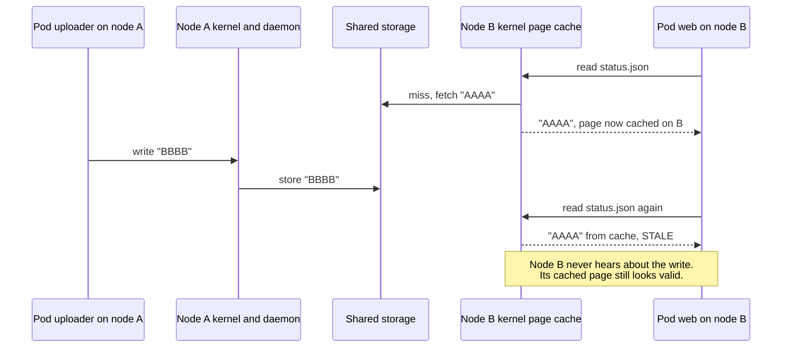
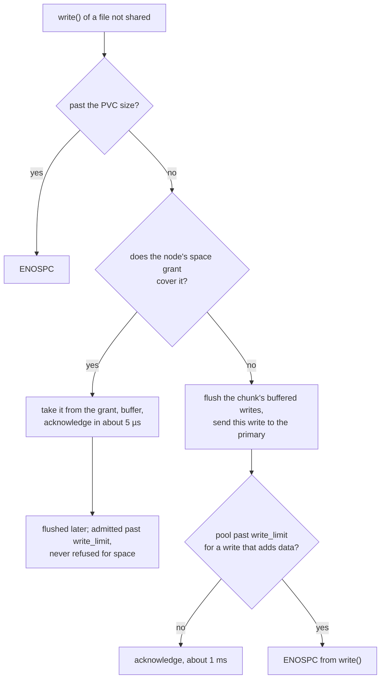
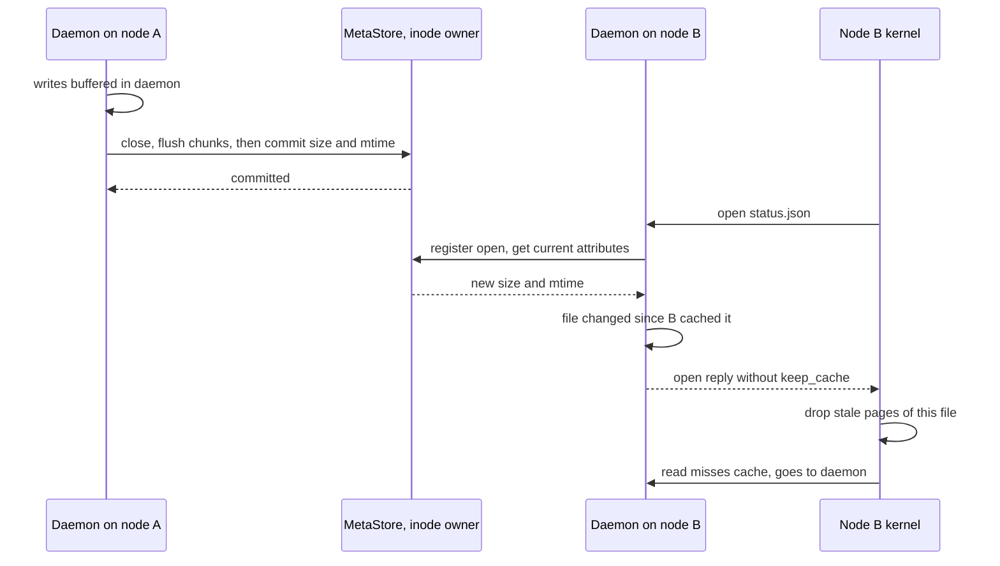
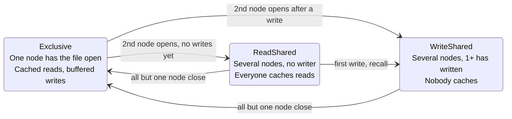
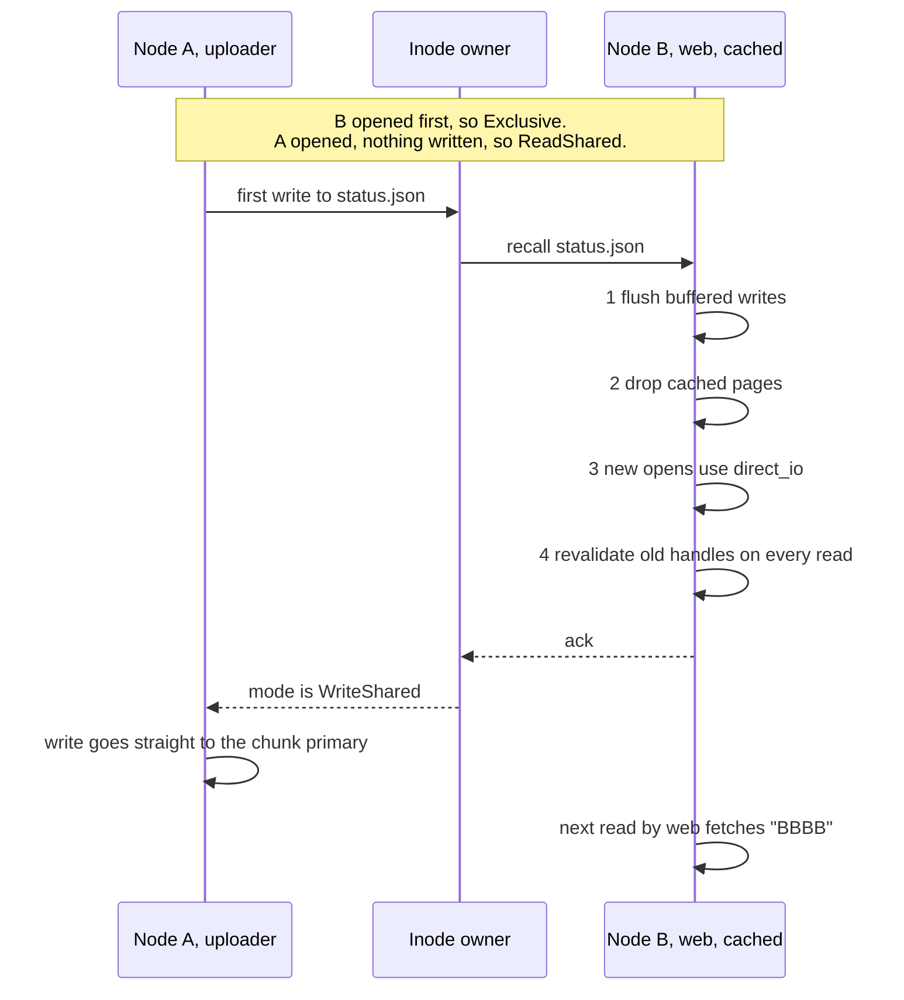
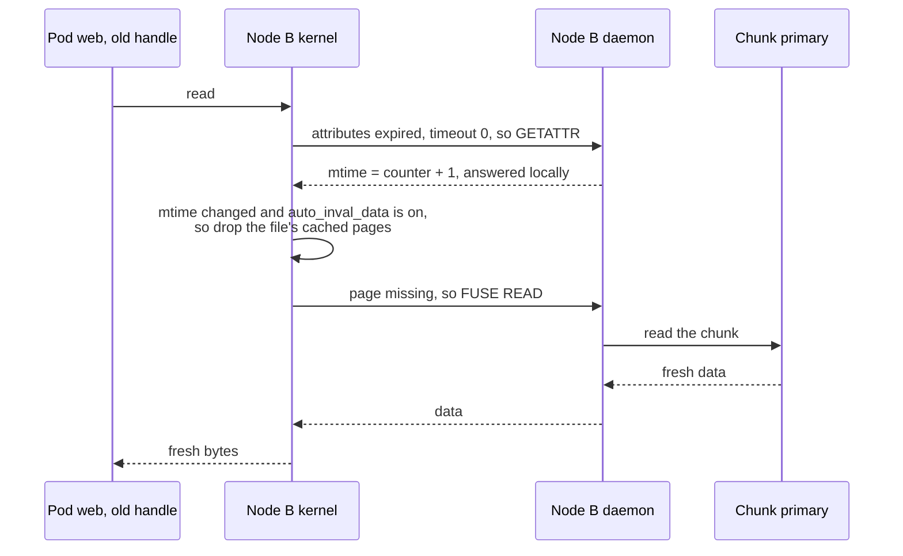
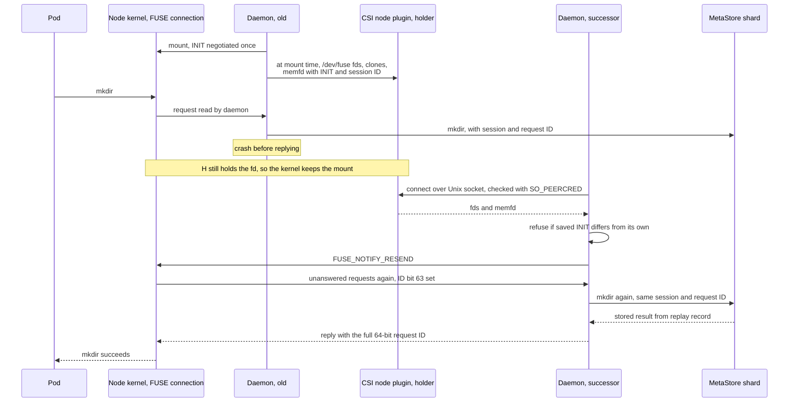

# One directory, many nodes, no gateway: rock-solid's RWX filesystem and cache coherence

A ReadWriteMany (RWX) volume, one directory mounted read-write by pods on many nodes, almost
always means an NFS server in the path: one process that every byte squeezes through, and that
every pod waits on when it fails over. rock-solid removes that server: every node's daemon is
also a FUSE client that talks to the storage nodes directly, and the kernel's page cache keeps
reads at memory speed. The hard part is that nodes caching one file can disagree about what it
contains, so rock-solid switches caching off per file, automatically, exactly while two nodes
share a file and one of them writes. Sessions, fencing and a descriptor handoff keep that correct
when nodes pause, crash or upgrade.

Nothing described here runs yet: the RWX filesystem with its first coherence tier is phase 6 of
the [roadmap](../docs/design.md#roadmap-and-open-questions), and the per-file cache mode switch
is phase 7. What exists today are the design and the spikes that test its riskiest assumptions
against real Linux kernels.

## Words you need

Each term is explained again where it first matters; the glossary has longer entries.

- **FUSE (Filesystem in Userspace).** A Linux mechanism that forwards a filesystem's operations
  from the kernel to an ordinary process through the device `/dev/fuse`. Here that process is
  the rock-solid daemon. See [Files and caching](../docs/glossary.md#files-and-caching).
- **Page cache.** The kernel's in-memory copy of file contents. A read that hits it never
  leaves the kernel.
- **Handle.** The open file behind a file descriptor. Each `open()` creates one.
- **Direct I/O.** Opening a file so that reads and writes skip the page cache and every one
  reaches the filesystem, here the daemon.
- **Cache coherence.** Every node's cache agrees with the latest writes. **Close-to-open
  consistency**, the guarantee NFS gives, is a weaker form: an `open` that starts after another
  node's `close` sees everything written before that close.
- **Inode and inode owner.** An inode is a file's identity: a number plus attributes such as
  size and modification time (`mtime`). The inode owner is the MetaStore node currently leading
  the shard that holds the inode; it also tracks who has the file open. See
  [Roles](../docs/glossary.md#roles-who-does-what).
- **Cache mode and recall.** The per-file state the owner tracks (Exclusive, ReadShared,
  WriteShared), and the message it sends to make other nodes stop caching a file.
- **Chunk and primary.** File data is stored in 4 MiB chunks; each chunk has one primary node
  that orders every write to it ([02-chunks-and-placement.md](02-chunks-and-placement.md)).
- **MetaStore.** rock-solid's replicated metadata database (names, sizes, locks), split into
  small Raft groups called shards ([08-the-metastore.md](08-the-metastore.md)).
- **Session, lease, fencing.** A session is a daemon's registration with the cluster, kept alive
  by a lease that the control plane renews on the node's heartbeat and alone declares expired.
  Fencing stops a daemon whose session expired from
  writing, even if it does not know yet
  ([03-epochs-leases-and-failures.md](03-epochs-leases-and-failures.md)).
- **CSI (Container Storage Interface).** How Kubernetes drives a storage system; its node plugin
  mounts volumes into pods.

## The problem

### Where a read goes: FUSE and the page cache

> **In plain words.** When a program reads a file, it asks the kernel. For ext4 the kernel finds
> the bytes itself; for a filesystem written as an ordinary program, FUSE carries each request out
> of the kernel to that program and the answer back. That trip costs microseconds, so the kernel
> keeps what it fetched, the page cache, and answers repeat reads from memory, like a librarian
> handing out a photocopy instead of walking to the archive. The photocopy is only useful while
> nobody edits the original.

The picture shows the two ways one 4 KiB `read()` can end: in the page cache, or as a FUSE
request to the daemon, which fetches the data over the network.

```text
  pod process on node B:   read(fd, buf, 4096)
                                |
+------------------------------ v ---- Linux kernel --------------------------------+
|  VFS --> FUSE filesystem driver                                                   |
|              |                                                                    |
|              +-- page in page cache? --- yes --> copy 4 KiB, return (~0.3 us)     |
|              |                                                                    |
|              no                                                                   |
|              v                                                                    |
|          request queue  <------------->  /dev/fuse                                |
+--------------------------------------------|--------------------------------------+
                                             | the daemon read()s the request and
                                             | write()s the reply (~5 us per trip)
                                             v
                    rock-solid daemon on node B (user space)
                    FUSE codec --> file frontend
                         |                         |
                         v  TCP                    v  TCP
                 chunk primary for          MetaStore shard leader
                 this 4 MiB chunk           for this inode (size, mtime)
```

In the [FUSE coherence spike](../docs/design.md#appendix-fuse-coherence-spike), a 4 KiB read
took 0.3 µs from the page cache and 5.4 to 6.7 µs through FUSE with direct I/O, with the daemon
on the same machine: 18 to 22 times faster before the network is even counted.

### Caching makes it fast, and wrong: two pods, one file

> **In plain words.** If two nodes each keep a photocopy of the same page, and one node edits
> the original, the other node keeps handing out its old copy. Nothing fails, nothing logs an
> error. The application just reads yesterday's data.

Pod `uploader` on node A and pod `web` on node B mount the same RWX volume at `/data`. `web`
has `/data/status.json` open and polls it; `uploader` rewrites the file. This is test T1 of the
coherence spike, which used two FUSE mounts of one backing file to stand in for two nodes; the
four-byte values are the ones it used.



Look at the last three arrows: node B's kernel has no reason to doubt its copy, so it never asks
anyone, and `web` serves stale data indefinitely.

The obvious fixes each break something else. Turning the page cache off everywhere makes every
read a network round trip, even for the many files only one node touches. Caching for one second
is correct only if the application tolerates a second of staleness, and a paused node can blow
past any timeout. One server in front of the files is NFS again, with its bottleneck.

The design's principle instead: *a file is cached on a node only while no other node writes it,
and correctness never depends on timeouts alone* ([Strategy](../docs/design.md#strategy)).

## The options

> **In plain words.** Real systems pick one of four answers: send everything through one server,
> accept close-to-open and let applications cope, build a full protocol of per-client cache
> permissions, or switch caching off per file only while it is actually contended.

- **NFS, or Longhorn's share-manager:** a pod running NFS-Ganesha (a user-space NFS server) in
  front of each volume. Familiar, close-to-open, but every byte goes through one pod: a
  bottleneck, and a failover pause when that pod moves.
- **JuiceFS:** FUSE clients that use an object store for data and an external metadata engine
  (Redis, TiKV or SQL). No gateway, but close-to-open only and two systems to operate.
- **CephFS:** clients hold *capabilities*, per-client rights to cache or buffer each file,
  granted and revoked as access changes. The most complete answer, with its own kernel module,
  at around 1 ms per write and heavy CPU, RAM and operations.
- **SeaweedFS:** a single binary with a FUSE mount, built around objects, with no coherence
  protocol for shared writes.
- **Weka:** a commercial GPU-cluster filesystem with its own kernel module. Its key idea: cache
  in the page cache by default, and when several servers access a file and at least one writes,
  bypass the page cache for that file. (DAOS, by contrast, leaves caching to the user.)

| System | Clients talk to | Coherence for shared files | What else you run | Main cost |
| --- | --- | --- | --- | --- |
| NFS server, Longhorn RWX | One NFS server; one share-manager pod per volume | Close-to-open | NFS-Ganesha pod per volume | Single-server bottleneck, failover pause |
| JuiceFS | Object store and metadata engine, through FUSE | Close-to-open only | Redis, TiKV or SQL, plus an object store | Two external systems |
| CephFS | Its servers, through its own kernel module | Full client capabilities | Ceph | Around 1 ms writes, heavy CPU, RAM and operations |
| SeaweedFS | Its servers, through FUSE | No protocol for shared writes | Nothing extra | Shared writers see stale data |
| Weka | Backend directly, own kernel module | Per-file switch to uncached when write-shared | Weka cluster | Commercial, built for GPU clusters |
| rock-solid | Storage nodes directly, through FUSE in the daemon | Close-to-open (Tier 1), then the Weka-style switch (Tier 2) | One daemon per node plus a CSI driver | Metadata round trips; a round trip per I/O while write-shared |

The [alternatives table](../docs/design.md#alternatives-considered) gives the reasons: a kernel
module is unsafe to iterate on and takes the kernel down when it crashes, and the Weka-style
switch "gets most of the benefit of capabilities with three states and one message type."

## What rock-solid picked

### A FUSE client in every daemon

> **In plain words.** Every node runs the same daemon. It stores data if the node has disks, and
> it is always the filesystem client for pods on that node, talking straight to whichever nodes
> hold a file's data and metadata. There is no middleman and no per-volume server.

The difference in shape between a gateway and direct clients is easiest to see side by side.

```text
 Longhorn RWX: one NFS gateway per volume       rock-solid RWX: every node is a client

  node1     node2     node3                      node1       node2       node3
  [pod]     [pod]     [pod]                      [pod]       [pod]       [pod]
    |  NFS    |  NFS    |                          | FUSE      | FUSE      | FUSE
    +---------+---------+                        [daemon]    [daemon]    [daemon]
              |                                    |   \       /  |  \       /  |
  [share-manager pod: NFS-Ganesha]                 |    \     /   |   \     /   |
              |                                    v     v   v    v    v   v    v
  [volume replicas on several nodes]            chunk primaries and MetaStore leaders,
                                                spread over every node
  every byte crosses one pod                    each request goes to the node that owns it
```

On the right, a read of chunk 7 goes to that chunk's primary, and a `stat` to the leader of the
inode's MetaStore shard. Load spreads with the data, and no single pod's failure stops the volume.

#### How it works: the request paths

A chunk ID is computed, not looked up, so a data request needs no metadata query first
([02-chunks-and-placement.md](02-chunks-and-placement.md)). Simplified from the
[design](../docs/design.md#client-design), the paths are:

```text
Write path
FUSE write(inode, off, data)
  past the PVC size: ENOSPC
  file not shared and the space grant covers it:
                   buffer in daemon, acknowledge         // flushed later, in order
  otherwise:       flush the chunk's buffered writes first
                   chunk_id = (volume, inode, off / CHUNK_SIZE)
                   -> ChunkStore.write via the chunk primary, which merges partial blocks
                   -> acknowledge, or ENOSPC if the pool refuses it
                   -> if the write extends the file: MetaStore size = max(size, end)
any chunk write    -> first, if its index >= alloc_end:
                      MetaStore.txn([raise alloc_end, set size written so far])
close() / fsync()  -> flush buffered chunks, widened to whole blocks where the daemon has the bytes
                   -> MetaStore.txn([set size, mtime = max(last write's time, mtime + 1 ns)])
                   -> an error this handle has not seen yet, if any

Read path
cached handle:   kernel page cache -> on a miss, FUSE read -> daemon -> ChunkStore.read
uncached handle: FUSE read every time -> daemon -> ChunkStore.read via the chunk primary
both:            the daemon clamps a read to the file's size
```

"Shared" here means the WriteShared cache mode explained under Tier 2 below; the space grant and
the late error are explained [below](#a-full-pool-space-grants). `alloc_end` is a mark on the
inode, one past the highest chunk that may hold data: it tells a later delete or truncate which
chunks to remove, even after a crash, and since the daemon raises it in steps that double up to 16
chunks, other nodes see a large file grow while it is written, at most 64 MiB behind. Namespace
operations (`create`, `mkdir`, `unlink`, `rename`, `setattr`) are MetaStore transactions,
single-shard except a cross-directory `rename`. The design's targets, stated as round trips:

| Operation | Target cost |
| --- | --- |
| Read of a cached file (one writer, or readers only) | Page-cache speed: no FUSE or network trip (0.3 µs per 4K measured) |
| Read or write of a file being written from two or more nodes | One network round trip to the chunk primary, plus about 5 to 20 µs of FUSE overhead |
| `stat`, `lookup` after a cache miss | One round trip to the MetaStore shard leader, answered from memory under its lease ([08-the-metastore.md](08-the-metastore.md)) |
| `open` of a file | One round trip to the inode's owner (memory only, no disk write) |

**Modification time across nodes.** A file's `mtime` comes from the wall clock of the node that
wrote it: the daemon sends the time of the file's last write with its `close` or `fsync`
transaction. Wall clocks on different nodes disagree by milliseconds or more, and a time daemon can
step one back, so a file written on node A and then on node B could see its `mtime` go backwards,
which breaks `make` and `rsync`. So the transaction stores the later of that time and the stored
`mtime` plus 1 ns, the rule CockroachDB's hybrid logical clocks use to keep timestamps from going
backwards ([clock skew study](../studies/clock-skew/README.md)). An explicit `utimensat`, as
`touch -d` or `rsync -t` call, stores exactly the time it is given.

### Three rules the kernel forces on the design

> **In plain words.** The project first tested what Linux lets a FUSE daemon control. Three facts
> shaped everything: the kernel's own write cache cannot be switched off for one file, so writes
> are buffered in the daemon instead; the daemon can tell the kernel to forget cached pages; and
> whether a handle uses the cache is fixed when the file is opened. Buffering in the daemon is
> safe while nobody else uses a file: no one can see an unflushed write, so the daemon says
> "done" at once and sends writes in big batches later, as the kernel does for local disks.

#### How it works

The three rules, each from the [FUSE coherence spike](../docs/design.md#appendix-fuse-coherence-spike):

1. **The kernel page cache is used for reads only.** FUSE has a `writeback_cache` option that
   lets the kernel buffer writes in the page cache. rock-solid never enables it. It is a
   mount-wide switch, it hides writes from the daemon until the kernel flushes them, and it
   disables the kernel's automatic invalidation on attribute changes, the mechanism Tier 2 relies
   on for files that are already open. In spike test T9, on a node mounted with it, that switch
   (`auto_inval_data`) had no effect, so the node kept reading stale data.
2. **Write-back buffering lives in the daemon.** Every `write()` reaches the daemon as a FUSE
   request (about 5 µs), so the daemon always knows when a file has been written and can flush it
   on demand. While the file is not shared, the daemon buffers writes in its own memory and
   acknowledges at once, as long as its *space grant* covers them ([below](#a-full-pool-space-grants)).
   It flushes a chunk as soon as it is full, and the rest on `fsync`,
   `close` or a recall, in whole blocks where it can
   ([below](#small-writes-truncate-and-the-end-of-file)). The buffer holds up to 256 MiB per node (`writeback_buffer`); when it is
   full, the oldest partial chunk is flushed. As with the kernel's dirty pages, a crash loses
   what has not been flushed; the [restart section](#daemon-restart-and-upgrade) shows how that
   loss is reported instead of hidden.
3. **Whether a handle is cached is decided at `open` and cannot change.** The kernel fixes a
   handle's direct-I/O flag when the file is opened. The daemon chooses it per open, from the
   file's cache mode at that moment. Handles already open with caching need other means, which
   Tier 2 supplies.

### Small writes, truncate and the end of file

> **In plain words.** Storage works in 4 KiB blocks, but programs write any number of bytes
> anywhere: a 100-byte log line, a 1.5 KiB config file, a truncate to an odd size. Someone must
> fill in the rest of each block. While only one node uses a file, the daemon has those bytes in
> its buffer and sends whole blocks. Once several nodes write it, the chunk's primary fills them
> in, so two nodes writing different bytes of one block never erase each other. And every byte
> past a file's end is kept as zeros on disk, so growing a file never shows old data.

#### How it works: whole blocks from the daemon, merges at the primary

Without `writeback_cache`, the kernel hands the daemon each `write()` with exactly its offset and
length (`fuse_perform_write` in `fs/fuse/file.c`), and direct I/O unaligned too, so the daemon
accepts any byte range. In Exclusive mode no other node can write the file, and the bytes past
its end are zero on disk (next part), so a flush widens a partial block to a whole one whenever
the daemon holds the block's other bytes or they lie past the end of file:

- a new 1.5 KiB file goes out as one 4 KiB block padded with zeros;
- after a flush the daemon keeps the file's last partial block, so a log file that appends a line
  and calls `fsync` sends its tail block whole every time; a recall drops it.

Everything else, writes to a WriteShared file and a buffer flushed under pressure into the middle
of a file this node did not write, reaches the chunk primary as a byte range, and the primary
merges it onto the newest version of the block it has ordered
([02-chunks-and-placement.md](02-chunks-and-placement.md)). That costs one random 4 KiB read at the
primary when nothing has the block in memory. SQLite's write-ahead log is an example: each frame is
a 24-byte header plus a page, so every commit's first and last blocks are partial.

#### How it works: truncate keeps the tail zero

POSIX says a file extended by a write past its end or by `truncate` upward reads zeros in the gap.
The bug that breaks this is old and keeps coming back. FreeBSD's fusefs dropped whole cached
blocks on truncate but kept the stale tail of the final partial block, so reads returned old data
(commit `e312493b`, 2019, found by `fsx`). XFS zeroed the tail in memory but committed the new size
first, so a crash in between exposed old bytes, which `fsx` could not see because memory was
right (commit `5885ebda`, 2015).

rock-solid keeps one rule instead: **once a file's purge has run, every byte past its size is zero
on disk.** A truncate commits, in one transaction, the new size, `alloc_end` lowered to the new
end, and a purge entry that starts at the new size's *byte offset*, not at a chunk boundary. A
file has at most one pending purge entry, so a truncate followed by an unlink before the purger
gets to it merges the two ranges instead of losing the first. The purge's first punch zeroes the rest of the block
holding the new end, by a merge at the primary, and the rest of its chunk; the daemon runs it
before `truncate` returns, and the purger runs it again if a crash came first. Any extension
finishes a pending purge before it writes. So growing a file again writes nothing to the gap:
blocks never written read as zeros, and the old last block's tail already is zero. Reads are
clamped to the size as well.

The kernel helps: it clamps writeback of a mapped page to the file's size, and drops cached pages
when a `setattr` changes the size (`fs/fuse/dir.c`). Whether an extending `write()` leaves a page
the program dirtied past the old end of file through a mapping in the cache is not tested yet;
`fsx -e` does exactly that, and the daemon, which sees every extending write, can invalidate that
one page if it must.

### A full pool: space grants

> **In plain words.** A buffered write is acknowledged before any disk has it. If the pool fills
> before the daemon flushes it, the only places left to report the failure are a later `write()`,
> `fsync` or `close`, and a program that ignores those loses data without a word. Local
> filesystems avoid this by reserving space at `write()` time. rock-solid does the same across the
> network: each node gets an allowance of pool space it may buffer against, and when the pool runs
> short the allowance shrinks, writes go straight to the storage nodes, and `write()` itself says
> "no space left".

**How it works.** ext4, XFS and Btrfs all reserve blocks before they buffer a write
(`ext4_da_reserve_space`, `xfs_dec_freecounter`, `btrfs_delalloc_reserve_space`), so `write()`
returns `ENOSPC` and writeback never fails for space. Network clients do not: the Linux NFS client
reports a full server at the next `write()`, `fsync` or `close`, CephFS at `fsync` or `close`
after discarding what it had buffered, JuiceFS at the next `write()` or flush
([capacity and ENOSPC study](../studies/capacity-and-enospc/README.md)).

rock-solid's daemon buffers only against a **space grant**: bytes of a pool its node may hold
unflushed, counted in whole blocks written, so a 100-byte append is charged a 4 KiB block per
copy. The heartbeat every node already sends the control-plane leader each second, the one
that renews its session, reports what the node has buffered and a running total of what it has
flushed, and asks for what it would buffer in the next second; the reply sets the grant, at most
the 256 MiB buffer. The leader keeps a pool's grants at most half of what the pool can still take,
so they shrink as it fills, and when nodes ask for more than that it shares it out evenly, up to
a common level, so one heavy writer cannot crowd out the small ones.

The daemon reuses its grant as flushes complete, but only for two grants' worth of flushes since
its last answered heartbeat; once it has used half of that, it sends its heartbeat early, so a
busy node rarely runs out. Whatever happens to heartbeats or to the control plane, a node can then
write at most three grants unseen, and the leader keeps three times the grants within the
smallest gap any of the pool's disks has between `write_limit` and its log's reserve, because a
granted flush is admitted past the limit and one node's buffer can land on a single disk. Without
that budget, a node cut off from the leader but not from storage could keep flushing for a whole
10-second session lease, 11 GB onto each disk of a three-node pool. A new leader counts every live
session as holding three full buffers until it renews:



*Near full, buffering turns into writing through, and the error arrives where programs look for it.*

A quiet node sends no extra message, only a few bytes per pool on each heartbeat; a node
streaming at 10 GbE sends about four more heartbeats a second, and at 100 GbE about 41, each a
memory update at the leader. At 10 nodes the grants add up to 2.5 GiB, and the leader budgets three times that, 7.5 GiB, for what can land unseen. The price is speed near full: a write that goes through costs a round
trip and a flush, about 1 ms on NVMe, against 5 µs buffered. CephFS pays the same once its pool is
nearly full, when its client makes every write synchronous. Writes through `mmap` cannot be
granted, since the kernel sends them at writeback; a refusal reaches `msync` or `fsync`.

A flush can still fail for other reasons: the disk log has nothing left the cleaner can free, the
session was fenced, or the daemon crashed. The daemon then drops the data, as CephFS does, because
dirty data held forever would block the recalls and deletes that free space, and reports the error
once to each handle that had the file open, at that handle's next `write()`, `fsync` or `close()`:
`ENOSPC` for space, `EIO` otherwise.
That is the kernel's `errseq_t` rule for local filesystems, where each open file sees a writeback
error once at `fsync`, extended to `close()` as NFS does; FUSE sends a `FUSE_FLUSH` on every
`close()` and returns the daemon's answer.

### Tier 1: close-to-open, flock and open-file deletion

> **In plain words.** Close-to-open is a promise about handoffs: if one node writes a file and
> closes it, the next node to open it sees everything that was written. Most shared-directory
> workloads look like that: a CI job writes a cache archive, the next job opens it. Tier 1 makes
> that promise and also handles file locks and deleting a file that someone still has open.

The sequence below is a close-to-open handoff between two nodes; look at the open on node B,
which is where stale pages are dropped.



#### How it works

- **On `open`:** the daemon registers the open with the inode's owner and gets current
  attributes. If the file changed since this node last cached it, the open is returned without
  the FUSE `keep_cache` flag, and the kernel drops the stale pages (spike test T6).
- **On `close` and `fsync`:** the daemon flushes buffered writes and commits size and `mtime`.
  The next open on any node sees them.
- **Metadata:** attributes and directory entries are cached in the kernel for 1 second by
  default. A `strict` mount option sets the timeouts to 0. No timeout the daemon hands the
  kernel reaches past its session lease (see [Sessions and fencing](#sessions-and-fencing)).
- **flock and whole-file `fcntl` locks:** MetaStore keys owned by the client's session, so they
  end with the session.
- **Unlink and rename-over of open files:** if anyone still has the inode open, unlink records
  it in an orphan list in the MetaStore instead of freeing it. Once no node has it open, and only
  after any failover grace period, the owner hands it to the background purge, which deletes its
  chunks. This replaces NFS's "silly rename" to a hidden `.nfsXXXX` name; temp files and log
  rotation need it.

Tier 1 is correct for one writer per file at a time. In the two-pod example, `web` opened
`status.json` before `uploader` wrote it, and close-to-open promises nothing to such a handle:
under Tier 1 alone `web` can read the old bytes until it reopens. Tier 2 closes that gap.

### The coherence tiers

> **In plain words.** Coherence ships in steps, each a usable release that is correct for a named
> set of workloads, so nobody is told it is safe for something it is not.

| Tier | What | Correct for | Effort |
| --- | --- | --- | --- |
| 0 | RWX block: multi-attach, no daemon-side cache, fencing | KubeVirt live migration, cluster-aware apps | Small |
| 1 | Close-to-open consistency, short attribute and directory-entry timeouts, flock, unlink and rename of open files, fencing | One writer per file at a time: media, configs, uploads, datasets, CI caches | Medium |
| 2 | Per-file cache mode switch: cache while one node holds the file or all are readers; uncached once two or more nodes share it and one has written | Concurrent writers on a file, automatically, with no tuning | Medium |
| 3 | Byte-range locks, directory caching with pushed invalidations | SQLite-style apps that lock byte ranges; large directory trees | Large |

Tier 0 belongs to block volumes ([10-block-snapshots-and-clones.md](10-block-snapshots-and-clones.md)).
The roadmap order is Tier 1 in phase 6, Tier 2 in phase 7, RWX block (Tier 0) in phase 8 and
Tier 3 in phase 13.

### Tier 2: the per-file cache mode switch

> **In plain words.** Each file has a referee, the inode owner, who knows which nodes have it
> open and whether any of them has written to it. While only one node uses the file, or several
> nodes only read it, everyone may cache, because no cached copy can go stale. The moment a
> second node is involved and somebody writes, the referee tells every other node to throw away
> its copies and stop caching that one file. Throwing the copies away once isn't enough, though:
> a program that already has the file open keeps refilling its copy, and Linux has no way to stop
> caching for a file that is already open. So the daemon makes the file look changed every time
> the kernel checks, and the kernel then fetches fresh data on every read. When all but one node
> have closed the file, caching comes back. Nobody configures anything: the switch follows how
> the file is actually used.

The three states and the events that move a file between them are below; caching is off only in
WriteShared.



There is no edge from WriteShared back to ReadShared: a file stays uncached until all but one
node have closed it, even after the node that wrote has closed it.

#### How it works: who decides

The inode owner is the leader of the MetaStore shard that holds the inode. The design gives it
an in-memory *open registry*: which nodes (the file's *members*) have the file open, which have
written, and the current mode.

```go
// Exclusive: one node; it caches reads and the daemon buffers its writes.
// ReadShared: several nodes, none has written; everyone caches reads.
// WriteShared: several nodes, one or more has written; nobody caches.
type CacheMode struct {
	Kind    ModeKind
	Members []ClientID
}
```

A node counts as writing after its first write to the file, whatever flags it passed to
`open()`. A program that opens with `O_RDWR` and only reads keeps the file ReadShared. The
daemon can track this exactly because of rule 1: the kernel does no write-back, so the daemon
sees every write.

The registry is *soft state*, kept only in memory, so `open` costs one round trip and no disk
write. A planned leader transfer hands it over; after a leader crash, clients re-register their
open files during a grace period of one session lease, as in NFS version 4.

#### How it works: entering WriteShared

To enter WriteShared, the owner sends a recall to every other member and waits for every
acknowledgment, or for that member's session to expire and be fenced. The write or open that
triggered the change waits too. The two-pod example then plays out like this:



The four steps on the receiving node, and why each is needed:

1. **Flush:** write the daemon's buffered writes for the file to the ChunkStore.
2. **Drop cached pages:** `notify_inval_inode`, a FUSE notification that tells the kernel to
   forget the file's pages; 2 to 25 µs in spike test T2.
3. **Uncache new opens:** from now on, open the file with `direct_io`.
4. **Revalidate old handles.** A one-time drop is not enough: in spike test T3, an already-open
   cached handle refilled the page cache on its next read, and was stale again after the
   writer's next write. Step 3 does not help it, because its direct-I/O flag was fixed when it was
   opened (T4).

Step 4 uses two kernel behaviors. An *attribute request* is the kernel asking the daemon for a
file's size, `mtime` and other attributes (FUSE `GETATTR`); it does so whenever its cached copy
of them has expired. `auto_inval_data` is a FUSE option, turned on at mount time, that makes the
kernel drop a file's cached pages when it sees the file's attributes, such as `mtime`, have
changed. So while the file is WriteShared, the daemon hands out its attributes with a timeout of
0 and puts a new change counter in the `mtime` field every time. Each `read()` on an old handle
then goes like this:



The attribute answer needs no network trip; in spike T5c it cost about 15 µs per read with a
local daemon. The data read then goes to the chunk primary, like every read in this mode.

The other way into WriteShared, from Exclusive, follows the same rule: the owner recalls every
other member. If node A has written the file and node B opens it, the owner recalls A; A flushes
its buffered writes and drops its pages. The owner answers B's open, uncached, only once A has
acknowledged or been fenced, so B never reads storage before A's buffered writes reach it. If A
is unreachable, B's open waits up to A's session lease plus the time to fence A's session; if A
still renews its session but does not answer, it waits up to `recall_timeout` instead.

#### How it works: while WriteShared

- **Data:** every read and write goes to the chunk primary, which orders them: one network round
  trip per I/O, tens of microseconds on 10 Gigabit Ethernet with kernel TCP. Two nodes writing
  different bytes of one 4 KiB block are merged there, one onto the other
  ([below](#small-writes-truncate-and-the-end-of-file)).
- **File size:** a write that extends the file updates the size in the MetaStore before it is
  acknowledged, so readers on other nodes can read past the old end of file. Writes inside the
  file don't touch the MetaStore.
- **Appends** (`O_APPEND`) from several nodes use a MetaStore compare-and-set on the size, so
  two nodes appending at once never pick the same offset.
- **mmap:** a program that maps a file into memory reads it with plain memory loads the kernel
  never revalidates (spike T5b), and FUSE does not tell the daemon a file is mapped. So after
  each write it commits, the writing node tells the other members' daemons, and each calls
  `notify_inval_inode` on its own kernel. Mapped readers see the write within one message delay,
  not instantly. The `mmap_sync` mount option, off by default, makes each write wait for those
  invalidations. Shared-writable `mmap` across nodes stays a non-goal.

#### How it works: leaving WriteShared

When all but one node have closed the file, the owner returns it to Exclusive. No recall is
needed, since no other node is caching. New opens on the remaining node are cached again, and its
writes are buffered again. A file that two nodes touched for a minute pays the uncached price for
that minute, plus any handle opened with `direct_io` during it, which stays uncached until it is
reopened.

### Sessions and fencing

> **In plain words.** Every right in this protocol (to cache, to hold a lock) assumes the node can
> be reached, but a node can freeze for twenty seconds and then carry on, still trusting its
> cache and its locks. So every right is tied to a lease that expires on its own, and when it
> expires, the cluster makes sure the node's late writes are refused *before* anyone else gets its
> rights. That last step is fencing; a timeout alone is not enough, because the paused node's own
> sense of time cannot be trusted. One referee, the control plane, keeps every node's lease, so
> the inode owners never have to agree among themselves on whether a node is gone.

The timeline below follows a node that pauses past its lease; read it left to right: the
cluster acts only after the lease has expired, and the locks are released last.

```text
time ---------------------------------------------------------------------------------->

node B daemon      heartbeat, renewed ... [ paused: frozen VM, partition, long stall ] wakes
B's lease (10 s)   [================================================)
                                                          ^         ^ the leader's count
                                                          |           runs out
         B stops writing here, lease_drift before its own count runs out, and no
         kernel cache timeout it handed out reaches past it

control-plane                                                         commits B's session
leader                                                                as fenced: session
                                                                      table version v
every storage node                                                      applies v, acks,
                                                                        rejects B's writes
control-plane leader                                                      every node acked:
                                                                          commits v acknowledged
inode owners                                                                release B's locks,
                                                                            opens, recalls
B wakes up         its writes are rejected -> it starts a new session and reopens its files
                   -> applications get errors, never silently stale data
```

#### How it works

Each client daemon holds one session, for its FUSE mounts and block devices alike, with a lease
of 10 s by default (`session_lease`). Its locks, open registrations and cache rights all belong
to the session.

- **The control plane keeps the lease.** The session is a key in the control-plane group, and
  its lease is renewed by the heartbeat each node already sends the control-plane leader once a
  second; renewals change only the leader's memory. Only that leader declares a session expired,
  on its own clocks, so the inode owners a node talks to never disagree about it, and an owner
  that fails over leaves sessions alone. Only a leader that holds its own leader lease answers
  renewals. A new leader gives every live session a full lease before it expires any, and a
  leader whose event loop fell behind restarts every session's timer rather than expire sessions
  it could not hear ([03-epochs-leases-and-failures.md](03-epochs-leases-and-failures.md#who-decides-that-a-session-has-expired)).
- **The client limits itself.** It counts its lease from when it sent the last answered
  heartbeat, which is before the leader counted it, and stops writing `lease_drift` early on
  whichever of its two clocks runs faster, with the margin widened if the leader's clock has been
  measured running fast (a freshly started daemon takes that measurement from two renewals 100 ms
  apart, so it holds its writes about 100 ms longer), or at once when it learns its machine was suspended,
  restored from a snapshot or migrated ([03-epochs-leases-and-failures.md](03-epochs-leases-and-failures.md#two-clocks-because-a-time-daemon-can-bend-either-one)).
  No timeout it gives the kernel reaches past that instant. So when the lease ends, a paused
  client's next `read()` asks the daemon for attributes, and the daemon, seeing its lease has
  lapsed, drops the file's pages first. Mapped pages are the exception: they stay stale until the
  daemon runs again and invalidates every cached inode. A client that merely lost touch with the
  control plane holds its requests until a new leader answers, so a control-plane failover is a
  pause, not an error.
- **The cluster fences before it reassigns.** The leader commits every session due at that moment
  as fenced in one new version of the *session table*, which is published like the placement
  table. Every storage node applies it, acknowledges it, and from then on rejects writes carrying
  a fenced session's ID, including ones already queued. Only once every storage node has
  acknowledged, or has been marked down in a committed placement table, does the leader commit
  the version as acknowledged, and only then do owners release the session's rights; a down node
  comes back only once its heartbeat reports the current version. So a write the fenced client got
  applied is ordered before every write of the next lock holder. Fences due at the same moment
  share one version, so a switch failure that strands many nodes costs one round.
- **A node that answers the control plane but not an owner.** Its session stays alive, so a
  recall to it could wait forever. After `recall_timeout` (30 s by default, a value still to be
  tuned) the owner asks the control plane to fence it, which ends the wait the same way as an
  expiry.

The same machinery serves flock (Tier 1), recalls (Tier 2), snapshot cuts and RWX block
(Tier 0). It is also why a recall can safely wait for a dead node: the wait ends with an ack or
with the node fenced, never with a guess.

### Kubernetes integration for RWX

> **In plain words.** rock-solid mounts each volume once per node, inside the daemon, and makes
> that one mount appear in every pod on the node that uses it.

The layout on one node looks like this; look at which pod holds what.

```text
one node
+------------------------------------------------------------------------------------+
|  rock-solid daemon pod (privileged)          CSI node plugin pod                   |
|   - FUSE-mounts volume V once, with           - asks the local daemon to mount V   |
|     allow_other, under the kubelet dir        - bind-mounts V into each pod        |
|   - kubelet dir mounted with                  - holds every /dev/fuse descriptor   |
|     mountPropagation: Bidirectional             of V, plus a memfd of saved state  |
|            |                                              |                        |
|            +---- Unix socket in a hostPath dir both mount +                        |
|                                                                                    |
|  app pod 1   /data  <-- bind mount of V     (no mount propagation needed)          |
|  app pod 2   /data  <-- bind mount of V                                            |
+------------------------------------------------------------------------------------+
```

#### How it works

- **CSI:** the driver advertises `ReadWriteMany` for `volumeMode: Filesystem`. Without
  `Bidirectional` propagation, which needs a privileged container, the daemon's mount would stay
  in its own mount namespace. Application pods need no propagation, since their volume is mounted
  before their containers start.
- **fsGroup:** the driver advertises the CSI `VOLUME_MOUNT_GROUP` node capability. Kubelet then
  passes the pod's `fsGroup` to the driver instead of recursively changing ownership of every
  file, which would stall mounts of large volumes.
- **Compute-only nodes** run the daemon in client-only mode: no disks, no shards, just FUSE.

### Daemon restart and upgrade

> **In plain words.** A FUSE mount is a phone line between the kernel and the daemon. If the
> daemon hangs up, which is what a crash or an upgrade does, the kernel declares the line dead,
> and every pod using the mount gets "Transport endpoint is not connected" until it is remounted,
> which usually means restarting the pods. rock-solid never lets the line drop: a second process,
> the CSI node plugin, always holds the other end, and a new daemon picks it up. In the spikes,
> applications saw a pause of a few milliseconds instead of errors.

Two terms first. *INIT* is the handshake in which the kernel and the daemon agree on settings,
once per mount. A *memfd* is an in-memory file that can be passed between processes. The
sequence shows a crash and recovery; look at the holder, which keeps the mount alive while no
daemon runs.



#### How it works

The kernel keeps a mount's whole state in the connection, so any process holding the descriptor
can serve it, and only when the *last* holder exits does the kernel abort it. So:

- **The CSI node plugin holds every descriptor, from mount time.** The daemon passes each
  `/dev/fuse` descriptor, every clone of it, and a memfd holding the negotiated `INIT`
  parameters and the daemon's session ID, over a Unix socket in a hostPath directory both pods
  mount, and hands them only to a root peer it checks with `SO_PEERCRED`, since a descriptor is
  the whole filesystem. The kernel never renegotiates `INIT`, so a successor refuses a mount whose
  saved parameters differ from its own.
- **An upgrade drains; a crash resends.** For an upgrade, the old process stops reading requests,
  finishes those in flight, flushes its write-back buffer and hands over. After a crash, the
  successor writes `FUSE_NOTIFY_RESEND` at once, and the kernel requeues every request the dead
  process had read but not answered. Without the resend, those callers would block forever.
- **Replayed requests are idempotent.** In the spike, a resent `mkdir` that the dead process had
  already applied returned `EEXIST` to the application. So every mutating MetaStore request
  carries the session, mount and FUSE request ID, and the shard stores its result in a replay
  record in the same transaction and returns it if the request comes again. Only a final result
  is stored, a success or an error the application will see such as `EEXIST`; a lost race the
  daemon retries itself stores nothing. The successor
  resumes the dead process's session, which the memfd names.
- **A dead daemon's stray writes are fenced.** Bytes the dead process left queued on a socket can
  still reach a chunk primary after it dies. Each connection names the session and an
  *incarnation*, the daemon's start time on `CLOCK_BOOTTIME`, and a primary that has seen a newer
  incarnation of a session rejects the older one's writes.
- **Supporting rules.** FUSE node IDs are inode IDs, so a successor can rebuild what the kernel
  refers to. The daemon never negotiates a request timeout shorter than a restart, avoids FUSE
  over io_uring, which loses requests in a crash, and speaks `/dev/fuse` with its own codec,
  because no library can adopt a descriptor and send the resend
  ([11-runtime-in-go.md](11-runtime-in-go.md)).

What survives a restart, in one table:

| | Upgrade (drain, then hand over) | Crash (successor takes from the holder) |
| --- | --- | --- |
| The mount and pods' open files | Survive | Survive |
| Requests in flight | Finished by the old process | Resent by the kernel, deduplicated by replay records |
| Session, locks, open registrations | Resumed: the memfd names the session | Resumed the same way |
| Write-back buffer | Flushed before handover | Lost; the next `write()`, `fsync` or `close` on each affected handle fails with `EIO` |
| Kernel `INIT` parameters | Unchanged; a release that changes them needs a remount | Unchanged |
| Pause measured in the spikes | 0.7 ms with the successor already running | 4.2 ms cold start from a holder; successor serving 3 to 10 ms after the kill under load |

On the write-back row: unflushed writes die with the process, as dirty pages die in a kernel
crash, but here the application keeps running and would never know. So the memfd lists the
handles holding unflushed data, and the successor fails their next `write()`, `fsync` or `close`
with `EIO`.

## Evidence

The [FUSE coherence spike](../docs/design.md#appendix-fuse-coherence-spike)
([spikes/fuse-coherence/](../spikes/fuse-coherence/), Linux 6.17, libfuse 3.14, two FUSE mounts
of one file standing in for two nodes) asked whether a FUSE daemon can stop stale reads, even
through handles already open, without a kernel module:

| Test | Result |
| --- | --- |
| T1: B has the file cached, A writes | B reads stale data. A coherence protocol is needed |
| T2: daemon sends `notify_inval_inode` to B | B's next read is fresh. Cost: 2 to 25 µs |
| T3: B reads again, then A writes again | **Stale.** The old handle refills the page cache, so one recall at the mode switch is not enough |
| T4: new opens get `direct_io`; an old cached handle stays open | New handle fresh, **old handle stale**. The direct-I/O flag is fixed at open |
| T5: `auto_inval_data` + attribute timeout 0 + data version as mtime | Old cached handle fresh on `read()`. One attribute request per read (about 5 to 6.5 µs locally) |
| T5b: same, but read through `mmap` | **Stale** until `notify_inval_inode`. Mapped pages are not revalidated |
| T5c: daemon reports a new change counter on every attribute request | Old cached handle always fresh, with no version lookup. About 15 to 17 µs per 4K read locally |
| T6: open without `keep_cache` | Stale pages dropped at open. Close-to-open works |
| T7: 4K read cost on B | Cached 0.3 µs; `direct_io` 5.4 to 6.7 µs; revalidated as in T5c, 15 to 17 µs (local daemon, no network) |
| T9: B mounted with `writeback_cache` | B's writes don't reach the daemon until flushed. `notify_inval_inode` forces them out (40 to 190 µs). `auto_inval_data` has no effect on regular files in this mode, so B stays stale |

Every Tier 2 step maps to a row, and the conclusion is that FUSE is enough for Tier 2: no kernel
module is needed.

The [FUSE restart spike](../docs/design.md#appendix-fuse-restart-spike)
([spikes/fuse-restart/](../spikes/fuse-restart/), Linux 6.17, libfuse 3.18.3, no root) and the
[FUSE handoff spike](../docs/design.md#appendix-fuse-handoff-spike)
([spikes/fuse-handoff/](../spikes/fuse-handoff/), Linux 6.18.44, root) back the restart design.
Their appendices hold the rest, including the io_uring and go-fuse results:

| Test | Result |
| --- | --- |
| F1: handoff over `SCM_RIGHTS`, old process exits | The mount survives with no new `INIT`; a file opened under the old process keeps reading and writing; 276 µs from send to the successor serving |
| F3: successor writes `FUSE_NOTIFY_RESEND` | The unanswered request is requeued with bit 63 set in its ID and answered 581 µs later. A reply without bit 63 is rejected |
| F4a, F4b: last descriptor closed | The connection aborts: in-flight callers get `ECONNABORTED`, later ones `ENOTCONN` |
| H1: holder process, SIGKILL with up to 16 requests read and unanswered, cold successor resends (5 runs) | No application error; every block verified. Successor serving 3 to 10 ms after the kill |
| H3: daemon, holder, application and successor in four mount namespaces | The mount outlives the daemon's namespace and is served by a successor that cannot see it: 0 errors |

H3 makes the Kubernetes layout safe: the mount belongs to the connection, not to the process or
namespace that made it, so a daemon pod can die while pods keep working.

The [sub-block writes spike](../docs/design.md#appendix-sub-block-writes-spike)
([spikes/sub-block-writes/](../spikes/sub-block-writes/), Go models, no I/O) checked where a
partial block is merged, against an oracle of every acknowledged write's bytes, 500 seeds each:

| Test | Result |
| --- | --- |
| M1: two clients writing unaligned bytes into one chunk, merged at the primary on its newest ordered version | 0 seeds wrong |
| M3: same, merged on the committed version | **500 of 500 seeds lose bytes** |
| M4, M5: the client merges, without and with compare-and-set | 500 of 500 wrong without; with it, 0.64 retries per write at two clients, 1.28 at four |
| A1: a 100-byte append and `fsync`, alone on the disk | 8,288 bytes written per copy (83×), the same whatever byte-granular layout short of keeping the bytes in the record header |
| S1: a 1.5 KiB file in `rep3` | 12,399 raw bytes (8.1×) |

The [sub-block writes study](../studies/sub-block-writes/README.md) reads how CephFS, VitastorFS,
JuiceFS and local filesystems handle the same cases.

The [Samba gateway spike](../docs/design.md#appendix-samba-gateway-spike)
([spikes/samba/](../spikes/samba/)) adds a cross-check on the shape of Tier 2: SMB leases behave
like cache modes, and a lease break is a recall.

## Trade-offs: what is not free

- **Metadata speed is bounded by MetaStore round trips**, so small-file workloads never match a
  local disk. Every shared POSIX system pays this; Tier 3's pushed invalidations will help.
- **Small files and small appends pay a whole block.** A 1.5 KiB file takes a 4 KiB block per
  copy, and a write-shared write that covers part of a block can wait for a 4 KiB read at the
  primary.
- **Write-shared files cost a round trip per I/O** instead of 0.3 µs from the page cache, on the
  bet that write-sharing is rare in homelab workloads.
- **`mtime` changes on every `stat` of a write-shared file**, a side effect of revalidation that
  tools comparing mtimes may notice.
- **mmap readers lag by one message delay** unless `mmap_sync` is on, and shared-writable `mmap`
  across nodes is not supported.
- **A recall waits for the slowest member.** If a member's node is unreachable, the first write
  on a ReadShared file, or a second node's open of a file another node has written, waits until
  that node acknowledges, or its session (10 s lease by default) expires or it is evicted after
  `recall_timeout` (30 s), and it is fenced at every storage node.
- **An owner crash pauses new opens** for one session lease while clients re-register.
- **A daemon crash loses unflushed buffered writes**, reported as `EIO` but still lost.
- **Near a full pool, writes slow down to a round trip each**, because space grants shrink and
  writes go through; a 32 GB NVMe disk at 90% leaves room for about 1 GB of grants.
- **The daemon container is privileged**, and the descriptor holder is sensitive: a descriptor is
  the whole filesystem.
- **FUSE parameters are frozen per mount**; changing them needs a remount.
- **No SMB in v1** (below).

## Open directions

From the [roadmap and open questions](../docs/design.md#roadmap-and-open-questions) and the
[build checklist](../docs/build-checklist.md):

- **Protocol models first (phase 2):** TLA+ models of sessions and fencing and of cache-mode
  recalls, whose property is no stale read in WriteShared mode.
- **Tier 1 (phase 6) and Tier 2 (phase 7).** Phase 6 is the first usable product, tested by
  killing the daemon pod under multi-client `fsx` in a real cluster. It already has the inode
  owner's in-memory open registry, which close-to-open and orphans need. Phase 7 adds the
  registry's handover on planned leader transfers, cache modes, recalls, revalidation of old
  handles and mmap invalidations.
- **Tier 3 (phase 13).** Byte-range locks and directory caching with pushed invalidations.
- **Runtime questions:** whether FUSE over io_uring is worth using once the kernel requeues the
  requests a crash strands, and how one mount's `/dev/fuse` requests spread across event loops.
- **FUSE timeouts across a suspend:** the kernel counts attribute timeouts in jiffies, which stop
  while a machine is suspended, while the session lease keeps counting. Does a resumed node trust
  cached attributes, and so cached pages, for up to a second after its session was fenced? A
  spike that suspends a VM is to answer it.
- **Small writes:** whether header patches for fsync'd appends or short last blocks for small
  files pay off, from traces of real pods, and what the primary's base read costs on NVMe and
  SATA. And the `fsx -e` case above: an extending write after a mapped page was dirtied past the
  old end of file.
- **The grant reuse budget:** two grants between answered heartbeats is reasoned, not measured.
  Does it hold through a simulated control-plane failover with streaming writers, and do 41 early
  heartbeats a second per node at 100 GbE fit the leader's loop?
- **`recall_timeout`:** 30 s is a default to tune from recall acknowledgment times measured
  under load, not a measurement.
- **Incarnation fencing:** the design expects that a primary's table of newest incarnations need
  not survive a primary change, since every chunk write carries its incarnation, checked when the
  write is ordered, and a held write is reordered only if no other primary led the PG meanwhile.
  The phase 2 model is to confirm it.
- **SMB later.** One Samba gateway per volume, plus a Samba VFS module that registers the
  gateway's opens with the inode owner and turns a recall into a lease break. Until it exists,
  shares that pods also write need `oplocks = no`.

There are no tech-debt entries for the file frontend yet; it has no code.

## Further reading

- Design: [File frontend: RWX filesystem](../docs/design.md#file-frontend-rwx-filesystem) and
  its subsections, [Inode owner](../docs/design.md#metadata-layer-metastore),
  [Testing strategy](../docs/design.md#testing-strategy) (simulated FUSE clients and coherence
  faults).
- Spikes: [fuse-coherence](../spikes/fuse-coherence/), [fuse-restart](../spikes/fuse-restart/),
  [fuse-handoff](../spikes/fuse-handoff/), [samba](../spikes/samba/),
  [sub-block-writes](../spikes/sub-block-writes/), summarized in the appendices of design.md.
- Studies: [sub-block writes and small files](../studies/sub-block-writes/README.md),
  [pool capacity and ENOSPC](../studies/capacity-and-enospc/README.md).
- Code: none yet; planned in `internal/meta`, `internal/fuseproto` and `internal/frontend/fuse`
  ([Package layout](../docs/design.md#package-layout)).
- Glossary: [Files and caching](../docs/glossary.md#files-and-caching),
  [Coordination and failure](../docs/glossary.md#coordination-and-failure).
- Other posts: [01-the-big-picture.md](01-the-big-picture.md),
  [02-chunks-and-placement.md](02-chunks-and-placement.md),
  [03-epochs-leases-and-failures.md](03-epochs-leases-and-failures.md),
  [05-the-cleaner-and-free-space.md](05-the-cleaner-and-free-space.md) (purges),
  [08-the-metastore.md](08-the-metastore.md),
  [10-block-snapshots-and-clones.md](10-block-snapshots-and-clones.md),
  [11-runtime-in-go.md](11-runtime-in-go.md), [12-testing-for-trust.md](12-testing-for-trust.md).
