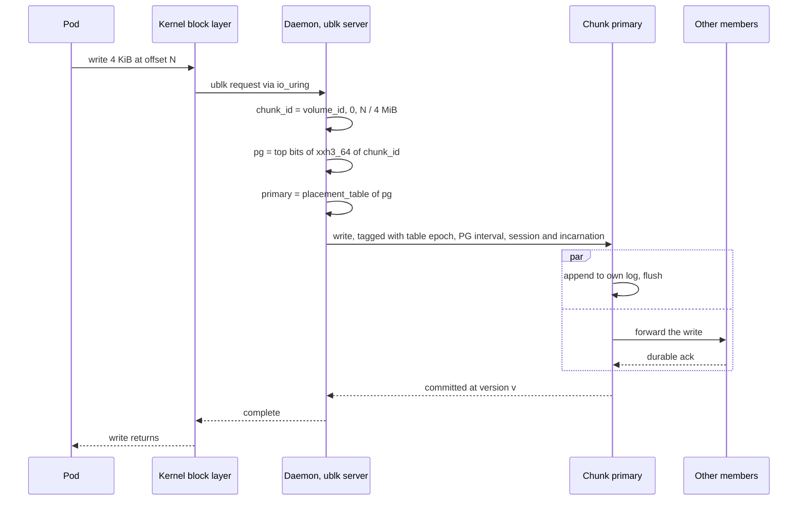
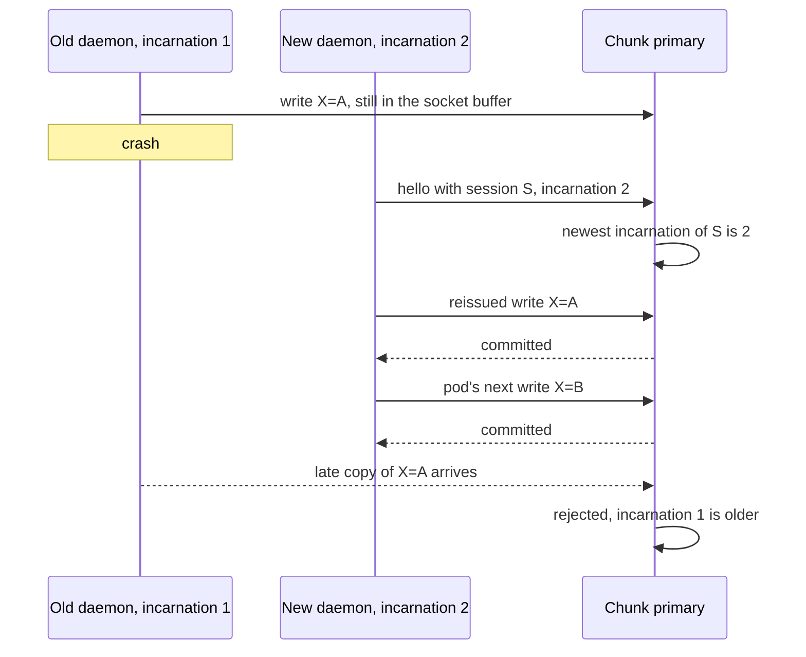
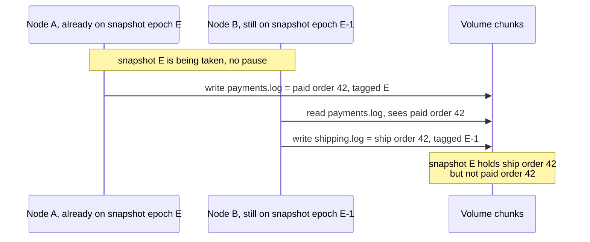
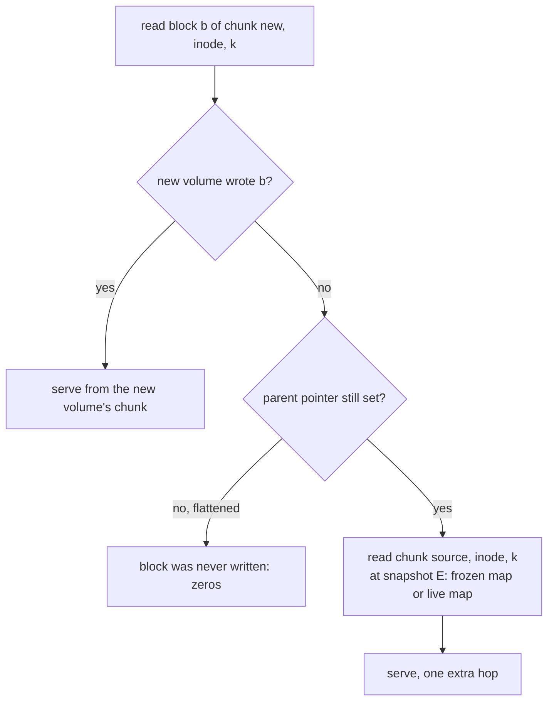

# Block volumes, snapshots and clones

A pod that wants a raw disk, such as a database or a KubeVirt virtual machine, should not need a
different storage system from a pod that wants a shared directory. rock-solid serves block volumes
from the same chunk store as its RWX filesystem: a Linux user-space block device (ublk) on the
node, NVMe over TCP for remote clients (not yet scheduled), and no metadata lookup on the write
path. On top of both kinds of volume it builds snapshots and clones, which is what makes backup
tools like Velero work. A snapshot copies no data: the first 4 KiB write after it writes 4 KiB,
not a 4 MiB chunk. None of this is built yet: the block frontend is roadmap phase 8, snapshots
and clones phase 11 and S3 phase 12. The on-disk pieces snapshots rest on, the `freeze` record
entry and the frozen maps in the chunk index, already exist in code.

Each section opens with an **In plain words** callout, the idea with an everyday example. The text
after **How it works** is the mechanics, with the real names and numbers. If you read only the
callouts, you still get the whole story.

## Words you need

- **Block device.** A disk as the kernel sees it: numbered blocks you read and write by offset,
  with no names or folders. rock-solid's are 4 KiB, or 512 bytes when a volume asks for it. You put a filesystem such as ext4 on it yourself.
- **ublk.** A Linux driver that lets a user-space process, here the rock-solid daemon, serve a
  local block device through io_uring, the kernel's asynchronous I/O interface
  ([glossary](../docs/glossary.md#files-and-caching)).
- **NVMe-oF/TCP.** NVMe over Fabrics over TCP: the NVMe drive command set carried over a network,
  so a machine can use a remote disk as if it were a local NVMe drive.
- **KubeVirt live migration.** Moving a running virtual machine to another node. For a moment,
  both nodes have its disk open, which is why rock-solid offers RWX (ReadWriteMany) *block*
  volumes besides the usual RWO (ReadWriteOnce) ones.
- **Session, fencing.** Each node's daemon holds a lease-backed session with the cluster. When the
  lease lapses, the session is *fenced*: every chunk primary rejects its writes, so a stalled node
  cannot write behind everyone's back.
- **Snapshot.** A read-only copy of a volume as it was at one instant. **Crash-consistent** means
  it holds exactly what a power cut at that instant would have left.
- **Copy-on-write.** Never modifying shared data in place: a write puts new data elsewhere and
  repoints the writer, so whoever still points at the old data, such as a snapshot, keeps seeing
  it. This is the broad sense the design uses; two narrower schemes are compared below.
- **Snapshot epoch.** A per-volume counter of snapshots. It is not the table epoch, the version
  number of the placement table, nor a PG's interval number, which counts the changes to one
  placement group's membership and fills the high half of every chunk version
  ([Words with more than one meaning](../docs/glossary.md#words-with-more-than-one-meaning)).
- **Punch, discard.** A discard (TRIM) is a filesystem saying "these blocks are free now".
  rock-solid turns it into a punch, which zeroes the range and frees its space.
- **Cleaner.** The background job that copies still-needed blocks out of old parts of the log so
  that whole parts can be reused ([05](05-the-cleaner-and-free-space.md)).

## A short recap: chunks and the log

> **In plain words.** Every volume is stored as 4 MiB chunks spread over a pool's disks, found by
> a formula. One primary disk per chunk orders its writes and copies them to the other members.
> Each disk keeps one append-only log and an index of where each block of each chunk lives.

The details are in [02, chunks and placement](02-chunks-and-placement.md) and
[04, one log per disk](04-one-log-per-disk.md). Three facts matter here:

1. `chunk_id = (volume_id, inode_id, offset / CHUNK_SIZE)`, and a block volume uses inode 0. The
   chunk hashes to a placement group (PG), and an in-memory table names the PG's primary.
2. A write never overwrites in place. It appends its blocks to the log, and the disk's chunk index
   records the new location. The index holds a **live map** per chunk: one entry per run of
   consecutive blocks written by one log record (an *extent*).
3. Every write and punch returns a new version. A read can ask for an old one (`at_ver`), and a
   primary keeps an old version only while a snapshot pins it.

Fact 2 is what makes snapshots cheap.

## Part 1: the block frontend

### What a block device is, and why it is the easy frontend

> **In plain words.** A filesystem volume is a shared folder: the storage system must know every
> file name, size and directory, and keep them consistent between nodes. A block volume is a blank
> disk. The pod formats it with its own filesystem and only ever says "write these 4 KiB at byte
> offset N". The storage system does not know what a file is. That makes block the simpler
> frontend: no names, no directories, almost no metadata.

**How it works.** The two paths differ in where the filesystem runs. Look at which side holds the
names and directories:

```text
 Filesystem volume (RWX)                    Block volume (RWO, or RWX for KubeVirt)
 ---------------------------------------    ---------------------------------------------
 pod: write("/data/a.txt", 4 KiB)           pod: write to a file on its own ext4 or XFS
            |                                            |
 kernel: VFS hands it to FUSE               kernel: the pod's filesystem turns it into
            |                                       "write 4 KiB at byte 1,048,576"
            v                                            |
 rock-solid daemon (FUSE client)                         v
   names, sizes, directories                rock-solid daemon (ublk server)
     -> MetaStore (Raft shards)               no names, no sizes, no directories
   file data -> chunks                        data -> chunks of inode 0
```

A block volume therefore never touches the MetaStore, rock-solid's replicated metadata store, on
the hot path. The MetaStore sees it only at attach and detach, at snapshots and at pool moves.

### The options for serving a block device

> **In plain words.** Something has to connect the kernel's block layer to the daemon, an ordinary
> program, so that `/dev/something` appears on the node. Linux offers several ways, which differ in
> overhead and in reach: the same machine, or over the network.

**How it works.** The design weighed these
([Alternatives considered](../docs/design.md#alternatives-considered)):

| Option | What it is | Gets right | Costs |
| --- | --- | --- | --- |
| **ublk** (chosen, local) | Kernel forwards block I/O to a user-space server over io_uring | Little overhead; survives a daemon restart | Local node only |
| **NVMe-oF/TCP** (chosen, remote) | NVMe commands over TCP | The native remote protocol for NVMe | Not yet in a roadmap phase |
| NBD | Linux's simple network block device | Simple | Single-threaded overhead |
| iSCSI | SCSI commands over TCP | Network block device | Old and heavy |

### What rock-solid picked: ublk locally, NVMe-oF/TCP remotely

> **In plain words.** On the node where the pod runs, the daemon serves the disk through ublk.
> When the pod writes 4 KiB, the daemon works out which chunk that is and which disk is its
> primary, using only arithmetic and a table it already holds, and sends the write there. The
> primary writes it to its own log and to the other copies at the same time, and the write is done
> when they all have it. Remote clients use NVMe over TCP instead; no roadmap phase schedules it
> yet, and the design does not say which machines count as remote clients.

**How it works.** Follow one 4 KiB write. Every step before the network hop is computed locally:



The one network round trip is to the primary, which fans out to the replicas in parallel. The
PG's interval number lets a member reject requests sent under an outdated membership of that PG,
and the table epoch tells it which table to fetch
([03, epochs, leases and failures](03-epochs-leases-and-failures.md)).

**What it costs.** The target for a 4K write at queue depth 1 is around 0.1 ms on drives with
power-loss protection (Vitastor class; Ceph is around 1 ms). Consumer drives without it floor at
about 1 ms, set by the drive's flush (see Evidence).

### Block size: 4 KiB, and 512 bytes only when asked

> **In plain words.** A block device tells the kernel the smallest piece it accepts. rock-solid's
> says 4 KiB, which is what Linux filesystems write anyway, so every request it gets is whole
> blocks and nothing has to be pieced together. Some guests and old tools insist on 512-byte
> sectors; a volume can offer them, and then the chunk's primary pieces each 512-byte write into
> its 4 KiB block. The choice is fixed when the volume is created, because a filesystem formatted
> for one size may refuse to mount on the other.

**How it works.** ublk takes a logical block size from 512 bytes to the page size
(`logical_bs_shift` 9 to 12, `drivers/block/ublk_drv.c`). rock-solid sets 12 for the logical and
physical size, `io_min` 4 KiB and `io_opt` the 4 MiB chunk, so the block layer never sends a
request smaller than a block or off a block boundary, and the block path never merges. Vitastor
makes the same choice, exposing its 4 KiB `bitmap_granularity` as the sector size; krbd keeps the
kernel's default 512 bytes, and Ceph's BlueStore then reads and rewrites the rest of the block on
every replica.

KubeVirt needs nothing special. A VM disk sees 512-byte sectors unless its spec sets a
`blockSize`, and QEMU pads a guest's 512-byte write to the host device's 4 KiB with its own
read-modify-write (`bdrv_padding_rmw_read` in `block/io.c`), on the node, before rock-solid sees
it.

For a guest that must see 512-byte sectors on the device itself, the StorageClass parameter
`block_size: 512` exposes them. Each 512-byte write then reaches the chunk primary as a byte range,
and the primary merges it onto the newest version of its 4 KiB block, the same merge files use
([02, chunks and placement](02-chunks-and-placement.md)). That keeps RWX block correct when two
nodes write different sectors of one block, since both merges happen at one primary in one order,
and costs a base read plus a whole 4 KiB block per write. The size cannot change later: XFS
formatted with 512-byte sectors refuses a device whose logical block is 4 KiB
(`bdev_validate_blocksize` in `fs/xfs/xfs_buf.c`), so clones and restores inherit their source's
size.

**RWO: one writer, enforced.** At attach, a single-writer attach record is taken in the MetaStore
(`volume/{id}/attach`). It stops two nodes from mounting one volume and corrupting it, and the
simulator, once built, checks "at most one writer per RWO volume" after every step.

**RWX block.** Several nodes attach one raw device, for KubeVirt live migration. The design calls
this Tier 0, the lowest of its coherence tiers: the attach record allows several writers, the
daemon caches nothing, and every I/O goes to the chunk primary, whose single order per chunk is
all the coordination needed. The kernel's own cache is the application's choice: KubeVirt opens
shared disks with `cache=none` (direct I/O), which is what makes live migration safe.

**Discard gives space back.** The device advertises discard, and the CSI driver mounts the
filesystems it creates on block volumes with `discard`, so deleting a file in the pod becomes a
punch at once and a thin-provisioned block volume shrinks. Why not a weekly `fstrim` is part of the
next section.

**Surviving a daemon restart.** Normally a ublk device disappears when its server exits, and a
failed write makes ext4 abort its journal and XFS shut down. rock-solid creates every device with
ublk's *user recovery* and *reissue*: the kernel keeps the device and holds its requests while the
daemon restarts, then hands every request the dead daemon had received to its successor. The pod
sees a stall, not an error.

One race remains: bytes the dead daemon had already queued on a socket still reach the primary
after the process dies, and could land after the reissue and after the pod's next write. Watch
the late copy:



An *incarnation* is the daemon's start time on `CLOCK_BOOTTIME`. Each connection's hello names
it, and so does every chunk write and punch, in 8 bytes. A primary that has seen a newer
incarnation of a session closes the older one's connections and rejects their writes, and it checks
when it orders a write, not only when it receives one, so a stale write it already holds is caught
too. The incarnation rides in each write, not only in the hello, because with one event loop per
core the old connection, the new one and the chunk's loop can be three different loops
([11](11-runtime-in-go.md)), and making every hello reach every loop first would be an ordering
rule between loops kept forever. Applying a reissued write twice is harmless: the same bytes give
the same blocks under a newer version. The same check fences the chunk writes of a dead FUSE
daemon. The flags and
recovery steps are in [Daemon restart and upgrade](../docs/design.md#daemon-restart-and-upgrade).

### When the pool is full: pause, never fail

> **In plain words.** A thin volume can promise more space than the pool has. When the pool really
> fills, a write into a part of the volume never written before has nowhere to go. Telling the
> filesystem inside "no space" sounds honest, but that filesystem is not built for a disk that
> refuses writes into its own free space: some of the refused writes are its own bookkeeping, and
> it stops working until it gets the room to repair them. So rock-solid makes those writes wait
> until there is room, the way Ceph's block devices do. A paused volume is bad; a stopped one
> that also lost data is worse.

**How it works.** Writes that add no data still pass a full pool's `write_limit`: overwrites of
blocks the volume already holds and nobody else shares (in the log, each kills the block it
replaces) and discards. So a filesystem's journal keeps working. A write that needs new space is
held, and the daemon retries it whenever the control plane reports that the pool has room again,
with no time limit. The evidence is the
[block ENOSPC spike](../docs/design.md#appendix-block-enospc-spike), which ran ext4 and XFS on a
full dm-thin pool. Refused writes got `ENOSPC` at `fsync`, but they included metadata in blocks
the device had never stored: the leaf of a file's extent tree, the inodes and directory blocks of
new files. ext4 aborted its journal at the first one and refused every later write, overwrites
included. XFS retried while it stayed mounted, then shut down at unmount. Both were consistent
again only after a mount replayed their log, and the replay writes the same new blocks, so it
needs the room the pool lacked. A hold that ended when the pool grew completed every write with
no error, and both filesystems checked clean. The options weigh up like this:

| On a full pool | Who does it | What happens to the filesystem inside |
| --- | --- | --- |
| Fail at once with `BLK_STS_NOSPC` | dm-thin with `error_if_no_space` | Refused data lost; ext4 stops at once, XFS at unmount; usable again only after a log replay with room in the pool |
| Hold 60 s, then fail | dm-thin and LVM thin by default | The same, a minute later, unless the pool grows |
| Let writes past the limit into a bounded reserve | No system studied | The same, once the reserve is spent; meanwhile recovery has less room |
| Hold until there is room | Ceph RBD, Vitastor, rock-solid | Intact, but the volume hangs while the pool is full |

The hang is real. Held writes keep their ublk tags, and ext4's journal waits for the data it
orders, so a volume that keeps writing soon stops altogether. Its processes sleep where nothing can
interrupt them, the kernel warns about them after 120 s, and the pod cannot be killed until the
writes complete. The node plugin posts a Warning event on the PVC naming the pool, the pool's
condition is `Full`, and a metric counts held writes per volume. Three ways out, in this order:
free space outside the volume (delete snapshots, which are what make overwrites need new space,
delete other volumes, or add a disk), and the writes resume by themselves; raise the pool's
`write_limit` into the room above it, which resumes them at once but leaves space grants and
recovery less room; or run
`rock-solid volume fail-held <volume>`, which completes the held writes with `ENOSPC` when the pod
must go, knowing the held data is lost and its filesystem stops until it is mounted with room in
the pool.

Discard matters here too. In the spike, without `discard` a new write after deleting a 512 MiB file
still failed: the space ext4 freed never reached the device. With `-o discard` it succeeded. A
weekly `fstrim` would leave a full pool full until its next run, and a punch costs one log entry, so
the CSI driver mounts with `discard`. A VM's raw disk sends discards only if its guest does.

Remote clients cannot be held forever: the Linux NVMe host times a command out after 30 s and
retries a refused one at most five times. So the target holds a write 20 s, then answers Capacity
Exceeded with the longest retry delay NVMe allows, 6,553.5 s, and a stock host pauses about 9 hours
before it gives up, at which point its filesystem is damaged as above. A client that must never
give up raises `nvme_core.max_retries`.

## Part 2: snapshots

### Why a storage system needs snapshots

> **In plain words.** A backup that copies a live disk file by file takes minutes. Meanwhile the
> application keeps writing, so the backup holds the start of the disk as it was at 10:00 and the
> end as it was at 10:07: a state that never existed. A snapshot freezes the volume at one
> instant, instantly, and the backup then copies the frozen version at its own pace.

**How it works.** Volume snapshots are an optional CSI (Container Storage Interface) capability.
Once the driver has it, Velero and Kasten work with no further integration: Velero's data mover
creates a temporary PVC from the snapshot, mounts it and uploads it with Kopia. Without snapshots,
Velero falls back to backing up files from the live mount, which is not point-in-time. So the
driver will advertise `CREATE_DELETE_SNAPSHOT` and `CLONE_VOLUME` and ship the `csi-snapshotter`
sidecar. Everything below applies to block and filesystem volumes alike, except that a block
volume has no file metadata to copy.

### Two ways to keep old data: copy out, or write elsewhere

> **In plain words.** After a snapshot, the snapshot and the live volume share every block. When
> the application overwrites one, the old contents must survive for the snapshot. There are two
> ways. **Copy out**: before overwriting the block in place, copy the old contents somewhere else
> for the snapshot. **Write elsewhere**, often called redirect-on-write: leave the old block alone,
> write the new contents somewhere else, and point the live volume at the new place.

**How it works.** Take one shared block B1 holding "old", and one overwrite with "new". Count the
I/Os each way:

```text
Before the overwrite:   snapshot S --> B1 "old" <-- live volume L

Copy out (keep data in place, copy the old version away first)
  1. read  B1 "old"
  2. write "old" to B9                      S --> B9 "old"
  3. write "new" over B1                    L --> B1 "new"
  first overwrite after a snapshot: 1 read + 2 writes, and the copy must be durable first

Write elsewhere (never overwrite, repoint the writer)
  1. write "new" to B9                      L --> B9 "new"
  2. update L's map: block 1 is at B9       S --> B1 "old"   (untouched)
  first overwrite after a snapshot: 1 write + 1 map entry
```

Writing elsewhere pays nothing extra on the write, but needs a map of where each block now lives,
and the live volume scatters over the disk as it is overwritten.

rock-solid's design and glossary call their scheme *copy-on-write per block*, in the broad sense:
shared data is never modified in place, and a write puts new data elsewhere and repoints the
writer. In the terms above that is write-elsewhere. "Per block" is the unit: the volume and its
snapshot share 4 KiB blocks, not 4 MiB chunks. The log already writes every block to a new place
(fact 2), so a snapshot only has to keep the old map. No data is copied; the map is.

### The problem: one instant across many chunks and nodes

> **In plain words.** One disk can take a snapshot by noting "everything up to now". A rock-solid
> volume is spread over thousands of chunks, each with its own primary, and written by one node
> or many. No single chunk or clock can say "now" for all of them. Get the instant wrong, and the
> snapshot can hold an effect without its cause.

**How it works.** The obvious fix is to bump a snapshot epoch and have nodes tag their writes with
it as soon as they hear about it, with no pause: writes tagged with the old number are in the
snapshot, the rest are not. But nodes hear about the new number at different times. Follow the
two files on a shared volume:



The snapshot keeps node B's write, tagged with the old snapshot epoch, and leaves out node A's. The
restored volume ships an order that was never paid, a state no crash can produce. The design
rejects tagging without a pause for exactly this reason.

### The options

> **In plain words.** A snapshot design answers three questions. How do you pick the instant? How
> do the snapshot and the live volume share blocks? And how do you turn a snapshot back into a
> usable volume? Real systems answer each differently.

**How it works.** From the design's
[Alternatives considered](../docs/design.md#alternatives-considered):

| Question | Option | Who | Gets right | Costs |
| --- | --- | --- | --- | --- |
| Instant | **Pause writers one round trip, resume under a new snapshot epoch** (chosen) | rock-solid | Reuses the recall fan-out; no timestamps in keys | A short write pause |
| Instant | Tag writes with the new snapshot epoch, no pause | | Cheaper | Effect without its cause |
| Instant | Multi-version data with hybrid logical clock timestamps | CockroachDB | No pause | Timestamps in every key |
| Sharing | **Frozen copy of the chunk's extent map** (chosen) | rock-solid; extent maps as in BlueStore, Btrfs | 4K write costs 4K | One entry copied per live extent |
| Sharing | Journal, in-place data, reference-counted extent map | Vitastor, BlueStore | Data stays in place | BlueStore's most complex part |
| New chunks | **Freeze version 0, the absent chunk** (chosen) | rock-solid | No format change | 37 bytes on a chunk's first-ever write in a snapshotted volume |
| New chunks | Snapshot epoch in every write entry | Ceph's `SnapSet.seq` | Epoch always at hand | 8 bytes on every write entry |
| Restore | **New volume, parent pointer, optional flatten** (chosen) | Ceph RBD | Instant, no space | Extra hop for unwritten blocks |

### The cut: pause, record, resume

> **In plain words.** To take a snapshot, rock-solid asks every node using the volume to hold new
> writes for a moment and finish the ones already on their way. When all have answered, it writes
> down "snapshot E exists" and tells everyone to carry on, stamping their writes with E from now
> on. Everything stamped before E is in the snapshot; everything stamped E or later is not. The
> pause lasts about one network round trip.

**How it works.** The cut takes snapshot epoch E with the same fan-out and fencing as a Tier 2
recall, the message the filesystem uses to make every node stop caching a shared file
([09, RWX filesystem and cache coherence](09-rwx-filesystem-and-cache-coherence.md)). Note that the
transaction happens while nobody can write:

```text
snapshot(volume):
  E = next snapshot epoch of the volume
  to every node with the volume attached or mounted, in parallel:
    pause new writes and namespace operations on the volume
    wait until in-flight ones are acknowledged, then ack    // or its session expires and is fenced
  txn: put volume/{id}/snap/{E}, plus a marker key in each shard holding fs/{volume}/
  resume every node; its writes now carry snapshot epoch E
```

Why this is correct: when the transaction commits, every write issued before the pause has been
acknowledged and carries a snapshot epoch below E, and none has been issued since. So "acknowledged before
the cut" and "tagged below E" are the same set. A paused node may read a write that an already
resumed node tagged E, but it can act on it only after it resumes, when its own writes carry E
too: the effect lands on the same side of the cut as its cause.

The edge cases:

- **A node that never answers.** The coordinator waits until its session expires and is fenced,
  as a recall does; every primary then rejects its writes.
- **The coordinator crashes** between pause and resume, or a MetaStore shard changes leader at the
  cut. Both are named simulation faults. A paused node resumes only once it knows whether the
  snapshot committed: the cut is a two-phase commit, the pause prepares it and the snapshot record
  commits it, so a node that resumed on a timeout under the old epoch could put a post-cut write
  into the snapshot. It asks the MetaStore whether snapshot E exists. Snapshot cuts get a TLA+
  model in phase 11, before the cut's code; it is to settle how the commit is made conditional, so
  a cut a node gave up on can never commit later, and how a node that attaches or mounts the
  volume during the cut is paused. Until phase 13 a filesystem has one data shard; once it has
  several, the markers commit with the snapshot record through the cross-shard transactions of
  [08](08-the-metastore.md).
- **Cost.** A block RWO volume has one node to pause; a volume nobody uses needs no pause.

**Data still in the daemon's buffer.** By default the cut does not flush the filesystem daemon's
write-back buffer: unflushed data is what a crash would lose too, and closed files are included
because `close` flushes. `flush: true` in the `VolumeSnapshotClass` makes each node flush first.
Application consistency (a database's own flush, `fsfreeze`) comes from backup-tool hooks.

### Data: freeze entries make versions share blocks

> **In plain words.** After the cut, nothing is copied. Each chunk is dealt with lazily, the first
> time a write tagged with the new snapshot epoch reaches it. At that moment its primary writes a small
> note in the log, a *freeze*: "keep the chunk as it is now, for snapshot E". Every copy of the
> chunk then saves its list of where each block lives, and only after that applies the write. The
> saved list and the live list point at the same blocks, except the one the write replaced.

**How it works.** A chunk's index entry holds its current version and the snapshot epoch of its
last freeze. When a write carries a snapshot epoch newer than that of the chunk's newest write the
primary has accepted, pending writes included, the primary puts a `freeze (pool, chunk_id,
version, snapshot epoch)` entry for the chunk's current version in the same log record as the
write. Every member copies the live map under that version's key, then applies the write.

A worked example. Chunk 3 of a VM disk volume (bytes 12 to 16 MiB, 1,024 blocks of 4 KiB) was
written by two records before the snapshot: blocks 0 to 511 at version v5 in record A, and blocks
512 to 1023 at v6 in record B. (Real versions are 64-bit numbers with the PG's interval number in
the high bits, not any epoch.) Snapshot 1 is cut, and the guest writes 4 KiB at block 100. Compare the two maps after
the write:

```text
Log record C (one write, one flush):
  header: freeze(chunk 3, v6, snapshot epoch 1)
          write (chunk 3, v7, block 100)
  data:   4 KiB

Chunk index after applying record C, on every member:

  chunk 3 entry:  version v7, last freeze epoch 1

  live map                                   frozen map v6
  blocks   0-99   v5 -> record A             blocks   0-511   v5 -> record A
  block    100    v7 -> record C  (new)      blocks 512-1023  v6 -> record B
  blocks 101-511  v5 -> record A
  blocks 512-1023 v6 -> record B
                 \_______________ same log blocks, shared, no reference count ___/
```

The write cost 4 KiB of data plus its header, not a 4 MiB chunk copy. Had the guest written
only 512 bytes into block 100, the record would look the same: the primary merges them onto
v6's block 100 first and logs the whole merged block as v7, so the frozen map keeps the old block
untouched. The freeze copied two
extent entries, one per live extent. A second write tagged epoch 1 to the same chunk sees freeze
epoch 1 in the chunk entry and freezes nothing.

"No reference count" needs a word. The index does keep, per log record, a count of the blocks any
map still uses, a block shared by the live and a frozen map counting twice, so the cleaner knows
when a whole record is dead. It is not a reference count on each block, which is what makes
BlueStore's extent maps complex.

**Which version does a snapshot read?** The frozen version whose freeze epoch is the smallest at
or above the snapshot's, or the live map if there is none. Writes after snapshot E's cut carry
epoch E, so the first freeze tagged E or later preserved the chunk exactly as it was at E's cut.
Continue the example on this timeline:

```text
cut 1 -> write block 100 (freezes v6 at epoch 1, writes v7)
      -> cut 2 -> write block 600 (freezes v7 at epoch 2, writes v8) -> cut 3 -> no more writes
```

| Read at | Frozen versions (freeze epoch) | Picks | Block 100 reads |
| --- | --- | --- | --- |
| Snapshot 1 | v6 (1), v7 (2) | v6, smallest epoch at or above 1 | v5's data, from record A |
| Snapshot 2 | v6 (1), v7 (2) | v7 | v7's data, from record C |
| Snapshot 3 | v6 (1), v7 (2) | none at or above 3, so the live map | v7's data |

Frozen maps sit outside the live map's key range, so punching the live chunk never touches what a
snapshot reads. A freeze is logged like a write, so rebuilding the index from the log restores
which versions a snapshot pinned, and applying a freeze twice changes nothing. Code:
[`internal/chunkstore/index.go`](../internal/chunkstore/index.go) (`freeze`, `LookupAt`) and
[`internal/disklog/record.go`](../internal/disklog/record.go) (the 37-byte entry).

### The absent chunk: a snapshot must remember what did not exist

> **In plain words.** A chunk written for the first time *after* a snapshot must read as empty in
> that snapshot. But a brand-new chunk has no version to freeze. Without a note saying "this chunk
> did not exist at the cut", the old snapshot ends up reading data written after it.

**How it works.** Write entries carry no snapshot epoch, and a chunk's index entry keeps only the
snapshot epoch of its last freeze. So after a restart, or when another member becomes primary,
nothing durable says a write was made in snapshot epoch 1; only a freeze records one. Without an extra rule, this is what
happens to a chunk first written after cut 1. Read it top to bottom:

```text
time  event                                  chunk 9 index                     snapshot 1 reads
----  -------------------------------------  --------------------------------  ----------------
t0    snapshot 1 cut                         (no entry)                        nothing: right
t1    write v1, tagged epoch 1, no freeze    v1, last freeze epoch 0           nothing: right
t2    write v2, tagged epoch 1               1 > 0, so freeze v1 at epoch 1
                                             v2, last freeze epoch 1           v1: WRONG
```

At t2 the chunk looks unfrozen since epoch 0, so the write freezes v1, which was written after the
cut. The [chunk epochs spike](../docs/design.md#appendix-chunk-epochs-spike) found exactly this in
the real index.

The fix is to freeze version 0, the *absent* chunk. When a write reaches a chunk with no version
in a volume that has had a snapshot, the primary puts `freeze(chunk 9, v0, epoch 1)` in the
record. Its frozen map is empty, so snapshot 1 reads the chunk as never written, and its epoch
tells later writes in epoch 1 not to freeze again. After cut 2, a write freezes v1 at epoch 2:
snapshot 1 still finds nothing, and snapshot 2 finds v1. That costs one 37-byte entry per chunk
created in a snapshotted volume, against 8 bytes on every write entry for carrying the snapshot
epoch everywhere. Today the index still refuses a freeze of version 0 (`ErrFrozenLive`); the absent
freeze is an open item in the [build checklist](../docs/build-checklist.md), with the spike's
tests to become regression tests first.

### Metadata: copy out of a point-in-time view

> **In plain words.** For a filesystem volume, the snapshot must also keep the file names, sizes
> and directories as they were at the cut. The metadata databases can take a consistent, read-only
> view of themselves at one moment. rock-solid takes such a view at the cut, copies the volume's
> metadata out of it into the snapshot's own space, then lets the view go.

**How it works.** When a MetaStore shard applies the cut's marker key, it opens a point-in-time
view and copies the volume's `fs/{volume}/` keys into `fs/{snapshot}/` in the background
([08, the MetaStore](08-the-metastore.md)). The view closes once the copy is done, so it never
holds back space for the life of the snapshot: in the
[KV engines spike](../docs/design.md#appendix-kv-engines-spike), one long-lived reader grew a redb
file from 26 MB to 419 MB in 100 commits. A block volume has no `fs/` keys, so its cut writes only
the `volume/{id}/snap/{E}` record and no shard markers.

**Backups don't load the primaries.** A backup reads the snapshot with `read(at_ver)`. A read at a
frozen version needs no ordering against writes, so any PG member holding it can serve it.

**Erasure-coded pools**, which store a chunk as data and parity pieces instead of full copies
([07](07-pools-and-redundancy.md)), normally encode a block chunk only after a day idle. Frozen
versions keep the chunk's form: copies while the chunk is copies, sharing untouched blocks with the
live version, and encoded with it when it seals, each version into shards of its own. When an
overwrite returns an encoded chunk to copies, the encoded version stays on as the frozen one
instead of being dropped.

### Restore and clone: a new volume that reads through

> **In plain words.** Restoring a snapshot does not copy anything at first. It creates a new,
> empty volume with a note: "for any block I have not written myself, read the source volume as it
> was at snapshot E". New writes land in the new volume. Optionally, a background job copies the
> remaining blocks over and removes the note, so the new volume stands on its own.

**How it works.** A restored volume gets a new `volume_id` and a parent pointer to
`(source volume, E)`.

- **Metadata** (filesystem volumes) is copied from `fs/{snapshot}/` in one pass over its inodes
  and directory entries; orphaned inodes, deleted while still open, are dropped.
- **Data is read through.** A read of a block that chunk `(new, inode, k)` has not written falls
  through to `(source, inode, k)` as snapshot E saw it, at the cost of an extra hop.
- **Inode numbers are unchanged.** Inode IDs are scoped to their volume, so a restored volume
  differs from its source only in `volume_id`. `st_ino` survives a restore, and the read-through
  needs no lookup table: the source chunk ID is the same formula with the old volume ID.
- **Clone from a PVC** (`CLONE_VOLUME`) is a snapshot followed by a restore.

Follow a read of block b of chunk k:



**Flatten.** With the StorageClass setting `flatten: true` (off by default), a background task
copies every chunk the new volume has not written yet, then drops the parent pointer. Off saves
space and suits Velero's temporary PVC, which is read once and deleted. A restore into a different
pool always flattens, and moving a volume between pools in place reuses the same cut, read-through
and copy ([07](07-pools-and-redundancy.md)).

**Deletion.** Deleting a snapshot removes its record at once. A sweep over the volume's PGs then
drops each frozen version that no remaining snapshot and no unflattened clone needs. A deleted
volume that still has snapshots or clones is hidden from Kubernetes and keeps those chunks. Punches
carry the snapshot epoch like writes, so freeing a file never frees a block a snapshot holds.

## Part 3: the S3 frontend, later

> **In plain words.** S3 is the object-storage protocol: you upload a whole file under a name and
> download it whole. It is the simplest frontend for rock-solid: write the object's data into
> fresh chunks, then, in one metadata transaction, publish "this name points at these chunks".
> Until that transaction commits, nobody can see the object; after it, everyone can.

**How it works.**

```text
stream body -> fresh chunk ids -> ChunkStore.write (once each; encoded on write in an
               erasure-coded pool) -> seal
            -> MetaStore.txn([put "bucket/key" -> chunk list, if-not-exists or version check])
LIST        -> MetaStore.scan(prefix)
```

The compare-and-set in the transaction (create only if absent, or only if the version still
matches) lets two uploads race safely.

## The three frontends side by side

> **In plain words.** All three frontends sit on the same chunk store. They differ in how much
> metadata they need and in what makes them slow. A shared filesystem pays for metadata round
> trips; a block volume pays for raw latency on single writes; S3 pays for throughput and listing.

**How it works.** The design's [frontend comparison](../docs/design.md#frontend-comparison):

| | File (RWX) | Block | Object (S3) |
| --- | --- | --- | --- |
| Write pattern | Byte-range writes, appends | 4K overwrites in place | Whole object, written once |
| Writers | Many, coordinated per file by cache mode | One (RWO), or many with app coordination (RWX block) | Many, atomic per key |
| Metadata | Heavy: directories, rename, stat, opens | Almost none | Sorted key index |
| MetaStore on hot path | Open, close, fsync, namespace operations; extending writes while write-shared | Never (attach only) | Once per PUT commit, and on LIST |
| Redundancy, in an erasure-coded pool | Encoded as written; copies while shared or edited, encoded once idle | Copies; chunks idle for a day encoded | Encoded as written |
| Snapshot cut | Pause every node with the volume mounted | Pause the attached node (or nodes, for RWX block) | None |
| Hot cost | Metadata round trips | Latency at queue depth 1 | Throughput, listing |

"4K overwrites in place" is what the pod asks for; underneath, the log never overwrites in place,
which is exactly why snapshots are cheap.

## Evidence

- **Chunk epochs spike** ([appendix](../docs/design.md#appendix-chunk-epochs-spike),
  [`spikes/chunk-epochs/`](../spikes/chunk-epochs/)), run against the real `internal/chunkstore`
  index at 676095b. Without the absent freeze, a chunk first written after cut 1 is read by
  snapshot 1 at version 1 (E1, E2), and a random property test read a snapshot wrong in **35 of 50
  seeds**, 259 block reads, all in chunks created after the cut (E3). With the absent freeze, 0 of
  50, with 74 absent freezes against 5,267 freezes.
- **Cleaner spike** ([appendix](../docs/design.md#appendix-cleaner-write-amplification-spike),
  [`spikes/cleaner-wa/`](../spikes/cleaner-wa/)). With 20% of the data snapshotted, then
  overwritten, cleaning write amplification was 5 to 9% lower at the same fill, because frozen data
  is cold. The snapshot raises the fill itself, so snapshot-pinned blocks count toward the pool.
- **NVMe flush spike** ([appendix](../docs/design.md#appendix-nvme-flush-spike),
  [`spikes/nvme-flush/`](../spikes/nvme-flush/)), N2: a 4K write plus `fdatasync` at queue depth 1
  costs p50 0.95 ms, p99 2.4 ms, the block frontend's latency floor on such a drive.

- **Sub-block writes spike** ([appendix](../docs/design.md#appendix-sub-block-writes-spike),
  [`spikes/sub-block-writes/`](../spikes/sub-block-writes/)). Its model of two clients writing
  unaligned bytes into one chunk, merged at the primary on its newest ordered version, was right on
  every one of 500 seeds, and wrong on every seed when merged on the committed version only: the
  evidence that 512-byte sectors are safe on RWX block once they merge at the primary.

- **Block ENOSPC spike** ([appendix](../docs/design.md#appendix-block-enospc-spike),
  [`spikes/block-enospc/`](../spikes/block-enospc/)). ext4 and XFS on a 1 GiB dm-thin volume over
  a 192 MiB pool: a hold that ended when the pool grew completed every write and left both clean.
  Refused writes gave `ENOSPC` at `fsync`, then ext4 aborted its journal and refused every write,
  and XFS shut down at unmount; both checked clean only after a log replay with room in the pool.
  Without `discard`, a write after `rm` still failed.

The simulator will check after every step that a snapshot holds every write acknowledged before
its cut and none issued after, that every read, live and at every snapshot, equals a byte-range
oracle of the acknowledged writes and punches, and that no block write needing new space completes
with an error while the pool is full unless an operator failed it. Among its faults are a snapshot
cut while a volume overwrites near full, so its overwrites suddenly need new space, a held block
write released by a discard, a purge or a new disk, and unaligned writes from two nodes into one
block across a primary change.

## Trade-offs: what this costs

- **The cut pauses writes** for about one round trip, and a node that does not answer holds the
  snapshot until its session expires and is fenced.
- **Crash-consistent, not application-consistent.** A database still needs a backup-tool hook to
  be clean on restore.
- **Snapshots use space.** The first write to a pinned block needs new space, so on a pool past
  its `write_limit` even an overwrite waits for room.
- **A full pool hangs a block volume** until space appears or an operator acts, instead of failing
  its writes and damaging its filesystem; remote NVMe-oF clients give up after about 9 hours.
- **A freeze copies a map,** up to 1,024 entries for a chunk overwritten at random 4K, and an
  unflattened clone pays an extra hop and keeps its source's frozen versions alive.
- **Block volumes fragment the chunk index.** Random 4K overwrites can push a 1 TB disk's index
  toward 270 million entries, more than 10 GB, and turn sequential reads into random 4K reads
  ([06, the LSM tree](06-the-lsm-tree.md)).
- **512-byte sectors cost a read.** A volume with `block_size: 512` pays a base read at the primary
  and a whole 4 KiB block for every 512-byte write; its latency is not measured yet.
- **The daemon is in the I/O path.** A restart is a stall rather than an error only because of
  ublk's reissue, and a dead daemon's late writes need incarnation fencing.

## Open directions

From the [roadmap and open questions](../docs/design.md#roadmap-and-open-questions):

- **Phase 8 starts with a block cache** so the chunk index can outgrow memory, before ublk itself:
  a block volume's fragmented index needs it.
- **Regrouping chunks overwritten at random.** Should a chunk whose live map passes some number of
  extents be rewritten whole? Each regroup writes 4 MiB, so it needs block-volume traces.
- **The NVMe-oF hold** has to be checked on a real initiator: does a stock host wait out five long
  retry delays without resetting the controller?
- **The primary's base read for a 512-byte write:** its latency at queue depth 1 on NVMe and SATA
  drives, and how large a per-loop cache of recently merged blocks lets most merges skip it.
- **Incarnation fencing in the epoch-change model.** A dead daemon's write delivered late to an old
  primary, or held by one: the design expects the per-primary table of newest incarnations need
  not survive a primary change, since every chunk write carries its incarnation, checked when it
  is ordered. The phase 2 model is to confirm it.

One gap is not an open question in the design but is worth naming: NVMe-oF/TCP is the design's
remote block protocol and the frontend slot's opt-in driver, but no roadmap phase schedules it.
Phase 8 ships ublk only.

## Further reading

- Design: [Block frontend](../docs/design.md#block-frontend),
  [Snapshots and clones](../docs/design.md#snapshots-and-clones),
  [S3 frontend](../docs/design.md#s3-frontend-later),
  [Frontend comparison](../docs/design.md#frontend-comparison),
  [On-disk format](../docs/design.md#on-disk-format) (the "Versions share blocks" bullet),
  [Daemon restart and upgrade](../docs/design.md#daemon-restart-and-upgrade),
  [Moving a volume to another pool](../docs/design.md#moving-a-volume-to-another-pool).
- Glossary: [Data model](../docs/glossary.md#data-model) (snapshot, copy-on-write, freeze, clone),
  [Files and caching](../docs/glossary.md#files-and-caching) (ublk, NVMe-oF, incarnation, S3).
- Spikes: [`spikes/chunk-epochs/`](../spikes/chunk-epochs/),
  [`spikes/cleaner-wa/`](../spikes/cleaner-wa/), [`spikes/nvme-flush/`](../spikes/nvme-flush/),
  [`spikes/sub-block-writes/`](../spikes/sub-block-writes/),
  [`spikes/block-enospc/`](../spikes/block-enospc/); the
  [sub-block writes study](../studies/sub-block-writes/README.md) and the
  [pool capacity and ENOSPC study](../studies/capacity-and-enospc/README.md).
- Other posts: [02](02-chunks-and-placement.md), [03](03-epochs-leases-and-failures.md),
  [04](04-one-log-per-disk.md), [05](05-the-cleaner-and-free-space.md),
  [06](06-the-lsm-tree.md), [07](07-pools-and-redundancy.md), [08](08-the-metastore.md),
  [09](09-rwx-filesystem-and-cache-coherence.md).
