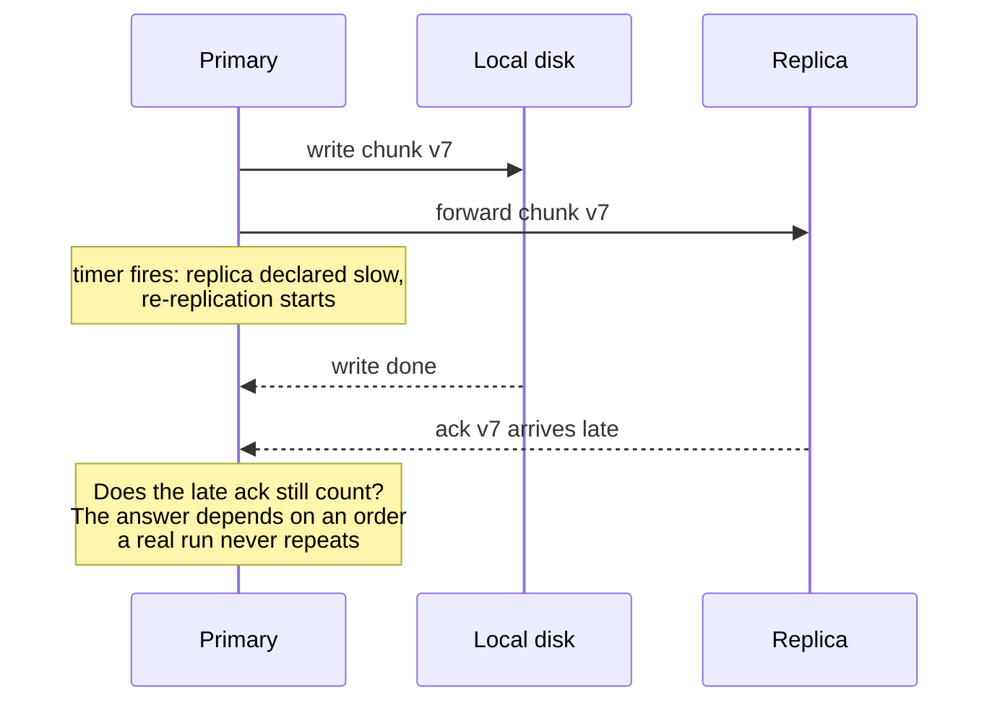
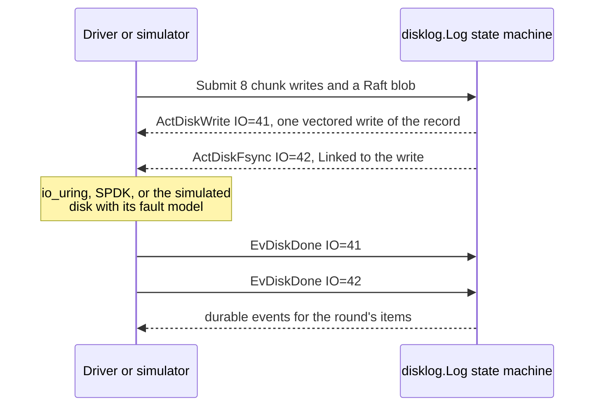
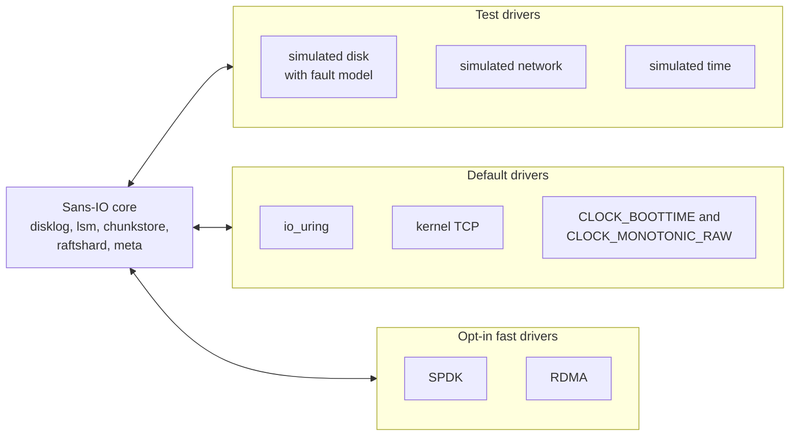
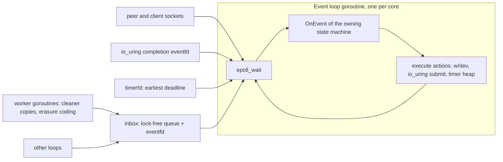
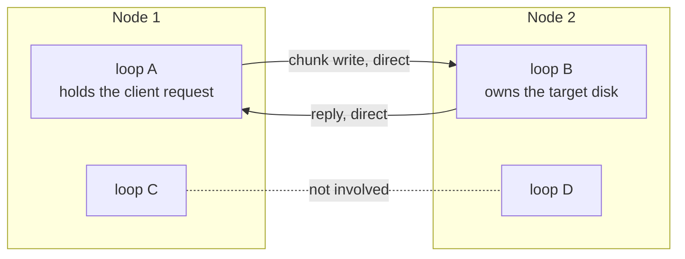

# Runtime in Go: a sans-IO core on one event loop per core

A storage daemon spends most of its life doing small jobs very often: take a 4 KiB write,
checksum it, put it on a disk, send it to two other nodes, answer. If every one of those steps
pays a few microseconds for goroutine handoffs, timers, allocations and garbage collection, the
overhead ends up costing more than the work. rock-solid splits its code in two. A **sans-IO
core** of pure state machines never touches a socket, a disk or a clock. A thin **runtime** of
drivers and event loops does all the real I/O. The core is what makes deterministic simulation
possible, and the runtime is where Go is bent into the shape of a C or Rust storage engine: one
epoll loop per core, no allocation per operation, bulk data off the Go heap.

None of this runs yet; the README says so plainly. What exists today (roadmap phase 1) is the
core types and seeded random generator in `internal/core`, the disk log, the LSM tree, the chunk
index, the simulator's pool and disk, and the `tools/sansio` analyzer that enforces the rules.
The event loops and the io_uring and TCP drivers are phase 5, and SPDK and RDMA are phase 9.
Every number below comes from `docs/design.md`, most of them from its spikes: throwaway
experiments that each answered one design question by measurement.

## Words you need

The [glossary](../docs/glossary.md#runtime-and-drivers) has more.

- **epoll.** The Linux call that waits for *any* of many file descriptors (sockets, timers,
  wake-up counters) to become ready, so one thread can serve thousands of connections.
- **io_uring.** The modern Linux interface for asynchronous I/O. You put requests on a ring of
  memory shared with the kernel and pick up completions from another ring, with few syscalls.
- **Kernel bypass.** Driving the hardware from your own program instead of through the kernel.
  **SPDK** (Storage Performance Development Kit) does it for NVMe drives, **DPDK** (Data Plane
  Development Kit) for network cards. **RDMA** (Remote Direct Memory Access) lets one machine's
  network card read and write another machine's memory directly.
- **Sans-IO, state machine, event, action.** Code that never performs I/O. It takes an
  **event** ("message arrived", "disk write finished", "timer fired") and returns **actions**
  ("send this", "write that", "wake me at T"). A **driver** carries out the actions and turns
  what happens into new events.
- **Goroutine, P, `GOMAXPROCS`.** A goroutine is Go's lightweight thread, much like a Java
  virtual thread. A thread may run Go code only while it holds a **P** (a "processor" permit),
  and `GOMAXPROCS` is the number of Ps.
- **Slab, handle.** A big fixed area of memory carved into equal slots, and a small number
  (slot plus generation) that names one slot instead of a pointer.
- **Queue depth (QD).** How many I/O requests are in flight at once: QD 1 measures latency,
  QD 32 throughput.
- **CFS quota, throttling.** A Kubernetes CPU limit becomes a CFS (Completely Fair Scheduler)
  quota of CPU time per 100 ms period; spend it early and every thread stops until the next.
- **Latency knee.** The offered load at which latency suddenly shoots up.
- **Deterministic simulation, seed.** Running a whole cluster inside one process from one
  random seed, so the same seed replays the same run exactly
  ([glossary](../docs/glossary.md#testing)).

## The problem: what the ordinary Go server gets wrong

There are two separate problems, and the design answers both with the same split.

### Problem 1: logic tangled with I/O cannot be replayed

> **In plain words.** Imagine a replication bug that shows up only when a disk write finishes
> *after* a network timeout fires *but before* the peer's reply arrives. In an ordinary server
> the kernel, the network and the Go scheduler decide the order of those three things. The bug
> happens once a month in production and never on your laptop. The fix is to take that order away
> from the runtime and draw it from a seed, so that one failing order can be replayed forever.

#### How it works

A typical Go service reads a `net.Conn` in one goroutine, hands work to another over a channel,
calls `time.Now()` freely and arms a `time.Timer` for timeouts. Each lets something outside the
program choose the order: which goroutine runs next, which `select` case wins, what the clock
says. Even a `range` over a map varies, since Go randomizes its order on purpose.



*Look at the middle note: the primary has already acted on the timeout when the late
acknowledgment lands, and with real goroutines and timers that interleaving cannot be
reproduced on demand.*

### Problem 2: per-operation overhead becomes the product

> **In plain words.** A replicated 4 KiB write is a small job: a checksum, a memory copy, a
> few messages. If the plumbing around it (waking goroutines, moving threads between CPUs,
> allocating memory and later collecting it) costs as much as the job, then a node serves half
> the writes per core it could. On a homelab box with four cores, that decides whether the
> storage daemon is a quiet neighbour or eats the machine.

#### How it works

The spikes measured the ordinary shape directly. On one 4-vCPU cloud VM with Go 1.27.0 and
Rust 1.99.1, a replicated 4K write (client to primary to two replicas and back, over loopback
TCP, 16 connections) cost 22.3 µs of CPU in a Rust epoll loop and **37.8 µs (1.70×) in Go with a
goroutine per connection** ([tuned Go spike](../docs/design.md#appendix-tuned-go-spike)).
Atomics in place of mutexes and channels barely helped: 36.3 µs.

**Why a hand-written loop beats Go's netpoller.** `net.Conn` already uses epoll underneath, so
why is it slower? With `net.Conn`, every socket that becomes ready wakes *its own* goroutine. One
replicated write passes from the client's goroutine to the replicas' goroutines and back, and
each handoff is a scheduler wakeup. Because each goroutine writes its own socket when it gets
round to it, frames that could go out together are written separately. Go made 3.69 socket
writes per operation against Rust's 2.78, and spent about 9% of its CPU in the scheduler ([Go CPU
spike](../docs/design.md#appendix-go-cpu-per-operation-spike)). With one loop, one goroutine
handles every ready descriptor in a pass and gathers each socket's frames into one `writev`.
It is the same move Java servers made from thread-per-request servlets to Netty's event loops.

Memory has the same problem. Take a memtable (the in-memory sorted table at the front of
an index, see [06-the-lsm-tree.md](06-the-lsm-tree.md)) built as an ordinary Go B-tree with one
pointer per entry, one entry per file. Under request load it made the collector take **23% of
process CPU at 10 million entries and 35% at 20 million**, while pauses stayed under 1 ms ([Go
memtable spike](../docs/design.md#appendix-go-memtable-spike)). Short pauses do not make
collection cheap.

The third failure hits both languages: a loop that reads each socket until it would block
collapses under overload. Seeing it needs the right benchmark. A *closed-loop* benchmark sends a
request, waits for the reply and sends the next. When the server slows down, the benchmark slows
with it, and the queue you would see in production never forms. An *open-loop* generator sends
on a fixed schedule and times each write from its **scheduled** send, so a stall shows up as
latency for every request that should have gone out during it. The [open-loop latency
spike](../docs/design.md#appendix-open-loop-latency-spike) drove both servers this way:

```text
Go server, loop reads every socket until EAGAIN, offered load rising

pass N     read all queued requests ...... queue replication output ...... write
pass N+1   more queued, so read more ..... output buffer grows ............ write
pass N+2   even more queued .............. append() regrows the slice:
                                           copy the whole buffer (memmove)
  ...      each pass slower than the last, so more queues up before the next

Go outcome:  buffered writes to a replica of 81 to 196 MB, 61% of CPU in memmove and
             13% in memclr, TCP backoff stretching stalls to seconds.
             Go dropped requests from 30,000 or 50,000 writes/s, depending on the host;
             Rust's loop of the same design hit the same runaway above 90,000.
```

*Read it top to bottom: the more that is queued, the longer a pass takes, and the longer a pass
takes, the more queues up. The fix is a bound on each pass, below.*

## Background: how Linux does I/O, and how Go runs your code

The design relies on three pieces of machinery that most application engineers never see.

### Syscalls, epoll and io_uring

> **In plain words.** Think of the kernel as a front desk. With plain `read` and `write` you
> walk up for every single request and wait. With **epoll** you hand the desk a list ("tell me
> when any of these 500 sockets has mail") and doze until it calls you. With **io_uring** you
> stop walking to the desk at all: you drop request slips in a tray you share with the desk,
> and pick up finished slips from a second tray.

#### How it works

```text
                  plain syscalls      epoll               io_uring             kernel bypass
                                                                               (SPDK/DPDK/RDMA)
 your program     read()/write()      epoll_wait() on     submission ring ->   driver library
                  per operation,      many fds, then      <- completion ring   polls the device
                  may block           non-blocking I/O    one syscall, many    queues itself
                                                          requests
 ------------------------------------------------------------------------------------------------
 kernel           filesystem, block,  same paths          same block layer     not involved
                  TCP stack                               and TCP stack        per operation
 ------------------------------------------------------------------------------------------------
 device           NVMe / NIC          NVMe / NIC          NVMe                 NVMe / NIC DMA into
                                                                               registered memory
```

*Read the columns left to right: each step takes more waiting and bookkeeping out of the
per-request syscall, and the last column takes the kernel out of the request path entirely.*

- **epoll:** you register descriptors once, and `epoll_wait` sleeps until some are ready.
  Linux makes other things into descriptors so they fit the same set: a **timerfd** fires at a
  deadline, and an **eventfd** is a counter another thread bumps to wake you.
- **io_uring:** one `io_uring_enter` call submits many requests, and completions can signal an
  eventfd, so the ring fits in an epoll set. Disk I/O that bypasses the page cache
  (**`O_DIRECT`**) needs page-aligned buffers. For each request the kernel **pins** the
  buffer's pages so the device can copy into them directly (DMA, direct memory access), then
  unpins them. **Registering** buffers once (*fixed buffers*) skips that. Go's standard
  library has no io_uring.
- **Kernel bypass:** the hardware can only DMA to memory it was told about, typically
  **hugepages** (large pages that stay put), and the classic way to notice completions is
  **polling**, a core spinning at 100%.

### The Go scheduler: G, M, P and sysmon

> **In plain words.** Go runs your goroutines (G) on OS threads (M), but a thread may run Go
> code only while it holds one of a fixed number of permits (P). When a goroutine sits in a
> blocking syscall, its thread keeps the permit. A background watchdog called **sysmon**
> notices permits held by sleeping threads and hands them to other threads, so the rest of the
> program keeps running. That is a great default for a web service. For an event loop that
> *deliberately* sleeps in `epoll_wait`, it means the watchdog keeps stealing its permit.

#### How it works

The [codegen spike](../docs/design.md#appendix-go-and-rust-codegen-spike) traced four busy
loop goroutines on four Ps:

```text
GOMAXPROCS = 4, four event-loop goroutines, no idle P

  P0        P1        P2        P3          sysmon (runtime watchdog)
  |         |         |         |             |
  loop0     loop1     loop2     loop3         |
  |                                           |
  epoll_wait ... blocked > 20 us  <-----------+  "P0 sits in a syscall and no P is idle:
  |                                               retake it" (runtime/proc.go, retake)
  |         P0 handed to a new spinning thread, which finds no work and sleeps
  |
  epoll_wait returns: loop0 has no P, parks its thread, waits for a P,
  resumes on another thread, often on another CPU

GOMAXPROCS above the loop count: a P is idle, so sysmon skips the retake
```

*Compare the two cases: with a spare P the retake never happens, and the loop wakes on the
thread and CPU it slept on.*

Per write, Go's loops saw 0.84 context switches and 0.137 CPU migrations against Rust's 0.51 and
0.003. The spike broke down Go's extra CPU on the same epoll design:

```text
Where Go's extra CPU per replicated write went (same epoll design, same syscall counts)

runtime scheduling (sysmon retakes)  ##############################  61%
syscall wrappers                     ########                        16%
user code                            ######                          13%
page faults                          ###                              6%
read/write vs recv/send              ##                               5%
```

*The biggest bar is not the compiler and not the collector: it is the scheduler fighting a
loop that blocks on purpose.*

The syscall wrappers cost 64 to 123 ns per call on the test VM. Spare Ps help in two ways.
Running 8 Ps for 4 loops saved about 2.9 µs of CPU per write in the codegen spike. In the
[GOMAXPROCS quota spike](../docs/design.md#appendix-gomaxprocs-under-a-cpu-quota-spike), one
spare P (5 for 4 loops) changed CPU only a little, 34.5 against 35.0 µs per message, but cut the
scheduler's p99 from 5.2 ms to 0.46 ms.

### The garbage collector

> **In plain words.** Go's collector finds live memory by following pointers, like checking
> which boxes in a warehouse are still on someone's list. Its work grows with the number of
> pointers it follows, not with the number of bytes. A billion bytes in one pointer-free array
> is one box. Twenty million small objects pointing at each other are twenty million boxes.
> Like Java's G1 or ZGC, Go keeps *pauses* short, but the *marking work* still runs on your
> CPUs, next to your requests.

#### How it works

A cycle starts when the heap reaches `GOGC` percent above the live heap, pointer-free memory
included; `GOMEMLIMIT` caps the total. In the memtable spike, one full collection of a `[]byte`
B-tree took 0.56 to 0.64 s of
CPU at 10 million entries and 1.25 s at 20 million. The same data as pointer-free 4 KiB pages
took 0.3 to 0.9 ms at 20 million. Go 1.27's Green Tea collector, on by default, cut collection
CPU by 7 to 14% against the previous one and changed nothing else. The **layout** of memory,
not the version of the collector, decides the cost.

## The options

Ordinary Go is the shape of go-fuse (a goroutine per request) and of hashicorp/raft and
etcd-raft's `Node`. An event loop per core is the shape of the Rust harness and of
[Seastar](https://seastar.io/), ScyllaDB's C++ framework. Rust has no garbage collector and
reaches SPDK and RDMA through bindgen; OpenEBS Mayastor is Rust plus SPDK. The design's
alternatives table lists Weka, Mayastor and Longhorn v2 as making DPDK and SPDK mandatory.

| Approach | CPU per replicated 4K write, 16 connections | Deterministic replay | Code style | Install burden |
| --- | --- | --- | --- | --- |
| Go, goroutine per connection | 37.8 µs, 1.70× Rust | No | Idiomatic Go | None |
| Go, goroutines plus atomics | 36.3 µs, 1.63× Rust | No | Idiomatic Go | None |
| **Go, sans-IO core plus epoll loop per core (chosen)** | **27.1 µs, 1.21× Rust; tuned 1.07× (1.26× before tuning, same host)** | **Yes** | Plain Go in the core, a strict dialect in the runtime | None by default |
| Rust epoll loop | 22.3 µs, baseline | Only if built sans-IO | Harder to review than Go | None by default |
| C++ (Ceph, 3FS) | Not measured | Depends on the design | Harder to review than Go | Varies |
| Mandatory SPDK/DPDK (Weka, Mayastor, Longhorn v2) | Not measured; buys latency, not throughput | Depends on the design | Any language | Hugepages, pinned cores |

Ratios compare only within one host. The tuning was measured later, in the codegen spike, on a
faster host where the same epoll design started at 1.26× Rust, and the tuning took it to 1.07×.

**Why Go at all.** Per the design's [alternatives
table](../docs/design.md#alternatives-considered), Go is easier to read, review and extend, and
it is the language of etcd-raft, the Kubernetes CSI (Container Storage Interface) tooling and
Porcupine, the history checker the tests use. The price is 1.07× on the write path, 1.1 to 1.25× on
compute-bound code, and a set of rules that keep Go there.

## What rock-solid picked

There are two layers: a **sans-IO core** of state machines that hold all the protocol logic and
never do I/O, and a **runtime** of event loops and drivers that does all of it.

### The sans-IO core: events in, actions out

> **In plain words.** Think of a chess player who never touches the board or the clock. A
> referee hands them a card ("your opponent moved the knight; the time is 10:42"), and the
> player hands back a card ("move my bishop; wake me in five minutes"). Because the player only
> ever sees cards, you can feed cards in any order, as often as you like, and always get the
> same answers. You can swap the referee too: a real tournament, or a simulator that throws in
> every nasty surprise you can think of.

#### How it works

Every component on the data path is a state machine with one entry point: the disk log, the
LSM index, the chunk replica, the Raft shard (one consensus group of the metadata store) and the
MetaStore ([08-the-metastore.md](08-the-metastore.md)). In the design, the entry point looks like
this:

```go
func (r *ChunkReplica) OnEvent(ctx *Context, ev *Event, out []Action) []Action
```

The types already exist in [`internal/core/event.go`](../internal/core/event.go):

```go
type Event struct {
	Kind  EventKind // EvNetRecv, EvPeerLost, EvDiskDone, EvTimer
	Peer  NodeID
	Msg   Msg
	IO    IOID
	Err   DiskError
	Timer TimerID
}

type Action struct {
	Kind   ActionKind // ActNetSend, ActDiskRead, ActDiskWrite, ActDiskFsync, ActDiskTrim, ActSetTimer
	Peer   NodeID
	Msg    Msg
	IO     IOID
	LBA    LBA
	Buf    IOBuf
	Vec    []IOVec
	Len    uint64
	Linked bool
	Timer  TimerID
	At     Tick
}

type Context struct {
	Now  Tick // 1 tick = 1 µs
	Pool BufPool
}
```

Things to notice:

- **Tagged structs, not interfaces**, so passing one never allocates. `LBA` is the block
  address on disk, `Vec` lists the buffers one vectored write gathers, and `Linked` makes an
  fsync wait for the write just before it. Messages up to 256 bytes ride inline in `Msg`;
  bigger data travels as an `IOBuf` handle.
- **The caller owns the output.** `OnEvent` appends to a slice the caller reuses, so a call
  allocates nothing. The disk log does the same with an `Output` struct the caller resets.
- **Time comes in, waiting goes out.** A machine reads time only from `ctx.Now` and never
  blocks. It emits `ActDiskWrite` with an `IOID` it chose, and the matching `EvDiskDone`
  resumes it; `ActSetTimer` works the same way for time. Timers have no cancel, so the machine
  checks its own deadline against `ctx.Now` when a `Timer` event arrives. Leases will need a
  second clock: the plan adds `ctx.Raw`, read from `CLOCK_MONOTONIC_RAW`, which no time daemon
  slews, and a `Resumed` event after a suspend
  ([03-epochs-leases-and-failures.md](03-epochs-leases-and-failures.md#two-clocks-because-a-time-daemon-can-bend-either-one)).
- **Errors are data.** A corrupt message or a failed disk is an event to handle; a panic is
  only for a broken invariant of the machine's own state.
- **Randomness is owned.** [`internal/core/rng.go`](../internal/core/rng.go) wraps
  `math/rand/v2`'s ChaCha8, seeded from 64 bits.

Here is one group-commit round of the disk log ([04-one-log-per-disk.md](04-one-log-per-disk.md))
as the core sees it. `BenchmarkGroupCommitRound` drives exactly this: eight 1-block writes and a
300-byte blob, through submit, write completion and flush completion.



*The state machine never learns which disk it is talking to. The same two actions and two
events cross the line whether the driver is real or simulated. The `IOID` values are
illustrative.*

**A tool checks the rules, not reviewers.** `tools/sansio` is a `go vet` analyzer that
`scripts/lint.sh` runs on every sans-IO package: everything under `internal/` except `loop`,
`driver/…`, `frontend/…` and `csi`. It rejects `go` statements, channels, `range` over a map,
`time.Now` and timers. It also rejects imports of `os`, `net`, `syscall`, `unsafe`, `sync`,
`sync/atomic`, `context`, `runtime`, `math/rand`, `crypto/rand`, `log` and `log/slog`. Each
rejection gives its reason, such as "use ctx.Now".

**Why this makes deterministic simulation possible.** Nothing inside a machine does real I/O or
reads a real clock, so a simulator can play every driver at once: all nodes, disks, clients and
the network in one goroutine, with one seeded generator deciding which message is delivered,
dropped or delayed, which disk write survives a crash, and when each timer fires. A seed that
finds a bug tonight replays as a regression test tomorrow
([12-testing-for-trust.md](12-testing-for-trust.md)). Drivers, which cannot be sans-IO, are
tested with `testing/synctest` for fake time.



*One core, three sets of drivers: the code you test under simulation is the code that runs on
real hardware, unchanged.*

The [package layout](../docs/design.md#package-layout) follows the same line: only
`internal/loop`, `driver/…`, `frontend/…`, `csi` and the `cmd/rock-solid` binary do I/O.
Protocol logic lives in the core even when one frontend uses it; a frontend only translates
FUSE, ublk or S3 requests into events and actions.

### Pluggable drivers and the driver contract

> **In plain words.** The core says "write these bytes at block 1,234" or "send this to node
> 3". Who does it is a plug-in, like a printer driver. The default plug-ins need only an
> ordinary kernel; the fast ones (direct NVMe access, RDMA cards) are opt-in. The trick is a
> contract that lets the fast plug-ins fit later without changing the core.

#### How it works

| Slot | Default driver | Opt-in fast driver | Test driver |
| --- | --- | --- | --- |
| Disk | `io_uring` on a file or raw device | SPDK on a dedicated NVMe drive | Simulated disk with fault model |
| Network | Kernel TCP | RDMA (on a capable card, or Soft-RoCE, a software RDMA for testing); DPDK as an experiment | Simulated network |
| Clock and timers | `CLOCK_BOOTTIME`, which counts through suspend, and `CLOCK_MONOTONIC_RAW`, which no time daemon slews, read together each pass for leases (1 tick = 1 µs); timers on `CLOCK_BOOTTIME` | Same | Simulated time: per-node oscillator drift, time-daemon slews and suspends |

Chunk data, Raft logs and indexes all live in the one log per disk, so the disk driver is the
only code that touches storage, and swapping it swaps everything.

**Why bypass is opt-in.** On homelab hardware the network caps throughput before the kernel
does: a 10 GbE link carries about 1.2 GB/s, and the kernel TCP stack saturates 10 to 25 GbE
with one or two cores. So DPDK buys almost no throughput and stays a learning experiment, while
SPDK and RDMA buy latency and CPU for people with the hardware.

The [kernel-bypass drivers spike](../docs/design.md#appendix-kernel-bypass-drivers-spike) found
that SPDK and RDMA fit the slot without changing the core, *but only if the contract held from
the first default driver*. The contract has four rules:

1. **Data buffers come from the driver's pool, and the core frees them.** An `IOBuf` is a handle
   (`Slot uint32, Gen uint32`) into a pool the driver owns, never a heap slice. SPDK and RDMA
   can only use registered memory: one RDMA send from outside it broke the connection, and
   registering per I/O cost 2.3 µs for 4 KB. A buffer named in an action stays with the driver
   until the action is over:

   | Action | The driver is done with the buffer when |
   | --- | --- |
   | `DiskRead`, `DiskWrite` | its `DiskDone` arrives |
   | `NetSend` | the peer's reply arrives, or `PeerLost` for that peer |

   An exhausted pool is an error the machine handles, typically by retrying on a timer, never a
   panic or a fallback to the heap.
2. **Every driver exposes a readiness descriptor and defaults to event mode**, an fd in the
   loop's epoll set; busy polling is an opt-in for dedicated cores. In the spike, SPDK in
   interrupt mode matched polling's latency (write 13 µs, read 17 µs at p50 on a file-backed
   device) at 2.9 µs of CPU per I/O against 43 µs. On some setups SPDK silently falls back to
   polling ([SPDK NVMe interrupt spike](../docs/design.md#appendix-spdk-nvme-interrupt-spike)),
   so the driver reads the mode back after attach and refuses the disk rather than hang.
3. **Network connections fail as a unit.** Any transport error becomes one `PeerLost` event,
   every outstanding request on it fails, and the driver reconnects.
4. **Every pass of an event loop does bounded work**, the lesson of the overload collapse.

Loops connect over TCP first and upgrade to RDMA if both ends can. cgo (Go's bridge to C)
appears only in the SPDK and RDMA drivers, behind build tags, so the default build is pure Go.

### One event loop per core

> **In plain words.** Instead of one waiter per table (a goroutine per connection), each core
> gets one waiter who owns a fixed set of tables outright. The waiter sleeps in one place,
> `epoll_wait`, and anything that needs attention rings the same bell. Nobody else touches
> those tables, so no locks are needed and a request never bounces between cores.

#### How it works



*Every arrow into `epoll_wait` is a file descriptor: the loop sleeps in exactly one place, and
everything that can wake it is in that set.*

- **One loop per core, owning its data outright.** A goroutine runs epoll through
  `golang.org/x/sys/unix` on raw non-blocking descriptors and owns its shards, its disks' logs
  and indexes, and its connections.
- **A loop waits only on its epoll set.** A goroutine blocked in `epoll_wait` cannot also wait
  on a channel. So the data path has no channels, `select`, `time.Timer` or `time.AfterFunc`.
  Timers live in a heap per loop, with one timerfd armed for the earliest deadline. Other loops
  and worker goroutines hand over work through a lock-free queue and write the inbox's eventfd
  **only when the queue was empty**, so a burst costs one wakeup.
- **Wakeups are expensive, so batch them.** One inbox hop with one item cost 13.6 µs of CPU,
  almost all of it spent waking a loop blocked in `epoll_wait`. With 8 items per hop it fell to
  0.73 µs per item, and with 64 to 0.07 µs ([log per core
  spike](../docs/design.md#appendix-log-per-core-spike)). So a loop sends each peer loop at most
  one message per pass, holding everything it has for that loop.
- **One `writev` per descriptor per pass**, gathering every frame ready for that descriptor.
  Syscalls set the cost of a write. When both wrote every frame separately, Go and Rust cost the
  same 55 µs per write. Batching halved Rust's cost and cut Go's by 29%.
- **Bounded passes.** A pass reads at most a fixed budget per connection (256 KiB in the
  spike), replication queues are capped, and output buffers are rings rather than grown slices.
  With the budget, neither language dropped a request up to 100,000 writes/s.
- **Raw syscalls where nothing blocks.** Non-blocking reads, writes and sends use
  `unix.RawSyscall`, skipping the scheduler's bookkeeping (−1.4 µs per write); anything that
  can block, such as `epoll_wait`, uses `unix.Syscall`.
- **Loops are not locked to OS threads.** In a smoke run, `runtime.LockOSThread` cost 35 µs per
  write against 29 µs unlocked. The exception is a C library that needs its own thread, as
  SPDK's does.

**Connections are per loop pair.** Each node publishes which loop owns each of its disks and
shard replicas. A loop opens one connection to each peer loop it needs, on demand, as Seastar's
shard-aware clients do:



*The write and its reply touch exactly two cores. With one connection per node pair, nearly
every request and reply would also cross an inbox on each side, adding two cross-core wakeups.*

A request that reaches the wrong loop, after a shard moved, is forwarded through the inbox, so
the owner map is a hint for speed, never a condition for correctness.

**Each disk belongs to one loop**, so it gets one flush per round; other loops hand it their
records through its inbox once per pass ([04-one-log-per-disk.md](04-one-log-per-disk.md)).
**CPU-heavy background work** (cleaner copies, erasure coding, compaction) runs on worker
goroutines that send results to the owning loop's inbox, so each index keeps one writer. **Off
the data path**, the CSI gRPC server, metrics and the admin API are ordinary Go.

### Sizing loops and GOMAXPROCS under a CPU limit

> **In plain words.** The watchdog steals permits from sleeping loops, and the cure is to keep
> one more permit than there are loops. But Kubernetes CPU limits punish exactly that. If more
> threads run than the limit pays for, the kernel freezes *all* of them until the next 100 ms
> period. So under a limit, you give up a loop instead of adding a permit.

#### How it works

The diagram below is arithmetic, not a measurement: 200 ms of quota shared by 3 busy threads
runs out after about 67 ms.

```text
CPU limit 2 = 200 ms of CPU time per 100 ms period, shared by all threads

2 busy threads     |<---- 2 threads run the whole 100 ms period ---->|  never throttled

3 busy threads     |<- 3 threads run ~67 ms ->|<-- ALL threads stopped -->|
                   0 ms                    quota spent              100 ms
```

*The bottom line shows the danger: every request on a frozen loop waits until the next period.*

The [quota spike](../docs/design.md#appendix-gomaxprocs-under-a-cpu-quota-spike) measured
throttling in 3.3 to 6.5% of periods at 2 CPUs, up to 174 ms of stall per 6 s, with more Ps than
the quota. With as many Ps as loops, background work starved and the scheduler's p99 reached 7
to 25 ms. Loops = Go's default `GOMAXPROCS` − 1 was never throttled. Go 1.27 sets that default
from the cgroup, `min(CPUs, max(2, ceil(quota)))`, but does not export the limit, so the daemon
reads `cpu.max` itself:

| Pod | Go's default `GOMAXPROCS` | Loops | `GOMAXPROCS` |
| --- | --- | --- | --- |
| No limit, 4 CPUs | 4 | 4 | 5, set by the daemon |
| Limit 2.5 CPUs | `max(2, ceil(2.5))` = 3 | 2 | 3, left to the runtime |
| Limit 2 CPUs | `max(2, 2)` = 2 | 1 | 2, left to the runtime |

A limit costs a core of loop capacity, and in the spike a single loop on 2 CPUs dropped 30,055
of 312,000 messages at 65% load. So the chart asks for an integer limit of at least 3 CPUs, or
none.

### Memory: pointer-free, off-heap, handles

> **In plain words.** The collector's cost is the number of pointers it chases. So the big
> long-lived data (the index, the memtable, the I/O buffers) is stored as plain numbers in big
> blocks of memory that the collector never looks at. Code refers to a buffer as "slot 2,
> generation 7" rather than by a pointer, much as Netty hands out pooled direct `ByteBuf`s
> outside the Java heap. The hardware can be told about that memory once, and a stale
> reference can be detected.

#### How it works

```text
Go heap (scanned by the collector)            Off-heap slabs (unix.Mmap, never scanned)
budgeted by GOMEMLIMIT                        never hold a Go pointer
+-------------------------------------+      +--------------------------------------------+
| state machine structs               |      | I/O slab, registered once with io_uring    |
| control-plane code: CSI, metrics    |      |  +--------+--------+--------+--------+     |
|                                     |      |  | slot 0 | slot 1 | slot 2 | slot 3 | ... |
| IOBuf{Slot: 2, Gen: 7}  ------------+----> |  +--------+--------+--------+--------+     |
|   8 bytes, no pointer               |      |                                            |
|                                     |      | memtable: 4 KiB pages, linked by uint32    |
| placement table via atomic.Pointer  |      | index tables: slices of integers           |
+-------------------------------------+      | retained Raft entries                      |
                                             +--------------------------------------------+
```

*The arrow is a number, not a pointer, so the collector never follows it. The slot carries a
generation, so a handle to a freed and reused slot is caught.*

- **Long-lived bulk structures hold no pointers.** The memtable is a copy-on-write B+-tree of
  4 KiB pages that refer to each other by `uint32` page number, and other tables are slices of
  integers: 0.3 to 0.9 ms per full collection at 20 million entries, against 1.25 CPU-seconds.
  Go arenas were no substitute: a memtable in one still spent 9.3% of CPU in collection.
- **Bulk memory lives outside the Go heap**, in slabs mapped with `unix.Mmap`, for three
  reasons. First, the heap goal counts pointer-free memory too, so 16 GiB of memtable on the heap
  would let the heap grow toward 32 GiB before a cycle. Second, `O_DIRECT` and io_uring need
  page-aligned buffers, which the Go heap does not promise. Third, a mapped slab is registered
  once with io_uring, SPDK or RDMA.
- **Registered once, it saves the pinning on every I/O.** The io_uring driver registers each
  loop's slab (`IORING_REGISTER_BUFFERS`) and issues `READ_FIXED` and `WRITE_FIXED`. On a
  consumer NVMe drive, fixed buffers saved 0.1 µs of CPU per 4 KiB `O_DIRECT` I/O at QD 32 and
  0.2 to 0.3 µs at QD 1, 5 to 8% of the CPU per I/O, for a registration paid once ([io_uring
  registered buffers spike](../docs/design.md#appendix-io_uring-registered-buffers-spike)). Pinned memory counts
  against the memory-lock limit: with the default 8 MiB, registering 64 MiB failed. So the
  daemon pod carries `IPC_LOCK`. Without it, the driver falls back to plain reads and writes on
  the same buffers and reports the fallback.
- **Manual memory, so it is checked.** A page used after it is freed reads another page's data
  instead of crashing, so handles carry a generation, and the simulator's pool
  ([`internal/sim/pool.go`](../internal/sim/pool.go)) poisons fresh buffers and panics on a
  stale handle. `sync.Pool` is never used for I/O buffers: it empties at collections, has no
  bound and cannot be registered for DMA.

### Hand-written encodings, zero allocations

> **In plain words.** Reflection-based encoders like `encoding/json` inspect types at run time
> and allocate as they go. A storage format is a fixed layout of bytes, so it is written by
> hand into a buffer the caller already has, and since those bytes can arrive corrupt, every
> decoder is attacked with random input.

#### How it works

Encodings use `encoding/binary`'s `Append*` and `PutUint*` functions into caller-provided
buffers. There is no `gob`, `json` or `binary.Read` on the data path, and every decoder has a
native fuzz test (`go test -fuzz`). Hot-path benchmarks call `b.ReportAllocs`, and CI fails any
that allocates per operation. The pattern is to reuse the destination, as in
[`internal/disklog/bench_test.go`](../internal/disklog/bench_test.go):

```go
dst := make([]byte, 0, len(tr.image))
b.ReportAllocs()
for b.Loop() {
	dst, err = AppendRecord(dst[:0], tr.rec, tr.entries, data)
	// ...
}
```

The group-commit round and the LSM tree's `Get`, `Floor`, `Put` and iterator are held to the same
bar ([`internal/lsm/bench_test.go`](../internal/lsm/bench_test.go)).

## Evidence

All measurements come from one 4-vCPU cloud VM with Go 1.27.0 and Rust 1.99.1; the appendices
note where a restart moved the VM to another host. Each spike's design appendix and code:
[tuned Go](../docs/design.md#appendix-tuned-go-spike) ([code](../spikes/go-tuned/)),
[Go and Rust codegen](../docs/design.md#appendix-go-and-rust-codegen-spike)
([code](../spikes/go-rust-codegen/)),
[Go CPU per operation](../docs/design.md#appendix-go-cpu-per-operation-spike)
([code](../spikes/go-cpu-per-op/)),
[open-loop latency](../docs/design.md#appendix-open-loop-latency-spike)
([code](../spikes/open-loop-latency/)),
[Go memtable](../docs/design.md#appendix-go-memtable-spike) ([code](../spikes/go-memtable/)),
[GOMAXPROCS under a CPU quota](../docs/design.md#appendix-gomaxprocs-under-a-cpu-quota-spike)
([code](../spikes/gomaxprocs-quota/)),
[io_uring registered buffers](../docs/design.md#appendix-io_uring-registered-buffers-spike)
([code](../spikes/uring-registered/)),
[kernel-bypass drivers](../docs/design.md#appendix-kernel-bypass-drivers-spike)
([code](../spikes/bypass-drivers/)),
[SPDK NVMe interrupt](../docs/design.md#appendix-spdk-nvme-interrupt-spike)
([code](../spikes/spdk-nvme-interrupt/)) and
[log per core](../docs/design.md#appendix-log-per-core-spike) ([code](../spikes/log-per-core/)).

Two of these deserve a closer look.

**Go against Rust codegen.** The compilers share nothing: Go's `gc` has its own backend with no
auto-vectorization, and rustc uses LLVM. The frame-parse loop is 46 instructions and 3 bounds checks per frame in Go, against 30 and
1 in Rust. Yet summed over a whole write, the code differences came to about zero, and Go's
CRC32C was faster. The gap is the runtime, which is why the fixes are runtime fixes: a spare P,
raw syscalls, and memory touched before use. One lesson cuts the other way. LLVM deleted two of
the Rust harness's three 4 KiB ring copies per write because nothing read them, worth 1.07 µs.
Benchmarks must read what they write.

**Latency under rising load.** With bounded passes, both servers carried the same throughput up
to 100,000 writes/s. Before the runtime tuning above, Go's p99 knee came 1.2× earlier:

```text
Offered load rising, both servers with bounded passes (open-loop latency spike,
measured before the runtime tuning)

writes/s     10k ............ 50k ......... 60k ...................... 100k
Go   p99     flat ............ ^ knee: the tail starts to climb ......... 50 ms
Rust p99     flat .......................... ^ knee ................... 10.6 ms

at 100,000 writes/s     p50: Rust 440 us, Go 875 us    no request dropped by either
p50 knee                Rust 120,000, Go 80,000 writes/s
```

*Both languages carry the same throughput. What differs is how close to the edge you can run
before the tail grows.*

Server CPU per write *fell* as load rose, because batches grow, and the servers used only 1.3 to
1.5 cores. So an event loop's busy cores do not measure its headroom. Capacity is planned per
serial owner, from latency against offered load.

## Trade-offs and what it costs us

- **Go is still a little slower.** It costs 1.07× Rust on the replicated write path when fully
  tuned, 1.1 to 1.25× on compute-bound code, and 1.12 to 1.24× for the cleaner's copies. Each
  serial owner reaches its ceiling and latency knee somewhat earlier than in Rust. Examples are a
  hot placement-group primary ([02-chunks-and-placement.md](02-chunks-and-placement.md)), a
  disk's commit loop and a busy MetaStore shard. So headroom is planned per owner.
- **The data path is not idiomatic Go.** It has no `net.Conn`, channels, `context` or
  `time.Timer`, uses raw syscalls, and passes handles instead of pointers. New contributors have
  to learn the dialect. The analyzer and the allocation checks exist because review alone would
  not hold the line.
- **Manual memory brings back manual-memory bugs.** The type system does not track who owns an
  `IOBuf`. Generations, poison bytes and the simulator catch these bugs in tests, not at compile
  time.
- **A CPU limit costs a core.** At a 2-CPU limit, that is half the loop capacity.
- **Privileges.** Registered buffers need `IPC_LOCK` on the daemon pod. SPDK on real NVMe needs
  root, `vfio-pci` and very likely hugepages on a dedicated drive, which is why it stays opt-in.
- **Two [tech debts](../docs/tech-debts.md).** Until the loop's off-heap slabs exist, the LSM
  pages sit on the Go heap as pointer-free slices: not scanned (0.24 ms per collection at 20
  million entries in this shortcut) but counted toward the heap goal. And the Go toolchain is
  pinned, because the scheduler and collector these rules were measured against change between
  releases.

## Open directions

From the design's [open questions](../docs/design.md#roadmap-and-open-questions) and roadmap:

- **CPU limits below 3 cores:** would one loop with `GOMAXPROCS` 2 serve a 2-CPU limit better?
- **Fixed buffers on real NVMe:** does the zram saving hold at QD 1 and 32?
- **SPDK interrupt mode on a real drive:** its latency at QD 1 and interrupts per I/O at QD 32
  and 128, needed before phase 9.
- **One loop per disk on a fast drive:** with power-loss protection, does the disk's loop
  become CPU-bound? If so, the drive can be split into two partitions with a loop each.
- **`/dev/fuse` across loops:** does every loop read its own clone of each mount, or one loop
  read for all?
- **Roadmap.** Phase 5 builds the event-loop runtime, then io_uring and kernel TCP behind the
  `Event`/`Action` contract. Phase 9 adds SPDK and RDMA. DPDK stays a side experiment, to be
  compared with AF_XDP, a Linux socket type that skips most of the kernel network stack.

## Further reading

- Design: [Modularity](../docs/design.md#modularity-sans-io-core-pluggable-drivers),
  [Runtime in Go](../docs/design.md#runtime-in-go),
  [Package layout](../docs/design.md#package-layout),
  [Strategy](../docs/design.md#strategy),
  [Alternatives considered](../docs/design.md#alternatives-considered),
  [Testing the design decisions](../docs/design.md#testing-the-design-decisions).
- Code: [`internal/core/event.go`](../internal/core/event.go),
  [`internal/core/rng.go`](../internal/core/rng.go),
  [`internal/sim/pool.go`](../internal/sim/pool.go),
  [`internal/disklog/groupcommit_bench_test.go`](../internal/disklog/groupcommit_bench_test.go),
  [`internal/lsm/bench_test.go`](../internal/lsm/bench_test.go),
  [`tools/sansio`](../tools/sansio/).
- Project docs: [glossary](../docs/glossary.md#runtime-and-drivers),
  [build checklist, phase 5](../docs/build-checklist.md#phase-5-default-drivers),
  [tech debts](../docs/tech-debts.md).
- Other posts: [01-the-big-picture.md](01-the-big-picture.md),
  [02-chunks-and-placement.md](02-chunks-and-placement.md),
  [04-one-log-per-disk.md](04-one-log-per-disk.md),
  [06-the-lsm-tree.md](06-the-lsm-tree.md), [08-the-metastore.md](08-the-metastore.md),
  [12-testing-for-trust.md](12-testing-for-trust.md).
