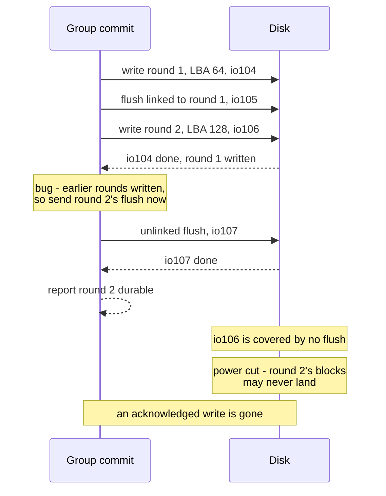
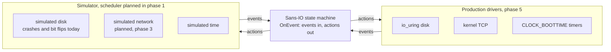
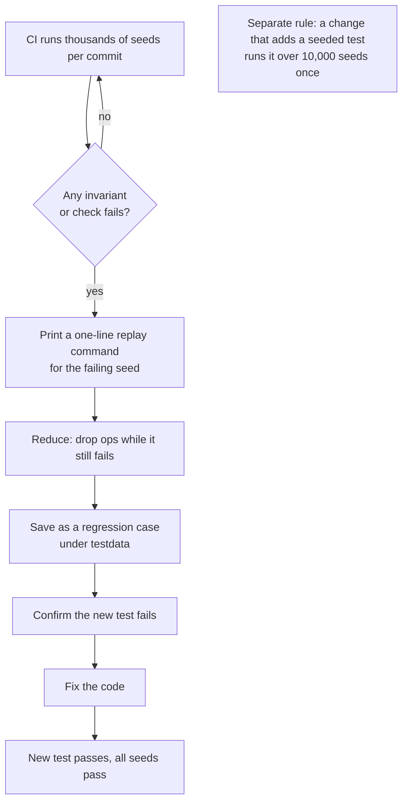

# Testing for trust: how rock-solid proves its storage keeps your data

Storage people wait years before trusting a new storage system, and they are right to: a filesystem that loses one acknowledged write in a million has failed at the one job it has. rock-solid's design says it directly: **trust is the adoption gate, so correctness work is the product.** The plan to earn that trust is a deterministic simulator that replays a whole run from one seed, a simulated disk that crashes and corrupts on purpose, invariants checked after every step, metamorphic tests for the indexes, a fuzz test on every decoder, and a rule that every bug a seed finds becomes a regression test before it is fixed. This post explains each piece, what it catches and what it costs.

Nothing in rock-solid runs yet; the README says so. What exists is phase 1 code: the disk log, with seeded property, torn-write, fuzz and golden-file tests; the LSM tree, with property tests and a fuzz test; and the chunk index, with property tests. All of it runs against a simulated disk. The full cluster simulator, the node-wide crash oracle, the invariant checker and the metamorphic tests are designed and listed in the [build checklist](../docs/build-checklist.md), but not built. The post marks which is which.

## Words you need

- **Sans-IO state machine, event, action, driver.** Code that never does input or output itself. It has one function, `OnEvent`: it takes an event ("disk write finished", "message arrived", "timer fired") and returns actions ("write these blocks", "send this", "wake me at T"). A **driver** carries the actions out, for real or in a simulator. See the [glossary](../docs/glossary.md#runtime-and-drivers).
- **Deterministic simulation, seed.** Running nodes, disks, network and clients inside one process, driven by one random number generator. The same **seed** (the 64-bit number that starts the generator) gives exactly the same run, so any bug it finds can be replayed. See the [glossary](../docs/glossary.md#testing).
- **Invariant.** A rule that must hold at every step, such as "every acknowledged write is readable".
- **Flush (`fsync`), acknowledged write.** A flush tells a drive to move what sits in its volatile cache onto stable media; it covers only writes that completed before it ran. A write is **acknowledged** once the system tells the caller it is durable. Losing an acknowledged write is the cardinal sin. See [Drives and durability](../docs/glossary.md#drives-and-durability).
- **Torn write.** A write of several blocks of which only some landed when power failed.
- **Log, record, LSN.** rock-solid stores everything on a disk in one append-only log. Each append is a record, numbered by a log sequence number (LSN) that only goes up. See [04-one-log-per-disk.md](04-one-log-per-disk.md).
- **Group commit, round.** Collecting every write that arrived while the previous flush ran and making them all durable with one write and one flush. Each batch is a round.
- **Checkpoint, manifest, recovery.** A checkpoint writes the in-memory indexes to the log and then a small **manifest** record saying where they are and from which LSN to replay. Recovery either starts from the newest manifest (**open** mode) or rereads the whole log (**rebuild** mode); both must agree, and both must be a **prefix**: every record up to some LSN and none after it.
- **LSM tree.** The index structure rock-solid uses: writes go to an in-memory table, which is **flushed** out as an immutable sorted **run**; runs are merged in the background (**compaction**). See [06-the-lsm-tree.md](06-the-lsm-tree.md).
- **Property test, fuzz test.** A property test generates many random inputs from a seed and checks a rule that must hold for all of them. A fuzz test lets Go's fuzzer generate inputs, mostly malformed bytes, to find one that breaks a function.
- **Metamorphic test.** Running the same operations under configurations that must not change the results, and comparing what each run read.

## The problem: storage bugs hide in orderings you cannot replay

> **In plain words.** Most storage bugs are not in the code you stare at. They are in a rare order of events: a flush that finishes just before a write, a crash between two particular blocks, a message that arrives late. A real cluster hits such an order rarely and never on demand. If you cannot replay the bug, you cannot be sure you fixed it.

Think of a kitchen inspector who only visits on quiet afternoons. The kitchen always passes. The food poisoning happens on Friday at 9 p.m., when three orders, a fryer fault and a new cook coincide. A storage system is the same: the bug lives in the coincidence.

### How it goes wrong: a real bug from rock-solid's own history

The disk log batches writes into rounds. With `commit_depth` 2 it may have two rounds in flight at once. When every earlier write has completed, the log emits a round's write and its flush together, **linked**: the driver starts the flush only when that write completes (io_uring's `IOSQE_IO_LINK`). Otherwise the flush is sent later, unlinked, and then it covers only writes already finished. So the rule is: a round's flush may go out only once its own write and every earlier round's write have completed.

An early version of group commit got this wrong. It sent round 2's flush as soon as round 1's write completed, without waiting for round 2's own write. Follow round 2's write in the diagram and notice that its flush finishes while that write is still outstanding. (An LBA, logical block address, is a block's number on the disk; `io104` and so on are the IDs the log gives its disk actions.)



On a real machine nothing visibly goes wrong. Round 2's write usually completes a moment later and sits in the drive's volatile cache, covered by no flush. Only a power cut in that window loses it, and afterwards nobody could say which order of completions caused it, let alone repeat it. In rock-solid it was found by **seed 1** of a property test, `TestEveryAcceptedItemDecodes`, one of whose checks is "no record is reported durable before a flush that ran after its write completed". Because a seed found it, it replayed exactly, became a regression test and was fixed. We come back to that test below.

## The options: how storage projects test themselves

> **In plain words.** There are three broad ways to hunt ordering bugs: break a real cluster and watch (realistic, but you cannot replay what you find), run the code inside a deterministic virtual machine (replayable, but someone else's machine and fault model), or write the system so that a simulator can drive it (replayable and cheap, but the code must be built for it from day one). Mature storage engines add their own tricks on top.

The design weighs these in its [testing spike](../docs/design.md#appendix-metamorphic-testing-spike) and [alternatives table](../docs/design.md#alternatives-considered). Pebble is CockroachDB's Go storage engine.

| Approach | Used by | What it gets right | What it costs |
| --- | --- | --- | --- |
| Real-cluster fault injection only | Jepsen-only testing | Real kernels, firmware and networks | A failure cannot be replayed; a rare order may never recur |
| Deterministic hypervisor | Antithesis | Replays a whole run | Not on our own machines; not our disk and page-cache fault model |
| Random stress plus expected state | RocksDB crash test | Checks recovery is a prefix with no hole | Options random per run, no comparison between configurations |
| Metamorphic ops plus `errorfs`, which injects errors by kind, k-th operation and seeded probability | Pebble | Finds bugs nobody wrote a scenario for; crash or fail at every k-th operation | Its crash model never keeps an older overwrite without the newer one; `invariants.Sometimes` draws from a global random source |
| State machine plus data-driven tests and TLA+ | etcd-raft | Protocol tested without real I/O | One protocol, not a whole node |
| Own simulator over a sans-IO core | **rock-solid** | Every component replayable from one seed; own fault model; thousands of seeds per commit | The whole codebase must obey strict rules from day one; the simulator is ours to build |

The design rejects Antithesis because it needs "a detailed disk and page-cache fault model and thousands of seeds per commit on our own machines", and Jepsen alone because it "can't reproduce failures". From the others it borrows: RocksDB's expected state becomes the crash oracle, Pebble's metamorphic test and `errorfs` predicates become the index tests and injected disk errors, etcd-raft's data-driven files hold regression cases, and Jepsen-style runs and TLA+ models sit beside the simulator rather than replacing it.

## What rock-solid picked: simulation first

> **In plain words.** Most testing happens in a simulator that can replay anything, because that is where ordering bugs die cheaply. Real hardware then confirms what a simulator cannot model: kernels, firmware that lies about flushes, real power cuts.

The [Testing strategy](../docs/design.md#testing-strategy) stacks seven layers:

| Layer | What it catches |
| --- | --- |
| 1. Deterministic simulation | Bugs in the order of crashes, partitions and disk faults, replayable from a seed |
| 2. Protocol model checking | Design bugs in the failover, locking and caching protocols, before code exists |
| 3. Consistency checking | Reads that no valid order of operations could produce |
| 4. Real-cluster fault injection | Kernel, firmware and fsync behaviour no simulator knows |
| 5. Matrix and property tests | Placement bugs on mixed hardware; malformed bytes, via fuzzing |
| 6. Conformance suites | Gaps against POSIX (the standard Unix file API) and Kubernetes storage tests |
| 7. Performance regression | Latency, CPU and recovery slowdowns, measured nightly |

The order is deliberate: "Build order puts the simulator before any real driver." The simulator is phase 1; the real io_uring driver is phase 5.

### Sans-IO is what makes simulation possible

> **In plain words.** A simulator can only control what it can intercept. If protocol code reads the clock, opens files or starts goroutines, the operating system decides the order of events and no seed can replay it. So rock-solid's protocol code may do none of that. It receives events and returns actions, like a chess engine that is handed a board and returns a move.

#### How it works

Every machine has one entry point; here is the disk log's, in `internal/disklog`:

```go
func (l *Log) OnEvent(ctx *core.Context, ev *core.Event, out *Output)
```

`ctx.Now` carries the time (1 tick = 1 µs); events are `NetRecv`, `PeerLost`, `DiskDone` or `Timer`, actions `NetSend`, `DiskRead`, `DiskWrite`, `DiskFsync`, `DiskTrim` or `SetTimer` ([Modularity](../docs/design.md#modularity-sans-io-core-pluggable-drivers)). The machine cannot tell whether a production driver or the simulator is on the other side. The diagram shows the swap; the box in the middle is the same code in both worlds.



The rules for these machines each exist to keep a run replayable. No goroutine, channel, `select`, `sync`, clock, `os`, `net`, `syscall` or `unsafe`, since any of them lets the Go runtime or the OS choose an order. No `range` over a map, since Go randomizes map iteration order on purpose and that order would shape the emitted actions. Randomness only from `core.Rand`, ChaCha8 keyed from a 64-bit seed, whose golden-stream test must fail before anyone changes it, because "a change to the generator breaks replay of every recorded regression seed". A machine never blocks: it records what it waits for under an I/O or timer ID, and the matching event resumes it. And errors are data: a corrupt message or a failed disk is an event to handle, never a panic.

Rules nobody checks erode, so a `go vet` analyzer, `tools/sansio`, enforces them on every sans-IO package (everything under `internal/` except `loop`, `driver/…`, `frontend/…` and `csi`). Drivers, which must do real I/O, will be tested with Go's `testing/synctest` for fake time. The same rules make the data path fast; [11-runtime-in-go.md](11-runtime-in-go.md) covers that side.

### The deterministic simulator

> **In plain words.** One random number generator decides everything that happens in the run: which disk action completes next, when to submit more work, when to pull the plug and which unflushed blocks survive. Give it the same seed and you get the same run, down to the last byte.

#### How it works

In the design, "all nodes, disks, clients and the network run in one goroutine from one seeded random number generator", which drops, delays, reorders and duplicates messages and crashes nodes. Once built, it will run thousands of seeds per commit in continuous integration (CI) and millions overnight on idle homelab machines, and two runs of a seed must produce byte-identical traces. What exists today is the simulator's buffer pool and disk, and test harnesses in `internal/disklog` that already work the way the scheduler will: a seeded generator picks each step, the harness executes the chosen disk action against `sim.Disk` and feeds the completion back as an event.

Here is one real seed of `TestRandomCrashesKeepAcknowledgedRecords`, the disk log's random crash test. The setup values are what seed 17 actually draws, and the outcome is what it actually did; the ranges in brackets are what other seeds can draw.

```text
seed 17 ──► core.NewRand(17): every choice below comes from this one stream
 │
 ├─ setup:  disk 65,536 blocks        [1,024 / 4,096 / 65,536]
 │          max record 10 blocks      [3..32]
 │          checkpoint due every 9 blocks of records   [4..200]
 │          commit_depth 1            [1..2]
 │          run pieces whole          [whole or 512 B]
 │
 └─ 4 cycles, each:
     ├─ 300 steps; each step either
     │    • submits 1-4 items (when nothing is pending, else with p = 2/5):
     │      60% chunk writes, 10% punches, 20% small blobs, 10% larger cold blobs
     │    • or completes one pending disk action, picked at random
     │    and the stand-in node starts a checkpoint whenever one is due
     ├─ end: a crash with p = 3/4 (each unflushed block lands with p = 1/2),
     │       otherwise a clean restart
     ├─ recover in rebuild mode, crashing inside recovery's own writes (p = 1/4 each)
     ├─ recover in open mode, its reads completing in random order
     └─ check: recovered LSN between acknowledged and acknowledged + in flight;
               open and rebuild agree; index = model; every block reads back

seed 17 did: 3 crashes, 1 restart, 3 crashes inside recovery, 4 recoveries
             from a manifest, in-flight rounds dropped 4 times, 1 header erased
```

A short legend: a **punch** erases a chunk's blocks; a **blob** is an opaque record such as a batch of Raft entries; **hot** and **cold** are two of the log's streams, each writing into segments of its own; the **stand-in node** is a small model of the chunk store that applies every durable record and checkpoints.

Run seed 17 twice and both runs report exactly that line. A failure message names the seed and cycle (`seed %d cycle %d: ...`), and rerunning that one seed repeats it exactly. Fifty seeds run in every `go test`, and the test then asserts it reached the hard cases; over seeds 1 to 50 it logs 27 in-flight rounds kept and 128 dropped, 44 `NoSpace` errors and 100 crashes inside recovery. A random test that never reaches the interesting paths would report green and prove nothing.

### The simulated disk: a hostile drive on purpose

> **In plain words.** A real drive keeps recent writes in a volatile cache and decides on its own which reach stable media before power fails. Some write half a request, some flip bits, some get slow without ever reporting an error. The simulated disk does these on purpose, so recovery code meets its worst day in the test suite rather than in your homelab.

#### How it works

`sim.Disk` keeps two views of every block: what reads see now, and what is durable. A write updates the first at once and joins a list of unflushed block writes; a flush makes every write executed so far durable. On a crash, **each unflushed block write lands or not on its own, in the order it was executed.** This example from the [test scenarios](../docs/test-scenarios.md) shows a hole: block 1 of a write lands while block 2 does not, and block 0 keeps its old contents.

```text
before:   LBA 0 = 1111 (flushed)    LBA 1 = 0000           LBA 2 = 0000
write:    3-block write of 2s at LBA 0, not flushed
            reads now see:  LBA 0 = 2222  LBA 1 = 2222  LBA 2 = 2222
crash:    landed set = { block 1 }
after:    LBA 0 = 1111 (old)        LBA 1 = 2222 (new)     LBA 2 = 0000 (never written)
```

The design compares this with the crash models of two mature engines. The difference shows with two unflushed writes to one block, an older write A and a newer write B:

```text
                   possible block contents after a crash
crash model        ───────────────────────────────────────────────────────────
rock-solid         old    A    B          each block write lands or not, in order
Pebble crash FS    old         B          random unsynced blocks of the latest contents
RocksDB fault FS   old         B          a random prefix of the unsynced data
```

Only rock-solid's model can keep A without B. The design chose it because "the device's volatile cache can persist any subset", so recovery has to survive every subset.

The design's full fault model adds torn sectors, bit flips, misdirected writes, a disk 100× slower that never errors, and injected errors chosen by action kind, block range, action index and a seeded probability, including a read that "succeeds" with one changed byte. The rule for errors is blunt: "A failed write or flush is final for the open log"; the node runs recovery again rather than retrying, since nobody knows which unflushed blocks reached the media.

Today `sim.Disk` implements crashes, bit flips and failed reads of chosen blocks, and the test harness can fail any chosen action; the rest is the planned "Simulated disk" checklist item.

The buffer pool is hostile too. `sim.Pool` fills every buffer from `Alloc` with the poison byte `0xA5`, so code that assumes zeroed memory fails, and every handle carries a generation, so using a freed or reallocated buffer panics instead of silently reading someone else's data.

### Tests feed events and assert actions, with no mocks

> **In plain words.** You do not need a fake disk to test a state machine. You hand it the event "write 104 finished" and look at what it asks for next. The test reads like a transcript: given this, it must say that.

#### How it works

The project rule: "Unit tests feed events and assert on the returned actions, with no mocks." The regression test for the seed-1 bug is a complete example:

```go
// Seed 1 of TestEveryAcceptedItemDecodes once flushed a round as soon as the rounds before
// it were written, before its own write completed, so the flush covered nothing of it.
func TestAFlushSentLaterWaitsForItsOwnWrite(t *testing.T) {
	cfg := testConfig(0)
	cfg.CommitDepth = 2
	h := formatted(t, gib, cfg)
	h.submit(disklog.Hot, h.write(0, 1, 1))
	h.submit(disklog.Cold, h.write(1, 1, 2))
	h.step(0)
	h.wantTrace("write 64+3 io104", "fsync io105", "write 128+3 io106")
	h.step(1)
	h.wantTrace("write 64+3 io104", "fsync io105", "write 128+3 io106", "fsync io107")
	h.run()
	if len(h.eventsOf(disklog.Durable)) != 2 {
		t.Fatalf("events %+v", h.events)
	}
}
```

`h.step(0)` completes round 1's write, and the trace must not grow. `h.step(1)` completes round 2's write, and only now may `fsync io107` appear.

The design generalizes this into **traces, not logs**: the data path will write fixed-field trace records, one format for simulator and daemon, so "exactly one `DiskFsync` per round" becomes a scan over a trace.

### Invariants registered with the simulator

> **In plain words.** A test checks what its author thought of. An invariant checks a rule after every step of every seed, including steps nobody imagined. It is a smoke detector, not a fire drill.

#### How it works

Each state machine registers its invariants with the simulator's checker "in the same change" that adds the machine. The design's full list covers placement, leases, caching and the cleaner ([Testing strategy](../docs/design.md#testing-strategy)); five that need no other post:

- every acknowledged write is readable, and no read returns a version that is later lost;
- a truncated or punched range reads as zeros;
- a chunk index rebuilt from the log equals the one recovered from its manifest;
- a replayed request returns its first result and changes nothing;
- epochs (the version numbers of the placement table) never go backwards on any node.

The invariant checker is planned; one of its checks already exists, `chunkstore.(*Index).Check`, which verifies that a chunk's map never holds two entries for one block.

Some checks live inside the code itself. Group commit has a `Check` setting: with it on, every record is decoded right after it is encoded, and group commit panics unless it holds exactly the submitted items, so an encoder bug fails in the round that made it instead of in a recovery months later. `TestDecodeCheckCatchesABrokenEncoder` proves the check works: it breaks the encoder five ways and requires a decode-check panic on every one of 100 seeds for each. The LSM tree will get the same kind of check in the planned "Run checks" item.

It is a setting rather than a build tag, as Pebble's is, so that "the simulator chooses per run with the same binary"; Pebble's `invariants.Sometimes` was rejected because its global random source "breaks seed replay". Release builds will keep only cheap checks on: entry counts on every flush and merge, and a CRC32C checksum of each in-memory piece a merge reads, 3.8 to 5.1% of the merge's CPU.

### The crash oracle

> **In plain words.** After a crash, "recovery didn't error" is not good enough. You need to know exactly what the disk should contain, and compare. The crash oracle is the referee who wrote down every acknowledged write and every write in flight before the plug was pulled.

#### How it works

The oracle follows RocksDB's crash test. Per disk, the simulator will keep the state every index had at the last acknowledged LSN, plus the items submitted since, in LSN order. After a crash, recovery reports an LSN somewhere between the acknowledged one and the last in flight. The oracle replays its trace to that LSN, and every index on the disk must equal the result. The number line shows the window recovery may land in.

```text
LSN:    1   2   3   4   5   6   7 │  8   9  │ 10
        ──────────────────────────┼─────────┼────►
        acknowledged durable      │in flight│ never submitted
                          acked=7    7+2=9

recovery may report 7, 8 or 9           (any prefix that keeps every acknowledged write)
recovery may NOT report 6               (lost an acknowledged write)
recovery may NOT keep 9 without 8       (a hole: no prefix)
oracle: replay items 8..recovered onto the state at 7, compare every index on the disk
```

For the disk log alone this already runs: `TestRandomCrashesKeepAcknowledgedRecords` checks `acked ≤ recovered ≤ acked + in flight`, replays the records past the acknowledged LSN onto its model, and requires both recovered indexes to equal it. The planned oracle extends this to every index on a node's disk, and phase 5's real-disk crash test will keep it in a file outside the daemon it kills with `kill -9`.

Random crashes can miss a rare action, such as one particular manifest write, so a planned second test, after Pebble's `TestErrors`, crashes at and separately fails the k-th disk action of a short workload, for every k.

### Metamorphic tests for the indexes

> **In plain words.** Bake the same cake in a gas oven, an electric oven and a camp stove. The baking differs, but if one cake tastes of fish, something is wrong, and you never needed to know what the cake should taste like. A metamorphic test runs the same operations against an index configured in wildly different ways that must not change any answer, and compares the answers.

#### How it works

An LSM tree makes many internal choices: how big the pieces of a run are, when to flush, when and what to merge, whether to consult its Bloom filters. None of them may change what a read returns. So `internal/lsm` and the chunk index are to get a metamorphic test, modelled on Pebble's. A seed generates one ops file: puts, removals (`del`), gets, `floor` (the largest key at or below a given key: `floor aca` asks for the largest key ≤ `aca`), scans, point-in-time views, flushes, failed flushes, compactions and restarts. Keys are reused three times in four, so ops collide. The ops run under several **option sets**, each pushing one choice to an extreme, and each run writes one history line per op; the histories must equal each other and a plain map model's.

```text
seed ─► ops file (3,000 ops)            the spike's option sets (abridged)
        put aa v26x                     F  memtable only: no flush, restart replays all
        get e                           A  1 MiB pieces, the generated flushes and merges
        flush                     ──►   C  256 B pieces, flush every 10 writes, never merge
        del aa                          E  every flush fails once, restart after each
        compact                         G  flush every 2 writes, merge only at 40 runs
        restart                         ...
        floor aca                              │
                                               ▼
                      one history line per op, per set ──► all equal? equal to the model?
```

Here is what a failure looks like, from the [metamorphic testing spike](../docs/design.md#appendix-metamorphic-testing-spike), which planted a bug that makes a flush drop removals. Among the ops before #109, seed 0's file put `aa`, flushed it into a run, deleted `aa` and flushed again. The bug drops the removal in that second flush, so the older run's `aa` comes back to life:

```text
op #109  floor aca
  model, and set F (memtable only, the bug never runs):   none
  set A (flushes run, removal dropped):                    aa=v26x    <── the diff
```

No one had to write a test for "a deleted key reappears after two flushes". The diff found it.

The map model stays, because a bug every option set shares (say, in the memtable) would show in no diff; the diff checks ops, such as views and range removals, that nobody has to model. The metamorphic test is the open "Metamorphic index tests" checklist item; its prototype is the spike harness in [spikes/lsm-study-testing](../spikes/lsm-study-testing/), which drives the real `internal/lsm`.

### A seed that finds a bug becomes a regression test

> **In plain words.** A failing seed is a gift: a replayable recipe for a bug. The rule is to save the recipe as a permanent test *before* fixing the bug, so you watch the test go from red to green, know the fix is real, and the bug cannot quietly return.

#### How it works

The planned flow, from the design and the "Seed runner in CI" checklist item:



Today's two regressions came from seeded property tests in plain `go test`, without a CI runner or a reducer. Seed 1 of `TestEveryAcceptedItemDecodes` gave the flush-ordering bug above. Seed 1 of `TestAnythingSubmitAcceptsDecodes`, which submits items with random kinds and stray fields, found that "a freeze entry carrying an owner was accepted and decoded without it": the record on disk silently differed from what was submitted. Each was turned into a hand-written unit test named for its seed.

**Reduction** matters because a 3,000-op failure is useless to a human: the planned runner removes chunks of ops while the failure persists. In the spike, the planted bug above reduced to five ops, saved in the `datadriven` format Pebble and etcd-raft use (commands, a `----` separator, the expected output):

```text
# P1, seed 0 under A: a flush dropped a removal that hid a key in an older run.
run set=A
put aa v26x
flush
del aa
flush
floor aca
----
floor aca: none
```

### Byte layouts: golden files, torn writes and fuzzing

> **In plain words.** Anything written to disk will be read back years later by newer code, possibly after a crash tore it or a bit flipped. So on-disk formats get the most paranoid tests: the exact bytes are frozen in a file, every way of tearing a record is tried, every single bit is flipped, and a fuzzer throws garbage at every decoder.

#### How it works

**Golden files.** `internal/disklog/testdata/log_format_golden.txt` holds the exact bytes of a superblock, a segment header and a record header. Its first line reads: "Frozen on-disk format of the disk log (FormatVersion 1). Changing any line is a format break that needs a FormatVersion bump." The encoder must reproduce it byte for byte. `internal/core/testdata/chunk_id_golden.txt` freezes the chunk ID packing and placement hash in 10 rows, since a change there would move every chunk.

**Torn writes, exhaustively.** `TestTornBlocksSeed4` takes 40 records of up to 10 blocks and tries every subset of landed blocks over three kinds of old content (zeros, random bytes, another valid record). Decoding must return the whole new record, the whole old one, or an error, never a mixture: more than 1,000 cases. Flipping any single bit of a segment header must make it fail to decode, checked for every bit.

**Fuzzing every decoder.** Every encoding is hand-written, with no reflection, so every decoder is code the project can get wrong, and each gets a native Go fuzz test. The disk log's share one short property: anything the decoder accepts must re-encode to the same bytes.

```go
f.Fuzz(func(t *testing.T, img []byte) {
	d, err := DecodeRecord(img, testPlace, math.MaxUint32, nil)
	if err != nil {
		return
	}
	again, err := AppendRecord(nil, d.Record, d.Entries, d.Data)
	if err != nil || !bytes.Equal(again, img[:len(again)]) {
		t.Fatalf("re-encoding %+v differs: %v", d.Record, err)
	}
	...
})
```

`FuzzRecover` flips bits wherever the fuzzer says in a log of 40 writes and checkpoints, and requires recovery to either fail with `Corrupt`, `CopyOnly` or `NotFormatted`, or resume a log whose next write survives a restart. `FuzzLoadRun` in `internal/lsm` feeds arbitrary bytes as a sorted run: loading must never panic, and any run it accepts must iterate in strictly increasing key order.

### Models, histories, real hardware and numbers

> **In plain words.** A simulator tests code. A model checker tests the idea before code exists. A history checker tests what clients actually saw. Real hardware tests what no simulator can know, like a drive that claims it flushed when it did not. And benchmarks hold the code to the numbers the design relies on.

#### How it works

These layers are all planned. "A new protocol is modeled in TLA+ before it is written": phase 2 models failover, fencing, cache recalls and purges, checked with the TLC model checker, each property tied to a simulator invariant. Every client operation will be recorded as `(invoke_time, complete_time, op, result)` so Porcupine can search for a linearizable order (each operation taking effect at one instant between its start and end). Nightly Jepsen-style runs will inject kills, partitions, disk errors and slow disks. Power cuts, through a server's management port or a smart power strip, with `fio --verify=crc32c` before and after, are "the only honest fsync test", because "some consumer NVMe drives acknowledge flushes they haven't done".

Numbers are decisions too: each is held by a nightly benchmark with the spike's figure as its bar, such as `BenchmarkCRC32CBlock` against 167 ns, and "a 20% regression is a bug". Hot-path benchmarks call `b.ReportAllocs` and must report zero allocations per operation; `BenchmarkGroupCommitRound` and the `internal/lsm` lookup benchmarks already call it. [Testing the design decisions](../docs/design.md#testing-the-design-decisions) maps every kind of decision, from byte layouts to runtime rules, to the test that holds it.

## Evidence

The [metamorphic testing spike](../docs/design.md#appendix-metamorphic-testing-spike) ([spikes/lsm-study-testing](../spikes/lsm-study-testing/)) ran a harness over the real `internal/lsm` with seven option sets, and five one-line bugs planted in copies of the package, on Go 1.27.0 in a virtual machine with 4 shared virtual CPUs:

| Test | Result |
| --- | --- |
| `internal/lsm`, 200 seeds × 3,000 ops × 7 option sets | No divergence from the map model or between option sets; about 99 ms per option set per seed |
| Planted bugs, 20 seeds each | All five found, four on all 20 seeds and one (reads skipping the frozen memtable) on 18 |
| Two of them | A merge installing its output as the oldest run, and a merge dropping removals that hide keys in older runs, showed **only under the set that lets 40 runs wait before a merge** |
| History diff against the model | Every divergence from the model also showed between option sets |
| Reduction | 5 and 7 ops from 3,000 when flushes, failed flushes and restarts are ops; 76 to 354 when an option sets the cadence |

The package's hand-written unit tests also caught all five plants, some with a single test. That is the point, not a disappointment: those scenarios existed because someone had thought of these bugs. The metamorphic test found the same five without knowing where to look, which is what it is for: the net under the scenarios nobody wrote.

The spike also showed that an option set must push each choice to its extreme, or whole bug classes never show, and that a failure reduces well only when structural steps such as flushes are explicit ops.

## Trade-offs and what it costs us

- **The code pays a tax everywhere.** No goroutines, channels, clocks or map iteration in the core; every wait is an ID; every buffer a pool handle. Contributors must learn the rules, and the analyzer makes them unavoidable.
- **We own a simulator.** Choosing it over Antithesis means building and maintaining the scheduler, disk, network, simulated clients, invariant checker and history recorder. Most of it is still phase 1 work.
- **A simulator only knows what we tell it.** A lying drive or a kernel quirk is invisible to it, which is why real-hardware tests and power cuts exist.
- **Seeds cost CI minutes.** A 3,000-op metamorphic seed costs about 99 ms per option set, and each set added costs a run of every seed.
- **Expensive checks are off in release.** The decode check and full run checks run in tests and the simulator only; production data meets only the cheap ones.
- **Option sets need judgement.** Two of five planted bugs hid unless one specific option was at an extreme. Nobody can prove the list of extremes is complete; it grows with the tree.

## Open directions

From the [Roadmap and open questions](../docs/design.md#roadmap-and-open-questions) and the [build checklist](../docs/build-checklist.md):

- **Phase 1 items still open:** the scheduler and trace records, the full simulated disk, crash at every action, the crash oracle, the invariant checker, the history recorder, the seed runner, data-driven regression files, the metamorphic tests and the LSM run checks.
- **Metamorphic cost in CI** is an open question: how many option sets per seed, and how many of them random (Pebble runs as many random sets as standard ones), find the most planted bugs per CI minute?
- **Incarnation fencing in the epoch-change model** is an open question for phase 2's TLA+ work: does a dead daemon's late write need a per-primary table that survives a primary change, or does the epoch rule already reject it?
- **Cross-version runs** start with phase 6: from the first usable release on, the simulator opens the previous release's saved disk images before its own seeds run, as Pebble's cross-version test does.

There are no entries in `docs/tech-debts.md` for the testing machinery today.

## Further reading

- Design: [Testing strategy](../docs/design.md#testing-strategy), [Testing the design decisions](../docs/design.md#testing-the-design-decisions), [Modularity: sans-IO core, pluggable drivers](../docs/design.md#modularity-sans-io-core-pluggable-drivers), [Alternatives considered](../docs/design.md#alternatives-considered) (rows "Testing the indexes", "Regression cases from data", "Checks inside the code", "Crash model of the simulated disk", "Simulation"), [Roadmap and open questions](../docs/design.md#roadmap-and-open-questions), [Landscape and positioning](../docs/design.md#landscape-and-positioning).
- Appendices: [metamorphic testing spike](../docs/design.md#appendix-metamorphic-testing-spike), [LSM study: durability spike](../docs/design.md#appendix-lsm-study-durability-spike).
- Spikes: [spikes/lsm-study-testing](../spikes/lsm-study-testing/), [spikes/lsm-study-durability](../spikes/lsm-study-durability/).
- Scenarios and checklist: [docs/test-scenarios.md](../docs/test-scenarios.md), [docs/build-checklist.md](../docs/build-checklist.md), the [glossary's testing terms](../docs/glossary.md#testing).
- Code: [internal/sim](../internal/sim/), [internal/disklog](../internal/disklog/) (`property_test.go`, `recovery_property_test.go`, `torn_test.go`, `fuzz_test.go`, `groupcommit_test.go`), [internal/lsm](../internal/lsm/), [internal/core/rng.go](../internal/core/rng.go), [tools/sansio](../tools/sansio/).
- Other posts: [01-the-big-picture.md](01-the-big-picture.md), [04-one-log-per-disk.md](04-one-log-per-disk.md) for group commit and recovery, [06-the-lsm-tree.md](06-the-lsm-tree.md) for the index the metamorphic test exercises, [03-epochs-leases-and-failures.md](03-epochs-leases-and-failures.md) for the protocols the TLA+ models cover, [11-runtime-in-go.md](11-runtime-in-go.md) for why the same sans-IO rules make the data path fast.
