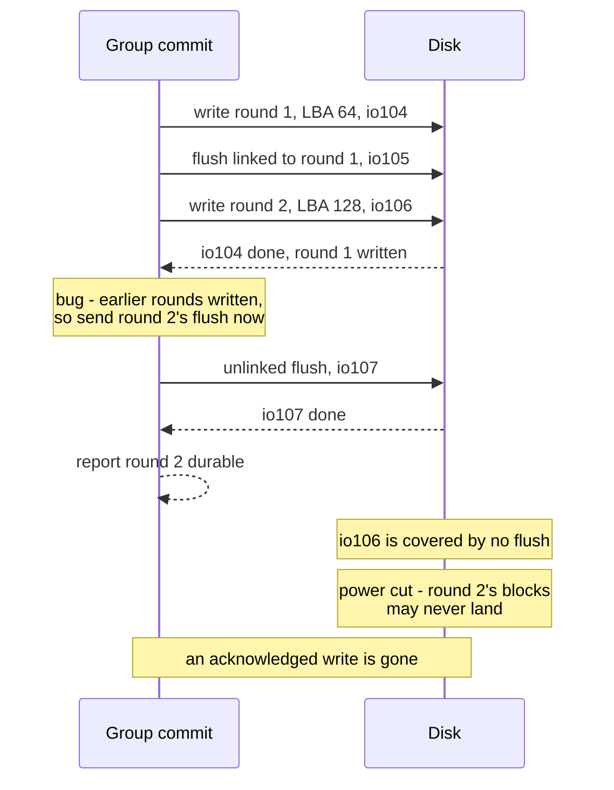
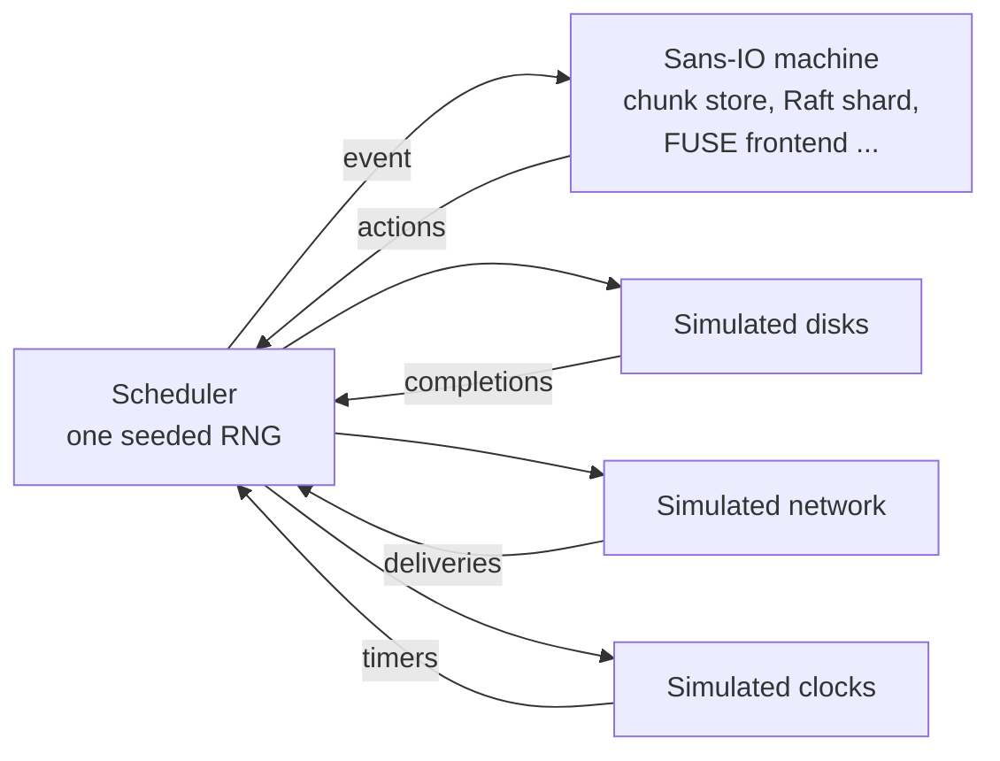
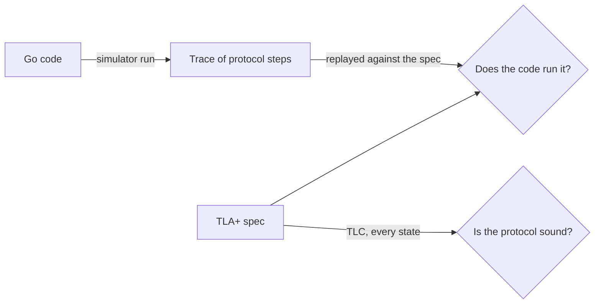

# Testing for trust: how rock-solid proves its storage keeps your data

Storage people wait years before trusting a new storage system, and they are right to: a filesystem that loses one acknowledged write in a million has failed at the one job it has. rock-solid's design says it directly: **trust is the adoption gate, so correctness work is the product.** This post explains how rock-solid tests itself and, more than that, why it tests this way: a deterministic simulator that replays a whole cluster from one seed, a simulated disk that crashes and corrupts on purpose, invariants and a crash oracle checked against independent models, protocol models checked by TLC with the code's own runs checked against them, metamorphic tests for the indexes, and a rule that every bug a seed finds becomes a regression test before it is fixed.

## Words you need

- **Sans-IO state machine, event, action, driver.** Code that never does input or output itself. It has one function, `OnEvent`: it takes an event ("disk write finished", "message arrived", "timer fired") and returns actions ("write these blocks", "send this", "wake me at T"). A **driver** carries the actions out, for real or in a simulator. See the [glossary](../docs/glossary.md#runtime-and-drivers).
- **Deterministic simulation, seed.** Running nodes, disks, network and clients inside one process, driven by one random number generator. The same **seed** (the number that starts the generator) gives exactly the same run, so any bug it finds can be replayed. See the [glossary](../docs/glossary.md#testing).
- **Invariant.** A rule that must hold at every step, such as "every acknowledged write is readable".
- **Flush (`fsync`), acknowledged write.** A flush tells a drive to move what sits in its volatile cache onto stable media; it covers only writes that completed before it ran. A write is **acknowledged** once the system tells the caller it is durable. Losing an acknowledged write is the cardinal sin. See [Drives and durability](../docs/glossary.md#drives-and-durability).
- **Torn write.** A write of several blocks of which only some landed when power failed.
- **Log, record, LSN.** rock-solid stores everything on a disk in one append-only log. Each append is a record, numbered by a log sequence number (LSN) that only goes up. See [04-one-log-per-disk.md](04-one-log-per-disk.md).
- **Group commit, round.** Collecting every write that arrived while the previous flush ran and making them all durable with one write and one flush. Each batch is a round.
- **Recovery, prefix.** After a crash, a disk rebuilds its indexes from the log. What it recovers must be a **prefix**: every record up to some LSN and none after it, with no hole.
- **LSM tree.** The index structure rock-solid uses: writes go to an in-memory table, which is **flushed** out as an immutable sorted **run**; runs are merged in the background (**compaction**). See [06-the-lsm-tree.md](06-the-lsm-tree.md).
- **Property test, fuzz test.** A property test generates many random inputs from a seed and checks a rule that must hold for all of them. A fuzz test lets Go's fuzzer generate inputs, mostly malformed bytes, to find one that breaks a function.
- **Metamorphic test.** Running the same operations under configurations that must not change the results, and comparing what each run read.
- **TLA+, TLC, spec.** TLA+ is a language for describing a protocol as a state machine: the variables each node holds and every step any node, message or fault can take. That description is the **spec** (or model). TLC is the tool that walks every reachable state of a small instance of it and prints a step-by-step trace of any state that breaks a property.

## The problem: storage bugs hide in orderings you cannot replay

> **In plain words.** Most storage bugs are not in the code you stare at. They are in a rare order of events: a flush that finishes just before a write, a crash between two particular blocks, a message that arrives late. A real cluster hits such an order rarely and never on demand. If you cannot replay the bug, you cannot be sure you fixed it.

Think of a kitchen inspector who only visits on quiet afternoons. The kitchen always passes. The food poisoning happens on Friday at 9 p.m., when three orders, a fryer fault and a new cook coincide. A storage system is the same: the bug lives in the coincidence.

### How it goes wrong: a real bug from rock-solid's own history

The disk log batches writes into rounds, and may have two rounds in flight at once. When every earlier write has completed, the log emits a round's write and its flush together, **linked**: the driver starts the flush only when that write completes (io_uring's `IOSQE_IO_LINK`). Otherwise the flush is sent later, unlinked, and then it covers only writes already finished. So the rule is: a round's flush may go out only once its own write and every earlier round's write have completed.

An early version of group commit got this wrong. It sent round 2's flush as soon as round 1's write completed, without waiting for round 2's own write. Follow round 2's write in the diagram and notice that its flush finishes while that write is still outstanding. (An LBA, logical block address, is a block's number on the disk; `io104` and so on are the IDs the log gives its disk actions.)



On a real machine nothing visibly goes wrong. Round 2's write usually completes a moment later and sits in the drive's volatile cache, covered by no flush. Only a power cut in that window loses it, and afterwards nobody could say which order of completions caused it, let alone repeat it. In rock-solid it was found by an early seed of a property test whose checks include "no record is reported durable before a flush that ran after its write completed". Because a seed found it, it replayed exactly, became a regression test and was fixed. That is the whole argument of this post in one bug: the order was rare, the damage silent, and only a replayable run made it fixable.

## The options: how storage projects test themselves

> **In plain words.** There are three broad ways to hunt ordering bugs: break a real cluster and watch (realistic, but you cannot replay what you find), run the code inside a deterministic virtual machine (replayable, but someone else's machine and fault model), or write the system so that a simulator can drive it (replayable and cheap, but the code must be built for it from day one). Mature storage engines add their own tricks on top.

Pebble is CockroachDB's Go storage engine.

| Approach | Used by | What it gets right | What it costs |
| --- | --- | --- | --- |
| Real-cluster fault injection only | Jepsen-only testing | Real kernels, firmware and networks | A failure cannot be replayed; a rare order may never recur |
| Deterministic hypervisor | Antithesis | Replays a whole run | Not on our own machines; not our disk and page-cache fault model |
| Random stress plus expected state | RocksDB crash test | Checks recovery is a prefix with no hole | Options random per run, no comparison between configurations |
| Metamorphic ops plus injected errors | Pebble | Finds bugs nobody wrote a scenario for | Its crash model never keeps an older overwrite without the newer one |
| State machine plus data-driven tests and TLA+ | etcd-raft | Protocol tested without real I/O | One protocol, not a whole node |
| Model checking of the design | Amazon (DynamoDB, S3), MongoDB, CockroachDB | Finds deep bugs in fault and recovery paths before code exists | Checks the design, not the code that claims to follow it |
| Own simulator over a sans-IO core, checked against TLA+ specs | **rock-solid** | Every component replayable from one seed; own fault model; the code's runs checked against the checked design | The whole codebase must obey strict rules from day one; the simulator is ours to build |

The design rejects Antithesis because it needs a detailed disk and page-cache fault model and thousands of seeds per commit on our own machines, and Jepsen alone because it cannot reproduce failures ([Alternatives considered](../docs/design.md#alternatives-considered)). From the others it borrows: RocksDB's expected state becomes the crash oracle, Pebble's metamorphic test and error injection become the index tests and injected disk errors, etcd-raft's data-driven files hold regression cases, and model checking sits beside the simulator, joined to it by a conformance check, rather than replacing it.

## What rock-solid picked: simulation first

> **In plain words.** Most testing happens in a simulator that can replay anything, because that is where ordering bugs die cheaply. Protocol models check the design itself, and the simulator's runs are checked against those models, so the code is known to follow a design that was checked. Real hardware then confirms what neither can model: kernels, firmware that lies about flushes, real power cuts.

The [Testing strategy](../docs/design.md#testing-strategy) stacks seven layers:

| Layer | What it catches |
| --- | --- |
| 1. Deterministic simulation | Bugs in the order of crashes, partitions and disk faults, replayable from a seed |
| 2. Protocol models | Design bugs before code exists, and code that drifts from the checked design |
| 3. Consistency checking | Reads that no valid order of operations could produce |
| 4. Real-cluster fault injection | Kernel, firmware and fsync behaviour no simulator knows |
| 5. Matrix and property tests | Placement bugs on mixed hardware; malformed bytes, via fuzzing |
| 6. Conformance suites | Gaps against POSIX (the standard Unix file API), the kernel's file-mapping corner cases and Kubernetes storage tests |
| 7. Performance regression | Latency, CPU and recovery slowdowns, measured nightly |

The order is deliberate: the simulator was built before any real driver, so every component was born replayable.

### Sans-IO is what makes simulation possible

> **In plain words.** A simulator can only control what it can intercept. If protocol code reads the clock, opens files or starts goroutines, the operating system decides the order of events and no seed can replay it. So rock-solid's protocol code may do none of that. It receives events and returns actions, like a chess engine that is handed a board and returns a move.

#### How it works

Every core package is a state machine with one entry point. Time arrives as part of the event's context, from two clocks (one a time daemon may slew and one it cannot), and randomness from a seeded source the machine owns. The rules, enforced by a static analyzer that fails the build ([post 11](11-runtime-in-go.md)):

- no goroutine, channel, `select`, `sync` or `sync/atomic`;
- no clock, `os`, `net`, `syscall` or `unsafe`;
- no `range` over a map, because Go randomizes map iteration order, and one random order is enough to make two runs of a seed differ.

A corrupt message or a failed disk is an event the machine handles, never a reason to crash; a panic is kept for a broken invariant of the machine's own state.

The same code then runs under two drivers. In production, an event loop per core feeds it real completions from io_uring and epoll. In the simulator, one scheduler feeds every machine of every node in one goroutine, in an order drawn from the seed. The protocol code cannot tell which.



### Drivers: stepped by the same scheduler

> **In plain words.** The parts that cannot be sans-IO, the event loop and the drivers that talk to the kernel, are tested too, by making most of what they decide come from what they just read, so a test can hand them readings instead of a real kernel.

The event loop and its drivers are tested in three tiers ([driver testing study](../studies/driver-testing/README.md)): stepped runs on every commit, in which a stepped kernel stands behind the loop's kernel interface and a seed fixes every completion; runs against a real Linux kernel in the gate, which count syscalls and allocations per pass; and nightly runs in virtual machines that really pause, step their wall clock or fail their devices. Stepped runs check what a pass decides; the real tiers check that the kernel and the clocks behave the way the stepped model assumed.

### The deterministic simulator

> **In plain words.** One program plays an entire cluster: every node, disk, network link and client. A single seed decides every coin flip, so a run that fails can be played again, step for step, as often as needed.

#### How it works

All nodes, disks, clients and the network run in one goroutine from one seeded random number generator. The simulator drops, delays, reorders and duplicates messages, partitions the network, crashes, restarts, reboots and pauses nodes, and runs each node's clocks at rates of their own. A failing seed replays exactly, and two runs of a seed give byte-identical traces, across processes, CPU counts and the race detector.

Every seeded test takes its seeds from one place: a few on every `go test`, thousands under a seed script that CI runs on every push. A failing seed prints the one-line command that replays it. A change that adds a seeded test runs it over many more seeds once, as Pebble stresses every test a pull request adds, because a new test is the most likely to hide a seed it fails on.

**Planted bugs.** A simulator that finds nothing might be blind, so it proves itself on a toy primary-backup protocol whose bugs are known. Settings plant one of two bugs: acknowledging a value once only the primary has it, and mistaking a reply to an earlier incarnation's write for one to the restarted primary's write, which only a primary crash with that reply in flight exposes. Each must be found within the seeds every commit runs, replay to a byte-identical trace, and vanish when the protocol is fixed. The same idea, a known bug the check must catch, recurs below for invariants, the crash oracle and conformance.

### The simulated disk: a hostile drive on purpose

> **In plain words.** A real drive keeps recent writes in a volatile cache and decides on its own which reach stable media before power fails. Some write half a request, some flip bits, some get slow without ever reporting an error. The simulated disk does these on purpose, so recovery code meets its worst day in the test suite rather than in your homelab.

#### How it works

The simulated disk keeps two views of every block: what reads see now, and what is durable. A write updates the first at once and joins a list of unflushed block writes; a flush makes every write executed so far durable. On a crash, **each unflushed block write lands or not on its own, in the order it was executed.** A worked example of a hole: block 1 of a three-block write lands, its neighbours do not.

```text
before:   LBA 0 = 1111 (flushed)    LBA 1 = 0000           LBA 2 = 0000
write:    3-block write of 2s at LBA 0, not flushed
            reads now see:  LBA 0 = 2222  LBA 1 = 2222  LBA 2 = 2222
crash:    landed set = { block 1 }
after:    LBA 0 = 1111 (old)        LBA 1 = 2222 (new)     LBA 2 = 0000 (never written)
```

The design compares this with the crash models of two mature engines. The difference shows with two unflushed writes to one block, an older write A and a newer write B:

```text
                   possible block contents after a crash
crash model        ───────────────────────────────────────────────────────────
rock-solid         old    A    B          each block write lands or not, in order
Pebble crash FS    old         B          random unsynced blocks of the latest contents
RocksDB fault FS   old         B          a random prefix of the unsynced data
```

Only rock-solid's model can keep A without B. The design chose it because a device's volatile cache can persist any subset of what it holds, so recovery has to survive every subset, not just the convenient ones.

The full fault model adds torn sectors, bit flips, misdirected writes, a disk that turns very slow without ever erroring, and injected errors chosen by action kind, block range, action index and a seeded probability, including a read that "succeeds" with one changed byte. The rule for errors is blunt: a failed write or flush is final for the open log, and the node runs recovery again rather than retrying, because after a failed flush nobody knows what the drive kept.

The buffer pool is hostile too. It fills every new buffer with a poison byte, so code that assumes zeroed memory fails, and every handle carries a generation, so using a freed or reused buffer fails loudly instead of silently reading someone else's data.

### The simulated world: networks, clocks, paused VMs and a full pool

> **In plain words.** Disks are not the only liars. Networks lose and reorder messages, clocks run fast or slow, a virtual machine can be frozen for minutes and wake up believing no time passed, and a pool can fill up while a dozen nodes still hold buffered writes. Each of these breaks a different promise, so the simulator does all of them on purpose too.

#### How it works

- **Network:** drops, delays, duplicates, reorders, one-way and full partitions, and a connection that resets with bytes still queued, which is how a dead daemon's stray write reaches a primary ([post 09](09-rwx-filesystem-and-cache-coherence.md#daemon-restart-and-upgrade)).
- **Clocks:** each node's two clocks run at rates of their own, within the drift the design allows and with the slew a time daemon may add, so every lease is tested on its worst legal clock ([post 03](03-epochs-leases-and-failures.md#two-clocks-because-a-time-daemon-can-bend-either-one)).
- **Pauses:** a node frozen for longer than any lease, then resumed, with or without the signal that it was suspended, the case that separates a lease that is safe from one that only looks safe.
- **Capacity:** pools driven to full while daemons hold space grants, so the promise that a buffered write never fails later for space is tested at the edge where it matters.

Each area's runs inject their faults at the step the protocol is least ready for: a crash between a write and its acknowledgment, a partition during peering, a pause while a lease is about to be renewed.

### Tests feed events and assert actions, with no mocks

> **In plain words.** A mock is a fake object that pretends to be a disk or a network and checks it was called in some expected way. Mocks test what the author expected, which is rarely where the bug is. Because rock-solid's code takes events and returns actions, a test can feed it real events and look at the real actions, with nothing faked.

#### How it works

A unit test builds a machine, feeds it a sequence of events, and asserts on the actions it returned: "after these three writes and one completion, emit exactly one flush, linked to the second write". The same assertion runs again inside the simulator over thousands of seeds, where the events arrive in orders nobody wrote by hand. Cases whose input is data, such as which runs a compaction picks, live in data-driven files, as etcd-raft and Pebble keep theirs, so adding a case is adding a few lines of text.

The design's [Testing the design decisions](../docs/design.md#testing-the-design-decisions) table assigns each kind of decision the test that holds it: a byte layout to golden files and fuzzing, what a state machine emits to trace checks, what must hold across a run to invariants and a TLA+ model, an internal choice that must not change results to a metamorphic test, a rule about the runtime to a static analyzer, and a number the design relies on to a benchmark with the spike's figure as its bar. The test is written with the decision, so a decision nobody can test is a decision nobody has really made.

### Invariants registered with the simulator

> **In plain words.** An invariant is a sentence about the whole system that must be true after every step: "every acknowledged write is readable", "a placement group has one primary". The simulator checks every registered sentence after every step, so a bug is caught at the step that caused it, not hours later when a user notices.

#### How it works

Each invariant is registered by name as its component is built, most specific first, so a bug that breaks several is named by the one closest to it. Some hold of what a store contains, and are checked whenever its disk goes quiet and after every recovery; some hold of a moment, such as two primaries serving at once, and are checked after every step, because the violation can end before the run goes quiet.

The rule that makes invariants worth having: **no check shares the code's own bookkeeping.** The byte-range oracle is a plain model of the bytes each acknowledged request sent, not a reading of the store's index; a check on reused space decodes what is on disk rather than asking the allocator. If a check and the code shared a data structure, a bug in it would fool both, and the run would pass with the bug inside.

A new invariant arrives in the same change as the component it guards. A component without its invariants is not finished, however well its unit tests pass.

### The crash oracle

> **In plain words.** After a simulated power cut, how do you know recovery got the right answer? You keep, on the side, an independent record of what was written and acknowledged, and after the crash you work out what the disk should hold and compare.

#### How it works

As RocksDB's crash test does with its expected state, the simulator keeps, per disk, the state every index had at the last acknowledged LSN and the records written since, in LSN order. After a crash, recovery reports the LSN it reached, which must lie between the last acknowledged one and the last one in flight. The oracle replays its own record to that LSN, and every index on the disk, the chunk index and each Raft shard replica, must equal the result, with no hole.

```text
records written:    101  102  103  104  105  106
acknowledged:       ---------------->|
in flight:                            105  106
crash, recovery reports LSN 105
oracle:             replay its own copy of 101..105
check:              every index on disk == oracle's state at 105
                    nothing of 106, nothing missing before 105
```

The oracle's record is independent of the code under test: it decodes each round from the write as it goes to the disk, and checks every decoded entry against what was submitted, so a codec bug that the oracle shared with recovery would still fail. A crash can be injected at every single disk action of a run, so recovery meets every point at which power can fail.

### Metamorphic tests for the indexes

> **In plain words.** An index has many internal choices: how big its pieces are, when it flushes, when it merges. None of them may change what a read returns. So the same list of operations is run under many settings at their extremes, and every run must read exactly the same thing.

#### How it works

As Pebble's metamorphic test does, a seed generates one operations file of writes, removals, range removals, gets, scans and point-in-time views, with flushes, failed checkpoints, compactions and restarts as operations too, and keys reused so operations collide. The file runs under a list of option sets, each pushing one choice to an extreme: tiny pieces, constant flushes, merges held back or restarted, filters off or always answering "maybe", flushes that fail. Each run writes one history line per operation, and the histories must equal each other and a plain map model's. One runner serves both the LSM tree and the chunk index.

The [metamorphic testing spike](../spikes/lsm-study-testing/) set the two rules that make this work. An option set must push its choice to the extreme, because some planted bugs showed only under one extreme setting and under no moderate one. And flushes and restarts must be operations in the file, not timers, or a failing run cannot be reduced to a short case.

### A seed that finds a bug becomes a regression test

> **In plain words.** When a seed finds a bug, the first thing written is not the fix, but a test that fails because of the bug. Then the fix makes it pass. The bug can never quietly come back.

#### How it works

A failing seed prints the command that replays it, and for a test with an operations file, a reduced file of the fewest operations that still fail. That case, or a test of the failing seed, lands in the change before the fix and fails without it. Reduced cases become data-driven regression files, readable by a person:

```text
# A flush dropped a removal that hid a key in an older run.
run set=A
put aa v26x
flush
del aa
flush
floor aca
----
floor aca: none
```

That case came from a planted bug in the metamorphic spike, reduced from thousands of operations to five, in the `datadriven` format Pebble and etcd-raft use: commands, a `----` separator, the expected output.

The order matters for a reason: a test written after the fix may pass for the wrong reason, and nobody would know. Seeing it fail first proves it exercises the bug.

### Byte layouts: golden files, torn writes and fuzzing

> **In plain words.** Everything rock-solid writes to disk or sends over the network has a byte layout, and a layout that changes by accident makes old disks unreadable. So each layout is pinned by golden files, attacked by torn writes and bit flips, and fed garbage by a fuzzer.

#### How it works

- **Golden files** under `testdata/` hold the exact bytes of superblocks, record headers, manifests, keys and chunk IDs; the code must reproduce them byte for byte, so a layout change shows up as a failed test, not as an unreadable disk next year.
- **Bit flips and torn writes:** an exhaustive test flips every single bit of a record and checks the checksum catches it; a property test lands every subset of a record's blocks and checks recovery stops cleanly at the tear.
- **Fuzzing:** every decoder has a native Go fuzz test, because a decoder takes bytes from disks and networks, and those bytes can be anything.
- **Checks inside the code:** group commit decodes each record it is about to write and asserts that it holds exactly the submitted items, so an encoder bug fails in the round that made it instead of in a later recovery, as RocksDB's paranoid checks do. These run in tests and the simulator, not in release builds.

### Models, histories, real hardware and numbers

> **In plain words.** A simulator checks the code, but only in the states its seeds happen to reach. A protocol model checks the design in every state of a small cluster, including ones a simulator would need years to stumble on. The two are joined: the code's simulated runs are replayed against the model, step by step, so passing tests mean the code follows a design that was checked, not merely that no seed found a bug.

#### How it works

**Why models.** The bugs model checking finds lie deep in fault and recovery paths: Amazon's models found a 35-step data loss in DynamoDB's replication protocol that had passed design reviews, code reviews and fault injection ([protocol models study](../studies/protocol-models/README.md)). No seed budget reliably reaches 35 precise steps. So every protocol is modelled in TLA+ under `models/` before its code, and TLC checks its properties, such as "an acknowledged write survives every failover", over every reachable state of a small instance.

**From spec to code.** A model checks the design, not the code that claims to follow it, and the gap between the two is where a checked design quietly stops protecting anyone. rock-solid's measure of success is therefore not how many bugs the models find, but whether **the code runs a protocol TLC has checked**. That splits into two questions with two checks:



The conformance check answers the second. A simulator run records each protocol step as a fixed-field trace record; a small tool turns the trace into data TLC can read; and a trace spec takes each line as the spec action it names and checks that the state the code reported is one that action can produce, with every safety property intact. It holds only when all three parts hold:

- **Every trace passes,** as a behavior of the spec.
- **Traces can fail:** removing a rule from the code (a *plant*) makes a trace fail, so the check is not silently accepting everything.
- **Traces cover the spec:** every action of the spec appears in some trace, and any that does not is listed.

A discrepancy is settled as one of four kinds: the code is wrong, the spec left out or got wrong a detail, a spec action compresses steps the code takes apart, or the logging is wrong. The code is fixed, or the spec is patched, and the work goes on. A patched spec is the protocol kept, not thrown away: a spec is right until shown wrong, and code follows it. A clean run is the result wanted, not a sign the check is idle.

A *model gate* runs on every commit: a commit that changes a protocol file must change a spec too, or say why not (a timer, a buffer or accounting needs no model; a new step, message or rule does). And each property a model checks names the simulator invariant that asserts it on the code, so a property TLC proved of the design is also checked on every seeded run.

**Histories.** Every client operation is recorded with when it started and when it finished, from simulation and real clusters alike, and a checker (Porcupine) searches for an order of operations that explains every result: linearizable for chunks and write-shared files, close-to-open for the rest. A history no valid order explains is a bug, whatever the invariants said.

**Real hardware.** Simulation knows only what we told it. Jepsen-style nemesis runs kill, partition and slow a real multi-node cluster under a file workload; POSIX and file suites (`pjdfstest`, single and multi-client `fsx`), Kubernetes' `csi-sanity` and a subset of Samba's smbtorture catch gaps against the standards; real power cuts on real drives test firmware that lies about flushes.

**Numbers.** A number the design relies on, such as the cost of a checksum per block, becomes a benchmark with the spike's figure as its bar, run nightly, and a large regression is a bug. Hot-path benchmarks must report zero allocations per operation ([post 11](11-runtime-in-go.md)).

**The gate.** A change reaches main only through a passing CI run on its exact commit: lint and the model gate, the tests, the seeded tests over their per-commit seeds, each protocol model's CI configurations and, for a change to a protocol's code, its conformance traces.

## Evidence

- **Metamorphic tests find what scenario tests miss.** The [metamorphic testing spike](../spikes/lsm-study-testing/) planted five one-line bugs in copies of the LSM tree and found all five without knowing where to look; two showed only under one extreme option set. The package's hand-written tests also caught all five, which is the point rather than a disappointment: those tests existed because someone had thought of those bugs, and the metamorphic test is the net under the scenarios nobody wrote.
- **Crash models differ in what they allow,** and only the subset model keeps an older overwrite without the newer one ([LSM study: durability spike](../spikes/lsm-study-durability/)).
- **Model checking finds deep bugs:** the [protocol models study](../studies/protocol-models/README.md) reads how Amazon, MongoDB and CockroachDB found bugs at depths no test reached, which is why every rock-solid protocol gets its model before its code.
- **The group-commit bug** at the top of this post is the case for seeded property tests: found by a seed, replayed exactly, fixed behind a regression test.

## Trade-offs and what it costs us

- **The code pays a tax everywhere.** No goroutines, channels, clocks or map iteration in the core; every wait is an ID; every buffer a pool handle. Contributors must learn the rules, and the analyzer makes them unavoidable.
- **We own a simulator.** Choosing it over Antithesis means building and maintaining the scheduler, disk, network, clients, invariant checker, crash oracle and history recorder.
- **A simulator only knows what we tell it.** A lying drive or a kernel quirk is invisible to it, which is why real-hardware tests and power cuts exist.
- **Models cost machine time and care.** A model's full search can take hours, so heavy runs happen at milestones, not per commit; conformance traces are expensive enough to run in the gate rather than on every save. A spec states the protocol, not every line, so its details need patching as code meets them.
- **Seeds cost CI minutes,** and every option set added to a metamorphic test costs a run of every seed.
- **Expensive checks are off in release.** The decode check and full run checks run in tests and the simulator only; production data meets only the cheap ones.
- **Option sets need judgement.** Some bugs hide unless one specific option is at an extreme. Nobody can prove the list of extremes is complete; it grows with the tree.

## Open directions

From the [Roadmap and open questions](../docs/design.md#roadmap-and-open-questions):

- **Metamorphic cost in CI:** how many option sets per seed, and how many of them random (Pebble runs as many random sets as standard ones), find the most planted bugs per CI minute?
- **Where overnight runs of millions of seeds live,** and how their failures reach a person.
- **Cross-version runs:** from the first usable release on, the simulator opens the previous release's saved disk images before its own seeds run, as Pebble's cross-version test does.

## Further reading

- Design: [Testing strategy](../docs/design.md#testing-strategy), [Testing the design decisions](../docs/design.md#testing-the-design-decisions), [Modularity: sans-IO core, pluggable drivers](../docs/design.md#modularity-sans-io-core-pluggable-drivers), [Alternatives considered](../docs/design.md#alternatives-considered), [Roadmap and open questions](../docs/design.md#roadmap-and-open-questions).
- Spikes and studies: [spikes/lsm-study-testing](../spikes/lsm-study-testing/), [spikes/lsm-study-durability](../spikes/lsm-study-durability/), [studies/protocol-models](../studies/protocol-models/README.md), [studies/driver-testing](../studies/driver-testing/README.md).
- Models: [`models/`](../models/).
- The [build checklist](../docs/build-checklist.md) and the [glossary's testing terms](../docs/glossary.md#testing).
