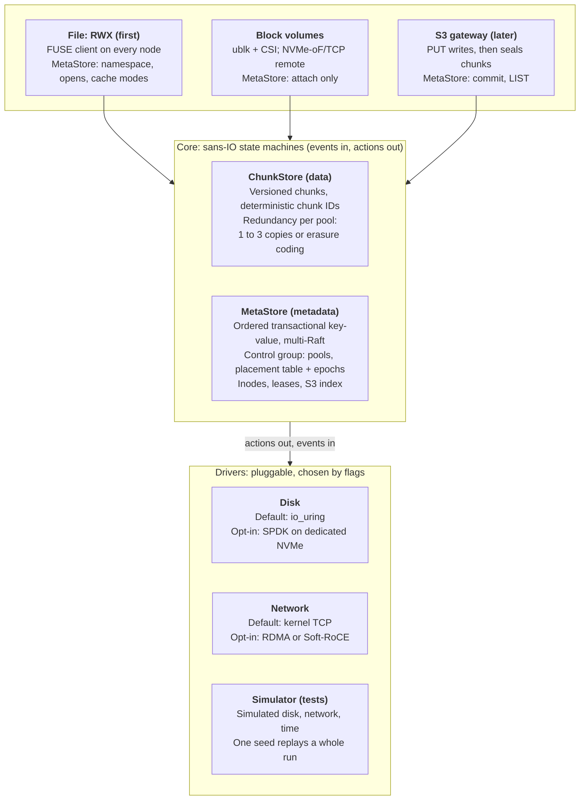
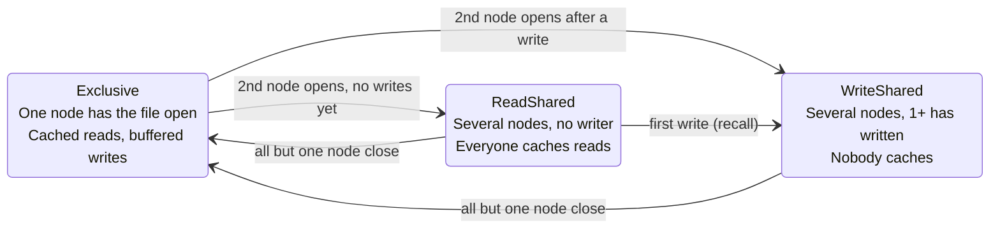
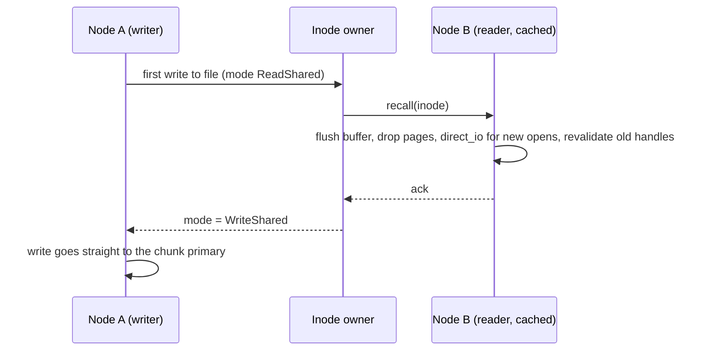
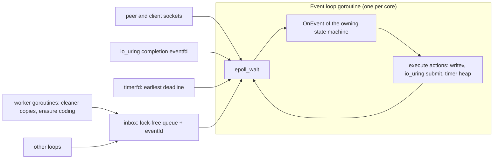

# rock-solid design

Terms such as primary, placement group, epoch or fencing are explained in the [glossary](glossary.md).

## Goals

Build a distributed storage system in Go ([Runtime in Go](#runtime-in-go)) whose headline feature is **ReadWriteMany (RWX) shared filesystems** for a 3 to 10 node homelab Kubernetes cluster: many pods on many nodes mounting one directory, with no NFS gateway in the path, caching that stays correct when files are shared, and Longhorn-level ease of install. Block volumes come from the same core, at near-raw NVMe latency.

**Target user:** homelab and small-cluster Kubernetes operators. They have several NVMe or SATA solid-state drives per node, 10 to 25 Gigabit Ethernet (GbE), and some nodes with Remote Direct Memory Access (RDMA) capable cards. For RWX today they choose between a Network File System (NFS) server (single server, fragile), Longhorn RWX (an NFS server pod in front of each volume), JuiceFS (needs an external metadata database and object store) and CephFS (heavy on RAM, CPU and operator knowledge).

**Product goals, in priority order**

1. **RWX filesystem** (`volumeMode: Filesystem`, `ReadWriteMany`): a Filesystem in Userspace (FUSE) client on every node, talking straight to the storage nodes, with close-to-open consistency first and automatic per-file cache coherence next.
2. **Block volumes**: ReadWriteOnce (RWO) Persistent Volume Claims (PVCs), plus RWX block for KubeVirt live migration.
3. **S3** later, on the same core.
4. **Easy to run:** a single binary (one daemon per node, which also serves as the FUSE client) plus a Container Storage Interface (CSI) driver. No hugepages, pinned cores or external database to get started.
5. **Low CPU per operation**, so storage does not eat the cluster.
6. **Permissive license** (Apache 2.0).

**Performance targets.** Stated as round trips, because absolute numbers depend on the network and drives.

| Operation | Target cost |
| --- | --- |
| Read of a cached file (one writer, or readers only) | Page-cache speed: no FUSE or network trip (0.3 µs per 4K measured) |
| Read or write of a file being written from two or more nodes | One network round trip to the chunk primary, plus about 5 to 20 µs of FUSE overhead |
| `stat`, `lookup` within the cache timeout | Local |
| `stat`, `lookup` after a cache miss | One round trip to the MetaStore shard leader (lease read, no disk write) |
| `create`, `unlink`, same-directory `rename` | One Raft commit on one shard |
| `open` of a file | One round trip to the inode's owner (memory only, no disk write) |
| Block 4K write at queue depth 1 | Around 0.1 ms (Vitastor class) on drives with power-loss protection; Ceph is around 1 ms. Consumer drives without it floor at about 1 ms per durable write ([NVMe flush spike](#appendix-nvme-flush-spike)) |

**Learning goals:** Go for systems code, the Storage Performance Development Kit (SPDK), the Data Plane Development Kit (DPDK) and RDMA, extended Berkeley Packet Filter (eBPF) tracing, plus distributed-systems correctness testing.

**Non-goals for v1:** Server Message Block (SMB) file sharing for macOS and Windows clients, GPU-cluster scale, shared-writable `mmap` across nodes, cross-directory hard links, a custom kernel module, and authentication or encryption between daemons. v1 trusts the cluster network: any host that can reach a daemon's port can read and write any volume.

## Landscape and positioning

The open gap is **RWX without a gateway**: every client reads and writes the storage nodes directly, caches aggressively while it is safe, and stops caching automatically when it is not. It installs like Longhorn and is licensed like SeaweedFS.

| System | What it covers | Why it doesn't fill the gap |
| --- | --- | --- |
| Longhorn | Easy Kubernetes block; RWX through a share-manager pod running NFS-Ganesha | All RWX traffic goes through one pod per volume: a bottleneck and a failover pause |
| [JuiceFS](https://github.com/juicedata/juicefs) | FUSE file system, CSI driver, Apache 2.0 | Needs an external metadata engine (Redis, TiKV, SQL) and an object store; close-to-open consistency only |
| CephFS | POSIX file system with full client capabilities | Around 1 ms writes, heavy CPU and RAM, steep operations learning curve |
| [SeaweedFS](https://github.com/seaweedfs/seaweedfs) | Single binary, S3, FUSE mount, CSI driver | Built around objects; no cache-coherence protocol for shared writes |
| [Vitastor](https://vitastor.io) | Ceph-like block, file, S3 at around 0.1 ms | Solo project; server under a GPL-based network-copyleft license that deters adopters |
| [OpenEBS Mayastor](https://github.com/openebs/mayastor) | Rust + SPDK + NVMe over Fabrics (NVMe-oF) block | Block only; requires hugepages and dedicated cores |
| [Weka](https://docs.weka.io/weka-system-overview/weka-client-and-mount-modes), DAOS, [DeepSeek 3FS](https://github.com/deepseek-ai/3fs) | AI-cluster file systems with kernel bypass | Built for GPU clusters; commercial or heavy to deploy |
| [MinIO](https://github.com/minio/minio), [RustFS](https://github.com/rustfs/rustfs), Garage | S3 | Object storage only |

**Takeaways**

- Homelab RWX today means NFS somewhere in the path. Removing it is the visible win.
- Weka shows that per-file cache-mode switching gives most of the benefit of full client capabilities with a much smaller protocol. Our spike shows it can be done on FUSE, without a kernel module (see [FUSE coherence spike](#appendix-fuse-coherence-spike)).
- Vitastor proves one person can get a 10x latency win over Ceph without DPDK, by shortening the code path. The same lean core serves block.
- Trust is the adoption gate. Storage people wait years before trusting a new system, so correctness work is the product.

## Strategy

Win on a short code path, correct caching and low CPU per operation. Kernel bypass is an opt-in fast path, never a requirement.

On homelab hardware the network caps throughput before the kernel does:

```
one NVMe Gen4 drive:  ~7 GB/s sequential, 4K write in ~0.04 ms (into its write cache)
10 GbE link:          ~1.2 GB/s
25 GbE link:          ~3 GB/s
kernel TCP stack:     saturates 10-25 GbE with one or two cores
```

So DPDK buys almost no throughput here. The latency gap between the disk and Ceph is almost all software path, which is what we attack. One caveat: a *durable* write is bounded by the drive's flush latency. On the consumer NVMe drive we measured, a 4K write plus flush takes 0.95 ms at p50 and about 2 ms after the drive has idled for 100 ms ([NVMe flush spike](#appendix-nvme-flush-spike)), so the 0.1 ms block target applies to drives with power-loss protection.

**Principles**

1. **RWX first:** the file frontend and its coherence protocol are the first usable product. Block and S3 reuse the same core.
2. **Lean data path:** client → chunk primary in one hop → log append in parallel with sends to replicas → acknowledge. Every frontend uses it.
3. **Cache where safe, never where unsafe:** a file is cached on a node only while no other node writes it. Correctness never depends on timeouts alone.
4. **Defaults that need no tuning:** `io_uring` for disk, kernel TCP for network, FUSE for the file client. No hugepages, pinned cores or kernel modules just to try it.
5. **Opt-in fast paths:** SPDK for dedicated drives, RDMA for nodes with capable cards. DPDK stays a learning experiment.
6. **Correctness before features:** deterministic simulation from day one, including the coherence protocol.
7. **Apache 2.0** to stand apart from Vitastor's network-copyleft license.

## Architecture overview

The system is a two-part core (ChunkStore for data, MetaStore for metadata) under three protocol frontends, over pluggable input/output drivers.



*Three frontends share one core; they differ only in how much metadata they need.*

The same daemon runs on every node. On storage nodes it serves chunks and MetaStore shards; on every node, including compute-only ones, it is also the FUSE client for RWX mounts. The core never touches real I/O, so the simulator can stand in for every driver.

## Data layer: ChunkStore

The ChunkStore is dumb, fast and versioned. It knows nothing about files, buckets or volumes.

```go
type ChunkStore interface {
	Write(c ChunkID, off uint32, data []byte, expectVer *uint64) (uint64, error)
	Punch(c ChunkID, off, n uint32, expectVer *uint64) (uint64, error) // zero a range; the whole chunk deletes it
	Read(c ChunkID, off, n uint32, atVer *uint64) ([]byte, error)
	Seal(c ChunkID) error     // now immutable -> eligible for erasure coding
	Flush(cs []ChunkID) error // durability barrier
}
```

**Deterministic chunk IDs.** `chunk_id = (volume_id, inode_id, offset / CHUNK_SIZE)` is computed, never looked up; a block volume uses inode 0. The hot path needs no metadata. A chunk ID packs into 128 bits: a 32-bit volume, a 64-bit inode and a 32-bit chunk index, which allows files up to 16 PiB. Volume IDs, like inode IDs, are never reused. `CHUNK_SIZE` is 4 MiB, Ceph RBD's default object size; the nightly benchmarks keep it honest. Inode IDs are scoped to their volume, so a [restored or cloned](#snapshots-and-clones) volume keeps every inode number and differs from its source only in `volume_id`.

**Versions.** Every write and punch returns a new version: a 64-bit number whose high 24 bits are the [epoch](#epoch-changes-and-failure-detection) of the primary that assigned it and whose low 40 bits that primary counts up; a primary that runs out asks the control plane for a new epoch. Versions therefore grow across primaries, and no two primaries can give one version to different data, so a member that returns holding a write its new primary never saw is told apart by the version alone, as Ceph's `eversion_t` does; a plain counter would take that stale write for the current one. `expect_ver` gives compare-and-set on data. A primary keeps an old version only while a [snapshot](#snapshots-and-clones) pins it. A read at a frozen version (`at_ver`) needs no ordering against writes, so any PG member holding that version can serve it, and it never waits for a writer.

**Reads see only acknowledged writes.** A version is *committed* once every live member of the chunk's PG holds it, which is also when its write is acknowledged. A read without `atVer` returns the newest committed version, never one still being replicated. Otherwise a reader could see a write that a primary crash then loses, since the new primary may be a member that never received it. So a primary maps a write into its [chunk index](#on-disk-format) only when the write commits; until then the write is pending, its record is in the log, and a read finds the previous version's blocks without waiting. A member that is not the primary maps writes as they become durable, since it serves no live reads, and a primary that restarts peers again, in its own epoch or a new one, before it serves anything.

**Single order per chunk.** Each chunk has one primary that applies writes in one order. This is what makes RWX block and uncached shared files correct without any client-side protocol.

**Punch.** `punch` zeroes a byte range as a new version. Its blocks are freed once no snapshot needs them, and later reads of the range return zeros. Punching a whole chunk deletes it and leaves a tombstone. File unlink and truncate, block discard and volume deletion all free space this way (see [Freeing space](#freeing-space)).

**Fencing.** Each write carries the client's session ID. When a client session expires (see [Sessions and fencing](#sessions-and-fencing)), the control plane publishes it as fenced and chunk primaries reject its writes. The session's locks and cache rights are released only after every node acting as a primary has applied the fence. This stops a paused or partitioned client from writing after its locks and cache rights are gone.

**Integrity.** Each 4K block, and each 4K block of an erasure-coded shard, carries a CRC32C checksum in its record's header in the [on-disk format](#on-disk-format), which catches bit rot, torn writes and misdirected writes. It is computed with Go's `hash/crc32`, which interleaves three SSE4.2 streams: 167 ns per 4 KiB block, 7× faster than a table-driven implementation ([Go CPU spike](#appendix-go-cpu-per-operation-spike), C0).

**Placement groups.** Chunks are not placed one by one. Each chunk hashes into one of a fixed number of placement groups (PGs) in its volume's [pool](#pools-and-redundancy), as in Ceph, and placement is decided per PG:

```
chunk_id = (volume_id, inode_id, offset / CHUNK_SIZE)        // computed
pool     = volume record → pool                              // learned once, at attach or mount
h        = xxh3_64(chunk_id as 16 big-endian bytes, seed 0)  // computed
pg       = (pool, h >> (64 - log2(pool.pg_count)))           // top bits of the hash
members  = placement_table[pg]                               // in-memory; [primary, r1, r2] in rep3
```

The hash spreads a volume's consecutive chunks over many PGs, and so over every disk of its pool. A volume is therefore not bounded by any one drive; see [Volume size and capacity](#volume-size-and-capacity). The PG is also the unit of recovery and rebalancing: adding a disk moves whole PGs onto it, never individual chunks. The hash function and bit layout are part of the disk format and never change.

Each pool's `pg_count` is a power of two, sized for the largest expected cluster so that each disk holds around 100 PG members summed over all pools (`pg_count × width ÷ disks`): 2048 for a 3-replica pool alone on 60 disks. It can grow later by doubling. Because a PG is the top bits of the hash, it is one contiguous hash range, and doubling splits PG `p` into `2p` and `2p + 1` without rewriting the per-disk index.

**Placement table.** The table maps each PG to its members and carries an epoch number. Its size depends on the pools' PG counts and widths, not on how much data is stored: 2048 PGs × 3 replicas × a 4-byte disk ID is 24 KiB, and even a 4096-PG `ec16-2` pool is 288 KiB, whether the cluster holds 1 GB or 100 TB. So it is **not sharded**. It lives in the single control-plane Raft group, every node caches a full copy, and it changes only on pool, disk and node events, never on the I/O path. Any change (pool created, disk added, node failed, rebalance) bumps the epoch, and nodes reject requests carrying a stale epoch. Recovery and rebalancing while writes are in flight is where the hardest correctness bugs live; [Epoch changes](#epoch-changes-and-failure-detection) covers how a PG moves from one epoch to the next.

The control-plane leader computes each new table and commits it as one Raft entry with a new epoch; nodes never compute placement themselves. The computation is a pure function in the sans-IO core, and it starts from the previous table, never from scratch:

1. Refill every missing member onto the least-full eligible disk.
2. While a disk is outside a fill margin of its capacity-weighted share, move one member from the fullest disk to the emptiest eligible one.

Both steps keep the pool's failure-domain rule. This gives exact balance on small clusters with mismatched disks, where a placement function every node evaluates (Ceph CRUSH, Weka's algorithmic ownership) would leave disks unbalanced; Ceph patches the same problem with `pg-upmap` exception tables and a balancer that writes them, so in practice it runs a table too. Each table change moves only the members the algorithm chose, so moves can be staged and throttled, and an operator can drain a disk or pin a PG by editing the table. The epoch is simply the table's version, which keeps simulation and models simple. At thousands of disks the table and its recomputation would grow enough to revisit computed placement; that is outside the target.

What does grow with data lives elsewhere. Each disk keeps its own [index](#on-disk-format) of the chunks and shards it holds, and file-to-inode metadata lives in the sharded MetaStore.

### Epoch changes and failure detection

A new table reaches nodes at different times. For a while, a PG's old primary may still be in epoch `e` while its new primary is in `e + 1`. Two rules keep that window safe.

**Writes: the new primary peers before it accepts writes.** A write tagged `e` completes only when every member that is live in `e` acknowledges it, and a member that has adopted `e + 1` rejects anything tagged `e`. So before it accepts writes, the new primary *peers*: it gets at least one member that was live in `e` to adopt `e + 1`, and collects the newest version of every chunk from each member it reaches. From then on no write tagged `e` can complete, because each needs that member's acknowledgment, and every write acknowledged in `e` is on that member. The new primary cannot tell an acknowledged write from one that reached every member it sees but was never acknowledged, so it keeps a version unless some member that was live in `e` lacks it, which proves the write was never acknowledged. A version it drops, or one that some member lacks, is recovered by writing the authoritative member's blocks under a new version to every member that lacks them or logged the dropped version, the new primary included, as Ceph recovers divergent objects. Every member so ends up with the same choice, and a member whose log holds the dropped write has a later record covering its blocks, so neither its replay nor a rebuild of its index brings the write back.

**Reads: the old primary's read lease runs out first.** Reads need no acknowledgment from other members, so the write rule does not stop an old primary from serving stale reads after the new one has accepted writes. A primary therefore serves reads for a PG only while it holds an unexpired read lease from each of the PG's other live members. A member that granted a lease does not take part in peering a new epoch that moves the primary away from that node until the lease expires, or until the old primary has adopted the new epoch itself, as it does in every planned change. The holder counts the lease from when it asked for it and the grantor from when it granted it, each on its own monotonic clock, so leases need bounded clock drift, not synchronized clocks. A grant carries a *support epoch*. Once a grant lapses on the grantor's clock, the grantor bumps the epoch and never renews the old one, so a lease taken under it never comes back after a partition heals. Lease time comes from `CLOCK_BOOTTIME`, which keeps counting while a machine is suspended; Go's monotonic clock is `CLOCK_MONOTONIC` (`runtime/sys_linux_amd64.s`), which stops, so a holder that slept would wake up believing its lease still runs. The holder ends its lease `lease_drift` (default 1% of the lease) early: the kernel slews a clock by at most 500 ppm (`MAXFREQ` in `include/linux/timex.h`), plus the oscillator's own error. A node that restarts has forgotten what it granted, so for one `primary_lease` after it starts it grants no vote and joins no peering. Leases are granted per node pair, covering every PG the pair shares, and are renewed by the heartbeats that already flow between them, so their cost does not grow with the PG count. Raft shards use the same leases for their [leader leases](#metadata-layer-metastore). Ceph added PG read leases for the same reason. `primary_lease` defaults to 4 s, shorter than failure detection below, so a crash adds no wait for the lease.

**Failure detection.** Only the control plane changes membership. Every node sends it a heartbeat each second, and it marks a node down after `node_down_after` (default 5 s) without one. A primary that waits more than `member_timeout` (default 1 s) for a member's acknowledgment reports it, and the control plane marks the member down at once if it also fails a direct probe. Until the new epoch, writes to the affected PGs wait, so a crash pauses those writes for up to `node_down_after`.

**Fail-slow.** A disk that slows down without failing would stall every write of every PG it belongs to, since writes wait for all live members. Primaries report each member's acknowledgment latency to the control plane. When a disk's 99th percentile stays above `slow_disk_factor` (default 10×) the median of its pool's disks for `slow_disk_window` (default 1 minute), the control plane marks it down as if it had failed. It never does this when a PG would drop below `min_live`; those PGs stay slow, and the pool reports them. A disk marked down this way keeps being probed, and rejoins only after its latency has stayed normal for a whole `slow_disk_window`, so a flapping disk does not churn epochs.

### On-disk format

Each disk holds one log for everything stored on it: chunk data, the Raft logs of the [MetaStore](#metadata-layer-metastore) shard replicas placed on it, and the indexes over both. The daemon embeds no key-value engine and a disk needs no filesystem. The log belongs to one event loop, the disk's *owner*, which also owns its chunk index and serves its chunk writes; shard replicas on other loops hand it their records through its [inbox](#runtime-in-go). The disk is a sequence of fixed-size segments, written only through the disk driver's actions, so SPDK can own the whole drive and the simulator sees every durable byte. A disk is a raw block device or a file; a file's segments are written in full once when it is created, because a write into never-written file extents makes `fdatasync` commit the filesystem journal as well (2.5 ms instead of 0.95 ms in the [NVMe flush spike](#appendix-nvme-flush-spike)). Every write is appended:

```
disk = segment 0:     superblock in its first and last block (log id, segment size and count)
       segments 1..n: segment header (log id, stream, open sequence, newest manifest) + records

each round (what arrived from every producer during the last round, up to max_group_commit_bytes):
  record = header blocks: log id, segment sequence, offset, LSN, durable LSN,
                          entries [write | punch (pool, chunk_id, version, block range)
                                   | copy (pool, chunk_id, version, block range, source)
                                   | freeze (pool, chunk_id, version, snapshot epoch)
                                   | blob (kind, owner, length)],
                          crc32c per data block, header checksum
         + data blocks:   written chunk blocks, then blob payloads (Raft entries and state,
                          sorted runs, manifests)
  append it to one stream's open segment in one write (after the segment header if the round
  opens a segment), flush once, acknowledge every item
```

- **One flush per round.** A round's chunk writes and the commits of every shard on the disk share one flush, however many shards there are: one combined commit for 100 shards took 1.2 ms, and 100 separate ones 114 ms ([KV engines spike](#appendix-kv-engines-spike)). Every extra flush costs a full flush time, so the header goes in the same write and the same flush as its data, and its own checksum plus the per-block CRCs make a torn record detectable on recovery. A round's write, segment header included, is capped at `max_group_commit_bytes` (default 1 MiB), which bounds how long a large chunk write delays a metadata commit: on the measured drive a commit costs the same 0.95 ms from 4 KiB to 64 KiB, and 2.3 ms at 1 MiB, beyond which latency grows faster than throughput. The cap is the only bound on a round: rounds under open load stay far below it (at most 574 KiB at 130,000 proposals/s on one loop), a smaller cap costs throughput because a round left behind waits a whole flush (256 KiB lost a third), and a bound on a round's collection time changed nothing ([raft rounds spike](#appendix-raft-rounds-spike)). Each round writes one record to one stream, taking the streams that have work in turn. At most `commit_depth` rounds are in flight at once, 1 by default, and a round's flush is submitted only once its own write and every earlier round's write have completed, so durability is a prefix of the log: when a record is durable, so is every record before it, and at a crash only the last `commit_depth` records can be torn or missing. Whether a depth of 2 pays on a consumer drive is an [open question](#roadmap-and-open-questions).
- **One owner loop per disk, not a log per loop.** A shard replica may run on any loop of its node. Once per pass, a loop hands each disk's owner one inbox message holding its shards' `Ready` records for that disk, and the owner hands back one message per round naming what became durable. That costs two inbox wakeups per loop per round, not per operation, and a shard on its disk's own loop skips them. On the cloud VM a wakeup cost 13.6 µs of CPU and a batched item 0.07 µs; an owner fed by 8 loops wrote 39 items per flush, where a log per loop wrote 8, at the same CPU per item ([log per core spike](#appendix-log-per-core-spike)). A log per loop on every disk would give a node's 4 to 16 loops as many flush streams per disk, past the two a consumer drive overlaps ([NVMe flush spike](#appendix-nvme-flush-spike), N7), split each round into smaller records with a header each, and give the format several LSN sequences. Recovery, checkpoints and the cleaner keep one owner: recovery runs on the owner and hands each shard's replayed entries to its loop, a checkpoint asks each index's loop for its runs, and the cleaner sends each move to the loop that owns the index it changes. TiKV works the same way: its raftstore threads hand every region's writes to one store writer by default, and raft-engine merges concurrent writers into one write and one sync. ScyllaDB keeps a commitlog per core, but by default acknowledges writes before a periodic sync, so it pays no flush per write. Pebble and RocksDB work the same way inside one process: every committing thread joins the group collected while the current sync runs, and CockroachDB runs every range of a store through one Pebble write-ahead log.
- **Write, then flush.** The driver makes a record durable with a write followed by a flush command (`IORING_FSYNC_DATASYNC` through io_uring, an NVMe Flush under SPDK), never with Force Unit Access (FUA) writes or `O_DSYNC`, which took 2.2 ms per 4K write on the measured drive. A flush makes durable every write that completed before it runs. When every earlier round's write has completed, the log emits a round's write and its flush together, and the io_uring driver submits them linked (`IOSQE_IO_LINK`), so a round costs one `io_uring_enter` and no wakeup between the two; otherwise the flush follows once the writes it must cover have completed. The write gathers the round's buffers in place: a header buffer the log fills, each producer's written blocks in the buffer it submitted, and one buffer into which the log packs the round's blobs, which are not block-aligned. Chunk blocks are never copied. The log takes each round slot's header and blob buffers from the pool once, when it starts, so producers that fill the pool cannot stop the round that would free their buffers. A disk error fails the log: queued items fail, and the items of rounds in flight are in doubt, since their writes may still land and be flushed, so recovery decides. Any flush error fails the log, including one reported late for a round a later flush already made durable, because the kernel may report a failed writeback to only one caller. Drives with power-loss protection may do better with FUA, so `durability` is a per-disk setting, `flush` (default) or `fua`.
- **Three streams.** Records go to one of three streams, each with its own open segment, so that a segment holds data of one kind, which tends to die together. The *hot* stream takes new chunk copies and the Raft entries of the same round; the *cold* stream takes blocks the cleaner moves and encoded shards; the *metadata* stream takes sorted runs, compaction output and manifests, which are written whole and die whole when a compaction or a newer manifest replaces them; within it, each running merge fills a segment of its own (see [The LSM tree](#on-disk-format)). Mixed with the cleaner's copies, runs raised block-volume write amplification by 25 to 54% at 80 to 90% full, and from 17 to 50 at 95%; in a stream of their own, by 3 to 15% at 80 to 90% full ([cleaner streams spike](#appendix-cleaner-streams-spike)). Raft entries stay in the hot stream because a round writes one record to one stream: a Raft stream would split a commit's chunk write and its Raft entries into two rounds and two flushes, to save 6%. More streams by temperature are not worth it yet: the cleaner's copies split by age, as SepBIT does, cut write amplification by up to 30% on hot/cold overwrites but raised it by up to 63% on uniform ones, and perfect hot/cold separation is only 1.1 to 1.6× below two streams once headers count. The stream tag is a whole byte, so a later stream needs only a new format version.
- **Chunk slots.** A chunk written whole, all 4 MiB in one write-back, goes to a chunk slot instead of the log. A slot segment is 16 slots of exactly one chunk's data. The round's record goes to the hot stream as usual, its write entry names the slot, and its per-block CRCs cover the slot's blocks, so recovery checks a tail record's slot data as it checks data in the log. A slot is free for reuse once the record that rewrote or deleted its chunk is durable; the segment is TRIMmed and freed with its last slot, and allocation fills the fullest slot segment first. A slot segment has no segment header, since chunk data fills it: the usage table lists it as a slot segment, and replay marks one opened after the manifest from the records that name its slots, never from its first block. Whole chunks deleted at random then cost no cleaning, a write amplification of 1.004 at any fill, against 4.9 at 90% and 9.0 at 95% full in 64 MiB segments, and a pool holding half its data in whole chunks cleans its small writes for 2.5 instead of 6.1 at 90%, because whole chunks no longer use their spare space ([cleaner streams spike](#appendix-cleaner-streams-spike)). The record headers stay in the log, 0.4% of the chunk's size, live while the chunk is and moved by the cleaner like data; a slot carrying its own headers would fit only 15 per segment, which caps a pool of whole chunks near 93% full. Partial chunks, such as file tails and small files, stay in the log too. Other layouts do not help: placement groups spread every file over every disk, so a disk sees whole-file deletes as random chunk deletes; a stream of their own changes nothing (6.2 against 6.1), since whole chunks die as randomly as small writes; and smaller segments for the whole disk would still cost 1.5 at 90% full with 4 MiB segments and multiply the usage table's snapshots by 16.
- **Every header names its place.** Segment and record headers repeat the log id drawn at format time, the segment's open sequence number and their own position, and the log sequence number (LSN) orders records across the streams. A record header also names the newest LSN that was durable when its round was built, as Pebble writes the offset its write-ahead log (WAL) had synced into every chunk header, so recovery can tell a missing record that was durable from one still in flight. A block left from an earlier use of the segment or an earlier format of the disk, or written to the wrong address, therefore never decodes as a record; since the log id is random, neither does a user's data block crafted to look like a header. The stream tag names one of the three streams, and a write entry that names a chunk slot carries the slot's segment and index.
- **The chunk index maps extents, and the live map never overlaps.** A chunk's keys start with `(pool, h, chunk_id)`, big-endian, so a PG's chunks are one key range. That prefix alone holds the chunk's entry: its current version and the snapshot epoch of its last freeze. Then comes its *live map*, `(…, 0, first block) → (version, location, block count, record header)`, one entry per run of consecutive blocks written by one record; a punched range has location 0 and reads as zeros. Applying a write inserts its extent and trims or splits the live entries it covers, as BlueStore's extent map and Btrfs do, removing the keys of the extents it covers whole with one range removal when there are two or more, so a lookup never steps over them (a punch of a whole chunk keeps the chunk's entry, its tombstone, and removes the live map `(…, 0, 0) .. (…, 1, 0)` with one range removal, and releasing a frozen version removes `(…, v) .. (…, v + 1)` the same way; frozen maps sit outside the live map's key range, so a punch never touches what a snapshot still reads), and a read of the live version costs one lookup per block, the greatest key at or below its block's (a read takes one reader per chunk, which probes the run filters once with the chunk's prefix and serves ascending blocks by stepping forward from the last one, as Pebble's `TrySeekUsingNext` and RocksDB's reseek within the current block do), and the map holds at most one entry per block, however many versions wrote it; one entry per version resolved at read time would make a read of a fragmented chunk scan every version that touched it. A version a snapshot freezes keeps the map it had under its own key, `(…, frozen version, first block)`, next to the live map, behind `(…, frozen version)`, which holds its freeze epoch (see [Versions share blocks](#on-disk-format)). Under the reserved pool 2^32 − 1 and a record header's address, after every chunk, the index counts the blocks its maps still refer to in that record, a block the live map and a frozen map share counting twice, so a record is dead to the cleaner once its count reaches zero. A cleaner move changes every map, live or frozen, that still stores the copied blocks where the cleaner read them. Trimmed entries are gone, so a primary maps a write only once it [commits](#data-layer-chunkstore), and maps a chunk's writes in version order: out of order, an older write would overwrite a newer one and a freeze would copy writes made after it. A checkpoint's replay point never passes a pending write's record, so a restart applies again the committed records after it that its runs already hold. That changes nothing: every block ends at the last record in LSN order that wrote it, as when the records were first mapped, and a freeze applied twice changes nothing. A block the cleaner moved meanwhile maps back to the record it was copied from, which is still on disk because records after the replay point stay live ([chunk epochs spike](#appendix-chunk-epochs-spike), R1, R2). Replay and rebuild apply every logged record, so a write that [peering](#epoch-changes-and-failure-detection) drops must be superseded by a later record in the log of every member that logged it (R3). A chunk written whole is one live entry per record it spans: at least four, since a record holds at most `max_group_commit_bytes` (1 MiB), or about a million entries for a disk holding 1 TB of such chunks. The checksums stay in the record headers, and a read fetches its extent's header block alongside the data; hot header blocks stay cached. A chunk overwritten at random 4K holds one extent per write, and the cleaner does not regroup it ([Cleaning](#on-disk-format)), so a block volume can push a 1 TB disk toward 270 million entries, more than 10 GB, and sequential reads of such a chunk are random 4K reads, which NVMe handles well and SATA SSDs and HDDs less so.
- **The log is the source of truth.** The chunk index and each MetaStore shard's state are log-structured merge (LSM) trees inside the log. An in-memory memtable holds what was applied since the last flush. A flush writes it to the log as an immutable sorted run, in pieces of at most one record each, the last of which lists the others, and compaction merges runs into new ones. A *checkpoint* flushes the memtable of every index on the disk that holds anything, then writes a manifest. A manifest is a *snapshot*, naming each index's runs, the LSN each index replays from and the whole [segment usage table](#on-disk-format), or an *edit* holding only what changed since the manifest before it: the runs added and removed, the replay LSNs, and the usage rows that changed. This is how Pebble and RocksDB keep their MANIFEST: version edits, with a snapshot of the whole version when the file rotates. A checkpoint writes a snapshot once the edits since the last one would exceed the smaller of that snapshot and the next, Pebble's rule (`record/rotation.go`), so snapshots are at most half of what manifests write and recovery reads at most twice a snapshot; RocksDB's default (`max_manifest_space_amp_pct` 500) writes a third less but lets recovery read six. An edit is bounded by the blocks its checkpoint's records wrote, one row per segment they changed, while a snapshot grows with the disk: on a 1 TiB disk at 90% full under 4 KiB overwrites, a full table in every manifest costs 0.42% of the log and edits plus snapshots 0.13%, and on a 16 TiB disk 6.6% against about 0.16% ([durability study](#appendix-lsm-study-durability-spike)). A manifest larger than a record is written in pieces; its last piece lists the pieces of its snapshot and of every edit since, and the segment header points at that last piece. A checkpoint is due once `max_replay_bytes` (default 64 MiB) of records follow the last manifest, which bounds replay after a crash to the records since then, and bounds the Raft entries a shard keeps in memory. If a checkpoint falls behind and the records after the newest manifest reach twice `max_replay_bytes`, group commit takes items only from the checkpoint and the cleaner until a manifest is durable, and other producers hold theirs, as Pebble stops writes at `MemTableStopWritesThreshold` and RocksDB at `max_write_buffer_number`, both two memtables by default. That makes the bound on memtables and on the Raft entries a shard keeps hard: twice `max_replay_bytes` per disk. A flush costs what changed since the last one, never the whole index: a full snapshot at every checkpoint would write a 300 MB shard five times over, and a 16 GiB one 256 times over, for each 64 MiB of entries. Replay time adds to restart time: fjall needed 2.8 s to replay a 64 MB journal ([KV engines spike](#appendix-kv-engines-spike)). If the chunk index is lost, a scan of the record headers rebuilds it. A [punch](#data-layer-chunkstore) or a `freeze` is recorded in a record header like a write, so a rebuild cannot bring punched blocks or a deleted chunk back, and knows which versions a [snapshot](#snapshots-and-clones) pinned.
- **Recovery.** The superblock gives the geometry. It is kept twice, in the first and the last block of segment 0, so one bad block cannot make the disk unreadable. A damaged copy is rewritten from block 0. When block 0 is unreadable, or holds this format's superblock with a bad checksum, recovery takes the copy, which the disk's size locates, and rewrites block 0; a disk therefore keeps the size it was formatted with. A block 0 of zeros or of another format may mean the disk was wiped or reused, since a partition table or a new filesystem leaves the end of segment 0 alone, so recovery writes nothing and reports the copy for an operator to restore ([superblock repair](#superblock-repair)). Recovery then reads every segment header, many at a time since a disk has 4,096 to 262,144 of them, together with the block after each, which holds the record written with the header. A header of this log that names its own segment marks the segment used, and the newest manifest any used header names is the one to start from: recovery reads its snapshot and edits, all listed by its last piece, and applies the edits in order, which gives each index's runs and the LSN each replays from. The index owners read their runs' pieces through recovery, which then replays the records after the oldest of those LSNs in LSN order, each index taking the entries it owns. Each stream is read from the last of its segments whose first record is at or before the first record to replay. A segment header names the manifest that was newest when the segment opened, so replay can run up to a segment per stream past `max_replay_bytes`, plus the records written while the checkpoint's runs streamed, plus, for the chunk index of a disk holding replicated primaries, everything logged while its oldest pending write waited: at most `node_down_after` of writes when a member fails. Rebuild, which replays every record from the start for an index that was lost, still reads the manifest, for its segment usage table and the size of what is left to replay.

  Replay merges the streams by LSN and stops at the first LSN it does not find. Durability is a prefix of the log and at most `commit_depth` rounds are in flight, so by the *tail rule* that missing LSN ends the log only if no record header recovery found past it names a durable LSN at or past it, every record header found past it, whole or torn, lies within the next `commit_depth` LSNs, and no segment header names a manifest past it: the missing record and those after it were rounds in flight, and are dropped. Otherwise the log is corrupt at that LSN, and recovery reports it instead of cutting the log short, as [Protocol-Aware Recovery](https://www.usenix.org/conference/fast18/presentation/alagappan) argues. The durable LSN proves corruption whenever a round began after the missing one was durable, which at queue depth 1 is every round, whatever `commit_depth` was; Pebble confirms WAL corruption the same way, and otherwise tolerates an unclean end only in its newest WAL. RocksDB's default, point-in-time recovery, instead opens with the prefix before any corruption; its own guard, refusing to open when a flushed table holds data past the corruption, is the manifest condition here. A replica that silently lost acknowledged writes must not rejoin as intact, so recovery never truncates on its own. A scan that finds no valid record at a block reads the rest of its segment for later headers, so a damaged header cannot hide the records behind it; this reads the unused tail of each open segment at every start. A prelude that claims more header blocks than `max_group_commit_bytes` holds is not taken for a header, so one flipped bit cannot make recovery read a whole segment at once. Two valid records with one LSN are corruption. A dropped round's record may have landed whole, and the log reuses its LSN, so a later start could find it behind the new tail and replay it. Recovery therefore zeroes the first block of every record header it found past the end of the log, then flushes, before it reports the log recovered: the flush also makes durable what a restarted process left in a volatile cache, which recovery read and replayed. A read error, or a failed write or flush, fails recovery.

  Which segments are free comes from the [segment usage table](#on-disk-format) of the manifest recovery loads, which lists every segment that was not free at the manifest's base LSN; before the first manifest, every segment is free, as at format. A segment the table quarantines stays quarantined and is not read again, whatever its header now says. A segment whose header is of this log and names its own segment is used: the table lists it, or it was opened after the base LSN. A segment the table leaves out whose header reads as zeros, or as another log's (the disk was formatted again), was never written by this log, or was trimmed, and is free. Its block 1 can still hold the record of a round in flight whose segment header never landed; recovery erases that record and opens later segments with a higher sequence number than it carries, so no record left in the segment can match the place of a new one. A header damaged to zeros over a segment opened after the base LSN looks the same, so a segment whose block 1 holds a record of this log is read in full, and every record header found there counts for the tail rule: a lone round in flight is dropped, and more records are corruption. A round appends to a segment only once the round that opened it is durable, which keeps block 1 the only place such a record can be; with `commit_depth` 1 the rule never waits. A segment is damaged if its header is otherwise unreadable or names another segment, or if the table lists it and its header reads as zeros or another log's, and recovery reads each damaged segment in full. A segment header fits in one sector, so a torn write leaves it whole or as it was, and such a header is damage, not a crash. If a damaged segment holds a record header of this log past the replay point, which may have been acknowledged, the log is corrupt at that record, and recovery writes nothing. Otherwise it is quarantined if the table lists it or it holds any record header of this log: never reused, and reported for repair from a replica, as NILFS2 never allocates a segment marked erroneous; the next manifest's table keeps it quarantined. A damaged segment the table leaves out that holds no record of this log is free. Every record the table counts lies before the manifest, so if replay cannot read one, replay stops short of the manifest's LSN and the tail rule reports the gap as corruption, in a rebuild too. Recovery hands group commit the table it loaded plus the records it replayed past the base LSN. Format writes only the superblock, so a raw device that held other data must be discarded or zeroed first, or every start reads its unused segments in full. Nothing on disk records `commit_depth`, so the window uses the configured one: lowering it across a crash can report a torn tail as corruption; raising it lets a torn header one LSN further pass, but no whole record that a later header names durable.
- **The LSM tree** is a memtable, immutable sorted runs and compaction, from the first commit, behind one interface (`internal/lsm`). The memtable is a copy-on-write B+-tree of 4 KiB pages: a page holds a slot array and its entries, pages refer to each other by `uint32` page number, and the pages sit in slabs outside the Go heap, so the garbage collector neither scans them nor counts them toward its heap goal ([Runtime in Go](#runtime-in-go); until the event loops' slabs exist they are pointer-free Go slices, a [tech debt](tech-debts.md)). A tree of one heap allocation per entry cost a quarter to a third of the CPU in collection at 10 to 20 million files; the page tree costs under 1 ms per collection at any size and answers gets fastest ([Go memtable spike](#appendix-go-memtable-spike)). A removal is an entry that hides the key in older runs, so a memtable never drops a key, and every inner key stays equal to the smallest key below it. A *range removal* hides every key from one key up to another, as RocksDB's and Pebble's `DeleteRange` do. A memtable keeps its range removals as non-overlapping fragments, `start → end`, in a second copy-on-write page tree in the same page store, as both engines keep theirs in a second skiplist, so a view reaches them through its root and each operation is one search. Removing a range turns the memtable's own entries in it into removals and merges the range with the fragments it touches; a later write cuts its key out of its fragment. A fragment so hides the memtable's older entries as well as older runs'. Without sequence numbers a fragment's age is its layer's: it hides every older layer and none of its own layer's entries, which is Pebble's rule for an ingested table, whose points and range deletions share one sequence number. A get stops at the first layer holding the key or a fragment over it. A floor keeps each layer's candidate and, when a newer layer's fragment covers the best one, moves every older layer below the fragment's start in one search. A scan moves older layers past the fragment's end, keeping each layer's current fragment until the scan passes its end, as Pebble's merging iterator does. Without range removals, a chunk rewritten whole over 1,024 one-block extents cost 200 to 730 µs per lookup until a merge reached the old extents' run, which size tiering had not done after 192 GiB of further writes; with them, about two searches ([LSM runs spike](#appendix-lsm-runs-spike)). A full leaf hands entries to a neighbour before it splits, since pages filled in create order are 63% full against 98% in key order; with the neighbour, leaves filled in random order are 80% full, and the MetaStore spike's file model takes 199 B per file in the memtable. A key is at most 1,024 bytes and a value 1,000, so two entries always fit a page; an entry that would not fit a run piece on its own is refused when it is written.

  A flush freezes the memtable, starts an empty one and streams the frozen one into the log as a sorted run, one piece at a time, each built at its final size and handed over once the one before is durable, so its peak is one piece above the frozen tree and the run it becomes; the frozen pages are freed once the run is durable and no view holds them. A piece is the format version, one block in LevelDB's format, which Pebble keeps (entries prefix-compressed against the one before, a restart every 16 entries storing its key whole, the restart offsets at the block's end), then a trailer: the run's last piece, its *root*, lists the earlier pieces, as a manifest's last piece does, so the manifest names a run by its root alone; every piece ends with the run's sequence number and the count of references before it. A run's range removals follow its entries as blocks of their own, `start → end` sorted by start, which the trailer marks; a run's own entries win over its fragments, since a merge unites its inputs'. Lookups search those blocks in place, as they do entry blocks. With the trailer read from the end, a piece is filled before the writer knows it is the last; when the root's references no longer fit beside the last block, an empty root follows. A root in a 1 MiB record lists about 58,000 pieces, so a run holds up to about 58 GiB. A checkpoint names again the runs already durable and writes only the frozen memtable and runs a compaction made since; one that fails keeps the frozen memtable, and the next writes it again from its first piece. A flush checks that the run holds as many entries and fragments as the frozen memtable, and a merge that its output and what it dropped add up to its inputs, as RocksDB does by default (`flush_verify_memtable_count`, `compaction_verify_record_count`). Each piece in memory keeps the CRC32C of its bytes, and a merge verifies it before reading the piece, since runs are not read back from disk, where Pebble and RocksDB verify every compaction input; it costs 4 bytes per piece and 167 ns per 4 KiB merged. A failed check fails the flush or merge, and the index is rebuilt from the log.

  Runs stay in memory, pointer-free, as the blocks of their pieces, each run with its last key and a Bloom filter. Each block's first key and restart keys are its fence pointers, so searching a run binary-searches its blocks and one block's restarts, and never the disk, where a cold lookup costs 0.15 to 1.4 ms ([KV engines spike](#appendix-kv-engines-spike)). A search costs about 0.3 µs for a key the run holds and 0.6 µs for a miss or a floor ([LSM runs spike](#appendix-lsm-runs-spike)), and a 16 GiB shard keeps up to about 16 runs, so a lookup must not search them all. As every RocksDB and Pebble table does, each run therefore carries a filter that rules out most runs that cannot hold a key. A lookup checks the memtable, then probes each run's filter, newest first, and searches only the runs the filter lets through and whose first and last keys bracket the key. A filter holds a run's entries, never its fragments, and a run's first and last keys include its fragments' bounds, so a lookup checks each run's fragments for the key whatever its filter says, and stops at a covering one: RocksDB twice returned keys a `DeleteRange` had removed because a prefix filter skipped the table holding the tombstone.

  The filter is a Bloom filter whose probes all fall in one 64-byte cache line, in RocksDB's full-filter format, which Pebble writes too; its code is ported from Pebble's `bloom` package with its tests. At 10 bits per key it gives about 1.2% false positives. It is filled as the run streams out and sized from the entry count the flush or merge knows in advance, so no key's hash is held, and it is written after the run's entries and range removals, in blocks of its own that the trailer marks, so a restore loads it rather than hashing every key again. Each index names what its filter holds, as RocksDB's prefix extractor does. The chunk index's reads are floors inside one chunk's keys, which a whole-key filter cannot serve, so its filter holds each chunk's prefix `(pool, h, chunk_id)`, one key per chunk rather than per extent, and a floor inside a prefix probes it, as RocksDB's `SeekForPrev` does in prefix mode. The MetaStore's filter holds whole keys and each key's inode prefix `fs/{volume}/{inode}`, which serve gets and scans of one inode's keys such as `readdir`. Over 24 runs, a MetaStore lookup of an absent name then costs 1.9 µs instead of 13 µs, and a chunk-index read of a chunk written whole 5 µs instead of 32 µs, searching 1.1 runs; the filters take 0.8% of the chunk index's run bytes and 2.9% of the MetaStore's ([LSM read path spike](#appendix-lsm-read-path-spike)). Fewer, larger runs would not do as well: six unfiltered runs already cost 4.3 µs for the miss, and a cap on runs needs leveled merges into the largest run, which rewrite entries several times as often. A get that finds its key gains little, since searching a run that lacks the key is cheap when keys arrive in order, as inode numbers do. A block volume's chunk index under random overwrites still searches about 7 of 24 runs, since every large run holds every hot chunk. Filters stay on the oldest run: RocksDB's `optimize_filters_for_hits` and Pebble's default reads leave that one out to avoid reading large filter blocks from disk, but these filters are in memory, and misses (a `create`'s name check, a read of unwritten blocks) are common. A scan merges its runs with a heap, as Pebble's and RocksDB's merging iterators do; comparing every source at every step cost 95 ns a step over 6 runs and 360 ns over 24.

  A run takes 133 B per file of the spike's file model, against 199 B in the memtable, as the [MetaStore memory spike](#appendix-metastore-memory-spike)'s blocks of 16 entries did (135 B, F4), plus about 3.5 B of filter. Most of an index sits in runs, so a 16 GiB budget holds roughly 120 million file replicas, 40 million distinct files per node at three replicas, plus about 125 B per xattr.

  Compaction follows RocksDB's universal compaction, whose sorted runs are this tree's: each spans the whole key range, they are ordered newest first, and a merge takes only runs adjacent in age and puts its output in their place. Entries therefore carry no sequence number; the run's sequence number, in every piece, orders the runs. Once an index holds four runs, the picker tries three rules in order, as RocksDB's `UniversalCompactionBuilder::PickCompaction` does:

  - **Size amplification** merges every run once the runs newer than the oldest hold 200% of its bytes.
  - **Size ratio** walks from the newest run, takes the next one while it is at most 1% larger than the runs taken so far, and merges the first span of two or more.
  - **Run limit.** If neither rule applies and the index holds more runs than its limit, the newest runs beyond the limit merge whatever their sizes.

  The limit is RocksDB's auto-tuned `max_read_amp`: the number of runs a size-ratio tree needs from 1 MiB up to the largest run, about 2 + log2(largest run ÷ 1 MiB): 8 for a 44 MB chunk index, 13 for a 1.6 GB shard and 16 for 16 GiB. An index may set a fixed limit instead, at the cost of bytes rewritten: four runs cost 100 times the flushed bytes on a 1.6 GB index, because the second-oldest run absorbs every flush; eight cost 4 to 7 times. Cassandra's size-tiered buckets need runs of similar size side by side: over runs adjacent in age they merged only while flushes were steady, and left one run per flush when checkpoint flushes alternated between user writes and a cleaner pass's moves, came in bursts, or spread over a range of sizes. Universal compaction kept 2.3 to 6.7 runs on average under all of these, rewrote 2.3 to 6.3 times the flushed bytes, and its runs took 1.3 to 1.7 times the live index, in memory as well as on disk ([LSM compaction study](#appendix-lsm-compaction-study)). A size-amplification merge writes the whole index, which is why merges install their output in steps.

  A flush or a merge drops a removal, or a fragment, unless a run older than what it writes holds a key it hides, since there is nothing else for it to hide, and drops the removals a fragment it keeps covers. Removals arrive in key order, so each older run is checked with a cursor that only moves forward, as RocksDB's compaction walks deeper levels' files; a flush builds its pieces on the owner's loop, where a fresh search of every older run per removal would cost about 0.6 µs per run. RocksDB keeps every removal through a flush and Pebble drops one only where no deeper file's key bounds overlap it; these runs span the whole key space, so only an exact check drops anything before the oldest run is merged. A range removal over a large key range, such as a dropped filesystem volume's `fs/{volume}/` keys, frees nothing until a merge reaches the runs holding them, which under universal compaction can wait for a size-amplification merge. Pebble's delete-only compactions drop the tables a range deletion covers with a manifest edit; the equivalent here, each older run dropping the blocks a fragment covers whole after a checkpoint and keeping its place, freed 22 of a dropped volume's 28 MB at the first checkpoint ([LSM deletions study](#appendix-lsm-deletions-study)), but pays only once a run's root can name pieces it shares with the run it replaces, which is an [open question](#roadmap-and-open-questions): written again whole, the kept blocks cost 85.6 MB, as much as the merge it saved. The merge reads only its immutable inputs, so it runs on a worker goroutine like the [cleaner](#on-disk-format). The picker skips runs a running merge holds, so a small merge can run beside a large one, and one scheduler per disk runs its indexes' merges, the index with the most runs over its limit first (RocksDB's universal score). A merge installs its output in *steps*, as ScyllaDB's incremental compaction does: a step merges up to `compaction_step_bytes` (default 64 MiB) of output, the index's owner appends its pieces to the output run and raises each input's *bound* to the step's last key, and the next checkpoint, a manifest alone if none is due, writes the pieces, the output's root and a manifest edit holding the bounds. A run holds only its keys at or above its bound, its fragments clipped to it, so the output and its inputs never hold the same key and need no sequence number to say which is newer, and an input piece wholly below the bound is dead once that manifest is durable; the piece across it stays whole, as a Pebble virtual sstable keeps its backing file. A merge so holds at most one step beyond what the manifests name. Installed whole, it held all its output until the next manifest: 65 to 109 segments of 64 MiB for a MetaStore index of 2 to 6.25% of a 256 GiB disk, up to the whole index, 258 segments, for a size-amplification merge, and the 69 segments that ran the [cleaner streams spike](#appendix-cleaner-streams-spike)'s disk out of its 8-segment reserve; in steps, 2 segments, for at most 0.6% more manifest bytes per flushed byte ([LSM space spike](#appendix-lsm-space-spike)). Pebble and RocksDB free a compaction's inputs only when it ends and bound its size instead, at 25 target files, which suits levels cut into files but would leave whole-key-space runs unmerged; RocksDB's experimental incremental universal compaction slices a size-amplification merge by key range for the same reason. Input blocks below the bound leave memory too, unless a view holds them, so a merge's memory peak is also a step. A restart finds the bounded inputs and the partial output in the manifest and resumes the merge from the bound. Merge output fills a metadata segment of its own, one per running merge, so the steps of a later merge free whole segments: in the shared open segment, consumed input pieces died among live flush pieces and 30 to 57 segments stayed stranded instead of 8 to 10. A reader or a Raft snapshot takes a point-in-time view, the memtable's root page plus the current runs: while a view is open, a write copies each page it changes that a view can reach, and a page copied away is freed when the last view that could reach it closes. Views are read on the owner's loop, since the page store grows under writes. A restart loads the runs and replays the records after them.

  A block cache that reads runs from the log instead of memory comes when an index outgrows memory. The fragmented index of a block volume does, so the cache lands before the block frontend. Those runs cut each piece into data blocks of 4 to 32 KiB, so a miss reads one block rather than a 1 MiB piece (RocksDB and Pebble default to 4 KiB), and each piece's filter is a partition of its own. Fence pointers and filters stay in memory outside the cache, as RocksDB keeps them by default (`cache_index_and_filter_blocks = false`). The cache is one CLOCK cache over off-heap buffers and belongs to the index's owner loop, so it needs neither the per-CPU shards of Pebble's Clock-PRO cache nor the lock-free table of RocksDB's HyperClockCache, which exist to serve many threads.
- **Versions share blocks.** An overwrite appends only the blocks it writes. When a write carries a [snapshot](#snapshots-and-clones) epoch newer than that of the chunk's newest write the primary has accepted, pending writes included, the primary puts a `freeze` entry for the chunk's current version in the same record. Every member copies the live map under that version's key before it applies the write. The frozen version so keeps every block the write did not touch and shares it with the live version, without a reference count per block; the copy costs one entry per live extent of the chunk, once per snapshot per written chunk. A chunk with no version yet freezes version 0, the *absent* chunk: its frozen map is empty, so a snapshot reads the chunk as never written, and its epoch tells later writes in that epoch not to freeze again. Record entries carry no epoch, so without this a chunk first written after a cut would look written before it: its next write would freeze a version the cut never held, and that snapshot and every older one would read it ([chunk epochs spike](#appendix-chunk-epochs-spike), E1 to E3). Ceph keeps the same fact in each object's `SnapSet`, which every write updates. The absent freeze costs one 37-byte entry per chunk created in a volume that has had a snapshot, where an epoch in every write entry would cost 8 bytes on each, and the record format already encodes it. A read at a snapshot picks the frozen version whose freeze epoch is the smallest at or above the snapshot's, since the writes after a snapshot's cut carry its epoch, or the live map when there is none.
- **Cleaning.** A block is live while the live version, a snapshot or an unflattened clone still maps to it. A Raft entry is dead once the memtable that applied it has been flushed, and a sorted run once compaction has replaced it. A manifest, the snapshot and edits its last piece lists, the runs it names and every record after its replay points stay live until a segment header naming a newer manifest is durable. The cleaner never copies a manifest piece: a segment holding one waits for the next snapshot, which a checkpoint writes early when the cleaner asks for that segment. The cleaner picks segments by cost-benefit (free space × age ÷ copy cost, as in the original log-structured file system), copies their live contents grouped by chunk, and queues the freed segments for discard (TRIM). Grouping keeps the blocks of a chunk that die together side by side, which wrote 6 to 7% less than copying in log order under hot/cold overwrites. It does not regroup a chunk overwritten at random: a pass copies about 0.2 blocks of any one chunk on a 1 TB disk, and merging moved extents with their neighbours removed at most 0.7% of the index's entries under uniform overwrites ([value separation spike](#appendix-value-separation-spike)). Two guards keep it from livelocking, which the [cleaner spike](#appendix-cleaner-write-amplification-spike) saw without them: a victim must free more space than copying it costs, header blocks included, and age counts up to one disk capacity of writes at most, so old, nearly full segments such as snapshot data stop looking attractive. On skewed overwrites, cost-benefit with two streams writes 36 to 45% less than greedy cleaning; on uniform ones it writes 3 to 14% more. With headers counted, perfect hot/cold separation is only 1.1 to 1.6× below two streams, no separation policy simulated beats two streams on every workload, and none of WiscKey, RocksDB's BlobDB, Titan or Pebble separates its cleaner's output by temperature. The cleaner's moves cause most of the chunk index's writes near full, 55, 76 and 92% of its entries at 80, 90 and 95% full under uniform overwrites, yet the index's runs add only 0.2 to 1.0 blocks per user block, about 6% of the total at 90% ([cleaner streams spike](#appendix-cleaner-streams-spike)). TRIMs are paced, one per segment at `trim_rate` (default 128 MiB/s, CockroachDB's file deletion rate), and run faster only to clear a backlog older than 5 minutes within 5 minutes, as Pebble's delete pacer does, because some SSDs stall on large bursts of discards; RocksDB paces file deletion the same way and truncates large files 64 MiB at a time. Unlike deleting a file, a TRIM frees no space in the log, since the segment is already free in the usage table, so low space never speeds it up, and a segment allocated again before its TRIM ran drops it. The io_uring driver discards with `BLOCK_URING_CMD_DISCARD` (Linux 6.12) or `BLKDISCARD` on a worker goroutine on older kernels, and SPDK with a Dataset Management deallocate. A disk that is a file ignores TRIM, since punching holes would undo writing the file in full.
- **The cleaner runs beside the writer, not on it.** Its copying runs on a worker goroutine, never on the event loop that owns the disk's chunk index and serves its writes. Inline, cleaning cost that loop 5.9 to 11 µs per write at 90 to 95% full and gave its writes a p99 of 250 to 540 µs; with a worker, 1.6 to 1.8 µs and about 6 µs ([parallel cleaner spike](#appendix-parallel-cleaner-spike)). The worker checks liveness, verifies each block's CRC32C and copies the block into a record of `copy` entries, each naming the location it copied from, then sends its moves to the index's owner. Its reads skip the header-block cache, as Pebble's blob file rewrites skip its block cache, since readers move to the copies. The owner, replay and a rebuild all apply it only where a map, live or frozen, still points at that location, so a write that lands during cleaning wins in every order the records are applied; Titan's garbage collector guards its write-back the same way, comparing the key's current blob index with the one it copied. The owner frees a victim only after all its moves are applied. A segment holding moves not yet applied is not a victim candidate. Applying costs the owner 42 to 72 ns per move, about one index entry per moved block, and the index stays single-writer. WiscKey and Titan relocate values the same way. Pebble instead rewrites a blob file behind a stable file ID and a remap inside the new file, so its on-disk sstables never change, and RocksDB moves values only inside compactions, which rewrite their index entries anyway. Neither pays here, because the index is in memory: a remap per original record wrote 19 to 33× fewer index entries than moves, but sent 63 to 96% of reads through an extra lookup and forced copies into log order, which costs hot/cold overwrites 6 to 7% more write amplification, and relocating in compaction would rewrite the whole index, since the entries of the oldest data sit in its largest run ([value separation spike](#appendix-value-separation-spike)). A disk gets one worker, and a second once free segments fall to 14, before writes slow, as RocksDB and Pebble add compaction threads under a backlog: an idle extra worker costs CPU and speeds nothing up.
- **Writers slow down before the log runs out.** Free segments outside the reserve play the part of RocksDB's and Pebble's level 0: the cleaner keeps `clean_free` of them (default 16), and the disk's owner reads how many are left every round, with time from `ctx.Now`. At RocksDB's level-0 proportions (compactions at 4 files, more compaction threads at 8, slower writes at 20, stopped writes at 36), a second cleaner worker joins at 14 free segments, chunk writes slow at 8, and at none every ordinary item waits. A slowed disk admits chunk write blocks through a token bucket refilled at the rate the cleaner measurably frees space, net of what it copies, averaged over one-second windows and scaled from 1 down to 0.5 as free segments fall from 8 to none, as CockroachDB's admission control hands out write tokens from the bytes compacted out of level 0 (and sets Pebble's own level-0 stop to 1,000 sublevels). RocksDB instead slows to a fixed rate it multiplies by 0.8 or 1.25 as the backlog grows or shrinks, and Pebble only stops. Raft entries, punches and freezes are not charged: they are small, and punches free space. A chunk write the bucket refuses stays with its connection, which the loop stops reading until the bucket refills, so clients see TCP backpressure, as from the capped replication queues ([Runtime in Go](#runtime-in-go)). Waiting items keep their buffers and are written in submit order once a segment frees; a disk the cleaner cannot free gets `NoSpace`. The same wait applies once the records after the newest manifest reach twice `max_replay_bytes` (see [The log is the source of truth](#on-disk-format)). An index over its run limit only costs lookups, so run count never stops writes, unlike Pebble's and RocksDB's level 0.
- **Free space is recorded, and some of it is reserved.** The manifests carry a segment usage table as of their base LSN: one row per segment that is not free, with its state (used or quarantined), its live blocks and the LSN of its newest record, 17 bytes a row, at most 68 KiB on disks under 256 GiB, which have 4,096 segments, and 272 KiB per TiB above. A snapshot holds every row; an edit holds the rows that changed since the manifest before it, a freed segment as a row in state free, and group commit marks the changed segments in a bitmap that a failed checkpoint keeps. The log counts every data block of a durable record as live, since header blocks are dead to the cleaner, and a used segment that rounds recovery dropped left empty counts none. A segment is free because the table says so, never because its header is unreadable, and an index rebuild can tell a segment the cleaner freed from a damaged one, as F2FS and the original log-structured file system do. A few segments stay in reserve for the work that frees space: checkpoints, the cleaner and merge steps, each of which frees at least what it writes once its manifest is durable. The reserve holds a checkpoint at its largest, twice `max_replay_bytes` since producers wait beyond that, one step per merge worker and one cleaner pass: ⌈(2 × `max_replay_bytes` + workers × `compaction_step_bytes`) ÷ segment⌉ + victims per pass, 7 segments on a disk of 64 MiB segments with one merge worker, so 8 by default. RocksDB's `SstFileManager` reserves the same three things, the largest write buffer, each running compaction's inputs and `compaction_buffer_size`, and ZFS's slop space and Btrfs's global reserve keep room for freeing space the same way. Ordinary writes wait while only the reserve is free ([writers slow down](#on-disk-format)), and get `NoSpace` only when the cleaner has no victim that passes its net-gain guard.
- **Segment count matters, segment size does not.** At a fixed number of segments, write amplification is the same from 1 to 256 MiB per segment. What drives it near full is the share of the disk taken by the segments the cleaner keeps free: a reserve of 8 segments costs nothing on 4,096 segments, but on 256 it raised write amplification at 95% full from 17 to 70. So a segment is min(64 MiB, disk size ÷ 4096), rounded down to a power of two: 64 MiB on disks of 256 GiB and up, with 0.5 MiB of segment metadata per TiB. Large segments, written sequentially and TRIMmed whole, also suit the drive's own garbage collection.
- **Headers are capacity.** Header blocks are dead to the cleaner, so near full they cost far more than their bytes: at 95% full, the headers of 64 KiB records with 32-byte entries raise write amplification from 11.4 to 17.3, and at 90% full, queue-depth-1 4K writes, one header block per data block, double it. The header encoding is part of the format and must stay compact: a write or punch entry takes 33 bytes, a write to a chunk slot 6 more for its slot, and a cleaner's copy 8 more for the location it copied from, plus 4 bytes of CRC per data block. How full a disk may get is the pool's [`write_limit`](#volume-size-and-capacity).
- **Upgrades.** Segment headers, record headers, sorted runs and manifests carry a format version. A daemon reads the current and the previous format, but writes the new one only after the operator raises the cluster's format level (a `ctl/` key) once every node runs the new release. Until then, rolling back is safe. The cleaner rewrites old segments over time.

**Why one log.** For chunk data the alternative is a journal plus in-place data (Vitastor, BlueStore's deferred writes): a small write is journaled, acknowledged and copied into place later, big writes must skip the journal or media bandwidth doubles, and sharing blocks with snapshots needs a per-chunk extent map with reference counts, BlueStore's most complex part. For indexes, shards and Raft logs the usual choice is an embedded key-value engine, which opens and flushes files through the kernel itself: it cannot run on a drive SPDK owns, the simulator cannot crash it, and its flushes, one per Raft group if each keeps its own log, come on top of the chunk log's. One log gives one sequential write and one flush per durable write, shared by every shard on the disk, and snapshot block sharing, checksums and torn-write detection come with the format. This is value separation as WiscKey introduced it and RocksDB's BlobDB, TiKV's Titan and Pebble ship it: the index holds locations, the data stays in a log, and a cleaner copies live data and updates the index ([value separation spike](#appendix-value-separation-spike)). It also rules out Raft libraries that do their own storage I/O. The price is the cleaner and the LSM tree, and the cleaner's write amplification, which grows as a disk fills.

#### Superblock repair

A block 0 that does not decode is not always damage. A disk can be reused without the copy at the end of segment 0 being cleared: a partition table (`parted`, `sgdisk`), a new filesystem, an LVM or BlueStore label, or a partial wipe with `wipefs` or `dd` all write at the start of the disk, and the copy sits up to 64 MiB in. Device names such as `/dev/nvme1n1` can also change across reboots, so a node can be pointed at another disk that once held a log. Writing the copy back over such a block 0 destroys the new owner's data. The failures the copy is for are a block 0 the drive cannot read (NVMe reports uncorrectable media as an error, not as flipped bits) and a block 0 written torn or rotted in place, which keeps this format's magic and fails its checksum. So what block 0 holds decides:

| Block 0 | Recovery |
| --- | --- |
| A valid superblock | Uses it, and rewrites the copy if the copy differs |
| Unreadable, or this format's magic and version with a bad checksum or inconsistent contents | Uses the copy if it is valid and sits where its own geometry puts it, and rewrites block 0 |
| Zeros, another magic or another format version | Writes nothing. Reports `CopyOnly` when the copy is valid, else `NotFormatted` |

Restoring the copy over a block 0 of the last row, or over a bit flip inside the magic or version, is an operator's decision, through a repair command. Other systems split the same way. ext4, XFS and Btrfs mount from the primary superblock only and leave their copies to offline tools (`e2fsck -b`, `xfs_repair`, `btrfs rescue super-recover`, which asks before it writes). The Linux kernel reads the backup GPT header only when a protective MBR in block 0 still marks the disk as GPT, and never writes it ([`block/partitions/efi.c`](https://android.googlesource.com/kernel/common/+/e6cfc1098ef0/block/partitions/efi.c)). Ceph BlueStore refuses to start an OSD whose label copies disagree and repairs them only through `ceph-bluestore-tool repair`; stale copies left by `sgdisk --zap-all` and `wipefs` have kept reused disks from starting ([IBM note](https://www.ibm.com/support/pages/node/7242545)). ZFS rewrites its labels automatically, and has rewritten them over a disk reformatted with UFS ([FreeBSD bug 204622](https://bugs.freebsd.org/bugzilla/show_bug.cgi?id=204622)). mdadm's superblocks near the end of the device are called dangerous with auto-detection by the [kernel RAID wiki](https://raid.wiki.kernel.org/index.php/RAID_superblock_formats).

### Pools and redundancy

Redundancy is set per **pool**: a named set of placement groups that share one redundancy scheme, one failure-domain rule and, optionally, one class of disk. Every block volume and RWX filesystem belongs to one pool, named by its StorageClass:

```yaml
kind: StorageClass
metadata: { name: footage }
parameters: { pool: ec4-2 }
```

Pools are cluster objects (a `Pool` custom resource, stored under `ctl/pool/` in the control-plane group). Installation creates `rep3` as the default pool. Every pool setting is the user's choice; the defaults suit a small team that wants its data protected but watches cost. They never lower how many failures data survives, and otherwise pick the option that uses less space.

| Setting | Default | Meaning |
| --- | --- | --- |
| `replicas` | 3; `parity + 1` in an erasure-coded pool | Copies of a mutable chunk, 1 to 3 |
| `sealed` | `replicated` | Layout of a chunk that is no longer being written: copies, or `ec` with `data` and `parity` shards |
| `encode_on_write` | On | Encode whole new chunks as they are written, skipping the copies stage |
| `seal_after` | 1 hour for files, 24 hours for block | Idle time before a chunk held as copies is encoded |
| `min_live` | `min(replicas, 2)` | Live PG members needed to accept writes |
| `failure_domain` | `node` | `node` or `disk` |
| `max_per_domain` | 1 | Shards of one PG allowed in one failure domain |
| `locality` | `node` with one copy, `spread` otherwise | Keep each volume on one node, or spread it over every disk |
| `overcommit` | On | Let volume sizes add up to more than the pool holds |
| `write_limit` | 90% | Disk fill at which the pool's writes fail with `ENOSPC`; see [Volume size and capacity](#volume-size-and-capacity) |
| `disk_class` | Any | Only disks of one class, such as NVMe |
| `pg_count` | Sized from the disk count | Power of two; see [placement groups](#data-layer-chunkstore) |

**Overwrites only ever hit copies.** A 4K overwrite in a 4 data + 2 parity stripe costs 3 reads plus 3 cross-node writes, and risks the write hole on crash:

```
stripe = [d0 d1 d2 d3 | p0 p1], overwrite d1:
  read old_d1, p0, p1
  delta = old_d1 ^ new_d1
  p0' = p0 ^ gf_mul(coef[0][1], delta)
  p1' = p1 ^ gf_mul(coef[1][1], delta)
  write new_d1, p0', p1'      // must land together on 3 nodes
```

Three-way replication costs 3 writes and 0 reads. So a chunk in an erasure-coded pool takes one of two forms, `replicas` copies or `data + parity` shards, and is only overwritten as copies. It is encoded when it is written whole or once it goes idle, as [Windows Azure Storage](https://www.usenix.org/system/files/conference/atc12/atc12-final181_0.pdf) does with its extents (see [When chunks are encoded](#when-chunks-are-encoded)).

**Presets.** Names follow `rep<copies>` and `ec<data>-<parity>`; any combination within the rules below is allowed.

| Pool | Copies | Shards | Survives | Failure domains needed | Usable / raw, encoded | Suits |
| --- | --- | --- | --- | --- | --- | --- |
| `none` | 1 | None | Nothing | 1 | 1 | Caches, CI scratch, apps that replicate themselves |
| `rep2` | 2 | None | 1 failure | 2 | 1/2 | Two storage nodes plus a [metadata-only node](#one-copy-pools-and-locality); re-creatable data |
| `rep3` (default) | 3 | None | 2 failures | 3 | 1/3 | Block volumes, databases |
| `ec2-1` | 2 | 2 + 1 | 1 failure | 3 | 2/3 | Media, photos and backups on a 3-node cluster |
| `ec4-2` | 3 | 4 + 2 | 2 failures | 6, or 3 at 2 per node (then 1 node) | 2/3 | Media, backups and S3 |
| `ec16-2` | 3 | 16 + 2 | 2 failures | 18, or 9 at 2 per node (then 1 node) | 8/9 | Archives on a large cluster |

An erasure-coded pool keeps `parity + 1` copies of a chunk by default, so a chunk survives the same number of failures in either form. "Usable / raw" counts encoded data; data held as copies (being edited, or idle for less than `seal_after`) costs `replicas` times its size.

**Rules checked when a pool is created:**

- **Width fits.** Copies always sit in distinct failure domains. Shards may share one up to `max_per_domain`, so `data + parity ≤ domains × max_per_domain`, counting only disks of the pool's class.
- **Node tolerance is printed.** With `max_per_domain` above 1, one node failure takes out several shards of a PG, and an encoded chunk survives `⌊parity ÷ max_per_domain⌋` node failures. `ec4-2` at 2 per node fits on 3 nodes and survives one node failure (Ceph's `crush-osds-per-failure-domain` does the same); `ec16-2` at 3 per node fits on 6 nodes and survives none. The CLI states, for every pool, how many node failures its copies and its shards survive.
- **Shape is fixed, the rest is not.** `data` and `parity` are fixed at creation, as in Ceph; to change them, [move the volumes](#moving-a-volume-to-another-pool) to another pool. Every other setting can change later; a change to `replicas` adds or drops copies per PG and bumps the epoch.

**Writes and `min_live`.** A write is acknowledged once every live member of the chunk's PG holds it. A PG with fewer than `min_live` live members rejects writes until recovery restores it, rather than accept writes onto too few copies. For `rep2` the default of 2 means a PG stops writing while either of its disks is down. A planned reboot avoids that with `maintenance <node>`: until the node returns, its PGs accept writes on one copy, and they resync first when it is back. Setting `min_live: 1` permanently does the same for unplanned failures, the setting Ceph users most often report losing data with.

**Encoded chunks need no write quorum.** An encoding commits only once all `data + parity` shards are durable, and only then are any copies dropped; a PG with a member down writes copies and defers encoding until recovery. An encoded chunk stays readable while any `data` of its shards survive. Ceph recommends `min_size = k + 1` for erasure-coded pools because it accepts writes to a stripe while only `min_size` shards are live; an encoding waits for every shard, so the rule does not arise.

#### When chunks are encoded

In an erasure-coded pool, a chunk's copies sit on the first `replicas` members of its PG and its shards on all `data + parity` members, so changing form moves no data between PGs. Shard `i` is the chunk's `i`-th contiguous byte range, so a 4K read of an encoded chunk touches one disk; a read whose shard is lost fetches `data` other shards and decodes. A chunk is encoded only if its shards, each rounded up to a 4 KiB block, take less space than its copies, so a small file's only chunk in an `ec16-2` pool stays as copies.

1. **On write** (`encode_on_write`). The daemon's [write-back buffer](#client-design) collects a file's writes chunk by chunk. When a chunk that held no data when the file was opened fills up, the daemon encodes it with Reed-Solomon (`klauspost/reedsolomon`, pure Go with SIMD assembly) and sends each shard straight to its member; the primary commits the encoded version once every member holds its shard. Chunk 0 waits in the buffer until `close`, because many writers patch the file's header last (the `mdat` size in MP4 and MOV, WAV sizes, zip local headers), and a patch to an encoded chunk would send it back to copies. At `close`, chunk 0 and the file's last partial chunk are encoded the same way, and S3 objects take this path too. If buffer pressure flushes chunk 0 early, it is written as copies and encoded once idle. In `ec4-2` the data crosses the network once, at 1.5× its size, where copies-then-encode would cost 3× and then 1.5× more. This is the path for write-once data such as a studio's footage and photos.
2. **When idle** (`seal_after`). Everything else is written as copies: overwrites, files several nodes are writing, chunks flushed early by `fsync` or a full buffer, and block volumes. Each primary encodes chunks that have not been written for `seal_after`:

   ```
   seal(chunk), PG members m[0 .. data+parity]:
     s[0 .. data]   = chunk split into contiguous byte ranges
     p[0 .. parity] = reed_solomon_encode(s)
     send each shard to its member in parallel, wait until all are durable
     commit the encoded version; each member replaces its copy, if any, with its shard
   ```

3. **Back to copies on overwrite.** A write to an encoded chunk first turns it back into copies: the primary reads `data` shards, writes the copies, then applies the write, and the chunk is encoded again once idle. That costs a full chunk read and a replicated chunk write. Editors write new files rather than patch footage, so media rarely pays it. A database on a block volume pays it on the first write to each idle chunk, which is why block chunks wait 24 hours before encoding.

#### One-copy pools and locality

`none` keeps one copy of everything. With `locality: node`, its default, each node has its own PGs, and a volume is placed on one node (the node of its first pod, through CSI's `WaitForFirstConsumer`) with its chunks hashed over that node's PGs only. Losing a disk then loses part of that node's volumes only; reads of the lost chunks return `EIO`, and the pool lists the volumes affected. Pods on other nodes still reach the volume over the network. With `locality: spread`, a volume uses every disk, and any disk loss takes part of every volume in the pool.

**Metadata is not pooled.** Pools set the redundancy of data only. MetaStore shards and the control plane are always 3-voter Raft groups, whatever pool their files use: metadata is small, and losing a directory loses every file under it. A cluster therefore needs three nodes that hold metadata. A node can hold metadata without data disks (`role: meta`), so a two-node cluster adds a small third machine, such as a single-board computer with an SSD, and runs `rep2` or `none` pools on the other two.

#### Moving a volume to another pool

A pool's `data` and `parity` are fixed, so changing them means moving each volume to another pool. Snapshot and restore could do that, but the result is a new PVC, and Kubernetes does not let a PVC change its StorageClass, so the application would have to stop and rebind its claim. Instead a volume moves to another pool in place, keeping its `volume_id`, PVC and inode numbers. The move reuses the [snapshot](#snapshots-and-clones) machinery:

```
move(volume, to):
  cut at epoch E: pause every node using the volume, as for a snapshot
  txn: volume record pool = to, source = (old pool, E)
  resume: writes go to the new pool's PGs; a read of a block not yet
          written there falls through to the old pool at version E
  copy the remaining chunks in the background, as a flatten does
  drop the source pointer; sweep the volume's chunks out of the old pool
```

Chunk IDs are the same in both pools; only the PG changes. Snapshots taken before the move stay in the old pool, since each snapshot record names its pool, and keep their space there until they are deleted. Moves reuse the cut, read-through and flatten code and its simulation coverage, so they ship with snapshots. Until the copy finishes, the volume uses space in both pools, and reads of uncopied blocks take an extra hop.

In Kubernetes, a move starts when a `VolumeAttributesClass` with a different `pool` parameter is applied to the PVC: the driver advertises the CSI `MODIFY_VOLUME` capability and starts the move in `ControllerModifyVolume`. The CLI can start one too.

### Volume size and capacity

A volume, block or file, can be larger than any single drive. Its chunks are spread across every disk of its pool through placement groups, so the limit is the pool's capacity. A pool reports it as free raw space divided by its encoded overhead (`(data + parity) ÷ data`, or `replicas` in a replicated pool), since with encoding on write most data lands encoded; data still held as copies is shown separately. Pools that share disks draw on the same free space.

- **Thin provisioning.** A chunk exists only after its first write, so creating a volume allocates nothing. With `overcommit` on, volume sizes may add up to more than the pool holds. With it off, creating a volume reserves its full size.
- **Write limit.** A write fails with `ENOSPC` once a disk holding one of its PG's members is fuller than the pool's `write_limit` (default 90%), and the pool warns 10 points earlier. The limit is checked per disk, not as a pool average, because one full disk stalls every PG on it. CockroachDB likewise stops placing replicas on a store over 95% full. The log's reserve and the cleaner's free segments sit below the limit, so a disk at its limit still cleans, checkpoints and merges ([Free space](#on-disk-format)). Pools that share a disk each check their own limit against the disk's total fill, so a pool with a higher limit can fill the disk past a lower one, and the lower one's writes stop there. The headroom serves recovery and the [cleaner](#on-disk-format): with random 4K overwrites, cleaning write amplification is about 3 at 80% full, 7 at 90% and 17 at 95%, where 94% of the disk's writes would be cleaning ([cleaner spike](#appendix-cleaner-write-amplification-spike)). Chunks written whole go to [chunk slots](#on-disk-format) and cost no cleaning whatever order they are deleted in, so a pool of large files, such as backups or footage archives, can raise its limit to 95%. Its small files and file tails still clean like block writes.
- **Snapshots use space.** Versions pinned by [snapshots](#snapshots-and-clones) count toward the pool, and the first write to a pinned block needs new space, so near full even an overwrite can fail with `ENOSPC`.
- **Wider blast radius.** A volume spread over every disk is hit by any failure, anywhere in its pool, that takes out more members of one PG than the pool survives. Recovery must restore a degraded PG before a second failure arrives, so it starts with the PGs that have lost the most members.
- **A filesystem volume's size is a quota.** The PVC size caps the sum of its files' sizes. Each inode slot keeps a byte counter (`u`, in the [key layout](#metadata-layer-metastore)), updated in the transaction that changes a file's size, so no single key is hot. `statfs` reports the PVC size as the total and the sum of the slot counters as used; the daemon caches the sum for `statfs_cache` (default 5 s) and fails writes that would extend files past the PVC size with `ENOSPC`. Writers can overshoot by what they add in one cache period. A block volume's size is its device size.
- **Largest file.** A file can't grow past the volume setting `max_file_size` (default 16 TiB, ext4's limit), which bounds a [purge](#freeing-space) to 4 million chunk IDs.

### Freeing space

Chunk IDs are computed, so freeing data never needs to find chunks: a purge lists the IDs and [punches](#data-layer-chunkstore) them, batched per PG. A punch to a chunk that doesn't exist succeeds, so a purge interrupted by a crash simply runs again. Punches carry the snapshot epoch like writes, so a purge never frees a block a [snapshot](#snapshots-and-clones) still holds.

- **Allocation mark.** Each inode records `alloc_end`, one past the highest chunk that may hold data. Before a daemon writes a chunk at or past it, it raises `alloc_end` in steps that double up to 16 chunks, and the same transaction commits the size of what it has already written. Other nodes therefore see a file grow while it is written, at most 64 MiB behind, and a purge never misses a chunk written before a crash.
- **Unlink.** Removing a file's last link deletes the inode and adds a purge entry (`p/{inode}` → `0 .. alloc_end`) to its slot, in one transaction. If the file is still open, the inode goes on the orphan list instead (see [Tier 1](#cache-coherence-tiers)) and moves to the purge list at its last close. The slot's shard leader works through the purge list in the background.
- **Truncate.** Shrinking a file commits, in one transaction, the new size, `alloc_end` lowered to the new end, and a purge entry for the range from the new end to the old `alloc_end`. The daemon punches the new last chunk's tail before `truncate` returns, and the purger deletes the whole chunks after it. Reads never return data past the size, and anything that extends the file over a range with a pending purge, a write raising `alloc_end` or a truncate upward, first finishes that purge. So a file extended later reads zeros where it was cut, and the purger never deletes newer data.
- **Block discard.** A discard (TRIM) from the pod's filesystem reaches the daemon through ublk and becomes a punch of the range, so a thin-provisioned block volume gives space back.
- **Volume deletion.** Deleting a block volume purges chunks `0 .. size ÷ CHUNK_SIZE`. Deleting a filesystem volume removes its `fs/{volume}/` key range in one range removal and has every disk of the pool sweep its chunk index for the volume's ID. That background scan is cheaper than purging millions of small files one by one. A volume that still has snapshots or clones keeps the chunks they need (see [Deletion](#snapshots-and-clones)).

## Metadata layer: MetaStore

The MetaStore is an ordered, transactional key-value store, sharded into many small Raft groups, each with its own leader. Consensus is needed per key, not globally.

```go
type MetaStore interface {
	Txn(ops []Op) error                                // compare-and-set, put, delete, all-or-nothing
	Scan(prefix, after []byte, limit int) ([]KV, error)
}
```

**Why consensus is unavoidable.** Leases, atomic rename and S3 `if-not-exists` are compare-and-set (CAS) operations, and agreeing on one CAS winner among replicas that can crash is consensus. Dynamo-style quorums and conflict-free replicated data types (CRDTs) scale without a leader but cannot do CAS: two racing lock grabs would both succeed.

**Sharding (multi-Raft).** The key space is split into ranges, each its own 3-replica Raft group, with leaders spread across nodes:

```go
func Txn(ops []Op) error {
	shards := shardMap.Route(ops) // sorted and deduplicated
	if len(shards) == 1 {
		return shard(shards[0]).Propose(ops) // fast path: one Raft round
	}
	return twoPhaseCommit(ops, shards) // slow path: rare by design
}
```

**Key layout: the design goal is single-shard for almost everything.** A `create` writes a directory entry under the parent and a record for the new inode, so the two keys must fall into one shard without a global transaction service. Other systems run one global transaction across shards (3FS on FoundationDB, JuiceFS on TiKV), store inodes inside directory entries with a separate path from inode number back to the entry (CephFS, HopsFS), or order writes and garbage-collect what a crash leaves (Tectonic).

Keys are written below as paths. On disk, each `word/` is a one-byte tag, and integers are fixed-width and big-endian, so numeric order is byte order. Only the last component may have variable length (a file name, xattr name or S3 key), so keys need no escaping and a prefix scan is a byte-prefix scan.

**Inode IDs** are 64 bits: a 24-bit *slot* and a 40-bit sequence number. Every key of an inode starts with `fs/{volume}/{inode}`, so a slot is one contiguous key range, and shards split only at slot boundaries.

- A new file takes the next sequence number in its parent's slot. Its entry and its inode are in one shard.
- A new directory takes a free slot from the same shard's range, so `mkdir` is single-shard too, and a later split can move whole subtrees. When the shard has no free slot left, the directory shares its parent's slot, and when a slot's 2^40 IDs run out, new files go to a fresh slot.
- IDs are never reused. The root directory is inode 1, and sequence number 0 of each slot holds the slot's own keys.

| Data | Key | Shard rule |
| --- | --- | --- |
| Pools, placement table, membership, fenced sessions, format level | `ctl/...` | One dedicated control-plane Raft group, not sharded; small because it maps placement groups, not chunks |
| Inode attributes, including size and `alloc_end` | `fs/{volume}/{inode}/a` | The inode's slot. The volume prefix makes a filesystem one contiguous key range, which a snapshot copies and a deletion drops |
| Directory entries | `fs/{volume}/{dir}/d/{name}` → inode, type | The directory's slot, usually shared with its files, so `readdirplus` is one request to one shard |
| Extended attributes | `fs/{volume}/{inode}/x/{name}` | Next to the attributes, so one request returns both; the daemon caches small ones with the attributes |
| Case-folded names | `fs/{volume}/{dir}/c/{folded name}` → name | Only with the volume setting `case_index` (off by default) for SMB-shared volumes; turning it on later builds it in the background |
| flock and whole-file locks | `fs/{volume}/{inode}/l/{session}` | The inode's slot |
| Slot counters (next sequence number, bytes used), orphans (unlinked while open), purge list | `fs/{volume}/{slot · 0}/n`, `…/u`, `…/o/{inode}`, `…/p/{inode}` | The slot itself; see [Freeing space](#freeing-space) |
| Replay records of mutating client requests | `fs/{volume}/{slot · 0}/r/{session}/{request}` → result | The slot the request changed; see [Daemon restart](#daemon-restart-and-upgrade) |
| Volume attach and mounts, snapshot records | `volume/{id}/attach`, `volume/{id}/snap/{epoch}` | Any shard; touched only at attach, detach, snapshot and move operations |
| S3 index | `s3/{volume}/{key}` → object ID, size, version | Range sharding, never hash, so `LIST prefix` is a sequential scan. A bucket is a volume, and object IDs come from a slot that each shard reserves, so a `PUT` stays single-shard |

**What the layout costs.** `create`, `mkdir`, `unlink` and `readdirplus` touch one shard, and a split never cuts a directory away from its files. In exchange:

- A cross-directory `rename` keeps the inode in its old slot, so locality decays slowly over time; correctness does not depend on it.
- A directory and all its files live in one slot, so one huge, busy directory is bounded by one shard, as in CephFS without directory fragmentation.
- A slot holds 2^40 IDs, about 3.5 years of creates at 10,000 per second.
- 64-bit `st_ino` values can overflow 32-bit programs built without large-file support.
- A volume shared over SMB needs `case_index` on, which costs one extra key in each create's transaction; small xattrs cached with the attributes answer a gateway's per-entry `user.DOSATTRIB` reads ([Samba spike](#appendix-samba-gateway-spike)).
- The hash function and bit layout of chunk IDs and PGs are disk format: changing either moves every chunk.

**Inode owner.** The leader of an inode's shard is that inode's *owner*. Besides serving its keys, it keeps in-memory state for open files: who has the file open, who has written, and the current cache mode (see [Cache coherence](#cache-coherence-tiers)). This state is soft. It is not written to the Raft log, so `open` costs one round trip and no disk write. A planned leader transfer (leader balancing, a rolling upgrade, draining a node) hands the open registry to the new leader with the transfer, so opens don't pause. After a leader crash, clients re-register their open files during a grace period of one session lease, as in NFS version 4. During it the new owner accepts only re-registrations: new opens and cache-mode changes for its inodes wait, while reads and writes on open handles carry on, since they go to chunk primaries.

**Cross-shard transactions (CockroachDB style, no global timestamp service):**

1. Coordinator writes a transaction record `{id: T, status: PENDING}` in shard X.
2. Each touched shard gets an "intent": a provisional value tagged T, written in parallel.
3. Flip T's record to COMMITTED. This single key is the atomic commit point.
4. Intents are resolved into real values asynchronously. A reader that meets an intent checks T's record, so anyone can finish or abort T after a coordinator crash.

Cross-directory `rename` is the main file operation that takes this path.

**Lists consumed in key order.** A list worked through in key order, such as a purge list, removes its consumed prefix with one range removal rather than one removal per entry. Removals of entries flushed before they were consumed otherwise pile up at the list's head: in the [LSM deletions study](#appendix-lsm-deletions-study), a seek to a queue's head stepped over 10,820 removals, and over one with the prefix removed as a range. RocksDB documents the same pile-up for queues.

**Storage.** Each shard replica lives on one disk of its node. Its Raft log and its state, an LSM tree, are part of that disk's [log](#on-disk-format), so the daemon embeds no key-value engine and SPDK drives hold metadata too.

**Raft shard.** The Raft shard is etcd-raft itself (`go.etcd.io/raft/v3`, pinned to v3.6.0), which already has the sans-IO shape: the shard wraps its `RawNode` in `OnEvent`, the driver feeds it ticks and messages, and it returns a `Ready` of entries to persist, messages to send and entries to apply. It is v3.6.0, not the newer v3.7.0: v3.7.0 generates its messages with `google.golang.org/protobuf`, a pointer per field, so it makes 16 allocations per message against 2.7, spends 1.64× the CPU per proposal and 22% of the process's CPU in collection against 14%, and its `Storage` returns `[]*pb.Entry`, which would allocate on every read of entries kept in an off-heap slab ([raft rounds spike](#appendix-raft-rounds-spike)). The fork carries v3.7.0's ReadIndex retry fix ([tech debt](tech-debts.md)). Ticks, messages and persistence all belong to the driver, so it shares flushes, batches messages per connection and quiesces shards across every group on the node. etcd-raft's `Node` wrapper and hashicorp/raft run their own goroutines or own their storage, which rules both out. A Raft written from scratch would have to find again the edge cases etcd-raft has fixed over years in etcd and CockroachDB. Even so, a mature library is no guarantee of safety, so etcd-raft's tests, the simulator and a TLA+ model all cover the shard.

- **Synchronous `Ready` and `Advance`.** etcd-raft's asynchronous storage writes stay off: with them a restored snapshot can overtake committed configuration changes still queued for apply, which panics upstream ([study](../studies/etcd-raft-async-snapshot-apply/README.md)). Turning them on needs two guards first: drop apply work that a restored snapshot covers, and never compact past the durable commit index.
- **A pinned fork.** Upstream draws election timeouts from `crypto/rand` behind a mutex (`raft.go`, `globalRand`). A `replace` to a pinned fork of v3.6.0 gives each replica a seeded source instead, so the simulator replays the shard exactly, until upstream takes a configurable source; the fork's only other change is v3.7.0's ReadIndex retry fix (etcd-io/raft#397). etcd-raft's own unit tests and datadriven testdata run on the fork at every tag update, and a simulator test replays a seed twice and compares histories, which catches any other source of nondeterminism.
- **Log entries.** Entries and hard state are written to the [disk log](#on-disk-format) as part of the round's record. A leader's appends to its followers go out in the same round as its own write, as etcd's server sends them; a follower holds its acknowledgments until its round's flush completes, since an acknowledged entry must survive its crash. etcd-raft reads entries synchronously through `raft.Storage` while it builds appends, so the shard keeps every entry after its last compaction in memory, in its loop's off-heap slab, and compacts once the memtable that applied them has been flushed. That bounds the retained entries by twice `max_replay_bytes` per disk ([On-disk format](#on-disk-format)).
- **Cost.** A group costs 2.8 KiB of heap idle, 2.7 MiB per node for 1,000 groups, and 2 to 8% of a core per node with a 10 ms tick; under load its heap is the entries it retains, which live in the loop's slab. At 60,000 proposals/s a proposal costs 22.6 allocations, 8.4 messages and about 27 µs of loop CPU across its three replicas, and collection 14% of the process's CPU. Most allocations are etcd-raft's own message and state slices, so the driver neither recycles messages nor encodes from entries until a profile says otherwise ([raft rounds spike](#appendix-raft-rounds-spike)). With the `Ready` shape, the [multi-raft spike](#appendix-multi-raft-spike) kept 3,000 quiesced replicas to 0.07% of a core.

**Shard count.** A shard splits, at a slot boundary, once it holds more than `shard_split_size` (default 512 MiB, as CockroachDB's ranges), so a 3 to 10 node cluster runs tens of groups per node. Splitting by load comes with leader balancing. The Raft shard is still built to stay cheap at about 1,000 groups per node, so per-group cost never limits splitting:

- **Batching per connection.** The driver sends every group's messages for one peer loop as one batch over their [connection](#runtime-in-go). In the spike, 80,000 Raft messages per second fit in 240 batches.
- **Quiescence.** A group with no writes stops ticking and heartbeating. In the spike that cut the idle cost of 3,000 replicas from 36% of a core to 0.07%. Its leader keeps its [lease](#metadata-layer-metastore) and its followers stay loyal through the per-node-pair leases, so a quiescent group sends nothing until it writes again or a node-pair lease lapses, which wakes every group led from that node. TiKV's hibernate regions and CockroachDB's leader leases on store liveness work the same way.
- **Timing.** `raft_heartbeat` defaults to 100 ms and `raft_election_timeout` to a random 1 to 2 s. The election timer ticks every 10 ms, finer than the heartbeat: with only a few distinct timeout values, followers time out together and split the vote. Failover is set by the slowest of the groups that lost their leader, so budget 1.5 to 5× the maximum election timeout: 3 to 10 s with the defaults.

**Group commit.** Each leader batches whatever arrived during the last round into one log entry and one network round. The entry joins the next record of its disk's log, so it shares one flush with every other shard and every chunk write on that disk. The batching, not a bound on the round, is what keeps rounds short: with one entry per proposal, 32,000 proposals in flight on 1,000 groups per node ran at 164,000 proposals/s with a p50 of 178 ms; with one entry per group per round, at 1.6 to 2.0 million/s in rounds of 5 ms on one loop per node ([raft rounds spike](#appendix-raft-rounds-spike)). The loop collects `Ready` only from the shards it stepped, proposed to or ticked since the last round, never by scanning all of them: a scan of `HasReady` over 250 shards per round took 54% of a loop's CPU once 0.1 ms flushes made rounds frequent.

```go
for {
	batch := inbox.DrainUpTo(1024)
	entry := encode(batch)
	diskLog.Append(entry) // the append and the sends go out in the same round
	replicateToFollowers(entry)
	waitForMajority()
	for _, t := range batch {
		memtable.Apply(t)
		t.ReplyOK()
	}
}
```

**Event loop per core.** Each core's [event loop](#runtime-in-go) owns a set of shards outright, their Raft state and LSM trees, with no locks between them. Their records go into the log of the shard's disk through that disk's [owner loop](#on-disk-format). A commit waits for about three rounds (the leader's append, the follower's append and flush, the leader's apply), each behind its loop's round in flight, so commit latency follows loop utilization, not round size: with each loop under half busy, p50 3 ms and p99 5 ms on a 0.95 ms flush, and 0.6 ms and 1 to 3.6 ms on a 0.1 ms flush, while one loop holding 1,000 shards is 90% busy at 60,000 proposals/s and its p99 reaches 10 to 50 ms ([raft rounds spike](#appendix-raft-rounds-spike)). Shards are spread over the loops, and a node plans its shard leaders so that no loop runs above about half busy.

**Reads and leader leases.** The leader serves reads under a lease, with no round trip. The lease rides on the per-node-pair leases that already back [primary read leases](#epoch-changes-and-failure-detection), as CockroachDB's leader leases ride on its store liveness. Once elected, a leader *fortifies* its term by asking each follower for support. A follower that agrees records the leader's node and the support epoch of its own node's grant to that node. While that grant holds in that epoch, the follower neither campaigns nor grants a vote or pre-vote in the group, except to a transfer target. The leader's lease ends at the quorum-th latest expiry among the voters that fortified it, itself included, and both halves of a joint configuration must each give a quorum. Each expiry is counted from when the leader's node asked for the grant. Node-pair heartbeats renew every group's lease at once, so a quiescent group keeps its lease with no Raft heartbeat, and the cost does not grow with the group count.

When a grant lapses on the grantor's clock, every fortification under it ends. The groups led from that node then wake up and elect, so a crashed leader's groups fail over after `primary_lease` (4 s) plus an election. Until a new leader is fortified and has committed an entry of its own term, it answers reads through etcd-raft's ReadIndex round instead. Followers can also read with ReadIndex later, if leaders get hot. Readers never wait for writers, except a reader that meets a cross-shard intent and must check its transaction record (above). A reader gets a point-in-time view of the shard's LSM tree without blocking the writer. The view pins the memtable and sorted runs it reads, so a view held open holds back the cleaner, and anything long-lived, such as a [snapshot's metadata](#snapshots-and-clones), is copied out instead.

etcd-raft has no such lease. Its own lease (`CheckQuorum` with `ReadOnlyLeaseBased`) counts ticks, which a quiescent group does not take. It also checks the quorum only once per election timeout, so a leader that lost its quorum just after a check believes it leads for up to two election timeouts while followers refuse votes for one (`raft.go` at v3.6.0, `tickHeartbeat` and the `inLease` check in `Step`). So `CheckQuorum` stays off and `PreVote` is on, and the shard implements fortification around `RawNode`: it drops the (pre-)votes of a supported leader's challengers before they reach etcd-raft, keeps supporting followers' election timers stopped, and computes the lease itself. CockroachDB's fork of etcd-raft has the same mechanism, but its fortification and store liveness code is under the CockroachDB Software License, so we take the design from it, not the code.

**Leader transfer.** A planned transfer ends the old leader's lease the moment its `Ready` carries `MsgTimeoutNow` to the target. etcd-raft keeps the old leader in office until it sees the new term, but it serves no lease read after that point. The target campaigns with etcd-raft's transfer context, which followers let through even while they support the old leader. The new leader fortifies its own term before it serves lease reads, and the open registry moves with the transfer, as above.

**Deferred:** leaderless consensus (Egalitarian Paxos, Accord). Leader-per-shard already removes the single-leader bottleneck.

## File frontend: RWX filesystem

This is the first product. Many pods on many nodes mount one POSIX directory: shared media, uploads, CI caches, datasets, app data. The data path is the shared ChunkStore path. The hard part is keeping each node's cache of pages, attributes and directory entries correct.

### Client design

Every node runs the daemon, which mounts RWX volumes through FUSE. Three rules come straight from the [FUSE spike](#appendix-fuse-coherence-spike):

1. **The kernel page cache is used for reads only.** We never enable FUSE's `writeback_cache`. It is a mount-wide switch, it hides writes from the daemon until the kernel flushes them, and it disables the kernel's automatic invalidation on attribute changes. With it on, the daemon could not stop a node from caching a shared file.
2. **Write-back buffering lives in the daemon.** Every `write()` reaches the daemon as a FUSE request (about 5 µs). While the file is not shared, the daemon buffers writes in its own memory and acknowledges at once. It flushes a chunk as soon as it is full, and the rest on `fsync`, `close` or a recall. The buffer holds up to 256 MiB per node (`writeback_buffer`); when it is full, the oldest partial chunk is flushed. The daemon therefore always knows when a file has been written, and can flush it on demand.
3. **Whether a handle is cached is decided at `open` and cannot change.** The kernel fixes a handle's direct-I/O flag when the file is opened. So the daemon chooses it per open, from the file's cache mode at that moment. Handles that are already open and cached are made coherent by other means (see Tier 2).

**Write path**

```
FUSE write(inode, off, data)
  file not shared: buffer in daemon, acknowledge         // flushed later, in order
  file shared:     chunk_id = (volume, inode, off / CHUNK_SIZE)
                   → ChunkStore.write via the chunk primary → acknowledge
                   → if the write extends the file: MetaStore size = max(size, end)
any chunk write    → first, if its index >= alloc_end: MetaStore.txn([raise alloc_end, set size written so far])
close() / fsync()  → flush buffered chunks → MetaStore.txn([set size, mtime])
```

`alloc_end` bounds the chunks a later [purge](#freeing-space) must delete, and its transaction also lets other nodes watch a large file grow while it is written.

**Read path**

```
cached handle:   kernel page cache → on a miss, FUSE read → daemon → ChunkStore.read
uncached handle: FUSE read every time → daemon → ChunkStore.read via the chunk primary
```

**Namespace operations** (`create`, `mkdir`, `unlink`, `rename`, `setattr`) are MetaStore transactions, single-shard except for cross-directory rename.

### Cache coherence tiers

Coherence ships in tiers. Each tier is correct for the workloads in its row, and each one is a usable release.

| Tier | What | Correct for | Effort |
| --- | --- | --- | --- |
| 0 | RWX block: multi-attach, no daemon-side cache, fencing | KubeVirt live migration, cluster-aware apps | Small |
| 1 | Close-to-open consistency, short attribute and directory-entry timeouts, flock, unlink and rename of open files, fencing | One writer per file at a time: media, configs, uploads, datasets, CI caches | Medium |
| 2 | Per-file cache mode switch: cache while one node holds the file or all are readers; uncached once two or more nodes share it and one has written | Concurrent writers on a file, automatically, with no tuning | Medium |
| 3 | Byte-range locks, directory caching with pushed invalidations | SQLite-style apps that lock byte ranges; large directory trees | Large |

Tier 1 already beats Longhorn RWX: there is no NFS pod per volume, so no single-server bottleneck or single point of failure.

**Tier 1: close-to-open**

- **On `open`:** the daemon registers the open with the inode's owner and gets current attributes. If the file changed since this node last cached it, the open is returned without `keep_cache`, and the kernel drops the stale pages.
- **On `close` and `fsync`:** the daemon flushes buffered writes and commits size and mtime. The next open on any node sees them.
- **Metadata:** attributes and directory entries are cached for 1 second by default. A `strict` mount option sets the timeouts to 0. No timeout the daemon hands the kernel reaches past its [session lease](#sessions-and-fencing).
- **flock and whole-file `fcntl` locks:** MetaStore keys owned by the client's session.
- **Unlink and rename-over of open files:** if anyone still has the inode open, unlink records it in its slot's orphan list instead of freeing it. The owner moves an orphan to the [purge list](#freeing-space) once no node has it open, and only after any failover grace period. This replaces NFS's `.nfsXXXX` silly rename. It is in Tier 1 because temp files, log rotation and "write a temp file, then rename it over the original" are common.

**Tier 2: the per-file cache mode switch**

Weka caches file data in the page cache by default. When several servers access a file and at least one writes, it bypasses the page cache and sends all I/O to the backend. We do the same, and the inode's owner tracks the mode:

```go
// Exclusive: one node; it caches reads and the daemon buffers its writes.
// ReadShared: several nodes, none has written; everyone caches reads.
// WriteShared: several nodes, one or more has written; nobody caches.
type CacheMode struct {
	Kind    ModeKind
	Members []ClientID
}
```

The mode is computed from the open registry. A node counts as writing after its first write to the file, whatever flags it passed to `open()`. The daemon sees every write, because the kernel does no write-back.



*Caching turns off only while a file is write-shared, and turns back on when only one node still has it open.*

**Entering WriteShared.** The owner sends a recall to every other member and waits for every acknowledgment, or for that member's session to expire and be fenced. The writing node's write waits for this too. A recall does four things on the receiving node:

1. **Flush:** write the daemon's buffered writes for the file to the ChunkStore.
2. **Drop cached pages:** `notify_inval_inode` (a few µs).
3. **Uncache new opens:** from now on, open the file with `direct_io`.
4. **Revalidate old handles:** a one-time drop is not enough, because an already-open cached handle refills the page cache on its next read (spike test T3). So while the file is WriteShared, the daemon answers every attribute request for it with a new change counter in the mtime field, with an attribute timeout of 0. With `auto_inval_data` on, the kernel then drops the cached pages before each `read()` on an old handle and fetches fresh data (spike T5c, about 15 µs per read locally). No extra network trip is needed.



**While WriteShared:**

- **Data:** every read and write goes to the chunk primary, which orders them. That costs one network round trip per I/O, tens of microseconds on 10 GbE with kernel TCP. Write-sharing is rare in homelab workloads, so this is acceptable.
- **File size:** a write that extends the file updates the size in the MetaStore before it is acknowledged, so readers on other nodes can read past the old end of file. Writes inside the file don't touch the MetaStore.
- **Appends** (`O_APPEND`) from several nodes use a MetaStore compare-and-set on the size.
- **mmap:** FUSE does not tell the daemon when a file is mapped, and mapped pages are not revalidated on access (spike T5b). So after each write it commits, the writing node tells the other members' daemons, and each calls `notify_inval_inode` on its own kernel. Mapped readers then see the write within one message delay, not instantly. The `mmap_sync` mount option (off by default) makes each write wait for those invalidations instead. Shared-writable `mmap` across nodes stays a non-goal.

**Leaving WriteShared.** When all but one node have closed the file, the owner returns it to Exclusive. No recall is needed, since no other node is caching. New opens on the remaining node are cached again.

### Sessions and fencing

Each client daemon holds a session with a lease (10 s by default, `session_lease`), renewed with the inode owners it talks to. Its locks, open registrations and cache rights all belong to the session.

- A client stops writing at `lease_expiry - clock_skew_margin`, and no attribute or directory-entry timeout it gives the kernel reaches past that instant. A paused client's kernel therefore stops trusting its cached pages when the lease ends: the next `read()` asks the daemon for attributes, and the daemon, seeing its lease has lapsed, drops the file's pages first. Mapped pages are the exception, since the kernel does not revalidate them (spike T5b), so a paused node's `mmap` readers can see stale pages until its daemon runs again and invalidates every cached inode.
- When a session expires, the control plane adds it to the fenced set, which is versioned like the placement table. Every node acting as a chunk primary applies the new version and acknowledges it, and from then on rejects writes carrying that session ID, including ones already in flight. Only once every such node has acknowledged, or has been marked down and will rejoin under a newer epoch that carries the fence, do owners release the session's locks and open registrations and count its recalls as answered. A write the fenced client got applied before that is therefore ordered before every write of the next lock holder.
- A fenced client must start a new session and reopen its files. Its applications get errors, never silently stale data.

This is the same machinery for flock (Tier 1), recalls (Tier 2) and RWX block (Tier 0).

### Kubernetes integration for RWX

- **CSI:** advertise `ReadWriteMany` for `volumeMode: Filesystem`. The node plugin asks the local daemon to mount the volume with `allow_other`, then bind-mounts it into each pod. The daemon's container mounts the kubelet directory with `mountPropagation: Bidirectional`, which requires a privileged container; without it the mount stays in the daemon's own mount namespace. Application pods need no propagation, since their volume is mounted before their containers start. The node plugin also holds the daemon's `/dev/fuse` descriptors ([Daemon restart and upgrade](#daemon-restart-and-upgrade)).
- **fsGroup:** advertise the CSI `VOLUME_MOUNT_GROUP` node capability. Kubelet then passes the pod's fsGroup to the driver instead of recursively changing ownership of every file, which would stall mounts of large volumes.
- **Compute-only nodes** run the daemon in client-only mode: no disks, no shards, just FUSE.

### Daemon restart and upgrade

When the last process holding a mount's `/dev/fuse` file descriptor exits, the kernel aborts the connection, and every pod using the mount gets "Transport endpoint is not connected". The [FUSE restart spike](#appendix-fuse-restart-spike) showed that any process holding the same descriptor can serve the mount without a new handshake, and files opened under the old process keep working. One process per volume would not avoid this, since that process can crash too; JuiceFS's mount pods pass their descriptors on for the same reason. So the daemon restarts in place:

- **The CSI node plugin holds every descriptor, from mount time.** The daemon passes each `/dev/fuse` descriptor, every clone of it, and a memfd holding the negotiated `INIT` parameters and the daemon's session ID to the CSI node plugin over a Unix socket in a hostPath directory that both pods mount, and a successor takes them back. The mount belongs to the connection, not to the process or mount namespace that made it: the [FUSE handoff spike](#appendix-fuse-handoff-spike) put the holder, the daemon, its successor and the application in four different mount namespaces, killed the daemon so that its namespace disappeared, and served an `allow_other` mount to another uid from the descriptor alone, with no application error. The holder hands descriptors only to a root peer it checks with `SO_PEERCRED`, since a descriptor is the whole filesystem. A successor sets the file flags it needs, because flags such as `O_NONBLOCK` belong to the open file that the holder and the dead process share. The kernel never renegotiates `INIT`, so the successor refuses to adopt a mount whose saved parameters differ from its own, and a release that changes them (a larger `max_write`, a request timeout) needs a remount.
- **Kernel-visible IDs come from durable state.** The FUSE node ID is the inode ID, and file handles name state the successor can rebuild on a miss. Lookup counts are lost in a crash, so the daemon tolerates `FORGET` for nodes it does not know.
- **An upgrade drains; a crash resends.** For an upgrade, the old process stops reading requests, finishes those in flight, flushes its write-back buffer and hands over; the spike measured stalls of 0.7 ms with the successor already running and 4.2 ms when it starts cold and takes the descriptors from a holder. After a crash, the successor writes `FUSE_NOTIFY_RESEND` at once, and the kernel requeues every request the dead process had read but not answered. Without the resend, those callers would block forever.
- **Replayed requests are idempotent.** A resent `mkdir` that the dead process had already applied returned `EEXIST` to the application. So every mutating MetaStore request carries the session, mount and FUSE request ID, and the shard stores its result in a replay record (`r/` in the [key layout](#metadata-layer-metastore)) in the same transaction, returning it if the request comes again. Each request also carries the oldest request ID its mount still has outstanding, and the shard drops older records. The successor resumes the dead process's session, which the memfd names.
- **A crash loses the write-back buffer, and says so.** Unflushed buffered writes die with the process, as dirty pages die in a kernel crash, but here the application keeps running. The memfd lists the handles holding unflushed data, and the successor fails the next `fsync` or `close` on each with `EIO`, so the loss is never silent.
- **Mount settings.** The daemon negotiates `FUSE_PARALLEL_DIROPS`; without it, one unanswered `LOOKUP` blocks every lookup in its directory for the whole handoff. It never negotiates a request timeout shorter than the worst-case restart, since an expired request aborts the whole mount. It never unmounts on exit and does not rely on `auto_unmount`; unmounting belongs to CSI `NodeUnpublishVolume`.
- **No FUSE over io_uring.** Since Linux 6.14 a daemon can take requests from per-CPU io_uring queues instead of reading `/dev/fuse` (`FUSE_OVER_IO_URING`). That transport loses requests in a crash, on Linux 6.18.44 and mainline alike. `FUSE_NOTIFY_RESEND` does not requeue requests the dead process had fetched from a queue, so they block until the mount is aborted. A request handed to the dying process fails in the application with `ECANCELED`, in 2 of 20 crashes under load. Requests queued while nothing serves wait for an unrelated request from the same CPU, and a connection whose ring was ready can never go back to `/dev/fuse`. So the daemon never negotiates it; whether to revisit that once the kernel requeues these requests is an [open question](#roadmap-and-open-questions).
- **The frontend speaks `/dev/fuse` itself.** A successor must adopt a descriptor with saved `INIT` parameters, write `FUSE_NOTIFY_RESEND` and echo the full 64-bit request ID. libfuse 3.18 does none of these in its default build. go-fuse v2.12.0 does only the echo: on an adopted descriptor it takes the first request for `INIT` and runs on with zero kernel settings, and it cannot send a resend. go-fuse also starts a goroutine per request, its filesystem API returns each reply from the call that received the request, and even its transport-free `ProtocolServer` allocates per request; all three break the [runtime rules](#runtime-in-go). So the FUSE protocol is a hand-written, fuzzed codec in a sans-IO package, about 15 opcodes, which took about 200 lines of C in the spike. The frontend's driver reads and writes non-blocking `/dev/fuse` descriptors in the event loops, as it does sockets; how one mount's requests spread across loops is an [open question](#roadmap-and-open-questions).

Block volumes have the same problem: a ublk device disappears when its server exits, unless it was created with ublk's user recovery. The block frontend creates every device with `UBLK_F_USER_RECOVERY` and `UBLK_F_USER_RECOVERY_REISSUE`, as SPDK's ublk target does, plus `UBLK_F_QUIESCE` on kernels that have it (6.16 and later):

- **The kernel keeps the device.** Once the server's `/dev/ublkcN` is closed, `/dev/ublkbN` stays, with its size, parameters and flags in the kernel, and new requests wait in the block layer, without a timeout, until a successor sends `START_USER_RECOVERY`, opens `/dev/ublkcN`, fetches on every queue and sends `END_USER_RECOVERY` ([`ublk_drv.c`](https://github.com/torvalds/linux/blob/v6.18/drivers/block/ublk_drv.c)). `/dev/ublkcN` admits one opener, and recovery starts only after its last holder closes it, so unlike `/dev/fuse` no other process holds the descriptor. The daemon stores the volume ID in the device's `ublksrv_flags`, 64 bits the kernel keeps and returns with `GET_DEV_INFO`, so a successor finds its devices without a file of its own.
- **A crash reissues; an upgrade drains.** With `REISSUE`, every request the dead server had received is requeued for the successor. With user recovery alone they would fail with `EIO`, and with `UBLK_F_USER_RECOVERY_FAIL_IO` so would every request until recovery. A failed write makes ext4 abort its journal and XFS shut down, so the pod would see the restart; a reissue costs it a stall. For an upgrade, `QUIESCE_DEV` stops dispatch, the old server finishes what it holds and exits, and nothing is reissued. Without `QUIESCE`, the old server finishes what it has started and exits; what it received but never sent is reissued, which is safe since none of it left the node.
- **A reissued write is idempotent, and the dead server's copy is fenced.** A block write carries no compare-and-set, so the same bytes applied twice give the same blocks under a newer version, and the block layer completes the original only when the reissue completes, so no write the pod ordered after it can come between them. The dead server's own copy can: bytes already queued on a socket still reach the primary after the process dies ([`tcp.c` `__tcp_close`](https://github.com/torvalds/linux/blob/v6.18/net/ipv4/tcp.c#L3123)), and could land after the reissue and the pod's next write. So each connection's hello names the client's session and *incarnation*, the daemon's start time on `CLOCK_BOOTTIME`, and a primary that has seen a newer incarnation of a session closes the older one's connections and rejects their writes. The reissue names the same chunk as the copy, so it reaches the same primary, and the copy is either versioned before it or rejected. The same rule fences the chunk writes of a dead FUSE daemon.
- **RWX block.** Another node's write to the same block between the original and its reissue is overwritten by the reissue. The two writes overlapped in time, so either order is allowed; KubeVirt's live migration never writes one block from two nodes at once.

### What is not free

- File metadata speed is bounded by MetaStore round trips, so small-file workloads never match a local disk. Every shared POSIX system pays this. Tier 3's pushed directory invalidations let caches live longer.
- While a file is write-shared, its reported mtime changes on every `stat` (a side effect of revalidation). Tools that compare mtimes on a file that another node is actively writing may notice.
- SMB for macOS and Windows clients would be a Samba gateway over the file frontend, and is out of scope for v1. The [Samba spike](#appendix-samba-gateway-spike) found that Samba's leases, share modes and lock state are per gateway, so a gateway on our filesystem needs a VFS module to see writes from other nodes.

## Block frontend

Block volumes use the same ChunkStore path and never touch the MetaStore on the hot path.

**Block 4K write**

```
pod write() → kernel block layer → userspace block device (ublk) in node daemon
  → chunk_id = (volume_id, 0, offset / CHUNK_SIZE) // computed
  → pg = (pool, top bits of xxh3_64(chunk_id))     // computed
  → placement_table[pg] → primary                  // in-memory, epoch-versioned
  → primary: log append ‖ send to the other replicas → acks → done
```

**RWO:** a single-writer attach record is taken in the MetaStore at attach. It prevents two nodes from mounting one volume and corrupting it. Remote clients use NVMe over Fabrics over TCP (NVMe-oF/TCP) instead of ublk.

**RWX block (Tier 0):** several nodes attach one raw device; the homelab user is KubeVirt live migration. The changes are a multi-writer attach record and no caching in the daemon, so every I/O goes to the chunk primary. The kernel's own cache for the block device is the application's choice: KubeVirt opens shared disks with `cache=none` (direct I/O), which is what makes live migration safe.

**Discard and restart.** The device advertises discard, so `fstrim` or a `discard` mount in the pod [punches](#freeing-space) the freed ranges. Devices are created with ublk's user recovery and reissue, so they survive a [daemon restart](#daemon-restart-and-upgrade) with requests in flight.

## Snapshots and clones

Volume snapshots are an optional CSI capability. Once the driver has it, backup tools such as Velero and Kasten work with no further integration: Velero's data mover creates a temporary PVC from the snapshot, mounts it and uploads it with Kopia. Without snapshots, Velero falls back to file-system backup from the live mount, which is not point-in-time.

**CSI side.**

- Advertise the `CREATE_DELETE_SNAPSHOT` controller capability (`CreateSnapshot`, `DeleteSnapshot`, `ListSnapshots`) and `CLONE_VOLUME`, and support `CreateVolume` from a snapshot. Backup needs restore too, since the data mover reads through a restored PVC.
- Ship the `csi-snapshotter` sidecar in the controller pod and a `VolumeSnapshotClass`. The snapshot CRDs and `snapshot-controller` are installed once per cluster and are missing from many distributions, so the Helm chart installs them optionally.
- `csi-sanity` already has snapshot tests.

**A snapshot is a crash-consistent cut.** It holds what the volume would hold had every node using it crashed at one instant: every write acknowledged before the cut and none issued after. Each chunk has its own primary, so no single chunk can define that instant. The cut is taken at the writers instead, with the same fan-out and fencing as a [Tier 2 recall](#cache-coherence-tiers):

```
snapshot(volume):
  E = next snapshot epoch of the volume
  to every node with the volume attached or mounted, in parallel:
    pause new writes and namespace operations on the volume
    wait until in-flight ones are acknowledged, then ack    // or its session expires and is fenced
  txn: put volume/{id}/snap/{E}, plus a marker key in each shard holding fs/{volume}/
  resume every node; its writes now carry epoch E
```

Writes pause for about one round trip to every node using the volume. Tagging writes without the pause would be cheaper but wrong: a node still on the old epoch could write data derived from a post-cut write it read from another node, and the snapshot would hold an effect without its cause. A block RWO volume has one node to pause; a volume nobody is using needs no pause.

The daemon's [write-back buffer](#client-design) is not flushed by default. Unflushed data is what a crash would lose too, and closed files are always included because `close` flushes. The `VolumeSnapshotClass` parameter `flush: true` makes each node flush its buffer for the volume before it acks. Application consistency (a database's own flush, `fsfreeze`) comes from backup-tool hooks.

**Data: copy-on-write per block.** A write carrying epoch E to a chunk last written before E freezes the chunk's current version for the snapshot with a `freeze` entry in the [log](#on-disk-format), or version 0, the absent chunk, if it has never been written, then applies. The frozen and live versions share every 4K block the write does not touch, so the first 4K write after a snapshot writes 4K, not a 4 MiB chunk copy; the [on-disk format](#on-disk-format) shares them without reference counts. Frozen versions never change, so in an erasure-coded pool they are encoded at once, without waiting for `seal_after`, and a [return to copies](#when-chunks-are-encoded) keeps the encoded version as the frozen one instead of dropping it. A backup reads the snapshot with `read(at_ver)`, which [any PG member](#data-layer-chunkstore) holding the version can serve, so backups don't load the primaries.

**Metadata.** On each shard, the marker key's Raft log index is the cut. When the shard applies the marker, it opens a point-in-time view of its LSM tree, the same kind of view a Raft snapshot is built from, and copies the `fs/{volume}/` range out of it into `fs/{snapshot}/` in the background. The view is closed once the copy is done, so it never holds back space reclamation for the life of the snapshot.

**Restore and clone.** A restored volume gets a new `volume_id` and a parent pointer to `(source volume, E)`:

- **Metadata** is copied from `fs/{snapshot}/` into the new volume's range: one pass over its inodes and directory entries, no data. Orphaned inodes are dropped, since nothing has them open.
- **Data** is read through: a read of a block that chunk `(new, inode, k)` has not written falls through to `(source, inode, k)` at version E, at the cost of an extra hop. Writes land in the new volume, block by block. Inode numbers are unchanged, so `st_ino` survives a restore.
- **Clone from a PVC** (`CLONE_VOLUME`) is a snapshot followed by a restore.
- **Flatten.** With the StorageClass setting `flatten: true` (off by default), a background task copies every chunk the new volume has not written yet, then drops the parent pointer. Off saves space and suits Velero's temporary PVC, which is read once and deleted; a long-lived restored volume can turn it on. A restore into a different pool always flattens. To change a volume's pool without a new PVC, [move it](#moving-a-volume-to-another-pool).

**Deletion.** Deleting a snapshot removes its record at once. A sweep over the volume's PGs then drops each frozen version that no remaining snapshot and no unflattened clone needs. A deleted volume that still has snapshots or clones is hidden from Kubernetes and keeps those chunks until they are gone. Snapshot space counts toward the pool (see [Volume size and capacity](#volume-size-and-capacity)).

## S3 frontend (later)

```
stream body → fresh chunk ids → ChunkStore.write (once each; encoded on write in an erasure-coded pool) → seal
  → MetaStore.txn([put "bucket/key" → chunk list, if-not-exists or version check])
LIST → MetaStore.scan(prefix)
```

The object becomes visible atomically in that one transaction.

## Frontend comparison

|  | File (RWX) | Block | Object (S3) |
| --- | --- | --- | --- |
| Write pattern | Byte-range writes, appends | 4K overwrites in place | Whole object, written once |
| Writers | Many, coordinated per file by cache mode | One (RWO), or many with app coordination (RWX block) | Many, atomic per key |
| Metadata | Heavy: directories, rename, stat, opens | Almost none | Sorted key index |
| MetaStore on hot path | Open, close, fsync, namespace operations; extending writes while write-shared | Never (attach only) | Once per PUT commit, and on LIST |
| Redundancy, in an erasure-coded pool | Encoded as written; copies while shared or edited, encoded once idle | Copies; chunks idle for a day encoded | Encoded as written |
| Snapshot cut | Pause every node with the volume mounted | Pause the attached node (or nodes, for RWX block) | None |
| Hot cost | Metadata round trips | Latency at queue depth 1 | Throughput, listing |

## Modularity: sans-IO core, pluggable drivers

All protocol and replication logic, including the coherence protocol, is written as pure state machines that take events and return actions. They never touch real I/O, so the simulator can stand in for every driver, one seed replays a whole cluster run, and every input/output (I/O) backend is swappable.

```go
// OnEvent appends its actions to out and returns it; the caller reuses out, so a call allocates nothing.
func (r *ChunkReplica) OnEvent(ctx *Context, ev *Event, out []Action) []Action

// Context carries the current time (1 tick = 1 µs) and the driver's buffer pool.
type Context struct {
	Now  Tick
	Pool BufPool
}

// Event and Action are tagged structs, not interfaces, so passing one never allocates.
type Event struct {
	Kind  EventKind // NetRecv, PeerLost, DiskDone, Timer
	Peer  NodeID
	Msg   Msg
	IO    IOID
	Err   DiskError
	Timer TimerID
}

type Action struct {
	Kind  ActionKind // NetSend, DiskRead, DiskWrite, DiskFsync, DiskTrim, SetTimer
	Peer  NodeID
	Msg   Msg
	IO    IOID
	LBA   LBA
	Buf   IOBuf
	Len   uint64
	Timer TimerID
	At    Tick
}
```

**Rules for state machines:**

- **No allocation per call.** `Event` and `Action` are tagged structs, not interfaces, and `OnEvent` appends to a slice the caller owns and reuses. Hot-path structs are filled in place, not built as temporaries and copied: a frame literal copied into a slice cost 534 ns, filled in place 177 ns ([codegen spike](#appendix-go-and-rust-codegen-spike)).
- **Time comes in, waiting goes out.** A machine reads time only from `ctx.Now`. It never blocks: it records what it waits for under an `IOID` or `TimerID`, and the matching event resumes it.
- **Deterministic.** No goroutine, channel, `select`, `sync` or `sync/atomic`; no clock, `os`, `net`, `syscall` or `unsafe`; no `range` over a map, since iteration order shapes the order of emitted actions (iterate an ordered structure or sorted keys). Go randomizes map iteration on purpose (`internal/runtime/maps/table.go`). Randomness comes only from a seeded `math/rand/v2` source (PCG or ChaCha8) the machine owns. Driver tests use `testing/synctest` for fake time.
- **Errors are data.** A corrupt message or a failed disk is an event to handle. A panic is only for a broken invariant of the machine's own state, never for peer or disk input.
- **Protocol logic lives in the core**, even when only one frontend uses it today: who may cache, when to recall, what is fenced. A frontend only translates between FUSE, ublk or S3 requests and events and actions.
- **Tested by feeding events.** Unit tests feed events and assert on the returned actions, with no mocks. A new machine registers its invariants with the simulator's checker in the same change; a seed that finds a bug becomes a regression test before the fix; a new protocol is modeled in TLA+ before it is written.

A `go vet` analyzer (`tools/sansio`) enforces the deterministic rules in every sans-IO package: everything under `internal/` except `loop`, `driver/…`, `frontend/…` and `csi` ([package layout](#package-layout)). Test files may read their `testdata`.

A driver executes `Action`s and feeds back `Event`s. Chunk data, Raft logs and indexes all live in the [disk log](#on-disk-format), so the disk driver is the only code that touches storage:

| Slot | Default driver | Opt-in fast driver | Test driver |
| --- | --- | --- | --- |
| Disk | `io_uring` on a file or raw device | SPDK on a dedicated NVMe drive | Simulated disk with fault model |
| Network | Kernel TCP | RDMA (real ConnectX or Soft-RoCE); DPDK as an experiment | Simulated network |
| Clock and timers | `CLOCK_BOOTTIME`, which counts through suspend (1 tick = 1 µs) | Same | Simulated time |
| Frontend | FUSE client; ublk + CSI driver | NVMe-oF/TCP for remote block clients | Simulated clients with a model page cache that record histories |

**Driver contract.** The [bypass-drivers spike](#appendix-kernel-bypass-drivers-spike) showed that SPDK and RDMA fit this slot, but only if the first three rules hold from the first (default) driver; the [open-loop latency spike](#appendix-open-loop-latency-spike) added the fourth:

- **Data buffers come from the driver's pool, and the core frees them.** `IOBuf` is a handle from a buffer pool the driver provides, never an arbitrary heap allocation. NVMe under SPDK can only DMA from SPDK-registered memory, and RDMA can only send from registered memory; one stray buffer breaks the whole RDMA connection, and registering per I/O costs as much as the I/O. The default drivers use a slab mapped outside the Go heap ([Runtime in Go](#runtime-in-go)), the simulator a plain pool. The pool has an explicit size: without hugepages, vfio limits SPDK to just under 256 MB of DMA memory (65,535 mappings of 4 KB pages), so the SPDK pool defaults to 128 MB and needs hugepages above that. An exhausted pool is an error the machine handles, typically by retrying on a timer, never a panic or a fallback to the heap. Control messages up to 256 bytes go inline and need no pool buffer.

  The core allocates with `Alloc` for buffers it overwrites (like disk reads) or `AllocZeroed` when it needs clean memory, and it frees every buffer, including the data a `NetRecv` delivers. A buffer named in an action stays with the driver until the action is over, and the core must not free it before then:

  | Action | The driver is done with the buffer when |
  | --- | --- |
  | `DiskRead`, `DiskWrite` | its `DiskDone` arrives |
  | `NetSend` | the peer's reply arrives, or `PeerLost` for that peer |

  A send reports no completion of its own, so a peer answers every request that carries data, even if only to reject it. The driver releases a send's buffer before it delivers the reply (an RDMA driver drains send completions before receive completions) and releases all of a peer's buffers before it emits that peer's `PeerLost`. A timeout gives up on the result, not the buffer: the buffer stays allocated until the reply or `PeerLost`. One buffer can go to several peers in a fan-out and is freed once every one of them is done with it. `IOBuf` is a plain value (a slot number and a generation), so the type system doesn't track any of this; the simulator's pool checks a per-slot generation and fills `Alloc`ed memory with a poison byte, which catches stale handles and reads of unwritten memory.
- **Every driver exposes a readiness fd and defaults to event mode.** SPDK's thread interrupt fd and the RDMA completion-channel fd both sit in the loop's epoll set. Busy polling is a separate opt-in for dedicated cores. SPDK's NVMe driver supports event mode on PCIe drives bound to `vfio-pci`, with one MSI-X eventfd per queue pair ([SPDK NVMe interrupt spike](#appendix-spdk-nvme-interrupt-spike)). Elsewhere (`uio_pci_generic`, or interrupts that can't be enabled) it silently attaches in polling mode, and a loop that sleeps on its fd then hangs. So the driver reads the mode back after attach and fails the disk with a clear error, unless the operator gave it a busy-polled core.
- **Network connections fail as a unit.** A transport error on a connection becomes one `PeerLost` event, every outstanding request on it fails, and the driver reconnects. The core keeps its own deadlines and never relies on transport timeouts. `SetTimer` on an armed `TimerID` replaces its deadline, and there is no cancel: a `Timer` event can still arrive for a deadline that was replaced or no longer matters, so the core checks its own deadline against `ctx.Now` before acting on one.
- **Every pass of an event loop does bounded work.** A pass reads at most a fixed budget from each connection (256 KiB in the spike), the bytes queued for replication are capped and stop the loop reading clients while over the cap, and output buffers are rings or compacted in place rather than grown. A loop that reads each socket until it would block makes each pass slower the more is queued: under overload both the Rust and the Go replication harnesses ran away into multi-second stalls with up to 200 MB buffered and most cores idle, Go from 30,000 writes/s because growing a slice copies it, Rust above 90,000. With the budget, neither dropped a request up to 100,000 writes/s.

**Transport negotiation.** Every pair of [event loops](#runtime-in-go) that talk connects over TCP first, then upgrades to RDMA if both ends report a usable device. RDMA needs that TCP channel anyway, to exchange queue pair numbers and addresses. The daemon loads `libibverbs` at runtime, so one binary runs on nodes with and without rdma-core, and a missing library, device or memory-lock allowance means TCP, not an error. Mixed clusters work without configuration. The daemon pod always carries `IPC_LOCK`, which the io_uring driver's registered slabs already need ([Runtime in Go](#runtime-in-go)), so RDMA's buffer pool can be registered too.

### Runtime in Go

The daemon runs the state machines inside event loops tuned to what the Go spikes measured, on one 4-vCPU cloud VM with Go 1.27.0 against the same designs in Rust 1.99.1:

| Question | Measurement |
| --- | --- |
| CPU per replicated 4K write, same epoll design ([tuned Go spike](#appendix-tuned-go-spike)) | Go 1.21× Rust; 1.5 to 1.7× with a goroutine per connection, whatever its synchronization |
| Where that comes from ([codegen spike](#appendix-go-and-rust-codegen-spike)) | Not the compiler: the generated code costs about the same per write. About 61% is runtime scheduling (`sysmon` retaking the P of a loop blocked in `epoll_wait`), 16% syscall wrappers |
| After tuning the runtime (codegen spike) | **Go 1.07× Rust** with `GOMAXPROCS` above the blocking loops, raw syscalls for non-blocking I/O, and memory touched before use |
| Compute-bound code ([Go CPU spike](#appendix-go-cpu-per-operation-spike), tuned Go spike) | Go 1.1 to 1.25× Rust; PGO, `GOAMD64=v3` and bounds checks each under 3.5% |
| Rising open-loop load ([open-loop latency spike](#appendix-open-loop-latency-spike)) | Same throughput up to 100,000 writes/s; Go's p99 knee 1.2× earlier (measured before the runtime tuning above) |
| `GOMAXPROCS` under a CPU limit ([GOMAXPROCS quota spike](#appendix-gomaxprocs-under-a-cpu-quota-spike)) | Ps above the limit throttled in up to 6.5% of 100 ms periods; as many Ps as loops starves the collector and workers; loops = Go's default − 1 never throttled |
| Garbage collector ([Go memtable spike](#appendix-go-memtable-spike), tuned Go spike) | Pauses under 1 ms. A memtable with a pointer per entry costs 23 to 35% of CPU in collection; in a Go arena 9%; as pointer-free 4 KiB pages 0% (0.3 ms per cycle at 20 million entries) |

The rules below are what keep the data path near 1.07×; without them it costs 1.5 to 1.7× the CPU, a quarter of it in collection. They apply to the data path: the sans-IO packages, the event loops, the drivers and the frontends' request handling. Code off the data path (the CSI gRPC server, metrics, the admin API, the FUSE descriptor holder) is ordinary Go with goroutines, `net/http` and `context`. Each serial owner (a hot PG primary, a disk's commit loop, a busy shard) still reaches its throughput ceiling and latency knee somewhat earlier than in Rust, so headroom is planned per owner, from latency against offered load.



*A loop sleeps only in `epoll_wait`; everything that can wake it is a descriptor in its set.*

**Event loops**

- **One loop per core** (one fewer under a CPU limit, see below). A goroutine runs `epoll` through `golang.org/x/sys/unix` on raw non-blocking descriptors, and owns its shards, the logs and indexes of its disks and its connections outright. Never `net.Conn` or a goroutine per connection on the data path: 1.21× Rust's CPU against 1.5 to 1.7×. A disk's log belongs to one loop ([on-disk format](#on-disk-format)). A node with fewer disks than loops spreads its shards over every loop by load, and each loop hands its records to the disk's loop through the inbox, batched once per pass, since every hop costs a wakeup. A node with more disks than loops gives a loop several disks, each with its own log and flush.
- **Connections are per loop pair, and a request goes to the loop that owns its target.** Each node publishes which loop owns each of its disks and shard replicas, in its membership record and whenever that changes, and a loop opens one connection to each peer loop it needs, on demand, as Seastar's shard-aware clients do. A chunk write from loop A on one node to a disk that loop B owns on another travels A → B and its reply B → A, with no other core in the path. One connection per node pair would instead hand nearly every request and reply through an inbox, two cross-core wakeups per operation, or pin a node pair to one core. A request that reaches the wrong loop, after a shard moved, is forwarded through the inbox and its reply names the new owner, so the owner map is a hint for performance, never a condition for correctness. A 10-node cluster of 8-loop nodes holds at most 576 sockets per node.
- **One spare P, and no more Ps than the CPU limit.** With as many busy loops as Ps, `sysmon` retakes a blocked loop's P (`runtime/proc.go`, `retake`), costing futex wakeups and CPU migrations (−2.9 µs per write with a spare P, futex calls from 0.21 to 0.02 per write), and the collector and worker goroutines wait for a P while the loops do (scheduler p99 7 to 25 ms). Under a Kubernetes CPU limit, Ps beyond the limit let the process run more threads than its CFS quota pays for, and the kernel stalls all of them until the next 100 ms period: 1.6 to 6.5% of periods at 2 CPUs ([GOMAXPROCS quota spike](#appendix-gomaxprocs-under-a-cpu-quota-spike)). So the daemon reads its cgroup's `cpu.max` (`cpu.cfs_quota_us` on cgroup v1) at start; Go does not export the limit, and comparing `runtime.GOMAXPROCS(0)` with `runtime.NumCPU()` misses a limit equal to the CPU count. Under a limit it runs one loop fewer than Go's default `GOMAXPROCS`, `max(2, ceil(limit))`, and leaves `GOMAXPROCS` to the runtime, which follows an in-place resize within a second. With no limit it runs one loop per CPU and sets `GOMAXPROCS` to the loop count plus one, since an extra P then costs nothing. A limit takes a core of loop capacity: a 2-CPU limit gets one loop. The chart therefore asks for an integer limit of at least 3 CPUs or none. If the limit is lowered while the daemon runs, it is left with no spare P, and the daemon reports that until it restarts.
- **Raw syscalls where nothing blocks.** Reads, writes and sends on non-blocking descriptors use `unix.RawSyscall`; `epoll_wait`, a waiting `io_uring_enter` and anything else that can block use `unix.Syscall`: −1.4 µs per write.
- **Loops are not locked to OS threads** (35 against 29 µs per write), except where a C library requires its own thread, as SPDK's `spdk_thread` does.
- **A loop waits only on its epoll set.** A goroutine blocked in `epoll_wait` cannot wait on a channel too, so everything that can wake a loop is a descriptor: its sockets, its io_uring completion eventfd, one timerfd armed for the earliest deadline in the loop's timer heap, and one eventfd for its inbox. Other loops and worker goroutines hand it work through a lock-free multi-producer queue and write the eventfd only when the queue was empty, so a burst costs one wakeup. No channel, `select`, `time.Timer` or `time.AfterFunc` on the data path.
- **Bounded passes** and **one `writev` per descriptor per pass**, gathering every frame ready for it, as the [driver contract](#modularity-sans-io-core-pluggable-drivers) requires: syscalls set the cost of a write, and batching halved Rust's and cut Go's by 29%. A slice grown by `append` copies itself (`runtime/slice.go`), which is why Go collapsed from 30,000 writes/s without the bound.
- **Traces, not logs.** A loop records every event, action and syscall as a fixed-field trace record and never writes a free-form log line ([Testing the design decisions](#testing-the-design-decisions)).
- **Disk I/O goes through io_uring**, on a ring per loop that the driver maps and drives with raw syscalls, since Go's standard library has none. The driver registers the loop's I/O slab once (`IORING_REGISTER_BUFFERS`, as regions of at most 1 GiB, a slab that grows adding regions to a sparse table) and its disks' descriptors, and issues `READ_FIXED`/`WRITE_FIXED`. A fixed buffer saves the page pinning and unpinning of every `O_DIRECT` request, 0.6 to 1.4 µs of CPU per 4 KiB I/O, a quarter of it on a near-null device ([io_uring registered buffers spike](#appendix-io_uring-registered-buffers-spike)); a fixed descriptor saves 5 to 13 ns. Pinned memory counts against the memory-lock limit, so the daemon pod carries `IPC_LOCK`. Without it, or when registration fails, the driver issues plain `READ`/`WRITE` on the same buffers and reports it.

**Memory**

- **Long-lived bulk structures hold no pointers.** The memtable is a copy-on-write B+-tree of 4 KiB pages that refer to each other by `uint32` number; the chunk index and similar tables are slices of integers. Collection then costs 0.3 ms at 20 million entries instead of 0.66 CPU-seconds per cycle.
- **Bulk memory lives outside the Go heap**, in slabs mapped with `unix.Mmap` and held as `[]byte`: memtable pages, index tables, retained Raft entries and I/O buffers. A page is viewed as `*[4096]byte` by slice conversion, without `unsafe`. Three reasons: the collector's heap goal is `GOGC` percent above the live heap, pointer-free memory included, so 16 GiB of memtable on the heap would let the heap grow toward 32 GiB before a cycle; `O_DIRECT` and io_uring need page-aligned buffers, which the Go heap does not promise; and a mapped slab is registered once with io_uring (`IORING_REGISTER_BUFFERS`), SPDK or RDMA. SPDK and RDMA slabs are allocated by their C libraries instead, which cgo's pointer rules allow. Off-heap memory never holds a Go pointer, since the collector does not scan it, and it is managed by hand: a page used after it is freed reads another page's data instead of crashing, so slab handles carry a generation and the simulator poisons freed and freshly allocated memory.
- **I/O buffers are handles**, a `uint32` slot plus a generation into the driver's slab, never `sync.Pool`, which empties at collections, has no bound and cannot be registered for DMA. `sync.Pool` is for scratch off the data path.
- **No Go arenas.** `GOEXPERIMENT=arenas` is on hold upstream, and the layouts above already cost nothing to collect: pages took 0.0% of CPU in collection against 9.3% for a memtable in an arena.
- **`GOMEMLIMIT` budgets the Go heap**, which is the daemon's memory budget minus its mapped slabs, with `GOGC` at its default. Hot-path benchmarks report allocations (`b.ReportAllocs`), and CI fails one that allocates per operation.

**Concurrency outside the loops**

- **Read-mostly tables** (the placement table, fenced sessions) are immutable values published through `atomic.Pointer`: a reader loads the current one without a lock, an update publishes a new one, and the collector frees the old.
- **Latency paths use typed atomics and fixed slot tables** instead of a mutex, a map and a channel: queue-depth-1 p50 67 against 84 µs. Counters written by different cores are padded to a cache line.
- **CPU-heavy background work runs on worker goroutines** (cleaner copies, erasure coding, compaction) that send their results to the owning loop's inbox as events, so each index keeps one writer. The cleaner's copy work costs Go 1.12 to 1.24× Rust.

**Libraries and build**

- **CRC32C from `hash/crc32`** (Castagnoli table), which interleaves three SSE4.2 streams on amd64 and uses the CRC32 instructions on arm64.
- **Encodings are hand-written** over `encoding/binary`'s `Append*` and `PutUint*` functions into buffers the caller provides, with no reflection (`encoding/gob`, `encoding/json`, `binary.Read`/`Write`) on the data path. Every decoder has a native fuzz test (`go test -fuzz`).
- **cgo only in the SPDK and RDMA drivers**, behind build tags so the default build is pure Go, and every crossing carries a batch: many submissions per call, many completions per poll. `unsafe` only in driver packages, for rings, cgo and registered memory.
- **Release builds use PGO** (a committed `default.pgo` from a representative profile) and ship for `amd64` at the default `GOAMD64=v1` and for `arm64`. `GOAMD64=v3` gained under 3.5% and would exclude homelab CPUs without AVX2, such as Goldmont Plus Celerons, and `hash/crc32` selects its instructions at run time either way.
- **The toolchain is pinned** in `go.mod`, and `scripts/lint.sh` runs `gofmt`, `go vet` with the sans-IO analyzer, `staticcheck`, `govulncheck` and a dependency license check.

### Package layout

One Go module, `github.com/nvcnvn/rock-solid`, with everything but the binary under `internal/`:

| Package | Contents | Sans-IO |
| --- | --- | --- |
| `internal/core` | `Event`, `Action`, `Context`, `IOBuf` and the buffer pool interface, IDs and the PG hash, CRC32C, seeded RNG, outstanding peer requests | Yes |
| `internal/disklog` | Segments, record codec, group commit, recovery, segment usage table, cleaner | Yes |
| `internal/lsm` | Page-tree memtable, sorted runs with Bloom filters, compaction, point-in-time views and restore; later a block cache | Yes |
| `internal/lease` | Per-node-pair lease grants with support epochs, expiry with the drift margin, the restart wait; used by primary read leases and Raft leader leases | Yes |
| `internal/chunkstore` | Chunk index, replica primary, pools, placement, peering, primary read leases, failure detection | Yes |
| `internal/raftshard` | etcd-raft `RawNode` wrapped in `OnEvent`, its `raft.Storage` over the disk log | Yes |
| `internal/meta` | MetaStore shard state machine, key encoding, cross-shard transactions, sessions, inode owner (open registry, cache modes, recalls) | Yes |
| `internal/fuseproto` | FUSE protocol codec: request decoding, reply and notification encoding, saved `INIT` parameters | Yes |
| `internal/sim` | Deterministic scheduler, simulated disk, network and clients, invariant checker, history recorder | Yes |
| `internal/loop` | Event loop runtime: epoll, inbox, timer heap, round driver | No |
| `internal/driver/uring`, `…/tcp`, `…/spdk`, `…/rdma` | One package per backend; SPDK and RDMA use cgo behind build tags | No |
| `internal/frontend/fuse`, `…/ublk`, `…/s3` | Protocol adapters onto the core | No |
| `internal/csi` | Kubernetes CSI driver | No |
| `cmd/rock-solid` | The single binary that wires the drivers and frontends picked by flags | No |
| `tools/sansio` | The `go vet` analyzer for sans-IO packages | No |
| `models` | TLA+ specifications | |

## Testing strategy

Most bugs live in interleavings that a real cluster hits rarely and can't reproduce. So most testing happens in deterministic simulation, and real hardware confirms what simulation can't model.

| Layer | What it catches | Tools |
| --- | --- | --- |
| 1. Deterministic simulation testing (DST) | Interleaving bugs across crashes, partitions, disk faults and lost recalls; reproducible from a seed | Own simulator over the sans-IO core; `testing/synctest` for drivers |
| 2. Protocol model checking | Design bugs in epoch changes (peering, read leases), sessions and fencing, cache-mode recalls, purges, snapshot cuts, cross-shard commit | TLA+ specifications checked with TLC, as etcd-raft checks its own |
| 3. Consistency checking | Reads that no valid ordering could produce; close-to-open violations | Porcupine (Go), Jepsen Elle |
| 4. Real-cluster fault injection | Kernel, FUSE, firmware, fsync and RDMA behavior | device-mapper, SPDK error/delay bdevs, eBPF error injection (`bpf_override_return`), `tc netem`, `nftables`, `kill -9`, power cuts |
| 5. Heterogeneous matrix and property tests | Placement and rebalance bugs on mixed hardware | Generated matrix, seeded property tests, native Go fuzzing of every decoder |
| 6. Conformance suites | POSIX and protocol compatibility gaps | `pjdfstest`, `fsx` (single and multi-client), `csi-sanity`, Kubernetes storage end-to-end tests, Ceph `s3-tests` |
| 7. Performance regression | Latency, CPU and recovery regressions | `fio` and metadata benchmarks nightly → VictoriaMetrics → Grafana; eBPF off-CPU and latency profiles to explain regressions |

**1. Deterministic simulation.** All nodes, disks, clients and the network run in one goroutine from one seeded random number generator. The simulator drops, delays, reorders and duplicates messages, and crashes and restarts nodes. A failing seed replays exactly. Run thousands of seeds per commit in continuous integration (CI), and millions overnight on idle homelab machines. A change that adds a seeded test runs it over 10,000 seeds once, as Pebble stresses every test a pull request adds.

The simulated disk models:

- loss of unflushed data on crash: each unflushed block write lands or not on its own, in the order it was executed, so a crash can leave holes and an older overwrite without the newer one, which is stricter than Pebble's crashable memory filesystem (random unsynced blocks of a file's latest contents) and RocksDB's `FaultInjectionTestFS` (a random prefix of unsynced data);
- torn writes (only some 4K sectors of a larger write land);
- injected errors, chosen by action kind, block range, action index and a seeded probability, as Pebble's `errorfs` chooses them: a failed write, a failed flush that leaves every unflushed block undecided, a failed read, and a read that completes with a changed byte, as RocksDB's fault injection returns damaged buffers;
- silent bit flips and misdirected writes;
- fail-slow: a disk 100x slower that never errors.

A failed write or flush is final for the open log: nothing after it is acknowledged, and the node runs recovery again rather than retrying the flush. Besides random seeds, a test crashes, and separately fails, the k-th disk action of a short workload with a checkpoint, a compaction and a cleaner pass, for every k, as Pebble's `TestErrors` and `TestDBCompactionCrash` do, so rare actions such as a manifest piece, a superblock copy or recovery's own header zeroing are never left to chance.

Group commit decodes each record it is about to write and asserts that it holds exactly the submitted items, so an encoder bug fails in the round that made it instead of in a later recovery. The LSM tree does the same for runs, as RocksDB's `paranoid_file_checks` and `force_consistency_checks` do: a flush decodes every piece it built, a merge checks its output's key order against its inputs, and the run list stays ordered by sequence number with no repeats. Both are settings (`Check`) that the packages' tests and the simulator turn on and release builds leave off; a setting rather than a build tag, as Pebble's `invariants` tag is, so the simulator chooses per run with the same binary. The cheap checks stay on in release builds ([The LSM tree](#on-disk-format)): entry counts on every flush and merge, and a CRC32C of every in-memory piece a merge reads, 3.8 to 5.1% of the merge's CPU ([metamorphic testing spike](#appendix-metamorphic-testing-spike)).

**Metamorphic runs.** An index must read the same whatever its internal choices, so `internal/lsm` and the chunk index have a metamorphic test, as Pebble's (`internal/metamorphic`). A seed generates one ops file: writes, removals, range removals, gets, floors, scans and point-in-time views, with flushes, failed checkpoints, compactions and restarts as ops; keys are reused three times in four so ops collide. The ops run under a list of option sets, each pushing one choice to an extreme: pieces of 256 bytes or 1 MiB; a flush never or after every few writes; compaction never, after every flush, held across a flush and installed between its pieces, two merges at once, a fixed run limit, or only once 40 runs wait so that a merge leaves older runs out; Bloom filters off or answering every probe "maybe"; every flush failing once before it succeeds, writes between a flush's pieces, a restart after every checkpoint, and range removals replaced by the point removals of the keys they cover. Each run writes one history line per op, and the histories must equal each other and a map model's. A failing seed is reduced to the fewest ops that still fail, and the reduced ops file becomes a data-driven regression case under `testdata/` before the fix. In the [metamorphic testing spike](#appendix-metamorphic-testing-spike), two of five planted bugs showed only under the option set at an extreme.

Simulated FUSE clients model the kernel behavior the spike measured: a page cache that refills on reads, direct-I/O fixed at open, and mapped pages that are not revalidated.

Simulation faults for coherence: lost or delayed recalls, clients paused past their lease, clock skew, owner failover in the middle of a recall, a planned leader transfer while opens arrive, a fence that reaches some primaries late, and a daemon crash with requests read but unanswered, followed by their resend, including a dead daemon's chunk write delivered after its successor's reissue and the pod's next write to the same block.

Simulation faults for placement: an old primary partitioned with clients that have not seen the new epoch, a disk that turns fail-slow and then recovers, clock drift between lease holder and grantor, a node crash during peering, and a node restarted within a lease it granted.

Simulation faults for the MetaStore: a quiescent leader's node partitioned from one follower, a leader's node suspended past its lease, a leader transfer while lease reads arrive, and a configuration change while a lease is held.

Simulation faults for redundancy: crashes and disk losses in the middle of an encoding (on write or when idle), a return to copies or a recovery, PGs dropping below `min_live`, and losses beyond what a pool survives.

Simulation faults for freeing space: crashes in the middle of a purge or a truncate, an unlink racing a write from another node, and a snapshot taken while a purge runs.

Simulation faults for snapshots and pool moves: a node that never acks the pause, coordinator crash between pause and resume, shard leader change at the cut, snapshot deletion while a clone reads through or flattens, and a crash in the middle of a move's copy.

Simulation faults for the on-disk format: crashes during cleaning, compaction and memtable flushes; overwrites, punches and snapshot cuts that land between a cleaner worker's copy and the owner applying it; and between a sorted run and the manifest that lists it; a torn record at the log's tail holding chunk writes and Raft entries together; a lost chunk index that must be rebuilt from the log. The disk log's crash and corruption cases are ported from RocksDB's log tests (which keep LevelDB's) and etcd's write-ahead log tests, each naming its source and commit.

Invariants checked after every step:

- every acknowledged write is readable, and no read returns a version that is later lost;
- no read returns a version before it commits, and no two members hold different data under one version;
- no PG serves reads from two primaries at once, no two replicas of a shard serve lease reads at overlapping times, and no write tagged with an epoch completes after a newer epoch of its PG has activated;
- a truncated or punched range reads as zeros, and once a purge settles, no chunk of a deleted inode or volume remains outside what snapshots hold;
- every chunk reaches its pool's redundancy (copies, or all `data + parity` shards) within the pool's failure-domain rule once recovery settles;
- an encoded version becomes readable, and copies are dropped, only after all its shards are durable;
- a chunk with fewer surviving copies or shards than it needs returns an error, never wrong data;
- at most one lock holder per lock; at most one writer per RWO volume;
- no client reads stale data from a file in WriteShared mode, no fenced session's write is applied, and no lock is granted to a new holder while a primary would still accept the fenced holder's writes;
- a replayed mutating request returns its first result and changes nothing;
- an orphaned inode is never freed while a live session has it open;
- a snapshot holds every write acknowledged before its cut and none issued after, in both data and metadata;
- a frozen version is never dropped, and the cleaner never frees a block, while the live version, a snapshot or an unflattened clone needs it;
- every cleaner pass frees more segments than it fills, and no segment is reused while it holds a live block or a record after the newest manifest's base;
- a cleaner move is applied only where a map still points at the location it copied from, live, in replay and in a rebuild, so a write that lands during cleaning is never replaced by the older copy;
- a disk that is full except for its reserve can still finish a checkpoint, a merge step and a cleaner pass, and the bytes held beyond the manifests never exceed the reserve;
- no ordinary write fails with `NoSpace` while the cleaner has a victim;
- a chunk index rebuilt from the log equals the one recovered from its manifest, a chunk's live map never holds two entries for one block, and a shard recovered from its manifest and log equals its state before the crash;
- at most one Raft leader per shard per term, and a committed entry is never lost;
- epochs never go backwards on any node.

**Crash oracle.** As RocksDB's crash test does with its expected state and trace, the simulator keeps, per disk, the state every index had at the last acknowledged LSN and the items submitted since, in LSN order. After a crash, recovery reports an LSN between the acknowledged one and the last in flight; the oracle replays its trace to that LSN, and every index on the disk, the chunk index and each shard replica, must equal the result, with no hole. The real-disk crash test of phase 5 keeps the same oracle in its driver, outside the daemon it kills.

**3. Consistency checking.** Record every client operation as `(invoke_time, complete_time, op, result)`, from simulation and real clusters alike. For write-shared files the checker searches for a linearizable order. For other files it checks close-to-open: an open that starts after another node's close sees that close's data.

**4. Real cluster.** Run Jepsen-style nemesis schedules nightly: random kills, partitions, disk errors and slow disks during a multi-node file workload, checked at the end.

- **FUSE behavior** is pinned by the spike harnesses in [spikes/fuse-coherence](../spikes/fuse-coherence/) and [spikes/fuse-restart](../spikes/fuse-restart/), run in CI against each supported kernel.
- **Daemon restarts:** `kill -9` and rolling upgrades of the daemon under multi-client `fsx` and a metadata workload. No request hangs, no mutating request runs twice, and lost buffered writes surface as `EIO`.
- **Power cuts** via the Intelligent Platform Management Interface (IPMI) or a smart power strip are the only honest fsync test. Write checksummed patterns with `fio --verify=crc32c`, cut power, boot, verify. Some consumer NVMe drives acknowledge flushes they haven't done.
- **Soft-RoCE (`rdma_rxe`)** runs the RDMA code path on any ordinary network card, and `tc netem` can inject faults under it. It is a functional stand-in only: it is slower than kernel TCP at every message size, and it treats `retry_cnt=7` as "retry forever", unlike real NICs. RDMA performance decisions need a real card.
- device-mapper can't see SPDK I/O, so the SPDK path uses SPDK's own error and delay bdev modules.

**5. Test matrix.**

```
transport:  TCP-only | RDMA-only | mixed
disks/node: 1 | 4 | mixed sizes | mixed speed (NVMe + SATA SSD + HDD)
cluster:    3 nodes | 5 nodes | add node mid-run | remove disk mid-run
clients:    storage nodes only | plus compute-only nodes
backend:    io_uring | SPDK
pool:       none | rep2 | rep3 | ec2-1 | ec4-2 at 2 per node
```

Property tests on placement: after any random add, remove and failure sequence, every placement group keeps its pool's width with no more than `max_per_domain` members per failure domain, no disk exceeds a set fill margin above average, and chunks moved stay near the minimum.

**7. Performance.** Track metadata operations per second (create, stat, rename), cached and write-shared read latency, 4K block latency at queue depth 1, CPU per operation, 99.9th-percentile latency during recovery, and cleaning write amplification with disks held at 80% and 90% full. Latency runs include idle gaps, because a drive that has idled for 100 ms adds about 1 ms to the next durable write (NVMe flush spike, N6). A 20% overnight regression is treated as a bug.

**Starting hardware.** One big machine is enough at first: a few virtual machines, QEMU's emulated NVMe devices (SPDK runs against them for correctness, not speed; this needs root, `vfio-pci` and hugepages inside the virtual machine). SPDK's file-backed aio bdev needs none of that and runs in CI as a normal user, and Soft-RoCE between the virtual machines.

### Testing the design decisions

Every decision above is held by a test, and the test is written with the decision, before or with the code that implements it. Which kind of test depends on what the decision is about:

| Decision is about | Held by | Examples |
| --- | --- | --- |
| A byte layout (superblock, headers, keys, chunk IDs, the PG hash) | Golden fixtures under `testdata/` that the code must reproduce byte for byte, round trips, an exhaustive single-bit-flip test, a torn-write property test over every subset of landed blocks, and a native fuzz test on every decoder | `internal/core/testdata/chunk_id_golden.txt`, `internal/disklog/testdata/log_format_golden.txt` |
| What a state machine emits (one flush per round, write and flush emitted together, `commit_depth` rounds in flight, peering before serving, a freeze entry with the first write after a snapshot) | Trace checks: a test feeds events, records the actions, and asserts on the trace, in the unit test and in the simulator over thousands of seeds; cases whose input is data (compaction picking, fragments, recovery from a scripted disk, a reduced failing seed) are data-driven files (`github.com/cockroachdb/datadriven`, as Pebble and etcd-raft use) that `go test -rewrite` regenerates for review | "exactly one `DiskFsync` per round"; "no `NetSend` of a write before the peering reply" |
| What must hold across a whole run (acknowledged writes readable, one primary per PG, versions never reused, a live map with one entry per block) | Simulator invariants checked after every step, plus a TLA+ model for each protocol | the invariant list above |
| An internal choice that must not change what an index reads (piece size, flush and compaction timing, filters, failed checkpoints, restarts, range against point removals) | A metamorphic test: one ops file per seed run under option sets at their extremes, histories compared with each other and with a model, failures reduced into data-driven regression files | `internal/lsm`'s metamorphic test; `testdata/regressions` |
| What the runtime does (one loop per core, no goroutine per connection, one `writev` per descriptor per pass, bounded passes, no allocation per operation, loops woken only through epoll) | Static checks where the rule is about code: the sans-IO analyzer. Trace checks where it is about behaviour: the event loop records every syscall it makes as a trace event, through a recording layer under its `unix` calls, and a test asserts on the counts per pass (`writev` ≤ 1 per descriptor, bytes read ≤ the budget, `epoll_wait` once). Allocation checks: `testing.AllocsPerRun` and `b.ReportAllocs` must report 0. Goroutine checks: `runtime.NumGoroutine` is the same with 1 and with 1,000 connections, measured in the loop's test | `tools/sansio`; the event loop item of the [build checklist](build-checklist.md) |
| A number the design relies on (CRC32C per block, collection cost of the page tree, cost per group) | A benchmark with the spike's figure as its bar, run nightly, and a 20% regression is a bug | `BenchmarkCRC32CBlock` against 167 ns |

**Traces, not logs.** On the data path the daemon writes no free-form log lines; the sans-IO analyzer rejects `log`, `log/slog` and `fmt.Print*` there. Every event a loop handles, every action it executes and every syscall it makes is a fixed-field trace record, the same record the simulator keeps for its action trace, so one checker library reads both: a seed's trace in a unit test, and a real daemon's trace from `--trace`, which writes the records to a ring in memory and dumps them as text on request. The format is one record per line, `tick loop kind fields...`, with fields in a fixed order per kind, so two runs of a seed are compared with `cmp` and a check is a scan over lines. The daemon's operator logs (startup, configuration, a disk marked down) go through `log/slog` off the data path.

## Alternatives considered

Each choice below favors a short hot path, a single binary and testable correctness over peak features. The section that owns each decision explains it in full; this table is the index of what was weighed.

| Decision | Chosen | Alternatives weighed | Why the chosen one |
| --- | --- | --- | --- |
| First product | RWX filesystem | Block first; S3 first | RWX is where homelab users have no good option; block alone competes with Longhorn v2 and Mayastor |
| Language | Go | Rust; C++ (Ceph, 3FS) | Easier to read, review and extend, and the language of etcd-raft, the CSI tooling and Porcupine. Against Rust it costs 1.07× the CPU on the replicated write path with the [runtime rules](#runtime-in-go) ([Go and Rust codegen spike](#appendix-go-and-rust-codegen-spike)), 1.5 to 1.7× with a goroutine per connection ([tuned Go spike](#appendix-tuned-go-spike)), and 1.1 to 1.25× on compute-bound code ([Go CPU spike](#appendix-go-cpu-per-operation-spike)). Collector pauses stay under 1 ms, but a memtable with one pointer per entry spends 23 to 35% of the CPU in collection, so bulk structures are pointer-free pages ([Go memtable spike](#appendix-go-memtable-spike)). Rust avoids the collector and reaches SPDK and RDMA through bindgen; Go reaches them through cgo in two drivers |
| File client | FUSE | Own kernel module (Weka, CephFS); NFS gateway pod (Longhorn RWX) | The spike shows FUSE can do per-file cache switching. FUSE is safe to iterate on, and a crash doesn't take down the kernel. A gateway funnels all traffic through one pod |
| Where write-back lives | In the daemon | FUSE `writeback_cache` (kernel page cache) | The kernel option is mount-wide, hides writes from the daemon and can't be revoked per file, so write-shared mode couldn't be enforced (spike T9) |
| Coherence | Tiers 1 → 2 → 3 | Close-to-open only (NFS, JuiceFS); full capabilities from the start (CephFS); caching left to the user (DAOS) | Ships useful RWX early; the Weka-style mode switch gets most of the benefit of capabilities with three states and one message type |
| Open-file state | Soft state at the inode owner, handed over on planned leader transfers and rebuilt after a crash | Durable open records in Raft | Keeps `open` to one round trip with no fsync, which matters for small-file workloads |
| Kernel bypass | Opt-in flag | Mandatory DPDK and SPDK (Weka, Mayastor, Longhorn v2) | Homelab links are network-bound, so bypass buys latency, not throughput. Mandatory hugepages and pinned cores break "plug and play" |
| Core abstraction | Two narrow primitives: ChunkStore + MetaStore (Tectonic, Colossus, 3FS) | One rich object layer (Ceph RADOS) | Each frontend pays only for the metadata it needs |
| Metadata store | Embedded multi-Raft | External FoundationDB (3FS), TiKV, Redis (JuiceFS), etcd | The single-binary goal rules out a second system to operate. An external etcd remains an option for early prototypes |
| Consensus shape | Leader per shard, one shard at first | Single global Raft group; leaderless Egalitarian Paxos or Accord; quorum or CRDT with no consensus (Garage) | CAS is required for locks and rename, which rules out quorums and CRDTs. Per-shard leaders already remove the single-leader bottleneck |
| Raft implementation | etcd-raft (`go.etcd.io/raft/v3`) used directly, `Ready`-style, in a fork that seeds election timeouts | A Raft written from scratch; hashicorp/raft; etcd-raft's `Node` with its goroutine | Only the `Ready` shape fits `OnEvent` and lets the driver share flushes, batch per connection and quiesce shards; hashicorp/raft and `Node` run goroutines and own their storage. Using upstream keeps its tests and years of fixes; a Raft from scratch would start without them |
| etcd-raft version | v3.6.0, the base of the pinned fork | v3.7.0 (latest, protobuf-go pointer messages); v3.7.0 with recycled decoded messages | v3.7.0 makes 6× the allocations per message (16.2 against 2.7), 1.64× the CPU per proposal and 22% against 14% collection CPU, mostly inside etcd-raft where recycling cannot reach, and its `[]*pb.Entry` storage API defeats off-heap entries; v3.7.0's ReadIndex fix is cherry-picked into the fork ([raft rounds spike](#appendix-raft-rounds-spike)) |
| Bounding a round | Size only, `max_group_commit_bytes` 1 MiB; one loop per core; collect only changed shards | A time or CPU bound per round; a smaller size cap (256 KiB); one loop per node | At a fixed number in flight latency is in-flight ÷ throughput, and under open load rounds never reach 1 MiB; a 1 ms CPU bound changed nothing, 256 KiB cost a third of throughput, while per-core loops took p50/p99 from 11/51 ms to 3.1/5.0 ms at 60,000/s ([raft rounds spike](#appendix-raft-rounds-spike)). RocksDB caps a write group at the same 1 MiB (`max_write_batch_group_size_bytes`) |
| Cross-shard transactions | Transaction record plus intents (CockroachDB style) | Percolator with a central timestamp oracle (TiKV); a central sequencer (FoundationDB) | No extra central service; the commit point rides on one shard's Raft |
| Redundancy | Per pool, chosen by the user: 1 to 3 copies, optionally erasure coding; defaults favor capacity without lowering failure tolerance | One scheme for the whole cluster; a replica count per volume (Longhorn) | Placement groups spread every volume over every disk, so a redundancy scheme has to belong to a whole set of PGs, not one volume. Pools also let one cluster mix scratch, block and media data |
| Erasure coding of mutable data | Never in place: encode whole new chunks and idle chunks, overwrite only copies (Windows Azure Storage) | In-place overwrites of stripes (Ceph `allow_ec_overwrites`, Vitastor); erasure-code everything with redirect-on-write (Weka) | Avoids read-modify-write and the write hole without cluster-wide stripe garbage collection. Closing the write hole in place is hard: Vitastor's chaos test failed on every seed of its two-phase erasure-coded configurations before its [3.2.0 fixes](https://vitastor.io/en/blog/2026-08-31-v3.2.0.html) |
| Snapshot cut | Pause every writer of the volume for one round trip, then resume under a new epoch | Multi-version MetaStore and chunks with hybrid logical clock timestamps (CockroachDB); tagging writes with the new epoch without a pause | Reuses the recall fan-out and Raft's point-in-time view, with no timestamps in the key encoding. Tagging alone can capture an effect without its cause |
| Restore and clone | New volume with a parent pointer, flattened in the background when `flatten` is on (Ceph RBD) | Copy all data at restore | Restore is instant and costs no space; Velero's temporary PVCs never pay for a copy |
| Replication protocol | Primary fans out to replicas in parallel (Ceph, Vitastor) | Chain replication or CRAQ (3FS); leaderless quorum writes | One added hop instead of one per chain link; the primary also gives each chunk a single write order |
| Placement | Chunks hashed into placement groups; table of PG → members with epochs, computed by the control plane | Per-chunk table; placement every node computes (Ceph CRUSH, Weka's algorithmic ownership) | Exact balance on small clusters with mismatched disks, and explicit, throttled moves; Ceph adds `pg-upmap` tables to CRUSH for the same reason. Placement groups keep the table to a few hundred KiB, and epochs are easy to simulate |
| On-disk format | One log per disk for chunk data, Raft logs and LSM indexes, with a cleaner | Journal plus in-place data with a reference-counted extent map (Vitastor, BlueStore); an embedded key-value engine for indexes, shards and Raft logs (a copy-on-write B-tree such as `redb` or bbolt, an LSM tree such as `fjall` or Pebble); chunk data inside that engine | One write and one flush per durable write, shared by every shard on the disk; the disk driver touches every byte, so SPDK and the simulator cover metadata too; snapshot block sharing, checksums and torn-write detection come free; sequential writes and TRIM suit consumer SSDs. Used as a Raft log, `redb` wrote 2 to 112× the payload and `fjall` stalled for about 100 ms and kept 179 MB on disk for 4.9 MB live ([KV engines spike](#appendix-kv-engines-spike)). Costs a cleaner and an LSM tree |
| Log streams | Three: hot (new copies and their Raft entries), cold (cleaner copies and shards), metadata (sorted runs, compactions, manifests) ([On-disk format](#on-disk-format)) | Two streams; more by temperature (F2FS move counts, SepBIT age classes); Raft entries in a stream of their own | Runs mixed with cleaner copies raised block-volume write amplification by 25 to 54% at 80 to 90% full, against 3 to 15% in their own stream. Age classes cut hot/cold write amplification by up to 30% but raised uniform write amplification by up to 63%. A Raft stream saved 6% but would split each commit into two rounds and two flushes ([cleaner streams spike](#appendix-cleaner-streams-spike)). WiscKey, RocksDB's BlobDB, Titan and Pebble each write their GC output to one place; their temperatures choose a cheaper device, which pools do ([value separation spike](#appendix-value-separation-spike)) |
| Whole-chunk layout | Chunk slots: 16 data-only slots per 64 MiB segment, each round's record in the hot stream ([On-disk format](#on-disk-format)) | Whole chunks in 64 MiB log segments; smaller segments for the whole disk (4 or 16 MiB); slots carrying their own record headers; a stream of their own | Slots cost no cleaning (1.004 at any fill, against 4.9 at 90% full in the log), and a stream of their own changes nothing (6.2 against 6.1), because whole chunks die as randomly as small writes. 4 MiB segments still cost 1.5 at 90% and multiply the usage table's snapshots by 16. Slots with their own headers fit 15 per segment and cap a pool near 93% full ([cleaner streams spike](#appendix-cleaner-streams-spike)) |
| Chunk index | A non-overlapping live map per chunk, trimmed and split on insert, plus a frozen copy of the map per snapshotted version (BlueStore, Btrfs) | One entry per version, resolved at read time (RocksDB-style merge) | A read of the live version costs one lookup per block whatever the chunk's history. The price is a map copy when a snapshot freezes a written chunk, and that a primary maps a write only once it commits |
| Chunk versions | A 24-bit epoch of the assigning primary plus a 40-bit sequence (Ceph `eversion_t`) | A plain counter per chunk | Two primaries can never give one version to different data, so peering and recovery compare versions, not contents |
| LSM tree shape | Memtable, in-memory sorted runs over the whole key range and universal compaction from the first commit | A memtable alone, checkpointed by full snapshots, with runs added later; leveled runs partitioned by key (Pebble, RocksDB's default) | A full snapshot per `max_replay_bytes` of records costs the index's whole size each time, 256× the entries for a 16 GiB shard; a run costs what changed. Leveled kept 1.5 to 3.5 runs but rewrote 2.8 to 17.7× the flushed bytes on a 44 MB index, and replaces a run's pieces one key range at a time, where whole runs die together in the metadata stream ([LSM compaction study](#appendix-lsm-compaction-study)) |
| Compaction choice | RocksDB's universal compaction: size amplification 200%, size ratio 1%, then the auto-tuned run limit, merging only runs adjacent in age ([LSM tree](#on-disk-format)) | Cassandra's size-tiered buckets over runs adjacent in age; the same buckets with universal's fallbacks; universal with a fixed run limit; buckets over runs sorted by size | Buckets over adjacent runs left a run per flush under alternating, bursty and log-uniform flush sizes; universal kept 2.3 to 6.7 runs on average under all of them at 2.3 to 6.3× the flushed bytes and 1.3 to 1.7× the index in space. A fixed limit of four costs 100× on a 1.6 GB index. Sorting by size needs a sequence number per entry, 8 B, and a read path that compares versions across every run, as Cassandra does with cell timestamps ([LSM compaction study](#appendix-lsm-compaction-study)) |
| Loops and `GOMAXPROCS` under a CPU limit | Loops = Go's default `GOMAXPROCS` (`max(2, ceil(limit))`) − 1, `GOMAXPROCS` left to the runtime ([Runtime in Go](#runtime-in-go)) | Loops = limit with `GOMAXPROCS` = limit + 1; loops = `GOMAXPROCS` = limit | The only shape that both keeps a spare P for the loops' wakeups and never exceeds the quota. Limit + 1 Ps was throttled in up to 6.5% of periods, and as many Ps as loops starved the collector and workers and held loops up to 25 ms ([GOMAXPROCS quota spike](#appendix-gomaxprocs-under-a-cpu-quota-spike)). It costs one core of loop capacity, which a higher limit or no limit buys back |
| Removals in the chunk index | Range removals in the LSM tree; a write removes the keys of the extents it covers with one, when there are two or more | Point removals left to merges; merges triggered by removals (RocksDB's `CompactOnDeletionCollector`, Pebble's tombstone-density compaction) or by a lookup's step count; a floor that keeps each layer's candidate | Point removals cost 200 to 730 µs per lookup of a chunk rewritten over small extents, unmerged after 192 GiB of writes; Pebble shows the same, 1,025 points per floor until a full compaction. A triggered merge leaves the memtable phase at 85 to 230 µs per lookup and rewrites the run holding the old keys. Pebble found the run-wide removal ratio we tried "somewhat ineffective" and counts dense blocks instead. Range removals take two searches from the moment the write applies ([LSM runs spike](#appendix-lsm-runs-spike), [LSM deletions study](#appendix-lsm-deletions-study)) |
| Kinds of removal | A removal, and a range removal | RocksDB's and Pebble's `SingleDelete`; Pebble's `DeleteSized` | `SingleDelete` drops a deletion where it meets its one write. Our flush and merge already drop a removal once no older run holds its key, without the caller's promise, and replay applies records again, the duplication `SingleDelete` forbids. `DeleteSized` feeds garbage-ranked picking, which universal compaction does not do |
| Memtable range removals | Non-overlapping fragments in a second page tree, a later write cutting its key out | Pebble's and RocksDB's unfragmented list in a second skiplist, fragmented and cached on read | Fragmenting on read exists to keep sequence-number stacks for snapshots; our views pin pages and runs, so the union of a layer's fragments is enough and is kept fragmented as it is written ([LSM deletions study](#appendix-lsm-deletions-study)) |
| Run format | LevelDB's block format with restarts every 16 entries, one block per piece while runs are in memory, the root listing the others; range removals and the filter in blocks of their own | One entry per line with a full key; Pebble's columnar blocks | Prefix compression brings a run to 133 B per file against 199 B in the memtable, and the format is Pebble's, so its block tests port unchanged. Pebble moved to columnar blocks for faster seeks and steps (a binary search over every key with no decoding, cheap reverse steps) and for CockroachDB's key schema, which puts MVCC timestamps in a column of their own. With [run filters](#on-disk-format), a lookup searches about one run, so the search inside a block is no longer the main cost |
| Run filters | A cache-local Bloom filter per run, 10 bits per key, of whole keys or a prefix the index names (the chunk index's `(pool, h, chunk_id)`, the MetaStore's keys and inode prefixes), on every run from the first | No filters and a cap on runs; binary fuse (Pebble) or Ribbon (RocksDB) filters; more bits for newer runs (Monkey, Pebble's progressive policy); no filter on the oldest run (RocksDB's `optimize_filters_for_hits`, Pebble's default reads) | Over 24 runs, filters cut a negative MetaStore lookup from 13 to 1.9 µs and a chunk-index read from 32 to 5 µs for 0.8 to 2.9% more memory, which beats six unfiltered runs. A cap needs leveled merges that rewrite entries several times as often. Binary fuse halves a miss's probe time but needs every hash and about 24 B per key at once, and a run is one object of up to 58 GiB. False positives cost 0.2 searches at 24 runs, so extra bits buy little. The oldest run's filter is in memory and misses are common ([LSM read path spike](#appendix-lsm-read-path-spike)) |
| Block cache | One CLOCK cache per index owner loop over off-heap buffers; data blocks of 4 to 32 KiB in each piece; fence pointers and filters pinned in memory outside the cache | Pebble's Clock-PRO, sharded four ways per CPU; RocksDB's HyperClockCache or LRU cache, index and filter blocks in the cache | One loop owns an index, so a cache needs no shards or locks. Pinned fence pointers and filters keep a lookup to at most one block read per run it searches, as RocksDB's default does ([On-disk format](#on-disk-format)) |
| Peer connections | One per pair of event loops, opened on demand, with requests routed to the owning loop (Seastar) | One per node pair | Keeps a request and its reply on the two loops that own its ends; one connection per node pair would add two inbox hops per operation or pin a node pair to one core |
| Disk logs and event loops | One log per disk, owned by one loop; other loops hand it their records once per pass through its inbox (TiKV's store writer and raft-engine) ([On-disk format](#on-disk-format)) | A log per loop on every disk (ScyllaDB's commitlog per shard); every shard pinned to its disk's loop | Keeps one flush per disk per round and the format's single LSN sequence, recovery and cleaner. Costs two inbox wakeups per loop per round: up to 20% more CPU per item with one or two producer loops and none measurable with four or more ([log per core spike](#appendix-log-per-core-spike)). Logs per loop would give each disk 4 to 16 flush streams, past the two a consumer drive overlaps, and change the format. Pinning shards to their disk's loop would put all of a one-disk node's metadata on one core |
| Raft leader leases | Fortification on the per-node-pair leases that back primary read leases, as CockroachDB's leader leases on store liveness ([Metadata layer](#metadata-layer-metastore)) | Node-liveness epochs in the control plane (CockroachDB's epoch leases); etcd-raft's `CheckQuorum` lease with `ReadOnlyLeaseBased`; ReadIndex for every read | One lease mechanism for PG primaries and Raft leaders, renewed per node pair whatever the group count, so quiescent groups keep their leases. No central record whose outage would expire every lease at once, and no synchronized clocks. etcd-raft's lease counts ticks a quiescent group does not take and can overlap a new leader by up to one election timeout. ReadIndex costs a round trip per read |
| Metadata keys and inode IDs | Keys grouped by inode; inode IDs of a slot plus a sequence number, with shards split at slot boundaries | One global transaction per create (3FS on FoundationDB, JuiceFS on TiKV); inodes inside directory entries (CephFS, HopsFS) | `create` and `mkdir` stay single-shard with no global transaction service, and `st_ino` stays stable |
| Snapshot epoch of a chunk's first write | A `freeze` of version 0, the absent chunk, in the record of its first write after a cut ([Versions share blocks](#on-disk-format)) | The snapshot epoch in every write and punch entry, as Ceph updates `SnapSet.seq` on every write; the placement epoch in the version's high bits | No format change, and 37 bytes once per chunk created in a volume with snapshots instead of 8 bytes on every write entry. The version's epoch counts placement tables, not a volume's snapshots ([chunk epochs spike](#appendix-chunk-epochs-spike)) |
| Replay past pending writes | The replay point stays at the oldest pending write, and replay applies the committed records after it again, in LSN order ([On-disk format](#on-disk-format)) | Skipping a write whose blocks hold a newer version; a checkpoint that waits for pending writes to commit | Applying again is harmless when a primary maps a chunk's writes in version order, so the index needs no check ([chunk epochs spike](#appendix-chunk-epochs-spike), R1). Writes of different chunks commit out of LSN order, so no wait makes the mapped set a prefix of the log without hiding acknowledged writes. A version check cannot catch a dropped write, whose version is newer than what it replaced. The cost is replaying what was logged while a write waited, at most `node_down_after` |
| Changing a volume's pool | In place: cut, read-through to the old pool, background copy | Snapshot and restore into a new PVC only | Keeps the PVC, so applications are not rebound; reuses the snapshot machinery |
| Manifest | An edit per checkpoint and a snapshot once the edits since the last exceed the smaller of it and the next (Pebble's `RotationHelper`); the last piece lists the snapshot and edits ([On-disk format](#on-disk-format)) | A full snapshot in every manifest; RocksDB's space-amplification rule (500%); rewriting only the usage table's dirty blocks (Sprite LFS ifile, F2FS SIT) | The full table grows with the disk, 0.42% of the log per checkpoint at 1 TiB and 6.6% at 16 TiB, while an edit is bounded by the checkpoint's writes: 0.01 to 0.2% with Pebble's rule. RocksDB's rule writes a third less but recovery reads up to six snapshots, not two. Random overwrites dirty nearly every table block each checkpoint ([durability study](#appendix-lsm-study-durability-spike)) |
| Tail rule | A gap ends the log only if no later header names it durable, every later header lies within `commit_depth` LSNs, and no segment header names a later manifest; otherwise Corrupt ([On-disk format](#on-disk-format)) | The depth window alone; RocksDB's point-in-time recovery (default: open with the prefix before the corruption) or skipping corrupted records; a clean-shutdown record for a strict mode (RocksDB `kAbsoluteConsistency`, Pebble's strict tail for closed WALs) | The durable LSN, Pebble's `syncedOffset`, proves corruption whenever a round began after the missing one was durable and does not depend on the configured depth. Truncating drops acknowledged writes a replica must not lose silently (Protocol-Aware Recovery). A clean-shutdown mode helps only planned restarts |
| Stale records past a recovered tail | Zero the first block of every record header found past the end, then flush ([On-disk format](#on-disk-format)) | A new log number per restart, as Pebble and RocksDB start a new WAL: a fresh segment per stream with the restart LSN in its header | Zeroing costs one write per found header and the flush recovery needs anyway; fresh segments would strand the rest of every open segment at each restart and add a rule to replay |
| Rounds in flight | `commit_depth` 1 by default; durability a prefix ([On-disk format](#on-disk-format)) | Depth 2 across streams; RocksDB's cap on a group led by a small write (size + 128 KiB) | Pebble and RocksDB keep one sync in flight per log; their throughput comes from the group collected meanwhile. Depth 2 waits on the NVMe stream-overlap run |
| Checkpoint lag | Producers other than the checkpoint and the cleaner wait once twice `max_replay_bytes` follow the newest manifest ([On-disk format](#on-disk-format)) | No bound; refusing items with an error | Pebble and RocksDB stop writes at two memtables by default; waiting keeps items and acknowledgments in order, where an error would make every producer retry |
| Superblock repair | From its copy only while block 0 is unreadable or this format's | Repair from any valid copy (ZFS labels); copies used only by an offline tool (ext4, XFS, Btrfs) | A bad block 0 needs no operator, and a disk repartitioned or given to another system is never written; ZFS has rewritten its labels over a disk reformatted with UFS |
| Cleaner index updates | One index update per move, applied by the index's owner only where a map still stores the copied blocks at their source (WiscKey; Titan's GC) ([On-disk format](#on-disk-format)) | A forwarding table the cleaner updates instead of the index, per block run or per original record (Pebble's blob file rewrite); relocating blocks only when a compaction rewrites their index entries (RocksDB's BlobDB, Titan's level merge) | The index is in memory, so a move is one put, 42 to 72 ns. A remap per original record wrote 19 to 33× fewer entries, but sent 63 to 96% of reads through an extra lookup and forced copies into log order (+6 to 7% hot/cold write amplification); per block run it saved nothing and grew the index by 43 to 91%. Relocating in compaction would rewrite the whole index, and follows key ranges, not free space ([value separation spike](#appendix-value-separation-spike)) |
| Cleaner copies in replay | A `copy` entry names the location it copied from; replay applies it where a map still stores the blocks there, as the owner did live ([On-disk format](#on-disk-format)) | A plain write entry; a copy entry checked by version only | A write entry would bring back a block a write replaced before the copy record. A version check holds only while a chunk never reuses a version, and differs from the owner's live test. The source costs 8 bytes per entry; a full copy record of single-block extents still needs 3 header blocks |
| Room for a merge | Output installed in steps of `compaction_step_bytes`, inputs bounded below by the step's last key, output in its own metadata segment (ScyllaDB's incremental compaction) ([LSM tree](#on-disk-format)) | Output installed whole with a reserve that grows with the largest merge (RocksDB's `SstFileManager` reservation); a size cap per merge (Pebble's and RocksDB's 25 target files) | Whole, a merge held up to the whole index beyond the manifests, 258 segments of 64 MiB for a 16 GiB shard; in steps, 2, for at most 0.6% more manifest bytes. A size cap suits levels cut into files but leaves whole-key-space runs unmerged ([LSM space spike](#appendix-lsm-space-spike)) |
| Writers when cleaning falls behind | Slow chunk writes to the cleaner's measured net freeing rate below 8 free segments, wait at none, `NoSpace` only when nothing can be freed (CockroachDB's admission control) ([On-disk format](#on-disk-format)) | `NoSpace` as soon as only the reserve is free; RocksDB's fixed delayed write rate adjusted by ×0.8 / ×1.25; Pebble's stops only | Failing writes the cleaner is about to make room for turns a lag into errors; a fixed rate needs tuning per drive and fill, and a stop alone gives the latency cliff CockroachDB built admission control to avoid |
| TRIM of freed segments | Paced at 128 MiB/s, one segment per discard, faster only for a backlog older than 5 minutes (Pebble's delete pacer) ([On-disk format](#on-disk-format)) | A TRIM per segment as it frees; Pebble's extra rate when free space is low | Bursts of discards stall some SSDs; a TRIM frees no log space, so low space is no reason to hurry |
| Cleaner threading | Worker goroutines copy; the index's owner applies their moves ([parallel cleaner spike](#appendix-parallel-cleaner-spike)) | Inline on the writing loop; workers that update a shared concurrent index | Inline cleaning cost the writer 5.9 to 11 µs per write and a p99 of 250 to 540 µs. A shared index saved the owner only 0.16 to 0.59 µs per write, and would need a concurrent index and memtable, which a loop per core avoids |
| ublk recovery mode | `UBLK_F_USER_RECOVERY` with `REISSUE`, plus `QUIESCE` for upgrades; a dead daemon's writes fenced by incarnation ([Daemon restart and upgrade](#daemon-restart-and-upgrade)) | User recovery alone (requests in flight fail with `EIO`); `FAIL_IO` (every request fails until recovery); no recovery (the device is removed) | A failed write takes the pod's filesystem down (ext4 aborts its journal, XFS shuts down), so only a reissue keeps a restart invisible, as SPDK's ublk target chooses. Block writes are idempotent, and the block layer holds the request until its reissue completes |
| FUSE protocol layer | Own codec over raw `/dev/fuse`, driven from the event loops ([Daemon restart and upgrade](#daemon-restart-and-upgrade)) | go-fuse (patched to adopt a descriptor and send resends); libfuse with a custom-I/O build; FUSE over io_uring | go-fuse runs a goroutine per request with a synchronous filesystem API and allocates per request. Neither library adopts an initialized descriptor or sends a resend ([FUSE restart spike](#appendix-fuse-restart-spike), [FUSE handoff spike](#appendix-fuse-handoff-spike)). The io_uring transport strands or fails requests when the daemon crashes. The protocol is a fixed binary layout, so a hand-written codec is small and can be fuzzed |
| Block frontend | ublk locally, NVMe-oF/TCP remotely | NBD (single-threaded overhead); iSCSI (old, heavy) | ublk rides io\_uring with little overhead; NVMe-oF is the native remote protocol for NVMe |
| Testing the indexes | A map model plus a metamorphic test: one ops file per seed under option sets at their extremes, histories compared with each other and the model, failures reduced into regression files ([Testing strategy](#testing-strategy)) | A model only; RocksDB's `db_stress` with an expected state and options randomized per run | Internal choices (piece size, flush and compaction timing, failed checkpoints, restarts) must never change a read, and a history diff checks that for ops a model would be costly to write, such as views and range removals; in the [metamorphic testing spike](#appendix-metamorphic-testing-spike) two of five planted bugs showed only under the option set at an extreme |
| Regression cases from data | `datadriven` files (`github.com/cockroachdb/datadriven`, as Pebble and etcd-raft) | Go table tests; one golden file per test | A reduced failing seed, a compaction-picking case or a recovery script is data; `-rewrite` regenerates expected output for review, and etcd-raft's tests already use the format |
| Checks inside the code | Settings the tests and the simulator turn on (`Check` in group commit and the LSM tree) | Pebble's `invariants` build tag with `Sometimes` taking rare paths at random; RocksDB's debug-build asserts | A setting is chosen per simulator run with the same binary, and rare paths come from option sets drawn from the seed; `Sometimes` uses the global random source, which breaks seed replay |
| Crash model of the simulated disk | Each unflushed block write lands or not on its own, in execution order | Pebble's crash clone (random unsynced blocks of the latest contents); RocksDB's random prefix of unsynced data | The device's volatile cache can persist any subset, so holes and an older overwrite without the newer one must be recoverable; the other two models never produce them |
| Simulation | Own simulator over a sans-IO core | Antithesis (a deterministic hypervisor); Jepsen-only testing | We need a detailed disk and page-cache fault model and thousands of seeds per commit on our own machines. Jepsen alone can't reproduce failures |
| License | Apache 2.0 | AGPL (MinIO); network copyleft (Vitastor) | Storage is adopted slowly and its license is part of the trust decision; copyleft with a network clause deters adopters. Anyone can embed, fork or ship Apache 2.0 code, and its patent grant covers contributors' patents. Proprietary forks that never contribute back are the accepted price. The name Rock Solid states the priority: correctness before features |

## Roadmap and open questions

Build order puts the simulator before any real driver and ships RWX file storage as the first usable product. Each phase ends with something that runs and is tested. Phases 1 to 5 are broken into reviewable components, libraries and tests in the [build checklist](build-checklist.md).

1. **Sans-IO core and simulator.** The Go module with its lint and sans-IO analyzer, then a single-node ChunkStore state machine with the per-disk log, extent index, punch, its cleaner and the LSM index (memtable, sorted runs with Bloom filters, compaction), simulated disk with the full fault model, invariant checker.
2. **Protocol models.** TLA+ models, checked with TLC, of epoch changes (peering, primary read leases and Raft leader fortification on the same node-pair leases), sessions and fencing with fence acknowledgments, cache-mode recalls, and purges, before writing the real protocols.
3. **Replication and placement.** Pools with 1 to 3 replicas and `min_live`, primary-based replication with reads of committed versions only, placement groups and the placement table computed by the control plane, with epochs, peering, read leases, failure and fail-slow detection, recovery per placement group. Fault-injected in simulation from the first commit.
4. **Embedded MetaStore.** etcd-raft as the Raft shard, with its upstream tests, with group commit on the disk log, one shard only, with the sharded API from day one. Inodes, directory entries, sessions and locks, purge lists, slot byte counters and replay records.
5. **Default drivers.** The event-loop runtime (epoll loops, inboxes, timer heaps, off-heap slabs), then `io_uring` and kernel TCP behind the `Action` interface, with the driver contract (driver-owned buffer pools, readiness fd, `PeerLost`) in place from the start.
6. **File frontend with Tier 1: first usable product.** Chunk slots for chunks written whole. FUSE client with daemon-side write-back, close-to-open, flock, orphans, unlink and truncate through purges, PVC size quotas, fencing, restart by descriptor handoff. CSI driver with RWX, fsGroup delegation and the descriptor holder, the restart tested by killing the daemon pod under multi-client `fsx` in a real cluster (kubelet bind mounts, pod user namespaces, SELinux). Passes `pjdfstest`, single and multi-client `fsx`, and `csi-sanity`. Nightly nemesis runs and power-cut tests. From this release on, the simulator opens the previous release's saved disk images before its own seeds run (cross-version runs, as Pebble's).
7. **Tier 2.** Inode owner with open registry (handed over on planned leader transfers) and cache modes, recalls, revalidation of old handles, mmap invalidations. Simulated FUSE clients and the spike harness in CI.
8. **Block frontend.** A block cache so the chunk index can outgrow memory, then ublk with discard, user recovery with reissue and incarnation fencing, plus CSI for RWO, then RWX block (Tier 0).
9. **Opt-in fast drivers.** SPDK and RDMA behind the same `Action` interface; Soft-RoCE lab on virtual machines.
10. **Erasure-coded pools.** Encoding on write and when idle, return to copies on overwrite, Reed-Solomon with `klauspost/reedsolomon`, degraded reads, shard recovery, several shards per node.
11. **Snapshots, clones and pool moves.** Snapshot cut, per-block copy-on-write, restore with read-through and flatten, in-place pool moves through `ControllerModifyVolume`, CSI snapshot capabilities. Passes the `csi-sanity` snapshot tests and a Velero backup and restore.
12. **S3 frontend.** Seal plus MetaStore transactions; Ceph `s3-tests`.
13. **Scale-out and Tier 3.** Range splitting and leader balancing across nodes; Raft messages batched per connection and quiescent shards; byte-range locks; directory caching with pushed invalidations.

**Open questions**

Each of these needs a measurement or a spike, not a design choice.

- [ ] Flush latency of drive classes beyond the one DRAM-less consumer NVMe drive measured so far: consumer drives with DRAM, QLC drives, SATA SSDs, and drives with power-loss protection, where `durability: fua` may beat write plus flush. Measure the device-side split with eBPF on the `nvme_setup_cmd` and `nvme_complete_rq` tracepoints, which needs root.
- [ ] Shorter commits under `commit_depth` 1: a commit waits for three rounds in flight (leader append, follower append and flush, leader apply). Letting a loop collect, during its round in flight, the `Ready` of shards that only send messages or apply committed entries is what Pebble and RocksDB do: they apply and publish while the sync runs and keep one sync in flight. Does it cut commits to two rounds without breaking durability as a prefix of the log?
- [ ] Does one loop per disk keep up with a drive that has power-loss protection, where a flush costs tens of µs and the disk's loop, which also runs that disk's chunk writes, becomes bound by CPU? If not, such a drive can be split into two partitions, each a disk with its own log and loop, provided placement treats both as one failure domain.
- [ ] `commit_depth` 2, the second round in flight taken from another stream, so a hot 4K commit no longer waits for a cold 1 MiB record: on the consumer NVMe drive, does a hot commit next to a stream of 1 MiB cold records stay near 0.95 ms? On a bandwidth-bound VM disk it did not: 1,356 µs against 97 µs alone and 1,553 µs with alternating rounds, and the size of the cold records mattered more than the second loop ([stream overlap spike](#appendix-stream-overlap-spike)). Pebble and RocksDB never keep two syncs in flight on one log; RocksDB instead caps a write group led by a small write at its size plus 128 KiB, so the same drive run should compare depth 2 with cold rounds capped near 128 KiB while hot items wait. The depth is a per-disk setting, not a format change, since every record header names what was durable. `spikes/stream-overlap/run.sh` measures it.
- [ ] A temperature separation that never loses to two streams. Age classes for the cleaner's copies (SepBIT) cut write amplification by 27 to 30% on hot/cold overwrites at 90 to 95% full, but raised it by up to 63% on uniform overwrites, because cost-benefit's age term ranks the old classes' nearly full segments high; with greedy victim choice they were neutral ([cleaner streams spike](#appendix-cleaner-streams-spike)). Does a victim score from each class's measured death rate, or turning the classes on only when the cleaner sees skew, keep the gain? No engine offers a precedent: WiscKey, RocksDB's BlobDB, Titan and Pebble write GC output to one place, and their temperatures choose a cheaper device, which pools do ([value separation spike](#appendix-value-separation-spike)). This needs block-volume and small-file traces, not synthetic workloads.
- [ ] Cleaner moves once the chunk index outgrows memory: with Bloom filters and a block cache for block volumes' chunk indexes, the owner's check before each move becomes a lookup that can miss the cache, 0.15 to 1.4 ms cold, as Titan's GC pays an LSM read per value it relocates. Do moves batched by chunk keep the checks in cache, or does a remap per original record, 0.03 to 0.05 index writes per moved block in the [value separation spike](#appendix-value-separation-spike), then repay its extra lookup per read?
- [ ] Regrouping chunks overwritten at random: the cleaner leaves such a chunk at about one extent per block ([value separation spike](#appendix-value-separation-spike)), so a block volume's index stays near one entry per block and its sequential reads stay random 4K reads. Should a chunk whose live map passes some number of extents be rewritten whole into a chunk slot, as Pebble rewrites values once an sstable references more than 10 blob files? Each regroup writes 4 MiB, so it needs block-volume traces.
- [ ] Prefix filters on a block volume's chunk index: under random 4 KiB overwrites every large run holds every hot chunk, so a read still searches about 7 of 24 runs ([LSM read path spike](#appendix-lsm-read-path-spike)). Does a finer prefix (the chunk plus a range of its blocks, probing the range before when the floor leaves it) or a merge triggered by reads, as Pebble's read-triggered compactions do, bring it near one search?
- [ ] One hash per lookup: Pebble and RocksDB hash the key again at every run's filter. The probes (41 to 67 ns each with Pebble's Bloom, the hash included; XXH3 of the key alone takes 11 to 19 ns) cost more than the false positives they let through. Does hashing once and reusing it for every run's probe bring a miss over 16 runs under 0.5 µs on the shared VM?
- [ ] Pieces shared between runs: dropping the blocks a range removal covers pays only if the trimmed run's root names the pieces it keeps, which a compaction's output never does today ([LSM deletions study](#appendix-lsm-deletions-study)); merge steps need no shared pieces, since a bounded run keeps its root and the manifest edit carries its bound. How does the segment usage table count a piece two roots name while a view or an older manifest holds the old run, and what does the cleaner do with a live run piece: copy it and rewrite every root naming it, or have the next checkpoint write those runs again?
- [ ] Admission across a placement group: each disk slows its own chunk writes, and a slowed member delays its acknowledgments until the primary's capped replication queue stops reading clients. Does the primary need its members' admission rates in their acknowledgments, as CockroachDB's replication admission control returns tokens from followers, so that one cleaning disk does not fill the whole cap?
- [ ] Cleaning-debt thresholds: `clean_free` 16, a second worker at 14 and slower writes at 8 are RocksDB's level-0 proportions, not measurements. Under bursty block-volume overwrites at 90 to 95% full, does the measured-rate bucket keep write latency bounded without oscillating, and should the thresholds scale with the cleaner's write amplification at the current fill?
- [ ] Deletes on a full disk: a disk at its pool's `write_limit` still takes punches and the MetaStore's unlinks, but with no free segment outside the reserve they wait like any write. Should records holding only punches, and Raft entries, draw on a slice of the reserve, as ZFS's slop space lets `rm` through?
- [ ] Metamorphic cost in CI: a 3,000-op seed costs about 99 ms per option set on the shared VM, and each set added costs a full run of every seed. How many sets per seed, and how many of them random (Pebble runs as many random option sets as standard ones), find the most planted bugs per CI minute?
- [ ] Chunk slots for encoded shards: a shard is 4 MiB ÷ k, so pools with different k need slot segments of different slot sizes. How much space do partly used slot segments of several sizes strand, and must the cleaner empty the emptiest slot segment when the log runs short?
- [ ] Incarnation fencing in the epoch-change model: a dead daemon's write delivered late to an old primary in epoch `e`, or to a new primary that has not yet seen the successor's incarnation. Does the per-primary table of newest incarnations need to survive a primary change, or does the epoch rule already reject every such write?
- [ ] Write amplification inside the drive under this log: does it fall with 16, 64 or 256 MiB segments written sequentially and TRIMmed whole? Measure with a drive's host-writes and NAND-writes SMART counters; the [cleaner spike](#appendix-cleaner-write-amplification-spike) models the host side only.
- [ ] CPU limits below 3 cores: one loop at a 2-CPU limit loses half the loop capacity. Does a loop with `GOMAXPROCS` 2 and the background confined to one worker goroutine at a time serve a 2-CPU limit better, and how far does the cleaner's work then fall behind?
- [ ] Fixed buffers on a real NVMe drive: does the 0.9 to 1.4 µs per 4 KiB I/O measured on zram hold at queue depths 1 and 32, and does the polled completion path (`IORING_SETUP_IOPOLL`) change it? `spikes/uring-registered/run.py` with a raw NVMe namespace in place of zram measures it.
- [ ] FUSE over io_uring once the kernel requeues the requests a crash strands: `FUSE_NOTIFY_RESEND` covering requests fetched from ring queues, a request handed to a dying daemon requeued instead of failed with `ECANCELED`, and `REGISTER` dispatching queued requests. Does the ring then cut CPU per request enough, at queue depths 1 and 32, to use it for new mounts? `spikes/fuse-handoff/run.py U1 U2 U3s` rechecks the crash paths on a new kernel.
- [ ] `/dev/fuse` across event loops: does every loop read its own `FUSE_DEV_IOC_CLONE` of each mount (each request wakes every loop and one wins the read, and replies go back on the clone that read the request), or does one loop read and pass requests to the inbox of the loop that owns the inode? Measure CPU and wakeups per request at queue depths 1 and 32.
- [ ] SPDK interrupt mode on a real NVMe drive: its latency cost at queue depth 1, and interrupts per I/O at queue depths 32 and 128, which decide whether the SPDK driver sets NVMe interrupt coalescing. `spikes/spdk-nvme-interrupt/run-real.sh` measures both on a spare drive; needed before phase 9.

## Learning project

Each learning track starts with a small throwaway exercise, then lands as a real component, so learning time also builds the project. The order follows the roadmap: correctness tools first, kernel-bypass hardware last.

| Track | Warm-up exercise | Lands in the project as | Roadmap phase |
| --- | --- | --- | --- |
| Go for systems code | Write a sans-IO echo state machine plus a tiny simulator that drops and reorders messages; check it allocates nothing per event and passes the sans-IO analyzer | `internal/core` and `internal/sim` | 1 |
| Correctness and consensus | Fly.io Gossip Glomers challenges on Maelstrom, through to the linearizable key-value one; then read etcd-raft against the Raft paper, running its tests | The Raft shard, MetaStore shards | 2, 4 |
| Model checking | A TLA+ model of a 3-node lease, checked with TLC: at most one holder per epoch | Models of placement epochs, sessions, cache-mode recalls | 2 |
| Consistency checking | Feed a recorded history from your simulator into Porcupine (Go) | History recorder plus checker in CI | 1, 3 |
| io\_uring | Raw-device read/write benchmark through an io_uring ring driven by raw syscalls from Go, with and without fixed buffers, compared against fio | Default disk driver | 5 |
| FUSE | Extend the coherence spike: add a second inode and directory-entry invalidation | `internal/frontend/fuse` | 6, 7 |
| eBPF | bpftrace: a flush-latency histogram for your NVMe drives; count FUSE reads served by the daemon versus the page cache during spike tests T3 and T5 | Answer to the flush-latency open question; kernel-side checks in the spike CI; tracing and fault-injection tooling in Go with `cilium/ebpf`. eBPF stays out of the data path: the verifier's limits make it the wrong home for storage logic | 1 (spike), 6 onward |
| Kubernetes storage | A toy CSI driver that provisions directories, run through `csi-sanity` | `internal/csi` | 6 |
| SPDK | Run SPDK's NVMe perf tool and hello\_bdev against a QEMU emulated NVMe; then call one bdev from Go through cgo, batching submissions and completions per call | Opt-in SPDK disk driver | 9 |
| RDMA | rdma-core's ibv\_rc\_pingpong over Soft-RoCE between two virtual machines; then a Go RDMA write-and-completion loop through cgo | Opt-in RDMA network driver, transport negotiation | 9 |
| Erasure coding | Reed-Solomon over GF(2^8) from scratch: encode, lose shards, decode; then benchmark it against `klauspost/reedsolomon` and ISA-L | Encoding in erasure-coded pools | 10 |
| DPDK | DPDK's l2fwd or testpmd on a spare port or virtual function; measure the busy-poll core cost. Compare with AF_XDP, which skips most of the kernel network stack without hugepages or a dedicated card | Side experiment only; informs the opt-in decision | Any |
| Performance work | Profile one hot path with perf and flame graphs; count CPU per operation | Nightly performance tracking | 6 onward |

**Done-when checkpoints**

- [ ] Simulator replays a failing seed exactly, and finds a bug planted in a toy replication protocol.
- [ ] Raft passes the Maelstrom linearizable key-value workload under partitions.
- [ ] Same `ChunkStore` test suite passes on the simulated disk, io\_uring and SPDK.
- [ ] Two pods on two nodes share an RWX PVC, one node is power-cut mid-write, and every file that was closed before the cut verifies after recovery.
- [ ] Two nodes write one file concurrently under `fsx` with Tier 2 on, and the consistency checker finds no stale read.
- [ ] RDMA and TCP drivers pass the same network test suite; a mixed 3-node cluster negotiates per pair.

## Appendix: FUSE coherence spike

**Question.** Can a FUSE daemon stop a node from serving stale cached data for a file that another node is writing, including through handles that were already open, without a kernel module?

**Setup.** Linux 6.17, libfuse 3.14. Two FUSE mounts (nodes A and B) serve one backing file, standing in for two clients over shared storage. A control channel triggers invalidations and changes open and attribute policy at runtime. Findings were checked against the kernel source (`fs/fuse/file.c`, `inode.c`). Code and raw output: [spikes/fuse-coherence](../spikes/fuse-coherence/).

| Test | Result |
| --- | --- |
| T1: B has the file cached, A writes | B reads stale data. A coherence protocol is needed |
| T2: daemon sends `notify_inval_inode` to B | B's next read is fresh. Cost: 2 to 25 µs |
| T3: B reads again, then A writes again | **Stale.** The old handle refills the page cache, so one recall at the mode switch is not enough |
| T4: new opens get `direct_io`; an old cached handle stays open | New handle fresh, **old handle stale**. The direct-I/O flag is fixed at open (`file.c`: `ff->open_flags`) |
| T5: `auto_inval_data` + attribute timeout 0 + data version as mtime | Old cached handle fresh on `read()`. One attribute request per read (about 5 to 6.5 µs locally) |
| T5b: same, but read through `mmap` | **Stale** until `notify_inval_inode`. Mapped pages are not revalidated |
| T5c: daemon reports a new change counter on every attribute request | Old cached handle always fresh, with no version lookup. About 15 to 17 µs per 4K read locally |
| T6: open without `keep_cache` | Stale pages dropped at open. Close-to-open works |
| T7: 4K read cost on B | Cached 0.3 µs; `direct_io` 5.4 to 6.7 µs; revalidated as in T5c, 15 to 17 µs (local daemon, no network) |
| T9: B mounted with `writeback_cache` | B's writes don't reach the daemon until flushed. `notify_inval_inode` forces them out (40 to 190 µs). `auto_inval_data` has no effect on regular files in this mode, so B stays stale |

**Conclusions** (applied in [File frontend](#file-frontend-rwx-filesystem))

- FUSE is enough for Tier 2; a kernel module is not needed.
- Never enable `writeback_cache`; buffer writes in the daemon.
- A recall must drop pages, switch new opens to `direct_io`, and put old handles into per-read revalidation.
- mmap readers need an invalidation after each write.

## Appendix: kernel-bypass drivers spike

**Question.** Can SPDK and RDMA be added later as opt-in drivers behind the `Action` interface, without changing the core, the default build or the no-hugepages install? Or does something in them have to shape the interface now?

**Setup.** Linux 6.17, laptop with one consumer NVMe drive (the root disk). SPDK v26.09 (DPDK 26.03) and rdma-core v50.0, both shallow clones, built and run as a normal user. SPDK runs inside the spike's own event loop (no `spdk_app_start`, no reactors) on malloc, aio and uring bdevs over a file. RDMA runs on Soft-RoCE over Wi-Fi; two queue pairs on one device stand in for two nodes. Code and raw output: [spikes/bypass-drivers](../spikes/bypass-drivers/).

| Test | Result |
| --- | --- |
| SPDK without hugepages, as a normal user | Works, but only after moving DPDK's base address below the host's IOMMU address width (42 bits here). The default fails at startup |
| SPDK memory | About 430 MB RSS with default pools; 63 MB with pools sized explicitly |
| SPDK 4K I/O, polling vs interrupt mode (aio bdev) | Same latency (write 13 µs, read 17 µs at p50). CPU per I/O 43 µs polling, 2.9 µs in interrupt mode; idle loop 100% vs 0% of a core. The uring bdev has no interrupt support and keeps a core busy |
| Handing I/O to the SPDK thread from another thread | 1.6 µs (poll) / 3 µs (interrupt) |
| SPDK embedding pitfalls | Interrupt mode crashes on shutdown unless the thread library gets a scheduler callback (`spdk_thread_lib_init_ext`). Linking without `--whole-archive` builds fine and fails at startup |
| SPDK DMA | Without hugepages, no memory is DMA-able. Real NVMe under SPDK still needs root, `vfio-pci` and very likely hugepages |
| RDMA library loading | Loaded at runtime; no library or no device means TCP, not a crash |
| RDMA memory registration | 2.3 µs for 4 KB, 12 µs for 1 MB, 170 µs for 16 MB. Fails with ENOMEM above the process's memory-lock limit (a 64 KB limit can't register 1 MB) |
| RDMA round trips on Soft-RoCE | 4 KB: 12 µs polling, 16 µs event-driven; kernel TCP loopback 9 µs. Event mode uses 5 to 10 µs of CPU per round trip at every size; polling burns the whole wait |
| RDMA bad buffer | Sending from memory outside any registration breaks the queue pair; every later send fails until it is rebuilt |
| RDMA dead peer | Detected in 4 to 540 ms depending on timeout settings. With `retry_cnt=7` Soft-RoCE retries forever |

**Conclusions** (applied in [Modularity](#modularity-sans-io-core-pluggable-drivers))

- Both drivers fit the driver slot; neither needs the core to change.
- The driver contract (driver-owned buffers, a readiness fd with event mode by default, connection-level failure) must exist from the default drivers on, or SPDK and RDMA would force a retrofit of every `Action`.
- SPDK's opt-in has two tiers: file-backed bdevs need no privileges; real NVMe needs root, `vfio-pci` and hugepages, on a dedicated drive.
- RDMA needs `IPC_LOCK` or a large enough memory-lock limit in the daemon pod, and TCP to bootstrap every connection.

## Appendix: Samba gateway spike

**Question.** If SMB is later served by Samba on top of the file frontend, how does Samba handle client caching, share modes and byte-range locks, what breaks with more than one gateway, and what does Samba need from the filesystem under it?

**Setup.** Linux 6.17, Samba 4.19.5 run unprivileged under `uid_wrapper`, a Python SMB 3.1.1 client that records and acknowledges lease breaks. Each gateway is one smbd with its own state, as on one node without CTDB. A counting passthrough FUSE filesystem stands in for the frontend; two mounts of one directory stand in for two nodes. Code and raw output: [spikes/samba](../spikes/samba/).

| Test | Result |
| --- | --- |
| Lease RWH held, a second client opens | Break to RH; the open waits for the ack (2 ms). Unacked: the open blocks 35 s |
| Read-caching lease held, another client writes | Break sent, but the write does not wait: SMB readers can be stale for one message delay |
| Share modes (deny write) | Enforced between SMB clients only; a local process writes freely |
| Byte-range locks | Mandatory for SMB clients; mirrored as OFD locks, which local processes see but may ignore |
| Two gateways, no CTDB | Both clients granted RWH on one file, share modes ignored. Locks cross only through cluster-wide fcntl locks |
| `kernel oplocks = yes` | Disables SMB2 leases. Crosses gateways on one kernel at 1 s per conflicting open; on FUSE, leases stay local to each mount |
| FUSE requests per SMB operation | create 22, open + read 10, stat 6, 100-entry listing 312 (lookup, `user.DOSATTRIB`, `listxattr` per entry) |
| Create in a 10,000-entry directory | 4.6 ms (Samba scans the directory for a case-insensitive match) vs 0.94 ms with `case sensitive = yes` |
| File identity across mounts | Same `st_ino`, different `st_dev` (CTDB needs `vfs_fileid`) |

**Conclusions** (applied in [Key layout](#metadata-layer-metastore))

- SMB leases map onto Tier 2 cache modes: a lease break is a recall. A Samba VFS module that registers the gateway's opens with the inode owner would make SMB clients coherent with pods on other nodes; without it, shares that pods also write need `oplocks = no`.
- Start with one gateway per volume; CTDB across nodes needs a cluster lock (a MetaStore-backed helper) and cluster-wide FUSE `lock`/`flock`.
- Shape the frontend now: inode IDs exposed as `st_ino`, small xattrs stored with the inode and cached by the daemon, readdirplus, and room for a case-folded name index.

## Appendix: multi-Raft spike

**Question.** The MetaStore must stay cheap at up to about 1,000 Raft groups on each node. Is `openraft` cheap and mature enough for that, or should the MetaStore use raft-rs, whose `Ready` API is close to the sans-IO core, or its own implementation?

**Setup.** Linux 6.17, 14 cores, openraft 0.9.25 and raft-rs 0.7.0, on a host shared with other benchmarks, so CPU numbers are ±30%. One process holds 3 simulated nodes × 1,000 groups (3,000 replicas). The network, logs and state machines are in memory, and fsync is a 1 ms sleep. The raft-rs harness is one synchronous loop that ticks every replica, delivers messages and persists every group's `Ready` with one fsync per round. The openraft harness runs each replica on tokio, with one shared write-ahead log task completing the `LogFlushed` callbacks. Code and raw output: [spikes/multi-raft](../spikes/multi-raft/).

| Test | Result |
| --- | --- |
| M1 memory per group | raft-rs 13 KiB. **openraft 150 to 300 KiB and growing toward about 670 KiB per replica**: it preallocates a 4,096-command queue per replica, and RSS creeps toward it as the ring's head moves |
| M2 tasks and idle CPU (100 ms heartbeat, 1–2 s election) | openraft runs 11 tokio tasks per group. Idle 3,000 replicas: raft-rs 13% of a core, openraft 47%: about 3.5× the CPU and 5× per message |
| M2 batching per node pair | raft-rs's caller sees every outgoing message, so 80,000 Raft messages per second fit in 240 batches. openraft 0.9 has no hook for it |
| M3 failover, 334 groups lose their leader | 1.4 to 5× the maximum election timeout in both libraries. With the tick equal to the heartbeat, raft-rs has only 3 distinct election timeouts, so followers split votes; a 10 ms tick halved failover at default timing |
| M4 writes, 32 in flight per group | raft-rs 117,800 ops/s on one thread. openraft 102,500 on one thread; its leader appends to storage once per client write |
| M5 one fsync for many groups | **Both allow it**: one fsync covered 534 to 3,000 groups' appends. Quiesced groups: raft-rs 0.07% of a core; openraft 4.5%, since its tick tasks keep waking |
| M6 maturity and supply chain | openraft 0.10 has been in alpha for over two years; its fuzzer and Jepsen suite found quorum-safety bugs in 2026. raft-rs's last release is from 2023 and TiKV uses git master. **cargo-deny fails** on raft-rs's protobuf 2 and fxhash |
| M7 deterministic replay | Both pull in `getrandom`. raft-rs replays exactly once a `#[doc(hidden)]` test hook overrides its election timeouts from a seeded RNG. openraft replays only on a custom runtime with a paused clock, and tokio's unseeded `select!` still makes that unreliable |

**Conclusions** (applied in [Metadata layer](#metadata-layer-metastore))

- Use neither library as it is. The Raft shard takes the `Ready` shape that raft-rs copied from etcd-raft, with a seeded RNG.
- Ticks, messages and persistence belong to the driver: it shares flushes, batches messages per node pair and quiesces idle groups.
- Tick the election timer finer than the heartbeat, and budget failover at 1.5 to 5× the maximum election timeout.

## Appendix: FUSE restart spike

**Question.** Can the FUSE daemon restart or upgrade without breaking mounts by handing its `/dev/fuse` file descriptors to a new process, or does each volume need its own mount process? What happens to requests the old process read but never answered, and where do the descriptors live while no daemon runs?

**Setup.** Linux 6.17, libfuse 3.18.3 (default build and one with `-Denable-custom-io=true`), `fusermount3` 3.14, systemd 255 user manager, no root. `rawfs.c` speaks the `/dev/fuse` protocol by hand, so nothing hides what the kernel does: a passthrough of one directory with node ID = backing inode number, which can hand its descriptors to a waiting successor, to itself through `execve`, to a holder process or to the systemd fdstore. `llfs.c` is the same filesystem on the libfuse low-level API. Code and raw output: [spikes/fuse-restart](../spikes/fuse-restart/).

| Test | Result |
| --- | --- |
| F1: handoff over `SCM_RIGHTS`, old process exits | **The mount survives with no new `INIT`.** A file opened under the old process keeps reading and writing; 276 µs from send to the successor serving |
| F2, F2b: a request the old process read and never answered | The caller blocks forever; nothing times it out. Without `FUSE_PARALLEL_DIROPS`, it also blocks every lookup in that directory |
| F3: successor writes `FUSE_NOTIFY_RESEND` | The request is requeued with bit 63 set in its ID and answered 581 µs later. A reply without bit 63 is rejected |
| F3b: resend of a `mkdir` the old process had applied | **The application's `mkdir` fails with `EEXIST`.** Resend is safe only for idempotent requests |
| F4a, F4b: last descriptor closed | The connection aborts: in-flight callers get `ECONNABORTED`, later ones `ENOTCONN` |
| F4c: a request read on a cloned descriptor that is not handed over | That request fails with `ECONNABORTED`; every clone must be handed over |
| F5a: holder process keeps the descriptor, daemon killed mid-request, successor started cold | The mount survives the crash; after the resend the blocked caller succeeds |
| F5b, F5c: `execve` in place; systemd user fdstore with a memfd of `INIT` state | Both work without root; one `INIT` across all restarts |
| F6b: `stat` loop across handoffs, 30 runs | No errors. Stall: 0.7 ms hot standby, 1.7 ms `execve`, 4.2 ms cold start from a holder, 21 to 27 ms through systemd |
| F7: one libfuse process per mount, 10 mounts | About 230 kB of unshared memory each; memory is no argument either way |
| F8: request timeout negotiated (Linux 6.14+), request left unanswered | **The kernel aborts the whole mount** after 15 to 30 s, although the successor holds the descriptor |
| F9a to F9c: `auto_unmount` | Does nothing for unprivileged mounts without `allow_other`, and stops watching once its socket is not handed over |
| L1 to L4: libfuse adopting an initialized descriptor | Fails with `EIO` in the default build; works only with a custom-I/O build and a synthetic `INIT`. libfuse has no call to send a resend |

**Conclusions** (applied in [Daemon restart and upgrade](#daemon-restart-and-upgrade))

- Pass the descriptors; one process per volume would still need the handoff to survive its own crash.
- Something must hold every descriptor, clones included, at every instant, from mount time on, so that a crash is survivable too. The CSI node plugin is the natural holder.
- Save the negotiated `INIT` with the descriptors and keep it fixed for the life of the mount.
- Derive node IDs and file handles from durable state.
- Drain for an upgrade; resend after a crash; never negotiate a request timeout shorter than a restart.
- Mutating requests need idempotency keys that survive the crash.
- Negotiate `FUSE_PARALLEL_DIROPS`; unmount only from CSI, never on exit.
- The FUSE layer must adopt descriptors, send raw notifications and echo full 64-bit request IDs; libfuse 3.18 does none of these by default.

## Appendix: FUSE handoff spike

**Question.** Does handing the `/dev/fuse` descriptor to a successor survive a daemon crash with a separate holder process, `allow_other`, mount namespaces and the FUSE-over-io_uring transport? And can go-fuse adopt the descriptor, or must the frontend speak `/dev/fuse` itself?

**Setup.** Linux 6.18.44 (FUSE 7.45), root, 4 vCPUs shared with other benchmarks, go-fuse v2.12.0. `hofs.c`, derived from the restart spike's `rawfs.c`, mounts with `mount(2)`. It hands its descriptor to a separate holder process at mount time and serves either by read and write on `/dev/fuse` or over io_uring (4 per-CPU queues). Four processes write, read back and verify blocks through the mount while the daemon is SIGKILLed and a cold successor takes the descriptor from the holder. Mount namespaces stand in for the daemon's container (shared propagation of a kubelet directory), the CSI node plugin and the application's container (`rslave`). There is no Kubernetes. Code and raw output: [spikes/fuse-handoff](../spikes/fuse-handoff/).

| Test | Result |
| --- | --- |
| H1: holder process, SIGKILL with up to 16 requests read and unanswered, cold successor resends (5 runs) | **No application error; every block verified.** Every unanswered request came back with bit 63 set; no new `INIT`. Successor serving 3 to 10 ms after the kill |
| H2: `allow_other`, I/O as another uid across the crash | 0 errors; without `allow_other` the other uid gets `EACCES` |
| H3: daemon, holder, application and successor in four mount namespaces | The mount propagates to the host and the application, **outlives the daemon's namespace**, and is served by a successor that cannot see it: 0 errors. Made with private propagation, it stays invisible |
| U1: io_uring daemon killed idle, request made in the gap | The successor cannot fall back to `/dev/fuse`, and re-registering does not dispatch the gap request; it waits for another request from the same CPU |
| U2: io_uring daemon killed with a fetched request | **Blocked until the mount is aborted**: `FUSE_NOTIFY_RESEND` skips the ring queues |
| U3: ring buffers in a memfd the successor maps at the same address (20 runs) | Fetched and gap requests answered, but **2 runs gave an application write `ECANCELED`**: a request handed to the dying daemon is failed, not requeued |
| G1: go-fuse `NewServer` on the adopted descriptor | Takes the first request for `INIT` and runs on with zero kernel settings, without an error |
| G2: go-fuse `ProtocolServer` | Echoes 64-bit uniques; 2 allocations per request; no way to send a resend |

**Conclusions** (applied in [Daemon restart and upgrade](#daemon-restart-and-upgrade) and [Kubernetes integration for RWX](#kubernetes-integration-for-rwx))

- A successor needs only the descriptor and its saved state, whatever namespace it and the holder run in.
- The daemon's container needs Bidirectional mount propagation; the holder's socket lives on a shared hostPath directory and checks its peer.
- Never negotiate FUSE over io_uring until the kernel requeues the requests a crash strands or fails.
- Speak `/dev/fuse` with our own codec: go-fuse cannot adopt a descriptor or resend, and its goroutine per request and per-request allocations break the runtime rules.

## Appendix: NVMe flush spike

**Question.** What does a durable write cost on a consumer NVMe drive, and how does the cost change with the bytes written per flush? The answer sets the durable-write floor on homelab hardware, the group-commit size of the [disk log](#on-disk-format), and whether a commit may ever use more than one flush.

**Setup.** Linux 6.17, one DRAM-less PCIe 4.0 consumer drive (UMIS RPEYJ512MML1QWQ, 512 GB, volatile write cache, no power-loss protection), which is also the root disk, under ext4. A C harness does `O_DIRECT` writes and `fdatasync` on a preallocated, prewritten file, times write and flush separately, and counts the flushes the device received from `/sys/block`. fio 3.36 cross-checks. The eBPF device-side traces need root and have not run. Code and raw output: [spikes/nvme-flush](../spikes/nvme-flush/).

| Test | Result |
| --- | --- |
| N2: 4K write + `fdatasync`, queue depth 1 | **p50 0.95 ms, p99 2.4 ms, about 1,090 durable writes/s**, one device flush each. The flush alone is 0.22 ms; the write after a flush takes 0.33 ms instead of 13 µs |
| N2d: same, into never-written `fallocate`d extents | 2.5 ms: each `fdatasync` commits the ext4 journal |
| N3: one write of B bytes, then one flush | 0.95 ms flat from 4 KiB to 64 KiB, then 1.9 ms at 256 KiB, 2.3 ms at 1 MiB (460 MB/s durable), 4.3 ms at 4 MiB |
| N3b: one 64 KiB record, header made durable separately | **Data + flush, then header + flush: 1.93× one write + flush.** Every extra flush costs a full ~1 ms |
| N5: `O_DSYNC` 4K write | Linux turns it into a FUA write: 2.2 ms, 2.3× write + `fdatasync`. `fsync` instead of `fdatasync` costs 2.5 ms |
| N6: idle gap before each durable write | 1.2 ms after 10 ms idle, 1.9 to 2.1 ms after 100 ms to 3 s, one outlier of 15.8 ms. Drive or link power states, not the CPU |
| N7, N7b: several threads, each write + flush | The kernel merges no flushes across CPUs. Two streams overlap at unchanged latency; four or more add latency without reliable gains |

**Conclusions** (applied in [On-disk format](#on-disk-format), the [performance targets](#goals) and [Testing](#testing-strategy))

- A consumer drive without power-loss protection floors at about 1 ms per durable write, 2 ms after idling.
- Cap a group commit at `max_group_commit_bytes`, default 1 MiB, and write each record with one contiguous write.
- Exactly one flush per commit: the header must make a torn record detectable on its own, so it never needs a flush of its own.
- Make records durable with write + flush, never FUA or `O_DSYNC`; `durability: fua` stays an option for drives with power-loss protection.
- Write file-backed segments in full once before use.
- One commit loop and one flush per disk, never per volume, PG or shard.
- Benchmarks and latency targets must include idle gaps.

## Appendix: SPDK NVMe interrupt spike

**Question.** Does SPDK's PCIe NVMe driver support interrupt mode, where completions arrive as MSI-X interrupts on an eventfd through `vfio-pci` so the SPDK thread can sleep in `epoll`, and what does it cost against polling? The answer decides whether the opt-in SPDK driver can follow the [driver contract](#modularity-sans-io-core-pluggable-drivers) (readiness fd, event mode by default) on real NVMe.

**Setup.** Linux 6.17, SPDK v26.09 with DPDK 26.03, no host root. Two stand-ins, neither a real drive: SPDK's vfio-user target as an emulated controller on the host, which shares the PCIe queue code but has no interrupts; and a QEMU/KVM guest with an emulated NVMe bound to `vfio-pci`, with and without a virtual IOMMU, which exercises the real driver path but not real latency or CPU numbers. The source was read at the exact tags. Code and raw output: [spikes/spdk-nvme-interrupt](../spikes/spdk-nvme-interrupt/).

| Test | Result |
| --- | --- |
| I1: source | Only the PCIe and RDMA transports implement interrupts. If enabling fails, SPDK logs one line and **silently attaches in polling mode** |
| V2, V3: vfio-user, interrupts requested and the fd trusted | Attach succeeds in polling mode; a loop sleeping on the fd **hangs** |
| G1: guest, `vfio-pci` with a virtual IOMMU | **Works**: one eventfd per queue pair, 1.00 interrupts and wakeups per I/O at queue depth 1 |
| G2, G5, G6: latency and CPU, poll vs interrupt | Interrupt adds 0 to 14 µs at queue depth 1 on an emulated device whose own latency varies 3× between boots; CPU per I/O falls 1.3 to 4.5×; idle 0.1% of a core against 100% |
| G4: queue depth 32 | 1.0 to 2.0 µs CPU per I/O; the emulated device batches about 30 completions per interrupt, which SPDK never asks a real drive to do |
| G7: no hugepages, virtual IOMMU | Works with 128 MB of DMA memory; fails at 256 MB, at vfio's 65,535-mapping limit |
| G9, G10: no-IOMMU mode; `uio_pci_generic` | No-IOMMU works but needs hugepages; uio silently falls back to polling |

**Conclusions** (applied in the [driver contract](#modularity-sans-io-core-pluggable-drivers))

- Interrupt mode works on PCIe NVMe through `vfio-pci`, so the SPDK driver keeps the readiness-fd contract. It requires `vfio-pci`.
- Read the mode back after attach; never trust the request.
- Size the DMA buffer pool explicitly: at most 128 MB without hugepages.
- Real-drive latency and interrupts per I/O at high queue depth remain open.

## Appendix: KV engines spike

**Question.** Which embedded key-value engine, `redb` (a copy-on-write B-tree) or `fjall` (an LSM tree), should hold the Raft logs, MetaStore shard state and the per-disk chunk index, or should some of them use a plain log file? The measurements also give the bar for the LSM tree inside the [disk log](#on-disk-format), which the design chose over embedding an engine ([why one log](#on-disk-format)).

**Setup.** Linux 6.17, the same DRAM-less consumer NVMe drive as the [NVMe flush spike](#appendix-nvme-flush-spike), under ext4. redb 4.4.0, fjall 3.1.12 (lsm-tree 3.1.10), Rust 1.99.1, 64 MiB caches, random incompressible values. A durable commit is redb `Durability::Immediate`, fjall `PersistMode::SyncData`, or `write` plus `fdatasync` on a plain file of prewritten segments. The host was shared with other benchmarks (load 6 to 22), and write amplification comes from `/proc/self/io` and `/proc/diskstats`, neither exact. Crashes are `kill -9`, not power loss. Code and raw output: [spikes/kv-engines](../spikes/kv-engines/).

| Test | Result |
| --- | --- |
| K1: Raft log, 256 B entries, 1 per commit | Plain file 1.10 ms, fjall 1.13 ms, redb 1.30 ms with **write amplification 112** |
| K1: 128 entries per commit | 256 B: file 1.18 ms, fjall 3.19 ms, redb 3.98 ms. 4 KB: file 4.2 ms, both engines 8.2 ms, fjall p99 114 ms (memtable flush stall) |
| K1: appending to a growing file | An `fdatasync` that allocates blocks commits the ext4 journal: 2.9 ms instead of 1.1 ms. fjall's journal "preallocation" only makes a sparse file |
| K1b, K1c: truncation and steady state | Truncating a file log is an unlink (25 ms). redb keeps its file size until `compact()`; fjall's tombstones grow the disk. With 4.9 MB live: file 16 MB, redb 9.1 MB, **fjall 179 MB** |
| K2: shard state, 1M keys, durable every 64 ops | redb 14,100 ops/s, write amplification 39; fjall 9,500 ops/s, 1.75, p99 96 ms. Applied without fsync and checkpointed: redb 28,700, fjall 47,700 ops/s |
| K2: reads, memory, open | Get p50: redb 7.2 µs, fjall 17.8 µs. 1,000-entry directory listing: 196 vs 374 µs. RSS 74 vs 239 MB. Open: 3 to 6 ms vs 306 to 454 ms |
| K3: chunk index, 10M 54-byte entries | 1,000 random updates per commit: **redb 95 ms, write amplification 160**; fjall 14 ms, 5. On disk: redb 115 B per entry, fjall 49 B. Warm lookup 10 vs 14 µs; **cold lookup 147 µs vs 1.4 ms** (p99 5 ms) |
| K4: 100 shards, one 256 B entry each per round | **One combined commit: shared file 1.2 ms**, fjall 3.1 ms, redb 5.4 ms. 100 separate commits: 114 to 120 ms. 100 threads committing at once: fjall merges nothing (121 ms) |
| K5: `kill -9` at random, 50 times per store | Every acknowledged batch present, no partial batch. Reopen of a 1.1 GB redb file: 22 to 34 s by default (it re-reads the file), 7 to 13 ms with quick-repair. fjall replays its journal: 0.53 s at 16 MB, 2.8 s at 64 MB |
| K6: maturity | Each has one main maintainer and has broken its disk format twice. redb has 1 dependency, fjall 48 |
| K7: one long-lived reader | redb's file grew from 26 MB to 419 MB in 100 commits and stayed there until `compact()`. fjall was unaffected |

**Conclusions** (applied in [On-disk format](#on-disk-format) and [Alternatives considered](#alternatives-considered))

- Neither engine suits a Raft log. Only a log of prewritten segments reached the flush floor, at a write amplification near 1 and with truncation free.
- Commit every shard of a round together: 100× faster than separate commits, and neither engine merges concurrent commits on its own, so the round belongs to the driver.
- Had an engine been embedded, redb would hold shard state and fjall the chunk index. With the LSM tree inside the disk log instead, these are the speeds to match: shard gets around 7 µs, a 1,000-entry listing around 200 µs, the chunk index around 50 B per entry. Cold index lookups cost 0.15 to 1.4 ms, so the hot part of the index stays cached.
- Bound what a restart must replay; open time grows with the unflushed log.
- A long-lived read view holds space, which confirms copying [snapshot metadata](#snapshots-and-clones) out of it.

## Appendix: cleaner write amplification spike

**Question.** What cleaning write amplification does the [disk log](#on-disk-format) with its cost-benefit cleaner have for block volumes with random overwrites as a disk fills, what segment size should it use, and how full may a disk get?

**Setup.** A simulation in Rust, no dependencies. A 16 GiB disk of 4,096 segments of 4 MiB, standing in for a 256 GiB disk of 64 MiB segments; the cleaner keeps 8 segments free and cleans 4 victims per pass. Group commits are 64 KiB records whose header holds 64 B, plus 32 B per write and 4 B of CRC per block. Workloads: uniform random 4K overwrites; hot/cold at chunk granularity (80% of writes to 20% of chunks, and 90/10); Zipf 0.99 over blocks; whole chunks rewritten oldest-first or at random. Each run warms up for 6 disk capacities of writes. Write amplification counts user, header and copied blocks over user blocks. Greedy cleaning without headers matches the analytic model ([Desnoyers, SYSTOR 2012](https://www.ccs.neu.edu/home/pjd/papers/pjd-systor12.pdf)) within 0.9% from 50 to 95% full. Not modeled: the drive's own garbage collection, Raft and LSM writes in the log, erasure-coded shards, a background cleaner. Code and raw output: [spikes/cleaner-wa](../spikes/cleaner-wa/).

| Test | Result |
| --- | --- |
| C1: uniform overwrites at 80 / 90 / 95% full | Greedy 3.1 / 6.5 / 15.1; cost-benefit with two streams 3.4 / 7.2 / **17.3**. The model without headers predicts 10.2 at 95%; headers explain the gap (C4) |
| C2: skewed overwrites, cost-benefit with two streams vs greedy | 90/10: 2.3 / 4.6 / 12.0 vs 3.7 / 7.3 / 15.6. Zipf: 2.5 / 4.2 / 9.3 vs 3.9 / 7.7 / 16.9. 80/20: only 8 to 13% lower, 0.3% at 95%. Perfect hot/cold separation would be 1.5 to 2.9× lower |
| C2: cost-benefit with uncapped age | **Livelocked**: 1,000 passes without gaining a free segment. Capping age at one disk capacity of writes fixed it and never raised write amplification |
| C3: segment size at a fixed count; count at 95% full | 1 to 256 MiB within 3%. **256 segments: 70; 1,024: 20.3; 4,096: 17.3; 16,384: 16.7** |
| C4: records and headers, at 90 / 95% | No headers 5.6 / 11.4. 4 KiB records 11.0 / 22.1. 64 KiB 7.2 / 17.3. 1 MiB 6.5 / 15.4. 64 KiB with 8-byte entries 6.7 / 14.4 |
| C5: 20% of the data snapshotted, then overwritten | 5 to 9% lower at the same fill: frozen data is cold. The snapshot raises the fill itself |
| C6: highest fill for write amplification ≤ 2 / 3 / 5 | Uniform: 66 / 77 / 86%. Zipf: 71 / 85 / 92% |
| C6f: whole chunks | Oldest-first: 1.00 at any fill. Random, 64 MiB segments: 2.5 / 4.4 / 7.9 at 80 / 90 / 95%; 4 MiB segments: 1.1 / 1.4 / 1.7 |
| C7: cleaner CPU per user 4K write | About 2.8 / 7.5 / 20 µs at 80 / 90 / 95% (copy, CRC32C and index update; order of magnitude) |

**Conclusions** (applied in [On-disk format](#on-disk-format), [Volume size and capacity](#volume-size-and-capacity) and [Testing](#testing-strategy))

- 95% full is too full for random overwrites. `write_limit` defaults to 90%, and only pools whose data is deleted in write order should raise it.
- Keep cost-benefit with two streams, guarded by net gain and an age cap.
- Size segments by count: min(64 MiB, disk ÷ 4096).
- Keep headers compact: header blocks are lost capacity, so near full they cost far more than their bytes.
- Count snapshot-pinned blocks toward the fill, as the pool already does.

## Appendix: MetaStore memory spike

**Question.** How many bytes of RAM does one file cost in a MetaStore shard held only in memtables, so we know how many files a node holds before its index must be read from the log?

**Setup.** macOS 27 on an Apple M4 Pro, 64 GiB, rustc 1.99.1. The harness measures the real stage-1 `MemTree` from `crates/core/src/lsm.rs` with the [key layout](#metadata-layer-metastore)'s keys: a 92 B attribute record per inode, a directory entry per name, a slot counter per directory, 20 to 50 files per directory, and file-name lengths sampled from 372,021 local names (mean 20 B). A counting allocator records requested bytes and the bytes macOS malloc really allocates; macOS rounds like jemalloc, and glibc figures are modelled from its size classes, not measured. F2 and F3 ran on the first `MemTree`, a `BTreeMap<Vec<u8>, Vec<u8>>`; the other rows on the current one, which stores each entry as one allocation, restores by bulk build and streams snapshots, with the first one's figure where it explains that design. Code and raw output: [spikes/metastore-memory](../spikes/metastore-memory/).

| Test | Result |
| --- | --- |
| F1 attributes + directory entry | **235 B per file** (glibc model 263 B), of which 154 B is key and value data; 209 B for a restored tree. The first `MemTree` took 373 B, 53% of it B-tree nodes: a leaf of 11 entries of two `Vec`s is 544 B, rounded to 640 B |
| F1 xattrs | +101 to 117 B per xattr stored as its own key (glibc model 103 to 124 B) |
| F2 1M, 10M, 30M files | 372.8 / 372.9 / 372.9 B: flat |
| F3 name length | +0.87 B per name byte (glibc model 1.19 B) |
| F4 representations at 10M files | One allocation per entry in a `BTreeSet`, now `MemTree`'s: 0.63× the first `MemTree`, same speed. Packed arena: 179 B. **Prefix-compressed blocks of 16 entries: 135 B**, immutable |
| F5 snapshot peak, 10M files | **1.0004× the tree**: streamed from a frozen view, one 1 MiB piece above it. Returning every piece at once held 1.75× the first `MemTree`, and restoring all pieces at once 1.81× |
| F6 snapshot and restore, 10M files | 167 B per file serialized. **Restore by bulk build 19 to 25M entries/s**, 0.08 to 0.11 s per million files, against 5.5M entries/s by repeated insert |
| F7 speed at 10M files | Get p50 0.96 to 1.00 µs, 1,000-entry listing p50 3.4 to 3.5 µs, against the [KV engines spike](#appendix-kv-engines-spike)'s 7.2 µs and 196 µs from redb on another machine |
| F8 files per node | 16 GiB holds 63 to 73 million file replicas (21 to 24 million distinct files at three replicas); 4 GiB 16 to 18 million; 64 GiB 261 to 292 million |

**Conclusions** (applied in [On-disk format](#on-disk-format))

- Budget 270 B per file plus about 125 B per xattr for a shard held in a memtable alone on Linux (F1): 21 million distinct files per node with 16 GiB for the MetaStore, fewer with SMB xattrs on (F8).
- A snapshot streams from a frozen view of the memtable, building each piece at its final size, so its peak is the tree plus one piece (F5).
- Prefix-compressed sorted runs are 1.7× smaller than the memtable on the same allocator, so an index held as runs in memory goes 1.7× further before any run has to be read from the log (F4).

## Appendix: cleaner streams spike

**Question.** Three questions the [cleaner spike](#appendix-cleaner-write-amplification-spike) left open:
- What segment layout keeps whole chunks deleted at random from paying the write amplification of 64 MiB segments?
- Does separating data by temperature into more than two streams close enough of the gap to perfect separation to be worth it?
- What do the log's own Raft entries, sorted runs, compactions and manifests cost, with the chunk-index entries the cleaner's moves cause, and where should they go?

**Setup.** The cleaner spike's Rust simulator, extended, on Linux 6.18.44 with 4 shared vCPUs; the simulation is deterministic.
- **Model.** 1 MiB records and a net-gain guard that rounds header blocks up per record.
- **Disks.** A 16 GiB stand-in of 4,096 segments of 4 MiB; for whole chunks, a real 64 GiB of 64 MiB segments with a 512 MiB reserve at every segment size.
- **Policies.** Streams by move count (F2FS multi-head logging); by age class (SepBIT, Wang et al. FAST 2022); and the true hot set, with headers.
- **Chunk slots.** One chunk per slot, freed when the chunk is rewritten. Either 15 per segment with their own record headers, or 16 data-only slots with the records in the log.
- **Metadata.** A checkpoint per `max_replay_bytes` flushes the chunk index as a run of 40 B entries and writes a manifest of 17 B per used segment. Raft entries die at the checkpoint. Size-tiered compaction caps output at the index's live size. Metadata space is taken from the data, so runs compare at equal total fill.
- **Not modeled:** the drive's own garbage collection, a background cleaner, shard-sized slots, traces.

Code and raw output: [spikes/cleaner-streams](../spikes/cleaner-streams/).

| Test | Result |
| --- | --- |
| A1: whole chunks rewritten at random, 80 / 90 / 95% full | 64 MiB segments 2.65 / 4.93 / 9.04; 16 MiB 2.02 / 3.24 / 4.64; 4 MiB 1.17 / 1.52 / 1.98. **Chunk slots 1.004 at every fill.** 15 slots per segment run out of space at 95% |
| A2: whole files deleted at random, 90% | 1.08 to 3.33 with one writer; **3.98 to 4.45 with 8 writers interleaved**, as random chunks |
| A3: half the data in whole chunks, half in random 4K overwrites | Log 3.02 / 6.10 / 13.2; whole chunks in their own stream 6.17 at 90%; **slots 1.53 / 2.53 / 5.33** |
| B: more streams, 80 / 90 / 95% | Perfect separation with headers is 1.08 to 1.56× below two streams. Age classes for copies: hc90 −12 / −27 / −30%, but **uniform +3 / +27 / +63%**, hc80 and zipf +14 to +18% at 95%. Move counts: hc90 −14 to −22%, uniform +7 to +14%. With greedy choice, age classes are neutral |
| C1: block volumes with the chunk index's runs | Uniform: none 3.35 / 7.15 / 17.3; runs in the cold stream 4.27 / 11.0 / 49.6; **runs in their own stream 3.86 / 8.04 / 26.4**. The cleaner causes 55 / 76 / 92% of the index's entries |
| C2/S2: Raft entries 25% of the data, MetaStore 2% of the disk | 80%: 7.45 shared, **6.03 with Raft and runs in their own streams**. 90%: only that layout completes (12.4); in the others a large compaction exhausts the reserve |
| C3/S3: file pool of whole chunks with metadata, 90% | Log 5.53, slots 1.035 |
| S4: buckets over runs adjacent in age | **Ran out of space at 80% full with 13,025 runs**: flush sizes alternate, so no four adjacent runs match |

**Conclusions** (applied in [On-disk format](#on-disk-format), [Volume size and capacity](#volume-size-and-capacity) and [Alternatives considered](#alternatives-considered))

- Put whole chunks in chunk slots of data only, 16 per 64 MiB segment, with their records in the log. Whole chunks then cost no cleaning, and a pool of them can fill to 95%.
- Keep sorted runs, compactions and manifests in a stream of their own. Keep Raft entries with new copies, so a commit stays one round.
- Add no temperature streams until a policy beats two streams on every workload.
- Compaction needs a rule that merges when flush sizes vary, which universal compaction is ([LSM compaction study](#appendix-lsm-compaction-study)), and room for its largest output.

## Appendix: parallel cleaner spike

**Question.** Can the disk log's cleaner run on worker threads, so its copy work leaves the thread that owns the disk's index and serves writes? What does that save the owner per write, what does it cost in total CPU, and can the workers hand their moves back to the owner instead of updating a shared index?

**Setup.** Linux 6.18.44 in a cloud VM, 4 vCPUs of an Intel Xeon at 2.1 GHz, Rust 1.99.1, no dependencies. A 1 GiB disk in memory: 4,096 segments of 64 blocks of 4K, uniform random 4K overwrites from one owner thread, a greedy cleaner keeping 8 segments free, CRC32C verified on every copied block. The cleaner runs inline on the owner; on workers that send their moves to the owner (*owner mode*); or on workers that update an atomic index with compare-and-swap (*shared mode*). P3 paces the owner at 50,000 writes/s. Code and raw output: [spikes/parallel-cleaner](../spikes/parallel-cleaner/).

| Test | Result |
| --- | --- |
| P0, P0b: inline cleaning, write amplification | 2.62 / 4.89 / 9.11 at 80 / 90 / 95% full, against the greedy model's 2.69 / 5.18 / 10.17. The gap at 95% is the 64-block segments: 256-block segments give 10.14. Owner work per write 3.1 / 5.6 / 10.2 µs, p99 186 / 242 / 514 µs |
| P1, P2: unthrottled at 95% full, 1 / 2 / 3 workers | Owner mode 1.11 / 1.88 / 2.56× the inline write rate; shared mode 1.07 / 1.70 / 2.28×. The cleaner sets the rate; the owner works 1.2 to 1.4 µs per write |
| P3: paced, owner work and p99 at 90 / 95% full | Inline 5.86 / 10.96 µs, p99 247 / 537 µs. **Owner mode 1.56 / 1.78 µs, p99 6.2 / 6.3 µs.** Shared mode 1.39 / 1.20 µs |
| P3: paced, total CPU per write | One worker: owner mode 1.30× / 1.12× inline, shared 1.26× / 1.07×. Two workers where one keeps up: 1.66× / 1.42×. The owner's own write p50 rises from 0.75 to 1.15 µs while a worker runs |
| P4: applying moves on the owner | 42 to 72 ns per move, 0.16 to 0.59 µs per write over shared mode |

**Conclusions** (applied in [On-disk format](#on-disk-format), [Testing](#testing-strategy) and [Alternatives considered](#alternatives-considered))

- Run the cleaner's copy work on a worker thread: it takes 4 to 6× less work per write from the index's owner and cuts its p99 from hundreds of µs to about 6 µs.
- The owner applies the moves and frees victims, so the index stays single-writer. A move applies only if the index still points at the copied block.
- Moving the work costs 7 to 30% more total CPU with one worker, and more with idle extra workers, so a disk gets one worker and adds more only when writes stall for free segments.

## Appendix: stream overlap spike

**Question.** Can the disk log's two streams commit concurrently, so a hot 4K commit no longer waits behind a large cold record, without costing the cold stream its throughput?

**Setup.** A C harness: one hot stream of 4K records at queue depth 1 and one cold stream of back-to-back 64K, 256K or 1M records, each appending into its own half of a 1 GiB preallocated, fully written file with `O_DIRECT` `pwrite` and `fdatasync`. They commit in alternating rounds (today's rule), in one round with one flush, or in two concurrent loops. **Stand-in only:** a cloud VM's virtio disk (Linux 6.18.44, ext4, volatile write cache, one hardware queue), where a flush costs about 60 µs and 1M records saturate the device at about 730 MB/s. It is bandwidth-bound where the consumer NVMe drive of the [NVMe flush spike](#appendix-nvme-flush-spike) is flush-bound, so it cannot settle the question. Code and raw output: [spikes/stream-overlap](../spikes/stream-overlap/).

| Test | Result |
| --- | --- |
| H1: hot alone | p50 97 µs, p99 209 µs |
| H3: alternating rounds, hot next to 64K / 256K / 1M cold | Hot p50 266 / 490 / 1,553 µs, p99 3,216 µs at 1M |
| H4: two concurrent loops | Hot p50 181 / 421 / 1,356 µs, p99 2,553 µs at 1M: 13 to 32% below H3 but **14× H1 at 1M**, waiting in its flush behind the cold bytes. Cold keeps 89 to 91% of its throughput alone |
| H4b: cold loop busy half the time, 1M | Hot p50 105 µs, p99 1,682 µs |

**Conclusions** (an [open question](#roadmap-and-open-questions) until it runs on the NVMe drive)

- On a bandwidth-bound device a second commit loop helps, but does not shield the hot stream: a hot commit still waits for the cold bytes ahead of it.
- The size of the cold records matters more than concurrency: 181 µs next to 64K records, 1,356 µs next to 1M ones.

## Appendix: Go memtable spike

**Question.** If the MetaStore were written in Go, what would its memtable cost the garbage collector at 10 to 20 million files per node, and which layout avoids that cost without giving up memory per file?

**Setup.** Linux 6.18.44 in a cloud VM, 4 vCPUs of an Intel Xeon at 2.1 GHz, Go 1.27.0 (Green Tea on by default) and Rust 1.99.1. The [MetaStore memory spike](#appendix-metastore-memory-spike)'s file model without xattrs, written to a file once and loaded by every variant: a B-tree of `[]byte` entries (the Rust `MemTree`'s shape, one pointer per entry), the same B-tree over handles into byte slabs, and a copy-on-write B+-tree of 4 KiB pages in pointer-free slabs. The real Rust `MemTree` loads the same file. Request load is two goroutines of lookups beside one allocating 256 MB/s of short-lived garbage, with the memory limit 512 MiB above the tree. Code and raw output: [spikes/go-memtable](../spikes/go-memtable/).

| Test (10M files unless noted) | Result |
| --- | --- |
| Bytes per file, create order / after a restore in key order | Rust 264 / 237; Go `[]byte` B-tree 256 / 279; slabs 199 / 207 (holes not reclaimed); **pages 276 / 175**, pages 63% / 98% full |
| One full collection with the tree live | `[]byte` B-tree: 0.25 s wall, 0.56 to 0.64 s of CPU; **1.25 s of CPU at 20M files**. Slabs 23 to 33 ms of CPU. **Pages under 3 ms** at 10M and 20M |
| Under request garbage | `[]byte` B-tree: **collection takes 23% of process CPU at 10M files and 35% at 20M**, and the allocating goroutine reaches 161 and 10 of its 256 MB/s. Pages: 0.0%. The longest pause stays under 1 ms in every variant |
| Green Tea against `nogreenteagc` | 7 to 14% less collection CPU, nothing else changed |
| Get p50 | Rust 2.29 µs; Go `[]byte` B-tree 2.64 µs; pages 1.66 µs |
| Copy-on-write snapshot, pages | 100,000 updates while frozen copy 22.5% of the pages until the snapshot ends |

**Conclusions** (applied in [On-disk format](#on-disk-format), [Runtime in Go](#runtime-in-go) and [Alternatives considered](#alternatives-considered))

- In Go, the memtable's pointer layout, not the collector's version, decides its cost: one pointer per entry costs a quarter to a third of the CPU under load.
- The memtable is a copy-on-write B+-tree of 4 KiB pages in pointer-free slabs: no collection cost, the fastest gets measured, and Rust's memory per file. It needs fuller pages in create order, and a bound on what a snapshot may copy.

## Appendix: Go CPU per operation spike

**Question.** On drives with power-loss protection, where the data path is bound by CPU, how much more CPU per operation and latency would the same design cost in Go than in Rust?

**Setup.** The same VM, Go 1.27.0 and Rust 1.99.1, the languages interleaved run by run. CRC32C per 4 KiB block in each language's implementations (C0). The [parallel cleaner](#appendix-parallel-cleaner-spike) harness ported line by line to Go, run without CRC32C (G1). A replicated 4K write, client to primary to two replicas and back over loopback TCP with CRC32C and an in-memory log at each node and no disk (G2). Rust runs one epoll loop per node, Go one goroutine per connection. Each runs with every frame written at once and with frames that are ready together batched into one write. Code and raw output: [spikes/go-cpu-per-op](../spikes/go-cpu-per-op/).

| Test | Result |
| --- | --- |
| C0: CRC32C per 4 KiB | Go `hash/crc32` 167 ns; Rust `crc32c` 215 ns built for x86-64-v2, 798 ns for the default target, which keeps its three-stream loop from inlining; the `crc` crate's 16 tables as in `core` 1.2 µs |
| G1: cleaner harness, owner work and cleaner CPU per write | **Go 1.13 to 1.16× Rust inline, 1.12 to 1.24× for the cleaner workers** |
| G2: 16 connections, every frame written at once | **Same CPU per write in both, 55 µs**, 6 socket writes per operation |
| G2: 16 connections, batched | **Rust 25.4 µs, Go 39.2 µs of CPU per write (1.54×)**, both about 74,000 writes/s; Go makes 3.69 socket writes per operation against 2.78, and spends about 9% of its CPU in the scheduler |
| G2: one connection | p50 75 µs in Rust, 85 to 87 µs in Go |

**Conclusions** (applied in [Data layer](#data-layer-chunkstore) and [Alternatives considered](#alternatives-considered))

- Go costs 1.1 to 1.25× Rust on compute-bound code, and about 1.5× on a CPU-bound small-write path when both batch their writes: about 35% fewer 4K writes per core.
- The number of syscalls per operation matters more than the language: with the same write pattern Go and Rust cost the same.
- A hardware CRC32C with three streams is 5.5 to 7.3× faster than a table-driven one, but in Rust only when built for x86-64-v2.

## Appendix: tuned Go spike

**Question.** How much of Go's gap to Rust on the replicated write path closes with Go-specific work (fewer syscalls, atomics instead of mutexes and channels, Rust's event-loop design, profile-guided optimization, `GOAMD64=v3`, no bounds checks), and do Go arenas cut the collector cost of a memtable with one pointer per entry?

**Setup.** The VM of the [Go CPU spike](#appendix-go-cpu-per-operation-spike), Go 1.27.0, Rust 1.99.1. The replicated 4K write in four designs, all batching frames that are ready together: Rust's epoll loop per node; Go with a goroutine per connection; the same with a slot table of atomic counters, replies sent from the acknowledgment reader and lock-free queues to the replicas; and Rust's design ported to Go, one goroutine per node running epoll on raw sockets. Go built with each compiler option; Rust with `target-cpu=x86-64-v3`. The [Go memtable spike](#appendix-go-memtable-spike)'s `[]byte` B-tree at 10 million files on the Go heap and in a Go arena (`GOEXPERIMENT=arenas`). Code and raw output: [spikes/go-tuned](../spikes/go-tuned/).

| Test | Result |
| --- | --- |
| Replicated write, 16 connections, CPU per write | Rust 22.3 µs. **Go with Rust's epoll design 27.1 µs (1.21×)**, with Rust's syscall counts. Go with atomics 36.3 µs (1.63×), goroutine per connection 37.8 µs (1.70×) |
| Replicated write, one connection | p50: Rust 74.9 µs, **Go with atomics 67.3 µs**, Go epoll 77.5 µs, goroutine per connection 84.2 µs |
| Compiler options | Go: PGO, `GOAMD64=v3`, both, and no bounds checks all within 3.5% of the default. Rust: `x86-64-v3` 6.3% faster on the cleaner harness, no change on the write path |
| Memtable in a Go arena, 10M files | One collection 307 to 330 ms of CPU against 659 to 683 ms on the heap (2.1× less); under request garbage 9.3% of CPU against 23.5%; 243 against 256 B per file. Pages: 0.3 ms and 0.0% |

**Conclusions** (applied in [Alternatives considered](#alternatives-considered))

- A Go data path should run an event loop per node on raw sockets, the sans-IO driver's shape; it then costs about 1.2× Rust. Goroutine per connection costs 1.5 to 1.7× whatever its synchronization.
- Compiler options are not a lever for this code.
- Arenas suit memory freed whole, not a long-lived memtable: they cut its collection cost 2.1 to 2.5×, where pointer-free pages cut it to nothing.

## Appendix: Go and Rust codegen spike

**Question.** With the same epoll design and the same syscall counts, Go costs 1.21× Rust's CPU per replicated 4K write and the garbage collector is not involved. Where do the extra cycles go, and do the two compilers share a backend?

**Setup.** The cloud VM of the [tuned Go spike](#appendix-tuned-go-spike), moved by a restart to a 2.8 GHz host, so absolute numbers are higher and only comparisons within the spike hold. Go 1.27.0, Rust 1.99.1 on LLVM 23.1.1, gccgo 14.2. Microbenchmarks of each part of a write in both languages, `perf` with software events (the VM has no hardware counters), Go's CPU profile, and the assembly of the frame-parse loop. Code and raw output: [spikes/go-rust-codegen](../spikes/go-rust-codegen/).

| Test | Result |
| --- | --- |
| Compilers | No shared backend. Go's `gc` has its own SSA backend, a linear-scan register allocator, an inlining budget of 80 and no auto-vectorization; rustc uses LLVM. gccgo 14 ships a Go 1.18 library, cannot parse generics and was 2 to 11× slower than `gc`; gollvm was never released |
| Decomposition of the gap per write | **Runtime scheduling about 61%**: with as many busy goroutines as Ps, `sysmon` retakes the P of a goroutine blocked in `epoll_wait` after 20 µs, so it wakes without one and often moves CPU (0.84 context switches and 0.137 migrations per write against Rust's 0.51 and 0.003). Syscall wrappers about 16% (64 to 123 ns per call). User code about 13%, page faults 6%, `read`/`write` against `recv`/`send` 5% |
| Generated code | Parse loop: Go 46 instructions and 3 bounds checks per frame, Rust 30 and 1. A frame literal built on the stack and copied with wide loads cost 534 ns; filling the slice element in place, 177 ns. Summed over a write, code differences are about zero, and Go's CRC32C is faster |
| Rust harness | LLVM removed two of Rust's three 4 KiB ring copies per write, as stores never read; keeping them costs 1.07 µs |
| Recovering the gap | `GOMAXPROCS=8` with 4 busy goroutines about −2.9 µs; `syscall.RawSyscall` for non-blocking reads and writes about −1.4 µs; rings touched before measuring. **Go 1.26× → 1.07× Rust** |

**Conclusions** (applied in [Alternatives considered](#alternatives-considered))

- The compilers differ, but on this loop the generated code costs about the same; Go's extra cost is its runtime scheduling event loops that block in syscalls.
- A Go event-loop driver needs `GOMAXPROCS` above its number of blocking loops, raw syscalls for non-blocking socket I/O, and structs filled in place on hot paths.
- Benchmarks must read what they write, or LLVM deletes the work.

## Appendix: open-loop latency spike

**Question.** At the same offered load, how do latency and server CPU differ between the Rust and Go replicated 4K write paths in the same epoll design as load rises past saturation, and where is each one's knee?

**Setup.** The Rust and Go event-loop harnesses as standalone servers (primary and two replicas in one process) and one open-loop C load generator for both, sending at fixed rates over 16 connections and timing each write from its scheduled send. Offered load from 10,000 to 115,000 writes/s, each point twice, the languages interleaved. A restart moved the VM between hosts mid-spike; each sweep is compared only within its host. Code and raw output: [spikes/open-loop-latency](../spikes/open-loop-latency/).

| Test | Result |
| --- | --- |
| Loop reading each socket until it would block | **Overload collapse**: Go dropped requests from 30,000 writes/s on one host and 50,000 on the other, Rust above 90,000, at about 1.5 of 4 cores. The primary's output buffer grew to 81 to 196 MB; in Go, growing a slice copies it (61% `memmove`, 13% `memclr` in a collapsing run), and TCP backoff stretched stalls to seconds |
| Loop reading at most 256 KiB per connection per pass | Neither dropped a request up to 100,000 writes/s (the load generator's limit); output buffers stayed under 20 MB |
| p99 knee, bounded loop | **Rust 60,000, Go 50,000 writes/s (1.2×)**; p50 knee 120,000 against 80,000 |
| Latency at 100,000 writes/s, bounded loop | p50 440 against 875 µs, p99 10.6 against 50 ms |
| Server CPU per write | Go 1.05 to 1.25× Rust; it falls with load (Rust 88 µs at 10,000/s to 13.8 µs at 100,000/s) because batches grow, while server cores stay at 1.3 to 1.5 |

**Conclusions** (applied in the [driver contract](#modularity-sans-io-core-pluggable-drivers) and [Alternatives considered](#alternatives-considered))

- An event-loop pass must do bounded work, with capped replication queues as backpressure; otherwise overload is a collapse, in either language.
- With bounded passes, Go's latency knee comes at a 1.2× lower rate than Rust's, and throughput is the same up to 100,000 writes/s.
- An event loop's cores do not measure its headroom; capacity is planned from latency against offered load.

## Appendix: log per core spike

**Question.** With an event loop per core, should each disk's log belong to one loop that collects the records of shards on other loops through its inbox, or should each loop append to its own log on every disk? What does an inbox hop cost in Go, and does one owner keep up with several producer loops?

**Setup.** Linux 6.18.44 in the cloud VM of the [stream overlap spike](#appendix-stream-overlap-spike), Go 1.27.0, the VM shared with other benchmarks, so latencies are noisy; CPU per item and flush counts are the reliable figures. Epoll loops whose inboxes are single-producer rings plus an eventfd written only when the ring was empty, as in [Runtime in Go](#runtime-in-go). *Log per loop*: K loops each group-commit their 8 outstanding 4 KiB items into their own region of a file, with an `O_DIRECT` write and `fdatasync`. *Owner*: K producer loops hand their 8 outstanding items each to one owner loop, which writes everything queued as one record, flushes once and hands the completions back. *Hop*: two loops ping-pong items. The virtio disk has one hardware queue and serializes flushes, so it cannot show the NVMe drive's two-stream overlap. Code and raw output: [spikes/log-per-core](../spikes/log-per-core/).

| Test | Result |
| --- | --- |
| H1: inbox hop, one item | **13.6 µs of CPU per hop**, round trip p50 27 µs: the wakeup of a loop blocked in `epoll_wait` |
| H1b: 8 / 64 items per hop | 0.73 / **0.07 µs of CPU per item per hop** |
| L1: log per loop, 1 / 2 / 4 / 8 loops | 21,900 / 25,700 / 32,900 / 39,800 items/s, p50 331 / 507 / 914 / 1,521 µs. Two loops gave 1.17×, not N7's 2×: this disk serializes flushes, and folds them from 4 loops up (0.69 and 0.36 flushes per record) |
| L2: one owner, 1 / 2 / 4 / 8 producer loops | 19,300 / 22,700 / 35,700 / 50,400 items/s, p50 346 / 575 / 778 / 1,162 µs, **1.00 device flush per record**, 8 / 9 / 17 / 39 items per record |
| Owner against log per loop | CPU per item 1.15 / 1.20 / 0.93 / 1.00×; items/s 1.08× at 4 loops and **1.27× at 8** |

**Conclusions** (applied in [On-disk format](#on-disk-format), [Runtime in Go](#runtime-in-go) and [Alternatives considered](#alternatives-considered))

- A disk keeps one log, owned by one loop. Handing it records costs two inbox wakeups per producer loop per round, not per operation, and its records grow with the number of producers.
- An inbox hop costs one wakeup, so a loop batches everything it has for one peer loop into one message per pass.
- Only the NVMe drive can measure the flush side: `DEV=nvme0n1 ./run.sh nvme`.

## Appendix: chunk epochs spike

**Question.** Does a chunk first written after a cut read correctly at that snapshot when write records carry no epoch? And is a replicated primary's restart correct when its replay point sits before its oldest pending write?

**Setup.** Linux 6.18.44, Go 1.27.0; nothing is timed. The tests run the real `internal/chunkstore` index at 676095b and a copy of it with the absent freeze, against a model of whole-chunk copies. E3 runs 50 seeds; R1 and R2 run 200 seeds each. Code and raw output: [spikes/chunk-epochs](../spikes/chunk-epochs/).

| Test | Result |
| --- | --- |
| E1, E2: a chunk first written after cut 1 | **Snapshot 1 reads version 1**, written after its cut; with the absent freeze it finds nothing |
| E3 [property] | **35 of 50 seeds** read a snapshot wrong, in 259 block reads, all in chunks created after the cut; with the absent freeze 0 of 50, 74 absent freezes against 5,267 freezes |
| R1: replay past pending writes, a chunk's commits in version order | **0 of 200 seeds** differ from a rebuild; 14% of replayed records were already in the runs; 7,917 cleaner moves undone onto intact records |
| R2: commits in any order | 200 of 200 wrong, without a crash too |
| R3: a write peering dropped, replayed from a checkpoint taken while it was pending | **Comes back**; with recovery's copy logged on the same member, replay converges |

**Conclusions** (applied in [On-disk format](#on-disk-format), [Epoch changes](#epoch-changes-and-failure-detection) and [Alternatives considered](#alternatives-considered))

- A chunk's first write after a cut freezes version 0: one 37-byte entry per new chunk, no format change.
- Replaying committed records again in LSN order is harmless, provided a primary maps a chunk's writes in version order.
- A dropped write must be superseded in the log of every member that logged it.
- Replay grows by what the disk logs while its oldest write is pending, at most `node_down_after` of writes.

## Appendix: LSM runs spike

**Question.** How many sorted runs does size-tiered compaction of in-memory runs leave an index with, what does a lookup cost over them without Bloom filters, and does bucketing every run under 1 MiB together keep the chunk index's tiny runs few enough? Do range removals, or eager merges of runs full of removals, bring a chunk rewritten whole after many small extents back to one search per lookup?

**Setup.** Linux 6.18.44 in a cloud VM, 4 vCPUs of an Intel Xeon at 2.1 GHz shared with other benchmarks, Go 1.27.0; CPU time per operation on a locked thread, several times a laptop's (the repository's `BenchmarkGet` takes 2.7 to 3.3 µs here). The harness drives the real `internal/lsm` and `internal/chunkstore` at 676095b. Copies of both add the candidate fixes: a floor that keeps each layer's candidate, range removals, and merges of runs whose removals pass half their entries; each copy is checked against a map model and against the real chunk index. Workloads: 500,000 random keys in 1 to 32 runs; the [MetaStore memory spike](#appendix-metastore-memory-spike)'s file model, about a million files flushed every 2,000 to 200,000 creates with overwrites and removals; a 512 GiB disk filled with whole chunks, 64 MiB per flush; a chunk of 1,024 one-block extents rewritten whole among 20,000 chunks; a 512-chunk block volume under random 4 KiB writes and whole-chunk rewrites. Code and raw output: [spikes/lsm-runs](../spikes/lsm-runs/).

| Test | Result |
| --- | --- |
| Lookup against run count | Each run adds about 0.3 µs to a get that finds its key and 0.6 µs to a miss or a floor: miss 1.5 µs at 1 run, 19.4 µs at 32; no allocation |
| Runs an index settles at | **About three per size class**: whole-chunk index (30.5 MB) mean 5.3, max 10; with 1% 4 KiB overwrites (177 MB) mean 7.7, max 14; MetaStore-like (141 MB) mean 7.3, max 13 flushed every 2,000 creates, at most 3 every 200,000 |
| Runs under 1 MiB | Never more than 3; rewriting them costs 0.26% of the log's bytes under whole-chunk writes |
| Chunk of 1,024 one-block extents rewritten whole, point removals | **255 µs per lookup in the memtable, 201 µs flushed, 731 µs after 3,000 more flushes (192 GiB)**: the removals never reached the old extents' run. A 4 KiB write into the chunk: 384 µs |
| The same with range removals | **0.4 to 1.8 µs, two searches**, from the moment the write applies; no merge |
| The same with merges triggered by removals | 85 to 230 µs in the memtable; 0.34 µs once flushed, by rewriting the whole 4.6 MB run holding the old extents |
| Mixed block volume, point removals against range removals | Lookup mean 12.4 against **5.2 µs**, 4.4 against 1.2 searches; 4 KiB write 17.3 against 14.1 µs |

**Conclusions** (applied in [On-disk format](#on-disk-format) and [Alternatives considered](#alternatives-considered))

- Under steady flushes, size-tiered buckets settled at about three runs per size class, at most 3·log4(index ÷ 1 MiB) + 3, and bucketing runs under 1 MiB together kept the tiny ones at three; once flush sizes vary they leave a run per flush, so compaction follows universal's rules ([LSM compaction study](#appendix-lsm-compaction-study)). Without Bloom filters each run costs a lookup one search.
- A point removal of a key an older run holds can outlive a disk's worth of writes under size tiering. Range removals end the cost when the write applies; merges triggered by removals leave the memtable phase slow and rewrite the run that holds the old keys.

## Appendix: GOMAXPROCS under a CPU quota spike

**Question.** The loops need `GOMAXPROCS` above their count, and the codegen spike measured that without a CFS quota. Under a Kubernetes CPU limit, does the extra P get the process throttled, and should the daemon run one loop fewer than the limit? What does Go 1.27 already do with `GOMAXPROCS` in a cgroup?

**Setup.** Linux 6.18.44 in a Firecracker VM with 4 vCPUs, shared with other benchmarks. Go 1.27.0, cgroup v1 `cpu` controller, 100 ms period. A C open-loop load generator outside the quota sends 16-byte messages over one socketpair per loop. The Go server runs inside the quota with N loops shaped like the daemon's: `epoll_wait`, raw `read`, not locked to threads, 20 µs of CPU per message. Its background is a goroutine allocating 64 MB/s over a 32 MB pointerful heap and a worker computing 10 ms of every 100 ms. Loops ∈ {limit, limit − 1} and `GOMAXPROCS` ∈ {loops, loops + 1}, under quotas of 2 and 3 CPUs at 40% and 65% load and with no quota, 3 reps each. Code and raw output: [spikes/gomaxprocs-quota](../spikes/gomaxprocs-quota/).

| Test | Result |
| --- | --- |
| Go's default `GOMAXPROCS` in a cgroup | `min(CPUs, max(2, ceil(quota)))`, reread at most once a second (3 → 2 → 4 as the quota went 3 → 1.5 → none); fixed once set explicitly |
| `GOMAXPROCS` above the quota (2 loops on 2 CPUs with 3 Ps; 3 on 3 with 4) | **Throttled in 7 of 12 runs**: 3.3 to 6.5% of periods at 2 CPUs (up to 174 ms per 6 s), up to 1.6% at 3 |
| `GOMAXPROCS` at or below the quota | Never throttled (36 runs) |
| As many Ps as loops | **Background starved**: 4 to 21 MB/s allocated of the 50 it reaches with a spare P, a third of the collections; loops wait for a P, scheduler p99 7 to 25 ms |
| Loops = `GOMAXPROCS` − 1, Go's default | Never throttled, background served, scheduler p99 0.2 to 2.1 ms; one loop on 2 CPUs dropped 30,055 of 312,000 messages at 65% load |
| No quota, 4 loops with 5 Ps against 4 | 34.5 against 35.0 µs of CPU per message, scheduler p99 0.46 against 5.2 ms |

**Conclusions** (applied in [Runtime in Go](#runtime-in-go) and [Alternatives considered](#alternatives-considered))

- An extra P is free without a quota and is throttled under one. `GOMAXPROCS` must still exceed the loop count, or loops and background work wait for Ps.
- Under a limit the daemon runs Go's default `GOMAXPROCS` − 1 loops and leaves `GOMAXPROCS` to the runtime; with none, one loop per CPU and one extra P.
- A CPU limit costs a core of loop capacity, so deployments use an integer limit of at least 3 CPUs, or none.

## Appendix: io_uring registered buffers spike

**Question.** Does registering the disk driver's slab and descriptors with io_uring cut the CPU per 4 KiB I/O at queue depths 1 and 32 enough to justify pinned memory, the memory-lock limit and the registration limits?

**Setup.** Linux 6.18.44 in a Firecracker VM with 4 vCPUs, shared with other benchmarks. A C harness drives a `SINGLE_ISSUER|DEFER_TASKRUN` ring with raw syscalls, without liburing. Each 4 KiB I/O goes to a random offset in a random slot of a 64 MiB slab, and CPU is the process's user plus system time. The variants are plain, fixed file, fixed buffer and both, in rotated order, 6 reps of 2 s. There is no NVMe drive or `null_blk`, so the stand-ins are `IORING_OP_NOP` with file and buffer flags, buffered reads from the page cache, `O_DIRECT` on a zram device of zero pages (a near-null device), and `O_DIRECT` on a file on the virtio ext4 root disk. Code and raw output: [spikes/uring-registered](../spikes/uring-registered/).

| Test | Result |
| --- | --- |
| zram `O_DIRECT`, fixed buffer | **−0.9 to −1.4 µs per I/O (−22 to −27%)** at QD 1 and 32; QD32 read 3.88 → 2.75 µs, write 4.30 → 3.18 µs, every rep |
| virtio ext4 `O_DIRECT`, fixed buffer | −0.6 to −0.7 µs (−18%) at QD32; QD1 (18 to 23 µs per I/O, mostly VM exits) within noise |
| Buffered reads from the page cache | No change: the copy is the same either way |
| Fixed file | 5 to 13 ns per request (NOP); within noise on real I/O |
| Registration | 34 to 70 ms per GiB already touched; at most 1 GiB per buffer and 16,384 buffers per ring |
| Memory-lock limit | **Without `CAP_IPC_LOCK` and with the default 8 MiB limit, 64 MiB fails with `ENOMEM`** |

**Conclusions** (applied in [Runtime in Go](#runtime-in-go))

- The disk driver registers each loop's slab: a fixed buffer saves the per-I/O page pinning of `O_DIRECT` (`block/bio.c`), up to a quarter of the CPU per I/O on a fast device.
- Registration fixes the slab, not the ring. A slab that grows registers new regions into a sparse table.
- The daemon pod carries `IPC_LOCK`; without it the driver falls back to plain reads and writes on the same buffers.
- Fixed descriptors are nearly free and nearly worthless; the driver registers its few disk descriptors anyway.

## Appendix: raft rounds spike

**Question.** A MetaStore loop collects every shard's `Ready` once per round and makes the round durable with one flush. What commit latency does that give at 1,000 groups per node with 32,000 proposals in flight, must rounds be bounded by size, by time or split across per-core loops, and what does etcd-raft cost in Go: heap per group, collection CPU and allocations per message?

**Setup.** The 4-vCPU cloud VM of the Go spikes, Go 1.27.0, shared with other benchmarks. etcd-raft v3.7.0 and v3.6.0, 3 nodes × 1,000 groups in one process, 10 ms tick, 100 ms heartbeat, synchronous `Ready`. A round driver per loop: one entry per group per round holding every queued proposal, `MsgApp` sent at once and acknowledgments held until the flush, one flush stream per loop. The cluster runs as a discrete-event simulation on one thread, each pass costing the thread CPU time it measurably took; flush is a fixed 0.95 ms or 0.1 ms or the [NVMe flush spike](#appendix-nvme-flush-spike)'s latency-by-size curve; messages are encoded in one batch per destination loop and arrive 50 µs later. 128 B proposals, closed loop (32 per group) or open-loop Poisson arrivals. Code and raw output: [spikes/raft-rounds](../spikes/raft-rounds/).

| Test | Result |
| --- | --- |
| Closed, 32,000 in flight, one entry per proposal | 164,000/s, **p50 178 ms**, p99 308 ms: the multi-raft spike's 100 ms rounds |
| Same, one entry per group per round | **1.98 M/s**, rounds of 5 ms and 1.3 MiB, p50 15 ms, p99 28 ms; latency = in flight ÷ throughput |
| Bounds, 32,000 in flight | 1 MiB: same; 256 KiB: a third less throughput; 1 ms CPU per pass: same; 4 loops per node: 6.0 M/s, p50 5.1 ms, p99 7.6 ms |
| Open load, flush 0.95 ms / 0.1 ms, 4 loops per node | **p50 2.9 to 3.6 ms, p99 4.6 to 5.8 ms** / p50 0.5 to 0.7 ms, p99 0.9 to 3.6 ms, at 30,000 to 130,000 proposals/s |
| Open load, one loop per node | 90% busy at 60,000/s, p99 10 to 51 ms; saturated at 100,000/s. Rounds never above 574 KiB |
| Scanning every group's `HasReady` per round | 54% of loop CPU at 0.1 ms flushes |
| Allocations, 60,000/s, v3.7.0 / v3.6.0 | **136.5 / 22.6 per proposal, 16.2 / 2.7 per message**; 43.8 / 26.7 µs of CPU per proposal; collection 22% / 14% of CPU. v3.7.0's are protobuf pointer fields, mostly made inside etcd-raft |
| Heap per group | 2.8 KiB idle on both versions; under load, the entries it retains |

**Conclusions** (applied in [Metadata layer](#metadata-layer-metastore), [On-disk format](#on-disk-format) and [Alternatives considered](#alternatives-considered))

- One entry per group per round, not a bound on the round, keeps rounds short; at a fixed number in flight latency is in flight ÷ throughput.
- Bound a round by `max_group_commit_bytes` (1 MiB) only; no time bound.
- Commit latency is about three rounds and follows loop utilization: one loop per core, each under about half busy.
- Collect from the shards that changed, never by scanning all of them.
- Use etcd-raft v3.6.0: v3.7.0's pointer messages cost 6× the allocations per message and 1.64× the CPU per proposal.

## Appendix: LSM compaction study

**Question.** Which compaction policy keeps the LSM tree's run count, the bytes it rewrites and the space its runs take bounded whatever sizes checkpoint flushes have, and do entries need sequence numbers for it? In the [cleaner streams spike](#appendix-cleaner-streams-spike), buckets over runs adjacent in age never merged once flush sizes alternated.

**Setup.** Linux 6.18.44, 4 shared vCPUs, Go 1.27.0; counts only. The study reads Pebble master `a7b8321871e3` and RocksDB v11.8.1, and drives Pebble v2.1.7.
- **Workload.** An index of live keys, each checkpoint flush a batch of uniform random updates. At the S4 scale the index is 44 MB of 40 B entries, with flushes of 1.3 MB (64 MiB of 4 KiB writes) and 33 MB (a cleaner pass). The flush sizes come in four sequences: steady, alternating, bursty (large one time in five) and log-uniform. Two more scales: a 1.6 GB index, and the whole-chunk chunk index (30 MB, flushes of 40 and 1,000 entries).
- **Policies.** A size model replays the bucket rule (a port of `compact.go`), the bucket rule with RocksDB's fallbacks, and a port of RocksDB's universal picker with fixed and auto-tuned run limits.
- **Checks.** The real `internal/lsm` checks the model, and Pebble's leveled compaction runs for real at the same bytes.

Code and raw output: [spikes/lsm-study-compaction](../spikes/lsm-study-compaction/).

| Test | Result |
| --- | --- |
| Size model against the real `internal/lsm` | Identical run counts, bytes rewritten and space for all four sequences |
| Bucket rule, S4 scale | Steady 6.5 runs mean, 12 max, 2.8× the flushed bytes, space 2.6×. **Alternating 2,001 runs, bursty 1,083, log-uniform 1,900: one per flush** |
| Universal, auto run limit | **2.3 to 4.0 runs mean, 3 to 8 max, 2.3 to 3.7×, space 1.3 to 1.7×**; 1.6 GB index 4.5 to 6.5 runs, 13 max, 4.0 to 6.3×; whole-chunk index 7 max |
| Universal, fixed limit | Four runs: 2.4 to 5.6× at S4, **100× on the 1.6 GB index**; eight runs: 1.6 to 2.9×, and 4.0 to 6.8× at 1.6 GB |
| Bucket rule with universal's fallbacks | 6.5 to 9.2 runs mean, 15 max, 1.3 to 2.8×, space up to 5.1× |
| Pebble leveled, LBase 64 / 4 MiB | Read amplification 1.5 to 2.5 / 3.1 to 3.5; **2.8 to 17.7×** the flushed bytes; space 1.0 to 2.1 / 1.3 |
| Largest merge, every tiered policy | The whole index, 1.0× live; peak space 3.1 to 4.5× live under universal |

**Conclusions** (applied in [On-disk format](#on-disk-format) and [Alternatives considered](#alternatives-considered))

- Buckets over runs adjacent in age merge only under steady flushes. RocksDB's universal rules (size amplification, size ratio, the auto-tuned run limit) bound the runs under every sequence tried, at about 2 + log2(largest run ÷ 1 MiB) at most.
- A fixed run limit is a per-index override, not a default: four runs rewrite a 1.6 GB index once per flush.
- Universal merges only adjacent runs, so entries need no sequence number; the run's own orders the runs.
- Leveled compaction keeps fewer runs for several times the bytes, and replaces runs piecewise; it is worth weighing again when runs are read from disk.

## Appendix: LSM read path spike

**Question.** What do Pebble and RocksDB put on an LSM tree's read path (filters, block cache, iterators, block format), which of it transfers to in-memory sorted runs, and does the MetaStore need per-run Bloom filters, or a cap on runs that merges early, before the block frontend? The chunk index reads by floors inside one chunk's key prefix, which a whole-key filter cannot serve.

**Setup.** Linux 6.18.44 in a cloud VM, 4 vCPUs of an Intel Xeon at 2.8 GHz shared with other benchmarks (load average up to 16), Go 1.27.0; CPU time per operation on a locked thread. Sources read: Pebble master `a7b8321871e3` and v2.1.7, RocksDB v11.8.1. The harness drives the real `internal/lsm` at 86c47be and Pebble master's `bloom` and `binaryfuse` filter packages. Filters alone: 200,000 chunk prefixes (28 B) or MetaStore keys. Lookups: about 2 million entries cut into 6, 12 or 24 runs of size tiering's shape, as one real tree and as single-run trees probed newest first, with no filter or one per run. The indexes: whole chunks (four extents each, prefix filters), random one-block overwrites of 62,500 chunks (prefix filters), and the MetaStore file model (whole-key plus inode-prefix filters). Code and raw output: [spikes/lsm-study-reads](../spikes/lsm-study-reads/).

| Test | Result |
| --- | --- |
| Filters alone | Bloom 10 bits per key: 1.16% false positives, build 30 to 36 ns per key, probe 41 to 67 ns. Binary fuse 8: 9.34 bits per key, 0.39%, build 78 to 126 ns, probe 22 to 31 ns. XXH3 of the key alone 11 to 19 ns; no allocations |
| MetaStore lookup of an absent name, 24 runs | **13.3 µs unfiltered (24 searches), 1.9 µs with Bloom (0.22), 1.35 µs with binary fuse (0.09)**; 6 runs unfiltered 4.3 to 5.2 µs |
| MetaStore get that finds its key, 24 runs | 3.4 µs real tree, 3.9 to 4.4 µs filtered: a run that lacks the key is cheap to search when keys arrive in order |
| Chunk-index read of a chunk written whole, 24 runs | **31.5 µs unfiltered, 5.1 µs with prefix filters, 1.18 runs searched**; unwritten chunk 30.5 → 1.35 µs |
| Chunk-index read under random overwrites, 24 runs | 33.2 → 19.8 µs, **7.2 runs searched**: every large run holds every chunk |
| Filter memory | 0.76% of the chunk index's run bytes (one key per chunk), 2.6 to 2.9% of the MetaStore's (1.5 keys per entry) |
| Scan step over N runs | 95 ns at 6 runs, 157 at 12, **360 at 24**: the merge compares every source on every step |

**Conclusions** (applied in [On-disk format](#on-disk-format) and [Alternatives considered](#alternatives-considered))

- Every run carries a Bloom filter from the start, sized at 10 bits per key and filled as the run streams out. Over 24 runs it cuts misses and floors to about one search, and it beats holding the same entries in six unfiltered runs, so no cap on runs is needed.
- Filters hold what an index reads by: the chunk index's chunk prefix, the MetaStore's whole keys and inode prefixes; a floor inside a prefix probes the prefix filter.
- Filters stay on the oldest run; probes cost more than false positives at 24 runs.
- The merge uses a heap.
- A block volume's chunk index under random overwrites still searches about 7 of 24 runs.

## Appendix: LSM deletions study

**Question.** Do the tree's range removals match how Pebble and RocksDB implement range deletions? What do those engines do about deletions that the tree lacks: dropping whole files under a range deletion, compactions triggered by tombstone density, `SingleDelete`? And how should deleting a chunk, a volume or a queue's head be expressed?

**Setup.** Linux 6.18.44, 4 shared vCPUs, Go 1.27.0; counts are the robust part, times are on a loaded VM. The study reads Pebble master `a7b8321871e3` and RocksDB v11.8.1, and drives Pebble v2.1.7 in memory:
- **P1:** the [LSM runs spike](#appendix-lsm-runs-spike)'s rewritten chunk, under the chunk index's 38-byte keys.
- **P2:** one of four 250,000-file volumes dropped.
- **P3:** a queue removed from its head.

A copy of the LSM runs spike's tree runs the same drop and queue, and adds a prototype that drops the blocks newer fragments cover whole. Its map-model test runs with that prototype on. Code and raw output: [spikes/lsm-study-deletes](../spikes/lsm-study-deletes/).

| Test | Result |
| --- | --- |
| Pebble, chunk of 1,024 one-block extents rewritten whole | **Point deletions: 1,025 points per floor in the memtable and after a flush**, 1 only after a full compaction. A range deletion: 2 |
| Pebble, one volume of four dropped | A range deletion: **one delete-only compaction, 0 bytes written**, live bytes 11.8 to 9.65 MB. Point deletions: 11 tombstone-density compactions, 1.0 MB rewritten |
| Pebble, queue | About 6,350 points per seek to the head, density compactions on or off; none ran |
| Our tree, one volume of four dropped (112 MB of runs) | No drop: nothing freed until a merge reached the runs. **Dropping covered blocks: 22 of 28 MB freed at the first checkpoint**, but 85.6 MB rewritten while runs cannot share pieces |
| Our tree, queue | 10,820 removals stepped over per seek to the head; **1 with the consumed prefix removed as one range** |
| Dropping covered blocks, map model | 300 of 300 runs pass; dropping a block whose first key alone is covered fails all 300 |

**Conclusions** (applied in [On-disk format](#on-disk-format), [Freeing space](#freeing-space) and [Alternatives considered](#alternatives-considered))

- The tree's range removals are Pebble's and RocksDB's without sequence numbers. A fragment's age is its layer's, as for a Pebble ingested table, and a layer's fragments unite, since views need no seqnum stacks.
- Fragments belong in a page tree of the memtable, filters and run bounds must leave them alone, and drops of removals use forward cursors over the older runs.
- Blocks a fragment covers whole can leave older runs without a merge, as Pebble's delete-only compactions drop tables. It pays only when the trimmed run names the pieces it keeps.
- Density-triggered merges did not help in either engine's measured cases. A key range consumed from its head should remove the consumed prefix as one range.
- `SingleDelete`, `DeleteFilesInRange` and excise do not fit an engine that replays records again and keeps point-in-time views.

## Appendix: LSM study: durability spike

**Question.** Do the disk log's group commit, record header, tail rule, checkpoints and manifest follow what Pebble and RocksDB do for their write-ahead log (WAL), commit pipeline, MANIFEST, recovery and memtable flushes, and which of their practices should replace or extend ours: more than one sync in flight, how a torn tail is told from corruption, and whether the manifest should become incremental edits plus snapshots?

**Setup.** A reading of Pebble master at a7b8321871e3 (2026-10-14, checked against v2.1.7) and RocksDB v11.8.1, plus a model: a segment-level simulator of a disk at 80 or 90% full, uniform or 80/20 overwrites of 4 KiB or 64 KiB, a greedy cleaner interleaved with user writes and a checkpoint per 64 MiB of log writes, counting the usage rows a full table and an edit carry, and replaying Pebble's and RocksDB's snapshot rules over them. Counts, not time. Code, sources and raw output: [spikes/lsm-study-durability](../spikes/lsm-study-durability/).

| Finding or test | Result |
| --- | --- |
| Syncs in flight per log | **One in both**: Pebble's flush loop writes then syncs for every waiter queued; RocksDB's group leader syncs before the next leader enters. Pebble overlaps devices only in WAL failover, rewriting unsynced records and completing waiters in order |
| Work during the sync | Pebble applies and publishes batches while the sync runs; RocksDB's pipelined write overlaps the next group's WAL write with memtable inserts |
| Group cap | RocksDB 1 MiB, and a group led by a write of at most 128 KiB grows by 128 KiB only |
| Torn tail against corruption | Pebble: an unclean end is tolerated only in the newest WAL and only if no later chunk's **`syncedOffset`** passes it. RocksDB: four modes, default point-in-time (open with the prefix), refusing only when an SST holds data past the corruption |
| After recovery | Both start a new WAL with a new log number; recyclable headers carry it |
| MANIFEST | Version edits; a snapshot at rotation. Pebble rotates when edits exceed min(last snapshot, next); RocksDB at 6× the compacted size by default |
| Flush lag | Writes stop at two memtables by default in both |
| Checks | RocksDB counts entries on every flush and compaction by default; both verify block checksums on compaction reads; full re-verification only in Pebble's `invariants` builds and RocksDB's `paranoid_file_checks` (off) |
| M2: 1 TiB, 64 MiB segments, 90%, 4 KiB | Full table **0.415%** of the log per checkpoint; edits plus snapshots (Pebble) **0.129%**; recovery reads ≤ 544 KiB |
| M4, M7: 64 KiB writes on 1 and 4 TiB | Full 0.415% and **1.66%**; edits plus snapshots 0.010% on both |
| M5: 80% full | Edits plus snapshots 0.199%, the worst measured: lower write amplification puts more user blocks in each checkpoint |
| M6: 1 TiB, 4 MiB segments | Full **6.64%**; edits plus snapshots 0.159%; recovery reads ≤ 8.5 MiB |
| Edit size | About one row per user block of the checkpoint (3,071 and 3,164 at the median on 16,384 and 262,144 segments), independent of disk size |

**Conclusions** (applied in [On-disk format](#on-disk-format), [Metadata layer](#metadata-layer-metastore), [Testing strategy](#testing-strategy) and [Alternatives considered](#alternatives-considered))

- Keep `commit_depth` 1 and durability as a prefix; neither engine keeps two syncs in flight on one log.
- Every record header names the LSN durable when its round was built, and the tail rule reports a gap that a later header names durable.
- A checkpoint writes an edit, and a snapshot by Pebble's rule; the full usage table in every manifest grows with the disk.
- Producers other than checkpoints and the cleaner wait once twice `max_replay_bytes` follow the newest manifest.
- Flushes and merges count entries, and a merge verifies each in-memory piece's CRC32C.
- Confirmed: one owner loop per disk, the 1 MiB round cap, write then flush, headers that name their place, zeroing past the end, the segment header as `CURRENT`, the root piece as an atomic group, one checkpoint for every index, CRC32C.

## Appendix: value separation spike

**Question.** The disk log is value separation, as WiscKey, RocksDB's BlobDB, TiKV's Titan and Pebble implement it: data in a log, an index of locations, a cleaner that copies live data. How do those engines get a relocated value's new location to readers, by an index write per value, by relocating only inside compactions, or through a forwarding table, and which suits an in-memory chunk index whose entries the cleaner's moves mostly cause? How should replay apply a cleaner's copy of a block a later write replaced, and does any engine separate its cleaner's output by temperature?

**Setup.** Source reading of Pebble master at `a7b8321871e3` (2026-10-14), RocksDB v11.8.1, Titan at `b21afb5d7a50` and the WiscKey paper (FAST 2016). A deterministic Go simulator, Go 1.27.0 on Linux 6.18.44 with 4 shared vCPUs: an 8 GiB stand-in of 2,048 segments of 4 MiB, 4 MiB chunks, 256-block records, cost-benefit with the age cap, 4 victims per pass, no headers. It warms up for 4 capacities of random 4K overwrites (uniform, or 90% of writes to 10% of chunks) and measures 2. It counts index writes for the design's moves, for moves that coalesce adjacent extents, and for forwarding tables keyed by original block run or by original record, the latter as Pebble remaps a rewritten blob file. Code and raw output: [spikes/lsm-study-blobs](../spikes/lsm-study-blobs/).

| Test | Result |
| --- | --- |
| How engines relocate | WiscKey and Titan's GC write each new location to the index, Titan only if the key still holds the old one. RocksDB relocates the oldest quarter of its blob files inside compactions, off by default. Pebble rewrites a blob file behind a stable file ID and a remap in the new file, leaving its sstables untouched |
| M1: index writes per move, the design | 1.00 extent per moved block under uniform overwrites, 0.76 to 0.81 under hot/cold. The cleaner causes 63 / 81 / 91% of extent writes at 80 / 90 / 95% full. Record counts fold to about 0.01 keys per moved block |
| M2: coalescing moved extents | At most 0.7% fewer extents uniform, 2.7% hot/cold: **the cleaner does not regroup chunks overwritten at random** |
| M3, M4: forwarding tables | Per block run: 0.62 to 1.37 entries per move, index 43 to 91% larger. **Per original record: 0.030 to 0.053 per move, 19 to 33× fewer**, with copies in log order |
| M5, M6: what forwarding costs | **63 to 96% of reads through the extra lookup**; log-order copies raise hot/cold write amplification by 6 to 7% at 90 to 95% full |
| Temperature | No engine separates GC output by temperature; RocksDB's and Pebble's temperatures choose a cheaper device |

**Conclusions** (applied in [On-disk format](#on-disk-format) and [Alternatives considered](#alternatives-considered))

- Keep one index update per move, applied by the owner where a map still holds the source, as WiscKey and Titan do. Pebble's mapping pays where references sit in on-disk sstables; with an in-memory index it trades a 42 to 72 ns put for a lookup on most reads.
- A copy entry names its source, and replay applies it with the owner's check.
- Grouping copies by chunk lowers hot/cold write amplification but does not regroup random overwrites; bounding fragmentation needs a rewrite of its own, as Pebble's reference-depth limit does.
```

## Appendix: metamorphic testing spike

**Question.** How do Pebble and RocksDB test that their LSM trees, logs and recovery are correct, and which of those practices fit a sans-IO core under deterministic simulation, with in-memory runs and several indexes per disk log? Does a metamorphic test over `internal/lsm` (the same ops under option sets that must not change a read) find bugs the model-checked property tests would otherwise need targeted scenarios for?

**Setup.** Linux 6.18.44 in a cloud VM, 4 vCPUs shared with other benchmarks, Go 1.27.0, rock-solid at 5a5f5e2, whose `internal/lsm` still has the bucket picker and no filters. Pebble master at a7b8321871e3 and v2.1.7, and RocksDB v11.8.1, read from source. A harness drives the real `internal/lsm` through the module's `replace`: a seeded generator of puts, removals, gets, floors, scans, views, flushes, failed checkpoints, compactions and restarts; seven option sets, from memtable only to 256-byte pieces, compaction held across a flush, every flush failing once, a restart after every checkpoint, and 40 runs waiting before a merge; a map model as reference; a reducer; five one-line bugs planted in copies of the package. Code and raw output: [spikes/lsm-study-testing](../spikes/lsm-study-testing/).

| Test | Result |
| --- | --- |
| `internal/lsm`, 200 seeds × 3,000 ops × 7 option sets | **No divergence** from a map model or between option sets; 99 ms per set per seed on the shared VM |
| Planted bugs, 20 seeds | All five found; a merge installing its output as the oldest run, and a merge dropping removals that hide keys in older runs, **only under the set that lets 40 runs wait before a merge**; every divergence from the model also showed between option sets |
| The package's own unit tests against the plants | All five caught; two by a single test each |
| Reduction of a failing seed | 5 and 7 ops from 3,000 when flushes, failed flushes and restarts are ops; 76 to 354 when an option sets the cadence |
| CRC32C over a compaction's inputs | 3.8 to 5.1% of the merge |
| Crash model against Pebble's and RocksDB's | Ours lands each unflushed block write on its own; Pebble keeps random unsynced blocks of the latest contents, RocksDB a random prefix: **neither makes holes or keeps an older overwrite without the newer** |

**Conclusions** (applied in [Testing strategy](#testing-strategy) and [Alternatives considered](#alternatives-considered))

- An option set must push each internal choice to its extreme: a bug in how a merge treats runs older than its inputs needs more runs waiting than one merge takes, so the merge leaves older runs out, and showed under no other set.
- A metamorphic test and a map model check different things: the model checks what the tree reads, the history diff that no internal choice changes it, without writing a model of views, range removals or frozen maps.
- A failing seed reduces to a few ops when the structural steps are ops; when an option sets their cadence, the reduced case is rewritten with explicit ops before it becomes a regression file.
- The disk crash model is already stricter than both engines'; what the simulated disk lacks is injected write, flush and damaged-read errors, and a test that crashes or fails at every action.

## Appendix: LSM space spike

**Question.** How do Pebble and RocksDB make sure a compaction has room, react when the disk fills, slow writers when background work falls behind, and pace file deletion? Does compaction need a reserve that grows with the largest run, or can it free input pieces as it goes; how are writers slowed when cleaning falls behind; and how is TRIM paced?

**Setup.** Source study of Pebble master a7b8321871e3 and v2.1.7, RocksDB v11.8.1, CockroachDB ea997fe3b5fb (the Pebble options it sets, admission control, ballast) and ScyllaDB 780d9fef0ba7 (incremental compaction). A deterministic Go model of one disk's metadata stream: checkpoint flushes of uniform updates, merges with the size-tiered buckets of `c14f6e1` and optionally universal compaction's size-amplification rule, 1 MiB pieces, a manifest with a full usage table, and a greedy cleaner of metadata segments. Merge output is installed whole or in steps that end with a manifest and bound the inputs. Scenarios: the [cleaner streams spike](#appendix-cleaner-streams-spike)'s 16 GiB stand-in, and a 256 GiB disk of 64 MiB segments with a MetaStore index of 2 or 6.25% of it, or eight 1% shards. Measured: bytes held beyond what the durable or next manifest names. Code and raw output: [spikes/lsm-study-space](../spikes/lsm-study-space/).

| Test | Result |
| --- | --- |
| Pebble, RocksDB: room for a compaction | Both free inputs only when the compaction installs, and bound its size instead: 25 target files, in Pebble also half the free space ÷ maximum concurrency. RocksDB's `SstFileManager` reserves each compaction's input bytes and cancels it when they do not fit |
| ScyllaDB incremental compaction (its default) | Replaces and deletes each input fragment once a sealed output fragment passes its last key: overhead twice the 1 GB fragment size per shard |
| C1: stand-in, MetaStore 2%, output whole | **69 segments** beyond the manifests, 88 with the size-amplification rule, against an 8-segment reserve |
| C3: 256 GiB, MetaStore 2% / 6.25%, output whole | 65 / 109 segments of 64 MiB; with the size-amplification rule **88 / 258, the whole index** |
| C2, C4, C6: steps of 16 MiB (stand-in) or 64 MiB | **5 and 2 segments**, in every scenario; manifests 0.0018 → at most 0.0080 bytes per flushed byte with full tables, compaction bytes and cleaning unchanged |
| C5: steps sharing the open metadata segment | Fragmentation 30 to 57 segments against 8 to 10 in a segment of their own |
| Disk full | RocksDB: a compaction's NoSpace pauses compactions, a flush's stops writes; free space polled every 5 s. Pebble: a disk-full callback, CockroachDB a 1% (at most 1 GiB) ballast |
| Slowing writers | RocksDB: slowdown at 20 L0 files, stop at 36, rate ×0.8 / ×1.25. Pebble: stops only (2 memtables, 12 sublevels). CockroachDB: L0 stop raised to 1,000, write tokens from measured L0 compaction bytes, 2× to 0.5× as sublevels go from 5 to 20 |
| Pacing deletion | Pebble: baseline (128 MB/s in CockroachDB), backlog older than 5 min cleared in 5 min, low space restored in 10 s. RocksDB: a deletion rate, 64 MiB truncation steps |

**Conclusions** (applied in [On-disk format](#on-disk-format), [Volume size and capacity](#volume-size-and-capacity) and [Alternatives considered](#alternatives-considered))

- Install merge output in steps that bound the inputs below the step's last key: a merge then holds one step beyond the manifests instead of up to the whole index, and runs still need no sequence numbers.
- Give each running merge's output a metadata segment of its own, so later steps free whole segments.
- Let only work that frees space use the reserve, and size it from a checkpoint, a step per worker and a cleaner pass: 8 segments on 64 MiB segments.
- Slow writers at the rate the cleaner measurably frees space, and make them wait rather than fail while it can.
- Pace TRIM per segment, never faster for space, since a TRIM frees nothing in the log.
