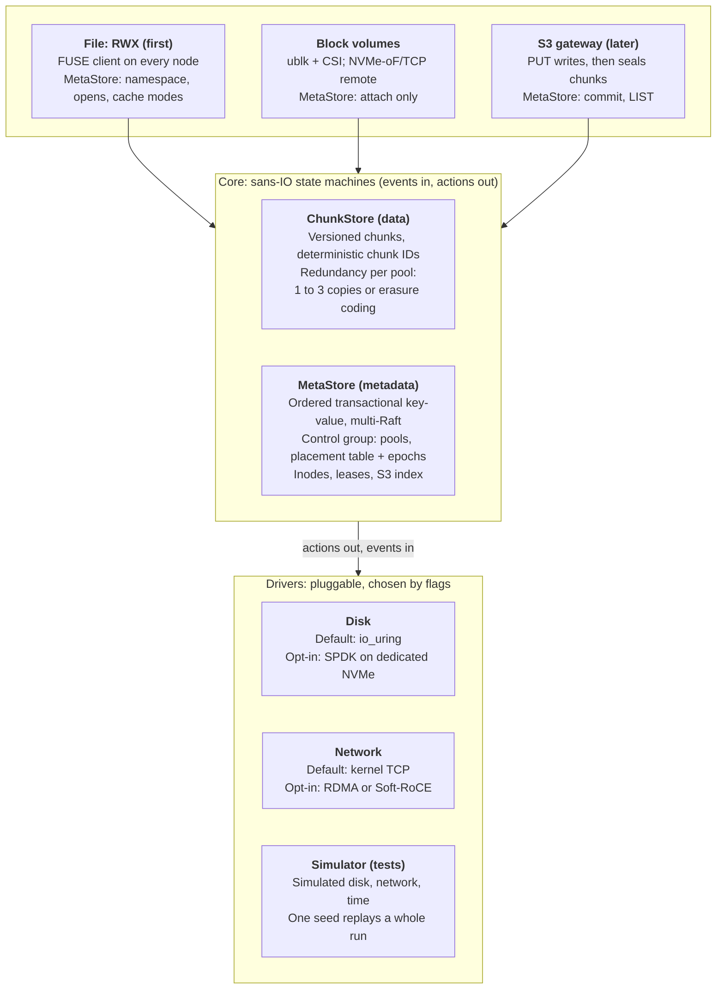
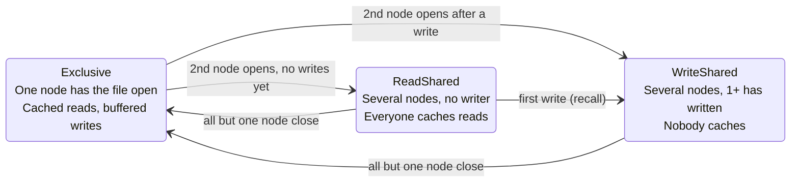
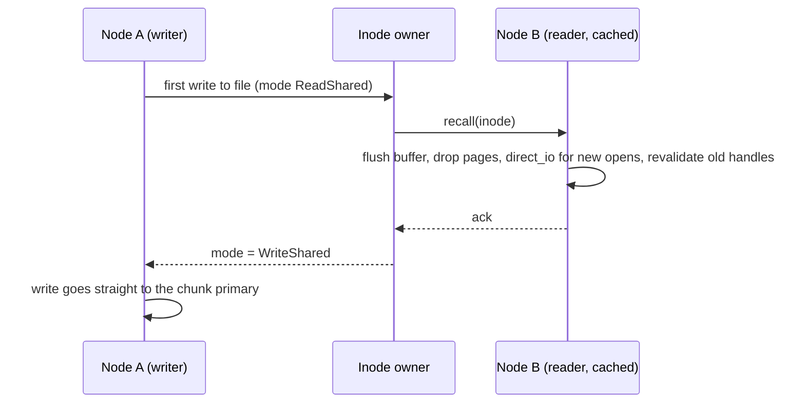

# Rock Solid - a Rust Distributed Storage — Project Design

## Goals

Build a distributed storage system in Rust whose headline feature is **ReadWriteMany (RWX) shared filesystems** for a 3 to 10 node homelab Kubernetes cluster: many pods on many nodes mounting one directory, with no NFS gateway in the path, caching that stays correct when files are shared, and Longhorn-level ease of install. Block volumes come from the same core, at near-raw NVMe latency.

**Target user:** homelab and small-cluster Kubernetes operators. They have several NVMe or SATA solid-state drives per node, 10 to 25 Gigabit Ethernet (GbE), and some nodes with Remote Direct Memory Access (RDMA) capable cards. For RWX today they choose between a Network File System (NFS) server (single server, fragile), Longhorn RWX (an NFS server pod in front of each volume), JuiceFS (needs an external metadata database and object store) and CephFS (heavy on RAM, CPU and operator knowledge).

**Product goals, in priority order**

1. **RWX filesystem** (`volumeMode: Filesystem`, `ReadWriteMany`): a Filesystem in Userspace (FUSE) client on every node, talking straight to the storage nodes, with close-to-open consistency first and automatic per-file cache coherence next.
2. **Block volumes**: ReadWriteOnce (RWO) Persistent Volume Claims (PVCs), plus RWX block for KubeVirt live migration.
3. **S3** later, on the same core.
4. **Easy to run:** a single binary (one daemon per node, which also serves as the FUSE client) plus a Container Storage Interface (CSI) driver. No hugepages, pinned cores or external database to get started.
5. **Low CPU per operation**, so storage does not eat the cluster.
6. **Permissive license** (Apache 2.0).

**Performance targets.** Stated as round trips, because absolute numbers depend on the network and drives.

| Operation | Target cost |
| --- | --- |
| Read of a cached file (one writer, or readers only) | Page-cache speed: no FUSE or network trip (0.3 µs per 4K measured) |
| Read or write of a file being written from two or more nodes | One network round trip to the chunk primary, plus about 5 to 20 µs of FUSE overhead |
| `stat`, `lookup` within the cache timeout | Local |
| `stat`, `lookup` after a cache miss | One round trip to the MetaStore shard leader (lease read, no disk write) |
| `create`, `unlink`, same-directory `rename` | One Raft commit on one shard |
| `open` of a file | One round trip to the inode's owner (memory only, no disk write) |
| Block 4K write at queue depth 1 | Around 0.1 ms (Vitastor class) on drives with power-loss protection; Ceph is around 1 ms. Consumer drives without it floor at about 1 ms per durable write ([NVMe flush spike](#appendix-nvme-flush-spike)) |

**Learning goals:** Rust, the Storage Performance Development Kit (SPDK), the Data Plane Development Kit (DPDK) and RDMA, extended Berkeley Packet Filter (eBPF) tracing, plus distributed-systems correctness testing.

**Non-goals for v1:** Server Message Block (SMB) file sharing for macOS and Windows clients, GPU-cluster scale, shared-writable `mmap` across nodes, cross-directory hard links, a custom kernel module, and authentication or encryption between daemons. v1 trusts the cluster network: any host that can reach a daemon's port can read and write any volume.

## Landscape and positioning

The open gap is **RWX without a gateway**: every client reads and writes the storage nodes directly, caches aggressively while it is safe, and stops caching automatically when it is not. It installs like Longhorn and is licensed like SeaweedFS.

| System | What it covers | Why it doesn't fill the gap |
| --- | --- | --- |
| Longhorn | Easy Kubernetes block; RWX through a share-manager pod running NFS-Ganesha | All RWX traffic goes through one pod per volume: a bottleneck and a failover pause |
| [JuiceFS](https://github.com/juicedata/juicefs) | FUSE file system, CSI driver, Apache 2.0 | Needs an external metadata engine (Redis, TiKV, SQL) and an object store; close-to-open consistency only |
| CephFS | POSIX file system with full client capabilities | Around 1 ms writes, heavy CPU and RAM, steep operations learning curve |
| [SeaweedFS](https://github.com/seaweedfs/seaweedfs) | Single binary, S3, FUSE mount, CSI driver | Built around objects; no cache-coherence protocol for shared writes |
| [Vitastor](https://vitastor.io) | Ceph-like block, file, S3 at around 0.1 ms | Solo project; server under a GPL-based network-copyleft license that deters adopters |
| [OpenEBS Mayastor](https://github.com/openebs/mayastor) | Rust + SPDK + NVMe over Fabrics (NVMe-oF) block | Block only; requires hugepages and dedicated cores |
| [Weka](https://docs.weka.io/weka-system-overview/weka-client-and-mount-modes), DAOS, [DeepSeek 3FS](https://github.com/deepseek-ai/3fs) | AI-cluster file systems with kernel bypass | Built for GPU clusters; commercial or heavy to deploy |
| [MinIO](https://github.com/minio/minio), [RustFS](https://github.com/rustfs/rustfs), Garage | S3 | Object storage only |

**Takeaways**

- Homelab RWX today means NFS somewhere in the path. Removing it is the visible win.
- Weka shows that per-file cache-mode switching gives most of the benefit of full client capabilities with a much smaller protocol. Our spike shows it can be done on FUSE, without a kernel module (see [FUSE coherence spike](#appendix-fuse-coherence-spike)).
- Vitastor proves one person can get a 10x latency win over Ceph without DPDK, by shortening the code path. The same lean core serves block.
- Trust is the adoption gate. Storage people wait years before trusting a new system, so correctness work is the product.

## Strategy

Win on a short code path, correct caching and low CPU per operation. Kernel bypass is an opt-in fast path, never a requirement.

On homelab hardware the network caps throughput before the kernel does:

```
one NVMe Gen4 drive:  ~7 GB/s sequential, 4K write in ~0.04 ms (into its write cache)
10 GbE link:          ~1.2 GB/s
25 GbE link:          ~3 GB/s
kernel TCP stack:     saturates 10-25 GbE with one or two cores
```

So DPDK buys almost no throughput here. The latency gap between the disk and Ceph is almost all software path, which is what we attack. One caveat: a *durable* write is bounded by the drive's flush latency. On the consumer NVMe drive we measured, a 4K write plus flush takes 0.95 ms at p50 and about 2 ms after the drive has idled for 100 ms ([NVMe flush spike](#appendix-nvme-flush-spike)), so the 0.1 ms block target applies to drives with power-loss protection.

**Principles**

1. **RWX first:** the file frontend and its coherence protocol are the first usable product. Block and S3 reuse the same core.
2. **Lean data path:** client → chunk primary in one hop → log append in parallel with sends to replicas → acknowledge. Every frontend uses it.
3. **Cache where safe, never where unsafe:** a file is cached on a node only while no other node writes it. Correctness never depends on timeouts alone.
4. **Defaults that need no tuning:** `io_uring` for disk, kernel TCP for network, FUSE for the file client. No hugepages, pinned cores or kernel modules just to try it.
5. **Opt-in fast paths:** SPDK for dedicated drives, RDMA for nodes with capable cards. DPDK stays a learning experiment.
6. **Correctness before features:** deterministic simulation from day one, including the coherence protocol.
7. **Apache 2.0** to stand apart from Vitastor's network-copyleft license.

## Architecture overview

The system is a two-part core (ChunkStore for data, MetaStore for metadata) under three protocol frontends, over pluggable input/output drivers.



*Three frontends share one core; they differ only in how much metadata they need.*

The same daemon runs on every node. On storage nodes it serves chunks and MetaStore shards; on every node, including compute-only ones, it is also the FUSE client for RWX mounts. The core never touches real I/O, so the simulator can stand in for every driver.

## Data layer: ChunkStore

The ChunkStore is dumb, fast and versioned. It knows nothing about files, buckets or volumes.

```rust
trait ChunkStore {
    async fn write(&self, c: ChunkId, off: u32, data: &[u8], expect_ver: Option<u64>) -> Result<u64>;
    async fn punch(&self, c: ChunkId, off: u32, len: u32, expect_ver: Option<u64>) -> Result<u64>; // zero a range; the whole chunk deletes it
    async fn read(&self, c: ChunkId, off: u32, len: u32, at_ver: Option<u64>) -> Result<Bytes>;
    async fn seal(&self, c: ChunkId) -> Result<()>;      // now immutable -> eligible for erasure coding
    async fn flush(&self, cs: &[ChunkId]) -> Result<()>; // durability barrier
}
```

**Deterministic chunk IDs.** `chunk_id = (volume_id, inode_id, offset / CHUNK_SIZE)` is computed, never looked up; a block volume uses inode 0. The hot path needs no metadata. A chunk ID packs into 128 bits: a 32-bit volume, a 64-bit inode and a 32-bit chunk index, which allows files up to 16 PiB ([ADR 0004](decisions/0004-key-layout-and-ids.md)). `CHUNK_SIZE` is 4 MiB, Ceph RBD's default object size; the nightly benchmarks keep it honest. Inode IDs are scoped to their volume, so a [restored or cloned](#snapshots-and-clones) volume keeps every inode number and differs from its source only in `volume_id`.

**Versions.** Every write and punch returns a new version. `expect_ver` gives compare-and-set on data. A primary keeps an old version only while a [snapshot](#snapshots-and-clones) pins it. A read at a frozen version (`at_ver`) needs no ordering against writes, so any PG member holding that version can serve it, and it never waits for a writer.

**Reads see only acknowledged writes.** A version is *committed* once every live member of the chunk's PG holds it, which is also when its write is acknowledged. A read without `at_ver` returns the newest committed version, never one still being replicated. Otherwise a reader could see a write that a primary crash then loses, since the new primary may be a member that never received it. Until the new version commits, the previous one's blocks are still in the log and still mapped, so the read does not wait.

**Single order per chunk.** Each chunk has one primary that applies writes in one order. This is what makes RWX block and uncached shared files correct without any client-side protocol.

**Punch.** `punch` zeroes a byte range as a new version. Its blocks are freed once no snapshot needs them, and later reads of the range return zeros. Punching a whole chunk deletes it and leaves a tombstone. File unlink and truncate, block discard and volume deletion all free space this way (see [Freeing space](#freeing-space)).

**Fencing.** Each write carries the client's session ID. When a client session expires (see [Sessions and fencing](#sessions-and-fencing)), the control plane publishes it as fenced and chunk primaries reject its writes. The session's locks and cache rights are released only after every node acting as a primary has applied the fence. This stops a paused or partitioned client from writing after its locks and cache rights are gone.

**Integrity.** Each 4K block, and each 4K block of an erasure-coded shard, carries a CRC32C checksum in its record's header in the [on-disk format](#on-disk-format), which catches bit rot, torn writes and misdirected writes.

**Placement groups.** Chunks are not placed one by one. Each chunk hashes into one of a fixed number of placement groups (PGs) in its volume's [pool](#pools-and-redundancy), as in Ceph, and placement is decided per PG:

```
chunk_id = (volume_id, inode_id, offset / CHUNK_SIZE)        // computed
pool     = volume record → pool                              // learned once, at attach or mount
h        = xxh3_64(chunk_id as 16 big-endian bytes, seed 0)  // computed
pg       = (pool, h >> (64 - log2(pool.pg_count)))           // top bits of the hash
members  = placement_table[pg]                               // in-memory; [primary, r1, r2] in rep3
```

The hash spreads a volume's consecutive chunks over many PGs, and so over every disk of its pool. A volume is therefore not bounded by any one drive; see [Volume size and capacity](#volume-size-and-capacity). The PG is also the unit of recovery and rebalancing: adding a disk moves whole PGs onto it, never individual chunks. The hash function and bit layout are part of the disk format and never change.

Each pool's `pg_count` is a power of two, sized for the largest expected cluster so that each disk holds around 100 PG members summed over all pools (`pg_count × width ÷ disks`): 2048 for a 3-replica pool alone on 60 disks. It can grow later by doubling. Because a PG is the top bits of the hash, it is one contiguous hash range, and doubling splits PG `p` into `2p` and `2p + 1` without rewriting the per-disk index.

**Placement table.** The table maps each PG to its members and carries an epoch number. Its size depends on the pools' PG counts and widths, not on how much data is stored: 2048 PGs × 3 replicas × a 4-byte disk ID is 24 KiB, and even a 4096-PG `ec16-2` pool is 288 KiB, whether the cluster holds 1 GB or 100 TB. So it is **not sharded**. It lives in the single control-plane Raft group, every node caches a full copy, and it changes only on pool, disk and node events, never on the I/O path. Any change (pool created, disk added, node failed, rebalance) bumps the epoch, and nodes reject requests carrying a stale epoch. Recovery and rebalancing while writes are in flight is where the hardest correctness bugs live; [Epoch changes](#epoch-changes-and-failure-detection) covers how a PG moves from one epoch to the next.

The control-plane leader computes each new table from the previous one, and nodes never compute placement themselves ([ADR 0002](decisions/0002-placement-table-computed-by-control-plane.md)):

1. Refill every missing member onto the least-full eligible disk.
2. While a disk is outside a fill margin of its capacity-weighted share, move one member from the fullest disk to the emptiest eligible one.

Both steps keep the pool's failure-domain rule. This gives exact balance on small clusters with mismatched disks, where a CRUSH-style hash would leave disks unbalanced. Ceph patches the same problem with `pg-upmap` tables.

What does grow with data lives elsewhere. Each disk keeps its own [index](#on-disk-format) of the chunks and shards it holds, and file-to-inode metadata lives in the sharded MetaStore.

### Epoch changes and failure detection

A new table reaches nodes at different times. For a while, a PG's old primary may still be in epoch `e` while its new primary is in `e + 1`. Two rules keep that window safe.

**Writes: the new primary peers before it accepts writes.** A write tagged `e` completes only when every member that is live in `e` acknowledges it, and a member that has adopted `e + 1` rejects anything tagged `e`. So before it accepts writes, the new primary *peers*: it gets at least one member that was live in `e` to adopt `e + 1`, and collects the latest committed versions from every member it reaches. From then on no write tagged `e` can complete, because each needs that member's acknowledgment, and every write acknowledged in `e` is on that member. A write that reached only some members was never acknowledged, so the new primary may keep or drop it, as long as every member ends up with the same choice.

**Reads: the old primary's read lease runs out first.** Reads need no acknowledgment from other members, so the write rule does not stop an old primary from serving stale reads after the new one has accepted writes. A primary therefore serves reads for a PG only while it holds an unexpired read lease from each of the PG's other live members. A member that granted a lease does not take part in peering a new epoch that moves the primary away from that node until the lease expires, or until the old primary has adopted the new epoch itself, as it does in every planned change. The holder counts the lease from when it asked for it and the grantor from when it granted it, each on its own monotonic clock, so leases need bounded clock drift, not synchronized clocks. Leases are granted per node pair, covering every PG the pair shares, and are renewed by the heartbeats that already flow between them, so their cost does not grow with the PG count. Ceph added PG read leases for the same reason. `primary_lease` defaults to 4 s, shorter than failure detection below, so a crash adds no wait for the lease.

**Failure detection.** Only the control plane changes membership. Every node sends it a heartbeat each second, and it marks a node down after `node_down_after` (default 5 s) without one. A primary that waits more than `member_timeout` (default 1 s) for a member's acknowledgment reports it, and the control plane marks the member down at once if it also fails a direct probe. Until the new epoch, writes to the affected PGs wait, so a crash pauses those writes for up to `node_down_after`.

**Fail-slow.** A disk that slows down without failing would stall every write of every PG it belongs to, since writes wait for all live members. Primaries report each member's acknowledgment latency to the control plane. When a disk's 99th percentile stays above `slow_disk_factor` (default 10×) the median of its pool's disks for `slow_disk_window` (default 1 minute), the control plane marks it down as if it had failed. It never does this when a PG would drop below `min_live`; those PGs stay slow, and the pool reports them. A disk marked down this way keeps being probed, and rejoins only after its latency has stayed normal for a whole `slow_disk_window`, so a flapping disk does not churn epochs.

### On-disk format

Each disk holds one log for everything stored on it: chunk data, the Raft logs of the [MetaStore](#metadata-layer-metastore) shard replicas placed on it, and the indexes over both ([ADR 0003](decisions/0003-one-log-per-disk.md)). The disk is a sequence of fixed-size segments, written only through the disk driver's actions, so SPDK can own the whole drive and the simulator sees every durable byte. A disk is a raw block device or a file; a file's segments are written in full once when it is created, because a write into never-written file extents makes `fdatasync` commit the filesystem journal as well (2.5 ms instead of 0.95 ms in the [NVMe flush spike](#appendix-nvme-flush-spike)). Every write is appended:

```
group commit (everything that arrived during the last flush, up to max_group_commit_bytes):
  record = header block [(chunk_id, version, block range, crc32c per 4K block) ...] + header checksum
         + data blocks
         + Raft entries and Raft state (term, vote) of the disk's shard replicas
         + sorted runs and manifests flushed by the indexes
  append the record to the open segment of its stream in one write, flush once, acknowledge every write
```

- **One flush per round.** A round's chunk writes and the commits of every shard on the disk share one flush, however many shards there are: one combined commit for 100 shards took 1.2 ms, and 100 separate ones 114 ms ([KV engines spike](#appendix-kv-engines-spike)). Every extra flush costs a full flush time, so the header goes in the same write and the same flush as its data, and its own checksum plus the per-block CRCs make a torn record detectable on recovery. A record is capped at `max_group_commit_bytes` (default 1 MiB), which bounds how long a large chunk write delays a metadata commit: on the measured drive a commit costs the same 0.95 ms from 4 KiB to 64 KiB, and 2.3 ms at 1 MiB, beyond which latency grows faster than throughput.
- **Write, then flush.** The driver makes a record durable with a write followed by a flush command (`IORING_FSYNC_DATASYNC` through io_uring, an NVMe Flush under SPDK), never with Force Unit Access (FUA) writes or `O_DSYNC`, which took 2.2 ms per 4K write on the measured drive. Drives with power-loss protection may do better with FUA, so `durability` is a per-disk setting, `flush` (default) or `fua`.
- **Two streams.** New copies and Raft entries go to one open segment. Encoded shards, blocks moved by the cleaner and sorted runs, which are written whole and change rarely, go to another. Keeping them apart makes most segments either mostly live or mostly dead, which keeps cleaning cheap.
- **The chunk index maps extents.** Each entry maps a run of consecutive blocks, `(pool, h, chunk_id, version, first block) → (location, block count, record header)`, so a chunk written whole is one entry: about 260,000 entries for a disk holding 1 TB of such chunks. The checksums stay in the record headers, and a read fetches its extent's header block alongside the data; hot header blocks stay cached. A chunk overwritten at random 4K holds one extent per write until the cleaner regroups its blocks, so a block volume can push a 1 TB disk toward 270 million entries, more than 10 GB.
- **The log is the source of truth.** The chunk index and each MetaStore shard's state are log-structured merge (LSM) trees inside the log. An in-memory memtable holds what was applied since the last flush. A flush writes it to the log as an immutable sorted run, a manifest record lists the live runs, and compaction merges runs into new ones. After a crash, the daemon loads the last manifest and replays the log from that point, so memtables are flushed once `max_replay_bytes` (default 64 MiB) of records follow the last manifest. Replay time adds to restart time: fjall needed 2.8 s to replay a 64 MB journal ([KV engines spike](#appendix-kv-engines-spike)). If the chunk index is lost, a scan of the record headers rebuilds it. A [punch](#data-layer-chunkstore) is recorded in a record header like a write, so a rebuild cannot bring punched blocks or a deleted chunk back.
- **The LSM tree comes in two stages** behind one interface. The first keeps only memtables, saved by periodic full snapshots into the log. The second adds sorted runs, compaction, Bloom filters and a block cache, for when an index outgrows memory. File data, written mostly in whole chunks, fits the first stage; the fragmented index of a block volume does not, so the second stage lands before the block frontend.
- **Versions share blocks.** An overwrite appends only the blocks it writes. A version frozen by a [snapshot](#snapshots-and-clones) keeps its older index entries, so it shares every block it did not overwrite with the live version, without reference counts.
- **Cleaning.** A block is live while the live version, a snapshot or an unflattened clone still maps to it. A Raft entry is dead once the memtable that applied it has been flushed, and a sorted run once compaction has replaced it. The cleaner picks segments by cost-benefit (free space × age ÷ copy cost, as in the original log-structured file system), copies their live contents, grouping blocks by chunk, which also defragments chunks overwritten at random, and discards (TRIMs) the freed segments. Two guards keep it from livelocking, which the [cleaner spike](#appendix-cleaner-write-amplification-spike) saw without them: a victim must free more space than copying it costs, header blocks included, and age counts up to one disk capacity of writes at most, so old, nearly full segments such as snapshot data stop looking attractive. On skewed overwrites, cost-benefit with two streams writes 36 to 45% less than greedy cleaning; on uniform ones it writes 3 to 14% more.
- **Segment count matters, segment size does not.** At a fixed number of segments, write amplification is the same from 1 to 256 MiB per segment. What drives it near full is the share of the disk taken by the segments the cleaner keeps free: a reserve of 8 segments costs nothing on 4,096 segments, but on 256 it raised write amplification at 95% full from 17 to 70. So a segment is min(64 MiB, disk size ÷ 4096), rounded down to a power of two: 64 MiB on disks of 256 GiB and up, with 0.5 MiB of segment metadata per TiB. Large segments, written sequentially and TRIMmed whole, also suit the drive's own garbage collection.
- **Headers are capacity.** Header blocks are dead to the cleaner, so near full they cost far more than their bytes: at 95% full, the headers of 64 KiB records with 32-byte entries raise write amplification from 11.4 to 17.3, and at 90% full, queue-depth-1 4K writes, one header block per data block, double it. The header encoding is part of the format and must stay compact. How full a disk may get is the pool's [`write_limit`](#volume-size-and-capacity).
- **Upgrades.** Segment headers, record headers, sorted runs and manifests carry a format version. A daemon reads the current and the previous format, but writes the new one only after the operator raises the cluster's format level (a `ctl/` key) once every node runs the new release. Until then, rolling back is safe. The cleaner rewrites old segments over time.

### Pools and redundancy

Redundancy is set per **pool**: a named set of placement groups that share one redundancy scheme, one failure-domain rule and, optionally, one class of disk. Every block volume and RWX filesystem belongs to one pool, named by its StorageClass:

```yaml
kind: StorageClass
metadata: { name: footage }
parameters: { pool: ec4-2 }
```

Pools are cluster objects (a `Pool` custom resource, stored under `ctl/pool/` in the control-plane group). Installation creates `rep3` as the default pool. Every pool setting is the user's choice; the defaults suit a small team that wants its data protected but watches cost. They never lower how many failures data survives, and otherwise pick the option that uses less space.

| Setting | Default | Meaning |
| --- | --- | --- |
| `replicas` | 3; `parity + 1` in an erasure-coded pool | Copies of a mutable chunk, 1 to 3 |
| `sealed` | `replicated` | Layout of a chunk that is no longer being written: copies, or `ec` with `data` and `parity` shards |
| `encode_on_write` | On | Encode whole new chunks as they are written, skipping the copies stage |
| `seal_after` | 1 hour for files, 24 hours for block | Idle time before a chunk held as copies is encoded |
| `min_live` | `min(replicas, 2)` | Live PG members needed to accept writes |
| `failure_domain` | `node` | `node` or `disk` |
| `max_per_domain` | 1 | Shards of one PG allowed in one failure domain |
| `locality` | `node` with one copy, `spread` otherwise | Keep each volume on one node, or spread it over every disk |
| `overcommit` | On | Let volume sizes add up to more than the pool holds |
| `write_limit` | 90% | Disk fill at which the pool's writes fail with `ENOSPC`; see [Volume size and capacity](#volume-size-and-capacity) |
| `disk_class` | Any | Only disks of one class, such as NVMe |
| `pg_count` | Sized from the disk count | Power of two; see [placement groups](#data-layer-chunkstore) |

**Overwrites only ever hit copies.** A 4K overwrite in a 4 data + 2 parity stripe costs 3 reads plus 3 cross-node writes, and risks the write hole on crash:

```
stripe = [d0 d1 d2 d3 | p0 p1], overwrite d1:
  read old_d1, p0, p1
  delta = old_d1 ^ new_d1
  p0' = p0 ^ gf_mul(coef[0][1], delta)
  p1' = p1 ^ gf_mul(coef[1][1], delta)
  write new_d1, p0', p1'      // must land together on 3 nodes
```

Three-way replication costs 3 writes and 0 reads. So a chunk in an erasure-coded pool takes one of two forms, `replicas` copies or `data + parity` shards, and is only overwritten as copies. It is encoded when it is written whole or once it goes idle, as [Windows Azure Storage](https://www.usenix.org/system/files/conference/atc12/atc12-final181_0.pdf) does with its extents (see [When chunks are encoded](#when-chunks-are-encoded)).

**Presets.** Names follow `rep<copies>` and `ec<data>-<parity>`; any combination within the rules below is allowed.

| Pool | Copies | Shards | Survives | Failure domains needed | Usable / raw, encoded | Suits |
| --- | --- | --- | --- | --- | --- | --- |
| `none` | 1 | None | Nothing | 1 | 1 | Caches, CI scratch, apps that replicate themselves |
| `rep2` | 2 | None | 1 failure | 2 | 1/2 | Two storage nodes plus a [metadata-only node](#one-copy-pools-and-locality); re-creatable data |
| `rep3` (default) | 3 | None | 2 failures | 3 | 1/3 | Block volumes, databases |
| `ec2-1` | 2 | 2 + 1 | 1 failure | 3 | 2/3 | Media, photos and backups on a 3-node cluster |
| `ec4-2` | 3 | 4 + 2 | 2 failures | 6, or 3 at 2 per node (then 1 node) | 2/3 | Media, backups and S3 |
| `ec16-2` | 3 | 16 + 2 | 2 failures | 18, or 9 at 2 per node (then 1 node) | 8/9 | Archives on a large cluster |

An erasure-coded pool keeps `parity + 1` copies of a chunk by default, so a chunk survives the same number of failures in either form. "Usable / raw" counts encoded data; data held as copies (being edited, or idle for less than `seal_after`) costs `replicas` times its size.

**Rules checked when a pool is created:**

- **Width fits.** Copies always sit in distinct failure domains. Shards may share one up to `max_per_domain`, so `data + parity ≤ domains × max_per_domain`, counting only disks of the pool's class.
- **Node tolerance is printed.** With `max_per_domain` above 1, one node failure takes out several shards of a PG, and an encoded chunk survives `⌊parity ÷ max_per_domain⌋` node failures. `ec4-2` at 2 per node fits on 3 nodes and survives one node failure (Ceph's `crush-osds-per-failure-domain` does the same); `ec16-2` at 3 per node fits on 6 nodes and survives none. The CLI states, for every pool, how many node failures its copies and its shards survive.
- **Shape is fixed, the rest is not.** `data` and `parity` are fixed at creation, as in Ceph; to change them, [move the volumes](#moving-a-volume-to-another-pool) to another pool. Every other setting can change later; a change to `replicas` adds or drops copies per PG and bumps the epoch.

**Writes and `min_live`.** A write is acknowledged once every live member of the chunk's PG holds it. A PG with fewer than `min_live` live members rejects writes until recovery restores it, rather than accept writes onto too few copies. For `rep2` the default of 2 means a PG stops writing while either of its disks is down. A planned reboot avoids that with `maintenance <node>`: until the node returns, its PGs accept writes on one copy, and they resync first when it is back. Setting `min_live: 1` permanently does the same for unplanned failures, the setting Ceph users most often report losing data with.

**Encoded chunks need no write quorum.** An encoding commits only once all `data + parity` shards are durable, and only then are any copies dropped; a PG with a member down writes copies and defers encoding until recovery. An encoded chunk stays readable while any `data` of its shards survive. Ceph recommends `min_size = k + 1` for erasure-coded pools because it accepts writes to a stripe while only `min_size` shards are live; an encoding waits for every shard, so the rule does not arise.

#### When chunks are encoded

In an erasure-coded pool, a chunk's copies sit on the first `replicas` members of its PG and its shards on all `data + parity` members, so changing form moves no data between PGs. Shard `i` is the chunk's `i`-th contiguous byte range, so a 4K read of an encoded chunk touches one disk; a read whose shard is lost fetches `data` other shards and decodes. A chunk is encoded only if its shards, each rounded up to a 4 KiB block, take less space than its copies, so a small file's only chunk in an `ec16-2` pool stays as copies.

1. **On write** (`encode_on_write`). The daemon's [write-back buffer](#client-design) collects a file's writes chunk by chunk. When a chunk that held no data when the file was opened fills up, the daemon encodes it with Reed-Solomon (ISA-L) and sends each shard straight to its member; the primary commits the encoded version once every member holds its shard. Chunk 0 waits in the buffer until `close`, because many writers patch the file's header last (the `mdat` size in MP4 and MOV, WAV sizes, zip local headers), and a patch to an encoded chunk would send it back to copies. At `close`, chunk 0 and the file's last partial chunk are encoded the same way, and S3 objects take this path too. If buffer pressure flushes chunk 0 early, it is written as copies and encoded once idle. In `ec4-2` the data crosses the network once, at 1.5× its size, where copies-then-encode would cost 3× and then 1.5× more. This is the path for write-once data such as a studio's footage and photos.
2. **When idle** (`seal_after`). Everything else is written as copies: overwrites, files several nodes are writing, chunks flushed early by `fsync` or a full buffer, and block volumes. Each primary encodes chunks that have not been written for `seal_after`:

   ```
   seal(chunk), PG members m[0 .. data+parity]:
     s[0 .. data]   = chunk split into contiguous byte ranges
     p[0 .. parity] = reed_solomon_encode(s)
     send each shard to its member in parallel, wait until all are durable
     commit the encoded version; each member replaces its copy, if any, with its shard
   ```

3. **Back to copies on overwrite.** A write to an encoded chunk first turns it back into copies: the primary reads `data` shards, writes the copies, then applies the write, and the chunk is encoded again once idle. That costs a full chunk read and a replicated chunk write. Editors write new files rather than patch footage, so media rarely pays it. A database on a block volume pays it on the first write to each idle chunk, which is why block chunks wait 24 hours before encoding.

#### One-copy pools and locality

`none` keeps one copy of everything. With `locality: node`, its default, each node has its own PGs, and a volume is placed on one node (the node of its first pod, through CSI's `WaitForFirstConsumer`) with its chunks hashed over that node's PGs only. Losing a disk then loses part of that node's volumes only; reads of the lost chunks return `EIO`, and the pool lists the volumes affected. Pods on other nodes still reach the volume over the network. With `locality: spread`, a volume uses every disk, and any disk loss takes part of every volume in the pool.

**Metadata is not pooled.** Pools set the redundancy of data only. MetaStore shards and the control plane are always 3-voter Raft groups, whatever pool their files use: metadata is small, and losing a directory loses every file under it. A cluster therefore needs three nodes that hold metadata. A node can hold metadata without data disks (`role: meta`), so a two-node cluster adds a small third machine, such as a single-board computer with an SSD, and runs `rep2` or `none` pools on the other two.

#### Moving a volume to another pool

A volume moves to another pool in place, keeping its `volume_id`, PVC and inode numbers ([ADR 0005](decisions/0005-move-volumes-between-pools-in-place.md)). The move reuses the [snapshot](#snapshots-and-clones) machinery:

```
move(volume, to):
  cut at epoch E: pause every node using the volume, as for a snapshot
  txn: volume record pool = to, source = (old pool, E)
  resume: writes go to the new pool's PGs; a read of a block not yet
          written there falls through to the old pool at version E
  copy the remaining chunks in the background, as a flatten does
  drop the source pointer; sweep the volume's chunks out of the old pool
```

Chunk IDs are the same in both pools; only the PG changes. Snapshots taken before the move stay in the old pool, since each snapshot record names its pool. Until the copy finishes, the volume uses space in both pools, and reads of uncopied blocks take an extra hop.

In Kubernetes, a move starts when a `VolumeAttributesClass` with a different `pool` parameter is applied to the PVC: the driver advertises the CSI `MODIFY_VOLUME` capability and starts the move in `ControllerModifyVolume`. The CLI can start one too.

### Volume size and capacity

A volume, block or file, can be larger than any single drive. Its chunks are spread across every disk of its pool through placement groups, so the limit is the pool's capacity. A pool reports it as free raw space divided by its encoded overhead (`(data + parity) ÷ data`, or `replicas` in a replicated pool), since with encoding on write most data lands encoded; data still held as copies is shown separately. Pools that share disks draw on the same free space.

- **Thin provisioning.** A chunk exists only after its first write, so creating a volume allocates nothing. With `overcommit` on, volume sizes may add up to more than the pool holds. With it off, creating a volume reserves its full size.
- **Write limit.** A write fails with `ENOSPC` once a disk holding one of its PG's members is fuller than the pool's `write_limit` (default 90%), and the pool warns 10 points earlier. The limit is checked per disk, not as a pool average, because one full disk stalls every PG on it. Pools that share a disk each check their own limit against the disk's total fill, so a pool with a higher limit can fill the disk past a lower one, and the lower one's writes stop there. The headroom serves recovery and the [cleaner](#on-disk-format): with random 4K overwrites, cleaning write amplification is about 3 at 80% full, 7 at 90% and 17 at 95%, where 94% of the disk's writes would be cleaning ([cleaner spike](#appendix-cleaner-write-amplification-spike)). A pool of files that are deleted roughly in the order they were written, such as backups or footage archives, cleans for almost nothing and can raise its limit to 95%. Whole files deleted at random still cost a write amplification of 4.4 at 90% full.
- **Snapshots use space.** Versions pinned by [snapshots](#snapshots-and-clones) count toward the pool, and the first write to a pinned block needs new space, so near full even an overwrite can fail with `ENOSPC`.
- **Wider blast radius.** A volume spread over every disk is hit by any failure, anywhere in its pool, that takes out more members of one PG than the pool survives. Recovery must restore a degraded PG before a second failure arrives, so it starts with the PGs that have lost the most members.
- **A filesystem volume's size is a quota.** The PVC size caps the sum of its files' sizes. Each inode slot keeps a byte counter (`u`, in the [key layout](#metadata-layer-metastore)), updated in the transaction that changes a file's size, so no single key is hot. `statfs` reports the PVC size as the total and the sum of the slot counters as used; the daemon caches the sum for `statfs_cache` (default 5 s) and fails writes that would extend files past the PVC size with `ENOSPC`. Writers can overshoot by what they add in one cache period. A block volume's size is its device size.
- **Largest file.** A file can't grow past the volume setting `max_file_size` (default 16 TiB, ext4's limit), which bounds a [purge](#freeing-space) to 4 million chunk IDs.

### Freeing space

Chunk IDs are computed, so freeing data never needs to find chunks: a purge lists the IDs and [punches](#data-layer-chunkstore) them, batched per PG. A punch to a chunk that doesn't exist succeeds, so a purge interrupted by a crash simply runs again. Punches carry the snapshot epoch like writes, so a purge never frees a block a [snapshot](#snapshots-and-clones) still holds.

- **Allocation mark.** Each inode records `alloc_end`, one past the highest chunk that may hold data. Before a daemon writes a chunk at or past it, it raises `alloc_end` in steps that double up to 16 chunks, and the same transaction commits the size of what it has already written. Other nodes therefore see a file grow while it is written, at most 64 MiB behind, and a purge never misses a chunk written before a crash.
- **Unlink.** Removing a file's last link deletes the inode and adds a purge entry (`p/{inode}` → `0 .. alloc_end`) to its slot, in one transaction. If the file is still open, the inode goes on the orphan list instead (see [Tier 1](#cache-coherence-tiers)) and moves to the purge list at its last close. The slot's shard leader works through the purge list in the background.
- **Truncate.** Shrinking a file commits, in one transaction, the new size, `alloc_end` lowered to the new end, and a purge entry for the range from the new end to the old `alloc_end`. The daemon punches the new last chunk's tail before `truncate` returns, and the purger deletes the whole chunks after it. Reads never return data past the size, and anything that extends the file over a range with a pending purge, a write raising `alloc_end` or a truncate upward, first finishes that purge. So a file extended later reads zeros where it was cut, and the purger never deletes newer data.
- **Block discard.** A discard (TRIM) from the pod's filesystem reaches the daemon through ublk and becomes a punch of the range, so a thin-provisioned block volume gives space back.
- **Volume deletion.** Deleting a block volume purges chunks `0 .. size ÷ CHUNK_SIZE`. Deleting a filesystem volume drops its `fs/{volume}/` key range and has every disk of the pool sweep its chunk index for the volume's ID. That background scan is cheaper than purging millions of small files one by one. A volume that still has snapshots or clones keeps the chunks they need (see [Deletion](#snapshots-and-clones)).

## Metadata layer: MetaStore

The MetaStore is an ordered, transactional key-value store, sharded into many small Raft groups, each with its own leader. Consensus is needed per key, not globally.

```rust
trait MetaStore {
    async fn txn(&self, ops: Vec<Op>) -> Result<()>;   // compare-and-set, put, delete, all-or-nothing
    async fn scan(&self, prefix: &[u8], after: &[u8], limit: usize) -> Result<Vec<(Key, Val)>>;
}
```

**Why consensus is unavoidable.** Leases, atomic rename and S3 `if-not-exists` are compare-and-set (CAS) operations, and agreeing on one CAS winner among replicas that can crash is consensus. Dynamo-style quorums and conflict-free replicated data types (CRDTs) scale without a leader but cannot do CAS: two racing lock grabs would both succeed.

**Sharding (multi-Raft).** The key space is split into ranges, each its own 3-replica Raft group, with leaders spread across nodes:

```rust
async fn txn(ops: Vec<Op>) -> Result<()> {
    let shards: HashSet<ShardId> = ops.iter().map(|o| shard_map.route(&o.key)).collect();
    if shards.len() == 1 { shard(shards[0]).propose(ops).await }  // fast path: one Raft round
    else { two_phase_commit(ops, shards).await }                 // slow path: rare by design
}
```

**Key layout: the design goal is single-shard for almost everything** ([ADR 0004](decisions/0004-key-layout-and-ids.md)).

Keys are written below as paths. On disk, each `word/` is a one-byte tag, and integers are fixed-width and big-endian, so numeric order is byte order. Only the last component may have variable length (a file name, xattr name or S3 key), so keys need no escaping and a prefix scan is a byte-prefix scan.

**Inode IDs** are 64 bits: a 24-bit *slot* and a 40-bit sequence number. Every key of an inode starts with `fs/{volume}/{inode}`, so a slot is one contiguous key range, and shards split only at slot boundaries.

- A new file takes the next sequence number in its parent's slot. Its entry and its inode are in one shard.
- A new directory takes a free slot from the same shard's range, so `mkdir` is single-shard too, and a later split can move whole subtrees. When the shard has no free slot left, the directory shares its parent's slot, and when a slot's 2^40 IDs run out, new files go to a fresh slot.
- IDs are never reused. The root directory is inode 1, and sequence number 0 of each slot holds the slot's own keys.

| Data | Key | Shard rule |
| --- | --- | --- |
| Pools, placement table, membership, fenced sessions, format level | `ctl/...` | One dedicated control-plane Raft group, not sharded; small because it maps placement groups, not chunks |
| Inode attributes, including size and `alloc_end` | `fs/{volume}/{inode}/a` | The inode's slot. The volume prefix makes a filesystem one contiguous key range, which a snapshot copies and a deletion drops |
| Directory entries | `fs/{volume}/{dir}/d/{name}` → inode, type | The directory's slot, usually shared with its files, so `readdirplus` is one request to one shard |
| Extended attributes | `fs/{volume}/{inode}/x/{name}` | Next to the attributes, so one request returns both; the daemon caches small ones with the attributes |
| Case-folded names | `fs/{volume}/{dir}/c/{folded name}` → name | Only with the volume setting `case_index` (off by default) for SMB-shared volumes; turning it on later builds it in the background |
| flock and whole-file locks | `fs/{volume}/{inode}/l/{session}` | The inode's slot |
| Slot counters (next sequence number, bytes used), orphans (unlinked while open), purge list | `fs/{volume}/{slot · 0}/n`, `…/u`, `…/o/{inode}`, `…/p/{inode}` | The slot itself; see [Freeing space](#freeing-space) |
| Replay records of mutating client requests | `fs/{volume}/{slot · 0}/r/{session}/{request}` → result | The slot the request changed; see [Daemon restart](#daemon-restart-and-upgrade) |
| Volume attach and mounts, snapshot records | `volume/{id}/attach`, `volume/{id}/snap/{epoch}` | Any shard; touched only at attach, detach, snapshot and move operations |
| S3 index | `s3/{volume}/{key}` → object ID, size, version | Range sharding, never hash, so `LIST prefix` is a sequential scan. A bucket is a volume, and object IDs come from a slot that each shard reserves, so a `PUT` stays single-shard |

**Inode owner.** The leader of an inode's shard is that inode's *owner*. Besides serving its keys, it keeps in-memory state for open files: who has the file open, who has written, and the current cache mode (see [Cache coherence](#cache-coherence-tiers)). This state is soft. It is not written to the Raft log, so `open` costs one round trip and no disk write. A planned leader transfer (leader balancing, a rolling upgrade, draining a node) hands the open registry to the new leader with the transfer, so opens don't pause. After a leader crash, clients re-register their open files during a grace period of one session lease, as in NFS version 4. During it the new owner accepts only re-registrations: new opens and cache-mode changes for its inodes wait, while reads and writes on open handles carry on, since they go to chunk primaries.

**Cross-shard transactions (CockroachDB style, no global timestamp service):**

1. Coordinator writes a transaction record `{id: T, status: PENDING}` in shard X.
2. Each touched shard gets an "intent": a provisional value tagged T, written in parallel.
3. Flip T's record to COMMITTED. This single key is the atomic commit point.
4. Intents are resolved into real values asynchronously. A reader that meets an intent checks T's record, so anyone can finish or abort T after a coordinator crash.

Cross-directory `rename` is the main file operation that takes this path.

**Storage.** Each shard replica lives on one disk of its node. Its Raft log and its state, an LSM tree, are part of that disk's [log](#on-disk-format), so the daemon embeds no key-value engine and SPDK drives hold metadata too.

**Raft shard.** Raft is our own sans-IO state machine in `core` ([ADR 0006](decisions/0006-own-raft-shard.md)), shaped like etcd-raft's and raft-rs's `RawNode`. The driver feeds it ticks and messages, and it returns a `Ready`: entries to persist, messages to send and entries to apply. Ticks, messages and persistence all belong to the driver, so the driver can share flushes, batch messages and quiesce shards across every group on the node. The [multi-raft spike](#appendix-multi-raft-spike) measured this shape at 13 KiB per group and 4.5 µs of CPU per idle message; openraft 0.9 used 150 to 670 KiB per replica and 11 tokio tasks per group. Election timeouts come from a seeded RNG, so the simulator replays the shard exactly.

**Shard count.** A shard splits, at a slot boundary, once it holds more than `shard_split_size` (default 512 MiB, as CockroachDB's ranges), so a 3 to 10 node cluster runs tens of groups per node. Splitting by load comes with leader balancing. The Raft shard is still built to stay cheap at about 1,000 groups per node, so per-group cost never limits splitting:

- **Batching per node pair.** The driver sends every group's messages for one peer as one batch. In the spike, 80,000 Raft messages per second fit in 240 batches.
- **Quiescence.** A group with no writes stops ticking and heartbeating. In the spike that cut the idle cost of 3,000 replicas from 36% of a core to 0.07%. Failure detection for quiescent groups moves to node liveness, as with TiKV's hibernate regions and CockroachDB.
- **Timing.** `raft_heartbeat` defaults to 100 ms and `raft_election_timeout` to a random 1 to 2 s. The election timer ticks every 10 ms, finer than the heartbeat: with only a few distinct timeout values, followers time out together and split the vote. Failover is set by the slowest of the groups that lost their leader, so budget 1.5 to 5× the maximum election timeout: 3 to 10 s with the defaults.

**Group commit.** Each leader batches whatever arrived during the last round into one log entry and one network round. The entry joins the next record of its disk's log, so it shares one flush with every other shard and every chunk write on that disk:

```rust
loop {
    let batch = inbox.drain_up_to(1024);
    let entry = encode(&batch);
    join!(disk_log.append(&entry), replicate_to_followers(&entry));
    wait_for_majority().await;
    for t in batch { memtable.apply(&t); t.reply_ok(); }
}
```

**Thread-per-core.** Each core owns a set of shards outright: their Raft state and LSM trees, with no locks between them. Tables that every I/O reads and that rarely change (the placement table, fenced sessions) are copied to each core and updated by message, so the hot path takes no locks either.

**Reads.** Served by the leader under a time-based lease, so there is no extra round trip. Follower reads with the read-index check come later, if leaders get hot. Readers never wait for writers, except a reader that meets a cross-shard intent and must check its transaction record (above). A reader gets a point-in-time view of the shard's LSM tree without blocking the writer. The view pins the memtable and sorted runs it reads, so a view held open holds back the cleaner, and anything long-lived, such as a [snapshot's metadata](#snapshots-and-clones), is copied out instead.

**Deferred:** leaderless consensus (Egalitarian Paxos, Accord). Leader-per-shard already removes the single-leader bottleneck.

## File frontend: RWX filesystem

This is the first product. Many pods on many nodes mount one POSIX directory: shared media, uploads, CI caches, datasets, app data. The data path is the shared ChunkStore path. The hard part is keeping each node's cache of pages, attributes and directory entries correct.

### Client design

Every node runs the daemon, which mounts RWX volumes through FUSE. Three rules come straight from the [FUSE spike](#appendix-fuse-coherence-spike):

1. **The kernel page cache is used for reads only.** We never enable FUSE's `writeback_cache`. It is a mount-wide switch, it hides writes from the daemon until the kernel flushes them, and it disables the kernel's automatic invalidation on attribute changes. With it on, the daemon could not stop a node from caching a shared file.
2. **Write-back buffering lives in the daemon.** Every `write()` reaches the daemon as a FUSE request (about 5 µs). While the file is not shared, the daemon buffers writes in its own memory and acknowledges at once. It flushes a chunk as soon as it is full, and the rest on `fsync`, `close` or a recall. The buffer holds up to 256 MiB per node (`writeback_buffer`); when it is full, the oldest partial chunk is flushed. The daemon therefore always knows when a file has been written, and can flush it on demand.
3. **Whether a handle is cached is decided at `open` and cannot change.** The kernel fixes a handle's direct-I/O flag when the file is opened. So the daemon chooses it per open, from the file's cache mode at that moment. Handles that are already open and cached are made coherent by other means (see Tier 2).

**Write path**

```
FUSE write(inode, off, data)
  file not shared: buffer in daemon, acknowledge         // flushed later, in order
  file shared:     chunk_id = (volume, inode, off / CHUNK_SIZE)
                   → ChunkStore.write via the chunk primary → acknowledge
                   → if the write extends the file: MetaStore size = max(size, end)
any chunk write    → first, if its index >= alloc_end: MetaStore.txn([raise alloc_end, set size written so far])
close() / fsync()  → flush buffered chunks → MetaStore.txn([set size, mtime])
```

`alloc_end` bounds the chunks a later [purge](#freeing-space) must delete, and its transaction also lets other nodes watch a large file grow while it is written.

**Read path**

```
cached handle:   kernel page cache → on a miss, FUSE read → daemon → ChunkStore.read
uncached handle: FUSE read every time → daemon → ChunkStore.read via the chunk primary
```

**Namespace operations** (`create`, `mkdir`, `unlink`, `rename`, `setattr`) are MetaStore transactions, single-shard except for cross-directory rename.

### Cache coherence tiers

Coherence ships in tiers. Each tier is correct for the workloads in its row, and each one is a usable release.

| Tier | What | Correct for | Effort |
| --- | --- | --- | --- |
| 0 | RWX block: multi-attach, no daemon-side cache, fencing | KubeVirt live migration, cluster-aware apps | Small |
| 1 | Close-to-open consistency, short attribute and directory-entry timeouts, flock, unlink and rename of open files, fencing | One writer per file at a time: media, configs, uploads, datasets, CI caches | Medium |
| 2 | Per-file cache mode switch: cache while one node holds the file or all are readers; uncached once two or more nodes share it and one has written | Concurrent writers on a file, automatically, with no tuning | Medium |
| 3 | Byte-range locks, directory caching with pushed invalidations | SQLite-style apps that lock byte ranges; large directory trees | Large |

Tier 1 already beats Longhorn RWX: there is no NFS pod per volume, so no single-server bottleneck or single point of failure.

**Tier 1: close-to-open**

- **On `open`:** the daemon registers the open with the inode's owner and gets current attributes. If the file changed since this node last cached it, the open is returned without `keep_cache`, and the kernel drops the stale pages.
- **On `close` and `fsync`:** the daemon flushes buffered writes and commits size and mtime. The next open on any node sees them.
- **Metadata:** attributes and directory entries are cached for 1 second by default. A `strict` mount option sets the timeouts to 0. No timeout the daemon hands the kernel reaches past its [session lease](#sessions-and-fencing).
- **flock and whole-file `fcntl` locks:** MetaStore keys owned by the client's session.
- **Unlink and rename-over of open files:** if anyone still has the inode open, unlink records it in its slot's orphan list instead of freeing it. The owner moves an orphan to the [purge list](#freeing-space) once no node has it open, and only after any failover grace period. This replaces NFS's `.nfsXXXX` silly rename. It is in Tier 1 because temp files, log rotation and "write a temp file, then rename it over the original" are common.

**Tier 2: the per-file cache mode switch**

Weka caches file data in the page cache by default. When several servers access a file and at least one writes, it bypasses the page cache and sends all I/O to the backend. We do the same, and the inode's owner tracks the mode:

```rust
enum CacheMode {
    Exclusive { client: ClientId },          // one node: cache reads, daemon buffers writes
    ReadShared { readers: Set<ClientId> },   // several nodes, none has written: everyone caches reads
    WriteShared { members: Set<ClientId> },  // several nodes, one or more has written: nobody caches
}
```

The mode is computed from the open registry. A node counts as writing after its first write to the file, whatever flags it passed to `open()`. The daemon sees every write, because the kernel does no write-back.



*Caching turns off only while a file is write-shared, and turns back on when only one node still has it open.*

**Entering WriteShared.** The owner sends a recall to every other member and waits for every acknowledgment, or for that member's session to expire and be fenced. The writing node's write waits for this too. A recall does four things on the receiving node:

1. **Flush:** write the daemon's buffered writes for the file to the ChunkStore.
2. **Drop cached pages:** `notify_inval_inode` (a few µs).
3. **Uncache new opens:** from now on, open the file with `direct_io`.
4. **Revalidate old handles:** a one-time drop is not enough, because an already-open cached handle refills the page cache on its next read (spike test T3). So while the file is WriteShared, the daemon answers every attribute request for it with a new change counter in the mtime field, with an attribute timeout of 0. With `auto_inval_data` on, the kernel then drops the cached pages before each `read()` on an old handle and fetches fresh data (spike T5c, about 15 µs per read locally). No extra network trip is needed.



**While WriteShared:**

- **Data:** every read and write goes to the chunk primary, which orders them. That costs one network round trip per I/O, tens of microseconds on 10 GbE with kernel TCP. Write-sharing is rare in homelab workloads, so this is acceptable.
- **File size:** a write that extends the file updates the size in the MetaStore before it is acknowledged, so readers on other nodes can read past the old end of file. Writes inside the file don't touch the MetaStore.
- **Appends** (`O_APPEND`) from several nodes use a MetaStore compare-and-set on the size.
- **mmap:** FUSE does not tell the daemon when a file is mapped, and mapped pages are not revalidated on access (spike T5b). So after each write it commits, the writing node tells the other members' daemons, and each calls `notify_inval_inode` on its own kernel. Mapped readers then see the write within one message delay, not instantly. The `mmap_sync` mount option (off by default) makes each write wait for those invalidations instead. Shared-writable `mmap` across nodes stays a non-goal.

**Leaving WriteShared.** When all but one node have closed the file, the owner returns it to Exclusive. No recall is needed, since no other node is caching. New opens on the remaining node are cached again.

### Sessions and fencing

Each client daemon holds a session with a lease (10 s by default, `session_lease`), renewed with the inode owners it talks to. Its locks, open registrations and cache rights all belong to the session.

- A client stops writing at `lease_expiry - clock_skew_margin`, and no attribute or directory-entry timeout it gives the kernel reaches past that instant. A paused client's kernel therefore stops trusting its cached pages when the lease ends: the next `read()` asks the daemon for attributes, and the daemon, seeing its lease has lapsed, drops the file's pages first. Mapped pages are the exception, since the kernel does not revalidate them (spike T5b), so a paused node's `mmap` readers can see stale pages until its daemon runs again and invalidates every cached inode.
- When a session expires, the control plane adds it to the fenced set, which is versioned like the placement table. Every node acting as a chunk primary applies the new version and acknowledges it, and from then on rejects writes carrying that session ID, including ones already in flight. Only once every such node has acknowledged, or has been marked down and will rejoin under a newer epoch that carries the fence, do owners release the session's locks and open registrations and count its recalls as answered. A write the fenced client got applied before that is therefore ordered before every write of the next lock holder.
- A fenced client must start a new session and reopen its files. Its applications get errors, never silently stale data.

This is the same machinery for flock (Tier 1), recalls (Tier 2) and RWX block (Tier 0).

### Kubernetes integration for RWX

- **CSI:** advertise `ReadWriteMany` for `volumeMode: Filesystem`. The node plugin asks the local daemon to mount the volume with `allow_other`, then bind-mounts it into each pod.
- **fsGroup:** advertise the CSI `VOLUME_MOUNT_GROUP` node capability. Kubelet then passes the pod's fsGroup to the driver instead of recursively changing ownership of every file, which would stall mounts of large volumes.
- **Compute-only nodes** run the daemon in client-only mode: no disks, no shards, just FUSE.

### Daemon restart and upgrade

When the last process holding a mount's `/dev/fuse` file descriptor exits, the kernel aborts the connection, and every pod using the mount gets "Transport endpoint is not connected". The [FUSE restart spike](#appendix-fuse-restart-spike) showed that any process holding the same descriptor can serve the mount without a new handshake, and files opened under the old process keep working. One process per volume would not avoid this, since that process can crash too; JuiceFS's mount pods pass their descriptors on for the same reason. So the daemon restarts in place:

- **The CSI node plugin holds every descriptor, from mount time.** The daemon passes each `/dev/fuse` descriptor, every clone of it, and a memfd holding the negotiated `INIT` parameters and the daemon's session ID to the CSI node plugin over a Unix socket. A successor takes them back. The kernel never renegotiates `INIT`, so the successor refuses to adopt a mount whose saved parameters differ from its own, and a release that changes them (a larger `max_write`, a request timeout) needs a remount.
- **Kernel-visible IDs come from durable state.** The FUSE node ID is the inode ID, and file handles name state the successor can rebuild on a miss. Lookup counts are lost in a crash, so the daemon tolerates `FORGET` for nodes it does not know.
- **An upgrade drains; a crash resends.** For an upgrade, the old process stops reading requests, finishes those in flight, flushes its write-back buffer and hands over; the spike measured stalls of 0.7 ms with the successor already running and 4.2 ms when it starts cold and takes the descriptors from a holder. After a crash, the successor writes `FUSE_NOTIFY_RESEND` at once, and the kernel requeues every request the dead process had read but not answered. Without the resend, those callers would block forever.
- **Replayed requests are idempotent.** A resent `mkdir` that the dead process had already applied returned `EEXIST` to the application. So every mutating MetaStore request carries the session, mount and FUSE request ID, and the shard stores its result in a replay record (`r/` in the [key layout](#metadata-layer-metastore)) in the same transaction, returning it if the request comes again. Each request also carries the oldest request ID its mount still has outstanding, and the shard drops older records. The successor resumes the dead process's session, which the memfd names.
- **A crash loses the write-back buffer, and says so.** Unflushed buffered writes die with the process, as dirty pages die in a kernel crash, but here the application keeps running. The memfd lists the handles holding unflushed data, and the successor fails the next `fsync` or `close` on each with `EIO`, so the loss is never silent.
- **Mount settings.** The daemon negotiates `FUSE_PARALLEL_DIROPS`; without it, one unanswered `LOOKUP` blocks every lookup in its directory for the whole handoff. It never negotiates a request timeout shorter than the worst-case restart, since an expired request aborts the whole mount. It never unmounts on exit and does not rely on `auto_unmount`; unmounting belongs to CSI `NodeUnpublishVolume`.
- **The FUSE layer must allow adoption.** libfuse 3.18 cannot adopt an already-initialized descriptor in its default build and has no call to send a resend, so the FUSE layer we use must let a session adopt a descriptor with saved `INIT` parameters, send raw notifications and echo the full 64-bit request ID.

Block volumes have the same problem: the ublk device of a volume disappears when its server exits, unless it was created with ublk's user-recovery feature (`UBLK_F_USER_RECOVERY`), which keeps the device and holds I/O until a new server attaches. How that handles requests in flight at a crash is an [open question](#roadmap-and-open-questions).

### What is not free

- File metadata speed is bounded by MetaStore round trips, so small-file workloads never match a local disk. Every shared POSIX system pays this. Tier 3's pushed directory invalidations let caches live longer.
- While a file is write-shared, its reported mtime changes on every `stat` (a side effect of revalidation). Tools that compare mtimes on a file that another node is actively writing may notice.
- SMB for macOS and Windows clients would be a Samba gateway over the file frontend, and is out of scope for v1. The [Samba spike](#appendix-samba-gateway-spike) found that Samba's leases, share modes and lock state are per gateway, so a gateway on our filesystem needs a VFS module to see writes from other nodes.

## Block frontend

Block volumes use the same ChunkStore path and never touch the MetaStore on the hot path.

**Block 4K write**

```
pod write() → kernel block layer → userspace block device (ublk) in node daemon
  → chunk_id = (volume_id, 0, offset / CHUNK_SIZE) // computed
  → pg = (pool, top bits of xxh3_64(chunk_id))     // computed
  → placement_table[pg] → primary                  // in-memory, epoch-versioned
  → primary: log append ‖ send to the other replicas → acks → done
```

**RWO:** a single-writer attach record is taken in the MetaStore at attach. It prevents two nodes from mounting one volume and corrupting it. Remote clients use NVMe over Fabrics over TCP (NVMe-oF/TCP) instead of ublk.

**RWX block (Tier 0):** several nodes attach one raw device; the homelab user is KubeVirt live migration. The changes are a multi-writer attach record and no caching in the daemon, so every I/O goes to the chunk primary. The kernel's own cache for the block device is the application's choice: KubeVirt opens shared disks with `cache=none` (direct I/O), which is what makes live migration safe.

**Discard and restart.** The device advertises discard, so `fstrim` or a `discard` mount in the pod [punches](#freeing-space) the freed ranges. Devices are created with ublk's user recovery, so they survive a [daemon restart](#daemon-restart-and-upgrade).

## Snapshots and clones

Volume snapshots are an optional CSI capability. Once the driver has it, backup tools such as Velero and Kasten work with no further integration: Velero's data mover creates a temporary PVC from the snapshot, mounts it and uploads it with Kopia. Without snapshots, Velero falls back to file-system backup from the live mount, which is not point-in-time.

**CSI side.**

- Advertise the `CREATE_DELETE_SNAPSHOT` controller capability (`CreateSnapshot`, `DeleteSnapshot`, `ListSnapshots`) and `CLONE_VOLUME`, and support `CreateVolume` from a snapshot. Backup needs restore too, since the data mover reads through a restored PVC.
- Ship the `csi-snapshotter` sidecar in the controller pod and a `VolumeSnapshotClass`. The snapshot CRDs and `snapshot-controller` are installed once per cluster and are missing from many distributions, so the Helm chart installs them optionally.
- `csi-sanity` already has snapshot tests.

**A snapshot is a crash-consistent cut.** It holds what the volume would hold had every node using it crashed at one instant: every write acknowledged before the cut and none issued after. Each chunk has its own primary, so no single chunk can define that instant. The cut is taken at the writers instead, with the same fan-out and fencing as a [Tier 2 recall](#cache-coherence-tiers):

```
snapshot(volume):
  E = next snapshot epoch of the volume
  to every node with the volume attached or mounted, in parallel:
    pause new writes and namespace operations on the volume
    wait until in-flight ones are acknowledged, then ack    // or its session expires and is fenced
  txn: put volume/{id}/snap/{E}, plus a marker key in each shard holding fs/{volume}/
  resume every node; its writes now carry epoch E
```

Writes pause for about one round trip to every node using the volume. Tagging writes without the pause would be cheaper but wrong: a node still on the old epoch could write data derived from a post-cut write it read from another node, and the snapshot would hold an effect without its cause. A block RWO volume has one node to pause; a volume nobody is using needs no pause.

The daemon's [write-back buffer](#client-design) is not flushed by default. Unflushed data is what a crash would lose too, and closed files are always included because `close` flushes. The `VolumeSnapshotClass` parameter `flush: true` makes each node flush its buffer for the volume before it acks. Application consistency (a database's own flush, `fsfreeze`) comes from backup-tool hooks.

**Data: copy-on-write per block.** A write carrying epoch E to a chunk last written before E freezes the chunk's current version for the snapshot, then applies. The frozen and live versions share every 4K block the write does not touch, so the first 4K write after a snapshot writes 4K, not a 4 MiB chunk copy; the [on-disk format](#on-disk-format) shares them without reference counts. Frozen versions never change, so in an erasure-coded pool they are encoded at once, without waiting for `seal_after`, and a [return to copies](#when-chunks-are-encoded) keeps the encoded version as the frozen one instead of dropping it. A backup reads the snapshot with `read(at_ver)`, which [any PG member](#data-layer-chunkstore) holding the version can serve, so backups don't load the primaries.

**Metadata.** On each shard, the marker key's Raft log index is the cut. When the shard applies the marker, it opens a point-in-time view of its LSM tree, the same kind of view a Raft snapshot is built from, and copies the `fs/{volume}/` range out of it into `fs/{snapshot}/` in the background. The view is closed once the copy is done, so it never holds back space reclamation for the life of the snapshot.

**Restore and clone.** A restored volume gets a new `volume_id` and a parent pointer to `(source volume, E)`:

- **Metadata** is copied from `fs/{snapshot}/` into the new volume's range: one pass over its inodes and directory entries, no data. Orphaned inodes are dropped, since nothing has them open.
- **Data** is read through: a read of a block that chunk `(new, inode, k)` has not written falls through to `(source, inode, k)` at version E, at the cost of an extra hop. Writes land in the new volume, block by block. Inode numbers are unchanged, so `st_ino` survives a restore.
- **Clone from a PVC** (`CLONE_VOLUME`) is a snapshot followed by a restore.
- **Flatten.** With the StorageClass setting `flatten: true` (off by default), a background task copies every chunk the new volume has not written yet, then drops the parent pointer. Off saves space and suits Velero's temporary PVC, which is read once and deleted; a long-lived restored volume can turn it on. A restore into a different pool always flattens. To change a volume's pool without a new PVC, [move it](#moving-a-volume-to-another-pool).

**Deletion.** Deleting a snapshot removes its record at once. A sweep over the volume's PGs then drops each frozen version that no remaining snapshot and no unflattened clone needs. A deleted volume that still has snapshots or clones is hidden from Kubernetes and keeps those chunks until they are gone. Snapshot space counts toward the pool (see [Volume size and capacity](#volume-size-and-capacity)).

## S3 frontend (later)

```
stream body → fresh chunk ids → ChunkStore.write (once each; encoded on write in an erasure-coded pool) → seal
  → MetaStore.txn([put "bucket/key" → chunk list, if-not-exists or version check])
LIST → MetaStore.scan(prefix)
```

The object becomes visible atomically in that one transaction.

## Frontend comparison

|  | File (RWX) | Block | Object (S3) |
| --- | --- | --- | --- |
| Write pattern | Byte-range writes, appends | 4K overwrites in place | Whole object, written once |
| Writers | Many, coordinated per file by cache mode | One (RWO), or many with app coordination (RWX block) | Many, atomic per key |
| Metadata | Heavy: directories, rename, stat, opens | Almost none | Sorted key index |
| MetaStore on hot path | Open, close, fsync, namespace operations; extending writes while write-shared | Never (attach only) | Once per PUT commit, and on LIST |
| Redundancy, in an erasure-coded pool | Encoded as written; copies while shared or edited, encoded once idle | Copies; chunks idle for a day encoded | Encoded as written |
| Snapshot cut | Pause every node with the volume mounted | Pause the attached node (or nodes, for RWX block) | None |
| Hot cost | Metadata round trips | Latency at queue depth 1 | Throughput, listing |

## Modularity: sans-IO core, pluggable drivers

All protocol and replication logic, including the coherence protocol, is written as pure state machines that take events and return actions. They never call a syscall, tokio, SPDK or a clock. This one decision makes deterministic simulation possible and makes every input/output (I/O) backend swappable.

```rust
impl ChunkReplica {
    fn on_event(&mut self, ctx: &mut Context<'_, impl BufPool>, ev: Event) -> Vec<Action> { ... }
}
enum Event  { NetRecv(NodeId, Msg), PeerLost(NodeId), DiskDone(IoId, Result<(), DiskError>), Timer(TimerId) }
enum Action { NetSend(NodeId, Msg), DiskRead(IoId, Lba, IoBuf), DiskWrite(IoId, Lba, IoBuf), DiskFsync(IoId), DiskTrim(IoId, Lba, u64), SetTimer(TimerId, Tick) }
```

A driver executes `Action`s and feeds back `Event`s. Chunk data, Raft logs and indexes all live in the [disk log](#on-disk-format), so the disk driver is the only code that touches storage:

| Slot | Default driver | Opt-in fast driver | Test driver |
| --- | --- | --- | --- |
| Disk | `io_uring` on a file or raw device | SPDK on a dedicated NVMe drive | Simulated disk with fault model |
| Network | Kernel TCP | RDMA (real ConnectX or Soft-RoCE); DPDK as an experiment | Simulated network |
| Clock and timers | Monotonic clock (1 tick = 1 µs) | Same | Simulated time |
| Frontend | FUSE client; ublk + CSI driver | NVMe-oF/TCP for remote block clients | Simulated clients with a model page cache that record histories |

**Driver contract.** The [bypass-drivers spike](#appendix-kernel-bypass-drivers-spike) showed that SPDK and RDMA fit this slot, but only if three rules hold from the first (default) driver:

- **Data buffers belong to the driver.** `IoBuf` is a handle from a buffer pool the driver provides, never an arbitrary heap allocation. NVMe under SPDK can only DMA from SPDK-registered memory, and RDMA can only send from registered memory; one stray buffer breaks the whole RDMA connection, and registering per I/O costs as much as the I/O. The pool exposes `alloc` for overwritten buffers (like disk reads) and `alloc_zeroed` when clean memory is required. `IoBuf` is a `Copy` handle, so the type system doesn't track who owns it; the simulator's pool checks a per-slot generation and fills `alloc`ed memory with a poison byte, which catches stale handles and reads of unwritten memory. The default drivers and the simulator use a plain heap pool, so nothing changes for them. Control messages up to 256 bytes go inline and need no pool buffer. The pool has an explicit size: without hugepages, vfio limits SPDK to just under 256 MB of DMA memory (65,535 mappings of 4 KB pages), so the SPDK pool defaults to 128 MB and needs hugepages above that.
- **Every driver exposes a readiness fd and defaults to event mode.** SPDK's thread interrupt fd and the RDMA completion-channel fd both sit in the daemon's epoll loop. Busy polling is a separate opt-in for dedicated cores. SPDK's NVMe driver supports event mode on PCIe drives bound to `vfio-pci`, with one MSI-X eventfd per queue pair ([SPDK NVMe interrupt spike](#appendix-spdk-nvme-interrupt-spike)). Elsewhere (`uio_pci_generic`, or interrupts that can't be enabled) it silently attaches in polling mode, and a loop that sleeps on its fd then hangs. So the driver reads the mode back after attach and fails the disk with a clear error, unless the operator gave it a busy-polled core.
- **Network connections fail as a unit.** A transport error on a connection becomes one `PeerLost` event, every outstanding request on it fails, and the driver reconnects. The core keeps its own deadlines and never relies on transport timeouts. `SetTimer` on an armed `TimerId` replaces its deadline, and there is no cancel: a `Timer` event can still arrive for a deadline that was replaced or no longer matters, so the core checks its own deadline against `now` before acting on one.

**Crate layout (proposed)**

- `core`: state machines for ChunkStore replicas, placement, Raft shards, sessions and leases. No I/O dependencies.
- `meta`: MetaStore shard logic, key layout, cross-shard transactions, and the inode owner (open registry, cache modes, recalls).
- `drivers-uring`, `drivers-tcp`, `drivers-spdk`, `drivers-rdma`: one crate per backend, behind feature flags so the default build needs no SPDK.
- `sim`: deterministic simulator, fault models and invariant checkers.
- `frontend-file`, `frontend-block`, `frontend-s3`: protocol adapters onto `ChunkStore` and `MetaStore`.
- `daemon`: the single binary that wires the drivers and frontends picked by flags.
- `csi`: Kubernetes CSI driver.

**Transport negotiation.** Every node pair connects over TCP first, then upgrades to RDMA if both ends report a usable device. RDMA needs that TCP channel anyway, to exchange queue pair numbers and addresses. The daemon loads `libibverbs` at runtime, so one binary runs on nodes with and without rdma-core, and a missing library, device or memory-lock allowance means TCP, not an error. Mixed clusters work without configuration. Turning RDMA on at install (off by default) adds `IPC_LOCK` to the daemon pod so its buffer pool can be registered.

## Testing strategy

Most bugs live in interleavings that a real cluster hits rarely and can't reproduce. So most testing happens in deterministic simulation, and real hardware confirms what simulation can't model.

| Layer | What it catches | Tools |
| --- | --- | --- |
| 1. Deterministic simulation testing (DST) | Interleaving bugs across crashes, partitions, disk faults and lost recalls; reproducible from a seed | Own simulator over the sans-IO core |
| 2. Protocol model checking | Design bugs in epoch changes (peering, read leases), sessions and fencing, cache-mode recalls, purges, snapshot cuts, cross-shard commit | `stateright` (models in plain Rust) |
| 3. Consistency checking | Reads that no valid ordering could produce; close-to-open violations | Porcupine (Go), Jepsen Elle |
| 4. Real-cluster fault injection | Kernel, FUSE, firmware, fsync and RDMA behavior | device-mapper, SPDK error/delay bdevs, eBPF error injection (`bpf_override_return`), `tc netem`, `nftables`, `kill -9`, power cuts |
| 5. Heterogeneous matrix and property tests | Placement and rebalance bugs on mixed hardware | Generated matrix, `proptest` |
| 6. Conformance suites | POSIX and protocol compatibility gaps | `pjdfstest`, `fsx` (single and multi-client), `csi-sanity`, Kubernetes storage end-to-end tests, Ceph `s3-tests` |
| 7. Performance regression | Latency, CPU and recovery regressions | `fio` and metadata benchmarks nightly → VictoriaMetrics → Grafana; eBPF off-CPU and latency profiles to explain regressions |

**1. Deterministic simulation.** All nodes, disks, clients and the network run in one thread from one seeded random number generator. The simulator drops, delays, reorders and duplicates messages, and crashes and restarts nodes. A failing seed replays exactly. Run thousands of seeds per commit in continuous integration (CI), and millions overnight on idle homelab machines.

The simulated disk models:

- torn writes (only some 4K sectors of a larger write land);
- loss of all unflushed data on crash;
- silent bit flips and misdirected writes;
- fail-slow: a disk 100x slower that never errors.

Simulated FUSE clients model the kernel behavior the spike measured: a page cache that refills on reads, direct-I/O fixed at open, and mapped pages that are not revalidated.

Simulation faults for coherence: lost or delayed recalls, clients paused past their lease, clock skew, owner failover in the middle of a recall, a planned leader transfer while opens arrive, a fence that reaches some primaries late, and a daemon crash with requests read but unanswered, followed by their resend.

Simulation faults for placement: an old primary partitioned with clients that have not seen the new epoch, a disk that turns fail-slow and then recovers, clock drift between lease holder and grantor, and a node crash during peering.

Simulation faults for redundancy: crashes and disk losses in the middle of an encoding (on write or when idle), a return to copies or a recovery, PGs dropping below `min_live`, and losses beyond what a pool survives.

Simulation faults for freeing space: crashes in the middle of a purge or a truncate, an unlink racing a write from another node, and a snapshot taken while a purge runs.

Simulation faults for snapshots and pool moves: a node that never acks the pause, coordinator crash between pause and resume, shard leader change at the cut, snapshot deletion while a clone reads through or flattens, and a crash in the middle of a move's copy.

Simulation faults for the on-disk format: crashes during cleaning, compaction and memtable flushes, and between a sorted run and the manifest that lists it; a torn record at the log's tail holding chunk writes and Raft entries together; a lost chunk index that must be rebuilt from the log.

Invariants checked after every step:

- every acknowledged write is readable, and no read returns a version that is later lost;
- no PG serves reads from two primaries at once, and no write tagged with an epoch completes after a newer epoch of its PG has activated;
- a truncated or punched range reads as zeros, and once a purge settles, no chunk of a deleted inode or volume remains outside what snapshots hold;
- every chunk reaches its pool's redundancy (copies, or all `data + parity` shards) within the pool's failure-domain rule once recovery settles;
- an encoded version becomes readable, and copies are dropped, only after all its shards are durable;
- a chunk with fewer surviving copies or shards than it needs returns an error, never wrong data;
- at most one lock holder per lock; at most one writer per RWO volume;
- no client reads stale data from a file in WriteShared mode, no fenced session's write is applied, and no lock is granted to a new holder while a primary would still accept the fenced holder's writes;
- a replayed mutating request returns its first result and changes nothing;
- an orphaned inode is never freed while a live session has it open;
- a snapshot holds every write acknowledged before its cut and none issued after, in both data and metadata;
- a frozen version is never dropped, and the cleaner never frees a block, while the live version, a snapshot or an unflattened clone needs it;
- every cleaner pass frees more segments than it fills;
- a chunk index rebuilt from the log equals the one recovered from its manifest, and a shard recovered from its manifest and log equals its state before the crash;
- at most one Raft leader per shard per term, and a committed entry is never lost;
- epochs never go backwards on any node.

**3. Consistency checking.** Record every client operation as `(invoke_time, complete_time, op, result)`, from simulation and real clusters alike. For write-shared files the checker searches for a linearizable order. For other files it checks close-to-open: an open that starts after another node's close sees that close's data.

**4. Real cluster.** Run Jepsen-style nemesis schedules nightly: random kills, partitions, disk errors and slow disks during a multi-node file workload, checked at the end.

- **FUSE behavior** is pinned by the spike harnesses in [spikes/fuse-coherence](../spikes/fuse-coherence/) and [spikes/fuse-restart](../spikes/fuse-restart/), run in CI against each supported kernel.
- **Daemon restarts:** `kill -9` and rolling upgrades of the daemon under multi-client `fsx` and a metadata workload. No request hangs, no mutating request runs twice, and lost buffered writes surface as `EIO`.
- **Power cuts** via the Intelligent Platform Management Interface (IPMI) or a smart power strip are the only honest fsync test. Write checksummed patterns with `fio --verify=crc32c`, cut power, boot, verify. Some consumer NVMe drives acknowledge flushes they haven't done.
- **Soft-RoCE (`rdma_rxe`)** runs the RDMA code path on any ordinary network card, and `tc netem` can inject faults under it. It is a functional stand-in only: it is slower than kernel TCP at every message size, and it treats `retry_cnt=7` as "retry forever", unlike real NICs. RDMA performance decisions need a real card.
- device-mapper can't see SPDK I/O, so the SPDK path uses SPDK's own error and delay bdev modules.

**5. Test matrix.**

```
transport:  TCP-only | RDMA-only | mixed
disks/node: 1 | 4 | mixed sizes | mixed speed (NVMe + SATA SSD + HDD)
cluster:    3 nodes | 5 nodes | add node mid-run | remove disk mid-run
clients:    storage nodes only | plus compute-only nodes
backend:    io_uring | SPDK
pool:       none | rep2 | rep3 | ec2-1 | ec4-2 at 2 per node
```

Property tests on placement: after any random add, remove and failure sequence, every placement group keeps its pool's width with no more than `max_per_domain` members per failure domain, no disk exceeds a set fill margin above average, and chunks moved stay near the minimum.

**7. Performance.** Track metadata operations per second (create, stat, rename), cached and write-shared read latency, 4K block latency at queue depth 1, CPU per operation, 99.9th-percentile latency during recovery, and cleaning write amplification with disks held at 80% and 90% full. Latency runs include idle gaps, because a drive that has idled for 100 ms adds about 1 ms to the next durable write (NVMe flush spike, N6). A 20% overnight regression is treated as a bug.

**Starting hardware.** One big machine is enough at first: a few virtual machines, QEMU's emulated NVMe devices (SPDK runs against them for correctness, not speed; this needs root, `vfio-pci` and hugepages inside the virtual machine). SPDK's file-backed aio bdev needs none of that and runs in CI as a normal user, and Soft-RoCE between the virtual machines.

## Alternatives considered

Each choice below favors a short hot path, a single binary and testable correctness over peak features. Choices settled after the first draft link their ADR in `docs/decisions/`.

| Decision | Chosen | Alternatives weighed | Why the chosen one |
| --- | --- | --- | --- |
| First product | RWX filesystem | Block first; S3 first | RWX is where homelab users have no good option; block alone competes with Longhorn v2 and Mayastor |
| Language | Rust | Go; C++ (Ceph, 3FS) | A learning goal; no garbage-collector pauses in tail latency; memory safety; SPDK and RDMA are C libraries, reached through bindgen without cgo overhead |
| File client | FUSE | Own kernel module (Weka, CephFS); NFS gateway pod (Longhorn RWX) | The spike shows FUSE can do per-file cache switching. FUSE is safe to iterate on, and a crash doesn't take down the kernel. A gateway funnels all traffic through one pod |
| Where write-back lives | In the daemon | FUSE `writeback_cache` (kernel page cache) | The kernel option is mount-wide, hides writes from the daemon and can't be revoked per file, so write-shared mode couldn't be enforced (spike T9) |
| Coherence | Tiers 1 → 2 → 3 | Close-to-open only (NFS, JuiceFS); full capabilities from the start (CephFS); caching left to the user (DAOS) | Ships useful RWX early; the Weka-style mode switch gets most of the benefit of capabilities with three states and one message type |
| Open-file state | Soft state at the inode owner, handed over on planned leader transfers and rebuilt after a crash | Durable open records in Raft | Keeps `open` to one round trip with no fsync, which matters for small-file workloads |
| Kernel bypass | Opt-in flag | Mandatory DPDK and SPDK (Weka, Mayastor, Longhorn v2) | Homelab links are network-bound, so bypass buys latency, not throughput. Mandatory hugepages and pinned cores break "plug and play" |
| Core abstraction | Two narrow primitives: ChunkStore + MetaStore (Tectonic, Colossus, 3FS) | One rich object layer (Ceph RADOS) | Each frontend pays only for the metadata it needs |
| Metadata store | Embedded multi-Raft | External FoundationDB (3FS), TiKV, Redis (JuiceFS), etcd | The single-binary goal rules out a second system to operate. An external etcd remains an option for early prototypes |
| Consensus shape | Leader per shard, one shard at first | Single global Raft group; leaderless Egalitarian Paxos or Accord; quorum or CRDT with no consensus (Garage) | CAS is required for locks and rename, which rules out quorums and CRDTs. Per-shard leaders already remove the single-leader bottleneck |
| Raft implementation | Our own sans-IO Raft shard, `Ready`-style ([ADR 0006](decisions/0006-own-raft-shard.md)) | openraft 0.9; raft-rs 0.7; a vendored raft-rs fork | Only the `Ready` shape fits `on_event` and lets the driver share flushes, batch per node pair and quiesce shards. openraft costs 150 to 670 KiB and 11 tasks per group and needs tokio; raft-rs fails cargo-deny and needs a test hook to be deterministic |
| Cross-shard transactions | Transaction record plus intents (CockroachDB style) | Percolator with a central timestamp oracle (TiKV); a central sequencer (FoundationDB) | No extra central service; the commit point rides on one shard's Raft |
| Redundancy | Per pool, chosen by the user: 1 to 3 copies, optionally erasure coding; defaults favor capacity without lowering failure tolerance | One scheme for the whole cluster; a replica count per volume (Longhorn) | Placement groups spread every volume over every disk, so a redundancy scheme has to belong to a whole set of PGs, not one volume. Pools also let one cluster mix scratch, block and media data |
| Erasure coding of mutable data | Never in place: encode whole new chunks and idle chunks, overwrite only copies (Windows Azure Storage) | In-place overwrites of stripes (Ceph `allow_ec_overwrites`, Vitastor); erasure-code everything with redirect-on-write (Weka) | Avoids read-modify-write and the write hole without cluster-wide stripe garbage collection. Closing the write hole in place is hard: Vitastor's chaos test failed on every seed of its two-phase erasure-coded configurations before its [3.2.0 fixes](https://vitastor.io/en/blog/2026-08-31-v3.2.0.html) |
| Snapshot cut | Pause every writer of the volume for one round trip, then resume under a new epoch | Multi-version MetaStore and chunks with hybrid logical clock timestamps (CockroachDB); tagging writes with the new epoch without a pause | Reuses the recall fan-out and Raft's point-in-time view, with no timestamps in the key encoding. Tagging alone can capture an effect without its cause |
| Restore and clone | New volume with a parent pointer, flattened in the background when `flatten` is on (Ceph RBD) | Copy all data at restore | Restore is instant and costs no space; Velero's temporary PVCs never pay for a copy |
| Replication protocol | Primary fans out to replicas in parallel (Ceph, Vitastor) | Chain replication or CRAQ (3FS); leaderless quorum writes | One added hop instead of one per chain link; the primary also gives each chunk a single write order |
| Placement | Chunks hashed into placement groups; table of PG → members with epochs, computed by the control plane ([ADR 0002](decisions/0002-placement-table-computed-by-control-plane.md)) | Per-chunk table; placement every node computes (Ceph CRUSH, Weka's algorithmic ownership) | Exact balance on small clusters with mismatched disks, and explicit, throttled moves; Ceph adds `pg-upmap` tables to CRUSH for the same reason. Placement groups keep the table to a few hundred KiB, and epochs are easy to simulate |
| On-disk format | One log per disk for chunk data, Raft logs and LSM indexes, with a cleaner ([ADR 0003](decisions/0003-one-log-per-disk.md)) | Journal plus in-place data with a reference-counted extent map (Vitastor, BlueStore); an embedded key-value engine (`redb`, `fjall`) for indexes, shards and Raft logs; chunk data inside that engine | One write and one flush per durable write, shared by every shard on the disk; the disk driver touches every byte, so SPDK and the simulator cover metadata too; snapshot block sharing, checksums and torn-write detection come free; sequential writes and TRIM suit consumer SSDs. Used as a Raft log, `redb` wrote 2 to 112× the payload and `fjall` stalled for about 100 ms and kept 179 MB on disk for 4.9 MB live ([KV engines spike](#appendix-kv-engines-spike)). Costs a cleaner and an LSM tree |
| Metadata keys and inode IDs | Keys grouped by inode; inode IDs of a slot plus a sequence number, with shards split at slot boundaries ([ADR 0004](decisions/0004-key-layout-and-ids.md)) | One global transaction per create (3FS on FoundationDB, JuiceFS on TiKV); inodes inside directory entries (CephFS, HopsFS) | `create` and `mkdir` stay single-shard with no global transaction service, and `st_ino` stays stable |
| Changing a volume's pool | In place: cut, read-through to the old pool, background copy ([ADR 0005](decisions/0005-move-volumes-between-pools-in-place.md)) | Snapshot and restore into a new PVC only | Keeps the PVC, so applications are not rebound; reuses the snapshot machinery |
| Block frontend | ublk locally, NVMe-oF/TCP remotely | NBD (single-threaded overhead); iSCSI (old, heavy) | ublk rides io\_uring with little overhead; NVMe-oF is the native remote protocol for NVMe |
| Simulation | Own simulator over a sans-IO core | turmoil or madsim; Jepsen-only testing | We need a detailed disk and page-cache fault model, which those crates don't cover. Jepsen alone can't reproduce failures |
| License | Apache 2.0 ([ADR 0001](decisions/0001-name-rock-solid-apache-2.md)) | AGPL (MinIO); network copyleft (Vitastor) | Copyleft with a network clause deters adopters |

## Roadmap and open questions

Build order puts the simulator before any real driver and ships RWX file storage as the first usable product. Each phase ends with something that runs and is tested. Phases 1 to 5 are broken into reviewable components, libraries and tests in the [build checklist](build-checklist.md).

1. **Sans-IO core and simulator.** Single-node ChunkStore state machine with the per-disk log, extent index, punch, its cleaner and the first-stage LSM index (memtable plus snapshots), simulated disk with the full fault model, invariant checker.
2. **Protocol models.** `stateright` models of epoch changes (peering and primary read leases), sessions and fencing with fence acknowledgments, cache-mode recalls, and purges, before writing the real protocols.
3. **Replication and placement.** Pools with 1 to 3 replicas and `min_live`, primary-based replication with reads of committed versions only, placement groups and the placement table computed by the control plane, with epochs, peering, read leases, failure and fail-slow detection, recovery per placement group. Fault-injected in simulation from the first commit.
4. **Embedded MetaStore.** Our own Raft shard, tested with ported etcd-raft and raft-rs cases, with group commit on the disk log, one shard only, with the sharded API from day one. Inodes, directory entries, sessions and locks, purge lists, slot byte counters and replay records.
5. **Default drivers.** `io_uring` and kernel TCP behind the `Action` interface, with the driver contract (driver-owned buffer pools, readiness fd, `PeerLost`) in place from the start.
6. **File frontend with Tier 1: first usable product.** FUSE client with daemon-side write-back, close-to-open, flock, orphans, unlink and truncate through purges, PVC size quotas, fencing, restart by descriptor handoff. CSI driver with RWX, fsGroup delegation and the descriptor holder. Passes `pjdfstest`, single and multi-client `fsx`, and `csi-sanity`. Nightly nemesis runs and power-cut tests.
7. **Tier 2.** Inode owner with open registry (handed over on planned leader transfers) and cache modes, recalls, revalidation of old handles, mmap invalidations. Simulated FUSE clients and the spike harness in CI.
8. **Block frontend.** The LSM tree's second stage for the chunk index, then ublk with discard and user recovery plus CSI for RWO, then RWX block (Tier 0).
9. **Opt-in fast drivers.** SPDK and RDMA behind the same `Action` interface; Soft-RoCE lab on virtual machines.
10. **Erasure-coded pools.** Encoding on write and when idle, return to copies on overwrite, Reed-Solomon with ISA-L, degraded reads, shard recovery, several shards per node.
11. **Snapshots, clones and pool moves.** Snapshot cut, per-block copy-on-write, restore with read-through and flatten, in-place pool moves through `ControllerModifyVolume`, CSI snapshot capabilities. Passes the `csi-sanity` snapshot tests and a Velero backup and restore.
12. **S3 frontend.** Seal plus MetaStore transactions; Ceph `s3-tests`.
13. **Scale-out and Tier 3.** Range splitting and leader balancing across nodes; Raft messages batched per node pair and quiescent shards; byte-range locks; directory caching with pushed invalidations.

**Open questions**

Each of these needs a measurement or a spike, not a design choice.

- [ ] FUSE descriptor handoff where the spike could not go without root: the CSI node plugin as holder, `allow_other`, a different mount namespace, and the io_uring FUSE transport.
- [ ] ublk user recovery across a daemon crash: are requests in flight at the crash reissued to the new server or failed, does a reissued write race a later write to the same block, and where does the device's control state live while no server runs?
- [ ] Flush latency of drive classes beyond the one DRAM-less consumer NVMe drive measured so far: consumer drives with DRAM, QLC drives, SATA SSDs, and drives with power-loss protection, where `durability: fua` may beat write plus flush. Measure the device-side split with eBPF on the `nvme_setup_cmd` and `nvme_complete_rq` tracepoints, which needs root.
- [ ] Leader leases for [quiescent shards](#metadata-layer-metastore): without heartbeats, how does a leader keep its read lease? Node-liveness epochs (CockroachDB), or the per-node-pair leases that already back [primary read leases](#epoch-changes-and-failure-detection)?
- [ ] Commit latency (p50 and p99) of a driver that collects every shard's `Ready` once per round. The multi-raft spike's naive loop had rounds of about 100 ms with 32,000 proposals in flight, so rounds must be bounded by size or time, or split per core.
- [ ] Memory per file of a MetaStore shard held only in memtables, which decides when the LSM tree's second stage (sorted runs and compaction) is needed. The [KV engines spike](#appendix-kv-engines-spike) measured the read, scan and update speeds that stage must match.
- [ ] Disk logs under thread-per-core: does each disk's log belong to one core that collects the records of shards on other cores, or does each core append to its own segments on every disk? The first keeps one flush per disk per round; the second keeps cores independent but adds flushes. The multi-raft spike's harness used the second shape, one log per core shared by its shards, as TiKV's raft-engine does. On the measured drive two concurrent flush streams cost no latency, and four or more did ([NVMe flush spike](#appendix-nvme-flush-spike), N7).
- [ ] Write amplification inside the drive under this log: does it fall with 16, 64 or 256 MiB segments written sequentially and TRIMmed whole? Measure with a drive's host-writes and NAND-writes SMART counters; the [cleaner spike](#appendix-cleaner-write-amplification-spike) models the host side only.
- [ ] Segment layout for the stream of whole chunks and encoded shards. Whole files deleted at random cost a write amplification of 4.4 at 90% full with 64 MiB segments and 1.4 with 4 MiB ones, so that stream may want chunk-sized slots, TRIMmed per chunk.
- [ ] Separating data by temperature beyond two streams, by age or by the number of times the cleaner moved it (F2FS multi-head logging, SepBIT): the best policy simulated stays 1.5 to 2.9× above perfect hot/cold separation at 80 to 95% full.
- [ ] Cleaning cost of the Raft entries, sorted runs and compactions that share the log with chunk data, including the index updates the cleaner causes when it moves blocks. The cleaner spike counted chunk writes only.
- [ ] CRC32C cost on the write path: every record checksums each 4K block, and the `crc` crate in `core` is table-driven without SSE4.2 or ARMv8 CRC instructions. Measure it against the durable write benchmark in phase 5 before deciding whether `core` needs a hardware-accelerated crate.
- [ ] SPDK interrupt mode on a real NVMe drive: its latency cost at queue depth 1, and interrupts per I/O at queue depths 32 and 128, which decide whether the SPDK driver sets NVMe interrupt coalescing. `spikes/spdk-nvme-interrupt/run-real.sh` measures both on a spare drive; needed before phase 9.

## Learning project

Each learning track starts with a small throwaway exercise, then lands as a real component, so learning time also builds the project. The order follows the roadmap: correctness tools first, kernel-bypass hardware last.

| Track | Warm-up exercise | Lands in the project as | Roadmap phase |
| --- | --- | --- | --- |
| Rust for systems code | Write a sans-IO echo state machine plus a tiny simulator that drops and reorders messages | `core` and `sim` crates | 1 |
| Correctness and consensus | Fly.io Gossip Glomers challenges on Maelstrom, through to the linearizable key-value one; then Raft from the paper, checked against ported etcd-raft tests | Our own Raft shard, MetaStore shards | 2, 4 |
| Model checking | A `stateright` model of a 3-node lease: prove at most one holder per epoch | Models of placement epochs, sessions, cache-mode recalls | 2 |
| Consistency checking | Feed a recorded history from your simulator into Porcupine (Go) | History recorder plus checker in CI | 1, 3 |
| io\_uring | Raw-device read/write benchmark with the `io-uring` crate, compared against fio | Default disk driver | 5 |
| FUSE | Extend the coherence spike: add a second inode and directory-entry invalidation | `frontend-file` | 6, 7 |
| eBPF | bpftrace: a flush-latency histogram for your NVMe drives; count FUSE reads served by the daemon versus the page cache during spike tests T3 and T5 | Answer to the flush-latency open question; kernel-side checks in the spike CI; tracing and fault-injection tooling in Rust with `aya`. eBPF stays out of the data path: the verifier's limits make it the wrong home for storage logic | 1 (spike), 6 onward |
| Kubernetes storage | A toy CSI driver that provisions directories, run through `csi-sanity` | `csi` crate | 6 |
| SPDK | Run SPDK's NVMe perf tool and hello\_bdev against a QEMU emulated NVMe; then call one bdev from Rust via bindgen, studying Mayastor's Rust bindings | Opt-in SPDK disk driver | 9 |
| RDMA | rdma-core's ibv\_rc\_pingpong over Soft-RoCE between two virtual machines; then a Rust RDMA write-and-completion loop | Opt-in RDMA network driver, transport negotiation | 9 |
| Erasure coding | Reed-Solomon over GF(2^8) from scratch: encode, lose shards, decode; then benchmark it against ISA-L | Encoding in erasure-coded pools | 10 |
| DPDK | DPDK's l2fwd or testpmd on a spare port or virtual function; measure the busy-poll core cost. Compare with AF_XDP, which skips most of the kernel network stack without hugepages or a dedicated card | Side experiment only; informs the opt-in decision | Any |
| Performance work | Profile one hot path with perf and flame graphs; count CPU per operation | Nightly performance tracking | 6 onward |

**Done-when checkpoints**

- [ ] Simulator replays a failing seed exactly, and finds a bug planted in a toy replication protocol.
- [ ] Raft passes the Maelstrom linearizable key-value workload under partitions.
- [ ] Same `ChunkStore` test suite passes on the simulated disk, io\_uring and SPDK.
- [ ] Two pods on two nodes share an RWX PVC, one node is power-cut mid-write, and every file that was closed before the cut verifies after recovery.
- [ ] Two nodes write one file concurrently under `fsx` with Tier 2 on, and the consistency checker finds no stale read.
- [ ] RDMA and TCP drivers pass the same network test suite; a mixed 3-node cluster negotiates per pair.

## Appendix: FUSE coherence spike

**Question.** Can a FUSE daemon stop a node from serving stale cached data for a file that another node is writing, including through handles that were already open, without a kernel module?

**Setup.** Linux 6.17, libfuse 3.14. Two FUSE mounts (nodes A and B) serve one backing file, standing in for two clients over shared storage. A control channel triggers invalidations and changes open and attribute policy at runtime. Findings were checked against the kernel source (`fs/fuse/file.c`, `inode.c`). Code and raw output: [spikes/fuse-coherence](../spikes/fuse-coherence/).

| Test | Result |
| --- | --- |
| T1: B has the file cached, A writes | B reads stale data. A coherence protocol is needed |
| T2: daemon sends `notify_inval_inode` to B | B's next read is fresh. Cost: 2 to 25 µs |
| T3: B reads again, then A writes again | **Stale.** The old handle refills the page cache, so one recall at the mode switch is not enough |
| T4: new opens get `direct_io`; an old cached handle stays open | New handle fresh, **old handle stale**. The direct-I/O flag is fixed at open (`file.c`: `ff->open_flags`) |
| T5: `auto_inval_data` + attribute timeout 0 + data version as mtime | Old cached handle fresh on `read()`. One attribute request per read (about 5 to 6.5 µs locally) |
| T5b: same, but read through `mmap` | **Stale** until `notify_inval_inode`. Mapped pages are not revalidated |
| T5c: daemon reports a new change counter on every attribute request | Old cached handle always fresh, with no version lookup. About 15 to 17 µs per 4K read locally |
| T6: open without `keep_cache` | Stale pages dropped at open. Close-to-open works |
| T7: 4K read cost on B | Cached 0.3 µs; `direct_io` 5.4 to 6.7 µs; revalidated as in T5c, 15 to 17 µs (local daemon, no network) |
| T9: B mounted with `writeback_cache` | B's writes don't reach the daemon until flushed. `notify_inval_inode` forces them out (40 to 190 µs). `auto_inval_data` has no effect on regular files in this mode, so B stays stale |

**Conclusions** (applied in [File frontend](#file-frontend-rwx-filesystem))

- FUSE is enough for Tier 2; a kernel module is not needed.
- Never enable `writeback_cache`; buffer writes in the daemon.
- A recall must drop pages, switch new opens to `direct_io`, and put old handles into per-read revalidation.
- mmap readers need an invalidation after each write.

## Appendix: kernel-bypass drivers spike

**Question.** Can SPDK and RDMA be added later as opt-in drivers behind the `Action` interface, without changing the core, the default build or the no-hugepages install? Or does something in them have to shape the interface now?

**Setup.** Linux 6.17, laptop with one consumer NVMe drive (the root disk). SPDK v26.09 (DPDK 26.03) and rdma-core v50.0, both shallow clones, built and run as a normal user. SPDK runs inside the spike's own event loop (no `spdk_app_start`, no reactors) on malloc, aio and uring bdevs over a file. RDMA runs on Soft-RoCE over Wi-Fi; two queue pairs on one device stand in for two nodes. Code and raw output: [spikes/bypass-drivers](../spikes/bypass-drivers/).

| Test | Result |
| --- | --- |
| SPDK without hugepages, as a normal user | Works, but only after moving DPDK's base address below the host's IOMMU address width (42 bits here). The default fails at startup |
| SPDK memory | About 430 MB RSS with default pools; 63 MB with pools sized explicitly |
| SPDK 4K I/O, polling vs interrupt mode (aio bdev) | Same latency (write 13 µs, read 17 µs at p50). CPU per I/O 43 µs polling, 2.9 µs in interrupt mode; idle loop 100% vs 0% of a core. The uring bdev has no interrupt support and keeps a core busy |
| Handing I/O to the SPDK thread from another thread | 1.6 µs (poll) / 3 µs (interrupt) |
| SPDK embedding pitfalls | Interrupt mode crashes on shutdown unless the thread library gets a scheduler callback (`spdk_thread_lib_init_ext`). Linking without `--whole-archive` builds fine and fails at startup |
| SPDK DMA | Without hugepages, no memory is DMA-able. Real NVMe under SPDK still needs root, `vfio-pci` and very likely hugepages |
| RDMA library loading | Loaded at runtime; no library or no device means TCP, not a crash |
| RDMA memory registration | 2.3 µs for 4 KB, 12 µs for 1 MB, 170 µs for 16 MB. Fails with ENOMEM above the process's memory-lock limit (a 64 KB limit can't register 1 MB) |
| RDMA round trips on Soft-RoCE | 4 KB: 12 µs polling, 16 µs event-driven; kernel TCP loopback 9 µs. Event mode uses 5 to 10 µs of CPU per round trip at every size; polling burns the whole wait |
| RDMA bad buffer | Sending from memory outside any registration breaks the queue pair; every later send fails until it is rebuilt |
| RDMA dead peer | Detected in 4 to 540 ms depending on timeout settings. With `retry_cnt=7` Soft-RoCE retries forever |

**Conclusions** (applied in [Modularity](#modularity-sans-io-core-pluggable-drivers))

- Both drivers fit the driver slot; neither needs the core to change.
- The driver contract (driver-owned buffers, a readiness fd with event mode by default, connection-level failure) must exist from the default drivers on, or SPDK and RDMA would force a retrofit of every `Action`.
- SPDK's opt-in has two tiers: file-backed bdevs need no privileges; real NVMe needs root, `vfio-pci` and hugepages, on a dedicated drive.
- RDMA needs `IPC_LOCK` or a large enough memory-lock limit in the daemon pod, and TCP to bootstrap every connection.

## Appendix: Samba gateway spike

**Question.** If SMB is later served by Samba on top of the file frontend, how does Samba handle client caching, share modes and byte-range locks, what breaks with more than one gateway, and what does Samba need from the filesystem under it?

**Setup.** Linux 6.17, Samba 4.19.5 run unprivileged under `uid_wrapper`, a Python SMB 3.1.1 client that records and acknowledges lease breaks. Each gateway is one smbd with its own state, as on one node without CTDB. A counting passthrough FUSE filesystem stands in for the frontend; two mounts of one directory stand in for two nodes. Code and raw output: [spikes/samba](../spikes/samba/).

| Test | Result |
| --- | --- |
| Lease RWH held, a second client opens | Break to RH; the open waits for the ack (2 ms). Unacked: the open blocks 35 s |
| Read-caching lease held, another client writes | Break sent, but the write does not wait: SMB readers can be stale for one message delay |
| Share modes (deny write) | Enforced between SMB clients only; a local process writes freely |
| Byte-range locks | Mandatory for SMB clients; mirrored as OFD locks, which local processes see but may ignore |
| Two gateways, no CTDB | Both clients granted RWH on one file, share modes ignored. Locks cross only through cluster-wide fcntl locks |
| `kernel oplocks = yes` | Disables SMB2 leases. Crosses gateways on one kernel at 1 s per conflicting open; on FUSE, leases stay local to each mount |
| FUSE requests per SMB operation | create 22, open + read 10, stat 6, 100-entry listing 312 (lookup, `user.DOSATTRIB`, `listxattr` per entry) |
| Create in a 10,000-entry directory | 4.6 ms (Samba scans the directory for a case-insensitive match) vs 0.94 ms with `case sensitive = yes` |
| File identity across mounts | Same `st_ino`, different `st_dev` (CTDB needs `vfs_fileid`) |

**Conclusions** (applied in [Key layout](#metadata-layer-metastore) by [ADR 0004](decisions/0004-key-layout-and-ids.md))

- SMB leases map onto Tier 2 cache modes: a lease break is a recall. A Samba VFS module that registers the gateway's opens with the inode owner would make SMB clients coherent with pods on other nodes; without it, shares that pods also write need `oplocks = no`.
- Start with one gateway per volume; CTDB across nodes needs a cluster lock (a MetaStore-backed helper) and cluster-wide FUSE `lock`/`flock`.
- Shape the frontend now: inode IDs exposed as `st_ino`, small xattrs stored with the inode and cached by the daemon, readdirplus, and room for a case-folded name index.

## Appendix: multi-Raft spike

**Question.** The MetaStore must stay cheap at up to about 1,000 Raft groups on each node. Is `openraft` cheap and mature enough for that, or should the MetaStore use raft-rs, whose `Ready` API is close to the sans-IO core, or its own implementation?

**Setup.** Linux 6.17, 14 cores, openraft 0.9.25 and raft-rs 0.7.0, on a host shared with other benchmarks, so CPU numbers are ±30%. One process holds 3 simulated nodes × 1,000 groups (3,000 replicas). The network, logs and state machines are in memory, and fsync is a 1 ms sleep. The raft-rs harness is one synchronous loop that ticks every replica, delivers messages and persists every group's `Ready` with one fsync per round. The openraft harness runs each replica on tokio, with one shared write-ahead log task completing the `LogFlushed` callbacks. Code and raw output: [spikes/multi-raft](../spikes/multi-raft/).

| Test | Result |
| --- | --- |
| M1 memory per group | raft-rs 13 KiB. **openraft 150 to 300 KiB and growing toward about 670 KiB per replica**: it preallocates a 4,096-command queue per replica, and RSS creeps toward it as the ring's head moves |
| M2 tasks and idle CPU (100 ms heartbeat, 1–2 s election) | openraft runs 11 tokio tasks per group. Idle 3,000 replicas: raft-rs 13% of a core, openraft 47%: about 3.5× the CPU and 5× per message |
| M2 batching per node pair | raft-rs's caller sees every outgoing message, so 80,000 Raft messages per second fit in 240 batches. openraft 0.9 has no hook for it |
| M3 failover, 334 groups lose their leader | 1.4 to 5× the maximum election timeout in both libraries. With the tick equal to the heartbeat, raft-rs has only 3 distinct election timeouts, so followers split votes; a 10 ms tick halved failover at default timing |
| M4 writes, 32 in flight per group | raft-rs 117,800 ops/s on one thread. openraft 102,500 on one thread; its leader appends to storage once per client write |
| M5 one fsync for many groups | **Both allow it**: one fsync covered 534 to 3,000 groups' appends. Quiesced groups: raft-rs 0.07% of a core; openraft 4.5%, since its tick tasks keep waking |
| M6 maturity and supply chain | openraft 0.10 has been in alpha for over two years; its fuzzer and Jepsen suite found quorum-safety bugs in 2026. raft-rs's last release is from 2023 and TiKV uses git master. **cargo-deny fails** on raft-rs's protobuf 2 and fxhash |
| M7 deterministic replay | Both pull in `getrandom`. raft-rs replays exactly once a `#[doc(hidden)]` test hook overrides its election timeouts from a seeded RNG. openraft replays only on a custom runtime with a paused clock, and tokio's unseeded `select!` still makes that unreliable |

**Conclusions** (applied in [Metadata layer](#metadata-layer-metastore) by [ADR 0006](decisions/0006-own-raft-shard.md))

- Use neither library. Write our own Raft shard in `core`, shaped like raft-rs's `Ready`, with a seeded RNG, plain-struct messages and ported etcd-raft and raft-rs tests.
- Ticks, messages and persistence belong to the driver: it shares flushes, batches messages per node pair and quiesces idle groups.
- Tick the election timer finer than the heartbeat, and budget failover at 1.5 to 5× the maximum election timeout.

## Appendix: FUSE restart spike

**Question.** Can the FUSE daemon restart or upgrade without breaking mounts by handing its `/dev/fuse` file descriptors to a new process, or does each volume need its own mount process? What happens to requests the old process read but never answered, and where do the descriptors live while no daemon runs?

**Setup.** Linux 6.17, libfuse 3.18.3 (default build and one with `-Denable-custom-io=true`), `fusermount3` 3.14, systemd 255 user manager, no root. `rawfs.c` speaks the `/dev/fuse` protocol by hand, so nothing hides what the kernel does: a passthrough of one directory with node ID = backing inode number, which can hand its descriptors to a waiting successor, to itself through `execve`, to a holder process or to the systemd fdstore. `llfs.c` is the same filesystem on the libfuse low-level API. Code and raw output: [spikes/fuse-restart](../spikes/fuse-restart/).

| Test | Result |
| --- | --- |
| F1: handoff over `SCM_RIGHTS`, old process exits | **The mount survives with no new `INIT`.** A file opened under the old process keeps reading and writing; 276 µs from send to the successor serving |
| F2, F2b: a request the old process read and never answered | The caller blocks forever; nothing times it out. Without `FUSE_PARALLEL_DIROPS`, it also blocks every lookup in that directory |
| F3: successor writes `FUSE_NOTIFY_RESEND` | The request is requeued with bit 63 set in its ID and answered 581 µs later. A reply without bit 63 is rejected |
| F3b: resend of a `mkdir` the old process had applied | **The application's `mkdir` fails with `EEXIST`.** Resend is safe only for idempotent requests |
| F4a, F4b: last descriptor closed | The connection aborts: in-flight callers get `ECONNABORTED`, later ones `ENOTCONN` |
| F4c: a request read on a cloned descriptor that is not handed over | That request fails with `ECONNABORTED`; every clone must be handed over |
| F5a: holder process keeps the descriptor, daemon killed mid-request, successor started cold | The mount survives the crash; after the resend the blocked caller succeeds |
| F5b, F5c: `execve` in place; systemd user fdstore with a memfd of `INIT` state | Both work without root; one `INIT` across all restarts |
| F6b: `stat` loop across handoffs, 30 runs | No errors. Stall: 0.7 ms hot standby, 1.7 ms `execve`, 4.2 ms cold start from a holder, 21 to 27 ms through systemd |
| F7: one libfuse process per mount, 10 mounts | About 230 kB of unshared memory each; memory is no argument either way |
| F8: request timeout negotiated (Linux 6.14+), request left unanswered | **The kernel aborts the whole mount** after 15 to 30 s, although the successor holds the descriptor |
| F9a to F9c: `auto_unmount` | Does nothing for unprivileged mounts without `allow_other`, and stops watching once its socket is not handed over |
| L1 to L4: libfuse adopting an initialized descriptor | Fails with `EIO` in the default build; works only with a custom-I/O build and a synthetic `INIT`. libfuse has no call to send a resend |

**Conclusions** (applied in [Daemon restart and upgrade](#daemon-restart-and-upgrade))

- Pass the descriptors; one process per volume would still need the handoff to survive its own crash.
- Something must hold every descriptor, clones included, at every instant, from mount time on, so that a crash is survivable too. The CSI node plugin is the natural holder.
- Save the negotiated `INIT` with the descriptors and keep it fixed for the life of the mount.
- Derive node IDs and file handles from durable state.
- Drain for an upgrade; resend after a crash; never negotiate a request timeout shorter than a restart.
- Mutating requests need idempotency keys that survive the crash.
- Negotiate `FUSE_PARALLEL_DIROPS`; unmount only from CSI, never on exit.
- The FUSE layer must adopt descriptors, send raw notifications and echo full 64-bit request IDs; libfuse 3.18 does none of these by default.

## Appendix: NVMe flush spike

**Question.** What does a durable write cost on a consumer NVMe drive, and how does the cost change with the bytes written per flush? The answer sets the durable-write floor on homelab hardware, the group-commit size of the [disk log](#on-disk-format), and whether a commit may ever use more than one flush.

**Setup.** Linux 6.17, one DRAM-less PCIe 4.0 consumer drive (UMIS RPEYJ512MML1QWQ, 512 GB, volatile write cache, no power-loss protection), which is also the root disk, under ext4. A C harness does `O_DIRECT` writes and `fdatasync` on a preallocated, prewritten file, times write and flush separately, and counts the flushes the device received from `/sys/block`. fio 3.36 cross-checks. The eBPF device-side traces need root and have not run. Code and raw output: [spikes/nvme-flush](../spikes/nvme-flush/).

| Test | Result |
| --- | --- |
| N2: 4K write + `fdatasync`, queue depth 1 | **p50 0.95 ms, p99 2.4 ms, about 1,090 durable writes/s**, one device flush each. The flush alone is 0.22 ms; the write after a flush takes 0.33 ms instead of 13 µs |
| N2d: same, into never-written `fallocate`d extents | 2.5 ms: each `fdatasync` commits the ext4 journal |
| N3: one write of B bytes, then one flush | 0.95 ms flat from 4 KiB to 64 KiB, then 1.9 ms at 256 KiB, 2.3 ms at 1 MiB (460 MB/s durable), 4.3 ms at 4 MiB |
| N3b: one 64 KiB record, header made durable separately | **Data + flush, then header + flush: 1.93× one write + flush.** Every extra flush costs a full ~1 ms |
| N5: `O_DSYNC` 4K write | Linux turns it into a FUA write: 2.2 ms, 2.3× write + `fdatasync`. `fsync` instead of `fdatasync` costs 2.5 ms |
| N6: idle gap before each durable write | 1.2 ms after 10 ms idle, 1.9 to 2.1 ms after 100 ms to 3 s, one outlier of 15.8 ms. Drive or link power states, not the CPU |
| N7, N7b: several threads, each write + flush | The kernel merges no flushes across CPUs. Two streams overlap at unchanged latency; four or more add latency without reliable gains |

**Conclusions** (applied in [On-disk format](#on-disk-format), the [performance targets](#goals) and [Testing](#testing-strategy))

- A consumer drive without power-loss protection floors at about 1 ms per durable write, 2 ms after idling.
- Cap a group commit at `max_group_commit_bytes`, default 1 MiB, and write each record with one contiguous write.
- Exactly one flush per commit: the header must make a torn record detectable on its own, so it never needs a flush of its own.
- Make records durable with write + flush, never FUA or `O_DSYNC`; `durability: fua` stays an option for drives with power-loss protection.
- Write file-backed segments in full once before use.
- One commit loop and one flush per disk, never per volume, PG or shard.
- Benchmarks and latency targets must include idle gaps.

## Appendix: SPDK NVMe interrupt spike

**Question.** Does SPDK's PCIe NVMe driver support interrupt mode, where completions arrive as MSI-X interrupts on an eventfd through `vfio-pci` so the SPDK thread can sleep in `epoll`, and what does it cost against polling? The answer decides whether the opt-in SPDK driver can follow the [driver contract](#modularity-sans-io-core-pluggable-drivers) (readiness fd, event mode by default) on real NVMe.

**Setup.** Linux 6.17, SPDK v26.09 with DPDK 26.03, no host root. Two stand-ins, neither a real drive: SPDK's vfio-user target as an emulated controller on the host, which shares the PCIe queue code but has no interrupts; and a QEMU/KVM guest with an emulated NVMe bound to `vfio-pci`, with and without a virtual IOMMU, which exercises the real driver path but not real latency or CPU numbers. The source was read at the exact tags. Code and raw output: [spikes/spdk-nvme-interrupt](../spikes/spdk-nvme-interrupt/).

| Test | Result |
| --- | --- |
| I1: source | Only the PCIe and RDMA transports implement interrupts. If enabling fails, SPDK logs one line and **silently attaches in polling mode** |
| V2, V3: vfio-user, interrupts requested and the fd trusted | Attach succeeds in polling mode; a loop sleeping on the fd **hangs** |
| G1: guest, `vfio-pci` with a virtual IOMMU | **Works**: one eventfd per queue pair, 1.00 interrupts and wakeups per I/O at queue depth 1 |
| G2, G5, G6: latency and CPU, poll vs interrupt | Interrupt adds 0 to 14 µs at queue depth 1 on an emulated device whose own latency varies 3× between boots; CPU per I/O falls 1.3 to 4.5×; idle 0.1% of a core against 100% |
| G4: queue depth 32 | 1.0 to 2.0 µs CPU per I/O; the emulated device batches about 30 completions per interrupt, which SPDK never asks a real drive to do |
| G7: no hugepages, virtual IOMMU | Works with 128 MB of DMA memory; fails at 256 MB, at vfio's 65,535-mapping limit |
| G9, G10: no-IOMMU mode; `uio_pci_generic` | No-IOMMU works but needs hugepages; uio silently falls back to polling |

**Conclusions** (applied in the [driver contract](#modularity-sans-io-core-pluggable-drivers))

- Interrupt mode works on PCIe NVMe through `vfio-pci`, so the SPDK driver keeps the readiness-fd contract. It requires `vfio-pci`.
- Read the mode back after attach; never trust the request.
- Size the DMA buffer pool explicitly: at most 128 MB without hugepages.
- Real-drive latency and interrupts per I/O at high queue depth remain open.

## Appendix: KV engines spike

**Question.** Which embedded key-value engine, `redb` (a copy-on-write B-tree) or `fjall` (an LSM tree), should hold the Raft logs, MetaStore shard state and the per-disk chunk index, or should some of them use a plain log file? The measurements also give the bar for the LSM tree inside the [disk log](#on-disk-format), which [ADR 0003](decisions/0003-one-log-per-disk.md) chose over embedding an engine.

**Setup.** Linux 6.17, the same DRAM-less consumer NVMe drive as the [NVMe flush spike](#appendix-nvme-flush-spike), under ext4. redb 4.4.0, fjall 3.1.12 (lsm-tree 3.1.10), Rust 1.99.1, 64 MiB caches, random incompressible values. A durable commit is redb `Durability::Immediate`, fjall `PersistMode::SyncData`, or `write` plus `fdatasync` on a plain file of prewritten segments. The host was shared with other benchmarks (load 6 to 22), and write amplification comes from `/proc/self/io` and `/proc/diskstats`, neither exact. Crashes are `kill -9`, not power loss. Code and raw output: [spikes/kv-engines](../spikes/kv-engines/).

| Test | Result |
| --- | --- |
| K1: Raft log, 256 B entries, 1 per commit | Plain file 1.10 ms, fjall 1.13 ms, redb 1.30 ms with **write amplification 112** |
| K1: 128 entries per commit | 256 B: file 1.18 ms, fjall 3.19 ms, redb 3.98 ms. 4 KB: file 4.2 ms, both engines 8.2 ms, fjall p99 114 ms (memtable flush stall) |
| K1: appending to a growing file | An `fdatasync` that allocates blocks commits the ext4 journal: 2.9 ms instead of 1.1 ms. fjall's journal "preallocation" only makes a sparse file |
| K1b, K1c: truncation and steady state | Truncating a file log is an unlink (25 ms). redb keeps its file size until `compact()`; fjall's tombstones grow the disk. With 4.9 MB live: file 16 MB, redb 9.1 MB, **fjall 179 MB** |
| K2: shard state, 1M keys, durable every 64 ops | redb 14,100 ops/s, write amplification 39; fjall 9,500 ops/s, 1.75, p99 96 ms. Applied without fsync and checkpointed: redb 28,700, fjall 47,700 ops/s |
| K2: reads, memory, open | Get p50: redb 7.2 µs, fjall 17.8 µs. 1,000-entry directory listing: 196 vs 374 µs. RSS 74 vs 239 MB. Open: 3 to 6 ms vs 306 to 454 ms |
| K3: chunk index, 10M 54-byte entries | 1,000 random updates per commit: **redb 95 ms, write amplification 160**; fjall 14 ms, 5. On disk: redb 115 B per entry, fjall 49 B. Warm lookup 10 vs 14 µs; **cold lookup 147 µs vs 1.4 ms** (p99 5 ms) |
| K4: 100 shards, one 256 B entry each per round | **One combined commit: shared file 1.2 ms**, fjall 3.1 ms, redb 5.4 ms. 100 separate commits: 114 to 120 ms. 100 threads committing at once: fjall merges nothing (121 ms) |
| K5: `kill -9` at random, 50 times per store | Every acknowledged batch present, no partial batch. Reopen of a 1.1 GB redb file: 22 to 34 s by default (it re-reads the file), 7 to 13 ms with quick-repair. fjall replays its journal: 0.53 s at 16 MB, 2.8 s at 64 MB |
| K6: maturity | Each has one main maintainer and has broken its disk format twice. redb has 1 dependency, fjall 48 |
| K7: one long-lived reader | redb's file grew from 26 MB to 419 MB in 100 commits and stayed there until `compact()`. fjall was unaffected |

**Conclusions** (applied in [On-disk format](#on-disk-format) and [Alternatives considered](#alternatives-considered))

- Neither engine suits a Raft log. Only a log of prewritten segments reached the flush floor, at a write amplification near 1 and with truncation free.
- Commit every shard of a round together: 100× faster than separate commits, and neither engine merges concurrent commits on its own, so the round belongs to the driver.
- Had an engine been embedded, redb would hold shard state and fjall the chunk index. With the LSM tree inside the disk log instead, these are the speeds to match: shard gets around 7 µs, a 1,000-entry listing around 200 µs, the chunk index around 50 B per entry. Cold index lookups cost 0.15 to 1.4 ms, so the hot part of the index stays cached.
- Bound what a restart must replay; open time grows with the unflushed log.
- A long-lived read view holds space, which confirms copying [snapshot metadata](#snapshots-and-clones) out of it.

## Appendix: cleaner write amplification spike

**Question.** What cleaning write amplification does the [disk log](#on-disk-format) with its cost-benefit cleaner have for block volumes with random overwrites as a disk fills, what segment size should it use, and how full may a disk get?

**Setup.** A simulation in Rust, no dependencies. A 16 GiB disk of 4,096 segments of 4 MiB, standing in for a 256 GiB disk of 64 MiB segments; the cleaner keeps 8 segments free and cleans 4 victims per pass. Group commits are 64 KiB records whose header holds 64 B, plus 32 B per write and 4 B of CRC per block. Workloads: uniform random 4K overwrites; hot/cold at chunk granularity (80% of writes to 20% of chunks, and 90/10); Zipf 0.99 over blocks; whole chunks rewritten oldest-first or at random. Each run warms up for 6 disk capacities of writes. Write amplification counts user, header and copied blocks over user blocks. Greedy cleaning without headers matches the analytic model ([Desnoyers, SYSTOR 2012](https://www.ccs.neu.edu/home/pjd/papers/pjd-systor12.pdf)) within 0.9% from 50 to 95% full. Not modeled: the drive's own garbage collection, Raft and LSM writes in the log, erasure-coded shards, a background cleaner. Code and raw output: [spikes/cleaner-wa](../spikes/cleaner-wa/).

| Test | Result |
| --- | --- |
| C1: uniform overwrites at 80 / 90 / 95% full | Greedy 3.1 / 6.5 / 15.1; cost-benefit with two streams 3.4 / 7.2 / **17.3**. The model without headers predicts 10.2 at 95%; headers explain the gap (C4) |
| C2: skewed overwrites, cost-benefit with two streams vs greedy | 90/10: 2.3 / 4.6 / 12.0 vs 3.7 / 7.3 / 15.6. Zipf: 2.5 / 4.2 / 9.3 vs 3.9 / 7.7 / 16.9. 80/20: only 8 to 13% lower, 0.3% at 95%. Perfect hot/cold separation would be 1.5 to 2.9× lower |
| C2: cost-benefit with uncapped age | **Livelocked**: 1,000 passes without gaining a free segment. Capping age at one disk capacity of writes fixed it and never raised write amplification |
| C3: segment size at a fixed count; count at 95% full | 1 to 256 MiB within 3%. **256 segments: 70; 1,024: 20.3; 4,096: 17.3; 16,384: 16.7** |
| C4: records and headers, at 90 / 95% | No headers 5.6 / 11.4. 4 KiB records 11.0 / 22.1. 64 KiB 7.2 / 17.3. 1 MiB 6.5 / 15.4. 64 KiB with 8-byte entries 6.7 / 14.4 |
| C5: 20% of the data snapshotted, then overwritten | 5 to 9% lower at the same fill: frozen data is cold. The snapshot raises the fill itself |
| C6: highest fill for write amplification ≤ 2 / 3 / 5 | Uniform: 66 / 77 / 86%. Zipf: 71 / 85 / 92% |
| C6f: whole chunks | Oldest-first: 1.00 at any fill. Random, 64 MiB segments: 2.5 / 4.4 / 7.9 at 80 / 90 / 95%; 4 MiB segments: 1.1 / 1.4 / 1.7 |
| C7: cleaner CPU per user 4K write | About 2.8 / 7.5 / 20 µs at 80 / 90 / 95% (copy, CRC32C and index update; order of magnitude) |

**Conclusions** (applied in [On-disk format](#on-disk-format), [Volume size and capacity](#volume-size-and-capacity) and [Testing](#testing-strategy))

- 95% full is too full for random overwrites. `write_limit` defaults to 90%, and only pools whose data is deleted in write order should raise it.
- Keep cost-benefit with two streams, guarded by net gain and an age cap.
- Size segments by count: min(64 MiB, disk ÷ 4096).
- Keep headers compact: header blocks are lost capacity, so near full they cost far more than their bytes.
- Count snapshot-pinned blocks toward the fill, as the pool already does.
