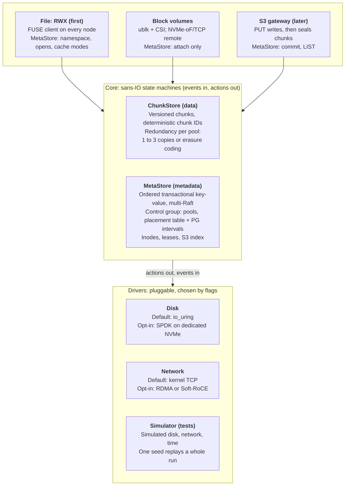
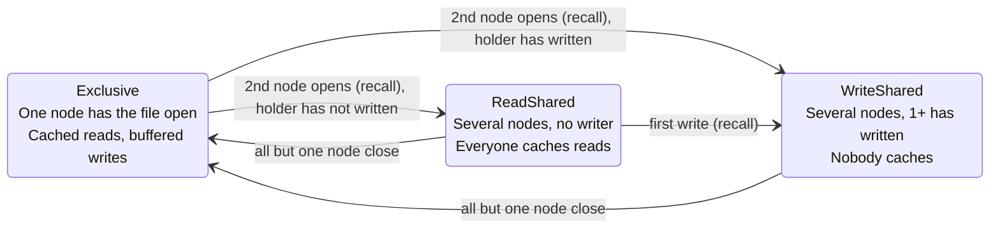
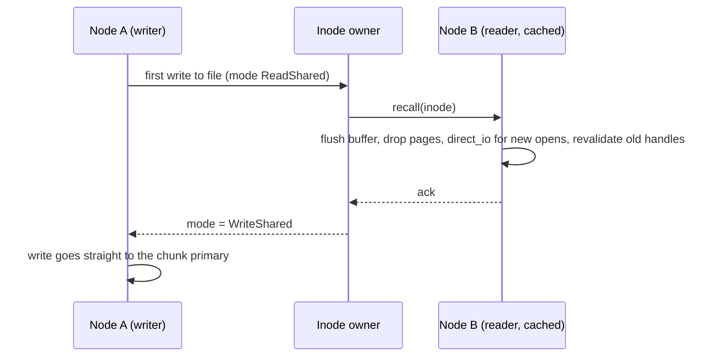
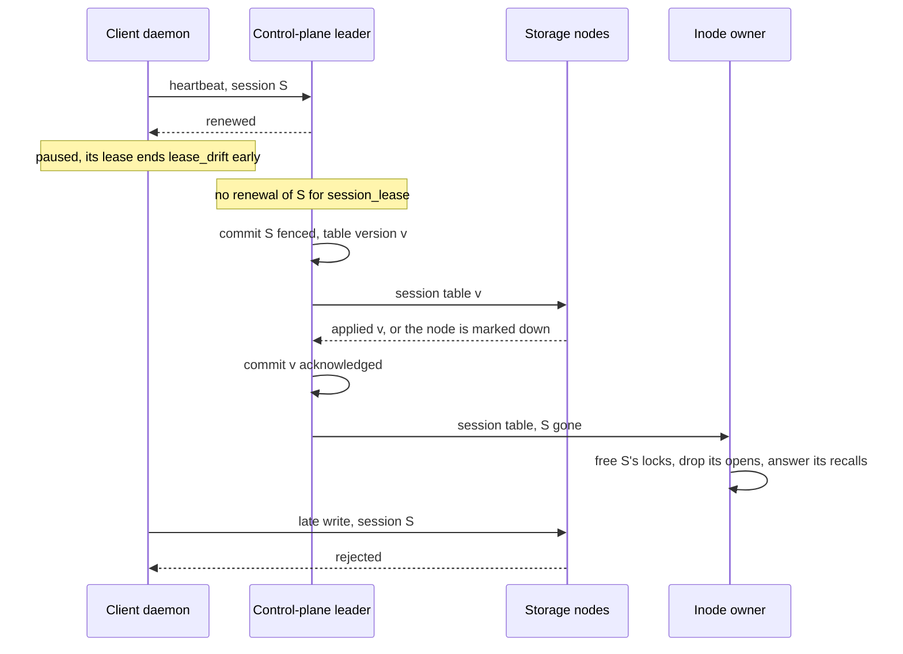
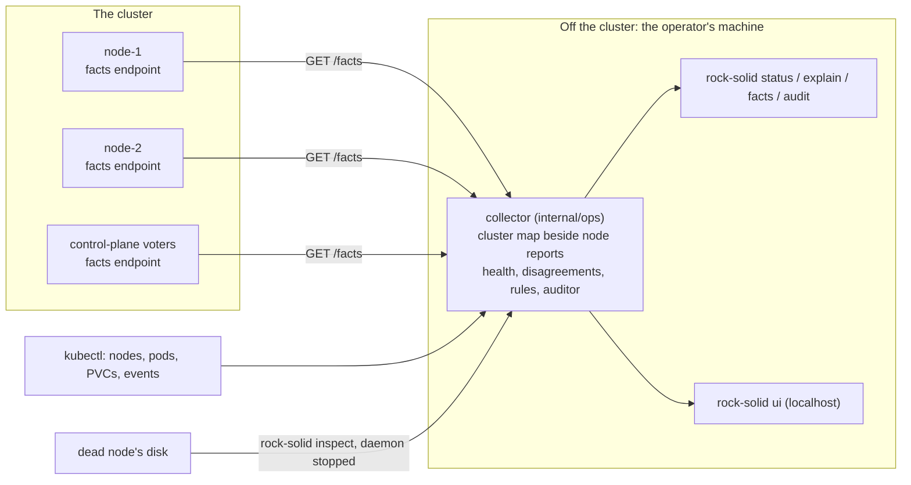
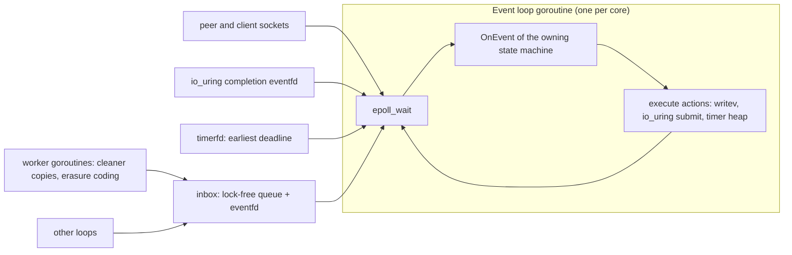

# rock-solid design

Terms such as primary, placement group, epoch or fencing are explained in the [glossary](glossary.md).

## Goals

Build a distributed storage system in Go ([Runtime in Go](#runtime-in-go)) whose headline feature is **ReadWriteMany (RWX) shared filesystems** for a 3 to 10 node homelab Kubernetes cluster: many pods on many nodes mounting one directory, with no NFS gateway in the path, caching that stays correct when files are shared, and Longhorn-level ease of install. Block volumes come from the same core, at near-raw NVMe latency.

**Target user:** homelab and small-cluster Kubernetes operators. They have several NVMe or SATA solid-state drives per node, 10 to 25 Gigabit Ethernet (GbE), and some nodes with Remote Direct Memory Access (RDMA) capable cards. For RWX today they choose between a Network File System (NFS) server (single server, fragile), Longhorn RWX (an NFS server pod in front of each volume), JuiceFS (needs an external metadata database and object store) and CephFS (heavy on RAM, CPU and operator knowledge).

**Product goals, in priority order**

1. **RWX filesystem** (`volumeMode: Filesystem`, `ReadWriteMany`): a Filesystem in Userspace (FUSE) client on every node, talking straight to the storage nodes, with close-to-open consistency first and automatic per-file cache coherence next. macOS and Windows clients reach the same volumes over Server Message Block (SMB), through a Samba gateway on the FUSE mount ([What is not free](#what-is-not-free)).
2. **Block volumes**: ReadWriteOnce (RWO) Persistent Volume Claims (PVCs), plus RWX block for KubeVirt live migration.
3. **S3** later, on the same core.
4. **Easy to run:** a single binary (one daemon per node, which also serves as the FUSE client) plus a Container Storage Interface (CSI) driver. No hugepages, pinned cores or external database to get started.
5. **Low CPU per operation**, so storage does not eat the cluster.
6. **Permissive license** (Apache 2.0).

**Performance targets.** Stated as round trips, because absolute numbers depend on the network and drives.

| Operation | Target cost |
| --- | --- |
| Read of a cached file (one writer, or readers only) | Page-cache speed: no FUSE or network trip (0.3 µs per 4K measured) |
| Read or write of a file being written from two or more nodes | One network round trip to the chunk primary, plus about 5 to 20 µs of FUSE overhead |
| `stat`, `lookup` within the cache timeout | Local |
| `stat`, `lookup` after a cache miss | One round trip to the MetaStore shard leader (lease read, no disk write) |
| `create`, `unlink`, same-directory `rename` | One Raft commit on one shard |
| `open` of a file | One round trip to the inode's owner (memory only, no disk write) |
| Block 4K write at queue depth 1 | Around 0.1 ms (Vitastor class) on drives with power-loss protection; Ceph is around 1 ms. Consumer drives without it floor at about 1 ms per durable write ([NVMe flush spike](#appendix-nvme-flush-spike)) |

**Learning goals:** Go for systems code, the Storage Performance Development Kit (SPDK), the Data Plane Development Kit (DPDK) and RDMA, extended Berkeley Packet Filter (eBPF) tracing, plus distributed-systems correctness testing.

**Non-goals for v1:** SMB leases on files that pods on other nodes also write, several SMB gateways per volume, GPU-cluster scale, shared-writable `mmap` across nodes, cross-directory hard links, a custom kernel module, hard disk drives (HDDs), which can come later as a capacity tier behind flash ([Addresses belong to the log](#on-disk-format)), and authentication or encryption between daemons. v1 trusts the cluster network: any host that can reach a daemon's port can read and write any volume.

## Landscape and positioning

The open gap is **RWX without a gateway**: every client reads and writes the storage nodes directly, caches aggressively while it is safe, and stops caching automatically when it is not. It installs like Longhorn and is licensed like SeaweedFS.

| System | What it covers | Why it doesn't fill the gap |
| --- | --- | --- |
| Longhorn | Easy Kubernetes block; RWX through a share-manager pod running NFS-Ganesha | All RWX traffic goes through one pod per volume: a bottleneck and a failover pause |
| [JuiceFS](https://github.com/juicedata/juicefs) | FUSE file system, CSI driver, Apache 2.0 | Needs an external metadata engine (Redis, TiKV, SQL) and an object store; close-to-open consistency only |
| CephFS | POSIX file system with full client capabilities | Around 1 ms writes, heavy CPU and RAM, steep operations learning curve |
| [SeaweedFS](https://github.com/seaweedfs/seaweedfs) | Single binary, S3, FUSE mount, CSI driver | Built around objects; no cache-coherence protocol for shared writes |
| [Vitastor](https://vitastor.io) | Ceph-like block, file, S3 at around 0.1 ms | Solo project; server under a GPL-based network-copyleft license that deters adopters |
| [OpenEBS Mayastor](https://github.com/openebs/mayastor) | Rust + SPDK + NVMe over Fabrics (NVMe-oF) block | Block only; requires hugepages and dedicated cores |
| [Weka](https://docs.weka.io/weka-system-overview/weka-client-and-mount-modes), DAOS, [DeepSeek 3FS](https://github.com/deepseek-ai/3fs) | AI-cluster file systems with kernel bypass | Built for GPU clusters; commercial or heavy to deploy |
| [MinIO](https://github.com/minio/minio), [RustFS](https://github.com/rustfs/rustfs), Garage | S3 | Object storage only |

**Takeaways**

- Homelab RWX today means NFS somewhere in the path. Removing it is the visible win.
- Weka shows that per-file cache-mode switching gives most of the benefit of full client capabilities with a much smaller protocol. Our spike shows it can be done on FUSE, without a kernel module (see [FUSE coherence spike](#appendix-fuse-coherence-spike)).
- Vitastor proves one person can get a 10x latency win over Ceph without DPDK, by shortening the code path. The same lean core serves block.
- Trust is the adoption gate. Storage people wait years before trusting a new system, so correctness work is the product.

## Strategy

Win on a short code path, correct caching and low CPU per operation. Kernel bypass is an opt-in fast path, never a requirement.

On homelab hardware the network caps throughput before the kernel does:

```
one NVMe Gen4 drive:  ~7 GB/s sequential, 4K write in ~0.04 ms (into its write cache)
10 GbE link:          ~1.2 GB/s
25 GbE link:          ~3 GB/s
kernel TCP stack:     saturates 10-25 GbE with one or two cores
```

So DPDK buys almost no throughput here. The latency gap between the disk and Ceph is almost all software path, which is what we attack. One caveat: a *durable* write is bounded by the drive's flush latency. On the consumer NVMe drive we measured, a 4K write plus flush takes 0.95 ms at p50, 98% of it inside the drive, and about 2 ms after the drive has idled for 100 ms ([NVMe flush spike](#appendix-nvme-flush-spike)), so the 0.1 ms block target applies to drives with power-loss protection.

**Principles**

1. **RWX first:** the file frontend and its coherence protocol are the first usable product. Block and S3 reuse the same core.
2. **Lean data path:** client → chunk primary in one hop → log append in parallel with sends to replicas → acknowledge. Every frontend uses it.
3. **Cache where safe, never where unsafe:** a file is cached on a node only while no other node writes it. Correctness never depends on timeouts alone.
4. **Defaults that need no tuning:** `io_uring` for disk, kernel TCP for network, FUSE for the file client. No hugepages, pinned cores or kernel modules just to try it.
5. **Opt-in fast paths:** SPDK for dedicated drives, RDMA for nodes with capable cards. DPDK stays a learning experiment.
6. **Correctness before features:** deterministic simulation from day one, including the coherence protocol.
7. **Apache 2.0** to stand apart from Vitastor's network-copyleft license.

## Architecture overview

The system is a two-part core (ChunkStore for data, MetaStore for metadata) under three protocol frontends, over pluggable input/output drivers.



*Three frontends share one core; they differ only in how much metadata they need.*

The same daemon runs on every node. On storage nodes it serves chunks and MetaStore shards; on every node, including compute-only ones, it is also the FUSE client for RWX mounts. The core never touches real I/O, so the simulator can stand in for every driver. Every daemon also reports what it holds, from its own memory and disks, on an admin port that the `rock-solid` command line and web UI read from off the cluster, so an operator can see the cluster's state when the cluster cannot report it ([Operating the cluster](#operating-the-cluster)).

## Data layer: ChunkStore

The ChunkStore is dumb, fast and versioned. It knows nothing about files, buckets or volumes.

```go
type ChunkStore interface {
	Write(c ChunkID, off uint32, data []byte, expectVer *uint64) (uint64, error)
	Punch(c ChunkID, off, n uint32, expectVer *uint64) (uint64, error) // zero a range; the whole chunk deletes it
	Read(c ChunkID, off, n uint32, atVer *uint64) ([]byte, error)
	Seal(c ChunkID) error     // now immutable -> eligible for erasure coding
	Flush(cs []ChunkID) error // durability barrier
}
```

Three sans-IO machines in `internal/chunkstore` carry it: `Store` runs one disk, `Replica` runs a disk's store as a member of every PG the table puts on it, and `Client` is a client daemon's side. The protocol they follow between them is `models/epoch/epoch.tla` ([Epoch changes](#epoch-changes-and-failure-detection)).

**Deterministic chunk IDs.** `chunk_id = (volume_id, inode_id, offset / CHUNK_SIZE)` is computed, never looked up, so the hot path needs no metadata; a block volume uses inode 0. It packs into 128 bits, a 32-bit volume, a 64-bit inode and a 32-bit chunk index, which allows files up to 16 PiB. Volume and inode IDs are never reused, and inode IDs are scoped to their volume, so a [restored or cloned](#snapshots-and-clones) volume keeps every inode number and differs from its source only in `volume_id`. `CHUNK_SIZE` is 4 MiB, Ceph RBD's default object size; the nightly benchmarks keep it honest.

**Versions.** Every write and punch returns a new 64-bit version: the high 32 bits are the number of the chunk's PG [interval](#epoch-changes-and-failure-detection) in which its primary ordered it, the low 32 bits count the chunk's writes in that interval. Each interval has one primary and a PG's interval numbers only grow (a split PG's halves start one above it), so no two primaries can give one version to different data, and a member returning with a write its new primary never saw is told apart by the version alone, as with Ceph's `eversion_t` and Vitastor's per-PG epochs; a plain counter would take that stale write for the current one. Version 0 is the absent chunk, and a punch of a chunk with no version logs nothing and returns 0. A chunk whose counter runs out, after 4.3 billion writes in one interval, asks for a new interval of its PG alone. The high half counts the PG's own intervals rather than [table epochs](#epoch-changes-and-failure-detection) because table epochs follow the whole cluster: in the [PG epochs spike](#appendix-pg-epochs-spike), one node flapping every 10 seconds would use up 32 bits of table epochs in 207 days, while the busiest PG's intervals would take 272 years. The layout is disk format: versions sit in every record entry, index key and extent ([On-disk format](#on-disk-format)), and 128-bit versions would add 8 bytes to each ([PG epochs study](../studies/pg-epochs/README.md)).

`expect_ver` gives compare-and-set on data. It is compared with the chunk's newest *ordered* version, pending writes included, since a write ordered behind a pending one it never saw would otherwise overwrite it unseen; `expect_ver` 0 creates a chunk only if it is absent. A read at a frozen version (`at_ver`) needs no ordering against writes, so any member holding that version serves it without waiting for a writer. A primary keeps an old version only while a [snapshot](#snapshots-and-clones) pins it.

**Reads see only acknowledged writes.** A version *commits*, and its write is acknowledged, once every live member of the chunk's PG holds it. A read without `atVer` returns the newest committed version, never one still being replicated, since a primary crash could lose that one: the new primary may be a member that never received it. So a primary maps a write into its [chunk index](#on-disk-format) only when it commits, and until then a read finds the previous version's blocks without waiting. A member that is not the primary maps writes as they become durable, since it serves no live reads, and a restarted primary takes a new interval of each PG it leads and [peers](#epoch-changes-and-failure-detection) before it serves.

**Single order per chunk, and every write applied once.** Each chunk has one primary that applies writes in one order, and every member holds them in that order, so RWX block and uncached shared files need no client-side protocol. A write takes effect once, however often its client sends it. A client resends whenever a first attempt may have committed (an acknowledgment lost with a connection or a primary, a refusal peering may still reverse), and applying it again under a newer version would let another node's write land between the two, so a reader would see X, Y, then X again, and a resent `expect_ver` write would fail although it succeeded.

So every client write and punch carries its *identity*, the session, incarnation and a per-chunk-write request ID kept across resends, and the oldest request ID its session still has outstanding. Every disk keeps a *resend table* in its chunk index, identity → (chunk, version) for the versions it logs, and a primary looks a write up once it would order it: a version it holds answers the write with that version (OK if mapped, the outcome if pending), and no entry means the write is ordered. The contract that keeps the table small and sound:

- An entry lives only while its disk holds the version. Every path that drops a version on a disk (a settle, a decision's marker, replay's gating, a failed log write, a give-up) removes that chunk's entries of every earlier interval. Erring toward removal is safe: the disk then lists the chunk and answers no write of it until recovery brings the source's entries back.
- The table holds only writes a client may still send. Each update names its session's oldest outstanding ID, every ID below which has a final answer and is never sent again; each disk it reaches removes the session's entries in the PG below that ID and raises the session's *watermark* there. A write at or below the watermark is answered `Stale`, which the client takes as final. Without the watermark a trimmed write waiting at an unpeered primary would be ordered again; NFSv4.1 does the same per slot with `NFS4ERR_SEQ_MISORDERED`.
- A client assigns no ID more than `RequestWindow` (4,096) past its oldest outstanding one, and a member refuses one that does, so one unanswered write cannot pile up a hot chunk's entries past what its recovery carries.
- A fenced session's entries and watermarks go in one range removal per PG, applied again after a replay rather than logged, since a fenced session's writes are refused before any lookup.
- A recovery write carries the source's watermarks for the PG and its entries for the chunk, those of overwritten versions too, since the target may lead the PG next. Copying only the live map's versions would forget X once Y overwrote it; copying the source's whole range would bring entries of versions the target never holds, and answer a resend OK for a version no disk holds.

Ceph answers resends the same way from its PG log and `dups` (`PrimaryLogPG::do_op`), but keeps a count of request IDs per PG (3,000 by default); trimming by the client's oldest outstanding ID means a busy PG cannot push out a write still unanswered. The MetaStore's [replay records](#daemon-restart-and-upgrade) do the same for metadata. A block daemon's reissue after a crash is the one resend that is a new write: the [incarnation fence](#daemon-restart-and-upgrade) orders the old copy before it or refuses it, so at worst the same bytes land twice. The cost is a 65-byte `writer` entry per version in the header its first data shares, about 60 bytes of index per write until the session's next update passes it, a watermark key per session and PG, and, in a recovery write, 48 bytes per carried record: at most `RequestWindow` entries per session per chunk, so the 16 MiB frame bounds a chunk at some 60 sessions with full windows. The code is `resend.go`; the model checks the rule as `AppliedOnce` and `StaleOnlyHeard` in `models/epoch/epoch.tla`.

**Byte ranges become whole blocks at the primary.** The API takes byte ranges; records, checksums, the chunk index and snapshots hold whole 4 KiB blocks. For each block an operation covers in part, the primary *merges*: it overlays the operation's bytes on the newest version of that block it has ordered (a pending write's merged block, else its live map, else zeros) and sends and logs only whole blocks, so members need no base and hold the same bytes under every version. The base must be the newest *ordered* version: in the [sub-block writes spike](#appendix-sub-block-writes-spike)'s model, merging against the committed version lost bytes on every seed as soon as two writes to one block were in flight. Merging on the client lost bytes without compare-and-set and retried 0.64 to 1.28 times per write with it (VitastorFS merges that way); merging on every member, as BlueStore does, costs a read per member and needs identical histories ([sub-block writes study](../studies/sub-block-writes/README.md)).

What follows from merging against pending versions:

- A write merged against a pending version is acknowledged only after that version commits, and refused if the base is, so no byte of a write that never committed survives in a later one. Across intervals [peering](#epoch-changes-and-failure-detection) keeps that dependency: it drops only a suffix of a chunk's pending versions, and a new primary merges only once it holds every kept version.
- A base read from disk has its CRC32C checked, and one that fails is read from another member at the same version, so a merge never carries rot into a new version; a member serves such a read only while its live map holds that block at that version. The chunk's later operations wait behind the base read, so they keep their order, as Ceph's erasure-coded extent cache does.
- Each loop keeps a small cache of recently merged blocks (64, 256 KiB), valid only while the index still maps the block at the cached version, so nothing invalidates it. With the [client](#client-design) sending whole blocks wherever it holds the bytes, base reads fall on write-shared files and 512-byte [block](#block-frontend) writes.

**Punch.** `punch` zeroes a byte range as a new version: whole blocks inside the range get a punch entry, and a block it covers in part is merged with zeros like a write. Punched blocks are freed once no snapshot needs them. Punching a whole chunk deletes it and leaves a tombstone. File unlink and truncate, `fallocate` hole punches, block discard and volume deletion all free space this way ([Freeing space](#freeing-space)).

**The primary's write path.** The primary orders a client's write or punch in its store, which merges it and gives it the next version, then sends the merged blocks to every up member while its own log takes them, so members log in parallel with it. A member in `maintenance` counts toward `min_live` but is sent nothing, and a PG with fewer than `min_live` live members refuses writes. The version commits once the primary's record is durable and every member it was sent to has acknowledged; the store maps a chunk's committed versions in version order and replies after mapping, since a reply on commit alone would let a following read miss the write while an older version waited. One copy of the merged blocks goes to every member, as the [driver contract](#modularity-sans-io-core-pluggable-drivers) allows. A member logs a version only from the PG's current interval in its own table and while it is an up member there, and answers once it is durable, with its disk's fill.

**A failed version ends the interval.** A version a member refuses, or that runs out of space or fails in the primary's own log, ends the PG's interval: neither it nor any later pending version of its chunk can commit, since each merged version holds the bytes of the one below and members may differ in which they logged. The primary orders nothing more in the interval, refuses the writes still waiting in its store, holds new ones, and asks the control plane for the next interval, in which it peers and leaves each pending version to [Which versions survive](#epoch-changes-and-failure-detection). Its clients are refused, which tells them to resend, not that the write failed; should peering keep the first attempt, the resend table answers the second. A failed version keeps its number, since members may hold it. Superseding the failed versions within the interval would save a table change and a peering, but its writes can fail in turn ([Alternatives considered](#alternatives-considered)).

The contract peering hands back through the store (`Store.Settle`, chunk by chunk, before activation and only once every up member has persisted its missing list, so no client hears of a decision that is not durable):

- Pending versions the kept one rests on are mapped, the rest dropped. A version rests on the kept one if it is at or below it in the kept version's interval, or below such a version; one from an earlier interval with none of the kept interval above it is dropped though it is lower by number, since an interval this primary missed may have dropped it.
- A kept version's client hears OK only if the decision proves at least `min_live` copies: the up members it leaves off the list and the members in `maintenance`. A member that lists the chunk is no copy, even if it holds the version, and a primary that keeps leading could otherwise answer OK for a write it alone logged. With fewer copies the clients are refused and the versions stay kept; the primary holds the resends until recovery gives the chunk `min_live` copies ([A write to a chunk with too few clean copies](#epoch-changes-and-failure-detection)).
- A refused version is never dropped, since only the primary that ordered it knows it was never acknowledged. So if its one holder dies the chunk is unfound, with the acknowledged versions below it, though they are whole on other disks; no operator path gives those back ([Alternatives considered](#alternatives-considered)).
- Peering decides a chunk only once none of its writes waits to be ordered and every record of it on the primary is durable or failed, and the primary names the chunks only it logged (`Store.Unsettled`) and refuses to activate while one is left.

A primary that loses its lead refuses its pending versions' clients and maps them as a member would. A rebuild of the store's index ends the interval of every PG the disk leads, as a restart does. A primary whose store failed refuses everything and takes no more, leaving its versions to another primary's peering. A member that fails to log a version refuses the chunk's later versions in that interval, so it never holds one without the versions below it; telling apart only the versions merged on the failed one would track a dependency per block for a case that means the member is full or gone.

**Admission against `write_limit`.** Before it orders a write, the primary checks every disk holding one of the PG's members, down ones at their last fill, against [Write limit](#volume-size-and-capacity). It learns each member's live blocks from every acknowledgment and the leader's heartbeat answer, its own disk's at most every 100 ms, and each disk's size, log reserve and the pool's outstanding grants from the leader's answer to its node's report ([The control-plane host](#metadata-layer-metastore)). A refused write gets `NoSpace` unless it is a flush under a space grant, which the client flags beside `expect_ver`, or an overwrite, looked up only once a member is at its limit. Punches and recovery copies are never checked. In phase 3 the primary trusts the grant flag; phase 4's control-plane group supplies the grants to check it against.

**Sends, reconnects and held writes.** A primary sends each member its writes in the order it ordered them over one connection per loop pair, and after a `PeerLost` waits `ResendAfter` (10 ms) and sends again, in order, every write of the current interval the member has not acknowledged; a write ordered meanwhile waits behind that resend. So a member never logs k.(n + 1) before k.n of a chunk. A member answers a resent version with its first copy's outcome, or OK if its index holds the version whole in the current interval (each version's last entry is flagged, [Which versions survive](#epoch-changes-and-failure-detection)), and otherwise refuses, since a multi-record version may be durable only in part. So an acknowledgment lost with a connection costs a resend, not an interval change. Until a primary has peered in an interval it holds the PG's client writes; afterwards it orders them only if it led every interval since it held them, and otherwise refuses them.

**The chunk client.** A client daemon reaches chunks through one `chunkstore.Client` per session incarnation, shared by the FUSE daemon and the block frontend. Exactly one per incarnation, because request IDs and every disk's trim by the oldest outstanding one are the incarnation's: a second client naming its own oldest would raise the watermark past the first's unanswered writes. The client places each chunk by the hash below over its node's table, sends each request to the primary that table names after a hello naming the session and incarnation, and keeps a write's bytes in a pool buffer until a final answer. Its retry rules:

- A refusal naming a newer table waits for that table and goes to its primary; one naming no newer table, or an unfound write, goes again after 100 ms doubling to 3.2 s. No reachable primary retries after 100 ms, no answer after 2 s, a lost connection after `ResendAfter`.
- A write to an unfound chunk stays outstanding until a candidate returns or an operator gives the chunk up; an unfound read completes with `EIO`, since a read is idempotent.
- `NoSpace` is final and returns `ENOSPC`. A fenced session's writes are refused and resent until the daemon replaces the client with one of its new session.
- IDs are taken in order, so a write past the window waits in the client's queue, never in the network.

**Tables reach a primary as deltas.** A replica applies each table as the delta from the one it holds and checks the CRC, and asks for the whole table after a gap or a mismatch; a message tagged with a newer interval from a newer table waits for that table.

**Operations on one disk.** `chunkstore.Store` is the ChunkStore of one disk, driven by its owner loop with requests and disk completions. A write's bytes come in one pool buffer laid out from the start of its first block, so whole blocks need no copy, and each write or punch carries its volume's snapshot epoch, which is how the store learns a cut ([Snapshots and clones](#snapshots-and-clones)). Its contract:

- A range lies inside one chunk and is at least a byte long, or it is refused with `ErrRange` and no disk action; callers split at a chunk's end.
- A write is answered once every record holding it is durable and the chunk's earlier writes are mapped, so `Flush(cs)` adds no disk action: it completes once every write and punch to `cs` submitted before it is answered. Until a write is mapped the store keeps its buffers, and later writes to the same blocks merge against them in memory.
- Every read checks each block's CRC32C against its record header. A write whose base fails or cannot be read fails (`ErrBadChecksum` or the disk's error) rather than carry rot forward; on one node the block stays unreadable until overwritten.
- A write larger than one record goes to the log as several items of one version, freeze first, and a crash or `NoSpace` can keep some of them. Live state must be what recovery produces, so the store keeps the durable items mapped: an unacknowledged large write may be partly visible, as on a local disk, and a failed one's error carries its version for compare-and-set. All or nothing would need a commit record per write, which [chunk slots](#on-disk-format) make unnecessary for whole chunks.
- Items in flight when the disk fails report `ErrInDoubt`, and the store refuses writes (`ErrUnavailable`) until it is opened again and recovery decides.
- On one node the version's interval is the store's own: 1 at each open, never below the interval of the version it increments, raised when a counter runs out. A restart may reuse the version of a write lost at the crash, which was never durable or acknowledged.
- `Seal` returns `ErrSeal` until [encoding](#when-chunks-are-encoded) exists.

**Fencing.** Each write carries the client's session ID. When a client session expires ([Sessions and fencing](#sessions-and-fencing)), the control plane publishes it as fenced in its session table and every storage node rejects its writes. The session's locks and cache rights are released only after every storage node has applied the fence or been marked down, so a paused or partitioned client cannot write after they are gone.

**Integrity.** Each 4K block, and each 4K block of an erasure-coded shard, carries a CRC32C in its record's header in the [on-disk format](#on-disk-format), which catches bit rot, torn writes and misdirected writes. Go's `hash/crc32` interleaves three SSE4.2 streams on x86-64: 167 ns per 4 KiB block, 7× faster than a table-driven implementation ([Go CPU spike](#appendix-go-cpu-per-operation-spike), C0); on arm64 it takes 359 ns on an Apple M4 Pro.

**Placement groups.** Chunks are not placed one by one. Each chunk hashes into one of a fixed number of placement groups (PGs) in its volume's [pool](#pools-and-redundancy), as in Ceph, and placement is decided per PG:

```
chunk_id = (volume_id, inode_id, offset / CHUNK_SIZE)        // computed
pool     = volume record → pool                              // learned once, at attach or mount
h        = xxh3_64(chunk_id as 16 big-endian bytes, seed 0)  // computed
pg       = (pool, h >> (64 - log2(pool.pg_count)))           // top bits of the hash
members  = placement_table[pg]                               // in-memory; [primary, r1, r2] in rep3
```

The hash spreads a volume's consecutive chunks over many PGs, and so over every disk of its pool, so a volume is not bounded by any one drive ([Volume size and capacity](#volume-size-and-capacity)). The PG is also the unit of recovery and rebalancing: adding a disk moves whole PGs onto it, never single chunks. The hash function and bit layout are disk format and never change.

Each pool's `pg_count` is a power of two, sized so that each disk holds around 100 PG members summed over all pools (`pg_count × width ÷ disks`); unset, it is the smallest power of two giving each disk at least 100 members of the pool alone, 2048 for a 3-replica pool on 60 disks. It grows only by doubling, since a halving would merge PGs: a PG is one contiguous range of the hash's top bits, so doubling splits PG `p` into `2p` and `2p + 1` without rewriting the per-disk index.

**Placement table.** The table maps each PG to its members in order, primary first, and to its interval state: the current and last activated interval, the members and `min_live` of intervals since, a pin flag, whether its primary reported the current interval recovered, and which members are *leaving* during a move or refill. Each pool's part carries its split epoch, and the table a *table epoch*, its version. Its size follows the pools' PG counts and widths, not the data: 2048 `rep3` PGs take 52 KiB and a 4096-PG `ec16-2` pool about 404 KiB, whether the cluster holds 1 GB or 100 TB. So it is **not sharded**: it lives in the single control-plane Raft group, every node caches a full copy, and it changes on pool, disk and node events and on primaries' activation and recovered reports, never on the I/O path. Every change raises the table epoch, but only a change to a PG's members, their order, live or leaving marks, its pool's `replicas` or `min_live`, a split, or its primary's request starts a new interval of that PG ([Epoch changes](#epoch-changes-and-failure-detection)), and a member rejects only requests from an earlier interval of their PG.

The control-plane leader computes each new table and commits it as one Raft entry holding only the PG entries it changes and the CRC32C of the table it produces; nodes never compute placement themselves. A node applies the change and checks the CRC, and fetches the whole table after a gap or mismatch, as Ceph's daemons do with incremental maps. Each entry carries its interval number, so a node that skips tables loses nothing, where Ceph's daemons walk every map to work out each PG's interval; deltas only save bytes. In the [PG epochs spike](#appendix-pg-epochs-spike), a homelab year with moves staged one per table pushed 2.25 GB of whole tables to 10 nodes against 105 MB of changes; activation and recovered reports change an entry at most once per interval each, at most tripling that.

The computation, `chunkstore.Next` in `placement.go`, is a pure function of the previous table and the cluster's state, deterministic (ties go to the lowest disk ID, then PG number, and no map order enters it), in two steps:

1. **Refill** every missing member. A member is missing once its disk has left the pool or lost its log, once it has been down `refill_after` (or `degraded_refill_after` in a PG below `min_live`) unless peering waits for it anyway ([Failure detection](#epoch-changes-and-failure-detection)), or once its PG is `Stuck` and it sits on a disk at its log reserve lacking copies ([A member on a full disk moves before the report](#epoch-changes-and-failure-detection)). An up leaving member takes a missing member's place if it can; otherwise a new member goes onto the eligible disk furthest below its target, replacing a member whose disk has left the pool and standing beside one merely down or full, which may hold a chunk's last copy and so stays as a leaving member ([A refilled member stays a source](#epoch-changes-and-failure-detection)). Refills are never held back.
2. **Balance**: while a disk is outside its fill margin, move one member of an unpinned PG from the disk furthest above its target to the eligible disk furthest below, without leaving the destination higher than the source. Each move lowers a well-founded measure, so the loop ends.

Lowering `replicas` narrows a PG through a move's removal, one member per recovered report, never a deletion: a refill member may still be recovering and the table cannot tell, so deleting a live member could delete the only complete copy. Only a member whose disk has left the pool is deleted at once. The leader allows `max_moves` (1) balance moves in flight across the cluster, as Ceph's `osd_max_backfills` of 1 does per OSD, since a move copies a whole PG while it serves; the count is cluster-wide because pools share disks and choose moves pool by pool. A move that cannot end, because another member of its PG is down, holds that budget until the member returns or its disk is declared lost: it slows moves, never refills or data.

**A move adds the new member before it removes the old one.** A move, from balance or off a draining disk, adds the destination and marks the member it replaces *leaving*, in one table that starts an interval. It starts only on a PG whose entry records a recovered report for its current interval with its members unchanged since, so every member is complete; the one exception is refill's park of a member on a full disk. Until the move ends the PG is one member wider: the leaving member acknowledges every write and is a recovery source, the new one counts toward `min_live` while it recovers, balance counts the leaving member as gone, and the failure-domain rule ignores it, so a move between two disks of one node works on 3 nodes. The first table after the current interval's primary reports it recovered removes the leaving members, unless that table marks another member down or in `maintenance`. Any change that lets a member miss writes starts an interval and so voids an older report; a late report would otherwise remove the leaving member while a member that missed writes still recovered.

A swap in one table would leave the chunks written before the move with one copy fewer on every routine move, since recovery copies only from the current interval's members and past intervals' lists are dropped at activation. Ceph keeps its old acting set as `pg_temp` until backfill ends, and CockroachDB adds a learner before removing the old replica, for the same reason. A leaving member stays while it is down, however long, and goes without a report only once its disk leaves the pool, so a move never loses a copy the PG would have kept without it. The cost is a second interval per moved PG and a PG one member wider while it copies. The model checks this as `Add`, `Remove`, `Replace`, `Drop`, `Stay` and `Refill` in `models/epoch/epoch.tla`, under the properties `RemovalKeepsCopies` and `NoStranded`; it does not cover a holder that truly dies (`LoneCopy`).

**Pins and drains.** An operator pins a PG with `rock-solid pg pin <pool> <pg> [<disk,...>]`, clears the pin with `rock-solid pg unpin <pool> <pg>`, and reorders it unpinned with `rock-solid pg edit <pool> <pg> <disk,...>`. An edit only reorders the PG's current members: one that changed the disk set would drop a member with no leaving mark to keep it until its replacement recovered, and could lose a last copy, so moving a PG off a disk is a drain's work. An edit naming more disks than the pool's width, a disk twice, or more per failure domain than `max_per_domain` allows is ignored, pin and all. Balance never moves a pinned PG's members, but refill still replaces a missing one, since a pin must not leave data on a lost disk.

A drain is a mark on the disk in the membership record (`rock-solid disk drain <disk>`, `rock-solid disk undrain <disk>`): the disk's target becomes 0, so balance moves its members off while they serve and refill puts nothing on it. The leader refuses a drain while placement finds no destination for some member of the disk, as on three nodes under `rep3`, since a drain that cannot finish would only stop refills onto the disk. It finishes once no PG names the disk, a leaving member or a past interval included; a pinned PG holds it until an operator edits or unpins that PG. Removing the drained disk from the pool is refused until then, and the refusal says how many PGs still name it, which is how an operator follows a drain. Removal is final: the drive returns only formatted again, under a new disk ID.

**Targets and margins.** A disk's target is its [capacity](#volume-size-and-capacity) for the pool, water-filled over failure domains so that no domain is asked for more than `max_per_domain` of a PG's width, and split within a domain by capacity. Capacity counts the pool's own data as held, so a finished move does not shift the targets; targets by free room shifted with every move, and after a disk was added settling took 1.5 to 2 times the moves and 3 to 5 computations, against 2 by capacity ([capacity conditions study](../studies/capacity-conditions/README.md)). A target proportional to size alone cannot be met when failure domains differ (under `rep2`, nodes of 0.7 and 2 GB each hold a copy of every PG), and in the [capacity model spike](#appendix-capacity-model-spike) a loop aiming at it never converged, while capped targets reached the pool's [balanced capacity](#volume-size-and-capacity) within 1%.

A disk's *fill margin* is max(5% of its target, 1 member). The 5% is Ceph's balancer deviation of 5 PGs at about 100 per disk and CockroachDB's rebalance threshold. The floor is needed because a 0.5 TB disk beside 8 TB disks has a target of 10 to 20 members, which no single move brings within 5%: without it the loop stopped outside the margin in 15 to 18 of 200 random tables. Balance takes its source from the disk furthest above target even inside its margin, as Ceph's balancer does once only underfull disks remain: that left available + held a median 0.8 to 1.2% under balanced after a disk addition, against 4.3 to 4.6% taking sources only from disks above their margins, for 11 to 17% more moves. Once converged, available + held ≥ balanced ÷ (1 + the pool's largest margin). With shards and `max_per_domain` above 1 (phase 10), two shards of a PG never share a disk and a PG's first `replicas` members sit in distinct domains.

A computed table gives exact balance on small clusters with mismatched disks, where a placement function every node evaluates (Ceph CRUSH, Weka's algorithmic ownership) leaves disks unbalanced; Ceph patches that with `pg-upmap` exception tables written by a balancer, so in practice it runs a table too, and warns that on mismatched devices a tight deviation can leave it "shuffling data forever". At thousands of disks the table and its recomputation would grow enough to revisit computed placement; that is outside the target.

What does grow with data lives elsewhere. Each disk keeps its own [index](#on-disk-format) of the chunks and shards it holds, and file-to-inode metadata lives in the sharded MetaStore.

### Epoch changes and failure detection

A new table reaches nodes at different times, so for a while a PG's old primary may act on an older table than its new primary. What keeps that window safe is the PG's *interval*: a run of tables in which the PG's ordered members and their live marks stay the same, so the PG has one primary and one set of members that must acknowledge its writes. The leader starts a new interval of a PG, its number plus one, in a table that changes the PG's members or their order, a member's live mark (down, up, `maintenance`), its pool's `replicas` or `min_live`, or splits it (both halves take the parent's number plus one), and when the PG's primary asks because a chunk's counter ran out or it restarted. Every other change raises the table epoch and leaves the interval alone. Ceph defines its intervals the same way (`PastIntervals::is_new_interval`). Three different numbers are called epochs, and none of them is in a version: the *table epoch* versions the placement table; a *support epoch* numbers one unbroken run of a loop-pair lease (below); a volume's *snapshot epoch* counts its [snapshots](#snapshots-and-clones). A PG's interval numbers, which are in versions, are not epochs. The protocol is the epoch change model, `models/epoch/epoch.tla`; the code is in `internal/chunkstore` (peering in `replica_peer.go` and `keep.go`, recovery in `replica_recover.go` and `recover.go`, the give-up in `giveup.go`, disk identity in `disks.go`, the detector in `detector.go`) and the lease arithmetic in `internal/lease`.

**Requests are checked against their PG's interval.** Every message about a PG carries the sender's table epoch and the PG's interval number in that table. A member accepts it only if that number is the PG's interval in its own table, whichever table is newer; it refuses a lower number, answering with its own table epoch and number, and fetches a table at least as new as the sender's before it judges a higher one. Comparing the PG's members in the two tables instead would not do: a member removed and added back leaves them equal, though it missed the writes in between. A split renumbers PGs, and new PG `p`, a half of PG `p ÷ 2`, can start the very interval old PG `p` was in, so the table keeps each pool's *split epoch*, that of the table that last doubled it: a member refuses any message about the pool's PGs tagged with an older table epoch, and a member whose table predates the split fetches the split table before it judges a message whose chunk is not in the PG it names under its own `pg_count`, or a peering message tagged with a newer table epoch. Neither wait comes in steady state.

A primary takes a client's write while its interval number is at least the one in which its own term began, since the write carries no state that depends on the PG's replicas. Writes it held when an interval ended under it it orders again once it has re-peered, but only if no interval since had another primary; otherwise it refuses them and the client retries, since a held write could land after writes another primary acknowledged, such as a dead daemon's write after its successor's reissue ([Daemon restart and upgrade](#daemon-restart-and-upgrade)). So a table change makes only the writes of the PGs it changed retry: in the [PG epochs spike](#appendix-pg-epochs-spike)'s homelab year on 10 nodes, a table changed 22% of PGs on average, or 2 to 4% with moves staged one per table, 4.4 to 46 times fewer disturbed writes than rejecting every older table epoch. On 3 nodes, where every PG has a member on every node, a node event still changes every PG. Ceph checks the same way (`can_discard_replica_op`, `same_primary_since`; [PG epochs study](../studies/pg-epochs/README.md)).

**Writes: the new primary peers before it accepts writes.** A write tagged with interval `j` completes only when every member live in `j` acknowledges it, and a member whose table has moved the PG past `j` refuses it. So before it accepts writes in interval `k`, the new primary *peers*: for every interval since the PG's last *activated* one (the last whose primary finished peering), it first gets at least one member live in that interval to adopt a table with interval `k`. From then on a write of an earlier interval completes only if `k`'s peering keeps it, so a client may hear of such a write late, but never of one `k` dropped. One interval back is not enough, since a PG can change interval twice before the first new primary peers. An interval whose live members, counting `maintenance`, numbered fewer than the `min_live` it ran under, or were all in `maintenance`, accepted no writes and is skipped, as Ceph skips intervals below `min_size`; the table keeps each past interval's `min_live`, since judged by the current value, raising it from 1 to 2 would skip an interval that took writes on one member. If no member of an interval to stop can be reached, the PG waits, as in Ceph's `down` state, until one returns or an operator [gives it up](#epoch-changes-and-failure-detection). Ceph also records each activation in the map first (`up_thru`) so peering can skip intervals that never activated, at a map change per peering; at 3 to 10 nodes waiting is enough.

**Which versions survive.** The primary collects, from each member it reaches, the newest version of every chunk and its *missing list*. That exchange grows with the chunks the PG holds, not with the writes a member missed, which RADOS's per-PG log of recent writes avoids for short outages (Weil et al., "RADOS: A Scalable, Reliable Storage Service for Petabyte-scale Storage Clusters", §3.4.1); whether it fits within a peering's pause is an [open question](#roadmap-and-open-questions). Before the primary activates, every member persists, with the interval number, for each chunk it lacks or holds a dropped version of, the kept version it must receive, as Ceph's members keep a missing set. A member never serves a chunk on its list, and only recovery removes an entry: a later peering may raise it but never clears it, because a write to another block can land on a dropped version's bytes before recovery arrives, and clearing the entry would make those torn bytes a recovery source.

The keep rule (`keep` in `keep.go`):

- The primary starts from the newest decision any reached member persisted: at least the last activated interval, possibly a later one not yet recorded or never activated. Versions below it stay as that decision kept them; deciding them by their own interval's members would drop what a later interval kept.
- A version assigned in that interval or later is kept unless a reached member live in the version's interval neither holds nor lists it, which proves it was never acknowledged. Keeping a write never acknowledged costs nothing.
- The proof gives way where acting on it would leave no source: a member that lists the chunk or holds a later version in part has no say when an up member of the current interval holds the version clean, and a member outside the current interval has no say when every up member of it holds the version. Otherwise a drain, a restart during recovery or a primary moved while holding part of a version could leave a chunk unreadable with every disk up. It is safe because a primary orders a write only while its own store lists nothing for the chunk ([A write to a chunk with too few clean copies](#epoch-changes-and-failure-detection)), so every version was first logged by a clean copy.
- A member holds a version only if every record of it is durable; each version's last entry is flagged and durability is a log prefix ([On-disk format](#on-disk-format)). A member holding a version in part vetoes it like one lacking it, and is listed whatever peering keeps.
- Every version a kept one rests on is kept, and a chunk whose kept version no up member of the interval can serve is reported unfound, never served older.

The versions peering drops are always the newest of their chunk: a primary sends a chunk's writes to each member in version order, again after a reconnect, and a member refuses the chunk's later versions in an interval once it fails to log one or is sent one again. A write that [merges a partial block](#data-layer-chunkstore) carries the bytes of the version below it, so peering never keeps a version whose base it drops.

**Recovery.** A member that lacks a chunk's kept version, or logged a version peering dropped, the new primary included, is recovered by copying the authoritative image onto it, as Ceph recovers divergent objects; the copy is a later record covering the dropped write's blocks, so neither replay nor an index rebuild brings it back. Until a chunk's kept versions are on the new primary, a partial-block write to it waits for its base, as Ceph's primary holds writes to a missing object: while the primary's index maps a version other than the kept one, or its store listed the chunk before the decision. Whole-block writes go ahead, and a punch of a chunk the primary holds nothing of is ordered, not answered done, since its members may hold the chunk. A primary holds at most 64 client writes per PG and past that refuses a partial-block write to a chunk whose kept version it lacks; a write to an unfound chunk is answered unfound at once.

A primary that dropped only versions of its own it never mapped still holds the kept image, so it is its own source and merges at once, and it carries that image from one decision to the next while every interval since had its disk as primary or as a member not up and peering keeps the same version. To outlast a restart or a lost lead, a store keeps versions *gated*, unmapped, until a decision its disk persisted settles them or the PG leaves the disk; replay gates the versions of any interval at or past the PG's newest persisted decision, and the primary answers kept versions' clients only at activation. The log cannot tell replay why a chunk is listed, so the primary persists the entry with an *image* flag when it lists the chunk only for its own dropped versions; every later persist of the list rewrites the flag. Without gating and the flag, a restarted primary would map its dropped versions and be no source, and losing the other member before recovery would leave the chunk unfound for good though the primary's log held the kept bytes. The cost is a flag per missing-list entry and gated versions held across a restart. Only the primary can be a source this way; whether another listed member could be is an [open question](#roadmap-and-open-questions).

Recovery is a write the primary orders like any other. It carries only the blocks no earlier write of the current interval covers, chosen when it is ordered, not when the source is read, so a client write ordered in between is never overwritten with older bytes. It takes no version of its own: it goes only to the members that list the chunk, each logs it under the newest version the interval ordered on the chunk before it, or the kept version, then ends it with an entry that sets the chunk's newest version and removes the missing-list entry. A later peering keeps or drops the recovered bytes with that version, and the chunk index keeps the version each chunk's last recovery was logged under, so a decision that keeps a version below it gives the primary no image. Rejected: a recovery write under the chunk's next version, sent only to the members it recovers, would be dropped by the next peering, so a move would copy the PG twice; sent to every member, a dropped one would list clean sources too, and two overlapping faults would leave chunks with no source. The costs: a recovery write sent again after it applied is refused and ends the interval, and a recovered block carries the recovery's version on the copy, so fetching it as a base, which only a checksum failure on the primary calls for, fails partial-block writes to it until a whole-block write or a recovery rewrites it.

The primary reads the image from its own store when its index holds the kept version whole, else from the first up member that does not list the chunk; a listed member is never a source, and a store whose image failed its checksum is none for the rest of the interval. A chunk with no source stays listed and unfound until a candidate returns or an operator [gives it up](#epoch-changes-and-failure-detection); kept version 0 needs none, its recovery write a map of holes. A failed recovery write ends the interval, and an index rebuild ends the recoveries under way. The image is the chunk's live map; a [snapshot](#snapshots-and-clones)'s frozen maps are not copied before phase 11. Each disk recovers at most 4 chunks at once across the PGs it leads: first a chunk a client write waits on, then the most degraded PG's (most members not up or listing, the lower PG among equals), and only while every target disk keeps the room outstanding [space grants](#client-design) were promised.

Once its members have persisted their lists, the primary activates and reports it on its next heartbeat, and the leader records the PG's last activated interval, dropping earlier intervals' member lists, in a later table that starts no interval; only activation guarantees every live member persisted the decision. A primary reports an interval *recovered* only once activated, since before activation a new member may not have persisted its missing list yet, so an empty one proves nothing; once its members, but a leaving one, are all up with empty lists it reports the interval recovered on each heartbeat until a table records it, which lets the leader start or end a [move](#data-layer-chunkstore). Every report, and the per-PG state a give-up reads, carries its pool's `pg_count` in the reporter's table, since a split renumbers PGs and a report for PG `p` from before it would land on the new PG `p`, a half of PG `p ÷ 2`; the leader drops one from before a split, ignores reports, edits and give-ups in the table that splits the pool, and drops an ask for a new interval tagged with a table older than the split.

**Restarts.** A node whose store was opened at start, rather than formatted, asks for a new interval of each PG it is a member of in its first table, every second until a table moves the PG on, and as primary peers in the new interval before it serves. Peering again in its old interval is not safe: a write its previous run sent could still sit in a member's socket buffer and land after that member answered peering, under a version the restarted primary would give to other data. A restarted member asks too, since replay leaves its current interval's versions gated until a decision settles them. Its own disk answers its peering, so the restart wait ([Reads](#epoch-changes-and-failure-detection)) applies: a primary restarting at t = 100 s activates at about 104 s. Its first table is one fetched after it started, never older than its previous run's, which could hand it back its old interval with no ask pending. The cost is one table change and one peering per PG of the disk, as Ceph peers every PG of a restarted OSD.

A PG can leave a disk while its node is down, as when a move completes with its leaving member down. The store drops the PG's gated versions once a table names the disk in no interval of the PG since the last activated one, as member or in a listed past interval; nothing can read them after that. Dropping them sooner would let the disk's peering reply veto an acknowledged version through a past interval; keeping them for good would pin the replay point, so the cleaner never frees later segments and a gated slot write keeps its slot. The drop logs nothing, so a restart replays them gated and drops them again under its first table, and an idle left disk keeps the slot lane's open segment until it takes writes. Pools are never deleted and PG counts only double, so every chunk's PG stays in the table; deleting a pool, if ever added, must drop its PGs' gated versions on every disk.

**A disk is its log.** Peering believes what a member says about the intervals it was live in, so a disk formatted again or replaced, answering from an empty log under the old disk ID, would drop acknowledged writes and stop intervals whose writes it never saw. So the control plane records, beside each disk ID, the disk's log ID, drawn at random at format ([On-disk format](#on-disk-format)), and the drive's stable identity, such as its WWN, and every node reports both for each disk it opens (`disks.go`). A device's slot is no identity, since a restart may renumber slots. A node refuses a drive with no unique stable identity (virtio disks, some USB bridges, cloned VM images that share a serial), and the control plane refuses a report's disks that share a device.

- An unknown log ID is a new disk with a new disk ID, from a counter that never reuses one. It retires only the disk last reported on the same device of the same node, a drive formatted again, whose ID stays down and whose members refill at once, without `refill_after`. A new drive in place of a failed one has a new identity and replaces nothing.
- A known log ID is taken only on its recorded device, and on another node only once its disk is down (a moved disk); under another identity it can only be a copy, such as a cloned drive, whose stale answers would prove acknowledged writes unacknowledged. The cost: a disk moved into an enclosure that reports its own identity is refused, and its members refill.
- An operator's declaration that a down disk is lost does the same for a disk that never reports again. The leader refuses it for an unknown disk, an up one, or one a PG's current interval holds without marking it down (the model's precondition for `Lost`); afterwards the record refuses that log, so the disk cannot rejoin under its old ID. What only it held stays unfound.
- A member answers peering only for its own disk ID, so a stale table placing the old ID at the new log's loop only delays peering, and serves a recovery read only while its disk ID is in the PG's current interval, or a new disk would copy zeros over acknowledged blocks.

A disk that leaves either way ends no peering: peering still needs an answer from a member of the last activated interval and of each later one that could have taken writes, so a PG with none of an interval's members left, as `rep2` when both go down together, stays stopped and is reported [`Blocked`](#volume-size-and-capacity) ([Blocked and unfound reports](build-checklist.md#phase-4-embedded-metastore)) until an operator's give-up. Ceph's `osd lost` frees the PG at once, so a declaration made in error loses data with no report; here it costs availability until the operator gives up writes knowingly. A lost log's shard replicas are lost with it, and the disk's new replicas join under new replica IDs, as etcd re-adds a member that lost its data directory; Ceph's monitors likewise ignore an OSD whose fsid changed (`OSDMonitor::preprocess_boot`). A drive that loses flushed writes but keeps its superblock keeps its log ID, which this cannot catch ([open question](#roadmap-and-open-questions)).

**An operator's give-up.** An unfound chunk or a stopped PG stays so until a candidate returns or an operator gives up what is lost, the one step that lets an acknowledged write go. `rock-solid pg give-up <pool> <pg>` ([The operator's commands](#metadata-layer-metastore)) gives up the PG's current interval k, read from the leader first, and every chunk k left unfound. The leader commits it as interval k+1 with the same members, marks and activation, in a table that changes nothing else of the PG; if a step changes the PG first, the leader refuses it with `ErrIntervalMoved` and the operator runs it again. The entry records k, so peering skips every interval up to k, and the chunks it may lose: every chunk if k is stopped, else those k's activated peering left unfound, which a primary reports `MaxReportUnfound` (64) at a time, so a PG with more takes several give-ups.

- The leader refuses it while the PG has a candidate, a member down or in `maintenance` whose disk is not gone ([Pool conditions](#volume-size-and-capacity)), as Ceph refuses `mark_unfound_lost` until every disk that might hold the object is probed or lost; and unless k is stopped or left chunks unfound. A give-up of an interval already given up is answered with that record and one of any other old interval is refused, so a resent command never gives up a newer interval.
- A node adopting a table with a new give-up drops the entry and bytes of every recorded unfound chunk, by a log entry replay applies too, before it answers peering, leaving any chunk it holds a version of from after k. Those chunks then read as zeros, a hole the filesystem above can repair or rewrite.

A stopped PG drops nothing up front: peering of k+1 keeps what the members it reaches hold, possibly older versions of acknowledged writes, and a chunk listed and held by none is unfound. The [epoch change model](#testing-strategy) lets an acknowledged version be lost only on a chunk a give-up records, and never lets a read return a version that was not written. The give-up deletes, as Ceph's `mark_unfound_lost delete`, rather than reverting: a store keeps one image per chunk, and a listed member's older bytes may lie under a later write, so there is no older image to trust, while an empty chunk is one every member agrees on.

**Reads: the old primary's read lease runs out first.** Reads need no acknowledgment from other members, so the write rule does not stop an old primary serving stale reads after the new one has accepted writes. A primary therefore serves reads only while it holds an unexpired read lease from each of the PG's other live members, and only while its interval has at least `min_live` live members, counting `maintenance`, as Ceph's PGs below `min_size` serve nothing; alone in such an interval it would need no lease and could serve after the PG moved on.

- A grantor joins no peering of an interval that moves the primary off its holder until the grant expires, or until the holder has adopted that interval, as its next lease request shows, so planned changes wait at most a heartbeat.
- A grantor grants or renews, fresh grants included, only a holder that reported a table at least as new as its own, so an old primary that reaches its members but not the control plane loses its leases within one `primary_lease`.
- Peering across several intervals adds no wait, since only the primary of the last activated interval, or of later ones that kept it, can have served reads. An interval that keeps the primary needs no wait: it serves committed versions and holds only writes until it has re-peered.
- A grant carries a *support epoch* the grantor keeps per holder within its run; a holder tells grants apart by the grantor's run ID and support epoch. Once a grant lapses on the grantor's clocks, the grantor bumps the epoch and never renews the old one. Primary leases need only the table check, but a Raft [leader lease](#metadata-layer-metastore) counts a follower's expiry only in the support epoch it was fortified under, so without the bump a partitioned old leader could serve lease reads beside a new one.
- A restarted node has forgotten what it granted, so until both its clocks show one `primary_lease` since it started it grants no vote, joins no peering and asks for no lease, so its old grants lapse and Raft groups it led fail over; its first reads come about `rate_gap` after the wait. A new boot's clocks may run faster than holders measured the old ones, ending the wait up to `(1 − 1/ρ)·primary_lease` early (154 ms at 4% fast), which the reboot's own seconds cover.

Leases are granted per loop pair, covering every PG and Raft group with members on both loops, and renewed by heartbeats that already flow, so their cost grows with loop pairs, not PGs. A lease per node pair would cost less on a node of many loops, but its state would be shared by loops that own theirs outright ([Runtime in Go](#runtime-in-go)), or kept by one loop at a cross-core hop per read. Raft [leader leases](#metadata-layer-metastore) and client [sessions](#sessions-and-fencing) count by the same rules. Ceph added PG read leases for the same reason. `primary_lease` defaults to 4 s, shorter than failure detection, so a crash adds no lease wait unless a time daemon is slowing a grantor's clock.

**Lease time: two clocks, each side taking the safe one.** The holder counts a lease from when it asked and the grantor from when it granted, each on its own clocks, so leases need clock rates that nearly agree, not synchronized clocks. No single Linux clock promises that. `CLOCK_BOOTTIME` runs at the rate the time daemon sets: `adjtimex` allows ±10% of tick, ±500 ppm of frequency and 0.5 s of phase slew, 22.6% fast or slow in all, and chrony slews up to 8.3% by default. `CLOCK_MONOTONIC_RAW` ignores the daemon but runs at the TSC rate the kernel calibrated at boot, which nothing bounds: the kernel trusts an Intel CPU's reported crystal frequency, a wrong table entry ran Skylake-X 4% slow until December 2017, and VMs take their host's figure ([clock slew spike](#appendix-clock-slew-spike), [lease margins study](../studies/lease-margins/README.md)). So the holder ends a lease when either clock shows the lease, less its margin and `ResumeThreshold` (1 s, below), since it asked, and the grantor keeps it until both show the whole lease since it granted. A slew then only shortens a holder's lease or lengthens a grantor's wait, by at most 22.6%, so a crash can wait up to 5.2 s for a lease.

A node's two clocks can still err the same way, since ntpd and timesyncd correct at most 500 ppm and step for the rest, so each holder bounds how fast each grantor's raw clock runs against its own. A grant carries the grantor's raw reading `g`; with the holder's raw send time `s` and arrival time `r`, between grants `a` and `b` the grantor's clock ran at most `(g_b − g_a) / (s_b − r_a)` times as fast, a bound no delayed or asymmetric path can make too low; with a bound `B ≥ ρ`, a margin of `1 − 1/B` suffices whatever either daemon does. The margin is `lease_drift` (default 1%) plus the bound's excess over `1 + lease_drift / 2`, reported when nonzero, and a margin of `max_margin` (50%) gives no lease. That leaves at least `lease_drift / 2` (20 ms of a 4 s lease) of headroom for a rate that rises after measurement: a warming oscillator, a clocksource switch, a migrated VM. Naming the miscalibrated node of a reported pair by majority, as CockroachDB judges clock offsets, is not adopted: safety is per pair and each pair's bound suffices; whether to alert from it stays open ([clock skew study](../studies/clock-skew/README.md), recommendation 2).

- A bound across a stop of the grantor's clock, a suspend or VM pause, comes out too low, so the holder keeps its window, last grant and bound per grantor node and *run*: every grant and heartbeat carries a run ID the grantor's loop draws at start and at every `Resumed`. A new run ID or a raw reading below the last ends the old run's lease and starts a new window, as do a detected pause and the last grant aging past `rate_window` (default 10 s).
- On a window's first grant the holder asks again `rate_gap` (100 ms) later, and takes no lease before it has a bound. It pairs the shortest round trip of the window's first third with that of its last, so only a third of all-slow round trips loosens the bound: a full window overshoots about 600 ppm at 1 ms round trips, against 5,000 ppm of headroom, and the first lease runs 2.90 s instead of 2.96 s. A holder so pays about 100 ms without reads on a grantor when either starts, reboots or resumes, and after each detection.

A holder cannot see how long it slept: `CLOCK_MONOTONIC_RAW` stops in suspend, and QEMU and Firecracker restore snapshots and migrations with clocks as saved, QEMU setting kvmclock back at a `stop` ([VM pause spike](#appendix-vm-pause-spike)). A holder cut off from its grantor would overrun the grant by the pause. So:

- A holder ends every lease on `Resumed`, which the [event loop](#runtime-in-go) delivers when `CLOCK_BOOTTIME` gains `ResumeThreshold` on `CLOCK_MONOTONIC` (only added sleep time changes that difference), or when the hypervisor's VMClock disruption marker changes, which QEMU 10.0+ (`-device vmclock`) and Firecracker 1.15+ do on every restore and migration, read from a mapped page at 3 ns a pass.
- The *step check*: every heartbeat carries the grantor's raw reading, and the holder ends its leases if `g − g_a > (r − s_a) / (1 − m)`, `a` the last grant and `m` its lease's margin. Tied to the margin, it never trips on a grantor whose rate the margin covers, as a fixed threshold would on any grantor 0.5% fast, and it runs only against a grant that gave a lease. It also catches a grantor stopped in place, which keeps its run ID.

The holder handles a pass's peer messages before its reads, so heartbeats queued during a pause end the old leases before a request that waited behind them, and after either detection it asks every grantor again and restarts its window. A grantor needs none of this, since a stopped clock only makes it wait longer. `ResumeThreshold` is 1 s: above the clock reads' ε, and within what the kernel's whole-second rounding leaves of any suspend of 1 s or more. A shorter suspend may deliver nothing, so the holder ends every lease `ResumeThreshold` early: a renewing lease runs 2.96 s from its ask, riding out one lost renewal, not two, and no failover lengthens; a longer `primary_lease` would win the second back only by lengthening every failover. Go's monotonic clock is `CLOCK_MONOTONIC`, so the loop reads `CLOCK_BOOTTIME` and `CLOCK_MONOTONIC_RAW` with raw syscalls, about 140 ns each, between two reads of `CLOCK_MONOTONIC` ([Runtime in Go](#runtime-in-go)). Wall-clock steps move none of these clocks. What remains uncovered (a pause whose queued messages were dropped, a grantor stopped in place or speeding up while its heartbeats are lost, two sub-second suspends of a cut-off holder within one lease) is in the [open questions](#roadmap-and-open-questions).

**Failure detection.** Only the control plane changes membership, and its leader runs the failure detector, a sans-IO machine (`chunkstore.Detector`) the control-plane group hosts. Each disk's owner loop heartbeats every second, naming its disk by log ID, so one rule covers a crashed node and a stopped loop: a disk not heard from for `node_down_after` (default 5 s) is marked down, and up again at its next heartbeat that shows nothing wrong. A down mark starts a new interval of every PG with a member on the disk, so a crash pauses those PGs' writes for up to `node_down_after`, less when a primary's probe goes unanswered (below). The count runs on the leader's `CLOCK_BOOTTIME` alone: a mark changes liveness, never safety, which leases and peering carry, and a node's measurements, such as its oldest I/O, travel as ages, never as times of its clock.

A new leader starts the count from its own leader lease, so a crashed control-plane leader's PGs wait for the [failover](#metadata-layer-metastore) plus `node_down_after`. It takes each disk's mark from the disk record under [`ctl/`](#metadata-layer-metastore), where a down mark records its age, rounded down to a minute and rewritten each minute, so a failover neither starts new intervals of a dead disk's PGs nor restarts its `refill_after` by more than a minute plus the failover. A commit answered with an error restarts the detector from the state read back, losing only the flap history; that delays marks and never makes a wrong one.

Beside heartbeats, each node reports its release, whether it runs `-role meta`, its table epoch, the disks it opened by device and log ID, the devices it left failed at start, and its replicas [halted](#metadata-layer-metastore) at an undecodable entry. The leader keeps these in memory only, since a new leader hears every node within a second, and returns the failed devices, with each device whose log the record refuses, from `Control.FailedDevices`. Until it hears a node's report it drops that node's heartbeats, so no disk is marked up on an unknown release. A node's disks under `-role meta` stay in their pools as draining, so their members move off through balance moves, rather than leaving in one table as a lost disk's do, since the disk may hold a PG's only live copy. When an event comes more than two heartbeats after the detector's last, which only a stop of its own node causes, or on `Resumed`, every disk gets one more heartbeat before it counts as silent.

**Down is not gone.** A member marked down stays in its PG, marked down, and is refilled onto another disk only once it has been down for `refill_after` (default 10 minutes). Until then its PGs write to their live members, degraded, and a member that returns is marked up in a new interval, peers, and receives only the versions on its missing list, so a reboot copies what was written meanwhile, never the member's whole data; refilling at once would copy a rebooting node's members away and back. RADOS keeps a down OSD *in* the mapping until it is marked *out* for the same reason (Weil et al., §2.3), and Ceph marks it out after 10 minutes (`mon_osd_down_out_interval`). On 3 nodes under `rep3` no other node can take a member, so `refill_after` delays only refills within a node.

Two cases refill sooner. A disk whose log is gone, replaced or declared lost ([A disk is its log](#epoch-changes-and-failure-detection)), leaves nothing to wait for, so its members refill at once. A PG below `min_live` accepts no writes, so its down members refill after `degraded_refill_after` (default 1 minute): long enough that a 5 s network hiccup or 1 s disk stall moves nothing, short enough that a stopped PG serves again within about a minute. A `rep2` pool, whose `min_live` of 2 puts every PG with a member down below it, so copies a rebooting node's PGs away and back unless the operator marks the node `maintenance` first; a member in `maintenance` is not refilled while its mark lasts ([Writes and `min_live`](#pools-and-redundancy)). An operator can also start a node's refills at once or hold them past `refill_after` until a time ([Actions](#actions)). Neither rule refills a member peering waits for, the only member live in some interval since the last activated one, since a new member would only wait beside it.

**A refilled member stays a source.** A refill member is no copy until its PG's recovered report, and the table cannot tell what a down member holds, so the down member may be a chunk's last source; deleted, it would leave the chunk [unfound](#epoch-changes-and-failure-detection) even after it returned whole. So refill keeps it as a *leaving* member, one member wider, with no stall of writes, removed only by the recovered report or its disk leaving the pool, unless an operator's edit or pin leaves it out. Ceph gets the same from past intervals, which keep an OSD in a PG's probe set until the PG is clean. Peering lists an unfound chunk on every up member, so a dead disk holds its PG wider only while it is a chunk's last source. Balance leaves a PG with a leaving member alone, a pin does not stop a refill, and the failure-domain rule ignores leaving members. A member that returns after its refill began still leaves, unless it takes a missing member's place, and does not lead again while another member is up. A PG can have several leaving members, since the table cannot tell which of two down members holds what, up to 8 members, the widest a primary fans out to; a leaving member whose disk leaves the pool goes alone. Two members that go down together, before a later interval activates, leave a `rep2` PG stopped until one returns, as Ceph's `down` state does.

**A member on a full disk moves before the report.** A disk is at its [log reserve](#on-disk-format) once its live blocks, its reserve and one chunk more would pass its size (the [recovery check](#client-design) with no grant out). A member there takes no more copies, so its PG never reports recovered and stays `Stuck`, and a move off it, which waits for that report, never starts. So refill counts as missing an up member on a disk at its reserve that the primary [reports](#volume-size-and-capacity) lacking copies once its PG is `Stuck`: it adds a member on the eligible disk furthest below its target and *parks* the full member as leaving in the same table, up to 8 members. Parked, it is a leaving member like any, a source for what it holds whole until the recovered report. It is parked rather than swapped out, because it holds writes acknowledged since it joined that its replacement lacks until its copy, and an up member leaves only beside a member the table adds; the model checks that a swap, or a park with no member added, loses data. If each replacement fills too, the PG stays `Stuck` until a disk is added or an operator edits it, and writes stall while any live member sits at its reserve. The leader judges fullness from live blocks only, until disks report the live blocks their log can hold ([Log room in the grant cap](build-checklist.md#phase-4-embedded-metastore)); a member short only of the grants' room is not parked, since cutting grants frees that ([Grants against a stuck refill](build-checklist.md#phase-4-embedded-metastore)).

**A refill member counts at once.** A member a refill or a move places is live, and counts toward `min_live`, from the table that adds it, while it still recovers. Every later write lands on it and the PG's other live members, and the chunks written before are on its missing list, persisted before activation and never served until recovery copies them. So a PG stopped below `min_live` serves again once the refill's interval activates, not once the copy ends, and `Stuck` reports a copy that stops ([Volume size and capacity](#volume-size-and-capacity)).

**A write to a chunk with too few clean copies.** A member that lists a chunk logs and acknowledges its new writes, but its blocks below may miss a kept version, so it serves nothing of the chunk until recovery clears its entry, and a write committed on it and one clean copy is lost with that copy. With `rep3` and `min_live` 2: W1 lands on disks 1 and 2; disk 2 goes down and disk 3 returns listing the chunk; W2 answered OK on disks 1 and 3 would be unreadable once disk 1 is lost, though acknowledged on two disks of a pool meant to survive one loss. So the primary holds a client write to a chunk with fewer than `min_live` clean copies (up members that list nothing of it, and members in `maintenance`), and any write while its own store lists the chunk, since the primary's is the one copy a write surely lands on. The write waits unordered until recovery, which takes such a chunk first, clears enough lists, as Ceph's `wait_for_degraded_object` does. Holding the order rather than the OK costs least: nothing is logged or sent while it waits, and peering has no extra version to decide. A held write counts toward the 64 a primary holds per PG; a write to a chunk no member lists pays nothing. The [epoch change model](#testing-strategy) checks that an OK rests on `min_live` such copies and that a held write is ordered in the end.

**Flap damping.** A node or disk marked down `flap_count` times (default 5) within `flap_window` (default 10 minutes) stays down until its heartbeats, and for a disk its I/O ages, have been normal for a whole `flap_window`, as Ceph stops an OSD marked down 5 times in 10 minutes (`osd_max_markdown_count`). Undamped, a node whose heartbeats stop for 5 s at a time starts two intervals of each of its PGs per flap; interval numbers would last centuries even so ([PG epochs spike](#appendix-pg-epochs-spike)), so damping is for the PGs each flap pauses. A damped member is down, for `refill_after`, from the mark that damped it. It is released at its first normal heartbeat when a PG it belongs to cannot serve without it (below `min_live`, or awaited by peering) and placement's own refill rule would not refill it, as on `rep2` with two storage nodes; its recent marks still count.

**Hung disks.** A node's heartbeats say nothing about its disks: a drive whose I/O never completes leaves its node and loop running, since an io_uring submission does not wait for the drive, while every PG on the disk waits. So each disk's owner loop keeps the age of the disk's *oldest unfinished I/O*, a read, write or flush, on its own clocks; discards are left out, since some drives take long over a burst of them, and a stall they cause shows in the I/O behind. A disk *stalls* when that age passes `member_timeout` (default 1 s), or when its open log has failed, which is final until recovery runs again ([On-disk format](#on-disk-format)). Every heartbeat carries the age, so a stalled disk is marked down within about a second even when no primary waits on it.

A primary that waits more than `member_timeout` for a member's acknowledgment reports it, once per `member_timeout` while it waits, and the control plane sends a *direct probe* to the member disk's owner loop, which answers from memory, never with disk I/O. An answer showing the disk stalled or naming another log marks it down at once as stalled; no answer within `member_timeout` marks it down as silent, and it rejoins at its next normal heartbeat, so a short network cut keeps it down only as long as the cut. Either way a hung disk stops its PGs for 1 to 2 s plus a table. A stalled disk counts as failed, not slow: it is marked down even below `min_live`, since a PG waiting on it accepts no writes anyway. It rejoins as a fail-slow disk does, after a whole `slow_disk_window` normal or at its first normal heartbeat while a PG cannot serve without it, since holding it would reach `degraded_refill_after` and, on `rep2`, copy a whole disk away and back for one 1 s stall. A probe that answers healthy leaves the member up, right when it is only busy, but leaves the PG waiting when only the link between primary and member is down ([open question](#roadmap-and-open-questions)).

**Fail-slow.** A disk that slows down without failing would stall every write of its PGs, since writes wait for all live members. On each heartbeat a primary reports, per member disk, the 99th percentile of the acknowledgments it took since the last, from a histogram of two buckets per octave of microseconds, so counting allocates nothing and the figure is at most a third low, fine against a tenfold bar; acknowledgments of versions resent after a reconnect are left out. A disk is slow while its latest figure exceeds `slow_disk_factor` (default 10×) the median of the latest fresh figures of the other up disks of a pool it is in, its own figure left out so a slow disk cannot raise its own bar; only members acknowledge, so a disk is judged by the PGs it does not lead. A disk slow for a whole `slow_disk_window` (default 1 minute) without a gap in its figures is marked down as if failed, but never when that would leave a PG below `min_live`, counting the detector's own marks since the last table, so two disks slow at once are not both marked; those PGs stay slow and the pool reports the disk (`Detector.Slow`). A disk marked down as slow or stalled takes no writes, so its heartbeats judge it, and it rejoins only after a whole `slow_disk_window` with no stall and a working log, unless a PG cannot serve without it; flap damping holds it after `flap_count` marks.
### Wire messages

Client daemons, primaries, members and the control plane talk in messages the chunk store encodes by hand (`internal/chunkstore/wire.go`, [Runtime in Go](#runtime-in-go)); each kind's fields are its type there. A message is a [driver contract](#modularity-sans-io-core-pluggable-drivers) `Msg`: a *frame* of at most 256 bytes inline, and optionally one pool buffer.

```
frame:  version (1) | kind (1) | request ID (8) | the kind's fields
PG fields: table epoch (8) | pool (4) | PG (4) | interval (4)
data:   the message's pool buffer, block i at byte i × 4096
```

- **The frame.** Integers are little-endian, as in the [disk log](#on-disk-format), and a chunk ID is its 16 big-endian bytes. A reply names its request's ID. Every message about a PG carries its PG fields, the sender's table epoch and the PG's interval in that table ([Epoch changes](#epoch-changes-and-failure-detection)); interval 0 does not exist. A version packs interval k over counter n, so 1.1 is `0x0000000100000001`, and 0 alone is the absent chunk. An optional version (`expect_ver`, `at_ver`) is a flag byte and 8 bytes, zero when absent; the flag byte also marks a client's flush under a [space grant](#client-design). Every kind has one fixed layout except the three that carry lists (the heartbeat to the authority, the peering reply and the missing list), so the hot path sends only fixed-size frames.
- **Data is its own buffer.** A write's blocks and a read reply's travel as the message's pool buffer, never inside the frame, and the receiving driver reads them straight into a fresh pool buffer: every block lands block-aligned with no copy, and the decoder reads only the frame and the buffer's length. Padding the frame to a whole block ahead of its data would keep one buffer per message at 4 KiB of padding each; the driver contract already carries a frame and a buffer apart. Every request that carries data has a reply that can refuse it, so its sender always learns when to free the buffer, and a reply that carries a buffer is a `NetSend` marked `Reply`, freed once sent. The connection's own framing carries both lengths and a CRC32C over frame and data, as Ceph's msgr2 does in crc mode; a mismatch ends the connection as a `PeerLost` ([network driver](#runtime-in-go)).
- **Longer frames** (a report, peering reply or missing list with long lists) travel alone in a pool buffer, zero-padded to whole blocks. None is on the write path.
- **Whole blocks on the wire.** A client's write carries the blocks its byte range touches, with the range's bytes at their offset in the first, which is the layout the [store](#data-layer-chunkstore) takes, so the primary merges the edge blocks in place in the buffer it received. A sub-block write therefore costs a whole block on the wire (4 KiB instead of 512 bytes, 3.3 µs instead of 0.4 at 10 GbE); sending only the range's bytes would give every driver a second, unaligned layout. A member's write carries the merged whole blocks, and a member's punch carries the at most two blocks its range covers in part, merged with zeros, so a member never reads a base. A range is at least a byte long and lies inside its chunk; a client answers a zero-length write itself.
- **Fields for later phases travel from the start**, so none of them takes a new wire version: each write and punch carries its volume's snapshot epoch ([snapshots](#snapshots-and-clones), phase 11), and the client's session ID and incarnation, request ID and oldest outstanding request ID for the [resend table](#data-layer-chunkstore); a member's update carries the same identity. The phase 3 primary checks the incarnation ([Daemon restart and upgrade](#daemon-restart-and-upgrade)); the session ID is checked from phase 4 against the [session table](#sessions-and-fencing). A purger's punch names its shard and the shard's Raft term ([Freeing space](#freeing-space)); any other update carrying either is malformed.
- **Leases and peering** carry what [Epoch changes](#epoch-changes-and-failure-detection) needs and nothing more: a lease request only the holder's table epoch; a grant its support epoch and the grantor's run ID and `CLOCK_MONOTONIC_RAW` reading, which every heartbeat of the loop pair carries too, but no table epoch, since the request reported the holder's. A peering request carries only its PG fields; the reply, the interval of the newest decision the member persisted for the PG (0 for none) and, for each chunk of the PG it logged or lists, its newest version held whole, its newest version logged and the kept version it lists ([Which versions survive](#epoch-changes-and-failure-detection)). A member acknowledges its missing list once durable, or refuses it with its own table epoch and interval; a request for an older interval goes unanswered, and the primary learns of the newer table from heartbeats.
- **Errors are data.** A frame of another version is refused as such; any other mismatch (a truncated or overlong frame, a data length other than the block count times 4,096, a bad version, range or interval, a status its reply kind does not take) is malformed. Neither panics: a bad message is an event. Only the sender's own mistake, such as a long frame given a data buffer, is a broken invariant. A read reply does not repeat its range, so the requester checks the data's length against its own read. The frames of every kind are frozen in `internal/chunkstore/testdata/wire_golden.txt`; after the first release a change to them takes a new version byte.
### On-disk format

Each disk holds one log for everything stored on it: chunk data, the Raft logs of the [MetaStore](#metadata-layer-metastore) shard replicas placed on it, and the indexes over both. The daemon embeds no key-value engine and a disk needs no filesystem. The log belongs to one event loop, the disk's *owner*, which also owns its chunk index and serves its chunk writes; shard replicas on other loops hand it their records through its [inbox](#runtime-in-go). The disk is a sequence of fixed-size segments, written only through the disk driver's actions, so SPDK can own the whole drive and the simulator sees every durable byte. A disk is a raw block device or a file; a file's segments are written in full once when it is created, because a write into never-written file extents makes `fdatasync` commit the filesystem journal as well (2.5 ms instead of 0.95 ms in the [NVMe flush spike](#appendix-nvme-flush-spike)). The log is `internal/disklog`, the tree under every index `internal/lsm`, the chunk index `internal/chunkstore`, and the round driver that feeds a log from other loops `internal/loop`. Every write is appended:

```
disk = segment 0:     superblock in its first and last block (log id, segment size and count)
       segments 1..n: segment header (log id, stream, lane, open sequence, newest manifest) + records

each round (what arrived from every producer during the last round, up to max_group_commit_bytes):
  record = header blocks: log id, segment sequence, offset, LSN, durable LSN,
                          entries [write | punch (pool, chunk_id, version, block range, last)
                                   | copy (pool, chunk_id, version, block range, source)
                                   | freeze (pool, chunk_id, version, snapshot epoch)
                                   | missing (pool, chunk_id, kept version, interval, image)
                                   | decision (pool, PG, PG count, interval)
                                   | writer (pool, chunk_id, version, session, incarnation,
                                             request, oldest outstanding)
                                   | blob (kind, owner, length)],
                          crc32c per data block, header checksum
         + data blocks:   written chunk blocks, then blob payloads (Raft entries and state,
                          sorted runs, manifests)
  append it to one lane's open segment in one write (after the segment header if the round
  opens a segment), flush once, acknowledge every item
```

- **One flush per round.** A round's records share one flush, however many shards' commits it carries: one combined commit for 100 shards took 1.2 ms, and 100 separate ones 114 ms ([KV engines spike](#appendix-kv-engines-spike)). The owner holds its log for a whole pass, so the chunk writes and shard commits of one pass go out in one round. The header goes in the same write and flush as its data, and its own checksum plus the per-block CRCs make a torn record detectable on recovery. A round's write, segment header included, is capped at `max_group_commit_bytes` (default 1 MiB), which bounds how long a large chunk write delays a metadata commit: on the measured drive a commit costs 0.95 ms from 4 KiB to 64 KiB and 2.3 ms at 1 MiB. The cap is the only bound on a round: a smaller one costs throughput, since a round left behind waits a whole flush (256 KiB lost a third), and a bound on a round's collection time changed nothing ([raft rounds spike](#appendix-raft-rounds-spike)). Each round writes one record to one lane of one stream (see Three streams), taking the lanes that have work in turn. At most `commit_depth` rounds are in flight, 1 by default, and a round's flush is submitted only once its own write and every earlier round's write have completed, so **durability is a prefix of the log**: when a record is durable, so is every record before it, and at a crash only the last `commit_depth` records can be torn or missing. A depth of 2 does not pay on a consumer drive, because a flush drains the drive's whole write cache: a hot 4K commit beside a stream of 1 MiB cold records took 2.3 ms with two rounds in flight, against 2.35 ms with both records in one round ([stream overlap spike](#appendix-stream-overlap-spike)). Whether a round should carry one record per stream under one flush is an [open question](#roadmap-and-open-questions).
- **One owner loop per disk, not a log per loop.** A shard replica may run on any loop of its node. Once per pass, a loop hands each disk's owner one inbox message holding its shards' `Ready` records for that disk, and the owner hands back one message per round naming what became durable: about two inbox wakeups per loop per round, not per operation, and none for a shard on the owner's own loop. An owner fed by 8 loops wrote 39 items per flush where a log per loop wrote 8, at the same CPU per item, a wakeup costing 13.6 µs and a batched item 0.07 µs ([log per core spike](#appendix-log-per-core-spike)). A log per loop would give a disk as many flush streams as its node has loops, 4 to 16, past the two a consumer drive overlaps ([NVMe flush spike](#appendix-nvme-flush-spike), N7), split each round into smaller records with a header each, and give the format several LSN sequences. TiKV hands every region's writes to one store writer and raft-engine merges them into one sync; Pebble and RocksDB group every committing thread under the running sync, and CockroachDB runs every range of a store through one Pebble WAL. ScyllaDB keeps a commitlog per core, but acknowledges before a periodic sync, so it pays no flush per write. The round driver (`internal/loop`) keeps these contracts:
  - **A round asks only the shards that changed.** A loop collects the `Ready` of its marked shards in marking order up to `max_group_commit_bytes`, and the leftovers stay marked, first in line, so a shard waits behind marked shards, never idle ones, and a pass costs the same with 1,000 idle shards as with 10.
  - **One batch out per loop until the owner takes it**, meaning until the batch's first record is in a round the log started, and while fewer than `commit_depth` + 1 of its batches await durability. Loop and owner share a batch without a lock, through counts the owner stores once per pass; a loop whose batch is not yet taken sets a *waiting* flag so the owner wakes it on taking, and its next batch does not miss a round. With 8 producer loops, commit p99 stays within one round of one loop's.
  - **A record from another loop is copied into the owner's pool**, since a buffer handle names a slot in its own loop's slab ([Runtime in Go](#runtime-in-go)). Only Raft records cross loops, as chunk writes are made on the owner, so the copies are bounded by loops × (`commit_depth` + 1) × (cap + one shard's `Ready`), about 16 MiB with 8 loops at the defaults. A batch that does not fit waits, untaken, for a later pass (a `PoolWait` in the trace), before the owner's own shards take pool room, and no proposal fails for want of buffers. Moving chunk writes off the owner would make these copies the bulk of a disk's bytes.
  - **The owner holds a pass's rounds until the pass ends**, so the batches it takes and its machine's own records share a round. A durable notice carries each record's place (segment, block, LSN, entry), which a Raft shard needs to report its blobs dead later.
  - **The owner's machine shares the loop with its logs.** Each log is attached with its own range of IO IDs, and a completion goes to the log whose range holds it, any other to the machine; a machine that calls into its logs (a chunk store's reads, checkpoints, the cleaner) implements `LogMachine` and gets their events after the driver has counted its tickets. A log is served (`Log.Serve`) only once recovered, and until then, or while a rebuild recovers it, other loops' batches and dead-blob reports wait. An event no one submitted is a broken invariant and panics.
  - **Recovery, checkpoints and the cleaner stay on the owner** and reach shards on other loops by mail on the hand-off (`MailRun`, `MailReplayed`, `MailRecovered`, `MailFlush`, `MailPiece`, `MailCheckpointed`, `MailFlushFailed`, `MailShare`, `MailRewrite`, with their `Reply…` answers). Mail is off the data path, under a mutex with its bytes on the Go heap; dead-blob reports, at the write rate, allocate nothing. A loop holds mail for a `ShardID` it has not added yet, since the owner must know a shard before its first blob ([Shards on a disk's chunk store](#metadata-layer-metastore)), and answers a piece ask for a shard it has removed as finished, so a checkpoint never waits on a shard that is gone.
  - **A removed shard is told nothing more.** `RemoveShard` retires its ID for good, so nothing addressed to it reaches a new replica of the same group. Its handed-off batches are still written, the loop freeing their buffers and reporting their Raft blobs dead, and its removed reply waits for them.
- **Write, then flush.** The driver makes a record durable with a write followed by a flush command (`IORING_FSYNC_DATASYNC` through io_uring, an NVMe Flush under SPDK), never with Force Unit Access (FUA) writes or `O_DSYNC`, which took 2.2 ms per 4K write on the measured drive. When every earlier round's write has completed, the log emits a round's write and flush together and the io_uring driver links them (`IOSQE_IO_LINK`), one `io_uring_enter` and no wakeup between the two. The write gathers the round's buffers in place, so chunk blocks are never copied: a header buffer the log fills, each producer's blocks in the buffer it submitted, and one buffer into which the log packs the round's blobs. The log takes each round slot's header and blob buffers from the pool once, at start, so producers that fill the pool cannot stop the round that would free their buffers. A disk error fails the log: queued items fail, and the items of rounds in flight are in doubt, since their writes may still land, so recovery decides. Any flush error fails the log, even one reported late for a round a later flush made durable, because the kernel may report a failed writeback to only one caller. Drives with power-loss protection may do better with FUA, so `durability` is a per-disk setting, `flush` (default) or `fua`.
- **Three streams, in lanes.** Records go to one of three streams, so that a segment holds data of one kind, which tends to die together: the *hot* stream takes new chunk copies and the Raft entries of the same round, the *cold* stream blocks the cleaner moves and encoded shards, the *metadata* stream sorted runs, compaction output and manifests, which are written whole and die whole. A stream fills its segments in *lanes*, each a sequence of segments with at most one open at a time, so LSNs rise along a lane, which is what recovery reads it by. Lane 0 of each stream is shared. Hot lane 1, the *slot lane*, takes each [chunk slot](#on-disk-format) write's record alone, so slot headers, which live as long as their chunks, share segments only with each other; cold lane 1 takes the cleaner's copies, so an ordinary item never appends to a segment opened from the reserve; metadata lane 0 takes checkpoints, and lane *w* merge worker *w*'s output, which continues one segment across merges so no tail is stranded behind run pieces the cleaner cannot move. `merge_workers` (default 1, at most 255) is one setting the log and the merge scheduler share; a lane left past it by a restart with fewer takes no more records. The two hot lanes take items in submit order between them, since replay applies a chunk's writes and freezes in LSN order, so a slot write costs a round of its own under mixed load (an [open question](#roadmap-and-open-questions)), and a stall fails both hot queues whole with NoSpace, so no item of a chunk becomes durable after an earlier one failed. Mixed with the cleaner's copies, runs raised block-volume write amplification by 25 to 54% at 80 to 90% full, and in a stream of their own by 3 to 15% ([cleaner streams spike](#appendix-cleaner-streams-spike)). Raft entries stay in the hot stream because a Raft stream would split a commit into two rounds and two flushes, to save 6%. More streams by temperature are not worth it yet: splitting the cleaner's copies by age, as SepBIT does, cut write amplification by up to 30% on hot/cold overwrites but raised it by up to 63% on uniform ones, and perfect hot/cold separation is only 1.1 to 1.6× below two streams once headers count. The stream tag and lane are a byte each, so a later stream needs only a new format version.
- **Chunk slots.** A chunk written whole, all 4 MiB in one write-back, goes to a *chunk slot* instead of the log: a slot segment holds as many slots of exactly one chunk as fit (16 in a 64 MiB segment), and a disk whose segments are smaller than a chunk has none. The round's record goes alone to the slot lane, its write entry naming the slot and its CRCs covering it; the slot's data goes out in a write of its own from the producer's buffer, and the round's flush follows both. A round carries at most one slot write, outside `max_group_commit_bytes`, so it still delays the commits behind it by at most a chunk. A whole chunk takes the lowest free slot of the fullest slot segment, or a newly opened segment, never one of the reserve, and goes to the log when there is none. A slot goes back once the index no longer refers to it after a durable rewrite or delete, no read in flight uses it and no unmapped slot write names it, and the log holds it until a round begun after its release is durable, so recovery never checks a slot against a newer chunk's data. A slot segment has no segment header: its usage-table row, in state *slot*, holds a bitmap of its slots, replay marks it from the records that write its slots, never from its first block, which is chunk data, and it reads as free only by a first block of zeros, which the driver writes behind its discard. Recovery checks a tail record's slots as it checks data in the log, but not those of records already named durable, which would read about 32 GiB per restart at the default `max_replay_bytes`; a damaged slot there is found by the read that reaches it, which checks each block. Whole chunks deleted at random then cost no cleaning, a write amplification of 1.004 at any fill against 4.9 at 90% full in the log, and a pool with half its writes whole writes 2.75 times what it is sent at 90% full against 6.1 ([cleaner streams spike](#appendix-cleaner-streams-spike)). The record headers stay in the log, 0.4% of the chunk, in a lane of their own: among small writes each kept its neighbours' dead space from being reclaimed, and the cleaner, which never takes a segment holding a live slot's header, ran out of victims at 50% full. Rejected: copying headers forward, to win back the 0.9 to 1.2% of the disk the slot lane holds; a slot carrying its own headers, which caps a pool of whole chunks near 93% full; a stream of their own for whole chunks, which die as randomly as small writes across placement groups; and smaller segments for the whole disk (1.5 at 90% full, and 16 times the usage table). Partial chunks, such as file tails and small files, stay in the log.
- **Every header names its place.** Segment and record headers repeat the log id drawn at format time, the segment's open sequence number and their own position, and the log sequence number (LSN) orders records across the streams. A record header also names the newest LSN that was durable when its round was built, as Pebble writes the offset its write-ahead log (WAL) had synced into every chunk header, so recovery can tell a missing record that was durable from one still in flight. A block left from an earlier use of the segment or an earlier format of the disk, or written to the wrong address, therefore never decodes as a record; since the log id is random, neither does a user's data block crafted to look like a header.
- **Addresses belong to the log, not the device.** Every address the format stores (an extent's location, a record header's address, a copy's source, a chunk slot's segment) is a block of the log's own address space; today that is one device, block for block. That lets hard disk drives (HDDs) come later without rewriting an index entry. A log on an HDD alone would run every MetaStore commit on the disk at HDD speed, a seek per turn between lanes. The fix is Ceph BlueStore's DB device and ZFS's special vdev: one log over two devices, segment numbers running on from a flash partition onto the HDD, the hot and metadata streams on flash and the cold stream and chunk slots on the HDD, so small writes reach the HDD only as the cleaner's sequential copies. Each device's superblock then names its place in the space, a new format version, and both carry the one log ID, so the pair is one disk to placement and to [disk identity](#epoch-changes-and-failure-detection). The tier needs more than the split: reading every segment header of a 16 TiB HDD takes about 20 minutes, a deep HDD queue holds I/Os past the 1 s `member_timeout`, and drive-managed shingled (SMR) HDDs must be refused at format. Until then a disk is one solid-state drive, NVMe or SATA.
- **The chunk index maps extents, and the live map never overlaps.** A chunk's keys start with `(pool, h, chunk_id)`, big-endian, so a PG's chunks are one key range. That prefix alone holds the chunk's entry: its current version, the snapshot epoch of its last freeze, the newest version the disk holds whole, its [missing-list](#epoch-changes-and-failure-detection) entry if any, and the version its last recovery was logged under. Then comes its *live map*, `(…, 0, first block) → (version, location, block count, record header)`, one entry per run of consecutive blocks one record wrote. Applying a write trims or splits the entries it covers, as BlueStore's extent map and Btrfs do, so the map holds at most one entry per block however many versions wrote it and a live read costs one lookup per block; one entry per version resolved at read time would make a read of a fragmented chunk scan every version that touched it. A write covering two or more whole extents removes their keys with one range removal, and a whole-chunk punch keeps the chunk's entry as its tombstone and removes the live map with one, so a lookup never steps over dead keys. A read takes one *reader* per chunk, an iterator that probes the run filters once with the chunk's prefix and serves ascending blocks by stepping forward. A version a snapshot freezes keeps its map under `(…, frozen version, first block)`, behind `(…, frozen version)` holding its freeze epoch, outside the live map's range, so a punch never touches what a snapshot reads. Three reserved pools hold the rest: 2^32 − 1, per record header, the blocks the maps still refer to in it (a block a live and a frozen map share counting twice), so a record is dead to the cleaner at zero; 2^32 − 2, per PG, the interval of its newest persisted peering decision; 2^32 − 3, the [resend table](#data-layer-chunkstore). Decisions and resend entries written before a PG split hold for both halves, so a lookup walks the PG's ancestors, at most 32 keys. A missing-list entry takes effect only once its PG's decision entry, logged after it, is applied, so a disk persists a decision whole or not at all. A cleaner move changes every map, live or frozen, that still stores the copied blocks where the cleaner read them. Trimmed entries are gone, so a primary maps a write only once it [commits](#data-layer-chunkstore), and a chunk's writes in version order: out of order, an older write would overwrite a newer one and a freeze would copy writes made after it. A checkpoint's replay point never passes a pending write's record, so a restart applies again records its runs already hold, which changes nothing: every block ends at the last record in LSN order that wrote it ([chunk epochs spike](#appendix-chunk-epochs-spike), R1, R2). Replay and rebuild hold each write of an interval at or past its PG's newest persisted decision unmapped until a decision entry settles it, so a write peering dropped stays out of the map ([Recovery](#epoch-changes-and-failure-detection), R3). The checksums stay in the record headers, and a read fetches its extent's header block beside the data. A chunk overwritten at random 4K holds one extent per write and the cleaner does not regroup it, so a block volume can push a 1 TB disk toward 270 million entries, more than 10 GB, whose sequential reads are random 4K reads, which NVMe handles well and SATA SSDs and HDDs less so.
- **The log is the source of truth.** The chunk index and each MetaStore shard's state are log-structured merge (LSM) trees inside the log. A memtable holds what was applied since the last flush; a flush writes it to the log as an immutable sorted run, in pieces of at most one record each, and compaction merges runs. A *checkpoint* flushes the memtable of every index on the disk that holds anything, then writes a manifest: a *snapshot*, naming each index's runs, replay LSN and merge bounds, the whole [segment usage table](#on-disk-format) and `NextSeq` (see Recovery), or an *edit* holding only what changed since the manifest before it, as Pebble and RocksDB keep their MANIFEST. A checkpoint writes a snapshot once the edits since the last one would exceed the smaller of that snapshot and the next, Pebble's rule (`record/rotation.go`), so recovery reads at most twice a snapshot; RocksDB's default writes a third less but lets recovery read six. Edits keep manifests small on large disks: on a 16 TiB disk at 90% full under 4 KiB overwrites, a full table in every manifest costs 6.6% of the log, edits about 0.16% ([durability study](#appendix-lsm-study-durability-spike)). A manifest larger than a record is written in pieces, the last listing the others, and segment headers point at that last piece. A checkpoint is due once `max_replay_bytes` (default 64 MiB) of records follow the last manifest, which bounds replay and the Raft entries a shard keeps in memory. If checkpoints fall behind and other producers' records after the newest manifest reach twice `max_replay_bytes`, group commit takes items only from checkpoints, merges and the cleaner until a manifest is durable, as Pebble and RocksDB stop writes at two full memtables, so that bound is hard. Checkpoints and merges write only to the metadata stream and do not count toward this hold, which a large snapshot or merge step would otherwise keep closed, and their queue never waits behind held items, which is safe because a checkpoint covers only records durable when it began. A flush costs what changed since the last one: a full snapshot at every checkpoint would write a 16 GiB shard 256 times over for each 64 MiB of entries. Replay time adds to restart time (fjall needed 2.8 s to replay a 64 MB journal, [KV engines spike](#appendix-kv-engines-spike)). If the chunk index is lost, a scan of the record headers rebuilds it; a [punch](#data-layer-chunkstore) or a `freeze` is recorded like a write, so a rebuild cannot bring punched blocks back, and knows which versions a [snapshot](#snapshots-and-clones) pinned.
- **Recovery.** The superblock gives the geometry. It is kept twice, in the first and last block of segment 0, so one bad block cannot make the disk unreadable, and a disk keeps the size it was formatted with; which copy wins, and when recovery refuses to write, is [Superblock repair](#superblock-repair). Recovery reads every segment header, many at a time since a disk has 4,096 to 262,144 of them, with the block after each, which holds the record written with the header. It starts from the newest manifest a header of this log naming its own segment points at, applies its snapshot and edits, has the index owners read their runs, and replays the records after the oldest replay LSN in LSN order, each index taking its own entries. Each **lane** is read from the last of its segments whose first record is at or before the replay point: LSNs rise along a lane, so that rule misses nothing, where the same rule per stream missed a record past the replay point in 74 to 99% of a model's crashes, since a merge's segment opens before, and keeps filling after, shared metadata segments opened later ([log segments study](../studies/log-segments/)). F2FS's checkpoint records where each of its logs stood in the same way. Merge lanes are read for their LSNs, which the tail rule needs, but their entries go to no index: a step's pieces count once a manifest names them. A segment header names the manifest newest when it opened, so replay can read up to a segment per lane past `max_replay_bytes`, plus what was logged while the checkpoint's runs streamed, plus, on a disk holding replicated primaries, what was logged while its oldest pending write waited, at most `node_down_after` of writes. Rebuild mode replays every record from LSN 1 and takes from the manifest only its usage table; it works only on a log the cleaner never cleaned ([The LSM tree](#on-disk-format) says why).

  Replay merges the lanes by LSN and stops at the first LSN it does not find. By the *tail rule*, that missing LSN ends the log only if no record header found past it names a durable LSN at or past it, every record header found past it, whole or torn, lies within the next `commit_depth` LSNs, and no segment header names a manifest at or past it: those were rounds in flight, and are dropped. Otherwise the log is corrupt at that LSN, and recovery reports it rather than cutting the log short, as [Protocol-Aware Recovery](https://www.usenix.org/conference/fast18/presentation/alagappan) argues: a replica that silently lost acknowledged writes must not rejoin as intact, so recovery never truncates on its own. Pebble confirms WAL corruption by the same durable offset; RocksDB's default, point-in-time recovery, opens with the prefix before any corruption, and its guard against a flushed table past the corruption is the manifest condition here. A scan that finds no valid record at a block reads the rest of its segment for later headers, so a damaged header cannot hide the records behind it. A prelude claiming more header blocks than `max_group_commit_bytes` holds is not a header, so one flipped bit cannot make recovery read a whole segment at once. Two valid records with one LSN are corruption. A dropped round's record may have landed whole and its LSN is reused, so before it reports the log recovered, recovery zeroes the first block of every record header it found past the end of the log and flushes, which also makes durable what a restarted process left in a volatile cache. A read error, or a failed write or flush, fails recovery, and a recovery that ends corrupt writes nothing.

  Which segments are free comes from the [segment usage table](#on-disk-format) of the loaded manifest, which lists every segment not free at its base LSN; a segment it quarantines stays quarantined and is not read again. A freed segment keeps its header until it is reused, so a header does not say by itself whether its segment was opened after the manifest or freed before it. Every manifest therefore records `NextSeq`, the open sequence number the first segment opened after its base takes. A header at `NextSeq` or more is a segment opened after the base: used, its row taken from replay. Below it, the table decides: listed, it keeps its row; left out, it is free and its header stale. That holds in every crash order of freeing, reusing and TRIM ([log segments study](../studies/log-segments/#2-nextseq-in-the-manifest)). `NextSeq` is one past the newest segment a *durable* round had opened at the base, not the next sequence when the checkpoint begins: a round in flight may already have opened a segment, and a crash that keeps it would leave durable records in a segment below `NextSeq` the table does not list. Pebble and RocksDB judge their files by the next file number each manifest records in the same way, as F2FS judges node blocks by checkpoint version and NILFS2 and BSD LFS segment summaries by a serial.

  A segment left out of the table whose header reads as zeros or as another log's is free. Its block 1 may still hold the record of a round in flight that opened it again and whose segment header never landed, one at `NextSeq` or more; recovery erases that record and opens later segments past its sequence. Under a header of zeros, such a record may instead follow a header damaged to zeros, so the segment is read in full and its records count for the tail rule. A round appends to a segment only once the round that opened it is durable, which keeps block 1 the only place such a record can be. A segment is *damaged* if its header is otherwise unreadable or names another segment, or if the table lists it and its header reads as zeros or another log's; a segment header fits in one sector, so a torn write leaves it whole or as it was, and damage is not a crash. Recovery reads a damaged segment in full: a record header of this log past the replay point makes the log corrupt there; otherwise the segment is quarantined if the table lists it or it holds a record of this log, never reused and reported for repair from a replica, as NILFS2 never allocates a segment marked erroneous, and free if not. Format trims every segment but segment 0 and flushes before it writes the superblock and its copy, so what a device's earlier use left never makes a start read a segment in full; before its first trim it zeroes the copy and then block 0, each flushed, so a crash mid-format leaves an unformatted disk, never an old superblock over trimmed segments. A disk that is a file is never trimmed and needs neither. Nothing on disk records `commit_depth`, so the tail window uses the configured one: lowering it across a crash can report a torn tail as corruption.

  At start a storage node recovers each device and acts on how recovery ended (`chunkstore.StartDevice`): a log that serves is opened; a device whose block 0 and copy both read as zeros (`NotFormatted`) is formatted under a new log ID and opened, or reported failed if the format fails; anything else (`Unrecognized`, `CopyOnly`, a read error, a corrupt log) is never formatted, since it may hold the only copy of something, and is reported failed for the operator ([Failure detection](#epoch-changes-and-failure-detection)), as is a device the node cannot open, while its other devices serve. The only writes before that report are recovery's own repairs: a superblock rewritten from its valid copy, or zeros over a record of a round that never became durable. A log ID is 64 bits from the random source the node passes `StartDevice`, seeded from the operating system at each process start, so a format cut short and run again draws another ID; over n formats two share an ID with odds of about n²/2⁶⁵. The rule lives in `chunkstore`, beside the disk record that judges the log IDs nodes report, so the store's tests and `storetest` start a device as a node does.
- **The LSM tree** is a memtable, immutable sorted runs and compaction, behind one interface (`internal/lsm`). The memtable is a copy-on-write B+-tree of 4 KiB pages that refer to each other by `uint32` page number and sit in slabs outside the Go heap, so the garbage collector neither scans nor counts them ([Runtime in Go](#runtime-in-go)): a tree of one heap allocation per entry cost a quarter to a third of the CPU in collection at 10 to 20 million files, the page tree under 3 ms per collection with pauses under 1 ms ([Go memtable spike](#appendix-go-memtable-spike)). A removal is an entry that hides the key in older runs. A *range removal* hides every key from one key up to another, as RocksDB's and Pebble's `DeleteRange` do; a memtable keeps its range removals as non-overlapping fragments in a second page tree, as both engines keep theirs in a second skiplist, and removing an empty range (`lo ≥ hi`) is an error. Without sequence numbers, a fragment hides every older layer and none of its own layer's entries, Pebble's rule for an ingested table. A get stops at the first layer holding the key or a fragment over it; a floor moves every older layer below a covering fragment in one search; an iterator's floors inside one prefix step a layer forward from its last candidate instead of searching it again, unless it is more than 16 entries ahead (Pebble's `TrySeekUsingNext`). Without range removals, a chunk rewritten whole over 1,024 one-block extents cost 200 to 730 µs per lookup until a merge reached the old extents' run, which size tiering had not done after 192 GiB of further writes; with them, about two searches ([LSM runs spike](#appendix-lsm-runs-spike)). A full leaf hands entries to a neighbour before it splits, since pages filled in create order are otherwise 63% full; with it, leaves filled in random order are 80% full. A split needs each entry within half a page, so a key is at most 1,032 bytes (`MaxKey`, an S3 key's 1,024 bytes plus its 5-byte prefix, rounded to 8) and a value 1,000 (`MaxValue`); the MetaStore refuses a range bound over 1,000 bytes and stores a larger value as [pieces](#metadata-layer-metastore). A write that cuts its key out of a fragment can leave a bound one byte too long; the memtable then keeps the fragment whole and lets its own entries win over its fragments from then on, as a run's do. An entry that would not fit a run piece alone is refused when written.

  A flush freezes the memtable, starts an empty one and streams the frozen one into the log as a sorted run, one piece at a time, each built at its final size and handed over once the one before is durable, so its peak is the frozen tree, one piece and the run. A piece is one block in LevelDB's format, which Pebble keeps (prefix-compressed entries, a restart every 16), then a trailer; the run's last piece, its *root*, lists the others, so a manifest names a run by its root, and a run holds up to about 57 GiB. A run's range removals follow its entries in blocks of their own, and its own entries win over its fragments. A checkpoint names again the runs already durable and writes only the frozen memtable and new merge output; one that fails keeps the frozen memtable for the next. **Run checks** are always on, as RocksDB's `flush_verify_memtable_count` and `compaction_verify_record_count` are: a flush's run and drops must hold as many entries and fragments as the frozen memtable, and a merge's output and drops must add up to its inputs. Runs are never read back from disk, so each piece in memory keeps its CRC32C, verified before a merge reads it and as a flush writes it, so a flipped bit never reaches the log under a fresh checksum, for 4 bytes a piece and 12% of a merge's CPU on arm64. A failed check fails the flush or merge, and the index is rebuilt from the pieces on disk, checksummed when written, and the log after them, while the disk's other indexes serve; a piece that fails its CRC32C fails the rebuild with `Corrupt` for repair from a replica, and a check that fails again before a checkpoint completes stops the store, since the fault is then not in the log. Rebuilding by replaying the whole log stops working once the cleaner frees segments, which takes away LSNs, punches and freezes surviving writes still need, so the cleaner frees only segments whose records all precede the replay points of the oldest manifest recovery may load. Until a disk holds a second index, the chunk store rebuilds by refusing operations and recovering its log again (a [tech debt](tech-debts.md#workaround-an-index-rebuild-restarts-the-whole-log)). A MetaStore shard replica's log is truncated behind its flushes, so it rebuilds by catching up from a Raft snapshot.

  Runs stay in memory, pointer-free, as the blocks of their pieces, each block's first and restart keys its fence pointers, so a search never touches the disk, where a cold lookup costs 0.15 to 1.4 ms ([KV engines spike](#appendix-kv-engines-spike)). A 16 GiB shard keeps up to about 16 runs, so, as in every RocksDB and Pebble table, each run carries a Bloom filter that rules out most runs that cannot hold a key; a lookup probes them newest first and searches only the runs a filter lets through whose bounds bracket the key. A filter never holds fragments, and a run's bounds include its fragments', so a lookup checks each run's fragments whatever its filter says: RocksDB twice returned keys a `DeleteRange` had removed because a prefix filter skipped the table holding it. The filter is RocksDB's full-filter format, probes in one 64-byte cache line, ported from Pebble's `bloom` package with its tests, about 1.2% false positives at 10 bits per key, and partitioned as RocksDB's partitioned filters are: one partition per merge step, fenced by the step's bound and holding the fence's prefix so a prefix straddling a fence is found, or one for a flush. A restore loads partitions rather than rehashing keys, and refuses a filter holding other keys than its index's configuration names. Each index names what its filter holds, as RocksDB's prefix extractor does, and its prefix must be closed (every key that starts with a prefix has it), or a prefix lookup would skip runs holding its keys. The chunk index's filter holds each chunk's 28-byte prefix, which its floors probe, as RocksDB's `SeekForPrev` does in prefix mode; the MetaStore's holds whole keys and each inode prefix `fs/{volume}/{inode}`, for gets and one inode's scans such as `readdir`. Over 24 runs, a MetaStore lookup of an absent name then cost 1.9 µs instead of 13 µs and a chunk-index read of a chunk written whole 5 µs instead of 32 µs, for filters of 0.8% and 2.9% of the run bytes ([LSM read path spike](#appendix-lsm-read-path-spike)); fewer, larger runs would not do as well, since six unfiltered runs already cost 4.3 µs for the miss and capping runs needs leveled merges that rewrite entries several times as often. Filters stay on the oldest run too, unlike RocksDB's `optimize_filters_for_hits`, because they are in memory and misses (a `create`'s name check, a read of unwritten blocks) are common. A scan merges its layers with a min-heap by key then age, as Pebble's and RocksDB's merging iterators do.

  A run takes 133 B per file of the spike's file model, against 199 B in the memtable ([MetaStore memory spike](#appendix-metastore-memory-spike), F4), plus about 3.5 B of filter, so a 16 GiB budget holds roughly 120 million file replicas, 40 million distinct files per node at three replicas, plus about 125 B per xattr.

  Compaction follows RocksDB's universal compaction, whose sorted runs are this tree's: each spans the whole key range, they are ordered newest first, and a merge takes only runs adjacent in age and puts its output in their place, so entries carry no sequence number; a run's sequence number orders the runs a tree holds at once, and a manifest names a run by its root, never by its number. Once an index holds four runs, counting those a running merge holds, the picker tries three rules in order, as RocksDB's `UniversalCompactionBuilder::PickCompaction` does:

  - **Size amplification** merges every run once the runs newer than the oldest hold 200% of its bytes.
  - **Size ratio** walks from the newest run, takes the next one while it is at most 1% larger than the runs taken so far, and merges the first span of two or more.
  - **Run limit.** If neither rule applies and the index holds more runs than its limit, the newest runs beyond the limit merge whatever their sizes.

  Each rule considers only runs no merge holds, and a rule whose span would make a run larger than a root can list picks nothing, so the picker tries the next rule; that limit leaves room for each step's filter partition and short pieces.

  The limit is RocksDB's auto-tuned `max_read_amp`, the runs a size-ratio tree needs from 1 MiB up to the largest run, about 2 + log2(largest run ÷ 1 MiB): 8 for a 44 MB chunk index, 13 for a 1.6 GB shard, 16 for 16 GiB. A fixed limit costs bytes rewritten: four runs cost 100 times the flushed bytes on a 1.6 GB index under steady flushes, since the second-oldest run absorbs every flush. Cassandra's size-tiered buckets merged only while flushes were steady, and left one run per flush when checkpoint flushes alternated, came in bursts or spread over sizes; universal compaction kept 2.3 to 6.7 runs on average under all of these, rewrote 2.3 to 6.3 times the flushed bytes, and its runs took 1.3 to 1.7 times the live index ([LSM compaction study](#appendix-lsm-compaction-study)).

  A flush or merge drops a removal or fragment unless a run older than what it writes holds a key it hides, checking older runs with cursors that only move forward, since removals arrive in key order. RocksDB keeps every removal through a flush and Pebble drops one only where no deeper file overlaps it; these runs span the whole key space, so only an exact check drops anything before the oldest run is merged. A range removal over a large range, such as a dropped volume's `fs/{volume}/` keys, frees nothing until a merge reaches the runs holding them. Pebble's delete-only compactions were weighed: dropping the blocks a fragment covers whole freed 22 of a dropped volume's 28 MB at the first checkpoint ([LSM deletions study](#appendix-lsm-deletions-study)), but pays only if a root could name pieces shared with the run it replaces, and no piece is ever named by two roots (see Cleaning), so a range removal frees its keys through ordinary merges.

  A merge reads only its immutable inputs, so it runs on a worker goroutine like the cleaner, and the owner installs its output. One scheduler per disk runs its indexes' merges, `merge_workers` at once (default 1), the index whose free runs most exceed its limit first, as RocksDB scores universal compaction. A merge installs its output in *steps*, as ScyllaDB's incremental compaction does: a step merges up to `compaction_step_bytes` (default 64 MiB), the owner appends it to the output and raises each input's *bound* to the step's last key, and the next checkpoint writes the step's pieces to the worker's lane (`MergePiece`), a new root and a manifest holding the bounds; when no checkpoint is due the owner writes one for the step alone, which leaves the replay floor where it was, so the records to replay still count toward the next checkpoint. Flushing the memtable at every step would add a small run per step for merges to take again, and restarting the count at a manifest that flushed nothing would let the memtable and the records to replay outgrow `max_replay_bytes`. A run holds only its keys above its bound, so output and inputs never hold one key; input pieces wholly at or below the bound die once that manifest is durable, and the piece across it stays whole, as a Pebble virtual sstable keeps its backing file. A merge's next step runs only once the manifest naming its previous one is durable (see Free space), so its space and memory peaks are a step. Installed whole, a merge held all its output until the next manifest, up to the whole index, which ran the [cleaner streams spike](#appendix-cleaner-streams-spike)'s disk out of its 8-segment reserve; in steps, 2 segments, for at most 0.6% more manifest bytes ([LSM space spike](#appendix-lsm-space-spike)). Pebble and RocksDB free a compaction's inputs only when it ends and bound its size instead, which suits levels cut into files but would leave whole-key-space runs unmerged. A restart resumes a merge past its bound. A worker's own lane lets later steps free whole segments (in the shared metadata segment, 30 to 57 stayed stranded instead of 8 to 10), and puts one merge's tail and the next one's head in one segment, which is not yet measured (an [open question](#roadmap-and-open-questions)). A reader or a Raft snapshot takes a point-in-time view, the memtable's root page plus the current runs, read on the owner's loop; while it is open, a write copies each page it changes that the view can reach.

  A block cache that reads runs from the log instead of memory comes when an index outgrows memory: a block volume's fragmented index does, so the cache lands before the block frontend at the latest, and a MetaStore shard does past about 40 million distinct files per 16 GiB at three replicas. Until then every index lives in memory whole, each node reports its indexes' memory against its limit, and `rock-solid node status` warns from 80%. Those runs will cut each piece into data blocks of 4 to 32 KiB, so a miss reads one block, with fence pointers and filters kept in memory outside the cache, as RocksDB does by default (`cache_index_and_filter_blocks = false`). The cache is one CLOCK cache over off-heap buffers owned by the index's loop, so it needs neither Pebble's sharded Clock-PRO nor RocksDB's lock-free HyperClockCache, which exist to serve many threads.
- **Versions share blocks.** An overwrite appends only the blocks it writes. When a write carries a [snapshot](#snapshots-and-clones) epoch newer than that of the chunk's newest write the primary has accepted, pending writes included, the primary logs a `freeze` entry for the chunk's current version just before the write's entries, which durability as a prefix keeps ahead of the write, and every member copies the live map under that version's key before it applies the write. The frozen version so shares every block the write did not touch with the live version, without a reference count per block, for one entry per live extent, once per snapshot per written chunk. A chunk with no version yet freezes version 0, the *absent* chunk: its frozen map is empty, so a snapshot reads the chunk as never written (a miss, not zeros), and its epoch tells later writes in that snapshot epoch not to freeze again. Record entries carry no epoch, so without it a chunk first written after a cut would look written before it, and that snapshot and every older one would read it ([chunk epochs spike](#appendix-chunk-epochs-spike), E1 to E3). Ceph keeps the same fact in each object's `SnapSet`. The absent freeze costs one 37-byte entry per chunk created in a volume that has had a snapshot, where an epoch in every write entry would cost 8 bytes on each. A punched chunk's tombstone keeps its version, so the first write after a cut freezes that version, and the snapshot reads zeros. The absent version holds no keys, so releasing it removes none, and its freeze replayed after the release changes nothing. A read at a snapshot picks the frozen version whose freeze epoch is the smallest at or above the snapshot's, or the live map when there is none. A version can be frozen twice, when a write lost in a crash after its freeze leaves the chunk at the frozen version and the next write, at a later cut, freezes it again: the frozen map then takes the later epoch, as does the chunk's entry, since both snapshots read the one map, and a freeze replayed at an epoch no newer than the map's changes nothing.
- **Cleaning.** A block is live while the live version, a snapshot or an unflattened clone still maps to it. A Raft round's blobs are dead once every index the round holds is compacted after the memtable that applied them was flushed, and a later round of its shard holds a newer hard state ([Raft shard](#metadata-layer-metastore)); a sorted run once compaction has replaced it. A manifest, what its last piece lists, the runs it names and every record after its replay points stay live until a segment header naming a newer manifest is durable. A freed segment may be reused at once, since recovery tells its new header from the old by `NextSeq` (see Recovery), provided the cleaner frees nothing the newest manifest named by a durable segment header still needs and no index's replay LSN passes a copy record whose moves its runs do not hold; F2FS's *prefree* state, held until the next checkpoint, would still need `NextSeq` and add a wait in allocation. The cleaner never copies a manifest piece (a checkpoint writes the next snapshot early when the cleaner asks for its segment) nor a piece of a live run: it marks the run for a *rewrite*, a merge of the run alone in steps, so no piece is ever named by two roots and the usage table counts each piece once. Copying the piece and naming the copy in every root that lists it would need those roots rewritten in one checkpoint and a count per piece while a view or an older manifest still holds an old root; a rewrite reuses merge steps, so the reserve still holds one step per worker. It may take a used segment no lane has open, holding no record header of a live chunk slot, whose records all precede the replay points of the oldest manifest recovery may load. It picks up to 4 victims a pass: first segments with nothing live, since nothing ages while writes wait and a metadata segment its merges just emptied would otherwise score 0 while the cleaner copied nearly full victims until the reserve drained; then by cost-benefit, (1 − u) × age ÷ (1 + u) for live share u, the original log-structured file system's rule, a segment's age being the ordinary blocks written since its youngest, with copies keeping their source's age and age capped at one disk capacity of writes, so old, nearly full segments such as snapshot data stop looking attractive. Live contents are copied grouped by chunk in key order, which wrote 6 to 7% less than log order under hot/cold overwrites, and a victim is freed once its copies are durable and no read in flight reads from it, since a reused segment could hand such a read another record's bytes. A chunk overwritten at random is not regrouped: merging moved extents with their neighbours removed at most 0.7% of the index's entries ([value separation spike](#appendix-value-separation-spike)). Net-gain guards keep the cleaner from livelocking, as the [cleaner spike](#appendix-cleaner-write-amplification-spike) saw without them: a victim must free more than copying it costs, records, headers, the tails rolled-over copies leave and an estimated 134 bytes of index run per moved block included; its copies must fit the room the cleaner's lane can reach, reserve included; and a pass that frees nothing starts no other until the durable LSN moves. On skewed overwrites, cost-benefit with two streams writes 36 to 45% less than greedy cleaning, on uniform ones 3 to 14% more; no separation policy simulated beats two streams on every workload, and none of WiscKey, BlobDB, Titan or Pebble separates its cleaner's output by temperature ([cleaner streams spike](#appendix-cleaner-streams-spike)). TRIMs are paced at `trim_rate` (default 128 MiB/s, CockroachDB's file deletion rate), faster only to clear a backlog older than 5 minutes within 5 more, as Pebble's delete pacer does, since some SSDs stall on bursts of discards; a TRIM frees no log space, so low space never speeds it up, and a lost or failed one costs only the discard. A freed segment's TRIM is queued only once a header naming the freeing manifest is durable, a segment allocated again drops a queued TRIM, and allocation passes over one in flight, as F2FS does, so a late discard cannot erase new records. The driver writes zeros over the header behind every discard, so it reads as zeros whatever the drive does ([Runtime in Go](#runtime-in-go)); a disk that is a file ignores TRIM.
- **The cleaner runs beside the writer, not on it.** Its copying runs on a worker goroutine, never on the event loop that owns the disk's index and serves its writes: inline, cleaning cost that loop 5.9 to 11 µs per write at 90 to 95% full and a write p99 of 250 to 540 µs, with a worker 1.6 to 1.8 µs and about 6 µs ([parallel cleaner spike](#appendix-parallel-cleaner-spike)). The index is single-writer, so the owner lists a victim's live blocks and reads them into pool buffers that become the copy items' buffers, nothing copied in memory, with at most 16 reads in flight a pass. The worker verifies each block's CRC32C against its record header and sorts the runs into key order; the owner hands them to the log as `copy` entries carrying those checksums, so no checksum of a copied block is computed on the owner's loop, and applies each move when its record is durable, only where a map, live or frozen, still points at the source, so a write that lands during cleaning wins in every order (Titan's garbage collector guards its write-back the same way). A victim holding a block that fails its checksum is quarantined, as a damaged segment is: nothing of it is copied, and reads of the block keep failing, since a single node holds no other copy. Applying costs the owner one index entry per moved block, about as much as applying a write. Pebble instead remaps a rewritten blob file behind a stable ID, and RocksDB moves values only inside compactions; neither pays with an in-memory index: a remap per record wrote 19 to 33× fewer index entries but sent 63 to 96% of reads through an extra lookup and forced copies into log order, and relocating in compaction would rewrite the whole index ([value separation spike](#appendix-value-separation-spike)). A disk gets one worker, and a second once free segments outside the reserve fall two below `clean_free`, to 14 by default, as RocksDB and Pebble add compaction threads under a backlog; an idle extra worker costs CPU and speeds nothing up.
- **Writers slow down before the log runs out.** Free segments outside the reserve play the part of RocksDB's and Pebble's level 0. The cleaner keeps `clean_free` of them (default 16); at RocksDB's level-0 proportions a second cleaner worker joins at 14, chunk writes slow at 8, and at none every ordinary item waits. A slowed disk admits chunk writes through a token bucket counted in blocks, as CockroachDB's admission control hands out tokens from the bytes compacted out of level 0; RocksDB instead slows to a fixed rate it scales by 0.8 or 1.25, and Pebble only stops. The bucket refills at the rate the cleaner freed space over one-second windows, net of everything it spent (copies, checkpoints, merges, record and segment headers and lane tails, `BackgroundBlocks`), so the rate is the room left for ordinary items; net of copied blocks alone, it would admit writers into the room its headers, index runs and manifests take. Each window's rate is averaged with the last, as CockroachDB smooths at the same weight, because near full a window often frees nothing while a victim's copies outweigh it; a window that spent more than it freed carries the difference forward. The rate scales from 1 at 8 free segments to 0.5 at none, absorbing what writes cost beyond their blocks, and the bucket holds one window's worth. A write goes out while the bucket holds a token and is charged all its blocks, so a whole chunk still goes out when the cleaner frees less than 4 MiB a window. The bucket starts with no rate and charges nothing, as CockroachDB starts with unlimited tokens, and charges only while the cleaner has a pass to run: with no victim at the current durable LSN, the log's wait and `NoSpace` decide. Raft entries, punches and freezes are not charged, but an item behind a held write of its chunk waits with it. A refused chunk write stays with the store in order, and while one is held the loop stops reading the connections that send chunk writes, so clients see TCP backpressure ([Runtime in Go](#runtime-in-go)). A disk the cleaner cannot free gets `NoSpace`: no victim passes the net-gain guard and fits the room its lane can reach, or the cleaner's own copies wait with no segment free at all. An index over its run limit only costs lookups, so run count never stops writes, unlike level 0.
- **Free space is recorded, and some of it is reserved.** The manifests carry a segment usage table as of their base LSN: one row per segment that is not free, with its state (used, slot, or quarantined), its live blocks or a slot segment's bitmap, and its newest record's LSN, 17 bytes a row (under 136 KiB below 256 GiB, 272 KiB per TiB above); an edit holds the rows that changed, a freed segment as state free. The log counts a durable record's data blocks live (header blocks are dead to the cleaner), and the owners lower the counts as data dies: the chunk index reports every change to a record's count (a trim, a punch, a released version, a move, and a freeze, which adds), so a chunk segment counts what the index counts, and an index reports a run piece dead once a checkpoint drops it, which the log keeps live until a segment header names that manifest. The counts a manifest holds are advice: recovery decides free or used by state, and at every open the counts are set again from the index and the loaded manifest's pieces, since counts carried across a crash drift as replay applies again records they reflect. Counting a record live until it is wholly dead would overstate partly dead records under 4K overwrites, and counting distinct blocks would cost a lookup per frozen version on every trim of a snapshotted chunk. A segment is free because the table says so, never because its header is unreadable, as in F2FS and the original log-structured file system. A *reserve* of segments is kept for the work that frees space (checkpoints, the cleaner, merge steps), each of which frees at least what it writes once its manifest is durable; the tree picks a merge's next step only after the checkpoint naming the previous one, and a merge keeps its worker and lane until a manifest names its last step, so merges hold at most one step per worker beyond the manifests. Why not lane priorities instead is in [Alternatives considered](#alternatives-considered). The reserve is ⌈(2 × `max_replay_bytes` + workers × `compaction_step_bytes`) ÷ segment⌉ + victims per pass (4, covering both cleaner workers), and at least 8, the reserve the cleaner spikes ran with: 8 on a disk of 64 MiB segments with one merge worker, 772 of 4,096 on a 1 GiB disk. The log works it out at format and at every open from its settings and the superblock's segment size; a disk whose reserve would take every segment is refused with a bad-settings error rather than run with less, and only tests run with none. An ordinary item never opens a segment while free segments number the reserve or fewer, and checkpoints and merges write to a stream ordinary items never share, so the reserve goes only to work that frees space. RocksDB's `SstFileManager` reserves the same three things, as ZFS's slop space and Btrfs's global reserve keep room for freeing space. A checkpoint that finds no segment free at all waits like a write and fails with `NoSpace` on the no-victim report (`CheckpointFailed`): quarantined segments or settings below the formula can shrink the reserve, so this is an event the owner handles, not a broken invariant.
- **Segment count matters, segment size does not.** At a fixed number of segments, write amplification is the same from 1 to 256 MiB per segment. What drives it near full is the share of the disk the cleaner keeps free: a reserve of 8 segments costs nothing on 4,096 segments, but on 256 it raised write amplification at 95% full from 17 to 70. So a segment is min(64 MiB, disk size ÷ 4096), rounded down to a power of two: 64 MiB on disks of 256 GiB and up, with 0.5 MiB of segment metadata per TiB. Large segments, written sequentially and trimmed whole, also suit the drive's own garbage collection.
- **Headers are capacity.** Header blocks are dead to the cleaner, so near full they cost far more than their bytes: at 95% full, the headers of 64 KiB records with 32-byte entries raise write amplification from 11.4 to 17.3, and at 90% full, queue-depth-1 4K writes, one header block per data block, double it. The header encoding is part of the format and must stay compact: a write or punch entry takes 33 bytes, 8 of them the [version](#data-layer-chunkstore) (its PG's 32-bit interval number over a 32-bit counter per chunk), a freeze 37, the 8 after the version being the snapshot epoch, a write to a chunk slot 6 more for its slot, and a cleaner's copy 8 more for its source, plus 4 bytes of CRC per data block. How full a disk may get is the pool's [`write_limit`](#volume-size-and-capacity).
- **Whole blocks are the floor.** A record's chunk data is whole blocks, written by the primary's [merge](#data-layer-chunkstore) where a write covers a block in part, so a file of 1 to 4 KiB takes one block per copy, as in XFS, BlueStore since Pacific and Vitastor: 12,399 raw bytes in `rep3` with its entry and CRC, 8.1 times a 1.5 KiB file, and as much in an erasure-coded pool, where such a file [stays as copies](#when-chunks-are-encoded). Per copy it also costs about 108 bytes of chunk index beside the inode's 133 bytes in the MetaStore. A fsync'd append of 100 bytes rewrites its tail block: alone on the disk, 8.3 KiB per copy; with 8 appenders sharing each round, about 2 blocks per append; among overwriters, about the log's write amplification ([sub-block writes spike](#appendix-sub-block-writes-spike)), about what a local filesystem writes per fsync. No layout below a block pays for itself yet: inline data in the inode would put file bytes in the MetaStore's in-memory runs, 12.5 times the per-file budget for a 1.5 KiB file; byte-granular patch entries help only when their bytes ride in header blocks, which would then hold live data; and storing a file's last block short saves 2.6 times on a 1.5 KiB file for a stored length in every write entry and extent and liveness counted in bytes. The last two are [open questions](#roadmap-and-open-questions); old write entries stay valid under either, so neither needs a migration.
- **Upgrades.** Segment headers, record headers, sorted runs and manifests carry a format version. Until the first release no disk holds data worth keeping, so the format is version 1 and changes in place, its golden fixtures rewritten; from the first release on, every change takes a new version. A new form of log entry takes an entry kind of its own rather than changing an entry's size, so old records still decode. The chunk index's values make no such promise: a chunk entry that does not decode fails the open that loads its run, and the node reports the device failed, as for a corrupt log. A daemon reads the current and the previous format, but writes the new one only after the operator raises the cluster's format level (a `ctl/` key) once every node runs the new release; the control-plane leader refuses a level that a node heard from within `node_down_after` runs below, or before it has heard from every node with a disk up, both when the operator sets it and again when it commits. A node on an older release that heartbeats after the raise is not marked up, and a condition names it, as Ceph's monitor ignores the boot of an OSD below its minimum release. Until the level is raised, rolling back is safe. The cleaner rewrites old segments over time.

**Why one log.** For chunk data the alternative is a journal plus in-place data (Vitastor, BlueStore's deferred writes): a small write is journaled, acknowledged and copied into place later, big writes must skip the journal or media bandwidth doubles, and sharing blocks with snapshots needs a per-chunk extent map with reference counts, BlueStore's most complex part. For indexes, shards and Raft logs the usual choice is an embedded key-value engine, which opens and flushes files through the kernel itself: it cannot run on a drive SPDK owns, the simulator cannot crash it, and its flushes, one per Raft group if each keeps its own log, come on top of the chunk log's. One log gives one sequential write and one flush per durable write, shared by every shard on the disk, and snapshot block sharing, checksums and torn-write detection come with the format. This is value separation as WiscKey introduced it and RocksDB's BlobDB, TiKV's Titan and Pebble ship it: the index holds locations, the data stays in a log, and a cleaner copies live data and updates the index ([value separation spike](#appendix-value-separation-spike)). It also rules out Raft libraries that do their own storage I/O. The price is the cleaner and the LSM tree, and the cleaner's write amplification, which grows as a disk fills.

#### Superblock repair

A block 0 that does not decode is not always damage. A disk can be reused without the copy at the end of segment 0 being cleared: a partition table (`parted`, `sgdisk`), a new filesystem, an LVM or BlueStore label, or a partial wipe with `wipefs` or `dd` all write at the start of the disk, and the copy sits up to 64 MiB in. Device names such as `/dev/nvme1n1` can also change across reboots, so a node can be pointed at another disk that once held a log. Writing the copy back over such a block 0 destroys the new owner's data. The failures the copy is for are a block 0 the drive cannot read (NVMe reports uncorrectable media as an error, not as flipped bits) and a block 0 written torn or rotted in place, which keeps this format's magic and fails its checksum. So what block 0 holds decides:

| Block 0 | Recovery |
| --- | --- |
| A valid superblock | Uses it, and rewrites the copy if the copy differs |
| Unreadable, or this format's magic and version with a bad checksum or inconsistent contents | Uses the copy if it is valid and sits where its own geometry puts it, and rewrites block 0; else reports the read error or `Unrecognized` |
| Zeros, another magic or another format version | Writes nothing. Reports `CopyOnly` when the copy is valid, `NotFormatted` when block 0 and the copy are both zeros, else `Unrecognized` |

A repair is flushed before recovery reads any segment header. Restoring the copy over a block 0 of the last row, or over a bit flip inside the magic or version, is an operator's decision, through a repair command. Other systems split the same way. ext4, XFS and Btrfs mount from the primary superblock only and leave their copies to offline tools (`e2fsck -b`, `xfs_repair`, `btrfs rescue super-recover`, which asks before it writes). The Linux kernel reads the backup GPT header only when a protective MBR in block 0 still marks the disk as GPT, and never writes it ([`block/partitions/efi.c`](https://android.googlesource.com/kernel/common/+/e6cfc1098ef0/block/partitions/efi.c)). Ceph BlueStore refuses to start an OSD whose label copies disagree and repairs them only through `ceph-bluestore-tool repair`; stale copies left by `sgdisk --zap-all` and `wipefs` have kept reused disks from starting ([IBM note](https://www.ibm.com/support/pages/node/7242545)). ZFS rewrites its labels automatically, and has rewritten them over a disk reformatted with UFS ([FreeBSD bug 204622](https://bugs.freebsd.org/bugzilla/show_bug.cgi?id=204622)). mdadm's superblocks near the end of the device are called dangerous with auto-detection by the [kernel RAID wiki](https://raid.wiki.kernel.org/index.php/RAID_superblock_formats).

### Pools and redundancy

Redundancy is set per **pool**: a named set of placement groups that share one redundancy scheme, one failure-domain rule and, optionally, one class of disk. Every block volume and RWX filesystem belongs to one pool, named by its StorageClass:

```yaml
kind: StorageClass
metadata: { name: footage }
parameters: { pool: ec4-2 }
```

Pools are cluster objects (a `Pool` custom resource, stored under `ctl/pool/` in the control-plane group); settings, defaults and creation rules are `internal/chunkstore/pool.go`. Installation creates `rep3` as the default pool. Every pool setting is the user's choice; the defaults suit a small team that wants its data protected but watches cost. They never lower how many failures data survives, and otherwise pick the option that uses less space.

| Setting | Default | Meaning |
| --- | --- | --- |
| `replicas` | 3; `parity + 1` in an erasure-coded pool | Copies of a mutable chunk, 1 to 3 |
| `sealed` | `replicated` | Layout of a chunk that is no longer being written: copies, or `ec` with `data` and `parity` shards |
| `encode_on_write` | On | Encode whole new chunks as they are written, skipping the copies stage |
| `seal_after` | 1 hour for files, 24 hours for block | Idle time before a chunk held as copies is encoded |
| `min_live` | `min(replicas, 2)` | Live PG members needed to serve reads and writes, 1 to `replicas` |
| `failure_domain` | `node` | `node` or `disk` |
| `max_per_domain` | 1 | Shards of one PG allowed in one failure domain |
| `locality` | `node` with one copy, `spread` otherwise | Keep each volume on one node, or spread it over every disk |
| `overcommit` | On | Let volume sizes add up to more than the pool holds |
| `write_limit` | Per disk by segment size: 90% on disks of 128 GiB and up, 85% from 32 GiB, 75% from 16 GiB, lower below | Disk fill past which writes that add data are refused; see [Volume size and capacity](#volume-size-and-capacity) |
| `disk_class` | Any | Only disks of one class, such as NVMe. A disk's class is the one its node reports when the disk joins the [disk record](#epoch-changes-and-failure-detection), committed with its entry |
| `pg_count` | Sized from the disk count | Power of two; see [placement groups](#data-layer-chunkstore) |

**Overwrites only ever hit copies.** A 4K overwrite in a 4 data + 2 parity stripe reads the old block and both parity shards, then writes the block and two new parity shards, which must land together on three nodes or leave a write hole after a crash: 3 reads and 3 cross-node writes, where three copies cost 3 writes and no read. So a chunk in an erasure-coded pool takes one of two forms, `replicas` copies or `data + parity` shards, and is only overwritten as copies. It is encoded when it is written whole or once it goes idle, as [Windows Azure Storage](https://www.usenix.org/system/files/conference/atc12/atc12-final181_0.pdf) does with its extents ([When chunks are encoded](#when-chunks-are-encoded)).

**Presets.** Names follow `rep<copies>` and `ec<data>-<parity>`; any combination within the rules below is allowed.

| Pool | Copies | Shards | Survives | Failure domains needed | Usable / raw, encoded | Suits |
| --- | --- | --- | --- | --- | --- | --- |
| `none` | 1 | None | Nothing | 1 | 1 | Caches, CI scratch, apps that replicate themselves |
| `rep2` | 2 | None | 1 failure | 2 | 1/2 | Two storage nodes plus a [metadata-only node](#one-copy-pools-and-locality); re-creatable data |
| `rep3` (default) | 3 | None | 2 failures | 3 | 1/3 | Block volumes, databases |
| `ec2-1` | 2 | 2 + 1 | 1 failure | 3 | 2/3 | Media, photos and backups on a 3-node cluster |
| `ec4-2` | 3 | 4 + 2 | 2 failures | 6, or 3 at 2 per node (then 1 node) | 2/3 | Media, backups and S3 |
| `ec16-2` | 3 | 16 + 2 | 2 failures | 18, or 9 at 2 per node (then 1 node) | 8/9 | Archives on a large cluster |

An erasure-coded pool keeps `parity + 1` copies of a chunk by default, so a chunk survives the same number of failures in either form. "Usable / raw" counts encoded data; data held as copies (being edited, or idle for less than `seal_after`) costs `replicas` times its size.

**Rules checked when a pool is created.** A refused setting is named in the error.

- **Width fits.** Copies always sit in distinct failure domains. Shards may share one up to `max_per_domain`, but never a disk, so a domain takes at most min(`max_per_domain`, its disks) shards of a PG, and the sum over the domains must reach `data + parity`, counting only disks of the pool's class.
- **Node tolerance is printed.** With `max_per_domain` above 1, one node failure takes out several shards of a PG, so an encoded chunk survives `⌊parity ÷ max_per_domain⌋` node failures: `ec4-2` at 2 per node fits on 3 nodes and survives one (as Ceph's `crush-osds-per-failure-domain` does), `ec16-2` at 3 per node fits on 6 and survives none. The CLI and `rock-solid pool status` state, for every pool, how many node failures its copies and its shards survive (none under `failure_domain: disk`, which keeps no PG's members on distinct nodes), and name each single loss after which the survivors cannot hold a PG's width, such as any node of `rep3` on three nodes: "losing node A leaves its PGs degraded until it returns". Such a loss is a fact of the layout, not a [condition](#volume-size-and-capacity).
- **Settings in range.** `replicas` 1 to 3; `min_live` 1 to `replicas`, as Ceph bounds `min_size` by `size`; `pg_count` a non-zero power of two, which later only doubles; `write_limit` above 10%, so that `NearFull` has a range below it, and at most 100%. Until erasure coding arrives in phase 10, `sealed: ec`, `data`, `parity` and `encode_on_write` are refused.
- **Shape is fixed, the rest is not.** `data` and `parity` are fixed at creation, as in Ceph; to change them, [move the volumes](#moving-a-volume-to-another-pool) to another pool. Every other setting can change later; a change to `replicas` or `min_live` starts a new [interval](#epoch-changes-and-failure-detection) of each of the pool's PGs.

**Writes and `min_live`.** A write is acknowledged once every live member of the chunk's PG holds it ([The primary's write path](#data-layer-chunkstore)). A PG with fewer than `min_live` live members rejects writes rather than accept them onto too few copies, and reads too, since peering skips such an interval and a primary left alone in it could read on after the PG moved on ([Reads](#epoch-changes-and-failure-detection)). A member that joined after a write's interval holds no copy of it until recovery reaches the chunk, so a write to a chunk with fewer than `min_live` copies that can serve it waits for that recovery ([A write to a chunk with too few clean copies](#epoch-changes-and-failure-detection)). A stopped PG waits for a member to return or a refill to add one, which counts as live while it still recovers; its down members are refilled after `degraded_refill_after` (1 minute) rather than `refill_after` ([Failure detection](#epoch-changes-and-failure-detection)). So under `rep2`'s default of 2 a PG serves nothing while either of its disks is down, for up to a minute plus a peering.

A planned reboot avoids that with `rock-solid node maintenance <node> --for <duration>` ([Actions](#actions)): the mark takes the node's members out of the live set, so writes stop waiting for them, but they still count toward `min_live`, so the node's PGs accept writes on one copy until it returns and resyncs. The operator chose that exposure until the mark's deadline, and [peering](#epoch-changes-and-failure-detection) counts members in `maintenance` the same way, so it never skips an interval that accepted writes under the mark.

The mark ends at `--end` or at its deadline, whichever comes first, and each member is then marked up if its disk heartbeats and down otherwise, from which `refill_after` counts: a mark that never ended would keep a lost node's PGs on fewer copies with no refill. The deadline is kept in the disk record as the time left, rounded down to a minute and rewritten each minute, as a down mark's age is ([Failure detection](#epoch-changes-and-failure-detection)), so a control-plane failover moves it by at most a minute plus the failover. The epoch change model allows a mark from up to `maintenance`, from there back to up, and to down as an expired mark on a node that does not return. Only an up member enters maintenance, which is all the model allows: a down member has already missed writes, so the mark would save it no copying, while counting it toward `min_live` would reopen a stopped PG on fewer copies, a choice `min_live` exists to make, and would hold off its refill. Setting `min_live: 1` permanently takes the same exposure for unplanned failures, the setting Ceph users most often report losing data with.

**Encoded chunks need no write quorum.** An encoding commits only once all `data + parity` shards are durable, and only then are any copies dropped; a PG with a member down writes copies and defers encoding until recovery. An encoded chunk stays readable while any `data` of its shards survive. Ceph recommends `min_size = k + 1` for erasure-coded pools because it accepts writes to a stripe while only `min_size` shards are live; an encoding here waits for every shard, so the rule does not arise.

#### When chunks are encoded

In an erasure-coded pool, a chunk's copies sit on the first `replicas` members of its PG and its shards on all `data + parity` members, so changing form moves no data between PGs. Shard `i` is the chunk's `i`-th contiguous byte range, so a 4K read of an encoded chunk touches one disk; a read whose shard is lost fetches `data` other shards and decodes. A chunk is encoded only if its shards, each rounded up to a 4 KiB block, take less space than its copies, so a small file's only chunk stays as copies: in `ec4-2` every file up to 8 KiB (a 1.5 KiB file costs 8.1 times its size, 5.4 times what the pool promises), in `ec16-2` every file up to 24 KiB. Encoding is Reed-Solomon (`klauspost/reedsolomon`, pure Go with SIMD assembly).

1. **On write** (`encode_on_write`). The daemon's [write-back buffer](#client-design) collects a file's writes chunk by chunk. A chunk that held no data when the file was opened is encoded by the daemon once it fills, each shard sent straight to its member, and the primary commits the encoded version once every member holds its shard. In `ec4-2` the data then crosses the network once, at 1.5× its size, where copies-then-encode costs 3× and then 1.5× more. Chunk 0 waits in the buffer until `close`, because many writers patch the file's header last (the `mdat` size in MP4 and MOV, WAV sizes, zip local headers), and a patch to an encoded chunk would send it back to copies; at `close` it and the file's last partial chunk are encoded the same way. S3 objects take this path too. Chunk 0 flushed early by buffer pressure is written as copies and encoded once idle. This is the path for write-once data such as a studio's footage and photos.
2. **When idle** (`seal_after`). Everything else is written as copies: overwrites, files several nodes are writing, chunks flushed early by `fsync` or a full buffer, and block volumes. Each primary encodes the chunks not written for `seal_after`, every [frozen version](#snapshots-and-clones) of a chunk along with its live one, and commits the encoded version once every shard is durable; each member then replaces its copy with its shard.
3. **Back to copies on overwrite.** A write to an encoded chunk first turns it back into copies: the primary reads `data` shards, writes the copies, then applies the write, and the chunk is encoded again once idle. That costs a full chunk read and a replicated chunk write. Editors write new files rather than patch footage, so media rarely pays it; a database on a block volume pays it on the first write to each idle chunk, which is why block chunks wait 24 hours before encoding.

#### One-copy pools and locality

`none` keeps one copy of everything. With `locality: node`, its default, each node has its own PGs, and a volume is placed on one node (the node of its first pod, through CSI's `WaitForFirstConsumer`) with its chunks hashed over that node's PGs only. Losing a disk then loses part of that node's volumes only; reads of the lost chunks return `EIO`, and the pool lists the volumes affected. Pods on other nodes still reach the volume over the network. With `locality: spread`, a volume uses every disk, and any disk loss takes part of every volume in the pool.

**Metadata is not pooled.** Pools set the redundancy of data only. MetaStore shards and the control plane are always 3-voter Raft groups, whatever pool their files use: metadata is small, and losing a directory loses every file under it. A cluster therefore needs three nodes that hold metadata. Every node holds metadata, and a node can hold metadata without data disks (`rock-solid node -role meta`, which its heartbeat reports, so the leader drains its disks for as long as it does and places no member on them). A two-node cluster adds a small third machine, such as a single-board computer with an SSD, and runs `rep2` or `none` pools on the other two.

#### Moving a volume to another pool

A pool's `data` and `parity` are fixed, so changing them means moving each volume to another pool. Snapshot and restore could do that, but the result is a new PVC, and Kubernetes does not let a PVC change its StorageClass, so the application would have to stop and rebind its claim. Instead a volume moves in place, keeping its `volume_id`, PVC and inode numbers, by reusing the [snapshot](#snapshots-and-clones) machinery: a cut at snapshot epoch E pauses every node using the volume, one transaction points the volume record at the new pool with the old pool at E as its source, writes then go to the new pool's PGs while a read of a block not yet written there falls through to the old pool at E, a background copy finishes the rest as a flatten does, and the source pointer is dropped and the old pool swept.

Chunk IDs are the same in both pools; only the PG changes, so a chunk's [versions](#data-layer-chunkstore) in the new pool follow its new PG's intervals and are never compared with the old pool's: reads fall through by snapshot epoch, and an `expect_ver` from before the move fails. Snapshots taken before the move stay in the old pool, since each snapshot record names its pool, and keep their space there until deleted. Until the copy finishes, the volume uses space in both pools, and reads of uncopied blocks take an extra hop. Moves reuse the cut, read-through and flatten code and its simulation coverage, so they ship with snapshots.

In Kubernetes, a move starts when a `VolumeAttributesClass` with a different `pool` parameter is applied to the PVC: the driver advertises the CSI `MODIFY_VOLUME` capability and starts the move in `ControllerModifyVolume`. The CLI can start one too.
### Volume size and capacity

A volume, block or file, can be larger than any single drive. Its chunks are spread across every disk of its pool through placement groups, so the limit is the pool's capacity, and a pool is full when its first disk is: every volume hashes over every PG, so once one disk refuses writes, some of every volume's writes are refused.

**What a pool reports.** A disk's *fill* is its live blocks, from its segment usage table, over its size; a pool's *data* on it is the blocks of the pool's live and frozen maps, which the chunk index counts by pool. A disk's *capacity* for a pool is what `write_limit` leaves of it after other pools' data, and its *room* that capacity less the pool's own data, never below 0. A disk's *share* of the pool's new data is its member slots over the PG count, a shard counting `1 ÷ data`. A pool's *held* data is what applications stored: each chunk's raw bytes over the overhead of its form. From the fills and per-pool data that heartbeats report, the control plane computes per pool, and per node for `locality: node` (`chunkstore.Pool.Capacity`):

| Figure | Definition | Used for |
| --- | --- | --- |
| Available | The smallest room ÷ share over the pool's disks, less the [space grants](#client-design) outstanding on the pool | `statfs`, CSI capacity, the CLI |
| Balanced | The most the pool could hold in all under its failure-domain rule: min over j of S₍>ⱼ₎ ÷ (b − j·a) | Admitting volumes with `overcommit` off, `Unbalanced` |
| Stranded fraction | Σᵢ max(0, cᵢ − a × balanced) ÷ Σᵢ cᵢ, and 0 when Σᵢ cᵢ is 0 | `Stranded`, and the confirmation when a pool or its disks change |
| Reprotectable | The least balanced over the survivors of any single loss listed below | `CannotReprotect` |

Here cᵢ is failure domain i's capacity; b is the pool's overhead (`replicas`, or `(data + parity) ÷ data`); a is the most of each byte one domain may hold, 1 for copies and `max_per_domain ÷ data` for shards. Domains are sorted largest first, S₍>ⱼ₎ is the capacity of all but the j largest, and j runs while j·a < b. Balanced is the largest D with Σᵢ min(cᵢ, a·D) ≥ b·D: no domain holds more than its capacity, nor more than `max_per_domain` members of a chunk, and McNaughton's wrap-around rule reaches it, so placement can approach it to within PG granularity. Capacity ÷ b, its j = 0 term, is what Ceph's `MAX AVAIL` and MinIO's usable capacity report, and it holds only while every domain can take a share proportional to its capacity: an empty `rep2` pool on nodes of 0.7 and 2 GB has 1.215 GB by that measure, but every chunk needs a copy on the small disk, so balanced is 0.63 GB. With shards and `max_per_domain` above 1 (phase 10), a domain also holds at most one member of a PG per disk, and balanced is found by bisection. Available is what Vitastor reports: in the [capacity model spike](#appendix-capacity-model-spike), uniformly hashed fills reached it within 0.3% in every layout ([capacity and ENOSPC study](../studies/capacity-and-enospc/README.md)). Available and balanced assume new data is encoded; data held as copies counts at its size. Pools sharing disks draw on the same capacity, so their figures overlap. The CLI lists each disk's fill, capacity, room, share and room ÷ share, which names the disk that sets available.

Everything but available is measured against capacity, not room, because room shrinks with every byte the pool writes even when nothing is wrong, while available + held, balanced and the stranded fraction stay put as the pool fills. `rep3` on nodes of 4, 4, 2 and 1 TB (the spike's C2) strands 18.2% of its capacity at any fill, but against room 26% at 1 TB held and 75% at 2.5 TB, so a condition on room would rise on every healthy pool near full ([capacity conditions study](../studies/capacity-conditions/README.md)). A domain's *stranded room*, max(0, cᵢ − a × balanced), is what it leaves unused at balance.

Reprotectable says whether the survivors of a likely loss could restore full redundancy. The losses it considers:

- **With a spare domain**, one whose loss still leaves enough domains for a PG's width: the domain with the largest capacity, since balanced never falls when a domain grows and losing a domain is worse than losing one of its disks. By capacity, not size, so a disk another pool filled counts as smaller.
- **Without a spare domain**, as `rep3` on three nodes: each disk that shares its domain with another, its capacity taken out of the domain, since the disk is the likely failure and recovery refills within the node.
- **Shards with `max_per_domain` above 1** (phase 10): each domain, then each disk, since with a member per disk the largest domain was not the worst loss in 367 of 3,000 random layouts.

A loss whose survivors cannot hold a PG's width is a fact of the layout, stated when the pool is created and in `rock-solid pool status` ([Pools and redundancy](#pools-and-redundancy)), and not counted here. A one-copy pool has nothing to re-protect.

The figures cover every disk with a share in the current table, a down disk at its last reported fill, so a node reboot changes none of them; a disk leaves them only when it is removed or marked out. Fill comparisons are in whole 4 KiB blocks: a disk's limit is ⌊its size in blocks × `write_limit`⌋, and balanced is rounded down to whole blocks.

**Conditions.** A pool raises conditions on its `Pool` resource, as events and as metrics (`chunkstore.Conditions`):

| Condition | Raised when | Cleared when |
| --- | --- | --- |
| `Full` | A member disk's live blocks plus ⌈grants × its share⌉ reach its limit: the primary's admission predicate ("Write limit", below), so `Full`, an available figure of 0 and the first refused write coincide | Every member disk is 1 point below its limit, grants counted |
| `NearFull` | Not `Full`, and a member disk's live blocks plus ⌈grants × its share⌉ reach `write_limit` less 10 points | Every member disk is 1 point below that |
| `Stranded` | The stranded fraction exceeds 10%, and the confirmed fraction (below) by more than 5 points. It names each domain with stranded room, and how much | The fraction falls 1 point below the threshold that raised it, or the operator confirms the current layout |
| `Unbalanced` | Evaluated only when placement proposes no move for the pool and every PG of it records a recovered report for its current interval; it keeps its value otherwise. Raised when available + held < 0.9 × balanced, available taken before grants. It names the disk that sets available, with its share and target | The same evaluation finds available + held ≥ 0.91 × balanced |
| `CannotReprotect` | Pools of 2 or more copies only: held > reprotectable. It names the domain or disk whose loss it is | Held ≤ reprotectable |
| `Stuck` | A PG of the pool needs copying and has copied nothing for `stuck_after` (60 s) on `ctx.Now`. A PG needs copying while it has a leaving member, a member down for `stuck_after`, or, with no member in `maintenance`, no recovered report for its current interval or copies its primary reports lacking. Maintenance is planned, so neither a member in it nor the copying it causes counts. It names the PGs | The PG copies again, or needs no copying |
| `Blocked` | A PG is `Stuck`, or its primary's last peering left chunks unfound. It names the PG, how many chunks, and its candidates: the members down, in `maintenance` or leaving, which [refill keeps](#epoch-changes-and-failure-detection) so that any surviving copy is on one. They are candidates, not holders, since peering cannot ask a down disk what it holds. A stopped PG, whose current interval no active primary reports, has an unknown count, not 0 | Neither holds any more |

What sets these boundaries:

- **`Full` and `NearFull` count grants and use `≥`**, where Ceph's per-disk states compare strictly and ignore pending writes, because the [block frontend](#block-frontend) reports a pool holding writes as `Full`, and a window in which admission refuses but the pool is not `Full` would hide it. The 1-point clearing gap keeps a full pool holding block writes from emitting an event pair at every discard.
- **`Stranded` waits for stranding nobody accepted.** On a mismatched layout stranding is permanent (`rep3` on nodes of 2, 2 and 4 TB strands 25% from the first day) and only new hardware clears it, so a standing condition would teach operators to ignore conditions. The prompt at creation is where it is accepted; the condition reports what changes later, such as C2 confirmed at 18.2% rising to 40% when its 1 TB disk is marked out.
- **`Unbalanced` has no timer.** A move lasts as long as its data takes to copy, and the leader knows when placement is done, so the condition is a state predicate, as Ceph's balancer gates on states. Its 10% is twice the fill margin's 5%: in the study's model, 400 random disk additions to converged tables never raised it, the worst leaving 9.4%. So it reports placement stopped well short: pinned PGs, a drain, a `pg_count` too small for a disk.
- **`Stuck` is the one timer.** A copy blocked by a full disk, or by the room [space grants](#client-design) hold, keeps its PG's leaving member, so `Unbalanced` is never evaluated and no state shows that copying stopped. `stuck_after` is Ceph's `mon_pg_stuck_threshold`.
- **`Stuck` and `Blocked` come from the primaries' heartbeats.** Each names, per PG the node leads, the interval, whether it leads it active, the chunks its last peering left unfound, and a bit per member lacking copies, which tells placement which member to [park off a full disk](#epoch-changes-and-failure-detection). The leader keeps when each PG last copied in memory only, so after a failover `Stuck` can show up to `stuck_after` late, which is cheaper than committing a timestamp per PG per copy through Raft.
- **`CannotReprotect` fires only when data is the problem.** Counting losses whose survivors cannot hold the width would raise it from the first byte on the default `rep3` with three nodes. One-copy pools have no redundancy to restore, which Ceph reports as a separate warning, `POOL_NO_REDUNDANCY`.

No system read warns about stranded space or predicts whether losing a domain leaves room to recover: Vitastor reports space efficiency, stranding and imbalance together with no threshold, and Ceph leaves both to planning and reports the failure when recovery runs out of room. The 10%, 5 points, 1 point and 60 s are judgments checked against the capacity conditions study's model, not against operators.

**Confirmation.** Placement never refuses a layout, because another pool on the same disks, such as `none` with `locality: node`, can use the room one pool strands. `rock-solid pool create` and disk changes print, per domain, its capacity, its load at balance and its stranded room, ask for confirmation when a domain would strand more than half its capacity, and record the stranded fraction as the pool's *confirmed fraction*. `rock-solid pool confirm` does the same for the current layout, for a `Pool` created without the CLI among others, whose confirmed fraction is 0 until then. `rock-solid pool status` shows the stranded fraction, its domains, the confirmed fraction and the losses the layout cannot recover from.

- **Thin provisioning.** A chunk exists only after its first write, so creating a volume allocates nothing. With `overcommit` on, volume sizes may add up to more than the pool holds. With it off, the pool keeps a reservation, the sum of its volumes' sizes, at the copies' overhead for block volumes in an erasure-coded pool since they stay copies for at least `seal_after`; `CreateVolume` and `ControllerExpandVolume` succeed only while reservations plus what snapshots hold stay within balanced, and otherwise fail with `RESOURCE_EXHAUSTED`. Balanced, not available, because a reservation outlives every rebalance; over capacity, not room, because reservations count data already written (C2 holding 2 TB with 2.5 TB reserved admits a 0.1 TB volume within its 2.7 TB, where balanced over room, 0.7 TB, would refuse it).
- **Write limit.** A write that adds live data is refused once a disk holding one of its PG's members reaches the pool's `write_limit`: its live blocks plus the pool's outstanding grants times its share, rounded up, reach ⌊size in blocks × `write_limit`⌋, the predicate `Full` uses, judged by the primary from members' reported fills and a grant total at most one report (1 s) old. Three kinds of write pass, so a filesystem's journal and preallocated database files keep working on a full pool: a flush under a space grant, promised when the daemon acknowledged it; an overwrite of blocks the chunk holds live as copies since its latest freeze, which kills as many blocks as it writes, as dm-thin keeps writing provisioned, unshared blocks; and punches, as Ceph lets every operation that adds no bytes through. The limit is per disk, not a pool average, because one full disk stalls every PG on it; CockroachDB likewise stops placing replicas on a store over 95% full. The log's reserve and the cleaner's free segments sit below it, so a disk at its limit still cleans, checkpoints and merges ([Free space](#on-disk-format)), and pools sharing a disk each check their own limit against its total fill. Chunks written whole go to [chunk slots](#on-disk-format) and cost no cleaning, so a pool of large files, such as backups, can raise its limit to 95% on disks of 256 GiB and up.
- **Small disks fill less.** A pool that leaves `write_limit` unset gives each disk the default for its [segment size](#on-disk-format), which follows the disk's size. The cleaner's [net-gain guard](#on-disk-format) charges a victim's copies in whole 1 MiB records plus a record's tail, a large share of a small segment, so it caps a victim's live share lower there, and once every segment is fuller than the cap writes fail with `NoSpace` below `write_limit`. Each default is the highest fill, in 5-point steps, at which a simulated disk under that cap ran a disk capacity of uniform 4 KiB overwrites with no `NoSpace` (`TestDefaultWriteLimitBySegmentSize`):

  | Segment size (disk size) | Guard's cap on a victim's live share | Default `write_limit` |
  | --- | --- | --- |
  | 32 to 64 MiB (128 GiB and up) | 92.7 to 94.2% | 90% |
  | 8 to 16 MiB (32 to 127 GiB) | 83.6 to 89.7% | 85% |
  | 4 MiB (16 to 31 GiB) | 71.6% | 75% |
  | 512 KiB to 2 MiB (2 to 15 GiB) | 47.2 to 48.3% | 55% |
  | 128 to 256 KiB (512 MiB to 2 GiB) | 41.9 to 46.0% | 50% |
  | 64 KiB (256 to 511 MiB) | 33.3% | 45% |

  Disks under 256 MiB take 45% too, which no run has checked ([open question](#roadmap-and-open-questions)). Each default keeps a margin, since a real disk has more segments than the simulation's. A cheaper guard would let through victims that cost as much as they free; smaller records would raise the cap but cost group commit a third of its throughput at 256 KiB ([raft rounds spike](#appendix-raft-rounds-spike)).
- **Fill sets drive wear.** A block volume's random overwrites cost each disk its cleaner's write amplification, which climbs with fill. Under uniform overwrites the [cleaner spike](#appendix-cleaner-write-amplification-spike), which writes no index, gives 2 at 66% full and 3 at 77%; the store, with its index's runs, reserve and admission pacing, writes about 4.5 at 80% and 11.4 at 90% on 64 MiB segments, estimated from its simulation (`TestCleanerWriteAmplification`), and about 30 at 95% in the [cleaner streams spike](#appendix-cleaner-streams-spike). Skewed overwrites cost less (4.2 at 90% for Zipf), and file data deleted in write order 1.0 at any fill. The drive's own garbage collection is not measured yet ([open question](#roadmap-and-open-questions)). Over five years, a drive's rated endurance allows this many bytes a day of overwrites landing on one disk held at each fill:

  | Fill (write amplification) | 1 TB TLC, 600 TBW (Samsung 990 PRO) | 1 TB QLC, 220 TBW (Crucial P3) | 960 GB, 1,700 TBW (Micron 7450 PRO) |
  | --- | --- | --- | --- |
  | 66% (2) | 164 GB | 60 GB | 465 GB |
  | 77% (3) | 110 GB | 40 GB | 310 GB |
  | 80% (4.5) | 73 GB | 27 GB | 207 GB |
  | 90% (11.4) | 29 GB | 11 GB | 82 GB |

  Each overwrite lands on `replicas` disks, so `rep3` on three single-disk nodes puts every byte on every disk: 50 GB of database overwrites a day held at 90% reaches the TLC drives' rating in 2.9 years and the QLC drives' in 1.1. The fill that matters is the one a disk sits at, not the limit. `write_limit` still defaults to 90%, since pool defaults pick the option that uses less space ([Pools and redundancy](#pools-and-redundancy)); 80% cuts writes by three fifths for a ninth of the pool, and is what a pool of randomly overwritten block volumes on consumer drives should set, QLC lower still. Each disk exports its write amplification as two counters and, on NVMe, the SMART log's Percentage Used and Data Units Written, and `rock-solid pool status` shows Percentage Used and writes per day over the last week.
- **Snapshots use space.** Versions pinned by [snapshots](#snapshots-and-clones) count toward the pool, and an overwrite of a block a snapshot shares needs new space, so past `write_limit` it is refused like a new write.
- **Wider blast radius.** A volume spread over every disk is hit by any failure, anywhere in its pool, that takes out more members of one PG than the pool survives. Recovery must restore a degraded PG before a second failure arrives, so it starts with the PGs that have lost the most members.
- **A filesystem volume's size is a quota.** The PVC size caps the sum of its files' sizes. Each inode slot keeps a byte counter (`u`, in the [key layout](#metadata-layer-metastore)), changed by an `Update(u, Add, delta)` in the transaction that changes a file's size, which never conflicts with other writers. `statfs` reports the PVC size as total, the counters' sum as used, and as available the smaller of the rest and the pool's available figure. The daemon caches both for `statfs_cache` (default 5 s) and fails writes extending files past the PVC size with `ENOSPC` before it looks at its grant, so writers can overshoot by one cache period's writes.
- **What Kubernetes sees.** `GetCapacity` answers for the class's pool and the node's topology segment, per node for `locality: node` pools. With `overcommit` off, `available_capacity` and `maximum_volume_size` are balanced minus reservations. With it on, `available_capacity` is available, and `maximum_volume_size` is 0 when available is 0 and otherwise the largest volume the pool accepts, so the scheduler keeps `WaitForFirstConsumer` pods off a node whose node-local pool is full but still places thin volumes larger than what is free. The check is advisory: a refused `CreateVolume` returns `RESOURCE_EXHAUSTED`, and Kubernetes reschedules.
- **Largest file.** A file can't grow past the volume setting `max_file_size` (default 16 TiB, ext4's limit), which bounds a [purge](#freeing-space) to 4 million chunk IDs.

**How a full pool reaches a writer.** From the top:

| Check | Where | What the writer sees |
| --- | --- | --- |
| PVC size (file volumes) | Daemon, at `write()` | `ENOSPC` |
| Space grant (buffered file writes) | Daemon, at `write()` | The write goes through to the primary instead of the buffer |
| `write_limit`, for writes that add data | Primary | `ENOSPC` from `write()` on a file volume; on a block volume the write is held until the pool has room ([Block frontend](#block-frontend)) |
| Cleaner behind | Disk log | Slower writes, then waiting ([Writers slow down](#on-disk-format)) |
| Only the reserve free, nothing to clean | Disk log | `NoSpace`, which reaches a file's writer late, at its next `write()`, `fsync` or `close` ([Client design](#client-design)) |

### Freeing space

Chunk IDs are computed, so freeing data never needs to find chunks: a purge lists the IDs and [punches](#data-layer-chunkstore) them, batched per PG. A punch to a chunk that doesn't exist succeeds, so a purge interrupted by a crash simply runs again. Punches carry the snapshot epoch like writes, so a purge never frees a block a [snapshot](#snapshots-and-clones) still holds. The purge list and its entries are `internal/meta` (`Purge`); the protocol is `models/purge/purge.tla`, whose negative configurations leave out these rules one at a time.

- **Allocation mark.** Each inode records `alloc_end`, one past the highest chunk that may hold data. Before a daemon writes a chunk at or past it, it raises `alloc_end` by a step (1 chunk at the file's first raise, doubling up to 16), in a transaction that also commits the size already written. So other nodes see a file grow while it is written, at most 64 MiB behind, and a purge never misses a chunk written before a crash.
- **Unlink.** Removing a file's last link puts the inode on its slot's orphan list (`o/{inode}`, see [Tier 1](#cache-coherence-tiers)). Once no node has it open, its owner, in a transaction of its own checked on the attributes it read, removes the inode's whole key range, deletes the orphan entry and adds a purge entry (`p/{inode}` → `0 .. alloc_end`). The unlink cannot free the file itself: the open registry lives in the owner's memory, not the log, so an open registered between the unlink's proposal and its apply would be missed. The cost is one more transaction per unlinked file. The slot's shard leader works through the purge list in the background.
- **Truncate.** Shrinking a file commits, in one transaction, the new size, `alloc_end` lowered to the new end and a purge range from the new size to the old `alloc_end`, and `truncate` returns. The purger's first punch zeroes the rest of the new end's block, by a [merge](#data-layer-chunkstore), and of its chunk; the others delete the whole chunks after it. So the cut bytes are zeroed on disk whatever crashes, where zeroing only in memory is the bug XFS fixed in 2015 (commit `5885ebda`) and FreeBSD's fusefs kept until 2019 (`e312493b`, found by fsx). Anything that extends the file over a range with a pending purge waits for it. The truncating daemon does not send the first punch itself, since it could land after the purger finished and another node extended the file, and zero that write.
- **A truncate drains the file before its purge.** A write from another node that read the old size could otherwise land past the cut after the purge ran, where a later extension would show it. So before running a truncate's entry the purger asks the inode's [owner](#metadata-layer-metastore) to drain the file: each other node with it open flushes its buffer, sends later writes under the new size, and answers once every write it sent under an older size has returned. A silent node is evicted as for an unanswered [recall](#cache-coherence-tiers); a crashed daemon's successor answers once its new incarnation is acknowledged ([Daemon restart and upgrade](#daemon-restart-and-upgrade)). The cost is one round trip before the purge, which an extension over the cut waits for and `truncate` does not, up to `recall_timeout` plus `session_lease` for a silent node. An extending write commits its size with a `Check` on the attributes it read, and on failure rereads, waits for any purge over its range and writes its chunk again. Zeroing the gap instead, as XFS does (`xfs_zero_eof`), does not hold across nodes: a gap punch can land after another node's extension was acknowledged.
- **One purge entry per inode, merged.** The purge list is keyed by inode, so a truncate, unlink, rename-over or an orphan's last close that finds an entry pending replaces it with the union of the pending range and its own, checked against what it read. Every pending range lies past the file's current size, so the union never covers live data. Overwriting the old range would leak chunks: a truncate then an unlink before the purger runs would leave only `0 .. alloc_end` at the lowered `alloc_end` ([MetaStore API study](../studies/metastore-api/README.md), finding 3).
- **The purger's writes are checked.** The list is not a queue: an entry for any inode can be added or merged at any time, below the purger's position too. So every purger write carries a `Check` that the entries it read are unchanged: removing a finished entry, recording progress in a long one (only once every punch before the new start has completed), and removing a consumed run in one range removal with a `CheckEmpty` over each gap ([Lists consumed in key order](#metadata-layer-metastore)). An unchecked removal, or a blind delete retried after an election, would delete a newer entry and leak chunks (finding 4).
- **The purger's punches carry its term.** A shard leader that lost its term may still have a punch in flight, which could land after its successor finished the entry and the file was written again. So each punch carries its shard and Raft term, and a primary that has seen a newer term of that shard rejects an older one. Since progress is recorded only once the punches before it completed, every chunk an older leader may still punch lies past a new leader's resume point. The primary's table of terms need not survive a primary change, for the reasons the table of incarnations need not ([Daemon restart and upgrade](#daemon-restart-and-upgrade)).
- **Block discard.** A discard (TRIM) from the pod's filesystem, which the CSI driver mounts with `discard` ([Block frontend](#block-frontend)), reaches the daemon through ublk and becomes a punch of the range, so a thin-provisioned block volume gives space back as soon as files in it are deleted.
- **Volume deletion.** Deleting a block volume purges chunks `0 .. size ÷ CHUNK_SIZE`. Deleting a filesystem volume removes its `fs/{volume}/` key range in one range removal, checked against the volume's record saying it is being deleted, and has every disk of the pool sweep its chunk index for the volume's ID, which is cheaper than purging millions of small files one by one. A volume that still has snapshots or clones keeps the chunks they need (see [Deletion](#snapshots-and-clones)).

## Metadata layer: MetaStore

The MetaStore is an ordered, transactional key-value store, sharded into many small Raft groups, each with its own leader. Consensus is needed per key, not globally. The API, the state machine, the router and the key encoding are `internal/meta`; the Raft shard under it is `internal/raftshard`.

```go
type MetaStore interface {
	Txn(t Txn) (Result, error)
	Scan(start, end []byte, limit int) (kvs []KV, more bool, err error)
}

type Txn struct {
	Ops    []Op
	Replay []byte // the replay record's key, fs/{volume}/{slot · 0}/r/{session}/{mount}/{request}, or nil for an internal transaction
	Oldest uint64 // the mount's oldest outstanding request; its records below it are dropped
}

// The op kinds, the whole set:
//   Put(key, value)
//   Delete(key)                          succeeds if the key is absent
//   DeleteRange(start, end)              removes every key in [start, end)
//   Update(key, off, Set|Add|Bump, n)    changes the 8-byte big-endian field at off; an absent key
//                                        or short value reads as zeros; Add wraps; Bump stores
//                                        max(n, field + 1), so the field always moves forward,
//                                        saturating at 2^64 - 1
//   Check(key, value | absent, final)    the key holds exactly value, or is absent
//   CheckEmpty(start, end, final)        no key in [start, end)

type Result struct {
	FailedCheck int      // index of the first failed check, or -1
	Actual      []byte   // that check's key's current value; nil if absent, a CheckEmpty or replayed
	Updated     []uint64 // each Update's new field value, in op order
}
```

**Why consensus is unavoidable.** Leases, atomic rename and S3 `if-not-exists` are compare-and-set (CAS) operations, and agreeing on one CAS winner among replicas that can crash is consensus. Dynamo-style quorums and conflict-free replicated data types (CRDTs) scale without a leader but cannot do CAS: two racing lock grabs would both succeed.

**How a `Txn` applies.** Every replica evaluates a `Txn` when it applies the log entry, in log order: every `Check` and `CheckEmpty` against the state before the `Txn`, then, if all pass, every write in list order, each seeing the ones before it. Nothing is ever undone, since no write can fail once the checks pass. A failed check applies nothing and returns its index and its key's current value, so the caller can retry without another read. This is etcd's rule (compares before ops) and CockroachDB's order within a batch; etcd refuses two writes to one key in one `Txn`, but here they are common (`mtime` and `ctime`, size and `alloc_end`). Evaluating at apply time costs each replica the checks' reads, about 1 µs each from the memtable, and makes the ops' meaning disk format: a new op kind or entry format needs a raised [format level](#on-disk-format), which the operator raises only once every node runs a release that decodes it, as CockroachDB gates new behavior on its cluster version. The alternative, CockroachDB's evaluation at the proposer, would make a write that depends on a key wait until the write before it on that key applied, or make the leader track every proposal in flight.

**A replica that cannot decode a committed entry halts.** It applies nothing of that entry or after it, refuses `Txn`s and reads with `ErrHalted`, answers its waiting `Txn`s as dropped, reports the entry's index and when it halted, and halts there again after a restart. Skipping would let replicas on different releases hold different states under one log; and since the entry came from the network and the disk, this is an event, never a panic. The halted replica acts as a down one so the group commits on the others: it takes no appends and restores no snapshot, since its log can never compact past its applied state, votes, campaigns and fortifies in no election, serves no lease read, and sends snapshots without data. While it leads it hands its leadership on, at most once an election timeout so a group whose every replica halted does not spin new terms; once it no longer leads it answers an ask about it as gone, so its followers stop supporting it ([voter replacement model](../models/voters/voters.tla), `neg-halted-silent`). The control plane replaces it after `refill_after`, on another node only ([Replica placement and replacement](#metadata-layer-metastore)). A `Txn` whose replay key holds a value that is not a record is different: every replica holds the same value, so each answers `ErrMalformed`, changes nothing, and none diverges.

**Why `Update`: keys many writers share.** Of the concurrent writers in one round that compare one key, only one commits and the rest retry. Some keys are written by many clients at once: a slot's counters (`n`, `u`), and a directory's attributes, whose `mtime` and `ctime` every `create`, `mkdir`, `unlink` and `rename` in it moves (POSIX, checked by `pjdfstest`), as `mkdir` and `rmdir` move its link count. With compare-and-set only, 64 parallel creators in one directory (`make -j`, a parallel copy, many pods writing one upload directory) would get one create per commit, 333 to 1,667 per second; with an `Update` that cannot fail, the shard's loop is the bound, about 60,000 proposals per second at 90% busy ([raft rounds spike](#appendix-raft-rounds-spike)). So keys many clients write change only through `Update`, and a file's own attributes, which one node usually writes, by `Check`-and-`Put`, which keeps its size, `alloc_end` and the `u` delta consistent. A parent's times move by `Bump`, so a create from a node whose clock is behind still moves the directory's `mtime` by at least 1 ns ([Modification time](#client-design)). FoundationDB's atomic `add` and `max` at "a known offset in the value" are the precedent, CockroachDB's `Increment` the single-key form. `CheckEmpty` is etcd's `Compare` over a `range_end`: `rmdir` and rename over a directory need it for `ENOTEMPTY`, flock for "no other holder", and the purger for the gaps in what it consumes ([MetaStore API study](../studies/metastore-api/README.md)).

**Limits, checked before proposing, as errors, never panics.** A `Txn` has at least one op and encodes to at most `max_txn_bytes` (256 KiB, a quarter of `max_group_commit_bytes` and three times the largest designed transaction, a 64 KiB xattr in pieces), or `max_ctl_txn_bytes` (896 KiB) when every key it names is under `ctl/`, where whole control-plane tables commit ([`ctl/` keys and commits](#metadata-layer-metastore)); both leave room for the headers in a 1 MiB log entry. Keys are at most `MaxKey` (1,032 bytes), values `MaxValue` (1,000), and each `DeleteRange` and `CheckEmpty` bound at most 1,000 bytes with its start below its end, so a range removal fits the [LSM tree](#on-disk-format)'s page. A replay key must lie under the replay tag (`ErrBadReplay`), so the range below `Oldest` that its apply removes holds that mount's records alone, and a `Txn` with one holds at most 124 `Update`s, so its record fits `MaxValue`. An op carrying a field its kind does not encode is refused, since an entry decoded differently from what its leader checked would fail on every replica. A `Txn` is never split, since splitting breaks all-or-nothing.

**`Scan`** reads `[start, end)` from one point-in-time view, at most `limit` keys and at most `max_scan_bytes` (256 KiB), and sets `more` when it stopped at either bound. A `limit` below 1 is an error, since an unbounded reply would allocate without bound. The caller resumes with `start` = last key + `0x00`, which is also S3's `start-after` and a `readdir` cookie, so a scan bound may be `MaxKey` + 1 bytes; it is never stored. A prefix scan is `Scan(p, PrefixEnd(p), n)`, and a point read such as `getattr` or `lookup` is `Scan(k, k + 0x00, 1)`. CockroachDB bounds a reply by keys and bytes the same way; etcd returns `more`.

**Internal transactions are guarded.** A client request is safe to resend because of its replay record ([Daemon restart](#daemon-restart-and-upgrade)). A `Txn` without one, from the control-plane leader or the purger, carries a `Check` or `CheckEmpty` on every key or range it read, so a repeat after an election, or a write that raced it, fails instead of doing harm; an `Add` whose repetition would matter, such as one to `u`, rides only in a `Txn` with a replay key or a check a repeat would fail. Being idempotent is not enough: a blind delete retried after an election can remove an entry written after its first attempt applied. The exceptions remove keys nobody writes again: replay records below a mount's oldest outstanding request, and a departed session's records.

**Sharding (multi-Raft).** The key space is split into ranges, each its own 3-replica Raft group, with leaders spread across nodes. The shard map gives each group the first key of its range, which runs to the next group's, and every key a `Txn` reads or writes, its ranges and its replay key included, routes through it, so a replay record lands in the shard its request changed. A `Txn` or `Scan` that reaches two groups, the control-plane group included, is refused with `ErrCrossShard` naming them before anything is sent; a range ending at a group's first key stays in the group before it. That refusal holds until phase 13's [cross-shard transactions](#metadata-layer-metastore); a caller scans each group's range in turn.

**Routing.** A `Txn` goes to its shard's leader, from the daemon's route cache (`meta.Router`, a sans-IO machine). A follower or candidate never forwards it (etcd-raft's `DisableProposalForwarding`): it answers `NotLeader{group, leader replica and node, term}`, proposing nothing, and the router updates its cache and resends, as CockroachDB's `NotLeaseHolderError` and TiKV's `NotLeader` do. Forwarding would add a hop, leave the proposer learning the result only by applying it, and bypass the [inode owner](#metadata-layer-metastore)'s open registry at the leader. The cache keeps the newest term it has heard per group, except that the cached leader answering `NotLeader` drops it at once. With no leader known the router tries the group's voters in turn, holding the `Txn` an election timeout (1 s) after each `NotLeader` naming none, so it never resends in a loop; a held `Txn` waits out its timer even once another answer names the leader, a stall of up to 1 s. A lost connection fails the `Txn`s sent to its node, every loop of it, as dropped, since each may have applied, and forgets the node as any group's leader. A new shard map fails the held `Txn`s of a group it no longer holds (`ErrGroupGone`), to be routed again. A leader never re-proposes, so a proposal from an old term is either in the new leader's log or gone, and the only ambiguity is the caller's: a client resends under the same replay key, which returns the first final result, and an internal caller reads again, its guards making a repeat fail harmlessly. CockroachDB needs its `max_lease_index` because its leaseholder re-proposes; this shard does not.

**The router on the wire.** A `Txn`, a read and their answers travel as one message each over the [network driver](#runtime-in-go): a protocol byte, the group ID, a kind and the router's token, then the body, inline up to 256 bytes and otherwise in a pool buffer; a `Txn`'s body is its log entry encoding. The protocol byte (`core.ProtoGroup` for Raft groups, `core.ProtoChunk` for chunkstore frames) lets one connection between two loops carry every protocol, where a group message, which begins with its little-endian group ID, could otherwise be taken for a chunkstore frame; a tag set per connection would need a connection per protocol for every pair of loops.

A read (`meta.Read`) is answered from the leader's applied state only while `raftshard`'s lease read holds, which every `Txn` acknowledged before the read was sent has reached, since a `Txn` is acknowledged only once applied ([epoch model](../models/epoch/epoch.tla) and [voter model](../models/voters/voters.tla) check one lease reader at a time, and that it has every committed entry). Otherwise the server answers `NotLeader` and the router holds the read for an election timeout, so a read waits out a new leader's fortification after a failover rather than taking a ReadIndex round, which would give the server a second, rarely run path.

On each node a `meta.Client` wraps the router, routing by the shard map it reads from `ctl/` and giving every `Txn` a token unique across the node's starts, so an answer to a `Txn` sent before a restart cannot settle one sent after. A `meta.Server` beside each loop's replicas proposes under tokens of its own, which `Shard.Txn` refuses from any other proposer (`ErrServerToken`). Since the router has no timeout, a server answers every `Txn` it hears; an error with no code, and an answer its pool has no buffer for, travel as dropped, the answer that promises nothing, rather than closing the connection and failing every other `Txn` on it. The router resends only after `NotLeader`, which a replica gives only when it proposed nothing, so no answer makes it send a `Txn` that may have applied a second time. The control plane's messages to nodes and clients use the same framing, addressed to the control-plane group ([Sessions and fencing](#sessions-and-fencing)).
**`ctl/` uses the same API.** The control-plane leader's logic (placement, session renewals in memory, fencing, space grants) is a sans-IO machine, `meta.Control`, that proposes `Txn`s on `ctl/` keys like any client. So the shard state machine, its tests and its invariants are one piece of code, and the group's state, and so its Raft snapshot, holds everything the control plane has decided. The shard map pins `[ctl/, PrefixEnd(ctl/))` to the control-plane group, which never splits, as CockroachDB's first-level addressing range never splits: it is the map's first range, running from the empty key, and `ShardMap.CheckRanges` refuses a map with a boundary or a second range inside it. A `Txn` on `ctl/` keys and data keys at once is refused as cross-shard; no designed transaction does that. While the committed map is empty, the leader commits the first one itself: the control-plane group's entry as its applied configuration holds it, and the first data group, which `PlaceVoters` fills ([Replica placement and replacement](#metadata-layer-metastore)), or a later step once an up disk can take a voter.

**The control-plane host.** Each control-plane voter runs one sans-IO machine, `meta.CtlHost`: its replica of the group and, only while that replica leads under its leader lease with an entry of its term applied, a `Control` built from the group's applied state, dropped as soon as it stops leading. The host routes what reaches the group: Raft messages and `Txn`s to a `meta.Server`; node reports to `Control.Heartbeat`, only from the node the connection's hello names (which stops a misrouted report, not a node that lies, since nothing authenticates the hello); session fetches to `Control.FetchAnswer` ([Sessions and fencing](#sessions-and-fencing)); replicas' heartbeats, member timeouts and probe replies to `Control.OnEvent`; and replicas' asks for a new interval ([Restarts](#epoch-changes-and-failure-detection)) to `Control.Ask`, taken only from a node heard from at the format level. It steps the `Control` every 100 ms and after each answer, handing it every recorded disk not gone at the size its node last reported and its last fill. Sizes live in the leader's memory, so after a failover a disk whose node has not reported goes in at size 0: it takes no new PG and keeps its PGs, where leaving it out would read as the disk leaving its pools.

What the host hands out, and why each is safe:

- **Placement tables.** A committed table goes as its delta to every node heard from within `node_down_after`, and whole to a node whose heartbeat reports an older epoch and to a node's fetch. A node fetches at its start, since its replicas start with no table and a replica with none refuses writes without asking, and again at each heartbeat and each move to another voter until a table arrives. A replica's ask for an interval is answered by the table's delta; it repeats the ask every second until then.
- **Session tables.** A committed fence is pushed to those nodes (`SessionPush`), and to each node a heartbeat shows behind (`SessionTables`).
- **The disk membership,** in answer to each report: per disk not gone, its log ID, its loops, its reported size and log reserve, its live blocks if heard within 2 s, and each pool's grants outstanding. From it a node learns its logs' disk IDs, and each replica its members' loops and what [admission](#data-layer-chunkstore) and [recovery's room check](#client-design) count each disk at. A disk is named only once the record holding it commits, since a leader that fails first may give its ID to another log. The membership carries no version and a node takes it from any voter: a committed disk ID never changes, so a stale list costs only liveness until the next answer.
- **Session starts,** handed to `Control.StartSession` only while the leader would answer a fetch, answered with the ID once committed. A client that hears nothing asks again, so it can get two sessions; the one it never heard of holds nothing and is fenced when its lease ends. No ID is handed out twice: each start commits the next ID, every session `Txn` checks the table's head, and a leader stages no start until a session `Txn` of its own has committed.

A node is configured with every voter's address and talks to one. A voter that does not lead answers with the leader it knows, and the node, and its replicas' reports (`SetAuthority`), move there or to the next address, at most once a second: each move makes every replica report at once, and while the driver backs off from an unreachable voter every send fails at once, which without a pause would spin the loop.

Each voter keeps the group's log on a disk log of its own through a Raft host, as any shard does (Log entries, below): an answer, a granted vote or a new term never runs ahead of the disk, and a restart restores the last checkpoint and replays the log after it. A restarted voter keeps its term, vote and acknowledged entries, which is what lets the group have several voters, and the control plane keeps every pool, table, disk record and session, so session IDs and placement epochs never start over. `-voters` sets the configuration only at the first boot, as the first round written at format (and again by a restart whose log holds no round); from then on the configuration is the log's, driven toward the group's own shard-map entry like any group's ([Replica placement and replacement](#metadata-layer-metastore)), and `-voters` gives only addresses. Checking the list against the log was rejected: it would refuse every restart after the first swap until the operator edited it, and a voter obeying a list of itself alone would elect itself and acknowledge commits no quorum holds.

The `rock-solid ctl` process runs one voter: one event loop with the TCP driver and an io_uring ring on a file of its own. `-format` formats the file at the first start by a storage device's rule ([Storage node disk startup](build-checklist.md#phase-5-default-drivers)): a file whose superblock and copy both read as zeros, as a cut-short format leaves it, is formatted again, and any other is refused. `-max-replay-bytes` (64 MiB) may be at most a quarter of the file: the reserve holds a checkpoint of up to twice it, and the records it bounds take up to twice it again. The process hosts no data replica, since it reports no disk. Only a chunk replica renews leases and the process runs none, so a group of several voters elects and commits but its leader never holds its lease and reads no `Control`: until a voter's loop renews leases with the other voters, the control plane runs one voter. A failed disk stops the host for good.

**The control-plane host's checkpoint.** The group's state is an in-memory LSM tree, checkpointed on the voter's own log as the disk owner checkpoints a disk's indexes ([LSM tree](#on-disk-format)). A checkpoint begins, between rounds, once `max_replay_bytes` of records follow the last manifest, or at once when the log stalls for room, since the host runs no cleaner and frees segments only when a checkpoint ends. It first writes again what holds the replay floor back (`Host.Rewrite`), the hard state of an idle group and the uncommitted entries a cut-off leader keeps appending, then runs one merge step of `compaction_step_bytes` (the step the log's reserve holds, which a whole merge would outgrow), flushes the memtable under a manifest (`Host.Indexes`), and once that is durable compacts the Raft log to the index applied at the begin (`Host.Compact`) and frees the dead segments. A failed checkpoint stops the host for good: its causes recur, and a host that cannot checkpoint stalls at twice `max_replay_bytes`, so `rock-solid ctl` exits rather than run a group that cannot commit.

The runs carry their own mark under key `0x00` in key space 0: the applied index and the Raft log's base, the index, term and configuration of the last compaction. Written into the memtable as the checkpoint begins, it never falls out of step with the runs, and the manifest needs no field for it. A restart loads the runs, takes the base from the mark (`Host.Loaded`) and replays the log after the replay LSN; the base is the compaction before the checkpoint, not the applied index, since the rounds between stay live until the manifest is durable. A `Txn` naming key space 0 is refused (`ErrBadOp`) and no scan or snapshot reads it. Compaction makes Raft snapshots live for the group: a follower behind the compacted log gets the whole state in its round, and restores it from that round ([tech debt](tech-debts.md#workaround-the-control-plane-hosts-restored-snapshot-in-its-round)), where a replica on the round driver writes it as runs (below). A tree whose largest run piece passes the log's largest blob is refused (`lsm.ErrBadConfig`), since each piece is one blob.

**Shards on a disk's chunk store.** A disk's chunk store hosts Raft shards through a `raftshard.Host` on its own log (`Store.AddRaft`, `WriteRound`), so their rounds share records and flushes with the chunk writes, and their trees join its merge scheduler and checkpoints. A shard is hosted on the owner loop, or runs on another loop's round driver (`raftshard.Rounds`, `Store.AddRemote`). For both, what must hold:

- the replay floor never passes a live round of any shard, and a segment holding a live Raft blob is never cleanable; Raft blobs die only by compaction;
- a shard compacts only to what a durable manifest recorded of it, and a restart loads its runs, restores its storage's base from them and replays its rounds after its replay LSN;
- a removed shard's blobs and pieces die only once no manifest a restart may load names it, and its owner key goes to no new shard until then (`Store.RemoveRaft`, `Store.RemoveRemote`, `Store.Reusable`), or a restart would restore the old replica under that owner and replay the new one's blobs to it;
- the cleaner rewrites any tree's runs with a live piece in a metadata victim, the shards' as well as the chunk index's.

An index check that fails, or a log out of room, stops a store that has hosted a shard since it opened rather than rebuild the chunk index: a rebuild would close the log under the round driver's batches and replay to loops whose shards still hold their rounds. Rebuilding one index while the others serve is still to come ([Shard indexes in the disk owner's checkpoint](build-checklist.md#phase-4-embedded-metastore)).

A shard on the round driver shares no memory with the owner loop, so the two speak only by mail (`loop.Mail…`) and replies (`loop.Reply…`): the store replays the shard's blobs to it, the shard reports the replay LSN it needs (`Rounds.ReplayLSN`) and its share of twice `max_replay_bytes` filling (`Rounds.Full`), and a due checkpoint asks it for its mark and runs, which it flushes on its own loop a piece at a time for the store to write under its owner. The choices in that protocol:

- The pieces do not ride the round driver's batches, which are noticed durable whole and in order: under checkpoint backpressure a piece behind held records would wait for the manifest that waits for it.
- After a checkpoint, the shard compacts and rewrites what holds the floor back (`Rounds.Rewrite`) to the base of the due manifest before the new one: an idle shard then writes one small round every other checkpoint, where the new base would rewrite at every checkpoint, and on a small log each rewrite would make the next checkpoint due, for good.
- A merge step no manifest names makes the shard ask for a due checkpoint, not a step checkpoint, which reuses its one flush round trip at the cost of a memtable flush; merges are rare against rounds. The shard names its runs before its first piece (`Log.CheckpointRuns`): the owner predicting them would race an install, and a reply before the begin would be a second wait.
- The cleaner weighs such a shard's runs from a cost table the shard replies (`lsm.Tree.RunCosts`), since only the tree knows its runs' blocks and filters, and mails a victim's run to the shard to rewrite.

The store's own records (chunk writes, checkpoint pieces, the cleaner's copies) go to the log directly, not through a `loop.Shard`, since the places `Durable` hands a shard lack the address, header size and payload offsets its chunk index maps. On a storage node, the device loop owns the store's log (`Store.OnLog`).

**A MetaStore replica on the round driver.** `meta.RoundShard` is the `loop.Shard` of a MetaStore replica on a storage node's loop: it composes the replica (`meta.Shard`), its state machine's tree and its `raftshard.Rounds`, and answers its store's mail. It lives in `internal/meta` beside the control-plane host, the other driver of a replica, which imports `internal/loop` for it alone: it calls only the loop's shard API, starts no goroutine, reads no clock but `ctx` and does no I/O. A package of its own under `internal/loop` would put sans-IO replica code under the loop's looser rules.

A new replica writes its boot state, the voters' configuration, or an empty one for a learner that takes its state by snapshot, as its first round, and starts once a restart would restore it (below); a restored replica starts once its replay ends. It answers every ask for its pieces, even holding nothing or stopped for good, since an unanswered ask would hold every checkpoint of the disk, and backpressure then every write. While `Rounds.Full` reports it full it drops each Raft append (`raftshard.Appends`), which its leader resends, and as leader refuses a `Txn` with `meta.ErrOverloaded` before proposing it, so no committed entry is dropped; it keeps applying the commits heartbeats carry and asks for a checkpoint. The drop is the adapter's, before the message reaches the replica, so the Raft replica stays the one the models check.

A snapshot the replica restores goes to its runs, not its round, and is acknowledged only once a restart would load them: the round carries only the snapshot's index, term and configuration (`raftshard.Round.Runs`), the state restores the snapshot into its memtable, and a due checkpoint flushes it under a manifest a segment header names (`Log.NameNewest`); only then does an empty round let Raft send the acknowledgment. A restart on older runs drops the snapshot round, which acknowledged nothing, and so that it keeps its vote the replica reports no replay LSN from that round until its next round is durable. Carrying the data in the round, as the control-plane host does, was rejected: it would hold the whole state in memory through a replay and write it twice, in the round and in the next checkpoint's runs.

**MetaStore replicas on a storage node.** A storage node runs each MetaStore replica on the loop that owns its disk, beside the disk's store (`node.Device`), so the store's mail and the replica's replies stay on one loop. `Device.AddMeta` and `Device.RemoveMeta` add and remove replicas, refused before the store serves (`node.ErrNotServing`).

The disk records which replicas it holds: each manifest names every shard on the round driver with its group and replica ID (`disklog.Replica`), and recovery restores each under that owner, group and ID (`chunkstore.Config.Replicas`), with its peers, tree and boot state from the device's settings for its group (`DeviceConfig.Metas`). A disk holding a replica of a group the device has no settings for fails the start, left to the operator, rather than take the replica's blobs for dead. The control plane's shard map as the record was rejected: nothing would check that the data on the disk belongs to the replica restored, and a stale map would drop a replica with acknowledged entries. So a new replica acknowledges nothing until a segment header names a manifest holding it: it asks for a due checkpoint as it writes its boot round, that manifest opens a new segment, and once it is durable the replica writes its boot state again in a round that can be durable only after that header. A store formatted again holds no replica; each must rejoin its group under a new ID.

A removed replica answers each `Txn` it holds dropped and reports its blobs dead. Until the store takes the removal, the device takes no new replica of that group (`node.ErrHosted`), since one manifest naming two replicas of a group would fail every restart that loads it; the next checkpoint's manifest leaves it out and is named in a new segment header, which an empty round under the removed owner opens even on an idle disk (`raftshard.Host.Retry`). A crash before then restores the replica whole, and its group removes it again. Once its store serves, the device answers an ask about a replica it does not host `Gone` (`raftshard.Gone`), and about one it removed only once the manifest a restart loads leaves it out (`Store.LeftOut`): Gone tells a follower the replica has left its group for good, so it stops supporting it as leader (**Replica placement and replacement**, below), which a crash that restored the replica would make false. Before the first release the manifest format changes in place and older disks are refused, never migrated.

The device reports its disk's size as the log's formatted size (`OpenedDisk.Blocks`), since `write_limit` counts against it: space a volume gains stays unused until a reformat, and a restored replica's `MaxBlobBytes` comes from the superblock. The replicas share the loop's leases with the chunk replica, which renews them with every loop hosting a member of a running replica's configuration (`Replica.SetLeasePeers`), so a leader on a storage node is [fortified](#metadata-layer-metastore) and serves lease reads, and a `Resumed` ends the replicas' leases too. The device's `meta.Server` (`Server.ServeRound`) answers a `Txn` for a group it hosts none of `NotLeader` naming no leader, and refuses one past `Server.Held` (1,024) unanswered in its group with `meta.ErrOverloaded`, a refusal to send again, which bounds the `Txn`s a replica held by backpressure gathers. A replica whose disk failed a round answers each `Txn` it holds dropped (`raft.ErrProposalDropped`), since it may have reached a follower, and the server then answers `NotLeader`, so the router tries another replica.

**How a storage node learns its MetaStore replicas.** The control-plane leader's membership answer, sent only while its lease runs, carries the committed shard map: each group's entry with its voters, the node and disk each is placed on, and its `Boot`, the voters its first plan placed, replica IDs 1 to `Boot`. A device applies it (`Device.Plans`): it hosts each voter placed on its disk that it does not host yet, with the plan's voters as peers at the loops the membership names, hands each replica its group's plan (`SetPlan`), which a leader drives its configuration toward, and hands each replica every member's current loop (`SetPeer`), so replicas a cold start restores find each other. `meta.PlaceVoters` places all of a group's boot voters in one plan, so each boots the same configuration whichever answer it heard; a later replica joins with empty storage as a learner. A node drops the plans of a map older than one it took, and never hosts again a replica a delete removed, which a stale plan may still name: back under its old ID with empty storage it would be a voter that forgot its log. A restart forgets the newest map taken, which is why the leader answers only under its lease: every leased leader has applied the map each delete came from, while a deposed one could place the deleted replica again. The device reports the replicas it runs, and those halted at an entry they cannot decode with the halt's age (`NodeReport.Halts`), so the leader replaces a halted voter after `refill_after`.

A device starts recovering only once its node holds a membership, whose map gives the settings of every group's replicas the disk may hold, including those of a drive moved from another node. A replica of a group the map no longer names is restored closed (`Device.Unmapped`, logged): its runs and checkpoints kept, but taking no timer or message, so it never votes or leads. The wait costs only a node whose control plane does not answer, which serves nothing anyway, and no control-plane replica lives on a storage node, so it never waits on itself. Rejected: a boot count recorded with each replica in the manifest, a disk format change that also leaves a restored replica unable to reach its peers until the next membership, and the settings in a node-local file, which a moved drive would lack. The whole map rides on every answer, simple while groups are few; its ceiling is one message, 16 MiB (`core.MaxMsgData`), about 15,000 groups with the longest range starts or 300,000 with short ones, past which no device starts and the leader logs it once. Well before that, a node would take only its own groups' entries.

**The storage node process.** `rock-solid node` runs one event loop for the node's machine (`node.Node`) and one per device for its `node.Device`, each with a TCP driver of its own and each device's with an io_uring ring, as [Runtime in Go](#runtime-in-go) has it. Loop *k* listens on `-listen`'s port plus *k* and reaches a peer's loop *k* at its port plus *k*, so `-ctl` and `-peers` name first-loop addresses and the process needs no other address book. The node's loop takes the control plane's messages and each device's loop its replica's chunkstore frames. Neither machine reads the other's state: the process clones each output meant for the other side (`node.Output.Clone`, `node.DeviceOutput.Clone`), since tables and memberships alias buffers the next message overwrites, and posts it as mail to the other loop. Only control traffic crosses: a device reports its session version and placement epoch only when they change, so a write costs no mail. Each start seeds every machine's random source from the operating system, so a cut-short format draws a new log ID and no earlier start's fetch token is reused ([Sessions and fencing](#sessions-and-fencing)). A device that cannot open still gets its loop, its `node.Device` failed on the error and reported in `NodeReport.Failed`; only a bad flag or a loop that cannot start refuses the start. A device's stable identity is its path, hashed, so the operator names each drive by a stable link such as `/dev/disk/by-id/wwn-…` ([tech debt](tech-debts.md#workaround-a-devices-identity-is-its-path)).

**The operator's commands.** `rock-solid disk lost|drain|undrain|remove <disk>`, `rock-solid disk failed`, `rock-solid pool <pool> [settings]`, `rock-solid pg give-up <pool> <pg>`, `rock-solid pg edit <pool> <pg> <disk,...>`, `rock-solid pg pin <pool> <pg> [<disk,...>]`, `rock-solid pg unpin <pool> <pg>` and the node commands `rock-solid node maintenance|refill|hold|out-of-service <node>` ([Actions](#actions)) are one-shot programs off the data path, ordinary Go with the standard library's `flag` and `net`. Each speaks the voters' own framing, naming itself in the hello with a random node ID from the upper half of the 32 bits, which every daemon refuses for its own IDs, and sends one message under a random request number. Only a leader with its lease and a `Control` handles it: `Control.Lost`, `Drain`, `Remove`, `SetPool` (a new pool takes each setting's default, a change keeps each setting it leaves out), `GiveUp` for the interval the command read first ([An operator's give-up](#epoch-changes-and-failure-detection)), `Edit` for edits, pins and unpins, which refuses disks other than the PG's members or a PG with a leaving member ([Pins and drains](#data-layer-chunkstore)), and one call per node command, each with the refusals [Actions](#actions) lists. `disk failed` answers from `Control.FailedDevices`, the leader's soft state, empty right after a failover until each node reports again.

The command line never prints success for a change that has not committed. A refusal is answered at once with its reason. A command taken is answered once nothing of it is staged: committed as asked, or refused as overtaken, ignored by the placement rules, or dropped when the state read back after a failed commit no longer takes it. A pool change replaced by another change of the pool before it commits is answered as dropped even when the winner carries its settings, since a refusal for settings that may have committed is the safe one of the two errors. A leader without its lease, or that loses its `Control` while a command waits, answers nothing, so after 5 s the command line resends to the next voter under the same request. Resending is safe: a declaration, removal, drain or undrain the record already holds is accepted and changes nothing, a pool change sets only the settings it names over the pool as it then is, an edit writes the same members and pin, a give-up names the interval it read, and a node command sets the same mark or fact, its deadline counted again from the resend. Nothing authenticates a command, as nothing authenticates any daemon's port in v1, which trusts the cluster network ([Goals](#goals)).

**`rock-solid volume create`.** `rock-solid volume create -pool <pool> -size <bytes> [-case-index]` makes a filesystem volume, its record, the counter past its ID and its root directory (mode 0755, owned by root), in the one `Txn` [A volume's record and its ID](#metadata-layer-metastore) describes. It takes the membership from the control-plane leader as a node does, refuses a pool that does not exist, waits while the membership places nothing yet, and routes the `Txn` through the map to its group's voters, following `NotLeader`. A resend after a lost answer must make one volume, so the `Txn` carries a replay key, `fs/{id}/{0}/r/{0}/{0}/{request}` (session 0, which no session has, mount 0, a random request), and a lost answer or 5 s of silence resends the same `Txn`, answered from the replay record; only a failed counter check, which recorded nothing, rebuilds it for the ID the answer carries. Past `-timeout` unanswered, the volume may exist and the error says so: a second run would make another.

**`ctl/` keys and commits.** After its tag, each `ctl/` key names its record by fixed-width big-endian IDs, pools, PGs and nodes 32 bits, groups, sessions and audit entries 64:

| Key | Value |
| --- | --- |
| `ctl/pool/{pool}` | The pool's settings |
| `ctl/placement/` | The table epoch and the table's CRC32C |
| `ctl/placement/{pool}` | The pool's `replicas`, `min_live`, PG count and split epoch as the table holds them |
| `ctl/placement/{pool}{pg}` | The PG's entry |
| `ctl/membership/` | The disk record's version |
| `ctl/membership/{disk}` | The disk's log ID, device and node, whether it is up, its log gone or it drained, its age while down, the time left of its `maintenance` mark and of a hold on its refill ([Actions](#actions)), and its class |
| `ctl/format/` | The format level |
| `ctl/session/{0}` | The session table's head: the next session ID, the table's version and its acknowledged version |
| `ctl/session/{id}` | The session's node, its newest incarnation, and the version that fenced it, 0 while it is live |
| `ctl/shardmap/` | The shard map's version |
| `ctl/shardmap/{group}` | The group's range start, the last replica ID handed out in it, and its voters |
| `ctl/node/{node}` | Present while the node is [out of service](#actions) |
| `ctl/audit/{seq}` | One operator command that committed: the time the command line read, the command, its arguments and the operator's self-declared name ([Audit log](#actions)) |

Every PG entry and group is stored as a head, as [large values](#metadata-layer-metastore) are. The leader commits what one step decides as one `Txn` (or several tables, below), one in flight at a time: the pool changes it staged, the table's head with the pool headers and PG entries that changed, the changed groups with a new shard-map version, the changed disks with a new disk-record version, and a raised format level. A step that changes nothing commits nothing, so the table epoch rises only with a change. The `Txn` opens with a `Check` that the table head, the shard-map and disk-record versions, the format level and every pool the table is computed from still hold what this leader last committed, so a deposed leader's commit fails and it reads `ctl/` back, as a new leader does; its staged pool changes are checked again there and dropped with their error if the rules refuse them. Nothing is handed out before its `Txn` commits, since a plan handed out first could be lost in a failover and its replica ID reused on another node. So a commit whose answer was lost is never handed out by the commit itself: after a failover, or an answer that is an error, the leader hands every group's committed entry to its leader once more, and the whole table once to each node whose heartbeat shows an older epoch.

The [session table](#sessions-and-fencing) commits in `Txn`s of its own, which take turns with the steps above, so a run of fences never holds up a table change, nor a run of table changes a fence. Each holds what the table owes at that moment, and only while the leader holds its lease: every session due, as one new version; the newest version as acknowledged once every node with a disk up holds it, with the sessions it fenced deleted; and the starts staged since the last. It checks the head and the disk-record version, so a deposed leader's fence or start fails, and writes at most 8,192 session keys, the rest in the next.

**A step past `max_ctl_txn_bytes` commits over several tables.** A node applies a table whole, so each table is one `Txn`, and one step can change more entries than that holds: a `rep3` PG's entry is 40 bytes as created, 61 with a past interval and 87 after a refill, so a `Txn` holds about 10,500 changed `rep3` entries, and losing every third node can change every entry, since placement tends to put a PG's members on neighbouring nodes. Measured with `chunkstore.Next`, that loss on a `rep3` pool of 16,384 PGs (the default from 246 disks) takes about 1 MB of down marks and 1.43 MB of refill, and a rack loss on a 4,096-PG `ec16-2` pool 868 KB and 1.3 MB. So the leader builds the step's other writes first and `Next` takes what fits in the bytes they leave: each pool whose header changes, whole, since a pool's entry count must match its header and a changed setting starts an interval of every PG, then the other PGs' changes in pool and PG order from where the last table stopped, wrapping round. A PG left out keeps its previous entry, so each table is valid on its own with no bookkeeping across tables, and the next table takes the left PGs first, so none starves. Where a table stopped is kept in the leader's memory only; a new leader starts from the first PG. A table that leaves changes makes no balance moves, and the leader keeps the reports and asks it may have left out.

A disk's down mark commits in the disk record only with the table that marks the disk's last PG, since the session table's acknowledgment counts a node whose disks are down in the record as holding every version ([Owners release last](#sessions-and-fencing)), and a PG still naming the disk live could order a fenced session's write; a detector restarted meanwhile starts such a disk down. This follows the models: `models/epoch/epoch.tla` commits each PG's change as its own table, so spread down marks are its `Refill` of one PG at a time, and `models/sessions/sessions.tla`'s `MarkDown`, a node's down mark with its PG's new interval in one step, is what holding the record's mark until the last PG's table keeps. A pool whose own first table, split or change of `replicas` or `min_live`, beside a record entry of every disk, does not fit one `Txn` could never commit, so `SetPool` refuses it (`ErrTooLarge`): a `rep3` pool of 16,384 PGs is taken and one of 32,768 is not; one of 8,192 can change `replicas` and `min_live` but not double; one of 16,384 can do neither, since every PG would gain a past interval. A step whose staged whole pools do not fit together drops its staged pool changes with `ErrTooLarge`, so the next step commits the rest.

**Key layout: the design goal is single-shard for almost everything.** A `create` writes a directory entry under the parent and a record for the new inode, so the two keys must fall into one shard without a global transaction service. Other systems run one global transaction across shards (3FS on FoundationDB, JuiceFS on TiKV), store inodes inside directory entries with a separate path from inode number back to the entry (CephFS, HopsFS), or order writes and garbage-collect what a crash leaves (Tectonic).

Keys are written below as paths. On disk, each `word/` is a one-byte tag, and integers are fixed-width and big-endian, so numeric order is byte order. Only the last component may have variable length (a file name, xattr name or S3 key), so keys need no escaping and a prefix scan is a byte-prefix scan. CockroachDB escapes every byte string in a key because a SQL key holds several variable-length columns; with one variable part last, escaping is unnecessary, and fixed widths keep decoding trivial and make slot boundaries plain prefixes, at about 8 bytes per key over varints, which the runs' prefix compression mostly recovers.

| Level | Tags |
| --- | --- |
| First byte | `0x00` reserved for a state's own mark ([The control-plane host's checkpoint](#metadata-layer-metastore)), `0x01` ctl, `0x02` volume, `0x03` fs, `0x04` s3 |
| `ctl/` | `0x01` pool, `0x02` placement table, `0x03` membership, `0x04` session, `0x05` format level, `0x06` shard map, `0x07` node, `0x08` audit |
| `volume/{id}/` | `0x01` attach, `0x02` snap, `0x03` record |
| An inode's keys (sequence ≥ 1) | `0x01` a, `0x02` x, `0x03` t (symlink target), `0x04` l, `0x05` d, `0x06` c, `0x07` P (a directory's parent) |
| A slot's keys (sequence 0) | `0x10` n, `0x11` u (bytes of the slot's regular files; a symlink's target counts nothing), `0x12` o, `0x13` p, `0x14` r, `0x15` f (next free slot, at the shard's lowest slot only) |
| Pieces of a split value | The value's tag with its high bit set (`0x82` for x, `0x83` for t), a 1-byte piece number from 1, then the last component |
| Lock modes in `l/{mode}/` | `0x01` s (shared), `0x02` x (exclusive) |

Volume IDs are 32 bits, inode IDs 64, session IDs 64, mount IDs 32, request IDs 64 (FUSE's `unique`), table and snapshot epochs 64, and a lock mode 8, so `fs/5/2:1/a` is `03 00000005 0000020000000001 01`. `a` and `x` are adjacent, so a file's attributes and xattrs are one range; an inode's tags sort before a slot's, which appear only at sequence 0; piece tags sort after everything an inode scan reads; the gaps leave room. Replay records have their tag to themselves, so one mount's records share a prefix no other key has, and dropping those below the oldest outstanding request is one range removal. A shard refuses, before proposing, a client `Txn` (one with a replay key) that writes or deletes a replay-tagged key (`ErrReplayTagged`), so a resend never finds a value there that is no record; an internal `Txn`, such as the leader's drop of a departed session's records, may. `meta.AppendKey` and `meta.DecodeKey` encode and decode every key, the decoder refusing any key the layout does not give, and `internal/meta/testdata/key_golden.txt` freezes the encoding. A snapshot's metadata copy at `fs/{snapshot}/` puts a snapshot ID where a volume ID goes, so snapshot IDs come from the volume ID counter.

**A volume's record and its ID.** `volume/{id}/record` holds a volume's pool (32 bits), its size in bytes (64) and a flags byte whose low bit is `case_index`. `volume/{0}/record` holds the next volume ID, and is absent before the first volume: no volume has ID 0. The counter sits beside the records it numbers rather than under `ctl/`, so a volume's creation writes the counter, the record and the root in one `Txn` of one shard; under `ctl/` it would span two groups. That `Txn` cannot raise the counter with an `Update`, since its other keys contain the new ID and no op can use an earlier op's result, so it checks that the counter holds the ID it takes and puts the next; a failed check answers with the counter, so the creator needs no read first ([`rock-solid volume create`](#metadata-layer-metastore)).

**Large values are split into pieces.** An xattr's value and a symlink target are stored as a head under their own key: the count m of the pieces after it, one byte, then the value's first 999 bytes. A longer value continues in pieces 1 … m under the piece tag, 1,000 bytes (`MaxValue`) each but the last, all written in one `Txn`, as FoundationDB advises for values over 10 KB. A split value is at most 64 KiB (`meta.MaxSplit`, the largest xattr value), so m is at most 65, and a reader refuses any other count or piece length. A 64 KiB xattr, which Samba's `vfs_streams_xattr` writes for macOS resource forks, is about 82 KiB in one `Txn`; a read is 1 + m point lookups, about 1 µs each. The frontends check sizes before they reach the MetaStore: 255 bytes for names and xattr names, 4,095 for symlink targets, 64 KiB for xattr values (Linux's `XATTR_SIZE_MAX`), 1,024 for S3 keys, whose index key, at 1,029 bytes, sets `MaxKey`.

**Inode IDs** are 64 bits: a 24-bit *slot* and a 40-bit sequence number. Every key of an inode starts with `fs/{volume}/{inode}`, so a slot is one contiguous key range, and shards split only at slot boundaries.

- A new file takes a sequence number in its parent's slot, so its entry and its inode are in one shard. A daemon reserves sequence numbers 64 at a time with a `Txn` of its own, `Update(n, Add, 64)`, and the next batch in the background when 6 are left, as JuiceFS prefetches its batches of 1,024. The reservation cannot ride in the create's `Txn`, since the create's keys contain the new number; it costs one round before a node's first create in a slot, and a repeat after an election only skips numbers.
- A new directory takes a free slot from the same shard's range, so `mkdir` is single-shard too, and a later split can move whole subtrees. Daemons reserve slots 16 at a time from the shard's `f` key, which they read once per shard first, since an `Update` would create it; a shard whose `f` is absent counts as used up. The directory is sequence 1 of its fresh slot, and its `mkdir` sets the slot's `n` to 66, so the creating daemon owns sequences 2 … 65 and "`mkdir`, then create in it" needs no reservation round. The `mkdir` checks, not final, that the slot has no `n` yet, so a slot handed out twice fails the second `mkdir`, which takes another. With no free slot, a directory shares its parent's slot; when a slot's 2^40 IDs run out, new files go to a fresh slot. A split will write the new shard's `f` past every slot the old shard handed out (phase 13).
- IDs are never reused. The root directory is inode 1, and sequence 0 of each slot holds the slot's own keys. A volume starts with one `Txn` that writes the root's attributes, slot 0's `n` = 2 and its `f` = 1, with a final check that `n` is absent, so a repeat fails.

| Data | Key | Shard rule |
| --- | --- | --- |
| Pools, placement table, membership, sessions, format level, shard map | `ctl/...` | The control-plane Raft group: the shard map pins the `ctl/` range to it and it never splits; small because it maps placement groups, not chunks |
| Inode attributes: nine fixed 8-byte big-endian fields, `mode`, `nlink`, `uid`, `gid`, `size`, `alloc_end`, `atime`, `mtime`, `ctime`, 72 bytes | `fs/{volume}/{inode}/a` | The inode's slot. The volume prefix makes a filesystem one contiguous key range, which a snapshot copies and a deletion drops |
| Directory entries | `fs/{volume}/{dir}/d/{name}` → inode, type (the mode's type bits, as `readdir`'s `d_type`) | The directory's slot, usually shared with its files, so `readdirplus` is one request to one shard |
| A directory's parent | `fs/{volume}/{dir}/P` → parent | Every directory's but the root's, since a rename's loop check reads it on each ancestor; its own key, so creates in an ancestor never fail that check |
| Extended attributes | `fs/{volume}/{inode}/x/{name}` | Next to the attributes, so one request returns both; the daemon caches small ones with the attributes |
| Symlink target | `fs/{volume}/{inode}/t` | Next to the attributes |
| Case-folded names | `fs/{volume}/{dir}/c/{folded name}` → name | Only with the volume setting `case_index` (off by default) for SMB-shared volumes; turning it on later builds it in the background |
| flock and whole-file locks | `fs/{volume}/{inode}/l/{mode}/{session}` | The inode's slot; the mode in the key lets one `CheckEmpty` find an exclusive holder |
| Slot counters (next sequence number, bytes used), orphans (unlinked while open), purge list | `fs/{volume}/{slot · 0}/n`, `…/u`, `…/o/{inode}`, `…/p/{inode}` | The slot itself; see [Freeing space](#freeing-space) |
| Replay records of mutating client requests | `fs/{volume}/{slot · 0}/r/{session}/{mount}/{request}` → result | The slot the request changed; see [Daemon restart](#daemon-restart-and-upgrade) |
| Volume records, the volume ID counter, attach and mounts, snapshot records | `volume/{id}/record`, `volume/{0}/record`, `volume/{id}/attach`, `volume/{id}/snap/{epoch}` | Any shard; touched only at create, attach, detach, snapshot and move. A create writes the record and the counter with the volume's root, one shard while the first data group holds every data key, and two-phase once phase 13's splits leave `volume/` and the root in different shards |
| S3 index | `s3/{volume}/{key}` → object ID, size, version | Range sharding, never hash, so `LIST prefix` is a sequential scan. A bucket is a volume, and object IDs come from a slot each shard reserves, as inode numbers are, so a `PUT` stays single-shard |

**The transactions.** Each is one `Txn` in one shard, except a cross-directory rename after phase 13. "The parent's times" is `Update(parent a.mtime, Bump, t)` and `Update(parent a.ctime, Bump, t)`; a check marked final is one whose failure the daemon returns as an errno.

| Operation | Ops |
| --- | --- |
| `create` | `Check(d/name absent, final)`, `Check(parent P = what was read)` unless the parent is the root, `Put(d/name → inode)`, `Put(child a)`, the parent's times; with `case_index`, `Check(c/folded absent, final)` and `Put(c/folded → name)` |
| `mkdir` | As `create`, plus `Update(parent a.nlink, Add, 1)` and `Put(child P → parent)`; in a fresh slot s, the child is s:1, with `Check(s:0 n absent)` and `Put(s:0 n = 66)` |
| `link` | As `create` for the entry, then `Check(child a)` and `Put(child a)` with `nlink` + 1 and `ctime` |
| `symlink` | As `create`, plus `Put(child t)`, in pieces past 1,000 bytes |
| `unlink` | `Check(d/name, final)`, `Delete(d/name)`, `Check(child a)` and `Put(child a)` with `nlink` − 1 and `ctime`, the parent's times; for the last link, `Put(o/inode)`; with `case_index`, here and in `rmdir`, `Delete(c/folded)` |
| An orphan's free, the owner's | `Check(child a = what was read)`, `DeleteRange` over the child's keys, `Delete(o/inode)`, its purge entry merged ([Freeing space](#freeing-space)), for a regular file `Update(u, Add, −size)` |
| `rmdir` | `Check(d/name = inode, final)`, `CheckEmpty(child's d/, final)`, `Delete(d/name)`, `DeleteRange` over the child's keys, `Update(parent a.nlink, Add, −1)`, the parent's times |
| `rename` in one directory | `Check(src entry, final)`, `Check(dst entry absent, or = what was read)`, `Delete(src)`, `Put(dst)`, the parent's times; over a directory also `CheckEmpty(its d/, final)`, its keys removed and `Update(parent a.nlink, Add, −1)`; a replaced inode as in `unlink`; with `case_index`, the source's `c/` key moves to the destination's, checked absent (final) when no entry was replaced, or `= src name` (final) when the two names fold alike, as in `readme.txt` to `README.txt`. When both entries name one inode, only `Check(src entry, final)` and `Check(dst entry = what was read)`: POSIX says such a rename changes nothing |
| `rename` across directories | As above, plus both parents' times and `Check(new parent P = what was read)` unless it is the root; for a directory, `Update(a.nlink, Add, ±1)` on both parents, `Put(its P → new parent)`, and `Check(P = what was read)` on each ancestor of the new parent up to the root, so a directory never moves under itself |
| `setattr` on a directory | `Check(P = what was read)` unless it is the root, `Update(field, Set, v)` and `Update(a.ctime, Bump, now)`; never a `Check` on a directory's attributes, which every create in it changes |
| `alloc_end` raise, `close` or `fsync`, a size change, O_APPEND | `Check(a = what was read)`, `Put(a)` with size, `alloc_end` and `mtime`, `Update(u, Add, new size − old size)`; a failed `Check(a)` is not final, so the daemon reads again and retries |
| Truncate | `Check(a)`, `Put(a)`, `Update(u, Add, −delta)`, the purge entry merged |
| flock `LOCK_EX` | Scan `l/`; for each key of a session gone from the session table, or of the requesting session itself (a conversion between modes), `Check` it and `Delete` it; any live holder fails the request; then `CheckEmpty` over each gap between those keys, and `Put(l/x/{session})` |
| flock `LOCK_SH` | The same over `l/x/` only, then `Put(l/s/{session})` |
| xattr set | `Put(x/name)`, in pieces past 1,000 bytes, and `Delete` of the old value's pieces past the new count, which the daemon read with the head; `removexattr` deletes the head and every piece; either checks, not final, that the inode is still there: a file's `a = what was read`, a directory's `P` as `setattr` does |
| S3 `PUT` | `Check(s3/v/key absent, or = version, final)`, `Put(s3/v/key)` |
| `ctl/`: a table or shard map | `Check` on the table head, the shard-map version and each pool the table is computed from; `Put` of the new head and version and what changed ([`ctl/` keys](#metadata-layer-metastore)) |
| `ctl/`: a session-table version | `Check(version = e)`, `Put(e + 1)` and its contents |
| `ctl/`: a session starts | `Check(counter = k)`, `Put(counter = k + 1)`, `Put(session/k)`; sessions start rarely, so compare-and-set is enough |

Why the transactions take these shapes (`meta.FS` builds each one):

- **A last unlink checks the attributes it read.** A `link` racing it adds an entry to the inode; without `Check(child a)` the unlink's `DeleteRange` would remove the inode and leave that entry naming nothing. The check is not final, so the daemon reads again and finds the second link; a rename over a last link carries it too.
- **An entry is added only under a live directory.** `rmdir` deletes the directory's `P` with its other keys, and nothing else deletes it, so every op that adds an entry, a directory's `setattr` and a directory's xattr carry `Check(P = what was read)`, not final; the root, never removed, has none. Without it, a `create` built before an `rmdir` that commits first would put its entry under the removed directory, and its `Update`s on the parent's times would bring back the directory's `a`. Creates never write `P`, so creates in one directory never conflict. Every directory has `P`, not only one in a fresh slot, since a rename's loop check reads it on each ancestor.
- **Times are nanoseconds since 1970 plus 2^63**, so `Bump`, which compares unsigned fields, orders a time before 1970 below every later one.
- **A case fold is not a lower-casing.** The Kelvin sign K, the long s ſ and the final sigma ς each match a letter under Unicode's simple case folding (as SMB clients match names) whose lower case they are not. So `case_index` replaces each rune of a name by the least rune of its `unicode.SimpleFold` orbit, and for valid UTF-8 two names collide exactly when `strings.EqualFold` matches them; bytes that are not UTF-8 compare as bytes. The fold comes from Go's Unicode tables, so a Go release that changed one would change stored `c/` keys; `TestCaseFoldIsPinned` fails on any such change ([tech debts](tech-debts.md)).
- **An xattr set deletes the old value's surplus pieces** given the old count the daemon read with the head. A daemon that did not read it passes 0: the old pieces stay, unread since the head counts its own, until the inode's keys go.
- **A flock clears dead holders in the transaction that grants it,** with a check per gap, which saves the round a separate clean-up would cost after every fence; clearing the requesting session's own key too makes a conversion between modes one `Txn`. A dead session is one `Control.Holding` reports false: an ID below the table's next one that has left the table. An ID at or above the next one counts as live, since a session holds a key only once its start commits and a new leader can read the table before the old leader's last start applies; an owner reading a lagging copy of the table counts a session it has not seen as live for the same reason.

**What the layout costs.** `create`, `mkdir`, `unlink` and `readdirplus` touch one shard, and a split never cuts a directory away from its files. In exchange:

- A cross-directory `rename` keeps the inode in its old slot, so locality decays slowly over time; correctness does not depend on it.
- A directory and all its files live in one slot, so one huge, busy directory is bounded by one shard, as in CephFS without directory fragmentation.
- A slot holds 2^40 IDs, about 3.5 years of creates at 10,000 per second.
- 64-bit `st_ino` values can overflow 32-bit programs built without large-file support.
- A volume shared over SMB needs `case_index` on, which costs one extra key in each create's transaction; small xattrs cached with the attributes answer a gateway's per-entry `user.DOSATTRIB` reads ([Samba spike](#appendix-samba-gateway-spike)).
- The hash function and bit layout of chunk IDs and PGs are disk format: changing either moves every chunk.
**Inode owner.** The leader of an inode's shard is that inode's *owner*. Besides serving its keys, it keeps soft, in-memory state for open files: who has the file open, and from phase 7 who it knows has written (a node in Exclusive says so only when a second open recalls it) and the current cache mode ([Cache coherence](#cache-coherence-tiers)). None of it goes through the Raft log, so an `open`, and a mount's last close of a file, cost one round trip and no disk write: each is a lease read of the file's attributes that carries the session and mount (`meta.Read`'s `Reg`). The contract:

- The owner registers an open only while the attributes show a link, so an orphan takes no new open, and refuses an open from a session its table shows not live. A create registers once its transaction applies.
- The mount orders a file's registrations: an open or create holds the inode until its registration is answered, and the last release until its deregistration is, since the kernel's release can race another `open(2)` and a release answered after an open would deregister it. A re-registration (below) skips a file released before its turn, and a release of the file whose re-registration is in flight waits for that answer, or the file would stay registered after its release and its space never be freed.
- A session's opens close at its fence once a session table acknowledges a version at or above the fence, when every storage node refuses its writes, never at the fence's commit; a handle opened under a session the mount has since replaced fails with `EIO`.
- Every new leadership term of a group starts a *grace period*, as in NFS version 4: the registry is in memory, so a new owner, after a crash or a planned transfer alike, knows no open. Meanwhile it takes re-registrations, refuses new opens with `ErrGrace`, which the router holds for its election wait and sends again, and frees no orphan, while I/O on open handles carries on at the chunk primaries. Handing the registry over on a planned transfer, so opens there don't pause, is phase 7's ([Roadmap](#roadmap-and-open-questions)).
- The new owner learns whom to wait on from a [session table](#sessions-and-fencing) its node fetches after the period began, which lists each live session's node: a table read before could miss a session that registered at the old owner after it. It waits on every session live there, and on each the table shows fenced until a table acknowledges that fence, since the old owner may hold such a session's opens and the session cannot re-register them. Every 100 ms (`ReclaimGap`) it asks each session it waits on to re-register, a message to loop 0 of its node, where the FUSE daemon runs. The owner pushes rather than sessions polling each group, so a session's cost stays one heartbeat whatever the number of shards.
- The mount re-registers each file it has open under its session in the owner's group, then ends with the owner's term; an end for an older owner's term does not count. It starts over when asked again, so a new term never counts re-registrations an older owner answered. An open or create whose registration is in flight at the ask registers again once answered, as the owner that answered may have failed, and hands out its handle only after the second answer. One end per session is right while a daemon hosts one mount; a daemon of several mounts would end once all of them have re-registered. Only a node that mounts holds a session, so a client-role node started without a mount, which nothing would re-register for, costs no grace period a lease.
- The period ends once every session it waits on has re-registered (an empty re-registration when nothing is open) or left the table, acknowledged; one still waited on after a session lease the owner asks the control plane to evict, again each lease since an ask that reaches a voter not leading is dropped. So the worst case is about 2 × `session_lease` plus a fence round, plus up to `dead_wait` after a control-plane failover. A fixed-time end would let the new owner free an orphan a node still reads, and give a file to one node while another still caches it ([purge model](../models/purge/purge.tla), [recall model](../models/recall/recall.tla)). At its end the owner scans its group's orphan list (`o/`), since the orphans whose opens closed under the old owner are listed nowhere else; the scan runs to the end of the group's keys in one loop event, which on a large shard stalls the loop it shares with the chunk store (**Orphan scan in bounded steps**, [build checklist](build-checklist.md#phase-6-file-frontend)).
- A re-registration does not yet say whether the node has written the file. Nothing reads that before phase 7's cache modes, which add it to re-registrations: without it a new owner could compute ReadShared for a file being written (the recall model's `neg-rereg-no-wrote`).

**Cross-shard transactions (CockroachDB style, no global timestamp service):**

1. Coordinator writes a transaction record `{id: T, status: PENDING}` in shard X.
2. Each touched shard gets an "intent": a provisional value tagged T, written in parallel.
3. Flip T's record to COMMITTED. This single key is the atomic commit point.
4. Intents are resolved into real values asynchronously. A reader that meets an intent checks T's record, so anyone can finish or abort T after a coordinator crash.

Cross-directory `rename` is the main file operation that takes this path. Every operation stays in one shard until range splitting makes a second data shard in phase 13: the control-plane group is its own Raft group from phase 4, but no designed operation writes it and a data shard in one `Txn`, and every volume's keys, `volume/{id}/` included, sit on the one data shard, so the [snapshot cut](#snapshots-and-clones) and a volume's deletion are one-shard transactions until then. The protocol is finished in phase 13, with a TLA+ model as its first precise form, before its code: the four steps leave out what other systems' bugs came from (what a reader or writer that meets a PENDING intent does and how the coordinator learns it lost, when a record may be removed, how a cross-directory rename refuses to make a directory its own ancestor across shards, and how the snapshot cut's markers commit with the snapshot record), and models of CockroachDB's parallel commit and MongoDB's two-shard transactions found exactly such bugs ([protocol models study](../studies/protocol-models/README.md)). Every transaction gets a commit timestamp from a hybrid logical clock on the coordinator, as in CockroachDB, rather than a central oracle, and intents and committed values carry it in their keys, so the [transactional key-value and SQL layer](#roadmap-and-open-questions) can later read at a timestamp without a second commit protocol or key format; filesystem operations read only the newest version. Until then a `Txn` whose keys span two Raft groups is refused with `ErrCrossShard{groups}` before anything is proposed, so nothing comes to depend on an unmodelled path.

**Lists consumed in key order.** A list worked through in key order, such as a purge list, removes each consumed run with one `DeleteRange`, not one removal per entry: removals flushed before they were consumed pile up at the list's head, and in the [LSM deletions study](#appendix-lsm-deletions-study) a seek to a queue's head stepped over 10,820 point removals against one range removal. RocksDB documents the same pile-up. The purge list is keyed by inode, not a queue, so entries can be added inside a run while it is consumed: the `DeleteRange(K₁, Kₘ + 0x00)` carries a `Check` on each entry it consumed and a `CheckEmpty` over each gap between them ([Freeing space](#freeing-space)).

**Storage.** Each shard replica lives on one disk of its node. Its Raft log and its state, an LSM tree, are part of that disk's [log](#on-disk-format), so the daemon embeds no key-value engine and SPDK drives hold metadata too.

**Raft shard.** The Raft shard (`internal/raftshard`) is etcd-raft itself (`go.etcd.io/raft/v3`, pinned to v3.6.0), which already has the sans-IO shape: the shard wraps its `RawNode` in `OnEvent`, the driver feeds it ticks and messages, and it returns a `Ready` of entries to persist, messages to send and entries to apply. Ticks, messages and persistence all belong to the driver, so it shares flushes, batches messages per connection and quiesces shards across every group on the node. etcd-raft's `Node` wrapper and hashicorp/raft run their own goroutines or own their storage, which rules both out, and a Raft written from scratch would have to find again the edge cases etcd-raft has fixed over years in etcd and CockroachDB. It is v3.6.0, not v3.7.0: v3.7.0's `google.golang.org/protobuf` messages make 16 allocations per message against 2.7, spend 1.64× the CPU per proposal, and its `Storage` returns `[]*pb.Entry`, which would allocate on every read of entries kept off-heap ([raft rounds spike](#appendix-raft-rounds-spike)). A mature library is no guarantee of safety, so etcd-raft's own tests, the simulator and the [voter replacement model](../models/voters/voters.tla) all cover the shard.

- **Synchronous `Ready` and `Advance`.** A `Ready` that must be durable (etcd-raft's `MustSync`: entries, a new term, a vote or a snapshot) becomes the shard's *round*: the driver flushes it, and only once it is durable does the shard write it to its `raft.Storage`, send the messages it held, hand over committed entries and call `Advance`. A `Ready` that only moves the commit index needs no flush, as in etcd, since Raft's safety does not rest on a durable commit index, with two exceptions: every round writes the newest hard state etcd-raft handed out (it hands one out only where it changed), and a `Ready` that commits a configuration change, or whose committed entries stop short of the commit index its messages carry (entries come in pages of up to 1 MiB), is a round that sends nothing before its flush. Without them a replica can restart in a configuration older than one it knew committed and help elect two leaders of one term ([voter replacement model](../models/voters/voters.tla), `neg-hard-state-old`, `neg-conf-commit-not-durable`). etcd-raft drops a transfer's `MsgTimeoutNow` while a committed configuration change is unapplied, so the shard keeps one that arrives mid-round and steps it after. Asynchronous storage writes stay off: with them a restored snapshot can overtake committed configuration changes queued for apply, which panics upstream ([study](../studies/etcd-raft-async-snapshot-apply/README.md)); turning them on needs two guards, dropping apply work a restored snapshot covers and never compacting past the durable commit index.
- **Ticks and messages.** The shard ticks once per 10 ms of `ctx.Now` and credits at most one heartbeat of ticks per event, since a longer gap means the loop stood still with the leader's messages possibly waiting behind the timer; dropping time only delays elections, as nothing counts ticks for safety (`CheckQuorum` is off and leases count on the clocks). A message is the group's ID and the encoded `raftpb.Message`, inline up to 256 bytes and otherwise in a pool buffer. One that does not decode, carries a snapshot the state machine refuses, or names another group or replica is dropped and counted, never answered; an append the pool has no buffer for is dropped as lost, for Raft to resend; a lost connection (`PeerLost`) reports the peer's replicas unreachable, so the leader probes them.
- **A pinned fork.** Upstream draws election timeouts from `crypto/rand` (`globalRand`), which the simulator cannot replay, so a `replace` builds `go.etcd.io/raft/v3` from a fork of v3.6.0 in `third_party/raft` whose `Config.Rand` takes a seeded `math/rand/v2` source per replica. Its only other change is v3.7.0's ReadIndex retry fix (etcd-io/raft#397), without which late acknowledgments of a retried ReadIndex can confirm a read at a deposed leader's stale commit index. `scripts/raft-tests.sh` runs etcd-raft's own tests on the fork in CI and before every tag update; the patches, and what removes the pin and the fork, are in [tech debts](tech-debts.md#workaround-etcd-raft-fork-in-third_partyraft).
- **Log entries.** A round's entries, hard state and any restored snapshot join the next record of the [disk log](#on-disk-format) through the disk's *host*, which carries every shard's rounds on the disk as blobs of the shard's owner (`BlobRaftEntries`, the last a `BlobRaftState`) and reports a round durable only once its last blob is, so a torn round never reached the shard and replay drops it whole. A restart replays the shard's rounds in log order: a restored snapshot drops every entry before it, a later round's entries replace an earlier one's from their first index, and the latest hard state wins. A leader's appends go out in the same round as its own write, as etcd's server sends them; every other message waits for the round's flush, since an acknowledged entry, a granted vote and a new term must survive a crash (Figure 2 of the Raft paper), except pre-votes and their answers, which change no hard state. etcd-raft reads entries synchronously while it builds appends, so the shard keeps every entry since its last compaction in memory, in pointer-free chunks that serve any range with no allocation per entry and are all freed by a compaction that leaves no payload; they belong in the loop's off-heap slab ([tech debt](tech-debts.md#workaround-lsm-runs-and-retained-raft-entries-on-the-go-heap)). The shard compacts once the memtable that applied the entries has flushed.
- **Log room.** A round's blobs stay live until every index it holds is compacted and a later durable round holds a newer hard state, or a durable full rewrite holds its entries again; a deleted replica's die at once, and a disk gives a blob owner to no new shard while its blobs can replay. A shard's replay LSN is the older of its oldest live round and its memtable's start. So that an idle shard's hard state, or a stuck follower's uncommittable entries, cannot hold the replay floor back for good, a checkpoint writes them again once the oldest live round falls behind the last manifest's base, as etcd's write-ahead log carries its hard state into each new file. A shard takes no new entries once it retains its share of twice `max_replay_bytes` (`Store.RaftFull`): a follower drops appends, which Raft takes as lost, and a leader refuses proposals as overloaded, and the disk takes one checkpoint for a full shard per commit it applied. That bounds retained entries by twice `max_replay_bytes` per disk, so one stuck group never stalls a disk's chunk writes. The costs: a stuck shard about doubles its disk's writes while stuck, and a busy shard among idle ones checkpoints once per share of its own writes, which caps its throughput.
- **Snapshots.** A snapshot is built when the leader needs one, at its applied index, with the configuration there and the state machine's [point-in-time view](#on-disk-format) as its data: one kept from the last compaction could predate a learner added since, which would refuse it. It goes out whole in one message and is reported finished a heartbeat later, so a lost message does not leave the leader in `StateSnapshot` for good and a refusing follower is not resent one every round. A follower on the round driver writes a restored snapshot's data as sorted runs of its tree ([A MetaStore replica on the round driver](#metadata-layer-metastore)); the control-plane host still carries it in the round ([tech debt](tech-debts.md#workaround-the-control-plane-hosts-restored-snapshot-in-its-round)). The shard hands restored snapshots and committed entries to its state machine within the call that takes them (`Config.Apply`), since a snapshot can be built later in that same call (`Config.SnapshotData`).
- **Cost.** A group may cost at most 3 allocations per Raft message and 4 KiB of heap while idle, written or not, which `TestCostPerGroup` holds at 1,000 groups per node on every `go test`; the first bar is the etcd-raft [version pin](tech-debts.md#version-pin-goetcdioraftv3-v360)'s exit condition. Nearly all of a proposal's allocations are etcd-raft's own, so the driver neither recycles messages nor encodes from entries until a profile says otherwise.

**Shard count.** A shard splits, at a slot boundary, once it holds more than `shard_split_size` (default 512 MiB, as CockroachDB's ranges), so a 3 to 10 node cluster runs tens of groups per node. Splitting by load comes with leader balancing. The Raft shard is built to stay cheap at about 1,000 groups per node, so per-group cost never limits splitting:

- **Batching per connection.** The driver sends every group's messages for one peer loop as one batch over their [connection](#runtime-in-go). In the spike, 80,000 Raft messages per second fit in 240 batches.
- **Quiescence.** A group with no writes stops ticking and heartbeating. The [multi-Raft spike](#appendix-multi-raft-spike) cut the idle cost of 3,000 replicas from 13% of a core at the design's timing, 36% at raft-rs's default 50 ms heartbeat, to 0.07%. Its leader keeps its [lease](#metadata-layer-metastore) and its followers stay loyal through the loop-pair leases, so a quiescent group sends nothing until it writes again or a loop-pair lease lapses, which wakes every group led from that node. TiKV's hibernate regions and CockroachDB's leader leases on store liveness work the same way.
- **Timing.** `raft_heartbeat` defaults to 100 ms and `raft_election_timeout` to a random 1 to 2 s, on a 10 ms election tick: with only a few distinct timeout values, followers time out together and split the vote. A crashed leader's followers stay fortified until its node's grants lapse, `primary_lease` (4 s, up to 5.2 s under a slewed clock), and a leader's node restarted in place asks for no lease during its restart wait, so its groups wait the same. The lapse shows the follower its leader's node is gone, so it campaigns, pre-vote first, after a random `raft_lapse_campaign` (150 to 300 ms, the range the Raft paper measured, §9.3) rather than a whole election timeout; a failed pre-vote, because another voter's grant has not lapsed on its own clocks, retries at its election timeout. So the failover budget is about 3.2 to 4.3 s from crash to new leader (a grant lapses one `primary_lease` after its last renewal, up to a heartbeat before the crash), up to 5.5 s under a slewed clock, and 1 to 2 s more for a group whose campaigns collide. Over many groups that budget is reasoned, not measured: no run has measured many groups campaigning on a lapse ([open question](#roadmap-and-open-questions)).
- **Control-plane failover and client leases.** The control-plane group fails over the same way, and meanwhile a client keeps the lease of its last answered renewal. By the [lease-time rule](#epoch-changes-and-failure-detection) a client ends that lease `lease_drift` and `ResumeThreshold` (1 s) early, about 7.26 s after the renewal on a clock a time daemon runs 22.6% fast, so a control-plane failover longer than about 6.3 s pauses that client's writes until the new leader answers, and one longer than about 7.9 s pauses every client's ([Sessions and fencing](#sessions-and-fencing)). The budget stays within about 6.3 s except where a slewed clock and colliding campaigns meet. `session_lease` stays at 10 s: the pause fences nobody, and a longer lease would hold a dead client's locks longer. A crashed control-plane leader's own PGs also wait for the failover plus `node_down_after` before they are marked down ([Failure detection](#epoch-changes-and-failure-detection)).

**Replica placement and replacement.** The control-plane leader places every data group's three voters, one per node on nodes that hold metadata, each on the up disk with the fewest voters of any group (the lower disk ID on a tie), and records them in the shard map under `ctl/`. Placement is a pure function of the shard map, the disk record, the halted and stuck replicas and the time (`meta.PlaceVoters`), counting each voter on the node its disk now reports from. A new voter always takes a replica ID its group never handed out, so a replica whose disk lost its log rejoins under a new ID; `PlaceVoters` never reuses an ID or shrinks a group, and `SetShardMap` refuses a map that would. A group obeys its own configuration, in its Raft log; the shard map is the plan its leader drives it toward (`Shard.SetPlan`). A voter is replaced:

- when its disk has been down for `refill_after`, as a PG member is refilled ([Failure detection](#epoch-changes-and-failure-detection)), or at once when its disk's log is gone, on the up disk with the fewest voters among other nodes holding none of its group and its own node's other disks; with none it stays, so on three metadata nodes a group with a node down runs on two voters and survives no further failure;
- when it [halted](#metadata-layer-metastore), as if its disk went down at the halt, but only on another node, since its own node's disks run the same release; each heartbeat reports halted replicas with each halt's index and age;
- when, planned and on an up disk, it has not held its plan for `refill_after` while a majority of the plan's voters do (a learner that never catches up, a replica never started, one cut off from the leader), on another node. A voter holds its plan once its own report shows a configuration that has it as a voter, at or past the plan's leave once any replica reported it. The majority keeps a gap in the reports, such as a release that sends none, from replacing every voter at once. The count lives in the leader's memory, so a control-plane failover restarts it, and since a report carries no log progress, a group whose snapshot takes longer than `refill_after` to reach a learner needs a larger `refill_after`;
- when its disk reports its log from another node, as after a drive is moved: counting it there could put two voters of a group on one node, so it is placed again under a new ID and swapped out like a dead one.

The control-plane group's entry is left as the map has it: its voters are the `rock-solid ctl` processes, so only a staged map changes them. A plan is never taken back when a dead voter returns, as a refilled PG member is not restored, so a flapping node does not start and drop a snapshot transfer each time.

**The swap.** A replacement never joins as an empty voter: with one voter of three down, an empty fourth would raise the quorum to three, and every commit would wait for it to catch up from a snapshot of up to `shard_split_size` (Ongaro and Ousterhout, §6). So the leader adds it as an etcd-raft *learner*, its node in the change's context, and once it has caught up proposes one `ConfChangeV2` that removes the dead voter and promotes the learner through a joint configuration, which etcd-raft leaves on its own. The two survivors are a majority of both halves, so the swap commits without the dead voter or the newcomer, and the [leader lease](#metadata-layer-metastore) needs a quorum in each half throughout. Caught up means holding every entry the leader had committed a heartbeat earlier: under steady writes a learner behind a slower link trails the current commit index for good. The leader proposes one change at a time, only once it has applied an entry of its term, and never its own removal: a leader the plan drops hands its leadership to a caught-up planned voter whose node it holds a loop-pair lease from, since etcd-raft drops proposals while a transfer waits and a dead target would stall them.

**Learning a removal.** A replica whose removal commits knows it from its log. One that missed it hears nothing more, so after an election timeout without a leader it asks its peers whether it is still a member, and a peer whose applied configuration lacks it answers with its applied index; an answer at or past the asker's own applied index, while the asker's applied configuration holds it, proves the removal committed, and since IDs are never reused it is final. A peer also answers a Raft message from a replica outside its applied configuration with that notice, which reaches a leader cut off while the others swapped it out. A returning voter asks within its restart wait, so it campaigns in no election. A replica is deleted only once its group's committed configuration shows it removed, never on the shard map's word, which runs ahead of the group.

A dropped voter can still lead: if the leader fails while the group is joint, a voter of the outgoing half can win and commit its own removal, while its node, still up, renews its followers' grants. So a follower that has heard nothing from the leader it supports for an election timeout asks that leader's node about the leader's replica ID, and once that replica has learned its removal the node answers that it left the group; the follower drops its support and campaigns after `raft_lapse_campaign`. The ask names the replica ID, never the group, so a new replica of the group on that node is not taken for the old one; an ask naming no replica the node holds is answered by `raftshard.Gone`. A replica that has learned its removal serves no lease read, so dropping support for it is safe whenever the answer comes.

**A removed replica stays a voter until its group's plan is complete.** When the leave that drops it commits, it hands the entry over without applying the change to etcd-raft, which keeps the joint configuration, and its state machine applies nothing from the leave on, so it serves no read and compacts no further. Unlike a [halt](#metadata-layer-metastore), Raft runs on: it campaigns, votes, takes appends and fortifies under the joint configuration. Leading, it re-proposes the leave as an empty change each time it applies the last one, and hands its leadership to any caught-up voter of the plan, with no lease asked since a removed leader takes no proposals, trying the next target in ID order once a transfer times out. Its node deletes it once the plan is complete.

Two wedges force this ([voter replacement model](../models/voters/voters.tla)). Once the leave commits, a voter that holds it but applied only the joint configuration can still win, and commits nothing until a quorum of each half takes an entry of its term. If the old leader then halts or dies and the dropped voter has deleted itself, the outgoing half has one voter left, and the new leader, which never steps down with `CheckQuorum` off, holds the group for good (`neg-removed-deletes-at-once`); if the dropped voter instead applies its removal and campaigns no more, as etcd-raft has it, it can hold the outgoing half's newest entry, whose vote the others' older logs never win (`neg-removed-applies-removal`). Letting a replica take a peer's commit index would break the wedges too, but needs a patch to the [etcd-raft fork](tech-debts.md#workaround-etcd-raft-fork-in-third_partyraft), where staying a voter needs none. Staying is safe, since the replica is just a voter whose log holds the leave unapplied, and a quorum of the joint configuration holds a quorum of the new one; deleting it is safe once every voter of the new configuration has applied the leave, provided no restart takes a replica back across a change it knew committed, which the round rules of [Synchronous `Ready` and `Advance`](#metadata-layer-metastore) guarantee.

**When a plan is complete.** Each node's heartbeat reports each metadata replica it holds: group, replica ID, the index its applied configuration holds at, whether it is joint, its voters, and whether the replica has learned its removal. A plan is complete once every voter it names reports an index at or past the lowest at which any replica reports a configuration of the plan's voters alone. Fresh IDs make that sound: no earlier configuration had the plan's voters, so no stale or reordered report completes it early. A joint report never counts, since a voter that applied only the joint configuration can lead it and need the dropped voter's vote (`neg-joint-report-counts`), and a majority is not enough, since the voter left out can be the one leading. The leader that runs `Control` keeps nothing beyond each node's last report: answering a heartbeat while it holds its lease, it names each replica the node reported removed that its group's current plan no longer holds, once that plan is complete, and the node deletes it. Only the current plan counts, whichever plan dropped the replica, which is never looser than waiting for its own and lets a new leader rebuild everything from the shard map and the next heartbeats. A plan never waits for the one before it: when a planned voter is down for good, the next plan, replacing it, is what completes. Overlapping plans are safe (`ci-two-plans`), since every entry of the next plan comes from a leader that applied the earlier leave.

**The control-plane group's own voters** change the same way, driven by its own leader through its own `Control`, which runs only once that leader has applied an entry of its term, so a leader stuck in the joint configuration sends no delete. Each control-plane voter reports its replica every second (`VoterReport`), to its own `Control` or else to every other member of its configuration, and those reports count toward nothing a node's do, such as the releases the format level waits for. A delete stops the voter's replica and writes a round flagged deleted; the host then stops (`ErrDeleted`) and the process exits with status 3, as every later start does on replaying the flag, so a service manager should not restart it on that status (systemd's `RestartPreventExitStatus=3`). The log is kept, since a log holding no round would boot from `-voters` again; only a fresh `-format` brings the voter back.

**Group commit.** Each leader batches whatever arrived during the last round into one log entry and one network round: a `Txn` arriving with no round in flight is proposed at once, and those arriving during a round are proposed together as it becomes durable, as one entry of at most `max_group_commit_bytes` (1 MiB). The entry joins the next record of its disk's log, sharing one flush with every other shard and chunk write on that disk. The leader answers its `Txn`s as it applies its own entries, which it recognises by its term; a waiting entry of an earlier term than one it applies never committed, so its `Txn`s fail retryably, as do those waiting when the replica restores a snapshot, and a resend under the same replay key returns the result they had. Only the leader answers a client, once applied; a follower may apply an entry a round sooner, but no client is told of it there. The batching, not a bound on the round, keeps rounds short: with one entry per proposal, 32,000 proposals in flight on 1,000 groups per node ran at 164,000 proposals/s with a p50 of 178 ms, and with one entry per group per round at 1.6 to 2.0 million/s in rounds of 5 ms ([raft rounds spike](#appendix-raft-rounds-spike)). The loop collects `Ready` only from the shards it stepped, proposed to or ticked since the last round, never by scanning all of them: a scan of `HasReady` over 250 shards per round took 54% of a loop's CPU once 0.1 ms flushes made rounds frequent.

**Event loop per core.** Each core's [event loop](#runtime-in-go) owns a set of shards outright, their Raft state and LSM trees, with no locks between them; their records go into their disk's log through its [owner loop](#on-disk-format). A commit waits for about three rounds (the leader's append, the follower's append and flush, the leader's apply), each behind its loop's round in flight, so commit latency follows loop utilization, not round size: with each loop under half busy, p50 3 ms and p99 5 ms on a 0.95 ms flush, while one loop holding 1,000 shards at 90% busy sees its p99 reach 10 to 50 ms ([raft rounds spike](#appendix-raft-rounds-spike)). So a node spreads its shards over its loops and plans its shard leaders so that no loop runs above about half busy.

**Reads and leader leases.** The leader serves reads under a lease, with no round trip. The lease rides on the loop-pair leases that already back [primary read leases](#epoch-changes-and-failure-detection), as CockroachDB's leader leases ride on its store liveness: a loop holds a lease from every loop hosting a member of a group one of its shards is in, so loop-pair heartbeats renew every group's lease at once, a quiescent group keeps its lease with no Raft heartbeat, and the cost does not grow with the group count. The contract:

- Once elected, a leader *fortifies* its term: it asks each follower whose loop it holds a lease from for support, and again each heartbeat while that support does not count. A follower whose loop's grant to the leader's loop holds records the term and the grant's support epoch and answers with them and its loop's run ID; while that grant holds in that epoch and its term has not moved on, it neither campaigns nor grants a (pre-)vote in the group, except a transfer target's vote.
- The leader holds its lease while the configuration, or each half of a joint one, has a quorum of voters, itself included, whose support counts: its loop holds an unexpired lease from the follower's loop under the run ID and support epoch the follower answered with. Its own entry never expires, since it votes for a challenger only after stepping down. Each expiry is the holder's end of a loop-pair lease by the [lease-time rule](#epoch-changes-and-failure-detection), and a voter whose grant has no rate bound yet gives none, so a restarted node's groups hold no lease for their first 100 ms or so. A holder that ends its loop-pair leases, on `Resumed` or a tripped step check, ends every lease read on them at once.
- When a grant lapses on the grantor's clocks, every fortification under it ends and the groups led from that node campaign after `raft_lapse_campaign`. That is safe: a challenger needs a quorum of votes, a follower whose grant still holds drops them, and by the lease-time rule the leader's expiry from each follower passes before that follower's grant lapses. A follower also stops supporting its leader when the leader itself asks for a (pre-)vote in a later term, which it does only once it no longer leads, and when the leader's node answers that the leader's replica left the group (above).
- `LeaseRead` says whether a read may be served now from the entries handed over to apply, which a new leader may not until it is fortified and has committed an entry of its term. `ReadIndex` gives a caller that would rather wait the commit index to see applied; reads over the wire are refused instead ([the router on the wire](#metadata-layer-metastore)). Followers can read with ReadIndex later, if leaders get hot.

Readers never wait for writers, except one that meets a cross-shard intent (above). A reader gets a point-in-time view of the shard's LSM tree without blocking the writer; the view pins the memtable and runs it reads, so a view held open holds back the cleaner, and anything long-lived, such as a [snapshot's metadata](#snapshots-and-clones), is copied out instead.

etcd-raft's own lease (`CheckQuorum` with `ReadOnlyLeaseBased`) is rejected: it counts ticks, which a quiescent group does not take, and checks the quorum once per election timeout, so a leader that lost its quorum just after a check believes it leads for up to two election timeouts while followers refuse votes for one (`raft.go` at v3.6.0, `tickHeartbeat` and `inLease`). So `CheckQuorum` is off and `PreVote` on, and the shard implements fortification around `RawNode` with no change to the fork: its own fortification messages beside Raft's, dropping a supported leader's challengers' (pre-)votes, and every candidate's during the restart wait, before they reach etcd-raft, ticking no election while supporting a leader or waiting out a restart, calling `Campaign` itself after a lapse, and computing the lease itself. CockroachDB's fork of etcd-raft has the same mechanism, but its fortification and store liveness code is under the CockroachDB Software License, so we take the design from it, not the code.

**Leader transfer.** A planned transfer ends the old leader's lease, for the rest of its term, the moment it takes the `Ready` that carries `MsgTimeoutNow` to the target. etcd-raft keeps the old leader in office until it sees the new term, but it serves no lease read after that point, even if the transfer times out, since the target may still campaign on a late `MsgTimeoutNow`. The target campaigns with etcd-raft's transfer context, which followers let through even while they support the old leader. The new leader fortifies its own term before it serves lease reads. The open registry does not move with the transfer: the new owner starts a grace period as after a crash ([Inode owner](#metadata-layer-metastore)), and handing the registry over is phase 7's.

**Deferred:** leaderless consensus (Egalitarian Paxos, Accord). Leader-per-shard already removes the single-leader bottleneck.
## File frontend: RWX filesystem

This is the first product. Many pods on many nodes mount one POSIX directory: shared media, uploads, CI caches, datasets, app data. The data path is the shared ChunkStore path. The hard part is keeping each node's cache of pages, attributes and directory entries correct.

The kernel side is `/dev/fuse`, spoken by the codec in `internal/fuseproto`; the daemon's sans-IO machine for a mount is `fsclient.Mount` (`internal/fsclient`), which builds its MetaStore `Txn`s through `meta.FS` and its chunk I/O through `chunkstore.Client`; the driver that owns the device, `mount(2)` and the wall clock is `internal/frontend/fuse`.

### Client design

Every node runs the daemon, which mounts RWX volumes through FUSE. Three rules come straight from the [FUSE spike](#appendix-fuse-coherence-spike):

1. **The kernel page cache is used for reads only.** We never enable FUSE's `writeback_cache`. It is a mount-wide switch, it hides writes from the daemon until the kernel flushes them, and it disables the kernel's automatic invalidation on attribute changes. With it on, the daemon could not stop a node from caching a shared file.
2. **Write-back buffering lives in the daemon.** Every `write()` reaches the daemon as a FUSE request (about 5 µs), with exactly its offset and length (`fs/fuse/file.c`, `fuse_perform_write`), so the daemon takes any byte range and always knows when a file has been written. While the file is not shared, the daemon buffers writes under its [space grant](#client-design) and acknowledges at once. It flushes a chunk once it is full, the rest on `fsync`, `close` or a recall, and the oldest partial chunk when the buffer (`writeback_buffer`, 256 MiB per node) is full. A flush covers whole blocks wherever the daemon holds a block's other bytes or they lie past the end of file, which are zero on disk ([Freeing space](#freeing-space)) and which no other node can change while the file is not shared; the daemon keeps a file's last partial block after flushing it, until a recall, so a small new file and each append go out as whole blocks. The chunk primary [merges](#data-layer-chunkstore) every other partial block, which is what write-shared files pay.
3. **Whether a handle is cached is decided at `open` and cannot change.** The kernel fixes a handle's direct-I/O flag when the file is opened, so the daemon chooses it per open from the file's cache mode at that moment. Handles already open and cached are made coherent by other means (see Tier 2).

**Write path**

```
FUSE write(inode, off, data)
  past the PVC size (cached)  → ENOSPC
  file not shared and the grant covers it:
                   take it from the grant, buffer, acknowledge   // flushed later, in order
  otherwise:       flush the chunk's buffered writes first
                   chunk_id = (volume, inode, off / CHUNK_SIZE)
                   → ChunkStore.write via the chunk primary, which merges partial blocks
                   → acknowledge, or ENOSPC if the pool refuses it
                   → if the file is write-shared and the write extends it: MetaStore size = max(size, end)
any chunk write    → first, if its index >= alloc_end: MetaStore.txn([raise alloc_end, set size written so far])
close() / fsync()  → flush buffered chunks, widened to whole blocks where the daemon holds the bytes
                   → MetaStore.txn([set size, mtime = max(last write's time, mtime + 1 ns)])
                   → an error this handle has not seen yet, if any
```

`alloc_end` bounds the chunks a later [purge](#freeing-space) must delete, so no chunk is written at or past it. Its raise, in steps that double up to 16 chunks, also commits the size written so far, which lets other nodes watch a large file grow. Outside write-shared mode no extending write commits the size on its own, since close-to-open needs it only at `close`; until it commits, the node counts its own acknowledged writes in the size it gives its kernel and clamps reads to. The requests that change one inode's attributes on a node (a raise, a `close` or `fsync` commit, a `setattr`) run one at a time, each building its `Txn` from the attributes the one before it committed.

**Modification time.** A file's `mtime` comes from the wall clock (`CLOCK_REALTIME`) of the node that wrote it, sent with its `close` or `fsync` transaction. Wall clocks on different nodes disagree and can step back, so the transaction stores the latest of that time, the stored `mtime` plus 1 ns and, for a file that was write-shared, the largest `mtime` the node reported for it ([Leaving WriteShared](#cache-coherence-tiers)). A file's `mtime` therefore never goes backwards when another node writes it next, which `make` and `rsync` rely on. An explicit `utimensat` stores the time it is given. CockroachDB's hybrid logical clocks stay monotonic by the same rule ([clock skew study](../studies/clock-skew/README.md)).

**Space grants.** A buffered write is acknowledged before any disk takes it, so it must not fail later for lack of space. ext4, XFS and Btrfs give that guarantee by reserving blocks at `write()`, while the Linux NFS client, CephFS and JuiceFS report a full server only at a later `write()`, `fsync` or `close` ([capacity and ENOSPC study](../studies/capacity-and-enospc/README.md)). So the daemon buffers only against a *space grant*: blocks of a pool its node may hold unflushed, counted as physical blocks written, so a 100-byte append is charged a whole block per copy. Grants ride on the session heartbeat each client daemon sends the control-plane leader about once a second ([Sessions and fencing](#sessions-and-fencing)). The leader's side is `internal/meta/grants.go`. What must hold:

- **Ask.** Each heartbeat asks, per pool, for min(`writeback_buffer`, what the node holds buffered + one second of its writes at its rate over the last second). It counts writes, buffered or written through, not flushes: flushes are bounded by the grant, so a node held to a small grant would ask for less every heartbeat. An idle node asks for 0, so its grant comes back within a heartbeat, which is Lustre's shrink protocol for free. The heartbeat also carries, per pool, what the node holds buffered, the grant it holds and a cumulative count of blocks flushed, which the leader differences, so a lost heartbeat loses no report.
- **Divide.** The leader keeps a pool's grants at most half its [available](#volume-size-and-capacity) figure counted before them, so grants shrink as the pool fills and daemons turn to writing through before it is full, as CephFS's client syncs every write once its pool is nearly full. When the asks exceed that cap or the disk cap below, it divides them max-min fairly with what each node holds buffered as a floor: grantᵢ = min(askᵢ, max(bufferedᵢ, L)), the level L set so the grants fill the cap (asks of 256, 256, 64 and 16 MiB against 512 get 216, 216, 64 and 16). Each reply opens a new reuse window, so a reply never carries more than the room the other nodes' counts leave under the cap; a daemon whose grant is below what it holds buffered buffers nothing new until it drains below it. If the floors alone exceed the cap, every grant is 0. Only a renewed session is granted anything.
- **Reuse budget.** The daemon reuses its grant as each flush completes, for at most k = 2 grants' worth of flushes counted from the send of its last heartbeat whose reply it received; past that it writes through until the next reply. Once it has used half the budget it sends its heartbeat at once, as CephFS's client reports its size early, so the budget bounds unseen bytes, not throughput: a streaming node at 100 GbE sends about 41 heartbeats a second, each a memory update at the leader and no Raft entry. Whatever happens to heartbeats, clocks or the control plane, a node lands at most (1 + k) × its grant since its window began.
- **The disk cap.** For every up disk d holding a member of the pool, (1 + k) × Σ grantᵢ + F ≤ g_d, where F is what nodes reported flushed since the fills the leader holds, and g_d the disk's size less its log reserve less the larger of its fill and `write_limit`. A granted flush passes `write_limit`, and all of a node's buffer can land on one disk (one full buffer put up to 3.4 times its share on one disk in the [capacity model spike](#appendix-capacity-model-spike)), so this cap, with recovery leaving the grants' room (below), is what keeps a granted flush off the log reserve. Fills and each pool's data per disk come from the disks' heartbeats to the [failure detector](#epoch-changes-and-failure-detection), sizes and log reserves from each node's report of its opened disks; a heartbeat carries at most 256 pools, and the leader counts any other pool's data there as other pools', which errs low on that pool's figures. Below `write_limit` the gap is fixed by the disk's size, so the cap binds before half of available from about 80% full under a 90% `write_limit`. The cap counts live blocks while a log takes 1 to 2% more (headers, open segments, tails, the cleaner's guard); counting the live blocks each disk's log can hold is [owed](build-checklist.md#phase-4-embedded-metastore).
- **Recovery leaves the grants' room.** Recovery passes `write_limit`, and a refill onto disks near it would fill their logs to the reserve under grants already out, refusing flushes the daemon had acknowledged. So a primary starts copying a chunk only while every disk the copy goes to keeps, after it, its log reserve plus (1 + k) × the grants outstanding on the pools with a member there: live + reserve + (copies in flight to it + 1) × a chunk + (1 + k) × Σ grants ≤ size. The whole Σ grants counts on every disk, not a share, because one node's buffer can land on one disk. Otherwise the PG copies nothing until room may have come free (a lower fill, fewer grants, a copy ending, or a second passing), except that a leaving member without room is left out rather than stopping the copies to the others; once its lacking copies stop falling, the leader raises `Stuck` ([Volume size and capacity](#volume-size-and-capacity)). Grants are promises acknowledged writes rest on, and data safety outranks a refill's progress. The inputs are each member's live blocks, summed afresh for a recovery write, the grant totals the primaries hold for admission, and each disk's size, reserve and fill, which the leader passes on with its answer to each node's report; a primary copies nothing to a disk whose size it has not learned, and the leader passes on only fills it heard within 2 s on both its clocks while a primary keeps a member's last acknowledged fill for 4 s on both of its own, so a stale fill never restarts copies the check stopped under any [slew](#epoch-changes-and-failure-detection). A chunk a client write waits on is copied regardless, since stopping it would hold that write for good. What the rule leaves uncounted, so a granted flush can still be refused: those copies, other primaries' copies in flight, and copies started while fills or raised grants are a report behind. The leader holding a pool's grants until its table is recovered, and cutting grants while a refill target past `write_limit` is `Stuck`, are [owed](build-checklist.md#phase-4-embedded-metastore). Rejected: the leader counting a refill's incoming copies in F, since it cannot see which copies each primary will send where or when, cannot take back grants already out when a refill starts, and would still race its own grants between fills.
- **Counting.** The leader counts each node at (1 + k) × the larger of its grant and what it holds buffered, and at the larger of its old and new grant until a heartbeat echoes the new one, so a shrink whose reply was lost is never counted before the node has it. A flush counts in F until the leader holds a fill of every member disk received at least 1 s after the heartbeat that reported it. That is a timing assumption of the same kind as [`dead_wait`'s](#sessions-and-fencing): a disk sums its fill at most 100 ms before it sends its heartbeat, so no fill heartbeat may reach the leader more than about 0.9 s after a flush it leaves out. If one does, granted flushes can pass g_d into the reserve, and past it a granted flush is refused, reported once per handle.
- **Failover, crashes and lapsed sessions.** A new leader knows no held grants, so it counts every session at `writeback_buffer` per pool until a heartbeat echoes a grant of its own, and adds (1 + k) × the grant a session says it holds to F when the session first names a pool. Each answer carries its *issuer*, the leader lease that answered (the control-plane group's term and the lease's start on its leader's `CLOCK_MONOTONIC_RAW`), and a daemon takes an answer only if its request is newer than the last it took and its issuer is not older than the one it holds, so an old leader's late reply never overrides a new one's. A leader that regains its lease starts its grants over the same way. It answers no heartbeat until its first step under its [leader lease](#metadata-layer-metastore) has built each pool's state, and grants nothing until it holds a fill of every up member disk received at least 1 s after that step, so its fills include every flush an earlier leader heard; meanwhile daemons write through, about 1 ms per write instead of 5 µs. A lapsed session's grant counts until its [fence](#sessions-and-fencing) is acknowledged, since until then a primary can still apply its flushes, as Lustre discards an evicted client's grant only "once we're sure no more interaction with the client is possible". The cumulative flush count lives in the [handoff memfd](#daemon-restart-and-upgrade); a successor that cannot read it buffers nothing until its first heartbeat is answered, and the leader, seeing the count go down, keeps the old (1 + k) × grant in F until fills cover it.
- **Capacity figures.** The leader computes each pool's [capacity figures and conditions](#volume-size-and-capacity) from the same fills and sizes, with the grants it counts, so `Full` rises once a member disk reaches `write_limit` and the pool's available figure goes to 0 there, leaving nothing to grant.

Why a budget: a grant reusable for the whole `session_lease` would let a node whose heartbeats stopped reaching the leader, while its writes still reached storage, flush unseen for 10 s, 11 GB per disk on a 3-node `rep3` pool at 1.1 GB/s against a 9.87 GB gap. Reuse for one heartbeat interval with a peak rate per disk would close that too, but it depends on clocks, sends even a light writer to writing through after one late reply, and leaves a small fast disk almost no grant. A larger k buys a heavy writer less than a second more of buffering through a failover and lowers the cap near full in proportion, so k is small ([MetaStore API study](../studies/metastore-api/README.md)).

A write the grant does not cover goes through: the daemon flushes that chunk's buffered writes and sends the write to the primary, as for a shared file, so a full pool returns `ENOSPC` from `write()`, at a round trip per write near full. The PVC size is checked first; it bounds a file's logical size, while the grant bounds new physical space, which an overwrite needs too. Mapped writes cannot be granted: the kernel sends them at writeback, so a refusal reaches `msync` or `fsync`.

**Errors after acknowledgment.** A flush can still fail: the log has no segment the cleaner can free, the session was fenced, or the daemon crashed ([Daemon restart and upgrade](#daemon-restart-and-upgrade)). The daemon drops the data, which a recall would otherwise wait on forever, as CephFS's client discards its cache when a pool fills, and reports the error once to each handle that was open on the file, at that handle's next `write()`, `fsync` or `close()` (which the kernel sends as `FUSE_FLUSH`): `ENOSPC` for space, `EIO` otherwise. That is `errseq_t`'s rule for local filesystems, extended to `close()` as NFS does. A FUSE file volume can fail a write this way because no filesystem sits between the daemon and the application; a [block volume](#block-frontend) holds its writes instead.

**Read path**

```
cached handle:   kernel page cache → on a miss, FUSE read → daemon → ChunkStore.read
uncached handle: FUSE read every time → daemon → ChunkStore.read via the chunk primary
both:            the daemon clamps a read to the file's size, its own uncommitted writes counted
```

**Namespace operations** (`create`, `mkdir`, `link`, `symlink`, `unlink`, `rmdir`, `rename`, `setattr`) are MetaStore [transactions](#metadata-layer-metastore), single-shard except for cross-directory rename, each carrying a replay key ([Daemon restart and upgrade](#daemon-restart-and-upgrade)). Each moves the parent directory's `mtime` and `ctime`, and `mkdir`, `rmdir` and a directory's rename its link count, through `Update`, so concurrent creators in one directory never conflict on it. A `create` without `O_EXCL` whose name another node created first opens that file, as `open(2)` with `O_CREAT` does, since the kernel would hand the `EEXIST` straight to the application; the kernel drops `O_TRUNC` after a `CREATE` reply, so the daemon applies it. A `CREATE` reply also makes the kernel skip the opener's permission check (`FMODE_CREATED`, `fs/namei.c` `do_open`), so a `CREATE` that opens an existing file checks the access mode, and `O_TRUNC`'s write, against the opener's uid, groups and `CAP_DAC_OVERRIDE` read from `/proc/<pid>/status`, the capability counting only in the daemon's user namespace; the check errs toward refusing with `EACCES`, including when the opener's status cannot be read. If the file is gone by the time the daemon reads its entry, the daemon creates the name again, once, under a replay ID of its own, the request's `unique` with bit 0 set (request IDs step by 2, `FUSE_REQ_ID_STEP`, and only a `FUSE_INTERRUPT`, which makes no `Txn`, sets bit 0), since the first ID's replay record would answer the failed check again; a second loss answers `EEXIST`. With `case_index`, a create whose name only folds to another file's answers `EEXIST`.

### Cache coherence tiers

Coherence ships in tiers. Each tier is correct for the workloads in its row, and each one is a usable release.

| Tier | What | Correct for | Effort |
| --- | --- | --- | --- |
| 0 | RWX block: multi-attach, no daemon-side cache, fencing | KubeVirt live migration, cluster-aware apps | Small |
| 1 | Close-to-open consistency, short attribute and directory-entry timeouts, flock, unlink and rename of open files, fencing | One writer per file at a time: media, configs, uploads, datasets, CI caches | Medium |
| 2 | Per-file cache mode switch: cache while one node holds the file or all are readers; uncached once two or more nodes share it and one has written | Concurrent writers on a file, automatically, with no tuning | Medium |
| 3 | Byte-range locks, directory caching with pushed invalidations | SQLite-style apps that lock byte ranges; large directory trees | Large |

Tier 1 already beats Longhorn RWX: there is no NFS pod per volume, so no single-server bottleneck or single point of failure.

**Tier 1: close-to-open**

- **On `open`:** the kernel takes a file's size only from `LOOKUP` and `GETATTR` replies and keeps it for the attribute timeout, and while a write on the node runs past the size it holds it discards every attribute reply (`FUSE_I_SIZE_UNSTABLE`, `fs/fuse/inode.c`, Linux 6.18.44, the spikes' kernel). So the daemon keeps three rules, which the [simulated FUSE clients](#testing-strategy) (`internal/sim`, `sim.Mount`) check against a model of that kernel:
  - **A regular file's directory entry has a timeout of 0,** so every open by path sends `LOOKUP`, which the daemon answers with the file's current attributes from the inode's owner; with `auto_inval_data` a changed `mtime` or size drops the node's old pages. An open is returned with `keep_cache` only when the attributes equal those of the node's previous open of the file, never at a first open. The strongest reason for the timeout of 0 is rename-over, an editor's atomic save: with the entry cached, an open on another node resolves the name to the old, unlinked inode and reads the old file until the entry expires. It also brings the size, which an open with a cached entry would miss.
  - **The daemon never writes an attribute reply whose attributes it fetched before it read another request for the same inode;** it fetches them again, as often as that takes. The kernel drops a reply to a request sent before the inode's attributes last changed (`attr_version`), so a stale reply landing after a later open's `LOOKUP` was sent would make the kernel keep its old size and drop the fresh one. A `LOOKUP` that has not yet read its entry counts as a request for every inode. Nor does the daemon keep attributes fetched before it last changed them itself (a commit, a raise of `alloc_end`, a `setattr`, an unlink or rename), since an old leader's lease read could otherwise put back the old size.
  - **A name that does not exist is answered with `ENOENT`,** which the kernel does not cache, never with an entry of node ID 0, which it keeps as a negative entry and so hides a file another node creates.

  What it costs: every open, every `stat` of a path and each name of an `ls -l` sends a `LOOKUP` and an owner round trip, so `READDIRPLUS` answers names and types with node ID 0, which the kernel takes as a name to look up, and a listing costs one scan of the directory. The node's own close moves `mtime`, so its next open drops its pages too.

  What it leaves open: a stream of requests, each read during the last one's fetch, holds a fetch as long as it lasts, and a stream of `LOOKUP`s anywhere in the mount, such as a `find`, holds every attribute fetch; waiting for such `LOOKUP`s to read their entries instead of fetching again would narrow that to one inode. An open that skips the path walk sends no `LOOKUP`: a reopen through `/proc/self/fd/N` or `/dev/stdin` (FUSE defines no weak revalidation) or `open_by_handle_at` may see the size and pages the node held for up to the attribute timeout. [Tier 2](#cache-coherence-tiers)'s recalls in phase 7 are where this can close ([What is not free](#what-is-not-free)).
- **On `close` and `fsync`:** the daemon flushes buffered writes and commits size and mtime. The next open on any node sees them.
- **Metadata:** attributes, and the entries of names other than regular files, are cached for 1 second by default. A `strict` mount option sets every timeout to 0. No timeout the daemon hands the kernel reaches past its [session lease](#sessions-and-fencing).
- **flock and whole-file `fcntl` locks:** MetaStore keys owned by the client's session.
- **Unlink and rename-over of open files:** removing an inode's last link records it in its slot's orphan list rather than freeing it ([Unlink](#freeing-space)). The owner moves an orphan to the [purge list](#freeing-space) once no node has it open, and only after any failover grace period. This replaces NFS's `.nfsXXXX` silly rename. It is in Tier 1 because temp files, log rotation and "write a temp file, then rename it over the original" are common.

**Tier 2: the per-file cache mode switch**

Weka caches file data in the page cache by default. When several servers access a file and at least one writes, it bypasses the page cache and sends all I/O to the backend. We do the same, and the inode's owner tracks the mode:

```go
// Exclusive: one node; it caches reads and the daemon buffers its writes.
// ReadShared: several nodes, none has written; everyone caches reads.
// WriteShared: several nodes, one or more has written; nobody caches.
type CacheMode struct {
	Kind    ModeKind
	Members []ClientID
}
```

The mode is computed from the open registry. A node counts as writing after its first write to the file, whatever flags it passed to `open()`. In ReadShared and WriteShared that first write waits for the owner to record it. In Exclusive it goes straight to the buffer; instead, a second node's open of an Exclusive file recalls the holder, whose acknowledgment says whether it has written. One that has written carries out the recall below, and the file becomes WriteShared; one that has not stops buffering, so its first write will register, keeps its cache, and the file becomes ReadShared. The round trip falls on the rare second open rather than on every file's first write, at the cost that a second open of an Exclusive file always waits for the holder. The owner records a writer only while it still has the file open, since an acknowledgment can arrive after its sender closed.



*Caching turns off only while a file is write-shared, and turns back on when only one node still has it open.*

**Entering WriteShared.** The owner sends a recall to every other member and waits for every acknowledgment, or for that member's session to expire and be fenced; a timeout alone never counts as an answer. The write or open that caused the switch waits too, up to the recalled node's `session_lease`, or `recall_timeout` plus `session_lease` if it renews but does not answer, plus the fence ([Sessions and fencing](#sessions-and-fencing)). Each recall carries the owner's term and the owner counts an acknowledgment only in the term it names, so a delayed acknowledgment of a failed owner's recall never stands for a newer one; within a term, one recall pending per file and fenced sessions never returning make the term enough. The cache-mode recall model, `models/recall/recall.tla`, checks these rules. A recall does four things on the receiving node:

1. **Flush:** write the daemon's buffered writes for the file to the ChunkStore.
2. **Drop cached pages:** `notify_inval_inode` (a few µs).
3. **Uncache new opens:** from now on, open the file with `direct_io`.
4. **Revalidate old handles:** a one-time drop is not enough, because an already-open cached handle refills the page cache on its next read (spike test T3). So while the file is WriteShared, the daemon answers every attribute request for it with a new change counter in the mtime field, with an attribute timeout of 0: the larger of the stored `mtime` and the last it reported for the file, plus 1 ns. With `auto_inval_data` on, the kernel then drops the cached pages before each `read()` on an old handle and fetches fresh data (spike T5c, about 15 µs per read locally), with no extra network trip.



**While WriteShared:**

- **Data:** every read and write goes to the chunk primary, which orders them, at one network round trip per I/O. Write-sharing is rare in homelab workloads, so this is acceptable.
- **File size:** a write that extends the file updates the size in the MetaStore before it is acknowledged, so readers on other nodes can read past the old end of file. Writes inside the file don't touch the MetaStore.
- **Appends** (`O_APPEND`) from several nodes use a MetaStore compare-and-set on the size.
- **mmap:** FUSE does not tell the daemon when a file is mapped, and mapped pages are not revalidated on access (spike T5b). So after each write it commits, the writing node tells the other members' daemons, and each calls `notify_inval_inode` on its own kernel: mapped readers see the write within one message delay. The `mmap_sync` mount option (off by default) makes each write wait for those invalidations. Shared-writable `mmap` across nodes stays a non-goal.

**Leaving WriteShared.** When all but one node have closed the file, the owner returns it to Exclusive with no recall, since no other node is caching. The change counters ran ahead of the stored `mtime`, so a daemon never reports a lower `mtime` for a file than it last did, and each closing node's `close` transaction carries the largest `mtime` it reported ([Modification time](#client-design)): a node that sees the file afterwards sees an `mtime` at least as late as any the closed nodes showed.

### Sessions and fencing

Each client daemon holds one session, for its FUSE mounts and block devices alike, and every chunk write carries the session's ID. The session's locks, open registrations and cache rights all belong to it. The control plane's side is `internal/meta/sessions.go`, the daemon's `meta.SessionClient` (`internal/meta/sessclient.go`), and the protocol is `models/sessions/sessions.tla`.

**The control plane owns every session.** A session is a key in the control-plane group, `ctl/session/{id}` → node and state, with IDs from a counter that never reuses one. Its lease (`session_lease`, 10 s by default) is renewed by the session heartbeat (`SessionBeat`), which the client daemon sends the control-plane leader about once a second, beside the node's failure-detection report rather than inside it, since its timing comes from the lease holder and only a leader under its leader lease answers it. Renewals change only the leader's memory; the Raft log changes only when a session starts, when a crashed daemon's successor commits its new [incarnation](#daemon-restart-and-upgrade), and when a session is fenced. So renewal costs one message per daemon per second whatever the number of shards, and inode owners never decide that a session expired: they cannot disagree, and their failovers leave sessions alone. Chubby, ZooKeeper, etcd and HDFS keep sessions at their leader the same way; CephFS lets each metadata server expire its own sessions but turns the first expiry into a cluster-wide blocklist, and Lustre's servers evict clients on their own only because each holds both the locks and the data they protect ([session expiry study](../studies/session-expiry/README.md)).

**Each side counts the lease on its own clocks**, by the [lease-time rule](#epoch-changes-and-failure-detection). The client is the holder and counts from the send of its last answered renewal; the leader is the grantor and counts from when it processed it. A new leader's count is the hard case: it starts on a clock the client's lease was never measured against, so a voter whose raw clock runs fast could fence a client whose lease still runs. So every leader also bounds its own raw clock's rate over each client's: each heartbeat b names the last answer a the client got, with a's arrival and b's send on the client's `CLOCK_MONOTONIC_RAW`, and the leader, which kept its own raw time of answering a, takes (b received − a sent) ÷ (b sent − a arrived), a bound no delay can make too low. Answers pair with sends by request ID, not arrival order, so request IDs rise with every send, a resend included, and across a daemon restart (the incarnation in their high bits). Only the last pair counts, with no rate window. The leader fences a session only once `session_lease` times the larger of 1 and that bound has passed on both its clocks since the renewal, or since the start of its own lease after a failover; a session it has not measured it fences only after `dead_wait` (2 × `session_lease`, 20 s). The old lease therefore ends before any successor's count, as long as no voter's raw clock runs twice as fast as a client's.

**A bound above 2 counts as 2**, so no measured session waits longer than `dead_wait`. The cap adds no assumption, since an unmeasured session's `dead_wait` already rests on the same one. Without it, a client whose VM stood still between an answer and its next heartbeat would measure a bound in the thousands, and if it then died it would keep its locks for hours. A client that stood still ends its own lease on `Resumed`, so the cap never shortens a lease it holds.

What the rate bound costs: a client that dies, or cannot reach the new leader, within a lease of a control-plane failover keeps its locks for `dead_wait` instead of `session_lease`; a daemon's start holds its writes about 100 ms more, until its second renewal (`rate_gap` after its first) gives it a bound. The rules that keep a leader from fencing early, all of which only delay an expiry:

- Only a leader holding its [leader lease](#metadata-layer-metastore) answers renewals or commits a session change, a start as well as a fence. It leaves unanswered a renewal for a session at or above its table's next ID, since its applied table can lag a start the old leader committed.
- Each time its lease starts, a leader gives every live session a full lease from that start before it expires any, since renewals live only in the previous leader's memory.
- A leader whose loop fell behind, with more than 2 s between two inputs, or that resumes from a pause restarts every session's timer, as CephFS's metadata server skips expiries after it was itself slow; a `Resumed` also drops each session's last answer, since a pair across the leader's own stop would measure too low.
- A start names the client's start request, 64 random bits sent again unchanged until answered, and the session's entry keeps it, so a start resent after a lost answer or to a new leader makes one session rather than a second that never renews.

How a session ends:

- **The client limits itself.** It issues no write after its lease ends, and no attribute or directory-entry timeout it gives the kernel reaches past that instant, so a paused client's kernel stops trusting its cached pages when the lease ends and the daemon, seeing its lease lapsed, drops the file's pages first. Mapped pages are the exception, since the kernel does not revalidate them (spike T5b); whether attribute timeouts hold across a machine suspend is an [open question](#roadmap-and-open-questions). A daemon whose lease lapsed without word of a fence holds its requests until a renewal is answered, so a control-plane failover shows as a pause, as in Chubby's grace period.
- **The control plane fences.** The leader fences a session when its lease runs out on the leader's clock. An owner that asks because the session left a recall unanswered for `recall_timeout` (default 30 s) or a grace period without re-registering, and an operator who evicts it, only stop its renewals, and the leader fences it once its lease runs out: fencing at once would break the rule every fence keeps, that the client's own lease has ended, since a client that still renews trusts its cached pages and locks until then. The leader commits every session due as one new version of the *session table*, which lists the live sessions with each one's newest incarnation and node, and those being fenced, published like the placement table; a start does not make a version, so storage nodes apply versions only to reject sessions.
- **Storage nodes reject.** Every storage node applies the version, from then on rejects every write from a fenced or removed session, queued ones included, and acknowledges through its heartbeat, which reports the oldest version its replicas hold, never one only received (`internal/node` hands each table to every replica, taking tables only from the control plane's address). A store's fence table lives in memory and starts empty, and a replica takes no session's write before it holds a table: persisting it would let a replica open with an older table while its node reports the newer one. A write from a session newer than the node's table waits, at most 64 of them, while the node fetches the table, and is refused if that table does not know the session either. The leader answers a fetch (`Control.FetchAnswer`) only under its leader lease and once a session-table `Txn` of its own has committed, since only a commit whose check of the table's head passed shows its applied table current. Session 0 marks a recovery write, which neither check applies to.
- **Owners release last.** Once every storage node has acknowledged the version, or has been marked down in a committed table in every PG that names its disks, the leader commits it as acknowledged and the fenced sessions leave the table; a version fenced again before every node held it is acknowledged with the next. A down node is marked up again only once its heartbeat reports the current version. Owners act only on that: they reject requests from sessions not live in their table, a lock key whose session has left the table is free and is deleted in the transaction that grants the lock to the next holder, the session's open registrations go, and its recalls count as answered.
- **A fenced client starts over.** It learns from its next renewal or a rejected write and starts a new session, unless its node is *out of service*: while `ctl/node/{node}` holds that fact, which an operator commits before Kubernetes moves the node's pods elsewhere ([Actions](#actions)), the leader refuses every session start from the node, and a start's `Txn` checks the key, so a start staged before the fact committed fails. The fact's `Txn` checks the session table's head, as the other session `Txn`s do, so a start that commits after the leader saw every session of the node fenced but before the fact commits fails the fact, which the leader then checks again. Pods the node still runs, because its kubelet has not yet heard that the API server deleted them, then cannot write beside their replacements. The sessions model checks these rules. Every call on a handle opened under the old one fails with `EIO`, since the owners closed the old session's opens, so applications get errors rather than silently stale data. Reads the kernel serves from its page cache or an mmap through such a handle, and a daemon that has not yet learned of its fence, miss this until [Client fencing](build-checklist.md#phase-6-file-frontend) closes them.



*The client's lease ends before the leader's, the fence commits after both, and owners release only once every storage node has applied it.*

This is safe because the client's lease ends first: it counts from a send that came before the leader processed the renewal, and the [lease-time rule](#epoch-changes-and-failure-detection) makes a holder's count end before its grantor's whatever a time daemon does to their clocks. A renewal answered by a deposed leader was answered under its leader lease, which ended before the new leader's began. So the client issues no write after the fence commits, every write it issued earlier is applied before its primary applies the fence or is rejected after, and the next holder writes only once every storage node has applied it or has been marked down. Marking a node down starts a new [interval](#epoch-changes-and-failure-detection) of every PG with a member on it, after which peering stops any write tagged with an earlier one, and in every other PG each member checks the fence on every write it receives, replicated ones included. A write the fenced client got applied is therefore ordered before every write of the next holder.

A dead client's locks wait `session_lease` on the leader's clock plus one commit and one acknowledgment round, at most one heartbeat interval, or until an unreachable storage node is marked down; a control-plane failover restarts the count at `dead_wait`. When the client's own node crashed, that node is already down, since `node_down_after` is shorter than `session_lease`. Fences are batched, so a switch failure that strands many nodes costs one version and one round, and the session table is versioned apart from the placement table, so a fence never waits behind a rebalance. A control-plane outage longer than about 6.3 s can pause the writes of a client whose clock a time daemon runs fast, one longer than about 7.9 s every client's, until a new leader answers, and it fences none of them ([Raft shard timing](#metadata-layer-metastore)).

This is the same machinery for flock (Tier 1), recalls (Tier 2), snapshot cuts and RWX block (Tier 0).

### Kubernetes integration for RWX

- **CSI:** advertise `ReadWriteMany` for `volumeMode: Filesystem`. The node plugin asks the local daemon to mount the volume with `allow_other`, then bind-mounts it into each pod. The daemon's container mounts the kubelet directory with `mountPropagation: Bidirectional`, which requires a privileged container; without it the mount stays in the daemon's own mount namespace. Application pods need no propagation, since their volume is mounted before their containers start. The node plugin also holds the daemon's `/dev/fuse` descriptors ([Daemon restart and upgrade](#daemon-restart-and-upgrade)).
- **fsGroup:** advertise the CSI `VOLUME_MOUNT_GROUP` node capability. Kubelet then passes the pod's fsGroup to the driver instead of recursively changing ownership of every file, which would stall mounts of large volumes.
- **Compute-only nodes** run the daemon in client-only mode (`rock-solid node -role client`): no disks, no shards, just FUSE.

### Daemon restart and upgrade

When the last process holding a mount's `/dev/fuse` descriptor exits, the kernel aborts the connection, and every pod using the mount gets "Transport endpoint is not connected". The [FUSE restart spike](#appendix-fuse-restart-spike) showed that any process holding the same descriptor can serve the mount without a new handshake, and files opened under the old process keep working. One process per volume would not avoid this, since that process can crash too; JuiceFS's mount pods pass their descriptors on for the same reason. So the daemon restarts in place:

- **The CSI node plugin holds every descriptor, from mount time.** The daemon passes each `/dev/fuse` descriptor, every clone of it, and a memfd holding the negotiated `INIT` parameters, the session ID, the cumulative flush count and the handles holding unflushed data to the CSI node plugin over a Unix socket in a hostPath directory both pods mount, and a successor takes them back. The mount belongs to the connection, not to a process or mount namespace: the [FUSE handoff spike](#appendix-fuse-handoff-spike) served an `allow_other` mount from the descriptor alone after the daemon's namespace disappeared. Each side hands descriptors only to a root peer, checked with `SO_PEERCRED`, since a descriptor is the whole filesystem. A successor sets the file flags it needs, since flags such as `O_NONBLOCK` belong to the shared open file. The kernel never renegotiates `INIT`, so the successor refuses a mount whose saved parameters differ from its own; a release that changes them, or that serves an opcode its predecessor answered with an `ENOSYS` the kernel remembers (below), needs a remount.
- **Kernel-visible IDs come from durable state.** The FUSE node ID is the inode ID, and file handles name state the successor can rebuild on a miss. Lookup counts are lost in a crash, so the daemon tolerates `FORGET` for nodes it does not know.
- **An upgrade drains; a crash resends.** For an upgrade, the old process stops reading requests, finishes those in flight, flushes its write-back buffer and hands over, a stall of a few milliseconds in the spike. After a crash, the successor writes `FUSE_NOTIFY_RESEND` at once, and the kernel requeues every request the dead process had read but not answered; without it those callers would block forever.
- **Replayed requests are idempotent.** A resent `mkdir` that the dead process had already applied would return `EEXIST`. So every mutating MetaStore request carries a replay key, `r/{session}/{mount}/{request}` in the slot it changes ([key layout](#metadata-layer-metastore)). If that record exists, the shard returns the stored `Result` and applies nothing; otherwise it applies the `Txn` and stores its `Result` in the same transaction, if the result is final: every check passed, or the failed one is marked final because the daemon returns it as an errno (`EEXIST`, `ENOENT`). A lost compare-and-set race, such as `close`'s, stores nothing, and the daemon reads again and retries under the same key. The key holds the mount ID because FUSE numbers requests per connection. Each request also carries its mount's oldest outstanding request ID, below which the shard removes the mount's records in that slot; when a session leaves the session table, each shard's leader removes its `r/{session}/` records in the background. The successor resumes the dead process's session, which the memfd names.
- **A crash loses the write-back buffer, and says so.** Unflushed buffered writes die with the process, as dirty pages die in a kernel crash, but here the application keeps running, so the successor fails the next `write()`, `fsync` or `close` on each handle the memfd lists with `EIO` ([Errors after acknowledgment](#client-design)). A flush the dead process already sent can still reach its primary, and nothing resends it, so the successor's first heartbeat names its new incarnation, the control plane commits it in a new [session-table](#sessions-and-fencing) version, and every storage node rejects the older incarnation's writes from then on, as for a fence. Until that version is acknowledged, the successor closes none of its predecessor's files and answers none of their recalls or drains, so the stale flush can neither land after an unlinked file's purge and bring back a chunk (the purge model, `models/purge/purge.tla`, fails without this rule) nor overwrite another node's later write.
- **Mount settings.** The daemon negotiates `FUSE_PARALLEL_DIROPS`; without it, one unanswered `LOOKUP` blocks every lookup in its directory for the whole handoff. It never negotiates a request timeout shorter than the worst-case restart, since an expired request aborts the whole mount. It never unmounts on exit and does not rely on `auto_unmount`; unmounting belongs to CSI `NodeUnpublishVolume`. The one mount it undoes is its own that never started serving.
- **No FUSE over io_uring.** Since Linux 6.14 a daemon can take requests from per-CPU io_uring queues (`FUSE_OVER_IO_URING`). That transport loses requests in a crash, on Linux 6.18.44 and mainline alike: `FUSE_NOTIFY_RESEND` does not requeue requests fetched from a queue, a request handed to the dying process can fail in the application with `ECANCELED`, and a connection whose ring was ready can never go back to `/dev/fuse`. So the daemon never negotiates it; revisiting that once the kernel requeues these requests is an [open question](#roadmap-and-open-questions).
- **The frontend speaks `/dev/fuse` itself.** A successor must adopt a descriptor with saved `INIT` parameters, write `FUSE_NOTIFY_RESEND` and echo the full 64-bit request ID. libfuse 3.18 does none of these in its default build; go-fuse v2.12.0 does only the echo, and its goroutine per request, its reply-from-the-call API and its per-request allocation all break the [runtime rules](#runtime-in-go). So the FUSE protocol is a hand-written, fuzzed codec in a sans-IO package (`internal/fuseproto`), a few dozen opcodes, speaking FUSE 7.45, the protocol of Linux 6.18, which has `FUSE_NOTIFY_RESEND`. For some opcodes the kernel remembers an `ENOSYS` answer for the connection's life: `CREATE`, `TMPFILE`, `LINK`, `STATX`, `ACCESS`, `FSYNCDIR`, `RENAME2` ([`fs/fuse/dir.c`](https://github.com/torvalds/linux/blob/v6.18/fs/fuse/dir.c)) and the four xattr opcodes ([`xattr.c`](https://github.com/torvalds/linux/blob/v6.18/fs/fuse/xattr.c)), which a Samba gateway calls for every entry. The codec decodes all of these, and the filesystem client answers each per call with an errno the kernel does not remember where it lacks the operation (`EINVAL` for a `rename` flag, `EOPNOTSUPP` for `O_TMPFILE`, `ENODATA` for an xattr), so a later release can serve it on a live mount. An opcode the codec does not decode is answered `ENOSYS`. The frontend's driver reads and writes non-blocking `/dev/fuse` descriptors in the event loops, as it does sockets; how one mount's requests spread across loops is an [open question](#roadmap-and-open-questions).

Block volumes have the same problem: a ublk device disappears when its server exits, unless it was created with ublk's user recovery. The block frontend creates every device with `UBLK_F_USER_RECOVERY` and `UBLK_F_USER_RECOVERY_REISSUE`, as SPDK's ublk target does, plus `UBLK_F_QUIESCE` on kernels that have it (6.16 and later):

- **The kernel keeps the device.** Once the server's `/dev/ublkcN` is closed, `/dev/ublkbN` stays with its size, parameters and flags, and new requests wait in the block layer, without a timeout, until a successor recovers it ([`ublk_drv.c`](https://github.com/torvalds/linux/blob/v6.18/drivers/block/ublk_drv.c)). `/dev/ublkcN` admits one opener, so unlike `/dev/fuse` no other process holds the descriptor. The daemon stores the volume ID in the device's `ublksrv_flags`, which the kernel keeps and returns with `GET_DEV_INFO`, so a successor finds its devices without a file of its own.
- **A crash reissues; an upgrade drains.** With `REISSUE`, every request the dead server had received is requeued for the successor; without it they would fail with `EIO`, and a failed write makes ext4 abort its journal and XFS shut down, where a reissue costs the pod a stall. For an upgrade, `QUIESCE_DEV` stops dispatch, the old server finishes what it holds and exits, and nothing is reissued; without `QUIESCE`, what the old server received but never sent is reissued, which is safe since none of it left the node.
- **A reissued write is idempotent, and the dead server's copy is fenced.** A block write carries no compare-and-set, so the same bytes applied twice give the same blocks, and the block layer completes the original only when the reissue completes. But the dead server's own copy, already queued on a socket, can still reach the primary after the process dies ([`tcp.c` `__tcp_close`](https://github.com/torvalds/linux/blob/v6.18/net/ipv4/tcp.c#L3123)) and land after the reissue and the pod's next write. So each connection's hello names the client's session and *incarnation*, the daemon's start time on `CLOCK_BOOTTIME`, and so does every chunk write and punch, in 8 bytes. A primary that has seen a newer incarnation of a session closes the older one's connections and rejects their writes, checking when it orders a write, so a write it already holds is caught too. The incarnation rides in each write rather than only in the hello because the old connection, the new one and the chunk's loop can be three different [event loops](#runtime-in-go), and ordering hellos before writes across loops would be a rule the runtime keeps forever. The primary's table of newest incarnations need not survive a primary change, since the copy is bound to its connection and a primary orders a held write again only if no other primary led the PG since ([Epoch changes](#epoch-changes-and-failure-detection)); the phase 2 epoch change model checks that these two rules are enough. The same rule fences the chunk writes of a dead FUSE daemon that the kernel resends; its flushes, which nothing resends, are fenced through the session table (above).
- **RWX block.** Another node's write to the same block between the original and its reissue is overwritten by the reissue. If the original committed, it takes effect twice, and a reader on a third node can see it, the other node's write, then it again ([Single order per chunk](#data-layer-chunkstore)). KubeVirt's live migration never writes one block from two nodes at once, so it never meets this.

The holder restarts and upgrades too, and its pod and the daemon's are rolled in an order that never leaves a FUSE descriptor with neither:

- **While the holder restarts, the daemon holds.** The daemon keeps its own copy of every descriptor, so its mounts keep serving while the node plugin is down. A new holder connects, the daemon sends it every descriptor, clone and memfd again, and the holder confirms once it holds them all; until then the daemon refuses a planned handoff, and a daemon crash in that window aborts the node's FUSE mounts, the one case in which a restart reaches the pods. ublk devices do not depend on the holder.
- **The holder stores, never parses.** It keeps descriptors and memfds as opaque objects behind a small protocol of its own (hold, list, give back), versioned apart from the daemon, so the memfd's contents can change in any release without a new holder. A daemon accepts the mount and unmount calls of the previous release's plugin, so an upgrade rolls the daemon first.
- **One node, one pod at a time.** Under the default `RollingUpdate` a chart upgrade could replace a node's daemon and node plugin at overlapping times and drop every descriptor. Both DaemonSets therefore use `updateStrategy: OnDelete`, and `rock-solid upgrade` walks the nodes one at a time: it deletes the daemon pod and waits until the successor has adopted every mount and device and the holder holds every descriptor, then does the same for the node plugin pod, and before the next node waits until no PG with a member on this one lacks a member or still recovers, as Ceph's upgrades check `ok-to-stop`.

### What is not free

- File metadata speed is bounded by MetaStore round trips, so small-file workloads never match a local disk. Every shared POSIX system pays this. Tier 3's pushed directory invalidations let caches live longer.
- While a file is write-shared, its reported mtime changes on every `stat` (a side effect of revalidation). Tools that compare mtimes on a file that another node is actively writing may notice.
- Tier 1's close-to-open holds for opens by path. An open that skips the path walk, a reopen through `/proc/self/fd` or `open_by_handle_at`, may see the size and pages its node held for up to the attribute timeout (1 s by default) ([Tier 1](#cache-coherence-tiers)). Samba's reopens are safe. Phase 7's recalls are where this can close.
- SQLite in WAL mode works from one node at a time only. Its WAL index is a `-shm` file that every connection maps and updates through shared memory, which no filesystem keeps coherent across nodes, and SQLite's own documentation says WAL does not work over a network filesystem. Tier 3's byte-range locks let several nodes share a database in rollback-journal mode, never in WAL mode.
- SMB for macOS and Windows clients goes through one Samba gateway per volume, an smbd pod mounting the volume through the FUSE frontend like any other pod. The [Samba spike](#appendix-samba-gateway-spike) found that Samba's leases, share modes and lock state are per gateway, and that nothing a pod on another node writes reaches them. So a share that pods also write runs with `oplocks = no`: its SMB clients cache nothing and see a pod's write on their next open, at a round trip per read. Share modes and byte-range locks hold between the gateway's own clients only, which keeps byte-range locks in Samba's lock database (`posix locking = no`). The volume is created with `case_index` on, so no pod can create a name that SMB clients could not tell from another. Leases that stay coherent with other nodes' writers wait for Tier 2, through a Samba VFS module that registers the gateway's opens with the inode owner and turns a recall into a lease break, and several gateways per volume for Clustered Trivial Database (CTDB), a MetaStore-backed cluster lock and cluster-wide FUSE locks: phase 7 or later.

## Block frontend

Block volumes use the same ChunkStore path and never touch the MetaStore on the hot path.

**Block 4K write**

```
pod write() → kernel block layer → userspace block device (ublk) in node daemon
  → chunk_id = (volume_id, 0, offset / CHUNK_SIZE) // computed
  → pg = (pool, top bits of xxh3_64(chunk_id))     // computed
  → placement_table[pg] → primary, interval        // in-memory, per-PG interval
  → primary: log append ‖ send to the other replicas → acks → done
```

**RWO:** a single-writer attach record is taken in the MetaStore at attach. It prevents two nodes from mounting one volume and corrupting it. Remote clients use NVMe over Fabrics over TCP (NVMe-oF/TCP) instead of ublk.

**Logical block size.** A block volume exposes 4 KiB logical and physical blocks, `io_min` 4 KiB and `io_opt` the chunk size, so the kernel never sends a write smaller than a block and the block path never merges. Vitastor exposes its 4 KiB `bitmap_granularity` as the sector size the same way, while krbd keeps 512 bytes and BlueStore merges each 512-byte write on every replica. KubeVirt guests that see 512-byte sectors are padded by QEMU's own read-modify-write. The StorageClass parameter `block_size: 512` exposes 512-byte logical blocks for guests and tools that need them; the primary [merges](#data-layer-chunkstore) them like a file's partial blocks, at the cost of a base read and a 4 KiB block per write. The size is fixed when the volume is created and inherited by its clones and restores, since XFS refuses a device whose logical block is larger than the sector size it was formatted with.

**RWX block (Tier 0):** several nodes attach one raw device; the homelab user is KubeVirt live migration. The changes are a multi-writer attach record and no caching in the daemon, so every I/O goes to the chunk primary. The kernel's own cache for the block device is the application's choice: KubeVirt opens shared disks with `cache=none` (direct I/O), which is what makes live migration safe.

**A full pool pauses a volume's new writes; it never fails them.** A write the pool refuses at [`write_limit`](#volume-size-and-capacity) because it needs new space is held until the pool has room again: the daemon retries it whenever the control plane reports that the pool's available figure has grown, with no time limit. The [block ENOSPC spike](#appendix-block-enospc-spike) decided this: a hold that ended when the pool grew completed every held write and left ext4 and XFS clean, while failing the writes lost their data, metadata among it, stopped both filesystems, and left a log whose replay needs the same new blocks, so failing needs the same space as holding, plus a remount, and still loses data. dm-thin's default, a 60 s hold that then fails, does the same a minute later, and ublk never times a request out for a privileged device. Reads, discards and overwrites of live unshared blocks pass `write_limit` and carry on, but held writes keep their ublk tags and ext4's journal commit waits for them, so a volume that keeps writing soon stops altogether, as a Ceph RBD image pauses while its cluster is full, and its pod cannot be killed until the writes complete. That is the trade: a hang that ends without loss once space appears, instead of an outage that needs the same space and a remount, and loses data. While writes are held, the node plugin posts a Warning event on the PVC naming the pool, the pool's condition is `Full`, and a metric counts held writes per volume. There are three ways out, in this order:

1. Free space outside the volume: delete snapshots, which are what make overwrites need new space, delete other volumes, or add a disk. The writes resume by themselves.
2. Raise the pool's `write_limit` into the room above it. The writes resume at once, and space grants and recovery have less room.
3. `rock-solid volume fail-held <volume>` completes the held writes with `ENOSPC`, for when the pod must go. Their data is lost; ext4 then refuses every write and XFS shuts down at unmount, and the filesystem is consistent again once it is mounted with room in the pool, which replays its log.

**A hold must not take the node with it.** Nothing else on the node may wait with the pod: the node plugin answers `NodeGetVolumeStats` for a block volume from the daemon's figures, never from the filesystem on the device, and the daemon warns at start when `kernel.hung_task_panic` is set, since the kernel then panics the node once a write is held past `hung_task_timeout_secs` (120 s by default). Whether kubelet keeps the node Ready while a pod's processes sleep on held writes for hours is for a real cluster to show ([Testing strategy](#testing-strategy)).

**Remote clients.** An NVMe over Fabrics host cannot be held forever: Linux times a command out after 30 s (`nvme_core.io_timeout`) and retries a status without Do Not Retry at most 5 times (`nvme_core.max_retries`, [`drivers/nvme/host/core.c`](https://github.com/torvalds/linux/blob/v6.18/drivers/nvme/host/core.c#L399)). So the target holds a write at most 20 s, then answers Capacity Exceeded without Do Not Retry and with a Command Retry Delay naming the longest delay its controller advertises, 6,553.5 s, the most the field holds. A stock host so pauses about 9 hours before it fails the write, after which its filesystem stops as above; a client that must never fail raises `nvme_core.max_retries`, up to 255, about 19 days.

**Discard is on, and restart is invisible.** The device advertises discard, and the CSI node plugin formats a `volumeMode: Filesystem` block volume (ext4, or the StorageClass's `fsType`) and mounts it with `discard`, so files the pod deletes return their space to the pool at once as [punches](#freeing-space). In the [block ENOSPC spike](#appendix-block-enospc-spike), without discard a write after deleting a file still failed, because the freed space never reached the device. A scheduled `fstrim` would leave a full pool full until its next run, and a punch costs one log entry, so online discard is cheap here. A raw block volume's consumer sends its own discards. Devices are created with ublk's user recovery and reissue, so they survive a [daemon restart](#daemon-restart-and-upgrade) with requests in flight.

## Snapshots and clones

Volume snapshots are an optional CSI capability. Once the driver has it, backup tools such as Velero and Kasten work with no further integration: Velero's data mover creates a temporary PVC from the snapshot, mounts it and uploads it with Kopia. Without snapshots, Velero falls back to file-system backup from the live mount, which is not point-in-time.

**CSI side.**

- Advertise the `CREATE_DELETE_SNAPSHOT` controller capability (`CreateSnapshot`, `DeleteSnapshot`, `ListSnapshots`) and `CLONE_VOLUME`, and support `CreateVolume` from a snapshot. Backup needs restore too, since the data mover reads through a restored PVC.
- Ship the `csi-snapshotter` sidecar in the controller pod and a `VolumeSnapshotClass`. The snapshot CRDs and `snapshot-controller` are installed once per cluster and are missing from many distributions, so the Helm chart installs them optionally.
- `csi-sanity` already has snapshot tests.

**A snapshot is a crash-consistent cut.** It holds what the volume would hold had every node using it crashed at one instant: every write acknowledged before the cut and none issued after. Each chunk has its own primary, so no single chunk can define that instant. The cut is taken at the writers instead, with the same fan-out and fencing as a [Tier 2 recall](#cache-coherence-tiers):

```
snapshot(volume):
  E = next snapshot epoch of the volume
  to every node with the volume attached or mounted, in parallel:
    pause new writes and namespace operations on the volume
    wait until in-flight ones are acknowledged, then ack    // or its session expires and is fenced
  txn: put volume/{id}/snap/{E}, plus a marker key in each shard holding fs/{volume}/   // one shard until phase 13
  resume every node; its writes now carry snapshot epoch E
```

**A paused node resumes only once it knows the cut's outcome.** The cut is a two-phase commit: pausing prepares it and `volume/{id}/snap/{E}` commits it. A node whose coordinator crashed cannot resume on a timeout alone: if E committed and the node resumed on the old epoch, its next writes would not freeze, and the snapshot would hold a post-cut write. So it asks the MetaStore whether E exists. How the coordinator's commit is made conditional, so that a cut a node gave up on can never commit later, and how a node that attaches or mounts the volume during the cut is paused, are for the phase 11 model of the cut to settle.

Writes pause for about one round trip to every node using the volume. Tagging writes without the pause would be cheaper but wrong: a node still on the old snapshot epoch could write data derived from a post-cut write it read from another node, and the snapshot would hold an effect without its cause. A block RWO volume has one node to pause; a volume nobody is using needs no pause.

The daemon's [write-back buffer](#client-design) is not flushed by default. Unflushed data is what a crash would lose too, and closed files are always included because `close` flushes. The `VolumeSnapshotClass` parameter `flush: true` makes each node flush its buffer for the volume before it acks. Application consistency (a database's own flush, `fsfreeze`) comes from backup-tool hooks.

**Data: copy-on-write per block.** A write carrying snapshot epoch E to a chunk last written before E freezes the chunk's current version for the snapshot with a `freeze` entry in the [log](#on-disk-format), or version 0, the absent chunk, if it has never been written, then applies. The frozen and live versions share every 4K block the write does not touch, so the first write after a snapshot writes only the blocks it touches, not a 4 MiB chunk copy; the [on-disk format](#on-disk-format) shares them without reference counts. In an erasure-coded pool a frozen version keeps the form its chunk has: copies while the chunk is held as copies, and when the chunk has been idle for `seal_after`, the [seal](#when-chunks-are-encoded) encodes every version, live and frozen, each into shards of its own, since it reads the whole chunk anyway. Encoding a frozen version as soon as it froze would read and write the whole chunk on the first 4 KiB write after a snapshot, the cost per-block copy-on-write exists to avoid. Encoded versions share nothing, so each frozen version of a sealed chunk costs a full encoded chunk, 1.5× in `ec4-2`, where as copies it cost 3× only the blocks that differ. A write to an encoded chunk after a snapshot [returns](#when-chunks-are-encoded) only the live version to copies. A backup reads the snapshot with `read(at_ver)`, which [any PG member](#data-layer-chunkstore) holding the version can serve, so backups don't load the primaries.

**Metadata.** On each shard, the marker key's Raft log index is the cut. When the shard applies the marker, it opens a point-in-time view of its LSM tree, the same kind of view a Raft snapshot is built from, and copies the `fs/{volume}/` range out of it into `fs/{snapshot}/` in the background. The view is closed once the copy is done, so it never holds back space reclamation for the life of the snapshot.

**Restore and clone.** A restored volume gets a new `volume_id` and a parent pointer to `(source volume, E)`:

- **Metadata** is copied from `fs/{snapshot}/` into the new volume's range: one pass over its inodes and directory entries, no data. Orphaned inodes are dropped, since nothing has them open.
- **Data** is read through: a read of a block that chunk `(new, inode, k)` has not written falls through to `(source, inode, k)` as it was at snapshot epoch E, at the cost of an extra hop. Writes land in the new volume, block by block. Inode numbers are unchanged, so `st_ino` survives a restore.
- **Clone from a PVC** (`CLONE_VOLUME`) is a snapshot followed by a restore.
- **Flatten.** With the StorageClass setting `flatten: true` (off by default), a background task copies every chunk the new volume has not written yet, then drops the parent pointer. Off saves space and suits Velero's temporary PVC, which is read once and deleted; a long-lived restored volume can turn it on. A restore into a different pool always flattens. To change a volume's pool without a new PVC, [move it](#moving-a-volume-to-another-pool).

**Deletion.** Deleting a snapshot removes its record at once. A sweep over the volume's PGs then drops each frozen version that no remaining snapshot and no unflattened clone needs. A deleted volume that still has snapshots or clones is hidden from Kubernetes and keeps those chunks until they are gone. Snapshot space counts toward the pool (see [Volume size and capacity](#volume-size-and-capacity)).

## S3 frontend (later)

```
stream body → fresh chunk ids → ChunkStore.write (once each; encoded on write in an erasure-coded pool) → seal
  → MetaStore.txn([put "bucket/key" → chunk list, if-not-exists or version check])
LIST → MetaStore.scan(prefix)
```

The object becomes visible atomically in that one transaction.

S3 is HTTP, so the gateway talks to ChunkStore and MetaStore directly rather than through the file frontend. Storing each object as a file would make a `PUT` a temporary file, an `fsync` and a `rename`, all metadata round trips, where here it is one transaction. A `LIST` would walk directories instead of scanning one sorted prefix, and every byte would pass through FUSE as well.

**Request handling is ordinary Go**: `net/http` and `crypto/tls`, with a goroutine per connection, not the event loops' rules ([Runtime in Go](#runtime-in-go)). Those rules are written for 4 KiB requests, where fixed per-request cost sets CPU and latency: a goroutine per connection costs 1.5 to 1.7× Rust's CPU per replicated 4K write ([tuned Go spike](#appendix-tuned-go-spike)), against 1.07× for a tuned loop ([codegen spike](#appendix-go-and-rust-codegen-spike)). An object request spreads that cost over a body of up to several MiB, and the S3 frontend's hot cost is throughput and listing ([Frontend comparison](#frontend-comparison)). Under the loops' rules the gateway would need its own HTTP/1.1 parser and TLS driven by hand inside a loop, giving up Go's mature HTTP and TLS stack, the main reason Go suits this frontend. A handler reads the body straight into slab buffers and passes each chunk write, and the `PUT`'s commit, to the owning loop's inbox: one inbox hop per chunk, not per 4 KiB. ChunkStore, MetaStore and the loops behind them keep the data-path rules. Small objects carry the most HTTP cost per byte, but each `PUT` also commits a MetaStore transaction, which is expected to cost more; neither cost has been measured.

## Frontend comparison

|  | File (RWX) | Block | Object (S3) |
| --- | --- | --- | --- |
| Write pattern | Byte-range writes, appends | 4K overwrites in place | Whole object, written once |
| Writers | Many, coordinated per file by cache mode | One (RWO), or many with app coordination (RWX block) | Many, atomic per key |
| Metadata | Heavy: directories, rename, stat, opens | Almost none | Sorted key index |
| MetaStore on hot path | Open, close, fsync, namespace operations; extending writes while write-shared | Never (attach only) | Once per PUT commit, and on LIST |
| Redundancy, in an erasure-coded pool | Encoded as written; copies while shared or edited, encoded once idle | Copies; chunks idle for a day encoded | Encoded as written |
| Snapshot cut | Pause every node with the volume mounted | Pause the attached node (or nodes, for RWX block) | None |
| Hot cost | Metadata round trips | Latency at queue depth 1 | Throughput, listing |
## Operating the cluster

An operator needs two things on a bad night: whether the data is safe, and what to do next. Longhorn's UI and `ceph status` both answer from the cluster's own account of itself, the manager's or the monitors', and that account is missing or stale exactly when the cluster is in trouble: Ceph's monitors without a quorum answer nothing, and Longhorn's UI shows what its manager last recorded. So rock-solid never asks the cluster how it is. Every node reports what it holds in its own memory and on its own disks, with no quorum and no leader, and a collector running off the cluster, on the operator's laptop if need be, reads every node directly and sets each report beside the control plane's record. The `rock-solid` command line and the `rock-solid ui` web UI are two views of the collector's output, in the same words.



*Each node answers for itself; the collector does every comparison, off the cluster.*

Where it lives: the facts types, their decoder, the comparison, the health rules, the auditor, redaction and action previews are one sans-IO package, `internal/ops`, a pure function of the facts read and the time given. Everything that does I/O is in `cmd/rock-solid`: the daemon's `net/http` server and the recorder's file writer, since `internal/node` is sans-IO ([Modularity](#modularity-sans-io-core-pluggable-drivers)), and the collector's HTTP calls, `kubectl` and files. Each loop's part of a node's facts is answered by its machine in `internal/node`.

**One word per thing.** The screens and the command line use these words and no others for the same state, because operators read "unreachable", "away" and "silent" as three different problems:

| Word | Means |
| --- | --- |
| Cluster map | The control plane's record as the operator sees it: pools, the placement table with every member's mark, the disk record, the session table and the shard map. "Control plane" is never shown, since to a Kubernetes operator it means the API server |
| Node report | What one node says about itself on its facts endpoint |
| Down | The cluster map marks the disk or node down ([Failure detection](#epoch-changes-and-failure-detection)). Nothing else makes a node down |
| Can't reach | This collector got no answer from a node. Shown apart from the cluster map's mark, with the Kubernetes node status and whether the node's loop port and admin port accept a connection, so a firewalled laptop never paints a healthy cluster degraded |
| Cut off | A mount whose session the cluster map has fenced ([Sessions and fencing](#sessions-and-fencing)) |
| Halted | A metadata replica stopped at a committed entry it cannot decode ([MetaStore](#metadata-layer-metastore)), almost always a node on an older release than the entry needs. Never a group that lost its majority |
| Writes, updates | Changes to a PG's chunks are writes; changes to a metadata group are updates |
| Rebuild | A [refill](#epoch-changes-and-failure-detection) and the recovery that fills the new member |

PGs, sessions and mounts are named by the volume and pod they serve on every screen, the protocol's numbers behind `--raw` and `-o json`. Units are binary (GiB, TiB) and every time is absolute, in UTC on the command line, so output pasted into an issue still means something an hour later.

### Node facts

Every daemon, storage node, client-only node and control-plane voter alike, serves `GET /facts` on its admin port (`-admin`, one port number for the whole cluster, set by the chart), plain HTTP with a JSON body. It answers from the node's own state only: it asks no other node and no leader, so a node answers while the control plane has no leader and while the node is cut off from every peer. A node reports:

- **The node:** its release, roles, run IDs, uptime, its `CLOCK_BOOTTIME`, `CLOCK_MONOTONIC_RAW` and wall-clock readings at the answer (the wall clock only to place the report on a timeline; the protocol never reads it), its flags, and the hosts it knows from `-peers` and `-ctl`, which is how one reachable node leads the collector to the rest.
- **Disks and their segments:** each device by its by-id path, its disk and log IDs, size, fill, `write_limit` and log reserve, segments by state and live share, the cleaner's write amplification counters, the age of its oldest unfinished I/O, its I/O errors and checksum failures, and on NVMe the SMART critical warning, media errors, temperature, Percentage Used and Data Units Written ([Fill sets drive wear](#volume-size-and-capacity)).
- **PG members and their logs:** per member the PG, its interval in this node's table, its role (primary, member, leaving), as primary whether it is peering, active or has reported its interval recovered, its read lease, writes it holds, the newest decision its disk persisted, its missing-list entries and unfound chunks (counts; the chunks themselves on `/facts/pg/<pool>.<pg>`, paged), recovery under way, and the 99th percentile acknowledgment time it measures per member ([Fail-slow](#epoch-changes-and-failure-detection)).
- **Groups and their replicas:** per metadata or control-plane replica its group, replica ID, term, the leader it supports, commit and applied index, its leader lease, and a halt's index and age; a leader adds each follower's match index, which gives "catching up, N updates behind".
- **Mounts and sessions:** the session ID and incarnation, the session lease's remaining time as the client counts it, the age of its last answered renewal, and per mount its volume, the pod from the CSI publish path, open handles, buffered bytes, pending errors, request counts and a latency histogram of the fail-slow kind (two buckets per octave, so counting allocates nothing).
- **Leases:** per loop pair the grants held and given, support epochs, the margin and measured rate bound ([Lease time](#epoch-changes-and-failure-detection)), the shortest round trip, step-check trips and `Resumed` deliveries.
- **The cluster map it holds:** the table epoch and CRC, the session-table and shard-map versions, the format level and the voter it reports to. A control-plane voter also reports its replica's committed `ctl/` state and, while it leads, the leader's soft state: each disk's last heartbeat age, marks and flap counts, the node reports it holds, what each primary's heartbeat last said of its PGs (interval, active, unfound chunks and the members lacking copies, [`Stuck` and `Blocked`](#volume-size-and-capacity)), the pools' conditions and capacity figures ([Volume size and capacity](#volume-size-and-capacity)).

Times are reported as ages on the node's own clocks, never as instants of one node's clock compared with another's, as heartbeats do ([Failure detection](#epoch-changes-and-failure-detection)).

**Answered by each loop, off the data path.** The admin port is ordinary Go (`net/http`, a goroutine per request), as everything off the data path may be ([Runtime in Go](#runtime-in-go)). It reads no loop's state itself: it posts each loop a call through the `mail` that already carries work between loops (`cmd/rock-solid/loops_linux.go`), and the loop runs it at its next event, copying its part into the reply in one pass, so no loop's state is read while it changes. The mail's mutex is held only to queue and take calls, never while a machine runs. The reply holds counts, not lists that grow with data, and a node builds at most one answer a second, so several collectors cost a node no more than one. A loop that has not copied its part within 5 s is stuck, and the node answers without it: the answer holds the other loops' parts and names the stuck loops in `unanswered_loops`, which a collector shows as unanswered, never as a node without those disks, members or replicas. A stuck loop gets no new call until it runs the one it holds.

**A versioned schema.** Every answer names its schema, `rock-solid.io/facts/v1`. Within v1 fields are only added; renaming, removing or changing the meaning of one takes v2, and a release that introduces v2 still serves v1 on request, so a collector of either release reads a cluster in the middle of a rolling upgrade. The schema is a JSON Schema file in `internal/ops`, frozen by a golden test like the [wire frames](#wire-messages), and each string field in it is marked as a name or not, which drives [redaction](#flight-recorder-and-support-bundle). The collector's own documents (`status`, `explain`, `facts --diff`) carry schemas the same way, under the same promise, since scripts read them.

Rejected: a status API on the control-plane leader, which is the self-report this design avoids and answers nothing while the group has no leader; the voters' own framing, as the [operator's commands](#metadata-layer-metastore) speak, which `curl` cannot read; gRPC, a dependency and a code generator for a read that happens once a second; Prometheus text alone, which flattens member lists and replica states into labels. Prometheus reads the collector's verdicts instead ([Alerts](#alerts-and-capacity)).

### The collector

The collector reads every node it can reach, at once, and builds one view: the cluster map, each node report beside it, the Kubernetes objects that name volumes and pods, and the disagreements between them, each classified.

**Running off the cluster.** The collector is a library, not a service: `rock-solid` and `rock-solid ui` link it and run wherever the operator is, on a node or on a laptop that can reach the nodes' addresses. Nothing it needs runs in the cluster beyond the daemons, so it works with Kubernetes down, the control plane without a leader, or half the nodes off. An in-cluster dashboard was rejected because it fails with the cluster it describes.

**Finding the nodes.** The collector starts from seeds: `--nodes`, `ROCK_SOLID_NODES`, the node list it saved after its last full read (`~/.config/rock-solid/<cluster>.json`), or, while the Kubernetes API answers, the host addresses of the daemon's pods. One node that answers names the rest, since each report lists the hosts it knows and the admin port is the same on every node. The saved list is what lets it find every node again while the Kubernetes API is down.

**Kubernetes through `kubectl`.** Node readiness, pods, persistent volumes and claims, volume attachments and events come from `kubectl get -o json` with the operator's own context, and the out-of-service taint goes through `kubectl taint`. `kubectl` already handles every credential plugin an operator's kubeconfig can name; `client-go` would add dozens of modules pinned to Kubernetes releases for the same calls. Without `kubectl`, or with the API down, Kubernetes columns read "unknown" and nothing else changes. The same binary installed as `kubectl-rock_solid` is the `kubectl rock-solid` plugin form.

**No authentication in v1.** The admin port is as open as every other daemon port, because v1 trusts the cluster network and leaves authentication between daemons out ([Goals](#goals)): anyone who can reach the admin port can already reach the chunk ports and read any volume. Mutual TLS on the admin port alone would protect nothing while the data ports stay open, and its certificates could expire, or be impossible to issue, in the outage the operator is debugging. The operator's name in the [audit log](#actions) is therefore self-declared and shown as such, and both it and `rock-solid ui`'s `--actions` gate are [tech debt](tech-debts.md#workaround-no-admin-authentication) until daemons authenticate; how an off-cluster operator gets a credential that works while Kubernetes is down is an [open question](#roadmap-and-open-questions) for when authentication arrives.

**Which cluster map.** The collector takes the cluster map from the leading voter's report, labelled with that voter and its applied index; without a leader, from the voter with the highest applied index, labelled as that voter's view; with no voter reachable, from the newest table any node holds, which carries every member's mark but no session table or leader soft state.

**Disagreements.** A node report that differs from the cluster map is not news by itself: a table reaches nodes at different times, and much of the protocol is waiting for things to settle. So each disagreement gets a class, an age, a deadline, and what it means for data and applications:

- **Settling:** the protocol resolves it by itself within a deadline the design gives. Hidden until it passes its deadline, after which it is *act*.
- **Act:** nothing in the cluster will resolve it, or it outlived its deadline.
- **Never:** a fact the protocol forbids, found by the [auditor](#the-auditor). It links to a [support bundle](#flight-recorder-and-support-bundle).

| Disagreement | Class | Deadline, from the design's own rules |
| --- | --- | --- |
| A node holds an older table or session-table version than the cluster map | Settling | Two heartbeats after the commit: a node heard within `node_down_after` gets every delta, and one reporting an older epoch the whole table ([The control-plane host](#metadata-layer-metastore)) |
| A session the cluster map fenced whose daemon reports its own lease ended but has not learned of the fence | Settling | The daemon's next answered renewal; it issues no write meanwhile, since its lease has ended |
| A session the cluster map fenced whose daemon reports its own lease still running | Never | No session is fenced while its client's own lease runs ([Sessions and fencing](#sessions-and-fencing)); the [auditor](#the-auditor) checks it |
| A member down in the cluster map, refill pending | Settling | `refill_after` from the down mark, `degraded_refill_after` in a PG below `min_live`, or the member's return |
| A member listing chunks, recovery under way | Settling | None fixed; *act* once its pool raises `Stuck` |
| A metadata replica catching up | Settling | None in the protocol; the collector's own rule makes it *act* once its lag has not shrunk for a minute |
| A disk down in the cluster map that its node reports open and healthy | Settling | `node_down_after`, or `flap_window` while flap damping holds it ([Flap damping](#epoch-changes-and-failure-detection)); past it the node reaches this collector but not the leader |
| A leader's soft state missing after a failover (sizes, failed devices) | Settling | Two heartbeats, by when every node has reported again |
| A halted replica | Act | The control plane replaces it after `refill_after`, but the release mix that halted it remains |
| A volume attached in Kubernetes to a node whose session is fenced | Act | Kubernetes keeps the pod off other nodes until the node returns or is marked [out of service](#actions) |

### Health states

`rock-solid status` prints one state, a plain sentence on whether the data is safe, the margin left, the next deadline and the recommended action, then the items behind it, split into **Now** (rules firing on current facts) and **Coming up** (forecasts such as wear). Its exit code is the state, so a script can act on it. Each state is defined by facts, and the highest that applies wins:

| Exit | State | Defined by |
| --- | --- | --- |
| 0 | Healthy | Every PG is known to have `replicas` clean copies of everything it holds (a move's extra member aside), every metadata group has all its voters up and none halted, and no rule fires |
| 1 | Degraded | Some PG has fewer clean copies than `replicas` (a member down, in `maintenance` or listing chunks) or is unknown, some group runs short of a voter, or a warning rule fires; of the PGs known, every chunk still has two clean copies, or its pool keeps one by choice |
| 2 | At risk | One more failure can lose acknowledged writes: some chunk of a pool of two or more copies has one clean copy, or a degraded PG or group keeps a copy or voter it needs on a [failing](#alerts-and-capacity) disk or node |
| 3 | Unavailable | Some data cannot be read or written: a PG below `min_live` or stopped, unfound chunks, a group without a majority of voters up and not halted, the control-plane group with a majority up but no leader under its lease for longer than a [failover](#metadata-layer-metastore) takes, so no session renews and every mount's writes pause, or a pool `Full` |
| 4 | Safety check failed | The [auditor](#the-auditor) found a fact the protocol forbids |
| 5 | Not enough read | No control-plane voter answered and fewer than half the nodes of the newest table this collector holds did: it cannot tell a current cluster map from a stale one |

A clean copy is one a member holds with nothing of the chunk on its missing list ([A write to a chunk with too few clean copies](#epoch-changes-and-failure-detection)); from the reports' counts, a PG's worst chunk has at least its up members that list nothing. Those counts come from the PG's primary; for a primary this collector cannot read, from what its last heartbeat told the leader, whose report carries it (the members lacking copies). A PG neither gives is *unknown*: never counted clean, so the state cannot be Healthy, and named as unknown rather than short of copies, since this collector, not the cluster, lacks the fact. A command line `status` cannot parse exits 64, as `sysexits.h`'s `EX_USAGE`, since 2 is a state; the [operator's commands](#metadata-layer-metastore) keep 0, 1 and 2. `-o json` carries the same state in its `state` field, and `--watch` redraws every 2 s with a line per change of state. A violation the auditor found is printed even when state 5 wins the exit code.

Ceph's three levels were rejected: `HEALTH_WARN` covers both a rebuilding PG and a PG one failure from loss, which is the split an operator deciding whether to get up needs. "At risk" counts correlated risk, not only copies: three copies with two on a disk that is failing are one copy waiting to happen.

### Alerts and capacity

**One rule set.** The items behind a state are rules, one table in `internal/ops`: each has an ID, the state it raises, the facts it reads, the design section that says why it matters and its recommended action. They are written once, in Go. For paging, `rock-solid exporter` runs the collector as a process, a Deployment the chart installs, and publishes its verdicts on `/metrics`: `rock_solid_state`, the health state, and `rock_solid_rule{id=...}`, 1 for each rule firing. The chart's `PrometheusRule` alerts on those series, and on their absence, since an exporter that cannot run is itself news, so a page, the UI's headline and `rock-solid status` say the same thing. The exporter runs in the cluster, unlike the command line, but it reads every node directly like any collector, so it needs no leader, and the alert on its silence covers the outage that takes it down. Writing each rule a second time in PromQL over per-node metrics was rejected: two forms of every rule drift unless a test holds them equal, and a rule over the whole cluster becomes joins across per-node series, where some rules, such as a PG's clean copies, cannot be written at all.

| Rule | Raises | Why, in the design |
| --- | --- | --- |
| A PG below `min_live` or stopped | Unavailable | It refuses reads and writes ([Writes and `min_live`](#pools-and-redundancy)) |
| Unfound chunks, `Blocked` | Unavailable | Only a candidate's return or a [give-up](#epoch-changes-and-failure-detection) frees them |
| A group without a majority | Unavailable | No update or lease read commits ([MetaStore](#metadata-layer-metastore)) |
| `Full` | Unavailable | Writes that add data are refused ([Conditions](#volume-size-and-capacity)) |
| A chunk with one clean copy | At risk | A write committed there is lost with that copy ([A write to a chunk with too few clean copies](#epoch-changes-and-failure-detection)) |
| A failing disk or node holds a copy or voter a degraded PG or group needs | At risk | Its loss drops the PG to one copy or the group below a majority |
| A member down, refill pending | Degraded | [Down is not gone](#epoch-changes-and-failure-detection): the deadline is its refill |
| A node in `maintenance` | Degraded | Its PGs write to fewer copies by the operator's choice ([Writes and `min_live`](#pools-and-redundancy)) |
| A halted replica | Degraded | It serves nothing until replaced; mixed releases halt more |
| A failing disk | Degraded | See below |
| `NearFull`, `Stuck`, `CannotReprotect`, `Unbalanced`, `Stranded` | Degraded | The pool conditions, as [Conditions](#volume-size-and-capacity) defines them |
| A mount cut off | Degraded | Every call on a handle opened before the fence fails with `EIO` for good, so the application must reopen its files and retry what failed ([Sessions and fencing](#sessions-and-fencing)) |
| Nodes on different releases outside `rock-solid upgrade` | Degraded | A replica halts at an entry its release cannot decode |
| A lossy link to a peer | Degraded | A PG waits on its slowest member, and a cut link can leave writes waiting ([open question](#roadmap-and-open-questions)) |
| A disk's wear reaching its rating within a year at its writes per day | Coming up | [Fill sets drive wear](#volume-size-and-capacity) |

A disk is *failing* while any of these holds: its NVMe critical warning is set, its media errors grew in the last day, its store counted an I/O error or a checksum failure in the last hour, or the detector marked it stalled or slow within `flap_window`. These are facts, not scores: a healthy drive has none of them, so the first one is worth a look, and a threshold would be a judgment no measurement backs.

**No automatic drain.** rock-solid already takes a disk out by itself when it stalls or slows ([Hung disks](#epoch-changes-and-failure-detection)); a disk that is failing but still answers gets an alert and a recommended drain, never an automatic one. A drain copies the disk's whole share while it serves, so a false alarm costs every other disk wear and hours of copying, and on three nodes under `rep3` a disk usually has nowhere to drain to. Whether to drain on SMART counts is an [open question](#roadmap-and-open-questions).

**Capacity in usable terms.** The UI shows the pool's own figures ([What a pool reports](#volume-size-and-capacity)) under operators' names, never new ones: *raw* is the pool's disk sizes, *usable* is balanced, already divided by the copies' overhead, *stored* is held, *free* is available, *fits after losing the largest node* is held ≤ reprotectable (`CannotReprotect` otherwise), and the *write limit* marks where writes that add data are refused, with `NearFull` 10 points below it.

**Rebuilds.** For each PG a rebuild touches, the UI names the source recovery will read, the primary itself or the first up member that lists nothing ([Recovery](#epoch-changes-and-failure-detection)), and the destination placement chose. An estimate is the bytes left divided by the recovery rate the destination disks reported over the last minute; before a rebuild starts it uses the rate of the last rebuild onto those disks, and otherwise shows none, since a guessed rate on a homelab drive misleads more than a blank. The bytes per PG need a count the chunk index does not keep yet ([open question](#roadmap-and-open-questions)); until then a PG's share is its pool's data on the disk divided by the disk's members of the pool.

### The auditor

`rock-solid audit` checks the facts gathered against the safety properties the protocol models prove ([Protocol models](#testing-strategy)), so a bug that slipped past the models and the simulator shows on a real cluster as a named violation rather than as corrupt data later. Each check is Go in `internal/ops`, named after the spec property it stands for. A test runs every check over seeded simulator runs, reading each node at a different tick with the leader read before and after them, as the collector reads a real cluster: a check must never fire on a run the simulator's invariants pass, and must fire on the runs of the [planted bugs](#testing-strategy) whose property it checks. Evaluating the TLA+ invariants themselves with TLC was rejected: it needs Java on the operator's machine, and facts are not the spec's state, so it would need a second trace mapping.

A false "Safety check failed" teaches an operator to ignore the one alarm that means a bug, so a check fires only on what holds whatever the skew between reads:

- **Against what the leader committed.** A check compares a node with the leading voter's report, never with a follower's, which may lag. Without a leader read, the check reads *unknown*.
- **Per run.** Facts are keyed by node and run ID. A node whose run ID changed between two reads, or that holds no table yet (a store's fence table starts empty, and a restarted node fetches its table), reads *unknown* for every check that compares it across reads or with the leader.
- **Confirmed.** A check that fires reads the nodes it named again, the leader before and after them, and fails only if it fires again; otherwise it reads *unknown*. Only a confirmed violation exits 4.

The checks:

- **From one snapshot:** at most one Raft leader per group per term; no disk ID with two log IDs and no log ID up under two disk IDs; no node holding a table epoch or session-table version newer than the leader, read after the node, reports committed; no two primaries of one PG both reporting a read lease whose remaining time, shortened by the lease's own margin, overlaps on the collector's clock across the read's round trip; no storage node, read after the leader, holding an older session-table version than the leader records as acknowledged while the node is not marked down, since a version is acknowledged only once every node holds it; no session the leader, read before its daemon, reports fenced while the daemon reports its own lease running past the margin and the read's round trip, since no session is fenced while its client's own lease runs ([Sessions and fencing](#sessions-and-fencing)).
- **Across snapshots** (`--watch`, and the facts the [flight recorder](#flight-recorder-and-support-bundle) keeps), within one run of each node: no table epoch, interval number or last activated interval goes backwards, no group's commit index or a replica's term goes down, and a halted replica's applied index stays put.
- **Not from facts:** anything about acknowledged writes and the bytes they wrote, such as no acknowledged write lost or no two members holding different data under one version. Those need the history the simulator keeps, so a field suspicion goes to [replay](#flight-recorder-and-support-bundle) and to [inspect](#offline-inspect).

### Offline inspect

`rock-solid inspect /dev/disk/by-id/<id>` reads one disk with its daemon stopped: a dead node's disk moved to a working machine, or a node whose daemon will not start. It opens the device with `O_EXCL`, which the daemon also uses, so it refuses while a daemon holds the disk, and runs the disk's own recovery (superblock, replay, chunk index, persisted decisions and missing lists, Raft hard state and applied index) on a driver whose writes go to memory, so it never changes what the daemon will find. It prints the disk's part of the facts schema plus what only the disk can say: whether its last stop was clean, and per PG the newest decision it persisted and what its missing list holds. `rock-solid facts --add <inspect.json>` sets that beside the cluster map as the node's report, marked as read from its disk at a given time, which is what an operator needs before choosing between bringing the disk back on another node ([A disk is its log](#epoch-changes-and-failure-detection)), declaring it lost, or giving a PG up.

A repair mode was rejected: every repair the design allows goes through the control plane, where its refusals are, and a tool that writes a disk behind it could make a member answer peering from a log that is no longer what it acknowledged.

### Flight recorder and support bundle

**What a node keeps.** Every loop keeps its last `trace_records` records in a ring ([Traces, not logs](#testing-the-design-decisions)), which covers seconds under load. The ring is always on: a record is a 64-byte copy into memory the ring was given at start, allocating nothing, and a recorder that must be switched on before an incident records none of it. Its cost is held by a benchmark, and the rings' memory, `trace_records` × 64 bytes per loop (4 MiB at the default), counts in the node's `-memory` budget ([Runtime in Go](#runtime-in-go)). Beside it each loop copies the records whose rate follows membership and leadership rather than I/O (tables adopted, intervals asked and started, peering decisions, activations and recovered reports, declarations, Raft state and leader changes, resumes) into a small second ring of its own. Once a second the recorder's writer in `cmd/rock-solid` posts each loop a call, as the facts endpoint does, and the loop copies its second ring's new records into a buffer the writer then writes, so only the loop that owns a ring ever reads it. The writer adds changes to the node's facts and, each minute, a line pairing its `CLOCK_BOOTTIME`, `CLOCK_MONOTONIC_RAW` and wall-clock readings, which places the lines on one timeline. The files are rotated and the oldest deleted past `recorder_keep` (7 days) or `recorder_bytes` (2 GiB), whichever comes first, under the daemon's state directory. A ring overrun writes a gap line, never a silent hole. History therefore lives on the nodes, there whether or not anyone had the UI open; the two defaults are judgments to check ([open question](#roadmap-and-open-questions)). Per-write records stay in the memory ring: kept for days they would cost the disk writes the data path is built to avoid.

The lines are `internal/trace`'s text format, `tick loop kind fields...`, with the daemon's loop number, so the checker library that reads a simulator trace reads them unchanged.

**The support bundle.** `rock-solid support-bundle --since <time>` writes one `tar.gz` (the standard library's, so no compression dependency): for the window, each node's recorder files and a dump of every loop's memory ring, each node's facts, the cluster map versions, Kubernetes events and the fields of `kubectl`'s objects on an allowlist, the [audit log](#actions), and the collector's own record of which nodes it could reach. It holds no file contents, but does hold names: file paths, volume, pod, claim and namespace names, hostnames, IP addresses and device serials. So by default it replaces every field the schema marks as a name with an HMAC-SHA-256 under a key drawn for the bundle and saved beside it, not in it: a name becomes the same token everywhere in the bundle, so events still line up, nobody can recover a hostname by hashing guesses as with a plain hash, and the operator can still say which pod a token was when asked. `--no-redact` keeps names for a private report. Removing names outright was rejected because events could no longer be matched across nodes.

A Kubernetes object holds more than names: a pod's spec carries environment values and arguments, which can hold secrets, and annotations carry whatever tools put there. So the bundle keeps only the fields on an allowlist in `internal/ops`, each marked as a name or not like the facts schema's: an object's kind, name, namespace, node, phase and conditions, a pod's volumes and their claims, a claim's volume and size, a node's taints and readiness, an attachment's node and volume, an event's object, reason, time and message, the message marked as a name since it is free text that may hold any. Nothing else of an object enters the bundle, so a field Kubernetes adds later stays out until someone adds it to the list.

**For developers.** `rock-solid debug check <bundle>` runs the trace rules of `internal/trace` over each ring dump and the auditor's checks across the bundle's facts. `rock-solid debug replay <bundle>` builds a simulator scenario from it: the pools, nodes and disks of its first cluster map and the fault schedule its records show (marks, restarts, resumes, partitions read from missed heartbeats, operator commands) at their times, then runs seeds of that scenario under the simulator's invariants and the [spec conformance check](#testing-strategy). A seed that fails becomes a regression test like any other. It reproduces the incident's faults, not its interleaving: messages' contents are not recorded, and a field trace starts mid-history where the conformance check needs the spec's `Init` ([open question](#roadmap-and-open-questions)).

### Actions

The command line and the UI act at node scope, because that is how an operator thinks about a failure: "node-2 is coming back", "node-2 is gone". Each action has a confirm step showing a preview, a refusal when it is unsafe with the reason, the command it runs (shown so it can be copied), a way back where one exists, and an audit entry. `--dry-run` prints the preview alone and `--yes` skips the confirm for scripts. The commands are [operator's commands](#metadata-layer-metastore) like the disk and PG ones, sent to the control-plane leader and answered once they commit.

| Action | Command | Refused when | Way back |
| --- | --- | --- | --- |
| Maintenance until a time | `rock-solid node maintenance <node> --for <duration>` | The node is not up, a PG of it would be left with no up member, or a metadata group with a voter on the node, the control-plane group included, would be left without a majority of up voters | `--end`; at its deadline the mark ends by itself |
| Rebuild now | `rock-solid node refill <node>` | The node is not down, or no eligible disk can take its members | None: the new members stay, and the old ones leave once the new ones recover |
| Wait longer | `rock-solid node hold <node> --for <duration>` | The node is not down | `--end` |
| Drain a disk | `rock-solid disk drain <disk>` | Placement finds no destination for some member ([Pins and drains](#data-layer-chunkstore)) | `rock-solid disk undrain <disk>` |
| Mark out of service | `rock-solid node out-of-service <node>` | Some disk of the node is not down, or some session of it is not fenced with its fence acknowledged; on the command line, Kubernetes does not report the node NotReady | `--end`, once Kubernetes reports the node Ready |

- **Maintenance** sets the `maintenance` mark, with its deadline, on every disk of the node; what the mark does and how it ends are in [Writes and `min_live`](#pools-and-redundancy). The preview lists the PGs that will write to fewer copies, those left on a single copy first, with their volumes, and the metadata groups with a voter on the node, with how many voters each keeps up. A group refusal has no override: on three nodes with one down, rebooting a second takes every group with voters on both below a majority, the control-plane group among them, and then no session renews and every mount's writes pause whatever the PGs do, so the mark would buy nothing. The voters counted are the ones each group's leader reports, not the shard map's plan, since a replacement under way gives a group voters the map does not yet list; a control-plane voter's node is its host.
- **Rebuild now** sets the leader's own count of how long each of the node's down disks has been down, the count placement reads, to `refill_after`, so its next table refills their members at once rather than after the wait ([Down is not gone](#epoch-changes-and-failure-detection)). That table commits the age in the disk record, and the command is answered once it commits, so after a failover before then the command line resends it to the new leader. It is no declaration of loss: each old member stays as a leaving member and a recovery source until its replacement recovers, so the PGs keep every copy they have throughout, and a node that returns still serves as a source. [Declaring a disk lost](#epoch-changes-and-failure-detection), which is final, stays a disk-screen action behind a confirmation that names the disk. The preview runs the leader's own placement function, `chunkstore.Next`, over the cluster map the collector read: the destinations, the bytes, the sources and the estimate.
- **Wait longer** holds the refills of the node's down members past `refill_after` until a time, for a node known to be coming back. The time left is kept in the disk record, rounded down to a minute and rewritten each minute like a `maintenance` deadline, so a failover moves it by at most a minute plus the failover. It holds no `degraded_refill_after` refill, since a PG below `min_live` serves nothing while it waits, and the preview names those PGs.
- **Out of service** lets Kubernetes delete the node's pods and detach their volumes so they start elsewhere, through its `node.kubernetes.io/out-of-service` taint. Kubernetes leaves it to the operator to be sure the node no longer writes, so the command makes sure in three steps. It checks through `kubectl` that Kubernetes reports the node NotReady. It then commits the node's out-of-service fact at the leader, which refuses it unless every disk of the node is down and every session of the node is fenced with the fence acknowledged; from then on the leader refuses every session start from the node, and the fact's `Txn` checks the session table's head, so a session that starts between the leader's check and the commit fails the commit ([Sessions and fencing](#sessions-and-fencing)). Only once that commits does it apply the taint. The fence stops the node's sessions and the refused starts stop new ones, so pods the node still runs cannot write beside their replacements, even when its storage network heals before its kubelet hears that the pods were deleted. A taint that fails after the commit is reported, and running the command again applies it. `--end` is refused until Kubernetes reports the node Ready, by when its kubelet has stopped the deleted pods; it ends the fact, then removes the taint.

The leader checks each refusal of its own again when the command arrives, as it checks a drain or a give-up, so a preview computed from facts a second old can never let an unsafe change through. Kubernetes' readiness, which the leader cannot see, is checked by the command line alone. Moving one or several PGs stays with the existing `rock-solid pg` commands. A command needs the control-plane leader, so while no voter answers as leader the UI shows every action disabled and says why; reading reports, the timeline and bundles still works.

**Audit log.** Each change an operator command commits, an out-of-service fact included, writes an entry under `ctl/audit/` in the same `Txn`, with the time the command line read, the command, its arguments and the operator's self-declared name (the `kubectl` context's user, else the local user and host), so an entry exists exactly when the change committed; it fits the key-value store's `MaxValue` of 1,000 bytes, so long arguments are truncated. The leader keeps the newest 1,000 entries, deleting the oldest in the `Txn` that adds one. The taint, which commits nothing at the leader, is in Kubernetes' own record of the node; it and every refused command are logged on the operator's machine.

### The web UI and Learn

`rock-solid ui` is the collector plus a web server on `127.0.0.1`, polling the nodes every 2 s. Each screen renders one collector document, the same JSON the matching command prints with `-o json`, so the UI holds no rule of its own and cannot say something the command line does not. The screens are the overview, a PG, the metadata groups, a disk, the timeline, the volumes and the nodes and disks. The pages are plain HTML, CSS and JavaScript embedded in the binary, with no build step, since a JavaScript toolchain beside the Go module would be a second dependency tree to pin and audit.

**Only the operator's browser.** Binding to `127.0.0.1` keeps other machines out, not other web pages: any page the operator's browser opens can send a request to `127.0.0.1`, and a page whose name an attacker points at `127.0.0.1` (DNS rebinding) can read the answers. So `rock-solid ui` draws a random token at start and prints the URL with it, as Jupyter does; the page holds it from then on. Every request must carry the token, name the UI's own address in its `Host` header and, when it has an `Origin`, the UI's own origin; anything that changes state is a `POST`, never a `GET`. Binding elsewhere takes `--listen`, and then actions stay off unless `--actions` is given, since in v1 anyone on that network who obtained the URL could press them ([tech debt](tech-debts.md#workaround-no-admin-authentication)).

**Learn.** The explainers are the [posts](../blogs/README.md), linked at a section anchor from the screen that needs them: blocks and segments from the disk screen, metadata groups against placement groups from the groups screen, a placement group from the PG screen. A link opens the post in the project's repository at the release's tag, so it matches the binary's release; embedding them was rejected, since `go:embed` reaches only files under the embedding package's directory and the module keeps Go packages to `cmd/`, `internal/` and `tools/`. A test resolves every link the UI holds against the posts' headings, so editing a post cannot break one, and the screens show a one-line summary with the link rather than a copy of the text, which would drift from the post.

## Modularity: sans-IO core, pluggable drivers

All protocol and replication logic, including the coherence protocol, is written as pure state machines that take events and return actions. They never touch real I/O, so the simulator can stand in for every driver, one seed replays a whole cluster run, and every input/output (I/O) backend is swappable. The shared types live in `internal/core`; the chunk replica's entry point is:

```go
// OnEvent fills out, which the caller owns, resets and reuses, so a call allocates nothing.
func (r *Replica) OnEvent(ctx *core.Context, ev *core.Event, out *ReplicaOutput)
```

Each machine's output type holds its actions plus what it asks of its host, such as the replica's request for a newer placement table.

`Context` carries the time on both clocks (`Now` on `CLOCK_BOOTTIME`, `Raw` on `CLOCK_MONOTONIC_RAW`, 1 tick = 1 µs) and the driver's buffer pool. An `Event` is a received message, a lost peer, a disk completion, a timer or `Resumed`; an `Action` is a send, a disk read, write, flush or trim, or a timer to set. Both are tagged structs, not interfaces, so passing one never allocates.

**Rules for state machines:**

- **No allocation per call.** `OnEvent` fills an output the caller owns and reuses, and hot-path structs are filled in place rather than built as temporaries and copied: a frame literal copied into a slice cost 534 ns, filled in place 177 ns ([codegen spike](#appendix-go-and-rust-codegen-spike)).
- **Time comes in, waiting goes out.** A machine reads time only from `ctx.Now` and `ctx.Raw` and never blocks: it records what it waits for under an `IOID` or `TimerID`, and the matching event resumes it. `Resumed` says the node may have stood still; a machine that holds no lease ignores it, emitting nothing and keeping its deadlines and rounds in flight.
- **Deterministic.** No goroutine, channel, `select`, `sync` or `sync/atomic`; no clock, `os`, `net`, `syscall` or `unsafe`; no `range` over a map, which Go randomizes on purpose and which would shape the order of emitted actions. Randomness comes only from a seeded `math/rand/v2` source the machine owns. In the simulator each machine's source is forked from its node's, and each node's from the run seed, in creation order (`Rand.Fork`), so a draw added in one machine shifts no other machine's stream.
- **Errors are data.** A corrupt message or a failed disk is an event to handle. A panic is only for a broken invariant of the machine's own state, never for peer or disk input.
- **Protocol logic lives in the core**, even when only one frontend uses it today: who may cache, when to recall, what is fenced. A frontend only translates between FUSE, ublk or S3 requests and events and actions.
- **Tested by feeding events.** Unit tests feed events and assert on the returned actions, with no mocks. A new machine registers its invariants with the simulator's checker in the same change, and a new protocol is modeled in TLA+ before it is written ([Testing strategy](#testing-strategy)).

A `go vet` analyzer, `tools/sansio`, enforces the deterministic rules in every sans-IO package: everything under `internal/` except `loop`, `driver/…`, `frontend/…` and `csi` ([package layout](#package-layout)). Test files may read their `testdata`. The loop and driver packages get a narrower rule set of their own ([Runtime in Go](#runtime-in-go)).

A driver executes `Action`s and feeds back `Event`s. Chunk data, Raft logs and indexes all live in the [disk log](#on-disk-format), so the disk driver is the only code that touches storage:

| Slot | Default driver | Opt-in fast driver | Test driver |
| --- | --- | --- | --- |
| Disk | `io_uring` on a file or raw device | SPDK on a dedicated NVMe drive | Simulated disk with fault model |
| Network | Kernel TCP | RDMA (real ConnectX or Soft-RoCE); DPDK as an experiment | Simulated network |
| Clock and timers | `CLOCK_BOOTTIME`, which counts through suspend, and `CLOCK_MONOTONIC_RAW`, which no time daemon slews, read together each pass for [lease time](#epoch-changes-and-failure-detection), with the VMClock disruption marker where the VM has one; timers on `CLOCK_BOOTTIME` | Same | Simulated time: per-node oscillator drift, time-daemon slews, suspends and VM pauses, which the event loop's own tests take through its [kernel seam](#runtime-in-go) |
| Frontend | FUSE client; ublk + CSI driver | NVMe-oF/TCP for remote block clients | Simulated clients with a model page cache that record histories |

**Driver contract.** The [bypass-drivers spike](#appendix-kernel-bypass-drivers-spike) showed that SPDK and RDMA fit this slot only if the first three rules hold from the first (default) driver; the [open-loop latency spike](#appendix-open-loop-latency-spike) added the fourth. Every driver passes the shared suites that check them: `internal/chunkstore/storetest` for disks and `internal/loop/nettest` for networks, each run on the simulated driver and the real one.

- **Data buffers come from the driver's pool, and the core frees them.** `IOBuf` is a handle into a pool the driver provides, never a heap allocation: SPDK can only DMA from SPDK-registered memory and RDMA only send from registered memory, one stray buffer breaks a whole RDMA connection, and registering per I/O costs as much as the I/O. The pool has an explicit size: without hugepages, vfio limits SPDK to just under 256 MB of DMA memory, so the SPDK pool defaults to 128 MB. An exhausted pool is an outcome the machine handles, typically by retrying on a timer, never a panic or a fallback to the heap. Control messages up to 256 bytes go inline and need no buffer.

  The core allocates with `Alloc` for buffers it overwrites or `AllocZeroed` for clean memory, and frees every buffer, including the data a `NetRecv` delivers. A buffer named in an action stays with the driver until the action is over:

  | Action | The driver is done with the buffer when |
  | --- | --- |
  | `DiskRead`, `DiskWrite` | its `DiskDone` arrives |
  | `NetSend` of a request | the peer's reply arrives, or `PeerLost` for that peer |
  | `NetSend` marked `Reply`: an answer, or a one-way message | it is sent, or `PeerLost` for that peer; the driver frees the buffer itself |

  A send reports no completion of its own, so a peer answers every request that carries data, even if only to reject it, and the core marks a send that gets no answer `Reply`; the driver never parses a frame to tell. The driver releases a send's buffer before it delivers the reply, and all of a peer's buffers before its `PeerLost`. A timeout gives up on the result, not the buffer. A buffer sent to several peers is freed once all are done with it. `IOBuf` is a plain value (slot and generation), so the type system tracks none of this; the pools check the generation, and the simulator's poisons `Alloc`ed memory.
- **Every driver exposes a readiness fd and defaults to event mode.** SPDK's thread interrupt fd and the RDMA completion-channel fd sit in the loop's epoll set; busy polling is a separate opt-in for dedicated cores. SPDK supports event mode on PCIe drives bound to `vfio-pci` ([SPDK NVMe interrupt spike](#appendix-spdk-nvme-interrupt-spike)), but elsewhere silently attaches in polling mode, and a loop sleeping on its fd then hangs. So the driver reads the mode back after attach and fails the disk with a clear error unless the operator gave it a busy-polled core.
- **Network connections fail as a unit and deliver in order.** A transport error becomes one `PeerLost`, every outstanding request on that connection fails, and the driver reconnects; between two `PeerLost`s a peer's messages arrive once each, in the order sent, so a replica primary may rely on that order. The core keeps its own deadlines and never relies on transport timeouts. `SetTimer` on an armed `TimerID` replaces its deadline and there is no cancel, so a `Timer` event can arrive for a deadline that no longer matters, and the core checks its own deadline against `ctx.Now` before acting.
- **Every pass of an event loop does bounded work.** A pass reads at most a fixed budget from each connection, the bytes queued for sending are capped and stop the loop reading clients while over the cap, and output buffers are rings or compacted in place rather than grown. Without the budget, both the Rust and the Go replication harnesses ran away under overload into multi-second stalls with up to 200 MB buffered and most cores idle, Go from 30,000 writes/s since growing a slice copies it; with it, neither dropped a request up to 100,000 writes/s.

**Transport negotiation.** Every pair of [event loops](#runtime-in-go) that talk connects over TCP first, then upgrades to RDMA if both ends report a usable device; RDMA needs that TCP channel anyway, to exchange queue pair numbers and addresses. The daemon loads `libibverbs` at runtime, so one binary runs on nodes with and without rdma-core, and a missing library, device or memory-lock allowance means TCP, not an error. The daemon pod always carries `IPC_LOCK`, which the io_uring driver's registered buffers already need, so RDMA's pool can be registered too.

### Runtime in Go

The daemon runs the state machines inside event loops tuned to what the Go spikes measured, on one 4-vCPU cloud VM with Go 1.27.0 against the same designs in Rust 1.99.1:

| Question | Measurement |
| --- | --- |
| CPU per replicated 4K write, same epoll design ([tuned Go spike](#appendix-tuned-go-spike)) | Go 1.21× Rust; 1.5 to 1.7× with a goroutine per connection, whatever its synchronization |
| Where that comes from ([codegen spike](#appendix-go-and-rust-codegen-spike)) | Not the compiler. About 61% is runtime scheduling (`sysmon` retaking the P of a loop blocked in `epoll_wait`), 16% syscall wrappers |
| After tuning the runtime (codegen spike) | **Go 1.07× Rust** with `GOMAXPROCS` above the blocking loops, raw syscalls for non-blocking I/O, and memory touched before use |
| Compute-bound code ([Go CPU spike](#appendix-go-cpu-per-operation-spike), tuned Go spike) | Go 1.1 to 1.25× Rust; PGO, `GOAMD64=v3` and bounds checks each under 3.5% |
| Rising open-loop load ([open-loop latency spike](#appendix-open-loop-latency-spike)) | Same throughput up to 100,000 writes/s; Go's p99 knee 1.2× earlier (before the runtime tuning above) |
| `GOMAXPROCS` under a CPU limit ([GOMAXPROCS quota spike](#appendix-gomaxprocs-under-a-cpu-quota-spike)) | Ps above the limit throttled in up to 6.5% of 100 ms periods; as many Ps as loops starves the collector and workers; loops = Go's default − 1 never throttled |
| Garbage collector ([Go memtable spike](#appendix-go-memtable-spike), tuned Go spike) | Pauses under 1 ms. A memtable with a pointer per entry costs 23 to 35% of CPU in collection; in a Go arena 9%; as pointer-free 4 KiB pages 0% |

The rules below keep the data path near 1.07×; without them it costs 1.5 to 1.7× the CPU, a quarter of it in collection. They apply to the data path: the sans-IO packages, the event loops, the drivers and the file and block frontends' request handling. Code off the data path (the S3 gateway's HTTP handling, which [S3 frontend](#s3-frontend-later) explains, the CSI gRPC server, metrics, the admin API, the FUSE descriptor holder) is ordinary Go with goroutines, `net/http` and `context`. Each serial owner (a hot PG primary, a disk's commit loop, a busy shard) still reaches its throughput ceiling and latency knee somewhat earlier than in Rust, so headroom is planned per owner, from latency against offered load.



*A loop sleeps only in `epoll_wait`; everything that can wake it is a descriptor in its set.*

**Event loops** (`internal/loop`)

- **One loop per core**, a goroutine running `epoll` through `golang.org/x/sys/unix` on raw non-blocking descriptors, owning its shards, its disks' logs and indexes and its connections outright. Never `net.Conn` or a goroutine per connection on the data path: 1.21× Rust's CPU against 1.5 to 1.7×. A disk's log belongs to one loop; a loop with shards on another loop's disk hands that loop its records through the inbox, one batch per pass, since every hop costs a wakeup, and gets one durable notice per round back ([round driver](#on-disk-format)).
- **Connections are per loop pair, and a request goes to the loop that owns its target.** Each node publishes which loop owns each of its disks and shard replicas, and a loop connects to each peer loop it needs, as Seastar's shard-aware clients do, so a chunk write touches no core but its two ends'; one connection per node pair would cost two cross-core wakeups per operation. A request that reaches the wrong loop after a shard moved is to be forwarded through the inbox, its reply naming the new owner, so the owner map is only a hint; no dispatch forwards yet ([TCP network driver](build-checklist.md#phase-5-default-drivers)).
- **One spare P, and no more Ps than the CPU limit.** With as many busy loops as Ps, `sysmon` retakes a blocked loop's P (2.9 µs per write) and the collector and workers wait for one; Ps beyond a CPU limit run more threads than the CFS quota pays for, and the kernel stalls them all until the next period ([GOMAXPROCS quota spike](#appendix-gomaxprocs-under-a-cpu-quota-spike)). So the daemon sizes from Go's own default `GOMAXPROCS`, which follows the cgroup limit (`loop.Size`): under a limit it runs one loop fewer than that default and leaves `GOMAXPROCS` to the runtime; without one, a loop per CPU and one P more. A limit equal to the CPU count reads as none, an accepted P too many. The chart asks for an integer limit of at least 3 CPUs or none. A limit lowered while the daemon runs leaves no spare P, which it reports until it restarts.
- **Raw syscalls where nothing blocks.** Reads, writes and sends on non-blocking descriptors use `unix.RawSyscall`, and `epoll_wait` and anything else that can block `unix.Syscall`: 1.4 µs less per write.
- **Never wait inside `io_uring_enter`.** The ring signals completions on its eventfd. Waiting in `io_uring_enter` instead would need a bound for the loop's timers and a way for its inbox and sockets to end the wait, and on the durable write benchmark (`TestDurableWriteBenchmark`) it gave no consistent latency gain, saving CPU only after idle gaps under the `powersave` governor. At queue depth 1 the governor matters more than the wait, so a node whose low-load latency matters runs `performance`; the daemon leaves the governor as it finds it.
- **Loops are not locked to OS threads** (35 against 29 µs per write), except where a C library requires its own thread, as SPDK's `spdk_thread` does.
- **A loop waits only on its epoll set.** A goroutine blocked in `epoll_wait` cannot also wait on a channel, so everything that can wake a loop is a descriptor: its sockets, its io_uring eventfd, one timerfd armed for the earliest deadline in the loop's timer heap, and one eventfd for its inbox. Others hand it work through a lock-free multi-producer queue and write the eventfd only when no wake is pending, so a burst costs one wakeup. No channel, `select`, `time.Timer` or `time.AfterFunc` on the data path.
- **Bounded passes** and **one `writev` per descriptor per pass**, gathering every frame ready for it: syscalls set the cost of a write, and batching halved Rust's and cut Go's by 29%. Watching is level-triggered, so a connection left unread past its budget is reported again next pass. At the queue cap (`Config.QueueCap`, 16 MiB, provisional) the loop drops its clients' read interest and reads only peers until the queue falls below it, so it sleeps rather than spins on clients it will not read.
- **Traces, not logs.** A loop records every event, action and syscall as a fixed-field trace record and never writes a free-form log line ([Testing the design decisions](#testing-the-design-decisions)). An inbox post's eventfd write is the poster's, on any goroutine, so the inbox counts it (`Inbox.Wakes`) instead.

**The kernel seam.** Everything a loop asks of the kernel that involves time or waiting goes through one interface, `loop.Kernel` (register descriptors, wait, wake, read every clock together, arm the timerfd), so its tests run many loops stepped on scripted clocks (`internal/loop/looptest`) from the simulator's scheduler ([Testing strategy](#testing-strategy)); the real one is `loop.Epoll`. A connection's ID carries a count of its slot's earlier holders, so an ID kept past its connection names nothing.

A pass (`Loop.Pass`) waits, then reads the clocks, delivers `Resumed`, fires due timers, delivers disk completions, handles peer messages before client reads, executes actions, makes one `io_uring_enter` and arms the timerfd. So every event is handled at a time no earlier than when it became ready, as in FoundationDB's loop (`flow/Net2.cpp`). Reading the clocks before the wait would be unsafe for [leases](#epoch-changes-and-failure-detection): a pass could serve on the old lease the reads that woke it after a suspend, handle an expiry timer and a read ready together at a `Now` from before the expiry, and record a grant's arrival early, making the grantor-rate bound too low. Peers come before clients so that a holder that lost time ends its leases before it serves a read that waited behind the grantor's messages. The seam's other rules:

- **The loop decides when to block**, only when `Loop.Pending` reports no work left (I/O merely in flight does not count: its completion wakes the loop). A pass fires only the timers due when it began, so it stays bounded.
- **Timers fire from the heap, not from the timerfd's readiness**, and `Arm` is called only when the earliest deadline changed. The timer heap is a pure function in `internal/core` and fires equal deadlines in `TimerID` order.
- **One `Resumed` detector for the loop and the simulator.** `core.Resumed` reports a suspend when `CLOCK_BOOTTIME − CLOCK_MONOTONIC` grew by at least `core.ResumeThreshold` (1 s), a changed VMClock marker, or a `CLOCK_BOOTTIME` or `CLOCK_MONOTONIC_RAW` reading below the last. Both take their first reading when the loop or machine is made, so a stop before the first pass is seen.
- **`Now` and `Raw` never go back.** A reading below the last leaves them at the last value and delivers `Resumed`, so a holder ends its leases at once rather than late by the step. Whether Linux ever returns such a reading is an [open question](#roadmap-and-open-questions).
- **Trace records take their tick from the pass's clock reading**, never a clock read of their own.
- **The clock read is bracketed** between two `CLOCK_MONOTONIC` reads and retried while they lie more than ε = 1 ms apart, so a stall between the reads, from descheduling or CFS throttling, does not look like a suspend and end every lease. The vDSO read is the runtime's `nanotime`, linked by name, since `x/sys/unix` makes every `clock_gettime` a syscall ([tech debt](tech-debts.md)). ε and the threshold are provisional ([open question](#roadmap-and-open-questions)). The read costs 365 ns a pass ([driver testing study](../studies/driver-testing/README.md)).
- **The VMClock device is used wherever it exists**, since only its marker shows snapshot restores and live migrations ([VM pause spike](#appendix-vm-pause-spike)). `NewEpoll` maps `/dev/vmclock0` read-only; with no device the marker reads 0 and `Epoll.VMClock` says so, and a device that cannot be mapped, or is not a VMClock, fails `NewEpoll` rather than leave the node blind. The device is root's, mode 0600, so the daemon runs as root or a udev rule grants it read access. A sequence count the host leaves odd reads as a changed marker, one `Resumed`, rather than a hang.
- **Nothing else in `internal/loop` or `internal/driver/…` reads a clock.** `tools/sansio`'s rule set for those packages refuses clock and timer calls outside `epoll_linux.go`, channel operations, `select` and `range` over a map.

**Disk I/O goes through io_uring** (`internal/driver/uring`), a ring per loop that the driver maps and drives with raw syscalls, since Go's standard library has none; `Loop.AttachDisk` puts its eventfd in the loop's set. The ring is set up with no flags: `IORING_SETUP_SINGLE_ISSUER`, which `DEFER_TASKRUN` needs, fails submissions from any thread but the first, and a loop goroutine is not locked to one.

- **Fixed buffers.** The loop's pool is fixed in size, so the driver registers its regions once (`IORING_REGISTER_BUFFERS`) and its disks as fixed files, and a one-buffer read or write uses `READ_FIXED`/`WRITE_FIXED`, saving 5 to 8% of the CPU per I/O in page pinning ([io_uring registered buffers spike](#appendix-io_uring-registered-buffers-spike)). A gathered write stays a plain `WRITEV`, since `WRITEV_FIXED` needs Linux 6.15 and its pin is small beside a flush. Without `IPC_LOCK` registration fails with `ENOMEM`, and the driver issues plain `READ`/`WRITE`, reported in its `Status`.
- **A write and its flush in one submission.** A round's write and its `IORING_FSYNC_DATASYNC` go linked (`IOSQE_IO_LINK`), so the flush starts only after the write and is cancelled if it fails. Contract: a flush never runs before its write has completed, even when the kernel cuts a chain for want of a request (`io_submit_sqes`, Linux 6.12): the driver takes back what the kernel did not take, read from the submission queue's head, and the rest waits for the taken part. A short transfer or any error result completes with `DiskIO`, and so, at once, does a linked flush that does not follow a write of its own disk queued in the same pass, since run unlinked it would report durable a write it never waited for. Under `durability: fua` a write carries `RWF_DSYNC` and a flush submits nothing; `flush` stays the default since FUA cost 2.2 ms per 4K write on the measured drive ([On-disk format](#on-disk-format)).
- **A trim zeroes the segment header.** On a raw device a `DiskTrim` is a `BLOCK_URING_CMD_DISCARD` (Linux 6.12) with a 4 KiB write of zeros over the segment's header hard-linked behind it (`IOSQE_IO_HARDLINK`); on a file it is the write of zeros alone, so the file stays written in full. A freed segment's header then reads as zeros whether the discard ran, failed or leaves old data readable, which a driver cannot learn reliably, and recovery never reads a freed segment in full ([On-disk format](#on-disk-format)).
- **Raw devices** are opened `O_DIRECT` and `O_EXCL`, so a second daemon or a file system cannot open one beside the first. A ring's file table holds that claim until the kernel tears the ring down, so `Close` unregisters it first (only with nothing in flight before Linux 6.13, where unregistering waits, [`io_rsrc_ref_quiesce`](https://git.kernel.org/torvalds/c/7029acd8a950)), and the daemon retries a busy device every 10 ms for up to 2 s, the teardown of a killed process's ring, before failing the disk.
- **A failed ring is a failed disk.** `io_uring_enter` is retried on `EINTR`, `EAGAIN` and `EBUSY`; any other error marks `Status.Failed` and completes every operation, queued, in flight or later, with `DiskIO`, so the log sees a failed disk rather than the daemon panicking. The kernel may still touch buffers it was handed, so the driver quarantines them (`Pool.Quarantine`): never handed out again while the pool lives, a bounded leak on a dead disk. `Close` quarantines the same way.
- **Containers.** Docker's default seccomp profile refuses `io_uring_setup` with `EPERM`, so the daemon runs under a profile that allows the `io_uring_*` calls.

**A FUSE mount's device is read and written one request at a time** (`internal/frontend/fuse`): each read of `/dev/fuse` returns one request and each write must be exactly one reply, so the frontend owns the descriptor on the loop and writes each reply with its own `write`, outside the loop's `writev`. A `READ`'s reply is built in place, each chunk's data copied once into a pool buffer behind header room, rather than gathered from the chunk client's buffers, which would hold every part until the last arrives. The mount runs on loop 0, which hosts no MetaStore replica, so its `meta.Client` never sends to its own loop.

**Network I/O goes through the TCP driver** (`internal/driver/tcp`), on raw non-blocking sockets; the daemon passes in how to dial a peer loop and the listening socket, so tests can hand it socketpairs. A loop keeps one connection per peer loop, opened by its first send or accepted; each side's first frame is a hello naming its loop and incarnation, and a message before it ends the connection. Two loops that dial each other at once keep the dial from the lower address. A peer known only from an accepted connection is forgotten once it ends, so the operator's one-shot command processes leave nothing behind. Every socket sets `TCP_NODELAY`, since the loop already gathers a pass's frames.

- **Framing.** A 12-byte header with a format version, the kind, both lengths and a CRC32C over the whole frame, then inline bytes and data, at most 16 MiB (the layout is the package's). A bad frame, or one the pool has no buffer for, ends the connection as one `PeerLost`; a frame cut off by a reset is never delivered.
- **Reads** are one `readv`: the current frame's data straight into its own block-aligned pool buffer, plus a read-ahead for the frames behind it, 64 KiB after a small frame and 4 KiB after a large one, so a burst of small frames costs one syscall and a large frame copies at most 4 KiB.
- **Sends.** A connection holds at most 32 MiB and one frame, above the loop's queue cap, so a peer that keeps reading never reaches it; one that stops reading, or a send the pool cannot buffer, ends the connection with a `PeerLost` rather than muting the sender, since Raft and replication cannot stall for one slow peer, and the core resends what a lost connection took ([Sends, reconnects and held writes](#data-layer-chunkstore)).
- **Reconnects.** A failed dial backs off from 10 ms to 1 s, half of it jitter from the loop's seeded source, and a send meanwhile gets its `PeerLost` by the next pass, since nothing above the driver has a timeout of its own. An accept error that lasts (`EMFILE` and its kin) pauses the listener for the same backoff.

**Memory**

- **Long-lived bulk structures hold no pointers.** The memtable is a copy-on-write B+-tree of 4 KiB pages that refer to each other by `uint32` number, and the chunk index and similar tables are slices of integers, so collection costs under 3 ms of CPU at 20 million entries instead of 1.25 CPU-seconds per cycle ([Go memtable spike](#appendix-go-memtable-spike)).
- **Bulk memory lives outside the Go heap**, in slabs mapped with `unix.Mmap` and held as `[]byte`: memtable pages, index tables, retained Raft entries and I/O buffers. Three reasons: the heap goal is `GOGC` percent above the live heap, pointer-free memory included, so 16 GiB of memtable on the heap would let the heap grow toward 32 GiB; `O_DIRECT` and io_uring need page-aligned buffers; and a slab registers once with io_uring, SPDK or RDMA (SPDK's and RDMA's are allocated by their C libraries). A slab hands out only `[]byte` and sans-IO code may not import `unsafe`, so off-heap memory, which the collector does not scan, never holds a Go pointer. Its regions, at most 1 GiB, never move, so a registration stays valid as it grows.
- **Managed by hand, checked by generation.** A buffer used after it is freed would read another buffer's data rather than crash, so a pool handle carries a generation, and a freed or stale handle panics in every build. The pool is `core.Pool`, the same first-fit allocator over the slab as over the simulator's Go slice, so both pass one set of pool tests. Memtable pages carry no generation, since they never leave their tree.
- **Every tree's pages come from its loop's slab and go back to it.** An LSM tree carves its memtable's pages from `Config.Pages`, the page slab of its loop, which reuses returned pieces and so grows to the loop's peak, and whoever drops a tree closes it (`Tree.Close`). Sorted runs and retained Raft entries are still on the Go heap ([tech debt](tech-debts.md)).
- **I/O buffers are handles**, never `sync.Pool`, which empties at collections, has no bound and cannot be registered for DMA; `sync.Pool` is for scratch off the data path. Each loop has its own slab and a handle does not say whose it is, so another loop may read a buffer it is handed but only its own loop frees it; a record handed to a disk's owner is copied into the owner's pool ([On-disk format](#on-disk-format)).
- **No Go arenas.** `GOEXPERIMENT=arenas` is on hold upstream, and pages already cost 0.0% of CPU in collection against 9.3% for a memtable in an arena.
- **`GOMEMLIMIT` budgets the Go heap**: both daemons take a budget as `-memory` (MiB) and set `GOMEMLIMIT` to it less the slabs mapped, lowered as slabs grow but never below a 64 MiB heap, since a limit near 0 keeps the collector running back to back while the soft-limited heap grows anyway. A start whose budget does not cover its pools, its slabs' first regions, its loops' [trace rings](#flight-recorder-and-support-bundle) and that minimum is refused; without `-memory` the limit is left alone. The budget does not bound slab growth: memtable flushing bounds each tree's pages, and those caps do not yet come from the budget ([tech debt](tech-debts.md)).
- **Hot paths allocate nothing**, held by `testing.AllocsPerRun` tests that fail `go test` and by benchmarks that report allocations (`b.ReportAllocs`).

**Concurrency outside the loops**

- **Read-mostly tables** (the placement table, the session table) are immutable values published through `atomic.Pointer`: a reader loads the current one without a lock, an update publishes a new one, and the collector frees the old.
- **Latency paths use typed atomics and fixed slot tables** instead of a mutex, a map and a channel: queue-depth-1 p50 67 against 84 µs. Counters written by different cores are padded to a cache line.
- **CPU-heavy background work runs on worker goroutines** (cleaner copies, erasure coding, compaction) that send results to the owning loop's inbox as events, so each index keeps one writer. In stepped tests their jobs run inline as steps of the simulator's scheduler. The cleaner's copy work costs Go 1.12 to 1.24× Rust.

**Libraries and build**

- **CRC32C from `hash/crc32`** (Castagnoli table), which uses SSE4.2 on amd64 and the CRC32 instructions on arm64.
- **Encodings are hand-written** over `encoding/binary`'s `Append*` and `PutUint*` into caller-provided buffers, with no reflection (`encoding/gob`, `encoding/json`, `binary.Read`/`Write`) on the data path. Every decoder has a native fuzz test.
- **cgo only in the SPDK and RDMA drivers**, behind build tags so the default build is pure Go, and every crossing carries a batch. `unsafe` only in `internal/loop`, for the raw `read` and `writev` syscalls, and in driver packages, for rings, cgo and registered memory.
- **Release builds use PGO** (a committed `default.pgo`) and ship for `amd64` at the default `GOAMD64=v1` and for `arm64`. `GOAMD64=v3` gained under 3.5% and would exclude homelab CPUs without AVX2, such as Goldmont Plus Celerons.
- **The toolchain is pinned** in `go.mod`, and `scripts/lint.sh` runs `gofmt`, `go vet` with the sans-IO analyzer, `staticcheck`, `govulncheck` and a dependency license check.

### Package layout

One Go module, `github.com/nvcnvn/rock-solid`, with everything but the binary and tools under `internal/`:

| Package | Contents | Sans-IO |
| --- | --- | --- |
| `internal/core` | `Event`, `Action`, `Context`, `IOBuf`, the buffer pool contract and the block pool both drivers' pools run on, IDs and the PG hash, CRC32C, seeded RNG, outstanding peer requests, the `Resumed` detector and the timer heap | Yes |
| `internal/disklog` | Segments, record codec, group commit, recovery, segment usage table, which segments the cleaner may free, TRIM pacing | Yes |
| `internal/lsm` | Page-tree memtable, sorted runs with Bloom filters, compaction, point-in-time views and restore; later a block cache | Yes |
| `internal/lease` | Loop-pair lease grants with support epochs, expiry with the drift margin, the restart wait; used by primary read leases and Raft leader leases | Yes |
| `internal/chunkstore` | Chunk index, the cleaner, replica primary, pools, placement, peering, primary read leases, failure detection | Yes |
| `internal/raftshard` | etcd-raft `RawNode` wrapped in `OnEvent`, its `raft.Storage` over the disk log | Yes |
| `internal/meta` | MetaStore shard state machine, key encoding, cross-shard transactions, sessions, inode owner, the control-plane leader's machine and its host, and a replica's `loop.Shard` on the round driver | Yes |
| `internal/node` | A storage node's machine beside its replicas (device starts, heartbeat to the control-plane leader, placement tables and disk membership for its replicas, its side of session fencing) and each device's machine | Yes |
| `internal/fuseproto` | FUSE protocol codec: request decoding, reply and notification encoding, saved `INIT` parameters | Yes |
| `internal/fsclient` | The FUSE daemon's sans-IO half per mount: requests turned into MetaStore `Txn`s and chunk I/O, handles, the write-back buffer under its space grant, and the `Mount` that answers `INIT` and frames the replies the frontend writes | Yes |
| `internal/sim` | Deterministic scheduler, simulated disk, network and clients, invariant checker, history recorder; `sim/clock`, the per-node clock model, which imports nothing else of the simulator so `looptest` can use it; `sim/toy`, a toy protocol with bugs to plant; `sim/lincheck`, the Porcupine check, kept apart since Porcupine runs goroutines | Yes |
| `internal/loop` | Event loop runtime: off-heap slabs and the buffer pool on them, the kernel seam over epoll, clocks and timerfd, inbox, the disk ring a driver attaches, round driver | No |
| `internal/loop/looptest` | Stepped kernel on scripted clocks, the loops as actors for `internal/sim`'s scheduler, and `Wire`, the framing the loop's own tests use | No |
| `internal/loop/nettest` | The shared network suite every network driver passes | No |
| `internal/driver/uring`, `…/tcp`, `…/spdk`, `…/rdma` | One package per backend; SPDK and RDMA use cgo behind build tags | No |
| `internal/frontend/fuse`, `…/ublk`, `…/s3` | Protocol adapters onto the core | No |
| `internal/csi` | Kubernetes CSI driver | No |
| `cmd/rock-solid` | The single binary that wires the drivers and frontends picked by flags | No |
| `tools/sansio` | The `go vet` analyzer for sans-IO packages, with a narrower rule set for the loop and driver packages | No |
| `tools/maelstrom` | The Raft shard as a Maelstrom node, for the `lin-kv` workload | No |
| `models` | TLA+ specifications | |
## Testing strategy

Most bugs live in interleavings that a real cluster hits rarely and can't reproduce. So most testing happens in deterministic simulation, and real hardware confirms what simulation can't model.

| Layer | What it catches | Tools |
| --- | --- | --- |
| 1. Deterministic simulation testing (DST) | Interleaving bugs across crashes, partitions, disk faults and lost recalls; reproducible from a seed | Own simulator over the sans-IO core; event loops and drivers stepped on scripted clocks by the same scheduler |
| 2. Protocol model checking | Design bugs in epoch changes (per-PG intervals, peering, read leases, Raft fortification), sessions and fencing, cache-mode recalls and purges (phase 2); snapshot cuts and pool moves (phase 11); cross-shard commit (phase 13) | TLA+ specifications checked with TLC in CI, in the style of etcd-raft's |
| 3. Consistency checking | Reads that no valid ordering could produce; close-to-open violations | Porcupine (Go), Jepsen Elle |
| 4. Real-cluster fault injection | Kernel, FUSE, firmware, fsync and RDMA behavior | device-mapper, SPDK error/delay bdevs, eBPF error injection (`bpf_override_return`), `tc netem`, `nftables`, `kill -9`, power cuts |
| 5. Heterogeneous matrix and property tests | Placement and rebalance bugs on mixed hardware | Generated matrix, seeded property tests, native Go fuzzing of every decoder |
| 6. Conformance suites | POSIX and protocol compatibility gaps | `pjdfstest`, `fsx` (single and multi-client, with end-of-file pollution `-e` and mapped operations), xfstests `generic/029` and `generic/030`, `csi-sanity`, Kubernetes storage end-to-end tests, Ceph `s3-tests` |
| 7. Performance regression | Latency, CPU and recovery regressions | `fio` and metadata benchmarks nightly → VictoriaMetrics → Grafana; eBPF off-CPU and latency profiles to explain regressions |

**1. Deterministic simulation.** All nodes, disks, clients and the network run in one goroutine from one seeded random number generator (`internal/sim`, itself sans-IO). The simulator drops, delays, reorders and duplicates messages, partitions the network, crashes, restarts, reboots and pauses nodes, and runs each node's clocks at rates of their own. A failing seed replays exactly, and two runs of a seed give byte-identical traces, across processes, `GOMAXPROCS` and `-race`. Every seeded property test, one whose property must hold seed by seed, takes its seeds from one place (`internal/sim/seeds`): a few under `go test ./...`, thousands under `scripts/seeds.sh`, which splits each test's seeds across processes and which continuous integration (CI) runs on every push, and one when replaying. A failing seed prints the one-line `go test` command that replays it and, for a test with an ops file, the ops reduced to a regression case; the case, or a test of the failing seed, lands before the fix, failing without it. A change that adds a seeded test runs it over 10,000 seeds once, as Pebble stresses every test a pull request adds. Where overnight runs of millions of seeds live is an [open question](#roadmap-and-open-questions).

The simulated network delivers each direction of a connection in order, as TCP does and as a primary's sends to a member rely on, so messages reorder only across connections; each takes a seeded delay plus any one-way queueing a test sets, and a duplicate arrives right behind its original. A lost message breaks its connection: everything after it is lost until one `PeerLost` at each end, or never, in runs that check the core keeps its own deadlines, as the [TCP driver](#runtime-in-go) behaves. A crashed process's sends still arrive, as its kernel would send them; a reboot, standing for a power loss, loses them. The network enforces the [driver contract](#modularity-sans-io-core-pluggable-drivers)'s buffer ownership and reports a machine that frees a send's buffer early.

Each node's clocks are a model in `internal/sim/clock`, shared with the event loop's stepped tests, at the bounds [Lease time](#epoch-changes-and-failure-detection) assumes: the raw clock within ±4%, fixed per node per seed and stepping once by up to `lease_drift / 2` after `rate_window`, `CLOCK_BOOTTIME` slewed from it by up to ±22.6%, and a reboot restarting them near 0 at a changed rate. A pause stands a node still in each of the ways the [VM pause spike](#appendix-vm-pause-spike) measured, and every simulated loop pass runs `core.Resumed` over the node's readings.

The scheduler offers every pending completion, delivery, due timer, client operation, crash and restart as a step, completions in any order, and jumps time only when nothing else is pending, so an idle hour costs one step. A write's blocks reach the disk's volatile state when its completion is taken, not when it is issued, and an unlinked flush covers only writes completed before it runs. It delivers stale `Timer` events, which the driver contract allows, and a machine reports an event outside its contract as data, never a panic.

The simulated disk models:

- loss of unflushed data on crash: each unflushed block write lands or not on its own, in the order it was executed, so a crash can leave holes (a lost write before one that landed) and can keep an older write to a block without the newer one; a write still in flight is decided the same way. That is stricter than Pebble's crashable filesystem, whose kept block always holds the file's latest contents, and RocksDB's `FaultInjectionTestFS`, which keeps a prefix of each file's unsynced data;
- torn writes: only some 512 B sectors of a block land, since the [NVMe flush spike](#appendix-nvme-flush-spike)'s drive is power-fail atomic for 512 B only, and a segment header, which fits in one sector, lands whole or as it was;
- injected errors, chosen by action kind, block range, action index and a seeded probability, as Pebble's `errorfs` chooses them: a failed write or trim, which leaves its blocks undecided, a failed flush, which leaves every unflushed block undecided for a later flush or crash to land, a failed read, which fills nothing the caller may trust, and a read that completes with a changed byte, as RocksDB's fault injection returns damaged buffers, which only checksums catch;
- silent bit flips over durable blocks, and misdirected writes, which land whole at another block. A misdirected record is never replayed at the wrong place, and at its own place recovery applies the tail rule; an acknowledged last record misdirected on a single disk is lost undetectably, so the single-disk "acknowledged writes are readable" invariant excuses exactly the writes the disk reports misdirected, and with replicas nothing is excused;
- TRIM: a segment header behind a discard reads as zeros, as the driver writes it; the rest of the range reads as zeros or as before, chosen per trim, and a trim is volatile until a flush;
- fail-slow: a disk 100x slower that never errors. The scheduler keeps one clock, so a slow disk delays other disks' completions as much as its own, and a comparison between disks' latencies is tested on the figures primaries report rather than in a simulated cluster;
- hangs: every action on a disk stays uncompleted until it is released, while its node and loops run.

A failed write or flush is final for the open log: nothing after it is acknowledged, and the node runs recovery again rather than retrying the flush. Besides random seeds, a short workload with a checkpoint, a compaction and a cleaner pass is crashed, and separately failed, at its k-th disk action for every k, with no, half and all unflushed blocks landing, and recovery itself crashed before each of its writes and flushes, as Pebble's `TestErrors` and `TestDBCompactionCrash` do, so rare actions such as a manifest piece, a superblock copy or recovery's own header zeroing are never left to chance.

Group commit decodes each record it is about to write and asserts that it holds exactly the submitted items, so an encoder bug fails in the round that made it instead of in a later recovery. The LSM tree does the same for runs, as RocksDB's `paranoid_file_checks` and `force_consistency_checks` do: a flush decodes every piece it built, a merge checks its output's key order against its inputs, and the run list stays ordered by sequence number. Both are settings (`Check`) that the packages' tests and the simulator turn on and release builds leave off; a setting rather than a build tag, as Pebble's `invariants` tag is, so the simulator chooses per run with the same binary. The cheap checks stay on in release builds ([The LSM tree](#on-disk-format)): entry counts on every flush and merge, and a CRC32C of every in-memory piece a merge reads or a flush rewrites, one pass 3.8 to 5.1% of the merge's CPU in the [metamorphic testing spike](#appendix-metamorphic-testing-spike), and the two the tree makes 12% of its own, faster merge on arm64.

**Planted bugs.** The simulator proves itself on a protocol whose bugs are known. `internal/sim/toy` is a primary-backup protocol on three nodes: the primary writes each value to its disk and both replicas', resends until one replies, and acknowledges once the value is durable locally and on one replica; every message carries the primary's incarnation. Its invariant, checked after every step, is that every acknowledged value is durable on at least two disks. A setting plants one of two bugs: acknowledging once only the primary's copy is durable, and taking a reply to an earlier incarnation's write as one to the restarted primary's write of the same sequence number, which only a primary crash with that reply in flight exposes. Each bug must be found within the seeds every commit runs, its failing seed must replay to a byte-identical trace and the same failing step, and the fixed protocol must pass the same seeds. The toy is a sans-IO package like the others, allocating nothing per event.

**Metamorphic runs.** An index must read the same whatever its internal choices, so `internal/lsm` and the chunk index have a metamorphic test, as Pebble's (`internal/metamorphic`). A seed generates one ops file of writes, removals, range removals, gets, floors, scans and point-in-time views, with flushes, failed checkpoints, compactions and restarts as ops, keys reused so ops collide. The ops run under a list of option sets, each pushing one choice to an extreme: piece size, flush and compaction cadence, merges held, stepped, concurrent or restarted, run filters off or always answering "maybe", the scan's merge, failing flushes, and range removals replaced by point removals. Each run writes one history line per op, and the histories must equal each other and a map model's. One runner, `internal/sim/metamorphic`, serves both indexes. A failing seed is reduced to the fewest ops that still fail, and the reduced ops file becomes a data-driven regression case under `testdata/` that names any plant that found it. In the [metamorphic testing spike](#appendix-metamorphic-testing-spike), two of five planted bugs showed only under the option set at an extreme.

Simulated FUSE clients (`sim.Mount`) are the kernel side of a mount as `fs/fuse` of Linux 6.18.44 runs one, speaking to the daemon only in `/dev/fuse` frames: a page cache that refills on reads, direct I/O fixed at open, `keep_cache`, attribute and entry timeouts, `auto_inval_data`, mapped pages that are not revalidated, and the attributes a write past the cached size makes the kernel discard. Its processes' operations go to the history recorder, and the file-level check of layer 3 reads them.

**Faults each area's runs inject**, beyond the network, clock and disk faults above, each landing at the step the protocol is least ready for:

- Coherence: recalls lost, delayed or crossing an owner failover; clients paused past their lease; an evicted node that still renews; racing opens of an Exclusive file; leader transfers, fences reaching some primaries late, and control-plane failovers, deposed leaders and stalls past `session_lease` while sessions renew; a client that reaches the control plane but no owner; a daemon crash with requests unanswered, then their resend, a dead daemon's write landing after its successor's reissue among them.
- Placement: an old primary partitioned with clients on its table; a disk that stops completing while its node heartbeats; interval changes faster than peering; members removed and re-added, reformatted, swapped or cloned under an old ID, flapping, or returning around `refill_after`; refills and moves whose members fail mid-recovery, below `min_live`; a primary restarted or paused around `node_down_after`; a chunk counter near its limit; a PG split under load; lease clocks at the bounds of [Lease time](#epoch-changes-and-failure-detection), suspends and VM stops around a lease; crashes during peering or within a granted lease; unaligned writes from two nodes into one block across a primary change; a merge's base block failing its checksum.
- MetaStore: a quiescent leader partitioned from one follower or suspended past its lease; leader transfers and configuration changes under lease reads; a voter replaced while another is down or returning mid-swap; groups campaigning together after a leader's crash; elections with transactions in flight, which their callers resend.
- Redundancy: crashes and disk losses mid-encoding, mid-return to copies and mid-recovery; PGs below `min_live`; losses beyond what a pool survives.
- Freeing space and a full pool: crashes mid-purge or mid-truncate, before the punch of a partial block; a purger losing its term with a punch in flight or repeating its `Txn` after an election; unlinks and truncates racing other nodes' writes; space grants lost, delayed or outlasting a control-plane failover; a refill onto the fullest disks while grants are out; block writes held until space is freed; a write crossing from a granted chunk into a refused one.
- Snapshots and pool moves (phase 11): a node that never acks the pause; a coordinator crash between pause and resume; a shard leader change at the cut; deletion while a clone reads through or flattens; a crash mid-copy; snapshots cut while a purge runs or a volume overwrites near full.
- On-disk format: crashes during cleaning, compaction and flushes, and between a cleaner copy and its apply, a run and its manifest, or a freed segment and the header naming the freeing manifest, with TRIM run, not run, or reading as ones; a torn tail record holding chunk writes and Raft entries; a lost chunk index rebuilt from the log. The disk log's crash and corruption cases are ported from RocksDB's log tests (which keep LevelDB's) and etcd's write-ahead log tests, each naming its source and commit.

**Invariants.** Each is registered by name, as its component is built, in the run's invariant checker (`sim.Invariants`), most specific first, so a bug that breaks several is named by the one closest to it. A check point follows every step unless a component's tests set another cadence. The chunk store checks whenever its simulated disk goes quiet and after every recovery: its invariants concern what the store holds, which a quiet store still shows, and comparing every read after every disk action would read the whole store once per action. An invariant about a moment, such as two primaries serving at once, needs a check after every step, because the violation can end before the run goes quiet. No check shares the code's own bookkeeping, so a bug cannot hide in both: the byte-range oracle is a plain model of the bytes each acknowledged request sent; the reuse check decodes the manifest a durable header names from the records written, as recovery would; and a cleaner victim's cost is the blocks its rewrites wrote, each run charged in full to every victim it spans, never the guard's own estimate.

- every acknowledged write is readable, and no read returns a version that is later lost;
- every read returns exactly the bytes of the acknowledged writes and punches applied in version order, checked against a byte-range oracle, live and at every snapshot, and no version peering keeps follows a dropped version of its chunk;
- no read returns a version before it commits, and no two members hold different data under one version;
- no PG serves reads from two primaries at once, no two replicas of a shard serve lease reads at overlapping times, a read's answer over the wire holds every `Txn` acknowledged before the read was sent, no member logs a write tagged with an earlier interval of its PG than its table's, and no write tagged with an interval completes after a later interval of its PG has activated unless that interval kept it; no write is acknowledged on fewer than `min_live` disks, a member in `maintenance` counting as one; no step check trips between two nodes neither paused nor rebooted, and each such pair holds a lease within `rate_gap` plus two round trips of first contact; once membership stops changing, every PG whose current interval has at least `min_live` live members on running nodes activates it;
- no write is refused for its interval while its PG's interval has not changed, no acknowledged version is ever dropped, and no version an activated interval kept is dropped later;
- no disk ID names two log IDs, and no log ID is up under two disk IDs;
- a truncated or punched range reads as zeros, an extension never exposes a byte a truncate cut off, no byte a truncate or unlink cut off is non-zero on disk once its purge has run, a purge rerun after a crash fails no punch, and once a purge settles, no chunk of a deleted inode or volume remains outside what snapshots hold;
- every chunk reaches its pool's redundancy (copies, or all `data + parity` shards) within the pool's failure-domain rule once recovery settles;
- an encoded version becomes readable, and copies are dropped, only after all its shards are durable;
- a chunk with fewer surviving copies or shards than it needs returns an error, never wrong data;
- at most one lock holder per lock; at most one writer per RWO volume;
- no file's `mtime` goes backwards except by an explicit `utimensat`, whatever the writers' wall clocks show, neither as stored nor as one node reports it, across entering and leaving WriteShared;
- no client reads stale data from a file in WriteShared mode, no session is fenced while its client's own lease still runs, no fenced session's write is applied, every write of a fenced lock holder that completes is ordered before every write of the next holder, and a dead client's locks are free within `session_lease` on the leader's clock plus one heartbeat interval while the leader holds its lease and has measured the client, `dead_wait` instead when it has not, or once an unreachable storage node is marked down;
- a replayed mutating request returns its first final result and changes nothing, and an internal transaction repeated after an election changes nothing it did not read;
- an orphaned inode is never freed while a live session has it open;
- a snapshot holds every write acknowledged before its cut and none issued after, in both data and metadata;
- a frozen version is never dropped, and the cleaner never frees a block, while the live version, a snapshot or an unflattened clone needs it;
- every cleaner pass frees more segments than it fills, every metadata victim frees more than its rewrites write, and no segment is reused while it holds a live block, or a piece, run or record that the newest manifest named by a durable segment header needs (a record after its replay points); after every recovery each chunk segment's live count in the usage table equals the blocks the index's records there refer to, each pool's live blocks are the blocks its maps refer to, every chunk slot in use is referred to by a map, a pending slot write or a free queue, and the log opens its next segment past every open sequence a segment header of this log on disk holds, so open sequences stay unique and increasing;
- a cleaner move is applied only where a map still points at the location it copied from, live, in replay and in a rebuild, so a write that lands during cleaning is never replaced by the older copy;
- a disk that is full except for its reserve can still finish a checkpoint, a merge step and a cleaner pass, and the bytes held beyond the manifests never exceed the reserve;
- no ordinary write fails with `NoSpace` while the cleaner has a victim;
- a flush under a space grant is never refused for space, and on every disk of a pool (1 + k) times the grants outstanding, plus the flushes not yet in fill reports, never exceed the gap between the larger of its fill and `write_limit` and its log reserve;
- a disk passes `write_limit` only through granted flushes, overwrites of blocks it holds live and unshared, punches and recovery;
- a PG whose copying has made no progress for `stuck_after` makes its pool `Stuck`, and a node reboot changes no capacity figure;
- every failed write the daemon acknowledged reaches each handle open on its file at the time, once, at its next `write()`, `fsync` or `close`;
- no block write that needs new space completes with an error while the pool is full, unless an operator failed it;
- a chunk index rebuilt from the log equals the one recovered from its manifest, replay rebuilds every map and record count the store held, a chunk's live map never holds two entries for one block, and a shard recovered from its manifest and log equals its state before the crash;
- at most one Raft leader per shard per term, a committed entry is never lost, and a replica keeps its term and vote across a crash;
- no node's table epoch or PG interval number goes backwards, no PG's last activated interval goes down, every activation a table records happened, and no two writes of a chunk get one version.

**Crash oracle.** As RocksDB's crash test does with its expected state and trace, the simulator keeps (`sim.Oracle`), per disk, the state every index had at the last acknowledged LSN and the records written since, in LSN order. After a crash, recovery reports an LSN between the acknowledged one and the last in flight; the oracle replays its trace to that LSN, and every index on the disk, the chunk index and each shard replica, must equal the result, with no hole. The oracle's state is independent of replay and of the index: the harness decodes each round from the write as it goes to the disk, with each segment's open sequence taken from the write that opened it rather than read back, and checks every decoded entry against the item submitted under its ticket, so a codec bug the oracle would share with replay still fails. Every ticket resolves: when a log is dropped at a crash, and at the end of a test, each ticket has been answered `Durable`, `InDoubt` or `Failed` exactly once, or its item is still queued or in flight. The real-disk crash test keeps its oracle in a file its driver writes outside the process it kills, and since the chunk store orders changes only within a chunk, it checks a prefix per chunk; a `kill -9` leaves the page cache and the drive's cache intact, so it tests rounds in flight, not a power cut ([build checklist](build-checklist.md), Crash tests on real disks).

**Driver tests.** The event loop and the drivers cannot be sans-IO, but most of what they decide is made from what a pass reads, so they are tested in three tiers ([driver testing study](../studies/driver-testing/README.md)):

| Tier | Runs | Covers |
| --- | --- | --- |
| Stepped | Every commit, seeded; the io_uring cases on a host or in a container that allows io_uring | `internal/loop/looptest` puts a stepped kernel behind the [kernel seam](#runtime-in-go): `Wait` polls the loop's real descriptors with `poll(2)` without blocking, so the tier runs on macOS too; `Clocks` reads the simulated clock model, and scripted jumps (a suspend, a slew, a VM pause, the next deadline) land inside `Wait`. The scheduler steps many loops and their worker jobs in a seeded order over real AF_UNIX socketpairs, which deliver inside the writer's call (`net/unix/af_unix.c`); kernel I/O still under way is waited for without advancing scripted time, so no deadline fires while a segment crosses loopback. A seed gives the same results and per-loop event order, and traces name connections by loop-assigned IDs, so two runs' traces are `cmp`-equal; over io_uring and TCP only pass boundaries can differ |
| Real kernel | Every commit in the gate workflow, natively on Linux, or in a container whose seccomp profile allows `io_uring_*` (Docker's default refuses `io_uring_setup`); `scripts/gate-branch.sh` runs those of the packages a branch affects in Docker on macOS | Syscall counts per pass, allocations and goroutines under 1,000 connections; a loop that really blocks and wakes; no false `Resumed` from stalls under CPU throttling; the timerfd's clock and absolute deadline; the io_uring ring on a file-backed disk; TCP errors made on loopback; cgroup sizing under `docker run --cpus=2.5`. These tests assert counts, orderings and lower bounds, never exact timings, as TigerBeetle's IO tests do |
| VM, nightly | The [VM pause](#appendix-vm-pause-spike) harness on QEMU and Firecracker | The VMClock rows with the real marker, a wall-clock step, device-mapper targets |

The stepper differs from production in three ways, each covered elsewhere. It runs one goroutine, so the inbox gets a stress test under `-race` with real producers and a consumer loop that really blocks. Its clocks are scripted, so the clock slew and VM pause spikes measured what real clocks do and the VM tier keeps checking it. It never sleeps, so a stepped loop that calls `Wait` to block while `Pending` reports work fails the test at once, and the real-kernel tier covers wake-ups that really sleep. The drivers' pure pieces, building io_uring submission entries, decoding completions and the frame codec, get table tests and fuzzing rather than a fake.

`testing/synctest` is only for goroutines off the data path that wait on channels, `time.Sleep`, Go timers or `context` deadlines and make only syscalls that return at once: worker retries, the CSI server's timeouts, the daemon's restart deadlines. It fakes only the `time` package, and a goroutine inside a system call such as `epoll_wait` keeps its bubble's clock from moving, so it can test neither a loop nor a goroutine that blocks in the kernel.

**2. Protocol models.** A TLA+ model describes a protocol as a state machine: the variables each node holds, and every step any node, message or fault can take. TLC walks every reachable state of a small instance and prints a step-by-step trace of any state that breaks a property. It checks the design; the simulator checks the code. The bugs models find lie in fault and recovery paths, at depths a simulator rarely reaches: Amazon's models found a 35-step data loss in DynamoDB's replication and membership protocol that had passed design reviews, code reviews and fault injection on a simulated network ([protocol models study](../studies/protocol-models/README.md)). So each protocol is modelled before its code: the four of phase 2 first, and each later one in the phase that builds it, since the snapshot cut and cross-shard commit build on designs phase 2 is still checking ([roadmap](#roadmap-and-open-questions), [Alternatives considered](#alternatives-considered)).

A model is `models/<name>/`: the spec `<name>.tla`, whose header says what it covers and what it takes as given, and its configurations, each opening with a comment that says what it holds. A spec states its properties and numbers them where there are many; each rule it states can be removed by a constant, and a negative configuration (`neg-*.cfg`) removes one and names on its first line the property it must break, never one that only restates the removed rule. TLC is pinned to 1.7.4 and the specs use no CommunityModules operator that needs the 1.8 pre-release ([tech debts](tech-debts.md)); etcd-raft's own spec (`tla/` in its repository) is the template. `scripts/models.sh` checks every model at three depths, and fails a spec that lacks a `ci` or a `deep` configuration:

- **`ci`**: exhaustive, for the safety properties and for liveness with a time bound, written as an invariant over the model's clocks, within 600 s with 4 workers on the M4 Pro, together with the negative configurations, each of which must stop at its counterexample. A negative that passes means the model is too weak, and one cut at its budget is over budget, not passed. At the 30,000 to 430,000 distinct states a second measured on 4 workers, 10 minutes covers 20 to 260 million states, enough for CockroachDB's two published models and MongoDB's two-shard transaction model, though not for etcd-raft's spec, which did not finish in 15 minutes cut down to 3 fixed servers ([protocol models study](../studies/protocol-models/README.md)). A configuration past the budget is split, or its largest constant moves to `deep`; the budget is not raised. A spec too large for one `ci` configuration gets several, each heavy on one part, rather than being split into specs: the epoch change model's property that no PG serves reads from two primaries needs peering and leases together, so it has configurations heavy on leases and others heavy on peering. Where any membership change at any time is too much, a configuration runs *plans* instead: each a short sequence of changes taken from the model's list of faults, with every interleaving of nodes, messages, writes and faults around it checked exhaustively; a larger configuration adds a plan of any two changes at any time. A model with two clocks per node lets time pass only once every step that is due has happened, so that time multiplies only its choices; the cost is that while time passes, only a node cut off from the control plane holds an old table, which its lease plans therefore use for every stale primary.
- **`deep`**: one more node, chunk, crash or term, plus the unbounded liveness properties, exhaustive, within 8,100 s on the M4 Pro. Liveness is the expensive part: CockroachDB's parallel-commit model checks its safety in 19 s and its temporal properties in 13 minutes. Nightly CI checks each `deep` configuration with no recorded pass for its spec, configuration and TLC version, so no author waits for one. A configuration past that budget is `heavy`: `scripts/models.sh heavy` runs it on the M4 Pro at milestones, capped at 12 hours, and CI never does.
- **Simulation**: TLC's random simulation (`-simulate`, depth 100), nightly, about an hour per model split among its `ci` configurations, each with a fresh seed printed for replay. It leaves out the configurations under fairness: TLC 1.7.4's simulation reports a liveness property violated wherever a trace ends at a state with no step enabled, even one at which it holds ([tech debts](tech-debts.md)); their exhaustive runs check those properties. An unchanged spec gives the same exhaustive answer every night; only simulation finds anything new.

When each run happens in CI is under **Continuous integration** below.

**Model-to-simulator map.** Each property a model checks names the simulator invariant that checks it in the code, so a property TLC showed holds of the protocol is also asserted on every seeded run of the code; the table says why where none does. Invariants are the Go constants their runs register, in the package named.

| Model | Spec property | Simulator invariant |
| --- | --- | --- |
| Epoch change (`chunkstore`) | 1 `OneReader` | `invOneReader`; for the lease clocks, `internal/lease`'s pair run (`TestNoLeaseOutlastsItsGrant`) |
| | 2 `OneLeaseholder` | `raftshard`'s `invOneLeaseReader` |
| | 3 `NoLateCompletion` | `invLateLog` |
| | 4 `NothingCommittedDropped` | `invAckedKept`, `invKeptWritten`, `invMappedAnswers` |
| | 5 `DropsAreSuffix` | `invKeptAfterDrop`, `invRecovered` |
| | 6 `OneWritePerVersion`, `VersionsGrow` | `invVersions`, `invOneVersion` |
| | 7 `UnchangedIntervalAccepts` | `invSameInterval` |
| | 8 `MergesOnKept`, `ImageRecoveryKept` | `invReads`, the byte-range oracle, which a merge on a missing base breaks |
| | 9 `TablesForward`, `Monotonic` | `invForward`, `invActivations` |
| | 10 `LeaseForms` | The lease pair run's quiet seeds, in which the step check never trips between a pair no fault touched |
| | 11 `NoResurrectedWrite` | `invReads`, `invIncarnation` |
| | 12 `PeeringSettles` | `invActivates` |
| | 13 `RemovalKeepsCopies` | `invRemoval` |
| | 14 `ReadsAcked`, `ReadsMapped` | `invReads`, `invReadVersion`, `invLinearizable` |
| | 15 `IntervalEnds` | `invAsks` |
| | 16 `AllAnswered` | `invOneReply` |
| | 17 `AckedOnMinLive` | `invAckCopies` |
| | 18 `NoStranded` | `invStranded` |
| | 19 `PrimarySource` | `invHasSource` |
| | 20 `GatesSettle` | `invRecovered`, which a member that keeps replayed writes gated breaks |
| | 21 `LeftGatesSettle` | `invLeftGated` |
| | 22 `HeldWritesOrdered` | `invHeldOrdered` |
| | 23 `GiveUpOnlyLost` | `invOnlyLost` |
| | 24 `AppliedOnce` | `invAppliedOnce`, and the chunk history check (`TestAResentWriteIsAppliedOnce`) |
| | 25 `StaleOnlyHeard` | `invStaleOnlyHeard` |
| Sessions and fencing | `NoFenceWhileLeased` | `meta`'s `invSessionLease` |
| | `NoFencedWriteApplied` | `chunkstore`'s `invFencedWrite` |
| | `LockOrder` | `chunkstore`'s `invLockOrder`, and `meta`'s on the leader side |
| | `AtMostOneHolder` | `meta`'s `invOneHolder` |
| | `NoSpuriousTrip` | `meta`'s `invNoTrip` |
| | `FenceReleasedInTime`, `CrashedClientReleased` | `meta`'s `invLocksFree` |
| Cache-mode recall | `NoStaleReadWriteShared` | None yet: phase 7 (Tier 2) registers it |
| | `CloseToOpen` | None needed: the consistency checker checks close-to-open on every history, and `fsclient`'s `invCloseToOpen` on its runs |
| Purge | `RerunSafe`, `TruncatedBytesZero`, `ExtensionNeverExposes`, `NoChunkOfDeletedInode` | None yet: the phase 6 items their `scripts/model-rules.tsv` rows name register them |
| | `NeverDeletesNewer` | The byte-range oracle |
| | `OrphanNotFreedWhileOpen` | `meta`'s and `fsclient`'s `invOrphanOpen` |
| | `PurgeSettles` | None needed: a purge entry pending for ever leaves a chunk the end-of-run settle check finds |
| Voter replacement (`raftshard`) | `AtMostOneLeader` | `invOneLeader` |
| | `CommittedNeverLost`, `CommittedAgree` | `invNeverLost` |
| | `VotersCaughtUp` | `invCaughtUp` |
| | `DeletesOnlyRemoved`, `LearnsOnlyRemoved` | `invOnlyRemoved`, which also checks each replica's report of its removal |
| | `OneLeaseReader` | `invOneLeaseReader` |
| | `LeaseReadsCurrent` | `invLeaseReadsCurrent` |
| | `SwapCommits` | None: the voter replacement tests time the swap |
| | `ReportsHold` | None: `TestALeaderThatCrashesAfterCommittingTheLeaveRestartsWithItCommitted` |
| | `NewLeader` | `invNewLeader` |
| | None: no spec step of a halted replica takes an append or a vote | `invHaltedStill` |

What no model checks, and what does instead:

- The sessions model starts a session with no fetch and no start request to answer, so "a live session's write is never refused" is in no model; the Go tests of the Control-plane sessions and Storage node session wiring items check it. Its leader measures a client's rate once two renewals reached it, so pairing an answer with the heartbeat it names, lost and repeated requests and a leader's own stop are checked only by Control-plane sessions' Go tests.
- Snapshot cuts and pool moves are modelled in phase 11 and cross-shard commit in phase 13, each before its code ([roadmap](#roadmap-and-open-questions)).
- The epoch model leaves out:
  - Splits beyond the one it models: a second split; a split of a pool whose PGs hold chunks in both halves, whose halves inherit the parent's state on every member as the modelled half does; and the reports placement ignores in the table that splits a pool, a table the model's folds never share. A node's per-PG state across a split is outside it too: the model follows a PG across the split, where a node matches its messages, leads, asks, failed versions and peering images by PG number. The code refuses a message tagged with a table older than its pool's split epoch, waits for a newer table on a message whose chunk its own `pg_count` puts in another PG or on a peering message tagged with a newer table (a sender's retry replacing the copy that waits), and drops that state of a pool that splits, so no half takes another PG's. The leader keys its watch of each PG's primary by number too, and drops a lead state whose `pg_count` is not the pool's (`TestAGiveUpAfterASplitDropsNoChunkOfAnotherPG`).
  - A change of `replicas`: neither the leaving mark that narrows a PG when `replicas` goes down nor a leaving member kept because a raised `replicas` needs it is modelled, though a leaving member that takes a missing member's place is, as `Stay`.
  - Moves beyond what its plans make. No plan puts a mark on one member and removes a leaving member in one table, which placement prevents by ignoring a report in a table that marks another member, nor a removal and a new move of the PG in one table, which placement prevents since a move needs the PG's members unchanged from the table before. The rule that a move starts only from an interval reported recovered is out as well: the model's refills are planned, not chosen by whether peering waits for a member, so the loss that rule prevents cannot arise there. The model checks that moves keep copies, never that a move completes; the placement tests that settle every move check that.
  - Failures: a member refusing a version it logged, whose acknowledgment was lost, which leaves a committed version waiting behind a failed one until `Settle`; a refusal from a member that already left the interval, which the model has it hold silently and the code answers; a failed recovery write, and a recovery write refused at a version the member does not stand at; a version held in part, which peering treats as not held; and a record failing below a later one on the primary's own log, which the store reports as held whole up to the failure, so that only the newest version on that log fails.

Some rules and properties of the epoch model have no negative configuration, and why:

- A primary asks for the next interval only once nothing of the PG waits (`AskNext`). Removing it leaves every `ci-faults` property passing, since a version a request came too soon for is settled by peering like any other; what the rule saves is refusing clients whose write would have completed, which no property states.
- A decision may list a member that logged a version in part. The model's logs hold whole versions, so `ci-tears` has the decision list such a member by `ListOf`, which shows extra listing is safe and not that it is needed. That a torn member must be listed rests on the Go plant `unlistTorn` (`TestUnlistTornMapsADroppedVersion`).
- Properties 3, 8 and 9 have no negative configuration of their own, since the only rules whose removal breaks them are the ones they restate.

**From spec to code.** The aim of this layer is to know that the code runs a protocol TLC has checked. New bugs are welcome, but they are not what it is measured by. That splits into two questions, with two checks:

- **Is the protocol sound?** TLC answers this on the spec. A spec states the protocol, not every line of code, so weak details can remain in it; that is fine, and a run need not be repeated until the spec changes.
- **Does the code run that protocol?** The spec conformance check (below) answers this from simulator runs: it catches code drifting away from a checked protocol, however good the spec.

The work goes in this order:

1. Model the protocol and check it with TLC before its code.
2. Build the code under the model gate (below). A protocol no model covers gets its model before its code, and a commit of that code names the model's commit in its `Model:` line.
3. Check conformance. It holds when all three parts hold: **every trace passes**, as a behavior of the spec; **traces can fail**, as removing a rule from the code fails one; and **traces cover the spec**, as every spec action appears in some trace, and any that does not is listed. A clean run is the result wanted, not a sign the check is idle: there is no quota of bugs to find.
4. Settle each discrepancy as one of four kinds: the code is wrong, the spec left out or got wrong a detail, a spec action compresses steps the code takes apart, or the logging is wrong. Fix the code, or patch the spec, and go on. A patched spec is the protocol kept, not thrown away, and it passes its `ci` run before it merges, since a patch can break a property.
5. Run the heavy checks at milestones: the end of a protocol's item, or of a phase. A commit that changes only code runs no state search, and a review does not wait for `deep`.

**Model gate.** On every commit `scripts/model-gate.sh`, run by `scripts/lint.sh`, checks what needs no reading, since nobody re-reads a spec and its code to compare them and an agent's reading of either proves nothing.

- A commit that changes a protocol file changes a spec or configuration under `models/` too, or says why not in a body line `Model: none, <reason>`. A new step, message or rule of a protocol needs the model; timers, buffers and accounting do not. Every `.go` file of a protocol package is a protocol file unless the script excludes it, as it does tests and files that hold no model's rule, so a new file starts covered. A merge whose resolution changes a protocol file is held to the same rule.
- The rule map, `scripts/model-rules.tsv`, gives every negative configuration one row: the Go plant that removes the same rule from the code and the test that fails under it, or the open checklist item or phase that still owes them, or `none` and why no plant of the rule can break a run. A row's plant must be in its package and its test's file must name it; a row open on a ticked item fails. That the test fails under its plant is the test's own assertion: the gate keeps the link from going missing. Most rows are open, as their code is not built; where a rule has its plant, deleting the rule from the code fails that test.

The gate checks the commits since `MODEL_GATE_BASE`, the merge base with `origin/main` by default: a push to main the commits it adds, and a push to another branch every commit since the merge base, so a commit on top of a failed one does not hide it. A force push to main has no old commit to start from and checks nothing, which branch protection covers; no base at all warns, and fails in CI. `scripts/model-gate-test.sh`, in CI's lint job, plants each case in a throwaway clone. Before changing a protocol file, `scripts/model-gate.sh for FILE` lists each rule whose plant the file holds, with the property it breaks, its lines and the rule in words; no output does not mean no rule applies, since many rules have no plant yet. The gate does not show that a model fits its change, or that a stated reason is true, which review judges.

**Spec conformance check.** A simulator run records fixed-field `internal/trace` records of each protocol step. A tool turns the trace into a TLA+ data module and decides nothing else: `tools/tracedata` for the epoch change model, `tools/votersdata` for the voter replacement model. A hand-written trace spec, `models/epoch/trace_epoch.tla` or `models/voters/trace_voters.tla`, takes each line by the spec action it names, with the spec itself unchanged, compares what the record saw with the state that action leaves, and passes when it reaches the last line with the safety invariants intact. TLC 1.7.4 checks each trace on one worker, so a trace, spec and mapping give the same verdict on every run. `scripts/conform.sh` runs the `TestConform*` traces, the plants (`plants`) or named trace files. Its rules:

- **No line is filtered out to make a trace pass.** Every record kind maps to a spec action or a stutter, or is one of the event loop's steps below the protocol (`belowProtocol` in `tools/tracedata`), and a tool stops on any other. A spec action with no record kind, or a record kind with no spec action, fails.
- **The trace spec holds no protocol logic.** The spec it wraps stays the only statement of the protocol. Where a spec action compresses several code steps, its mapping names them, and the code's other steps are stutters whose guard says which step holds them. The mapping's judgement sits in named functions with the reason beside each: in `tools/tracedata`, `classify` (a table's changes), `landOpen` and `crash` (versions made durable with no record), `recoveredAt`, `repliedLater` and `heard` (where a line goes); in `tools/votersdata`, `state`, `replicate`, `support` and `elect`. A line may move only to where the spec takes the step the code took apart from it.
- **A compared value may run behind the spec only where the line pins what it counts.** The voter trace checks a commit or applied index as at most the spec's, because each `replicate` line carries the follower's log terms, a prefix of the spec's log, so no trace passes in which the code commits an entry the spec never does. The spec may then run ahead of the code: a guard can hold in the spec's state that the code's did not meet, which the plants of those guards still show is not hiding them, and a step the spec refuses there is a discrepancy.
- **A trace starts at the spec's `Init`.** The first `Table` record is `Init`, so interval 1's bootstrap peering is out of scope, and a trace with no line but tables gives no data and cannot pass.
- **Three verdicts.** A trace passes, fails at the line no state could take or the invariant a line broke, or gives no verdict when TLC runs out of time or heap; no verdict is neither a pass nor a failure.
- **Traces can fail.** `scripts/conform.sh plants` runs each Go plant of the model gate's rule map in the run its baseline comes from, on seeds whose unplanted trace passes. A plant has fired only when its trace's lines differ from the baseline's, which can be timing alone; identical lines are no evidence. A rejection counts once its failing line has been read to be the planted behaviour, and it is clean when every invariant of the run still held. A plant that leaves a step out, or acts only on leases or on liveness, cannot be caught: no line names a step not taken, and a trace checks no lease or liveness property. The plants expected caught are listed in `scripts/conform.sh` (`ecaught`, `caught`); the run fails when a baseline fails, when an expected plant fires and is rejected on no seed, or, over seeds 0 to 39, where each fires on some, fires on none.
- **Traces cover the spec.** Coverage is read from the behavior TLC prints for each pass: a line took its action when a spec variable moved, and stuttered when none did. TLC's `-coverage` does not fit: it counts every evaluation over abandoned branches and `ENABLED` too. A pass shows one behavior, so a stutter may also have had a real step open to it. The run ends by listing the actions of `Next` no trace took; each has its reason beside the list in `scripts/conform.sh`, and what is owed is in the checklist's **Spec conformance of the untraced protocols**.
- **Discrepancies are settled, not tolerated.** Each is classed as step 4 says and settled in the code or the spec; a patched spec passes `scripts/models.sh ci` on its model before it merges. A claim of conformance states the seeds it ran and which actions and rules it covered.

**Where conformance runs.** A seeded epoch trace takes up to 400 s of one core and 2 GB of heap on the M4 Pro, and one TLC cannot settle gives no verdict, which a gate could neither pass nor fail; so conformance is no per-commit check ([Alternatives considered](#alternatives-considered)). The `gate` workflow runs it for a change to a path in `scripts/conform-paths` (the epoch and voter models and trace specs, `internal/chunkstore`, `internal/lease`, `internal/raftshard`, `internal/trace`, both tools and the script): seeds 0 to 39 of each model with the scripted traces, and the plants over seeds 0 to 9, on the self-hosted SYS-2 runner, so a pull request's gate skips it. The nightly `conform` workflow checks a window of 500 seeds that moves each day, from seed 40 up, of the primary-change run, its resending variant and the voter replacement run, giving a trace 40 minutes and stopping inside the job's limit so every line prints; a failure names its seed and the command that replays it. `scripts/gate-branch.sh` runs the local default on a branch that touches those paths. Locally `JOBS` sets how many traces run at once, with no effect on a verdict, and `KEEP=dir` keeps the traces and data.

Together these support one statement: TLC showed the protocol safe within its bounds, and every action of it was seen in the code's runs with no step outside it. That is evidence, not proof. It covers only paths the seeds reach, and it says nothing about whether the spec is the right protocol, which is TLC's and review's part.

**3. Consistency checking.** Every client operation is recorded as `(invoke_time, complete_time, op, result)` (`sim.History`), from simulation and real clusters alike, and `lincheck.Illegal` (`internal/sim/lincheck`) checks the history with Porcupine: a linearizable order for write-shared files and for chunks, and close-to-open for other files, where an open that starts after another node's close sees that close's data. In simulation the times are the scheduler's own, not a node's `ctx.Now`: nodes' clocks drift and slew apart, and a linearizability check needs one timeline. A machine answers a client with a `NetSend` marked `Reply`, and the history completes the operation from that send, through a decoder the run gives it, so no machine carries a hook for the recorder; the send comes after the operation took effect, so a correct run fits the narrower window.

On a real cluster each client process stamps its own operations on `CLOCK_MONOTONIC_RAW`, the invocation before it sends, rounded down, and the completion after it hears, rounded up, so the window holds the effect. That clock is one timeline for every process on a host and no time daemon slews it; clients on other hosts map their stamps onto one host's clock by an offset measured from round trips each second and widen each operation by half the round trip plus the drift since, so the check never flags an order the clocks could not tell apart, though it misses a violation shorter than the bound. One recorder stamping every event on arrival was rejected: its stamp may fall after the operation's effect, so it is sound only if every client waits a round trip before it sends. Each process appends its events (`sim.PutEvent`) to its host's history file with single `O_APPEND` writes, which a local Linux filesystem lands whole, so processes interleave without tearing; a shared file across hosts gives no such promise, so each host keeps its own, and `sim.ReadHistory` joins them, refusing a torn record. Recording costs a clock read and a write and allocates nothing.

An operation that never completes stays in the history with an infinite return time, as Jepsen records an indeterminate operation: it may have taken effect any time after its call, or never; dropping it would flag every later read of its write. A client's pipelined operations overlap under one client ID. Porcupine's search is exponential in such operations, so a check stops at a timeout and fails rather than run on, and the chunk model settles each one a later peering decided (`settle` in `internal/chunkstore/chunkhist_test.go`). When no order is legal, the check names an operation the longest legal prefixes leave out, the same one every run.

**4. Real cluster.** Run Jepsen-style nemesis schedules nightly: random kills, partitions, disk errors and slow disks during a multi-node file workload, checked at the end.

- **FUSE behavior** is pinned by the spike harnesses in [spikes/fuse-coherence](../spikes/fuse-coherence/) and [spikes/fuse-restart](../spikes/fuse-restart/), run in CI against each supported kernel.
- **Daemon restarts:** `kill -9` and rolling upgrades of the daemon under multi-client `fsx` and a metadata workload. No request hangs, no mutating request runs twice, and lost buffered writes surface as `EIO`. The same for the node plugin: killed and upgraded alone, no mount sees it; `rock-solid upgrade` from the previous release keeps every mount and device and never restarts a node's daemon and plugin together.
- **Held block writes:** a pod on an RWO block volume keeps writing into a full pool for 6 hours, and another node's daemon is stopped for 30 minutes with its ublk devices waiting for recovery. Both nodes stay Ready with kubelet's pod lifecycle checks healthy, other pods on them start and stop, `NodeGetVolumeStats` answers, and once room returns or the daemon restarts the held pods carry on and their filesystems check clean.
- **Power cuts** via the Intelligent Platform Management Interface (IPMI) or a smart power strip are the only honest fsync test. Write checksummed patterns with `fio --verify=crc32c`, cut power, boot, verify. Some consumer NVMe drives acknowledge flushes they haven't done.
- **Soft-RoCE (`rdma_rxe`)** runs the RDMA code path on any ordinary network card, and `tc netem` can inject faults under it. It is a functional stand-in only: it is slower than kernel TCP at every message size, and it treats `retry_cnt=7` as "retry forever", unlike real NICs. RDMA performance decisions need a real card.
- device-mapper can't see SPDK I/O, so the SPDK path uses SPDK's own error and delay bdev modules.

**5. Test matrix.**

```
transport:  TCP-only | RDMA-only | mixed
disks/node: 1 | 4 | mixed sizes | mixed speed (NVMe + SATA SSD)
cluster:    3 nodes | 5 nodes | add node mid-run | remove disk mid-run
clients:    storage nodes only | plus compute-only nodes
backend:    io_uring | SPDK
pool:       none | rep2 | rep3 | ec2-1 | ec4-2 at 2 per node
```

Property tests on placement: after any random add, remove and failure sequence, every placement group keeps its pool's width with no more than `max_per_domain` members per failure domain, targets follow each disk's capacity, so after a disk is added to a pool holding data the second computation proposes no move, the balance loop converges with every disk within its fill margin, available + held then lies between balanced ÷ (1 + the largest margin) and balanced, and the members moved stay within a quarter above the fewest that could bring every disk within its margin, plus the sum of the disks' margins. Property tests on the capacity figures: available + held ≤ balanced ≤ Σ capacity ÷ b, the domains' stranded rooms sum to Σ capacity − b × balanced, the stranded fraction does not change as a pool fills at balanced proportions, and for copies, balanced without the largest-capacity domain is the least over single domains and at most balanced after any one disk loss.

**7. Performance.** Track metadata operations per second (create, stat, rename), cached and write-shared read latency, 4K block latency at queue depth 1, CPU per operation, 99.9th-percentile latency during recovery, and cleaning write amplification with disks held at 80% and 90% full. Latency runs include idle gaps, because a drive that has idled for 100 ms adds about 1 ms to the next durable write (NVMe flush spike, N6). A 20% overnight regression is treated as a bug.

**Continuous integration.** GitHub Actions runs the checks on its standard hosted runners, free for a public repository: 4 vCPUs and 16 GB each, about 20 jobs at once, and at most 6 hours per job. A change reaches main only through a passing run of the `gate` workflow on its exact commit, pushed as a `gate/<name>` branch; the workflow also runs on every push to main and every pull request. It runs `scripts/lint.sh`; `go test ./...` and `scripts/raft-tests.sh`; `scripts/seeds.sh` at its per-commit seeds, split by test name over 12 jobs so that each ends well inside the hour; each protocol model's `ci` and negative configurations, one job each; and, when the change touches a path in `scripts/conform-paths`, the spec conformance check and its plants on the self-hosted SYS-2 runner (8 threads, 20 GB), never for a pull request, whose code may come from a fork. Its last job, `gate`, passes only when every other one passed or was skipped. When Actions is unavailable, `scripts/gate-branch.sh` runs the same checks on the M4 Pro, for the packages a branch affects.

Each `ci` and negative configuration is hashed with its model's spec and the TLC version and checksum lines of `scripts/models.sh`; a pass is cached under the hash by a push to main or a `gate/` branch, and a configuration whose hash has one is skipped and named in the run's summary. A pull request caches to its own scope, so it skips nothing else. A TLC bump therefore reruns every configuration and a spec change every one of its model's, and a cache entry GitHub evicts after 7 days unused runs again. A rule removed from a spec with no negative configuration changed fails some job. A configuration past 2,000 s on the runner fails its job, as its runner checks about 3 times slower than the M4 Pro; one past 600 s on the M4 Pro is split, as `ci-restarts` and `ci-restarts-moved` are, or its largest constant moves to `deep`.

Nightly, the `models` workflow runs the models' simulations and, one job each, every `deep` configuration with no cached pass, under `DEEP_LIMIT` 19,800 s, storing its result line; a failure stores nothing and runs again the next night. No job runs a `heavy` configuration. The `conform` workflow runs conformance on seeds no local run reaches, on the SYS-2. The `maelstrom` workflow runs `scripts/maelstrom.sh` (`tools/maelstrom`) on every push and pull request that changes the Raft shard, what it builds on, or the harness. Each action is pinned to a commit, and Go and Java to a version ([tech debts](tech-debts.md)).

**Starting hardware.** One big machine is enough at first: a few virtual machines, QEMU's emulated NVMe devices (SPDK runs against them for correctness, not speed; this needs root, `vfio-pci` and hugepages inside the virtual machine). SPDK's file-backed aio bdev needs none of that and runs in CI as a normal user, and Soft-RoCE between the virtual machines.

### Testing the design decisions

Every decision above is held by a test, and the test is written with the decision, before or with the code that implements it. Which kind of test depends on what the decision is about:

| Decision is about | Held by | Examples |
| --- | --- | --- |
| A byte layout (superblock, headers, manifests with their merge bounds, keys, chunk IDs, the PG hash) | Golden fixtures under `testdata/` that the code must reproduce byte for byte, round trips, an exhaustive single-bit-flip test, a torn-write property test over every subset of landed blocks, and a native fuzz test on every decoder | `internal/core/testdata/chunk_id_golden.txt`, `internal/disklog/testdata/log_format_golden.txt` |
| What a state machine emits (one flush per round, write and flush emitted together, `commit_depth` rounds in flight, peering before serving, a freeze entry with the first write after a snapshot) | Trace checks: a test feeds events, records the actions, and asserts on the trace, in the unit test and in the simulator over thousands of seeds; cases whose input is data (compaction picking, fragments, recovery from a scripted disk, a reduced failing seed) are data-driven files (`github.com/cockroachdb/datadriven`, as Pebble and etcd-raft use) that `go test -rewrite` regenerates for review | "exactly one `DiskFsync` per round"; "no `NetSend` of a write before the peering reply" |
| What must hold across a whole run (acknowledged writes readable, one primary per PG, versions never reused, a live map with one entry per block) | Simulator invariants checked after every step, plus a TLA+ model for each protocol | the invariant list above |
| An internal choice that must not change what an index reads (piece size, flush and compaction timing, filters, failed checkpoints, restarts, range against point removals) | A metamorphic test: one ops file per seed run under option sets at their extremes, histories compared with each other and with a model, failures reduced into data-driven regression files | `internal/lsm`'s metamorphic test; `testdata/regressions` |
| What the runtime does (one loop per core, no goroutine per connection, one `writev` per descriptor per pass, bounded passes, no allocation per operation, loops woken only through epoll, clocks read only through the kernel seam) | Static checks where the rule is about code: the sans-IO analyzer and its rule set for the loop and driver packages. Stepped runs: a seed gives the same results and per-loop event order twice. Trace checks where it is about behaviour: the event loop records every syscall it makes, and a test asserts on the counts per pass (`writev` ≤ 1 per descriptor, bytes read ≤ the budget, `epoll_wait` once) and finds every syscall the thread made (`/proc/thread-self/io`) in the trace. Allocation checks: `testing.AllocsPerRun` and `b.ReportAllocs` report 0. Goroutine checks: `runtime.NumGoroutine` is the same with 1 and with 1,000 connections | `tools/sansio`; the event loop item of the [build checklist](build-checklist.md) |
| A number the design relies on (CRC32C per block, collection cost of the page tree, cost per group) | A benchmark with the spike's figure as its bar, run nightly, and a 20% regression is a bug | `BenchmarkCRC32CBlock` against 167 ns on x86-64 and 359 ns on arm64 |

**Traces, not logs.** On the data path the daemon writes no free-form log lines; the sans-IO analyzer rejects `log`, `log/slog` and `fmt.Print*` there. Every event a loop handles, every action it executes and every syscall it makes is a fixed-field trace record (`internal/trace`, 64 bytes, pointer-free), the same record the simulator keeps for its action trace, so one checker library reads both: a seed's trace in a unit test, and a real daemon's trace, which each loop writes to a ring in memory and dumps as text into a [support bundle](#flight-recorder-and-support-bundle). The format is one record per line, `tick loop kind fields...`, with fields in a fixed order per kind and no field holding a pointer, a wall-clock time or a map's order, so two runs of a seed are compared with `cmp` and a check is a scan over lines that names the first line breaking a rule. A fourth kind, `output`, records what a machine hands its owner (the log's `Durable`, `Failed`, `CheckpointDone`), which no driver delivers and so is not an event. In the simulator `tick` is the scheduler's global time, so the nodes' records merge into one file in order whatever each node's clock reads, and `loop` is written `node.loop`; a daemon writes its loop number alone. Each loop's ring holds `trace_records` records (default 65,536), and the dump runs on the loop that owns the ring, as an inbox request, so it never sees a record half-written. The daemon's operator logs (startup, configuration, a disk marked down) go through `log/slog` off the data path.
## Alternatives considered

Each choice below favors a short hot path, a single binary and testable correctness over peak features. This table is the index of what was weighed; the linked section owns each decision and explains it in full.

| Decision | Chosen | Alternatives weighed | Why the chosen one |
| --- | --- | --- | --- |
| First product | RWX filesystem | Block first; S3 first | RWX is where homelab users have no good option; block alone competes with Longhorn v2 and Mayastor |
| SMB clients | From phase 6, one Samba gateway per volume over the FUSE mount, `oplocks = no` on shares pods also write ([What is not free](#what-is-not-free)) | SMB left out of v1; a VFS module and coherent leases first; several gateways with CTDB; `kernel oplocks` | The gateway is an ordinary pod on the mount and gives macOS and Windows clients a share in the first product; coherent leases need Tier 2's recalls, and `kernel oplocks` stay local to one FUSE mount ([Samba spike](#appendix-samba-gateway-spike)) |
| A peer that stops reading | End the connection with one `PeerLost` once its 64 send buffers (32 MiB) are full ([Runtime in Go](#runtime-in-go)) | Mute the producer, as the loop mutes clients at its queue cap; an unbounded queue | A loop's machines serve every peer, so muting them for one slow peer stalls the rest, and an unbounded queue is what collapsed the [open-loop latency spike](#appendix-open-loop-latency-spike)'s loop. The core already resends what a lost connection took |
| S3 request handling | `net/http` and `crypto/tls`, a goroutine per connection, chunk writes handed to the owning loop's inbox ([S3 frontend](#s3-frontend-later)) | The event loops' rules with its own HTTP parser and TLS; `fasthttp`; an epoll HTTP library such as `nbio`; S3 over the file frontend | Object bodies spread per-request cost over MiBs, so a goroutine per connection barely shows and Go's HTTP and TLS stack stays usable. `fasthttp` still runs a goroutine per connection, `nbio` adds a second set of event loops, and through files a `PUT` costs several metadata round trips instead of one transaction |
| Language | Go | Rust; C++ (Ceph, 3FS) | Easier to read, review and extend, and the language of etcd-raft, the CSI tooling and Porcupine. With the [runtime rules](#runtime-in-go) it costs 1.07× Rust's CPU on the replicated write path ([Go and Rust codegen spike](#appendix-go-and-rust-codegen-spike)), against 1.5 to 1.7× with a goroutine per connection ([tuned Go spike](#appendix-tuned-go-spike)); bulk structures are pointer-free pages because a pointer per entry costs a quarter to a third of the CPU in collection ([Go memtable spike](#appendix-go-memtable-spike)) |
| File client | FUSE | Own kernel module (Weka, CephFS); NFS gateway pod (Longhorn RWX) | The spike shows FUSE can switch cache modes per file; it is safe to iterate on, and a crash doesn't take down the kernel. A gateway funnels all traffic through one pod |
| Where write-back lives | In the daemon | FUSE `writeback_cache` (kernel page cache) | The kernel option is mount-wide, hides writes from the daemon and can't be revoked per file, so write-shared mode couldn't be enforced ([FUSE coherence spike](#appendix-fuse-coherence-spike) T9) |
| Full pool under write-back | Space grants per node and pool from the control-plane leader on the session heartbeat, divided by water-filling and reused for at most k = 2 grants' worth of flushes, so every disk's gap above `write_limit` covers them; write through without one; a later failure reported once per handle ([Client design](#client-design)) | Late reports only (Linux NFS client, CephFS, JuiceFS); writing through only near full (CephFS `nearfull`); grants per disk; a near-full flag on replies; reuse for a whole session lease or a time window; Lustre's first come; shares proportional to asks; counting a grant above the water level at buffered + k × L | Applications that ignore `close()` would lose acknowledged data, and a near-full flag is learned after bytes were acknowledged. `write_limit` is soft, so a pool grant capped by the room above it suffices without asking every storage node ([capacity and ENOSPC study](../studies/capacity-and-enospc/README.md)). Reuse for a lease or a time window depends on clocks and lets a node cut off from the leader overrun a disk; first come and proportional shares let one streaming node crowd out small writers ([MetaStore API study](../studies/metastore-api/README.md)). Counting buffered + k × L above the level would grant more only near full, against a level that moves with every heartbeat |
| Recovery under space grants | A primary copies a chunk no client write waits on only while each target disk keeps its log reserve plus (1 + k) × the grants outstanding on its pools; otherwise the refill waits and goes `Stuck` ([Client design](#client-design)) | Recovery passing `write_limit` up to the reserve; each disk keeping only its share of the grants; the leader counting a refill's copies before it grants | Grants are promises against acknowledged writes, and one buffer can land on one disk, so every disk must keep the whole sum. The leader sees neither which copies go where nor when, and cannot take grants back once a refill starts |
| A write of several records that fails or crashes part-way | Its durable items stay mapped under its version, so an unacknowledged write may be partly visible, and a failed one's error carries the version | All or nothing, with a commit record per write | A local disk gives multi-block writes no more; whole chunks, the common large write, go to [chunk slots](#on-disk-format) in one record ([Operations on one disk](#data-layer-chunkstore)) |
| Coherence | Tiers 1 → 2 → 3 | Close-to-open only (NFS, JuiceFS); full capabilities from the start (CephFS); caching left to the user (DAOS) | Ships useful RWX early; the Weka-style mode switch gets most of the benefit of capabilities with three states and one message type |
| Close-to-open at open | Every open by path looks the file up: regular files' entries time out at once, `LOOKUP` answers current attributes, an open of a changed file gets no `keep_cache`, and no attribute reply fetched before a later write of its inode is written ([Cache coherence tiers](#cache-coherence-tiers)) | `keep_cache` dropped alone with 1 s entries; `inval_inode` at open; attribute timeout 0; direct I/O for writers of a changed file | The kernel keeps a file's size until its attributes expire and discards attribute replies during a write past it, so cached entries read short after another node's close and open the old inode after a rename-over. `inval_inode` makes the kernel drop a fresh reply already in flight; timeout 0 costs a `GETATTR` before every cached read; direct I/O gives up the page cache and still reads at the kernel's size |
| Finding the writer of an Exclusive file | A second node's open recalls the holder, whose acknowledgment says whether it has written ([Cache coherence tiers](#cache-coherence-tiers)) | Every first write waits for the owner to record it | The round trip falls on the rare second open instead of on every file's first write; a second open waits for the holder even when it never wrote |
| Keeping cut bytes from showing after a truncate | The purger drains the file through its owner before it runs a truncate's entry, and extensions write nothing into their gap ([Freeing space](#freeing-space)) | An extension punching its gap before its size commit (XFS's `xfs_zero_eof`); the gap committed as a purge entry and zeroed by the purger | A gap punch before the size commit can zero another node's acknowledged extension, and a gap zeroed through the purge list still lets a write that read the old size land in it. The drain costs a round trip to other openers per truncate, not a cost on every write past the end |
| Open-file state | Soft state at the inode owner, rebuilt by re-registration in a grace period after every leader change, a planned transfer included | Durable open records in Raft | Keeps `open` to one round trip with no fsync, which matters for small-file workloads |
| Unlinking a file's last link | Always makes an orphan, which the owner frees in a transaction of its own once no node has it open ([Unlink](#freeing-space)) | The unlink frees the file at once when no open is seen | The open registry is not in the log, so the unlink's transaction cannot consult it and would miss an open registered between proposal and apply; the cost is one more transaction per unlinked file |
| How a new inode owner gets the opens back | It asks each session in a session table fetched after its term began to re-register, by a message to the session's node, and waits for every one or its acknowledged fence ([Inode owner](#metadata-layer-metastore)) | Sessions poll each group's leader for a term change; the control plane relays the ask; the grace period ends after a fixed time | Polling costs every session a message per shard however few failovers happen, a relay adds a hop and a piece to fail, and a fixed time can free an orphan a slow node still reads |
| Session expiry | Sessions owned by the control plane: renewed on each client daemon's heartbeat to the leader, expired on the leader's clock stretched by the measured rate ratio (capped at 2), fenced in one versioned session table every storage node acknowledges ([Sessions and fencing](#sessions-and-fencing)) | Renewal with every inode owner (CephFS, Lustre); a session key in one MetaStore shard; node liveness as the session; CephFS's epoch barrier on the next holder's writes in place of acknowledgments; a client margin covering every voter's clock, with a restarted voter leading only once every live client has measured it; a rate window per session at the leader; an uncapped stretch | One verdict per session and a renewal cost per node, not per owner or shard. Per-owner expiry fences a client cut off from one owner; a session shard adds a hop and a failover pause; node liveness turns 5 s stalls into application errors; the barrier saves an acknowledgment round that costs milliseconds at 10 nodes ([session expiry study](../studies/session-expiry/README.md)). Covering every voter costs a ping per voter and stops clients while a voter is unmeasured, and a restart wait on time alone is safe only if the restarted voter's new clock is not fast, which nothing bounds. A window would only shorten the wait after a lost answer, which the last pair turns into `dead_wait` at worst; an uncapped stretch lets a paused-then-dead client hold locks for hours |
| Kernel bypass | Opt-in flag | Mandatory DPDK and SPDK (Weka, Mayastor, Longhorn v2) | Homelab links are network-bound, so bypass buys latency, not throughput. Mandatory hugepages and pinned cores break "plug and play" |
| Core abstraction | Two narrow primitives: ChunkStore + MetaStore (Tectonic, Colossus, 3FS) | One rich object layer (Ceph RADOS) | Each frontend pays only for the metadata it needs |
| Metadata store | Embedded multi-Raft | External FoundationDB (3FS), TiKV, Redis (JuiceFS), etcd | The single-binary goal rules out a second system to operate |
| MetaStore `Txn` | Six ops (`Put`, `Delete`, `DeleteRange`, `Check`, `CheckEmpty`, `Update`) evaluated at apply time, checks first; a replay record stores only final results; followers redirect ([Metadata layer](#metadata-layer-metastore)) | Compare-and-set, put and delete only; etcd's compare-then-branch; proposer-evaluated writes (CockroachDB); forwarding to the leader | With compare-and-set only, concurrent creators in one directory commit one per round on its `mtime`; `Update` never conflicts, as FoundationDB's atomic ops. Proposer evaluation makes a write wait for the one before it on its key; forwarding hides the result from the proposer and bypasses the owner's open registry ([MetaStore API study](../studies/metastore-api/README.md)) |
| A committed entry a replica cannot decode | The replica halts at it, refuses requests, hands off leadership and takes no appends, until the control plane replaces it after `refill_after`; new entry formats wait for the format level | Skipping the entry; panicking; a halted replica that keeps taking appends | Skipping leaves replicas on different releases with different states under one log; a panic restarts into the same entry forever and takes the node's other shards down; a halted replica that kept taking appends could never compact them and would fill its disk ([How a `Txn` applies](#metadata-layer-metastore)) |
| Consensus shape | Leader per shard, one shard at first | Single global Raft group; leaderless Egalitarian Paxos or Accord; quorum or CRDT with no consensus (Garage) | CAS is required for locks and rename, which rules out quorums and CRDTs. Per-shard leaders remove the single-leader bottleneck |
| Raft implementation | etcd-raft (`go.etcd.io/raft/v3`) used directly, `Ready`-style, in a fork that seeds election timeouts | A Raft written from scratch; hashicorp/raft; etcd-raft's `Node` with its goroutine | Only the `Ready` shape fits `OnEvent` and lets the driver share flushes, batch per connection and quiesce shards; the others run goroutines and own their storage. Upstream brings its tests and years of fixes |
| etcd-raft version | v3.6.0, the base of the pinned fork, with v3.7.0's ReadIndex fix cherry-picked | v3.7.0 (protobuf-go pointer messages), with or without recycled messages | v3.7.0 makes 6× the allocations per message and 1.64× the CPU per proposal, mostly inside etcd-raft where recycling cannot reach, and its `[]*pb.Entry` storage API defeats off-heap entries ([raft rounds spike](#appendix-raft-rounds-spike)) |
| Where the etcd-raft fork lives | A copy in this repository, `third_party/raft`, through a `replace`: the pristine tag as one commit and each patch as one more | A fork in a repository of its own | Patches are reviewed next to the code that needs them, and a tag update is one change tested in this repository's CI ([Raft shard](#metadata-layer-metastore)) |
| Ticks after a long gap | At most one heartbeat of ticks per event, the rest of the gap dropped | Every tick the gap holds, at once | The leader's messages may be queued behind a late timer, so crediting the gap starts needless campaigns; no safety rule counts ticks, so dropping time only delays an election ([Raft shard](#metadata-layer-metastore)) |
| Bounding a round | Size only, `max_group_commit_bytes` 1 MiB; one loop per core; collect only changed shards | A time or CPU bound per round; a 256 KiB cap; one loop per node | At a fixed number in flight latency is in-flight ÷ throughput, and under open load rounds never reach 1 MiB; a CPU bound changed nothing and 256 KiB cost a third of throughput, while per-core loops cut p99 from 51 to 5 ms ([raft rounds spike](#appendix-raft-rounds-spike)). RocksDB caps a write group at the same 1 MiB |
| Cross-shard transactions | Transaction record plus intents (CockroachDB style) | Percolator with a central timestamp oracle (TiKV); a central sequencer (FoundationDB) | No extra central service; the commit point rides on one shard's Raft |
| Redundancy | Per pool, chosen by the user: 1 to 3 copies, optionally erasure coding | One scheme for the whole cluster; a replica count per volume (Longhorn) | Placement groups spread every volume over every disk, so a scheme belongs to a set of PGs, not one volume. Pools also let one cluster mix scratch, block and media data |
| Erasure coding of mutable data | Never in place: encode whole new chunks and idle chunks, overwrite only copies (Windows Azure Storage) | In-place stripe overwrites (Ceph `allow_ec_overwrites`, Vitastor); erasure-code everything with redirect-on-write (Weka) | Avoids read-modify-write and the write hole without cluster-wide stripe garbage collection. Closing the write hole in place is hard: Vitastor's chaos test failed its two-phase erasure-coded configurations before its [3.2.0 fixes](https://vitastor.io/en/blog/2026-08-31-v3.2.0.html) |
| Snapshot cut | Pause every writer of the volume for one round trip, then resume under a new snapshot epoch | Multi-version MetaStore and chunks with hybrid logical clocks (CockroachDB); tagging writes with the new epoch without a pause | Reuses the recall fan-out and Raft's point-in-time view, with no timestamps in the key encoding. Tagging alone can capture an effect without its cause |
| Restore and clone | New volume with a parent pointer, flattened in the background when `flatten` is on (Ceph RBD) | Copy all data at restore | Restore is instant and costs no space; Velero's temporary PVCs never pay for a copy |
| Replication protocol | Primary fans out to replicas in parallel (Ceph, Vitastor) | Chain replication or CRAQ (3FS); leaderless quorum writes | One added hop instead of one per chain link; the primary also gives each chunk a single write order |
| Placement | Chunks hashed into placement groups; a table of PG → members and interval, versioned by a table epoch and computed by the control plane | Per-chunk table; placement every node computes (Ceph CRUSH, Weka) | Exact balance on small clusters with mismatched disks and explicit, throttled moves; Ceph adds `pg-upmap` to CRUSH for the same reason. The table stays a few hundred KiB, and epochs and intervals are easy to simulate |
| Pool capacity | Available from the placement table (the smallest room ÷ share); placement targets each disk's capacity capped by the failure-domain rule, with a fill margin of max(5% of target, 1 member) ([Volume size and capacity](#volume-size-and-capacity), [placement table](#data-layer-chunkstore)) | Free raw space ÷ overhead (MinIO); Ceph's `MAX AVAIL`; Vitastor's linear program; figures over free room; a 5% margin with no floor | Room ÷ overhead overstated by 1.36 to 3.3× on unequal failure domains, while available matched the first refused write within 0.3%, and size-proportional targets never converged where capped ones did ([capacity model spike](#appendix-capacity-model-spike)). Figures over free room drift as the pool fills and cost more moves; 5% is under one member on a small disk ([capacity conditions study](../studies/capacity-conditions/README.md)) |
| Balance moves | A move starts only on a PG recovered in its current interval; it adds the new member and marks the old one leaving in one table, and a later table removes it once the primary reports the current interval recovered; ties go to the lowest disk ID, then PG ([placement table](#data-layer-chunkstore)) | A swap in one table; keeping the swapped-out member as a recovery source; removal on a report from any interval since the move; a move from any interval; random tie-breaks | A routine move never drops redundancy, as Ceph's `pg_temp` and CockroachDB's learners keep the old copy until the new one is complete; a swap leaves chunks a copy short until recovery. Only a report for the current interval proves the others hold everything, since every new interval may let a member miss writes; a move from an unrecovered interval may let refill replace the only complete member. Fixed tie-breaks keep the computation a pure function |
| Pool conditions | `Full` and `NearFull` on the admission predicate, clearing 1 point down; `Stranded` over 10% and 5 points above the confirmed layout; `Unbalanced` when placement has stopped short of 0.9 × balanced; `CannotReprotect` against the worst likely loss; `Stuck` after 60 s without copying ([Volume size and capacity](#volume-size-and-capacity)) | Ceph's strict per-disk states without hysteresis; `Stranded` whenever over 10%; `Unbalanced` after a timer (Ceph 60 s, Vitastor 600 s); `CannotReprotect` on the largest domain by size | Strict states leave windows where writes are refused but the pool is not `Full`, and without a gap each discard re-raises it. Stranding on mismatched homelabs is permanent, so it is confirmed at creation and the condition reports only later change. The leader knows when placement stops, which a timer guesses at ([capacity conditions study](../studies/capacity-conditions/README.md)) |
| On-disk format | One log per disk for chunk data, Raft logs and LSM indexes, with a cleaner | Journal plus in-place data (Vitastor, BlueStore); an embedded key-value engine (`redb`, bbolt, `fjall`, Pebble) for indexes and Raft logs; chunk data inside that engine | One write and one flush per durable write, shared by every shard on the disk; the disk driver touches every byte, so SPDK and the simulator cover metadata too; sequential writes and TRIM suit consumer SSDs. As a Raft log, `redb` wrote up to 112× the payload and `fjall` stalled and kept 179 MB for 4.9 MB live ([KV engines spike](#appendix-kv-engines-spike)). Costs a cleaner and an LSM tree |
| Log streams | Three: hot (new copies and their Raft entries), cold (cleaner copies and shards), metadata (sorted runs, compactions, manifests) ([On-disk format](#on-disk-format)) | Two streams; more by temperature (F2FS, SepBIT); Raft entries in a stream of their own | Runs mixed with cleaner copies raised write amplification by 25 to 54% near full. Age classes helped skewed workloads but raised uniform write amplification by up to 63%, and a Raft stream would split each commit into two flushes ([cleaner streams spike](#appendix-cleaner-streams-spike)). No engine separates GC output by temperature ([value separation spike](#appendix-value-separation-spike)) |
| Whole-chunk layout | Chunk slots: 16 data-only slots per 64 MiB segment, each slot write's record in the hot stream's slot lane ([On-disk format](#on-disk-format)) | Whole chunks in log segments; smaller segments for the whole disk; slots carrying their own headers; a stream of their own | Slots cost no cleaning (1.004 at any fill, against 4.9 at 90% in the log), where a stream of their own changes nothing because whole chunks die as randomly as small writes. Smaller segments still cost 1.5 and multiply the usage table; slots with their own headers fit 15 per segment and cap a pool near 93% full ([cleaner streams spike](#appendix-cleaner-streams-spike)) |
| Slot record headers | Left in place, in a slot lane of their own, never a victim while a chunk they cover lives ([Chunk slots](#on-disk-format)) | Among small writes in the shared lane; copied forward by the cleaner into a copy entry a read follows | Among small writes each header strands the small writes' dead space and the cleaner ran out of victims at 50% full. In their own lane they hold at most 1.2% of the disk, which copying forward would win back only with a new entry kind and read path ([cleaner streams spike](#appendix-cleaner-streams-spike)) |
| Chunk index | A non-overlapping live map per chunk, trimmed and split on insert, plus a frozen copy per snapshotted version (BlueStore, Btrfs) | One entry per version, resolved at read time (RocksDB-style merge) | A read of the live version costs one lookup per block whatever the chunk's history. The price is a map copy when a snapshot freezes a written chunk, and a primary maps a write only once it commits |
| Sub-block writes | Merged at the chunk primary against the newest version it has ordered, pending ones included; whole merged blocks sent to replicas ([Data layer](#data-layer-chunkstore)) | Client read-modify-write with compare-and-set on the version (VitastorFS); a byte-range delta merged on every member (BlueStore); merging against the committed version | Merging on committed versions, or on the client without compare-and-set, lost bytes; with it, clients retried up to 1.28 times per write since the version is per chunk ([sub-block writes spike](#appendix-sub-block-writes-spike)). Deltas cost a base read on every member. The primary's merge needs peering to drop only a suffix of a chunk's pending versions |
| A version that fails within an interval | Ends the PG's interval: its clients are refused and peering keeps or drops it ([Data layer](#data-layer-chunkstore)) | Restore writes in the same interval over the failed versions | A restore write can fail in turn and leave the failed version for replay to map back, a second protocol the model does not check; a failure means a member is full or gone, which starts a new interval soon anyway |
| A version sent again to a member whose first copy is done | Acknowledged when the member's index holds the version whole in the current interval, refused otherwise ([Sends, reconnects and held writes](#data-layer-chunkstore)) | Always refused; acknowledged when the member's newest version is at least that one | Refusing costs an interval change per lost acknowledgment. A newest-version compare misses an older version durable only in part after a failure; the flag on each version's last entry does not |
| A client write sent again after its first attempt may have committed | Answered from a resend table each disk keeps for the versions it logs, carried by recovery, trimmed by the client's oldest outstanding request ID behind a watermark that answers a trimmed write `Stale` ([Single order per chunk](#data-layer-chunkstore)) | Applied again; a last-writer record per chunk; a table in the primary's memory; Ceph's count of recent request IDs per PG; trimming with no watermark | Applied again, a resent write can land after another node's write to the same bytes, and a resent `expect_ver` write fails although it succeeded. A last-writer record is overwritten by pipelined writes, a memory table is lost on exactly the primary crashes that leave writes unanswered, and a count lets a busy PG trim a write still unanswered |
| A recovery write's version | None of its own: logged under the newest version the interval ordered before it, by the members that list the chunk ([Recovery](#epoch-changes-and-failure-detection)) | The chunk's next version, sent only to the members it recovers or to every member | A new version sent only to recovered members is dropped by the next peering, and one sent to every member lists every member that logged it, so overlapping faults leave chunks with no source |
| Which of a returning primary's pending versions peering keeps | Those at or below the kept version in its interval and every one below such a version; the others dropped and refused ([Data layer: ChunkStore](#data-layer-chunkstore)) | Every pending version at or below the kept one by number; members reporting their chains of versions | An interval the primary missed may have built the kept version on an older one, so a number compare could answer a lost write OK. Chains would grow every peering reply, for writes a refusal leaves to the client's retry |
| When a version peering could prove unacknowledged is dropped anyway | Kept when the member lacking it lists the chunk, or every up member holds it ([Epoch changes and failure detection](#epoch-changes-and-failure-detection)) | Drop on any proof (Ceph's authoritative log); use a departed disk's clean copy as a source; keep only while an up member holds it clean | Dropping left every member listing the chunk with no disk lost. A departed disk is reachable only by the next peering, so a restart then strands the chunk ([epoch change model](#testing-strategy)) |
| When peering answers a kept version's client OK | Only with `min_live` copies the decision proves; otherwise refused, the version kept ([Data layer: ChunkStore](#data-layer-chunkstore)) | Answering every kept version OK; waiting for recovery to make the copies; dropping the refused version | Answering every kept version acknowledges a write on one disk; waiting holds activation on a copy that may have no source; only the ordering primary could prove a refused version unacknowledged, and only until a decision kept it |
| A PG whose last activated interval has no member left | Stays stopped until an operator gives up its intervals, which peering then skips ([An operator's give-up](#epoch-changes-and-failure-detection)) | Freeing it when its disks are declared lost (Ceph's `osd lost`) | Peering cannot tell which chunks those intervals wrote, so a freed PG would serve older versions of acknowledged writes silently, and a mistaken declaration would lose them |
| How an operator ends an unfound chunk | Every member drops it, and it works again as an empty chunk (Ceph's `mark_unfound_lost delete`); refused while a candidate may return ([An operator's give-up](#epoch-changes-and-failure-detection)) | Rolling back to an older version (`mark_unfound_lost revert`); leaving it unfound for good | A store keeps one image per chunk and a listing member may hold a dropped version's bytes, so no older image can be trusted; an unfound chunk leaves a hole the volume cannot even punch |
| A client write to a chunk with fewer than `min_live` clean copies, or that the primary itself lists | Held unordered until recovery takes the chunk ([A write to a chunk with too few clean copies](#epoch-changes-and-failure-detection)) | Accept the window; hold the OK instead of the order; count the clean copies alone | Accepting lets an OK rest on one clean copy, the exposure `min_live` exists to rule out. Counting clean copies alone lets a listing primary order a write the next peering keeps with no clean copy. Holding the OK works but keeps a pending version and its buffers and leaves peering one more version to decide |
| When a new primary's partial-block write to a chunk waits for recovery | Whenever its own store lists the chunk, as any write does | Only while its index maps a version other than the kept one | The index misses a block that still lacks a kept version under whole-block writes raised to the kept one, and a merge there loses an acknowledged write's bytes |
| A primary's image across a restart and a lost lead | Unsettled versions stay gated until a persisted decision settles them, and the primary flags a missing-list entry made only for its own dropped versions ([Recovery](#epoch-changes-and-failure-detection)) | Gating alone; recovering its own dropped versions before persisting its list; stating the gap as a limit | Gating alone misses a restart after the decision; only the flag tells that entry from one for a missing kept block. Recovering first adds a peering step, and the limit leaves a chunk unfound with its bytes on the primary |
| Settling a restarted member's replayed writes | The restarted node asks for a new interval of every PG it is a member of, each second until a table moves it ([Restarts](#epoch-changes-and-failure-detection)) | The member settling its replayed versions itself when its table shows the interval unchanged | Settling alone races a decision on a possibly stale view and adds a second settle path to check; the ask costs one peering per PG, as Ceph peers every PG of a restarted OSD |
| Ending the gated writes of a PG that left the disk | Dropped once a table names the disk in no interval of the PG since the last activated one ([Restarts](#epoch-changes-and-failure-detection)) | Dropping them once the current interval leaves the disk out; keeping them until the PG returns | A listed past interval can still be peered, and a reply without them vetoes an acknowledged version; kept for good, they pin the replay point until the log fills |
| Wire frame | A frame of at most 256 bytes inline, with a write's or read reply's whole blocks as its own pool buffer; snapshot epoch, session ID and incarnation in every write and punch from phase 3 ([Wire messages](#wire-messages)) | A frame with its header padded to a block ahead of the data; only the range's bytes; each field added in the phase that checks it | The driver contract carries frame and buffer apart, so data lands aligned with no copy or padding. Whole blocks are the layout the store merges in place. Fields carried from the start spare a wire version later |
| Small files and fsync'd appends | A whole 4 KiB block per copy; a fsync'd append rewrites its tail block ([On-disk format](#on-disk-format)) | Inline data in the inode (CephFS, ext4, Lustre DoM); byte-granular patches merged on read (JuiceFS, ZIL); short last blocks; smaller blocks | MetaStore runs live in memory, so inline data costs 12.5× the per-file budget. Patches gain only with their bytes in header blocks, which would make headers live; smaller blocks multiply checksums and index entries. Patches and short blocks stay [open questions](#roadmap-and-open-questions) ([sub-block writes study](../studies/sub-block-writes/README.md)) |
| Stale requests | A member accepts a request only in its PG's current interval, which the table carries per PG; tables pushed as deltas with the resulting table's CRC32C ([Epoch changes](#epoch-changes-and-failure-detection)) | One table epoch for the whole cluster; comparing the PG's members across tables; nodes walking every table (Ceph); recording activations in the table (Ceph `up_thru`) | A table change disturbs only the PGs it changes: 4.4 to 46 times fewer disturbed writes on 10 nodes in the [PG epochs spike](#appendix-pg-epochs-spike). Member lists can change and change back; walking tables makes every delta mandatory; `up_thru` costs a table change per peering ([PG epochs study](../studies/pg-epochs/README.md)) |
| Failure detector heartbeats and clock | Each disk's owner loop heartbeats for its disk; a disk silent for `node_down_after` on the leader's `CLOCK_BOOTTIME` is down ([Failure detection](#epoch-changes-and-failure-detection)) | A node heartbeat gathered from its loops; counting on both clocks as leases do | One rule covers a crashed node and a stopped loop. A mark only changes liveness and leases keep a wrong guess safe, so a slewed clock costs at most a late or early mark |
| Disk record across a control-plane failover | The record commits each disk's log ID, device identity, mark, drain, class and, while down, its age in whole minutes; the rest stays in the leader's memory ([Failure detection](#epoch-changes-and-failure-detection)) | Committing the time a disk went down; an age on every step; everything heartbeats report; the class only in memory | Two leaders' `CLOCK_BOOTTIME`s share no zero, so only an age carries over, at one small commit per down disk per minute. Nodes report the rest within a second of a failover. A class held in memory would let a new leader move a disk's PGs before its first heartbeat, as Ceph sets a device class once |
| Hung disk detection | Each disk's oldest unfinished I/O, aged on its owner loop, carried on every heartbeat and answered to a probe after a primary's `member_timeout` report; a disk stalled past `member_timeout` is down ([Hung disks](#epoch-changes-and-failure-detection)) | A probe of the node or loop only; a probe that writes and flushes; the kernel's NVMe `io_timeout`; fail-slow alone | A ping passes on a hung drive and fail-slow takes a whole window. A probe write queues behind the hung I/O anyway, while the age is already in the loop's state |
| Refill after a member goes down | A down member stays in its PG and is refilled after `refill_after` (10 minutes), after `degraded_refill_after` (1 minute) below `min_live`, at once for a lost log; it stays as a leaving member until the recovered report; a refill member counts toward `min_live`; flapping disks are damped unless a PG needs them ([Failure detection](#epoch-changes-and-failure-detection)) | Refilling at once; deleting the refilled member; one leaving member per PG; counting a refill member only once recovered; Ceph's damping that stops the OSD; no damping | A reboot or hiccup then costs only the writes it missed, where refilling at once copied every member away and back ([PG epochs spike](#appendix-pg-epochs-spike)); RADOS separates down from out for the same reason. A deleted refilled member strands chunks it is the last source of, and one leaving member per PG froze repair on a second failure. Counting the refill member resumes writes at activation. Damping without the `min_live` guard would stop a two-node `rep2` pool |
| Default `write_limit` | Per disk by segment size: 90% on disks of 128 GiB and up, stepping down to 55% from 2 GiB, with wear projected per disk and 80% advised for random-overwrite block pools on consumer drives ([Volume size and capacity](#volume-size-and-capacity)) | 90% everywhere; a cheaper net-gain guard for small segments; smaller records on small segments; 80% for block pools; a default per drive class | Each default is the fill the cleaner can sustain at that segment size: small segments run out of victims sooner. 90% is where the cleaner's write amplification is about 11 rather than about 30 at 95% ([cleaner spike](#appendix-cleaner-write-amplification-spike)). Wear depends on workload, which a default cannot know but the projection shows |
| Disk identity | A disk ID bound to the log ID drawn at format time and never reused ([Epoch changes](#epoch-changes-and-failure-detection)) | A disk ID kept by node and device path (Ceph's `osd destroy` and reuse); a disk ID in the superblock | Peering's proofs assume a member kept its whole log; a new ID costs a refill the lost data needs anyway and keeps the rule in the control plane |
| Drive classes | Solid-state drives; HDDs later, as one log over a flash partition and an HDD, every address in the log's own space ([On-disk format](#on-disk-format)) | HDDs now, each with its own log; HDD-only pools; a cache tier (Ceph); automatic tiering | On an HDD alone every flush costs a seek, so its MetaStore shards commit at HDD speed. The two-device log is BlueStore's and ZFS's answer and can wait; log-relative addresses mean no format migration. Ceph deprecated cache tiering |
| Version layout | 64 bits: the PG interval number in the high 32 over a per-chunk counter in the low 32; a counter that runs out takes its PG to a new interval (Vitastor) ([Data layer](#data-layer-chunkstore)) | The table epoch over a 40-bit counter; Ceph's `eversion_t` in 12 bytes; 128-bit versions; a plain counter | Two primaries can never give one version to different data, so peering compares versions, not contents. Table epochs follow the whole cluster and a flapping node fills 24 bits in 19 hours, where the busiest PG's intervals take centuries to fill 32 ([PG epochs spike](#appendix-pg-epochs-spike)). 128 bits would add 8 bytes to every entry and extent |
| LSM tree shape | Memtable, in-memory sorted runs over the whole key range, universal compaction from the first commit | A memtable checkpointed by full snapshots; leveled runs (Pebble, RocksDB) | A full snapshot per `max_replay_bytes` costs the index's whole size each time; a run costs what changed. Leveled rewrote 2.8 to 17.7× the flushed bytes and replaces runs piecewise, where whole runs die together in the metadata stream ([LSM compaction study](#appendix-lsm-compaction-study)) |
| Compaction choice | RocksDB's universal compaction (size amplification 200%, size ratio 1%, auto-tuned run limit), merging only runs adjacent in age ([LSM tree](#on-disk-format)) | Cassandra's size-tiered buckets; buckets with universal's fallbacks; a fixed run limit; buckets over runs sorted by size | Buckets left a run per flush once flush sizes varied; universal kept 2.3 to 6.7 runs under every sequence. A fixed limit of four costs up to 100× on a large index. Sorting by size needs a sequence number per entry ([LSM compaction study](#appendix-lsm-compaction-study)) |
| Loops and `GOMAXPROCS` under a CPU limit | Loops = Go's default `GOMAXPROCS` − 1, `GOMAXPROCS` left to the runtime ([Runtime in Go](#runtime-in-go)) | Loops = limit with `GOMAXPROCS` = limit + 1; loops = `GOMAXPROCS` = limit | The only shape that keeps a spare P for wakeups and never exceeds the quota: limit + 1 Ps was throttled, and as many Ps as loops starved the collector and held loops up to 25 ms ([GOMAXPROCS quota spike](#appendix-gomaxprocs-under-a-cpu-quota-spike)). It costs one core of loop capacity |
| Removals in the chunk index | Range removals; a write removes the keys of the extents it covers with one, when there are two or more | Point removals left to merges; merges triggered by removals (RocksDB, Pebble) or by a lookup's step count; a floor that keeps each layer's candidate | Point removals cost 200 to 730 µs per lookup of a chunk rewritten over small extents and never got merged away; triggered merges leave the memtable phase slow and rewrite whole runs. Pebble found the run-wide removal ratio "somewhat ineffective" and counts dense blocks instead. Range removals take two searches from the moment the write applies ([LSM runs spike](#appendix-lsm-runs-spike), [LSM deletions study](#appendix-lsm-deletions-study)) |
| Kinds of removal | A removal, and a range removal | `SingleDelete` (RocksDB, Pebble); Pebble's `DeleteSized` | Flush and merge already drop a removal once no older run holds its key, and replay applies records again, the duplication `SingleDelete` forbids. `DeleteSized` feeds garbage-ranked picking, which universal compaction does not do |
| Memtable range removals | Non-overlapping fragments in a second page tree, a later write cutting its key out | An unfragmented list fragmented on read (Pebble, RocksDB) | Fragmenting on read keeps sequence-number stacks for snapshots; our views pin pages and runs, so a layer's fragments can be kept fragmented as written ([LSM deletions study](#appendix-lsm-deletions-study)) |
| Run format | LevelDB's block format with restarts every 16 entries; range removals and the filter in blocks of their own | One entry per line with a full key; Pebble's columnar blocks | Prefix compression brings a run to 133 B per file against 199 B in the memtable, and Pebble's block tests port unchanged. Columnar blocks serve faster seeks and CockroachDB's MVCC column; with [run filters](#on-disk-format) a lookup searches about one run, so in-block search is not the main cost |
| Run filters | A cache-local Bloom filter per run, 10 bits per key, of whole keys or a prefix the index names, on every run from the first | No filters and a cap on runs; binary fuse (Pebble) or Ribbon (RocksDB); more bits for newer runs (Monkey); no filter on the oldest run | Over 24 runs filters cut a negative lookup from 13 to 1.9 µs for under 3% more memory, which beats six unfiltered runs, so no cap is needed. Binary fuse needs every hash at once, and a run can be one 58 GiB object. The oldest run's filter is in memory and misses are common ([LSM read path spike](#appendix-lsm-read-path-spike)) |
| Block cache | One CLOCK cache per index owner loop over off-heap buffers; fence pointers and filters pinned outside it | Pebble's sharded Clock-PRO; RocksDB's HyperClockCache or LRU with index and filter blocks cached | One loop owns an index, so the cache needs no shards or locks. Pinned fence pointers and filters keep a lookup to one block read per run searched ([On-disk format](#on-disk-format)) |
| Peer connections | One per pair of event loops, opened on demand, requests routed to the owning loop (Seastar) | One per node pair | Keeps a request and its reply on the two loops that own its ends; one per node pair adds two inbox hops per operation or pins a pair to one core |
| Protocols on one connection | A protocol byte first in every message: 1 for chunkstore, 2 for a Raft group's ([The router on the wire](#metadata-layer-metastore)) | A tag per connection; telling them apart by existing first bytes | One byte compare per message; a tag needs a connection per protocol per loop pair, and the old first bytes collide |
| Finding the control-plane leader | A node holds every voter's address; a non-leader answers with the leader it knows, and the node moves there or to its next address ([`ctl/` uses the same API](#metadata-layer-metastore)) | One fixed address; sending to every voter | A fixed address works only with one voter; sending to every voter multiplies a node's messages by the voters |
| The operator's commands | A command kind of the control-plane group's framing on the voters' listener, handled by the leader under its lease and answered once it commits, the node actions included ([The operator's commands](#metadata-layer-metastore)) | Commands over HTTP on the admin port; answering at staging | A command must reach the leader under its lease and survive a resend, and the voters' listener already finds the leader and replays a request; the admin port answers each node's own facts and changes nothing, which is what makes it safe for `curl` and any collector to read. An answer at staging would report success for a change a failover drops |
| The control-plane group's log | On a disk log of each voter's own, through the Raft host every shard uses ([The control-plane host](#metadata-layer-metastore)) | In memory, with one voter and the control plane's data disposable | A restart from memory hands session IDs out again, counts placement epochs from 1 over disks with data, and could vote twice in a term; the host and its replay already existed |
| Waiting for disk completions | The loop waits in `epoll_wait` with the ring's eventfd among its descriptors and submits with `min_complete` 0 ([Runtime in Go](#runtime-in-go)) | Waiting in `io_uring_enter` when the ring is all the loop has in flight | A wait in `io_uring_enter` needs a bound for the loop's timers and a wake for its inbox and sockets. It saves CPU only at low load, where CPU does not limit throughput, and gave no consistent latency gain under the `performance` governor (`TestDurableWriteBenchmark`) |
| Disk logs and event loops | One log per disk, owned by one loop; other loops hand it their records once per pass through its inbox (TiKV's store writer) ([On-disk format](#on-disk-format)) | A log per loop on every disk (ScyllaDB); every shard pinned to its disk's loop | Keeps one flush per disk per round and the format's single LSN sequence, for about two inbox wakeups per loop per round ([log per core spike](#appendix-log-per-core-spike)). Logs per loop give a disk more flush streams than a consumer drive overlaps; pinning puts a one-disk node's metadata on one core |
| Raft leader leases | Fortification on the loop-pair leases that back primary read leases, as CockroachDB's leader leases on store liveness ([Metadata layer](#metadata-layer-metastore)) | Node-liveness epochs (CockroachDB's epoch leases); etcd-raft's `CheckQuorum` lease; ReadIndex for every read | One lease mechanism for primaries and Raft leaders, renewed per loop pair whatever the group count, so quiescent groups keep leases; no central record whose outage expires every lease. etcd-raft's lease counts ticks a quiescent group does not take; ReadIndex costs a round trip per read |
| A read without the lease | Refused with `NotLeader` naming none; the router retries after an election timeout ([The router on the wire](#metadata-layer-metastore)) | Served through ReadIndex until the lease holds | A refusal adds no server path and only delays reads for a new leader's first moments |
| Replacing a Raft voter | Placed by the control-plane leader in the shard map; replaced after `refill_after`, at once for a lost log; the new replica joins as a learner and one `ConfChangeV2` swaps it for the dead voter through a joint configuration; a removed replica stays a voter of the joint configuration, its state machine stopped, until every new voter has reported the leave, and then is deleted ([Metadata layer](#metadata-layer-metastore)) | Add a voter then remove; remove first then add; voters chosen by each group; promotion at the leader's current index; a removed replica deleting itself or no longer campaigning once it learns of its removal | An empty voter in a group with one voter down joins every quorum while catching up (Raft paper §6). Removing first takes two changes; the joint change is one proposal. Only the control plane sees replicas across groups. A learner held to the current index never catches up under steady writes. A dropped voter that deletes itself or stops campaigning can leave the group with no leader for good, since it may hold the outgoing half's newest entry ([voter replacement model](#testing-strategy)) |
| A storage node's MetaStore settings | The shard map in every membership answer; each group's `Boot` voters boot its first configuration; a device recovers its replicas once its node holds a membership ([Metadata layer](#metadata-layer-metastore)) | A boot count in the manifest; settings in a file of the node's own; the map as the record of a disk's replicas | The map is already the plan every replica follows and reaches a drive wherever it moves; a boot count changes the format and still waits for a membership to reach peers |
| A restored Raft snapshot on a storage node | Its data in the replica's runs; Raft is told it durable once a segment header names the manifest holding it ([Metadata layer](#metadata-layer-metastore)) | The data in the round; telling Raft once the manifest is durable | The round held the whole state in memory and wrote it twice. A restart loads only a manifest a header names, so a durable manifest alone could lose an acknowledged snapshot |
| Election after a lease lapse | A follower whose fortification lapses campaigns, pre-vote first, after a random `raft_lapse_campaign` (150 to 300 ms) ([Metadata layer](#metadata-layer-metastore)) | A whole `raft_election_timeout` after the lapse; a shorter timeout for every group | The lapse already shows the leader gone, so a whole timeout only lengthens failovers that already took 1.4 to 5 timeouts over many groups ([multi-Raft spike](#appendix-multi-raft-spike)); 150 to 300 ms keeps split votes rare (Raft §9.3). A shorter timeout everywhere would elect when a busy loop merely delays heartbeats |
| Lease clock | Both `CLOCK_BOOTTIME` and `CLOCK_MONOTONIC_RAW`: the holder ends a lease on whichever runs faster, the grantor on whichever runs slower; a holder ends its leases on resume, bounds each grantor's rate from grant round trips per grantor run ID, and takes no lease before that bound ([Epoch changes](#epoch-changes-and-failure-detection)) | `CLOCK_BOOTTIME` with a 1% or 37% margin; `CLOCK_MONOTONIC_RAW` alone; the rate `adjtimex` reports; stopping leases while clocks disagree; requiring chrony's `maxslewrate`; synchronized clocks with a maximum offset (CockroachDB); before the first bound, a lease on `lease_drift` alone or no lease until a whole `rate_window`; the margin `1 − 1/B` alone; a count of `Resumed` in place of a run ID | A time daemon may run `CLOCK_BOOTTIME` 22.6% off and chrony slews 8.3% by default, so a 1% margin lets a 4 s lease overlap by 1.85 s, and no margin covers the unbounded knobs. The raw clock escapes the daemon but not the boot calibration error, so each clock covers the other and the rate bound covers both. A lease on `lease_drift` alone before the first bound outlasts its grant by 39 ms at ±1% and 279 ms at 4%, a calibration error that has shipped (4% on Skylake-X), and no wider margin is safe for an error the kernel does not bound; refusing leases for a whole window costs 10 s of reads at every start and detection. `1 − 1/B` alone is exact but leaves no headroom: a 0.4% rate change after measurement already overlaps. A count of `Resumed` held in memory starts again with the daemon, so it can repeat a value a holder saw across a pause no loop counted, where a random run ID does not. Stopping leases during a slew stops reads for minutes; a maximum offset stops nodes once a time service fails ([clock slew spike](#appendix-clock-slew-spike), [lease margins study](../studies/lease-margins/README.md), [clock skew study](../studies/clock-skew/README.md)) |
| Lease across a VM pause | A holder ends its leases when the VMClock disruption marker changes (read each pass), or when a grantor's `CLOCK_MONOTONIC_RAW` on a heartbeat moved further than the margin allows, or on a grantor's new run ID; peer messages are handled before reads ([Epoch changes](#epoch-changes-and-failure-detection)) | The rate bound alone; the emulated RTC; `ptp_kvm` each pass; `poll()` on `/dev/vmclock0`; confirming each batch of reads; requiring hosts that never stop VMs | A pause can freeze every guest clock, so the rate bound alone serves on a lapsed lease. The marker costs 3 ns and changes before a restored or migrated guest runs; a stop in place shows in the holder's clocks or the grantor's. `ptp_kvm` costs 1.6 µs a read, the RTC counts whole seconds, and confirming reads costs a round trip per batch ([VM pause spike](#appendix-vm-pause-spike)) |
| Metadata keys and inode IDs | Keys grouped by inode under one-byte tags, fixed-width fields and one variable last component; inode IDs of a slot plus a sequence, reserved 64 at a time; values over 1,000 bytes in piece keys | One global transaction per create (3FS, JuiceFS); inodes inside directory entries (CephFS, HopsFS); escaped variable-length parts (CockroachDB); the slot counter in every create | `create` and `mkdir` stay single-shard with no global service, and `st_ino` stays stable. Escaping is needed only when several parts vary; a counter in every create would conflict ([MetaStore API study](../studies/metastore-api/README.md)) |
| Volume records and their IDs | `volume/{id}/record` beside a counter at `volume/{0}/record`, written with the root in one replayed `Txn` the command line sends to the data group's leader ([A volume's record and its ID](#metadata-layer-metastore)) | The counter under `ctl/`; the control-plane leader creating the volume; a request index of its own | Record, counter and root land in one shard as one `Txn`, and a resend is answered from the replay record, which needs the same request ID, so the command that read the ID resends it |
| Case-insensitive names | `case_index` folds each rune to the least rune of its `unicode.SimpleFold` orbit, so names collide exactly when `strings.EqualFold` matches ([Key layout](#metadata-layer-metastore)) | Lower-casing; full case folding (ß as ss) | Lower-casing misses the Kelvin sign, the long s and the final sigma; full folding changes a name's length and is not what Go or SMB clients use |
| Snapshot epoch of a chunk's first write | A `freeze` of version 0 in the record of its first write after a cut ([Versions share blocks](#on-disk-format)) | The snapshot epoch in every write entry (Ceph's `SnapSet.seq`); the version's high bits | No format change and 37 bytes once per new chunk instead of 8 bytes on every write; the version's high bits count intervals, not snapshots ([chunk epochs spike](#appendix-chunk-epochs-spike)) |
| Replay past pending writes | The replay point stays at the oldest pending write, and replay applies the committed records after it again in LSN order ([On-disk format](#on-disk-format)) | Skipping a write whose blocks hold a newer version; a checkpoint that waits for pending writes | Applying again is harmless when a primary maps a chunk's writes in version order ([chunk epochs spike](#appendix-chunk-epochs-spike)). Writes of different chunks commit out of LSN order, so no wait makes the mapped set a prefix, and a version check cannot catch a dropped write. The cost is at most `node_down_after` of extra replay |
| Changing a volume's pool | In place: cut, read-through to the old pool, background copy | Snapshot and restore into a new PVC only | Keeps the PVC, so applications are not rebound; reuses the snapshot machinery |
| Manifest | An edit per checkpoint and a snapshot once the edits exceed the smaller of it and the next (Pebble's `RotationHelper`) ([On-disk format](#on-disk-format)) | A full snapshot every time; RocksDB's 500% rule; rewriting only dirty usage-table blocks (Sprite LFS, F2FS) | The full table grows with the disk, 6.6% of the log per checkpoint at 16 TiB, while an edit stays 0.01 to 0.2%. RocksDB's rule makes recovery read up to six snapshots; random overwrites dirty nearly every block ([durability study](#appendix-lsm-study-durability-spike)) |
| Tail rule | A gap ends the log only if no later header names it durable, every later header lies within `commit_depth` LSNs, and no segment header names a later manifest; otherwise Corrupt ([On-disk format](#on-disk-format)) | The depth window alone; RocksDB's point-in-time recovery; a clean-shutdown record | The durable LSN, Pebble's `syncedOffset`, proves corruption independent of the configured depth. Truncating drops acknowledged writes a replica must not lose silently (Protocol-Aware Recovery); a clean-shutdown mode helps only planned restarts |
| Replay with several open segments | A lane per merge worker beside each stream's shared lane, named in the segment header; replay merges the lanes by LSN ([On-disk format](#on-disk-format)) | The per-stream rule; merge output in the shared segment; the manifest recording each open segment (F2FS); merge records outside the LSN sequence (Pebble, RocksDB); a lane per merge | Per stream, replay missed records with merges running; the shared segment stranded several times the segments. Recorded positions save little read for an open list in every manifest, and records without LSNs would change the header, tail rule and rebuild ([log segments study](../studies/log-segments/)) |
| Freed segments' headers | `NextSeq` in every manifest: a header below it is judged by the usage table, one at or past it was opened after the manifest; freed segments reusable at once ([On-disk format](#on-disk-format)) | Every header counts as used; zeroing before the manifest; an open sequence per usage row; F2FS's prefree segments | Pebble and RocksDB judge files by the manifest's next file number the same way. The others keep freed segments used, need an ordered write per manifest, cost 2 MiB per snapshot, or still need `NextSeq` ([log segments study](../studies/log-segments/)) |
| Stale records past a recovered tail | Zero the first block of every record header found past the end, then flush ([On-disk format](#on-disk-format)) | A new log number per restart (Pebble, RocksDB) | One write per found header and a flush recovery needs anyway; fresh segments would strand the rest of every open segment at each restart |
| Rounds in flight | `commit_depth` 1 by default; durability a prefix ([On-disk format](#on-disk-format)) | Depth 2 across streams; RocksDB's cap on a group led by a small write | Pebble and RocksDB keep one sync in flight per log. On a consumer drive depth 2 was no better than one round holding both streams' records under one flush, because a flush drains the whole write cache ([stream overlap spike](#appendix-stream-overlap-spike)) |
| Checkpoint lag | Producers other than the checkpoint and the cleaner wait once twice `max_replay_bytes` of their records follow the newest manifest ([On-disk format](#on-disk-format)) | No bound; refusing with an error; counting the checkpoint's own records | Pebble and RocksDB stop writes at two memtables; waiting keeps items in order where an error makes every producer retry |
| Superblock repair | From its copy only while block 0 is unreadable or this format's | Repair from any valid copy (ZFS labels); copies used only offline (ext4, XFS, Btrfs) | A bad block 0 needs no operator, and a disk given to another system is never written; ZFS has rewritten its labels over a reformatted disk |
| Cleaner index updates | One index update per move, applied by the index's owner only where a map still stores the copied blocks at their source (WiscKey, Titan) ([On-disk format](#on-disk-format)) | A forwarding table per block run or per original record (Pebble's blob rewrite); relocating only in compactions (BlobDB, Titan) | The index is in memory, so a move is one 42 to 72 ns put. A forwarding table sent most reads through an extra lookup and forced copies into log order; relocating in compaction rewrites the whole index and follows key ranges, not free space ([value separation spike](#appendix-value-separation-spike)) |
| Live run pieces in a cleaner's victim | Mark the run for a rewrite, a merge of it alone in steps; no piece is named by two roots ([On-disk format](#on-disk-format)) | Copy the piece and re-root every root naming it | Re-rooting needs every root rewritten together and a count per piece; a rewrite reuses merge steps and keeps the reserve at one step per worker |
| Usage table live counts | Count changes reported by the owners as they happen, recounted from the index at every open; a manifest's counts only advice ([On-disk format](#on-disk-format)) | Records live until their count is zero; distinct blocks; counts carried across a crash | Whole records overstate partly dead ones under 4K overwrites; distinct blocks cost a lookup per frozen version; replay applies again records carried counts already reflect |
| Cleaner copies in replay | A `copy` entry names its source location; replay applies it where a map still stores the blocks there, as the owner did live ([On-disk format](#on-disk-format)) | A plain write entry; a copy checked by version only | A write entry would bring back a block replaced before the copy. A version check differs from the owner's live test; the source costs 8 bytes per entry |
| Index rebuild after a failed run check | Reload the runs the newest named manifest lists, each piece checked against its CRC32C, and replay after them, as an open does; a damaged piece is `Corrupt`, repaired from a replica ([LSM tree](#on-disk-format)) | Replay from LSN 1; scan the record headers of segments still in use | Freed segments break both: replay from LSN 1 meets missing LSNs, and a scan loses the punches, freezes and copy sources they held. Reloading reuses open's code |
| Entries in segments the cleaner frees | Carried nowhere: a rebuild starts from the named manifest's runs, which hold them ([LSM tree](#on-disk-format)) | The cleaner copying forward punches and freezes older records still need | Carrying them forward makes the cleaner read metadata it otherwise never reads, only to serve a rebuild |
| Room for a merge | Output installed in steps of `compaction_step_bytes`, inputs bounded below by the step's last key, output in its worker's lane (ScyllaDB's incremental compaction) ([LSM tree](#on-disk-format)) | Output installed whole with a reserve for the largest merge (RocksDB `SstFileManager`); a size cap per merge | Installed whole, a merge held up to the whole index beyond the manifests; in steps, two segments. A size cap suits levels cut into files but leaves whole-key-space runs unmerged ([LSM space spike](#appendix-lsm-space-spike)) |
| Naming a merge step when no checkpoint is due | A checkpoint begun for the step alone, the memtable unflushed and the replay counts kept ([LSM tree](#on-disk-format)) | Waiting for the next due checkpoint; an ordinary checkpoint | Waiting stalls a many-step merge on an idle disk; an ordinary checkpoint adds a small run per step and restarts the count that bounds replay |
| A merge step's filter | One filter partition per step, fenced by the step's bound (RocksDB's partitioned filters) ([LSM tree](#on-disk-format)) | The whole filter written with the last step; the output answering "maybe" until then | Whole at the last step, a large merge held hundreds of MB beyond the manifests; per step, one partition, and a lookup still probes one partition per run |
| A merge step against the reserve | The next step runs only once the manifest naming the previous one is durable, and a merge keeps its lane until its last step is named ([Free space](#on-disk-format)) | Metadata lane 0 first when only the reserve is free; merge lanes leaving a checkpoint's worth free | Only this rule bounds the reserve at one step per worker, and kept in the tree it needs no other owner |
| Writers when cleaning falls behind | Slow chunk writes from 8 free segments to the rate the cleaner measurably frees space net of all its own writes, smoothed over windows; `NoSpace` only when nothing can be freed (CockroachDB's admission control) ([On-disk format](#on-disk-format)) | `NoSpace` once only the reserve is free; RocksDB's fixed delayed write rate; Pebble's stops only; the rate net of copied blocks alone; each window's rate alone | Failing writes the cleaner is about to make room for turns a lag into errors; a fixed rate needs tuning per drive, and stops alone give the latency cliff admission control avoids. Counting only copied blocks overstates the room, and an unsmoothed rate holds writes through windows that measured nothing |
| TRIM of freed segments | Paced at 128 MiB/s, one segment per discard, faster only for a backlog older than 5 minutes (Pebble's delete pacer) ([On-disk format](#on-disk-format)) | A TRIM per segment as it frees; faster when space is low | Bursts of discards stall some SSDs; a TRIM frees no log space, so low space is no reason to hurry |
| A freed segment's header after its TRIM | The driver writes 4 KiB of zeros over the header behind every discard, hard-linked so a failed discard still zeroes it ([Runtime in Go](#runtime-in-go)) | Zeroing only where a discard does not read back as zeros (`discard_zeroes_data`, NVMe `DLFEAT`, a read-back) | The sysfs flag reads 0 since Linux 4.12, `DLFEAT` needs a passthrough command and can be wrong, and a read-back adds a step; one paced 4 KiB write is cheaper and always right |
| Cleaner threading | Worker goroutines verify and sort the copies; the index's owner lists live blocks and applies the moves ([parallel cleaner spike](#appendix-parallel-cleaner-spike)) | Inline on the writing loop; workers updating a shared concurrent index | Inline cleaning cost the writer 5.9 to 11 µs per write and a p99 of hundreds of µs. A shared index saved the owner under 0.6 µs per write and needs a concurrent index, which a loop per core avoids |
| ublk recovery mode | `UBLK_F_USER_RECOVERY` with `REISSUE`, plus `QUIESCE` for upgrades; a dead daemon's writes fenced by incarnation ([Daemon restart and upgrade](#daemon-restart-and-upgrade)) | User recovery alone (in-flight requests fail with `EIO`); `FAIL_IO`; no recovery | A failed write takes the pod's filesystem down, so only a reissue keeps a restart invisible, as SPDK's ublk target chooses. Block writes are idempotent |
| Incarnation fencing | The incarnation in every chunk write and punch, checked when the primary orders the write ([Daemon restart and upgrade](#daemon-restart-and-upgrade)) | The incarnation in the connection hello only; a table of newest incarnations kept across primary changes | 8 bytes per write instead of an ordering rule between loops; the interval and held-write rules make a surviving table unnecessary ([protocol models study](../studies/protocol-models/README.md)) |
| Upgrade rollout | Both DaemonSets `OnDelete`; `rock-solid upgrade` rolls each node's daemon, then its node plugin, then waits for its PGs ([Daemon restart and upgrade](#daemon-restart-and-upgrade)) | `RollingUpdate` on both; daemon and holder in one pod; a holder DaemonSet with `maxSurge` | Independent rolling updates can restart daemon and holder together and drop every descriptor; one pod's containers restart together; two node plugins contend for kubelet's one CSI socket |
| FUSE protocol layer | Own codec over raw `/dev/fuse`, driven from the event loops ([Daemon restart and upgrade](#daemon-restart-and-upgrade)) | go-fuse; libfuse with a custom-I/O build; FUSE over io_uring | go-fuse runs a goroutine and allocations per request, and neither library adopts an initialized descriptor or sends a resend ([FUSE restart spike](#appendix-fuse-restart-spike), [FUSE handoff spike](#appendix-fuse-handoff-spike)). The io_uring transport strands requests on a crash. The protocol is a fixed binary layout, so a codec is small and fuzzable |
| Block frontend | ublk locally, NVMe-oF/TCP remotely | NBD (single-threaded overhead); iSCSI (old, heavy) | ublk rides io\_uring with little overhead; NVMe-oF is the native remote protocol for NVMe |
| Block volume logical block size | 4 KiB, with 512-byte sectors per volume through the primary's merge ([Block frontend](#block-frontend)) | 512 bytes by default (krbd) | Linux filesystems write 4 KiB and QEMU pads its guests, so 512 by default would make small writes pay a base read; Vitastor exposes 4 KiB too |
| Block volumes on a full pool | Overwrites of live, unshared blocks and discards pass `write_limit`; writes needing new space are held until the pool has room, with no time limit; CSI-created filesystems mount with `discard` ([Block frontend](#block-frontend)) | Fail at once (dm-thin `error_if_no_space`); hold 60 s then fail (dm-thin default); an emergency reserve; thick provisioning of filesystem metadata; `fstrim` on a schedule | A hold that ended when the pool grew left ext4 and XFS clean; failing lost refused data, aborted ext4's journal and shut XFS down ([block ENOSPC spike](#appendix-block-enospc-spike)), so a hold that ends in failure adds an outage to the wait, and a reserve only postpones the hold while taking room from recovery and space grants. Metadata cannot be provisioned ahead, since ext4 and XFS place bitmaps, extent blocks, inode chunks and directories wherever they allocate. Ceph RBD pauses the same way. Without discard, deleted files never free pool space |
| Testing the indexes | A map model plus a metamorphic test: one ops file per seed under option sets at their extremes, histories compared, failures reduced into regression files ([Testing strategy](#testing-strategy)) | A model only; RocksDB's `db_stress` with options randomized per run | Internal choices must never change a read, and a history diff checks that for ops a model is costly to write; some planted bugs showed only under an option set at its extreme ([metamorphic testing spike](#appendix-metamorphic-testing-spike)) |
| Operations that never complete | Kept in the history with an infinite return time ([Testing strategy](#testing-strategy)) | Dropped; ended at the crash | A crashed node's write may have reached the disk; dropping it flags every read that saw it, and ending it at the crash forbids a later reissue. Jepsen and Porcupine do the same |
| Time base of real-cluster histories | Each client stamps its own operations on `CLOCK_MONOTONIC_RAW`; across hosts, mapped by a round-trip offset widened by its bound ([Testing strategy](#testing-strategy)) | One recorder stamping every event; one driver process (Jepsen); wall clocks | A recorder's stamp can come after the operation's effect; one process cannot issue a mounted filesystem's calls on other nodes; wall clocks step, and slewed clocks part faster than raw ones |
| Regression cases from data | `datadriven` files (`github.com/cockroachdb/datadriven`, as Pebble and etcd-raft) | Go table tests; one golden file per test | A reduced seed or a recovery script is data; `-rewrite` regenerates expected output for review |
| Checks inside the code | Settings the tests and the simulator turn on (`Check` in group commit and the LSM tree) | Pebble's `invariants` build tag with `Sometimes`; RocksDB's debug asserts | A setting is chosen per run with one binary; `Sometimes` uses the global random source, which breaks seed replay |
| Crash model of the simulated disk | Each unflushed block write lands or not on its own, in execution order | Pebble's crash clone; RocksDB's random prefix of unsynced data | A volatile cache can persist any subset, so holes and an older overwrite without the newer must be recoverable; Pebble's model never keeps an older overwrite, RocksDB's makes neither |
| Driver test time | A kernel seam in `internal/loop` with clocks read after the wait; a stepped kernel on scripted clocks over real socketpairs; real-kernel tests in CI and VM tests nightly ([Testing strategy](#testing-strategy), [Runtime in Go](#runtime-in-go)) | `testing/synctest`; time through Go's `time` package; syscall interposition (madsim, `LD_PRELOAD`, `ptrace`, seccomp); time namespaces; VM-only clock cases; a sans-IO loop; a fully simulated network | synctest fakes only the `time` package, which reads neither lease clock and does not move timerfds or `epoll_wait`. Raw syscalls bypass libc, tracing is slow and nondeterministic, and a time namespace's offsets freeze. VMs take minutes per case with no seed, and a fully simulated network leaves the drivers untested ([driver testing study](../studies/driver-testing/README.md)) |
| Simulation | Own simulator over a sans-IO core | Antithesis; Jepsen-only testing | We need a detailed disk and page-cache fault model and thousands of seeds per commit on our own machines. Jepsen alone can't reproduce failures |
| Continuous integration | A `gate` workflow on GitHub Actions' hosted runners that every change passes on its exact commit before main ([Testing strategy](#testing-strategy)) | Self-hosted runners for the gate; a gate script run by hand | Hosted runners cost nothing here and run about 20 jobs at once, where one machine runs model configurations for hours; a self-hosted runner would run pull requests' code on the owner's machine; a manual check depends on memory |
| Protocol models | TLA+ models checked by TLC in CI: per model a `ci` configuration under 10 minutes and a `deep` one up to 2 hours 15 minutes, recorded at milestones, plus nightly random simulation; each protocol modelled before its code ([Testing strategy](#testing-strategy)) | Models checked by hand (CockroachDB, etcd-raft); deep runs every night; trace validation as a gate from the start; two epoch specs with a refinement check; all models in phase 2 | Models checked by hand went stale (CockroachDB #54130); an unchanged deep run repeats its answer. Trace validation runs nightly, not per commit, since a trace takes up to 400 s and one TLC cannot settle gives no verdict, with the [model gate](#testing-strategy) per commit meanwhile. One epoch spec covers the read property, which needs peering and leases together, without a refinement to keep in step. All models in phase 2 would put the snapshot cut and cross-shard commit on designs phase 2 is still checking, and cross-shard commit is not designed yet ([protocol models study](../studies/protocol-models/README.md)) |
| Where the operator's view comes from | Each node's facts endpoint, answered from its own memory and disks with no quorum, compared by a collector off the cluster ([Operating the cluster](#operating-the-cluster)) | A status API on the control-plane leader (Ceph's monitors, Longhorn's manager); an in-cluster dashboard | A cluster's account of itself is missing or stale when it is in trouble, and a dashboard in the cluster fails with it |
| Facts format | JSON over plain HTTP on an admin port, under a versioned schema | The voters' framing; gRPC; Prometheus text alone | `curl` reads it with nothing installed; the framing needs our client, gRPC a generator, and labels flatten member lists. Prometheus reads the collector's verdicts |
| Kubernetes access from the CLI | `kubectl` with the operator's own context | `client-go` | `kubectl` already handles every kubeconfig credential plugin; `client-go` adds dozens of modules pinned to Kubernetes releases |
| Admin port authentication in v1 | None, like every daemon port; the audit log's operator name is self-declared | Mutual TLS on the admin port alone | v1 trusts the cluster network, so the open data ports would leave TLS on one port protecting nothing, and certificates can lock an operator out mid-outage |
| Alert rules | Written once in Go; `rock-solid exporter` publishes the state and each rule firing as gauges, and the chart's `PrometheusRule` alerts on them and on their absence ([Alerts and capacity](#alerts-and-capacity)) | Each rule again in PromQL over per-node metrics, held equal by `promtool` tests | Two forms of every rule drift, and a cluster-wide rule in PromQL becomes joins across per-node series, where some cannot be written |
| Marking a node out of service | A fact the leader commits once the node's disks are down and its sessions fenced, which refuses the node's session starts, then Kubernetes' taint ([Actions](#actions)) | The taint once the node's sessions are fenced | A fenced client starts a new session, so a node whose storage network heals before its kubelet learns of the deleted pods would write beside their replacements |
| The auditor's checks | Go checks named after the spec properties, tested over simulator runs and planted bugs ([The auditor](#the-auditor)) | Evaluating the TLA+ invariants with TLC over gathered facts | TLC needs Java on the operator's machine, and facts are not the spec's state, so it would need a second trace mapping |
| A failing disk that still answers | An alert and a recommended drain ([Alerts and capacity](#alerts-and-capacity)) | Draining automatically on SMART or read-error thresholds | A false alarm costs every other disk a full copy, and on three nodes there is often nowhere to drain to; stalled and slow disks are already marked down |
| Support bundle names | Replaced by an HMAC under a key kept beside the bundle ([Flight recorder and support bundle](#flight-recorder-and-support-bundle)) | Plain hashes; removing names | A plain hash of a hostname is found by hashing guesses; removed names stop events lining up across nodes |
| License | Apache 2.0 | AGPL (MinIO); network copyleft (Vitastor) | Storage is adopted slowly and its license is part of the trust decision; anyone can embed, fork or ship Apache 2.0 code, and its patent grant covers contributors. Proprietary forks are the accepted price. The name Rock Solid states the priority: correctness before features |
## Roadmap and open questions

Build order puts the simulator before any real driver and ships RWX file storage as the first usable product. Each phase ends with something that runs and is tested. Phases 1 to 6 are broken into reviewable components, with their state and tests, in the [build checklist](build-checklist.md).

1. **Sans-IO core and simulator.** The Go module with its lint and sans-IO analyzer; a single-node ChunkStore with the per-disk log, extent index, partial blocks merged into whole ones, punch, its cleaner and the LSM index; the simulated disk with the full fault model; the invariant checker.
2. **Protocol models.** TLA+ models, checked with TLC, of epoch changes (per-PG intervals, peering, restarts, primary read leases and Raft leader fortification on the same loop-pair leases), sessions and fencing, cache-mode recalls, and purges, before the real protocols. Epoch changes are one spec with configurations weighted towards leases or peering, since its central property needs both. Later protocols get their models in the phases that build them.
3. **Replication and placement.** Pools with 1 to 3 replicas and `min_live`, primary-based replication, placement groups and the placement table computed by the control plane, per-PG intervals, peering with missing lists, read leases, failure and fail-slow detection with flap damping, refill and recovery per PG, `write_limit` admission. Fault-injected in simulation from the first commit.
4. **Embedded MetaStore.** etcd-raft as the Raft shard with its upstream tests, group commit on the disk log, voters placed by the control plane and replaced through learners, one shard behind the sharded API. Sessions, pool capacity and space grants in the control-plane group; inodes, directory entries, locks, purge lists and replay records in the data group.
5. **Default drivers.** The event-loop runtime (epoll loops behind the kernel seam, inboxes, timer heaps, off-heap slabs), then `io_uring` and kernel TCP behind the `Action` interface, with the driver contract (driver-owned buffer pools, readiness fd, `PeerLost`) from the start.
6. **File frontend with Tier 1: first usable product.** FUSE client with daemon-side write-back, close-to-open through the inode owner's open registry, flock, orphans, unlink and truncate through purges, PVC quotas, space grants, fencing, and restart by descriptor handoff. CSI driver with RWX, fsGroup delegation and the descriptor holder; `rock-solid upgrade`. The operator's command line and web UI over each node's facts, with the auditor, offline `inspect`, the flight recorder and support bundles, and node-scoped actions ([Operating the cluster](#operating-the-cluster)). One Samba gateway per SMB-shared volume. Passes `pjdfstest`, single and multi-client `fsx`, `csi-sanity` and a basic subset of smbtorture; real-cluster histories, nightly nemesis runs and power-cut tests. From this release on, the simulator opens the previous release's disk images before its own seeds run.
7. **Tier 2.** The open registry handed over on planned leader transfers, cache modes, recalls, revalidation of old handles, mmap invalidations, and the FUSE coherence spike's harness in CI. A Samba VFS module that registers a gateway's opens with the inode owner and turns a recall into a lease break; several gateways per volume through CTDB after it.
8. **Block frontend.** The block cache, unless an earlier phase needed it ([On-disk format](#on-disk-format)), then ublk with 4 KiB logical blocks, discard, writes held while the pool is full, user recovery with reissue and incarnation fencing, CSI for RWO, then RWX block (Tier 0).
9. **Opt-in fast drivers.** SPDK and RDMA behind the same `Action` interface; a Soft-RoCE lab on virtual machines. The RDMA driver joins the shared network suite (`internal/loop/nettest`) by implementing its `Net` interface.
10. **Erasure-coded pools.** Encoding on write and when idle, return to copies on overwrite, Reed-Solomon with `klauspost/reedsolomon`, degraded reads, shard recovery.
11. **Snapshots, clones and pool moves.** Snapshot cut, per-block copy-on-write, restore with read-through and flatten, in-place pool moves through `ControllerModifyVolume`, CSI snapshots. A TLA+ model of the cut and the move before the cut's code. Passes the `csi-sanity` snapshot tests and a Velero backup and restore.
12. **S3 frontend.** HTTP through `net/http`, then seal plus MetaStore transactions; Ceph `s3-tests`.
13. **Scale-out and Tier 3.** Range splitting and leader balancing; cross-shard transactions (transaction record and intents) for cross-directory rename and snapshot markers, designed and modelled before their code, with commit timestamps and multi-version keys from the start ([Cross-shard transactions](#metadata-layer-metastore)); Raft messages batched per connection and quiescent shards; byte-range locks; directory caching with pushed invalidations.
14. **Transactional key-value and SQL layer.** The MetaStore's ordered keys and transactions as a product of their own, with a stateless SQL layer on top as one more client, as CockroachDB and TiDB are built: a row and its index entries are keys written in one transaction. The storage side needs transactions across any keys (phase 13), MVCC so a long read sees one snapshot, and filters and aggregates run on the shard leader (as TiKV's coprocessor). The layer reuses an existing Go SQL engine, speaks the PostgreSQL wire protocol, and is checked with Elle and SQLite's `sqllogictest`. A database that replicates itself belongs on a one-copy pool or local disks instead, or it keeps nine copies under two failover mechanisms.

**Open questions**

Each of these needs a measurement, a spike or a model run, except where it names a rule still to choose.

*Safety and availability.* Each leaves a known gap: a lease that can overlap, a write that can be lost or read stale, or a PG that can stop.

- [ ] Stops in place that no clock shows: a QEMU guest on kvm-clock hides a `stop`, an internal snapshot or a cancelled migration from every clock and from the disruption marker ([VM pause spike](#appendix-vm-pause-spike)), and a CRIU checkpoint and restore or a suspend under 1 s may hide the same way. A holder then catches the stop only through a grantor message queued during it, which the epoch change model assumes; a stopped grantor or control-plane leader also measures a rate too low across the stop. How many messages does a tap queue hold under replication load before it drops? If it drops them, should storage VMs on QEMU require `+invtsc`, should a holder read `ptp_kvm` on each pass that serves lease reads (1.6 µs), or confirm reads with its grantors per batch? And how does a step seen on one loop reach the loops serving reads before they serve a request that waited behind it?
- [ ] A grantor's raw rate rising past the margin's headroom of `lease_drift / 2` after it was measured (a clocksource switch, a live migration onto another calibration) while its heartbeats are lost: until the next heartbeat's step check a lease can outlast its grant by up to `(Δρ − lease_drift / 2) · primary_lease`, a case the epoch change model leaves out ([lease margins study](../studies/lease-margins/README.md)). Must a grantor resumed from a marker change count its outstanding grants from the resume, a full `primary_lease` on both clocks?
- [ ] Recovery sources across overlapping faults: a non-primary member an earlier interval listed is never a recovery source, even when its index holds the kept image, so two overlapping faults can leave a chunk unfound although a member holds it ([Recovery](#epoch-changes-and-failure-detection)). Is it safe, and worth it, to flag such a member's entry as the primary flags its own?
- [ ] A read at a primary whose own missing list holds the chunk: whether it waits for recovery, forwards the read to a clean member, or returns an error ([Recovery](#epoch-changes-and-failure-detection)).
- [ ] Peering's cost: a new primary collects the newest version of every chunk from every member, and on 3 nodes a node event re-peers every PG, so a reboot compares about a million chunk entries per 4 TB disk while writes wait ([Which versions survive](#epoch-changes-and-failure-detection)). How long does that take on real disks? If too long, each member keeps a bounded per-PG log of recently written chunks, with the full comparison as fallback, as RADOS does with PG logs (Weil et al., §3.4.1).
- [ ] How an empty refilled member is filled: a PG is one key range of the chunk index, so a scan of `(pool, h)` over that range would fit ([Recovery](#epoch-changes-and-failure-detection)).
- [ ] Does a consumer drive without power-loss protection honour Flush? The measured drive completes some flushes in about 0.2 ms and charges the rest to the next write ([NVMe flush spike](#appendix-nvme-flush-spike)); only a power-cut test shows whether the data was on media. The disk log's recovery assumes it was.
- [ ] A `log-writes` crash cut placed where the kill lands (a mark sent before the kill), so the power-cut test does not depend on a flush in flight at the kill.
- [ ] A clock reading that goes backwards: does Linux return one after a clocksource switch or a VM restore? The loop holds `Now` and `Raw` at their last value and delivers `Resumed` ([Runtime in Go](#runtime-in-go)); if it happens often enough to cost availability, the choice is between that and stopping, as TigerBeetle panics.
- [ ] FUSE timeouts across a suspend: the kernel keeps entry and attribute timeouts in jiffies, which stop during suspend, while the daemon ends its [session lease](#sessions-and-fencing) on resume. Does the kernel trust cached attributes, and so cached pages, after the session is fenced? A spike that suspends a VM holding a cached file answers it; if so, the daemon invalidates every cached inode before the kernel serves a read after a resume.
- [ ] An extending `write()` on a cached handle after the page past the old end was dirtied through a shared mapping: does the kernel keep showing those bytes (`fsx -e`)? If so, the daemon invalidates that page when it sees the extension.
- [ ] Byte-range `fcntl` locks before Tier 3: SQLite in rollback-journal mode locks single bytes. Refusing with `ENOLCK` breaks SQLite even from one node; widening to the whole file keeps exclusion but makes its reserved lock conflict with every reader. Which, checked with SQLite's test suite from one node and two?
- [ ] A link down between a primary and one member while both reach the control plane: the probe answers healthy and the PG's writes wait as long as the link stays down. Should the control plane mark the member down for that primary's PGs, move the primary, or count reports from several primaries (Ceph's `mon_osd_min_down_reporters`)? Asymmetric partitions have flapped Ceph OSDs, so the rule goes into the epoch change model's faults first.
- [ ] The stall threshold `member_timeout`, 1 s, is a default, not a measurement ([Hung disks](#epoch-changes-and-failure-detection)). How long do healthy consumer NVMe, QLC and SATA drives hold an I/O under load at worst? The [NVMe flush spike](#appendix-nvme-flush-spike)'s harness could record the tail over hours.
- [ ] Deletes on a full disk: punches pass `write_limit` but wait like any item once only a disk's reserve is free, and so do the Raft entries for `unlink`. Should they draw on a slice of the reserve, as ext4, XFS, Btrfs, ZFS and CockroachDB each keep one ([capacity and ENOSPC study](../studies/capacity-and-enospc/README.md))? How many segments does purging a full disk's largest volume take?
- [ ] A write whose client heard a final error other than OK while another attempt still waits at another primary can still be ordered afterwards, and nothing fences it. The rule is still to choose: hold the error until every primary sent the write has answered, or let the next update's watermark refuse the waiting attempt.

*Performance and defaults.*

- [ ] The cost of a slot write's round of its own ([Three streams](#on-disk-format)): a whole chunk among small writes splits them into two rounds, one more flush per slot write. Measure against slot writes sharing a round, at `commit_depth` 1 and 2.
- [ ] Failover with lapse campaigns: 3.2 to 4.3 s from a crash to a new leader ([Raft shard timing](#metadata-layer-metastore)) is reasoned, not measured. Rerun the [multi-Raft spike](#appendix-multi-raft-spike)'s M3 with a 10 ms tick and lapse campaigns and count colliding groups; it also shows how often a control-plane failover outlasts the 6.3 s a fast-clocked client keeps its session lease.
- [ ] Flush latency of other drive classes: consumer drives with DRAM, QLC, SATA, and drives with power-loss protection, where `durability: fua` may beat write plus flush. `spikes/nvme-flush/trace-root.sh` gives the device-versus-software split.
- [ ] Shorter commits under `commit_depth` 1: a commit waits for three rounds. Can a loop collect, during its round in flight, the `Ready` of shards that only send or apply, as Pebble and RocksDB apply while the sync runs, and so commit in two rounds with durability still a prefix?
- [ ] Does one loop per disk keep up with a drive that has power-loss protection, where flushes cost tens of µs and the loop becomes CPU-bound? If not, the drive splits into two partitions, each a disk with its own loop, in one failure domain.
- [ ] One flush for both streams: a round holding one record per stream under one flush cut a hot commit next to 1 MiB cold records from 3.0 to 2.35 ms ([stream overlap spike](#appendix-stream-overlap-spike)), at the cost of the "one record per round" rule and the tail rule. Separately, a cap on a round's cold bytes while a hot commit waits trades cold throughput for hot latency; what default, per disk?
- [ ] A temperature separation that never loses to two streams: age classes helped skewed overwrites and hurt uniform ones ([cleaner streams spike](#appendix-cleaner-streams-spike)). Does a victim score from each class's measured death rate, or classes enabled only under skew, keep the gain? Needs block-volume and small-file traces.
- [ ] Cleaner moves once the chunk index outgrows memory: the owner's check before each move becomes a lookup that can miss the cache (0.15 to 1.4 ms cold). Do moves batched by chunk stay cached, or does a forwarding table then pay ([value separation spike](#appendix-value-separation-spike))?
- [ ] Regrouping chunks overwritten at random: the cleaner leaves them at about one extent per block, so sequential reads stay random ([value separation spike](#appendix-value-separation-spike)). Should a chunk past some extent count be rewritten whole into a slot, as Pebble rewrites values referencing too many blob files? Needs block-volume traces.
- [ ] Prefix filters on a block volume's chunk index: under random overwrites a read still searches about 7 of 24 runs ([LSM read path spike](#appendix-lsm-read-path-spike)). Does a finer prefix, or merges triggered by reads (Pebble), bring it near one?
- [ ] Filter hash: the filter uses Pebble's 32-bit hash, which passes 1.85% of absent sequential integer keys against 1.17% of random ones, and inode numbers arrive in order. Does XXH3, already the PG hash, keep false positives near 1.2%? A hash change is a run format change.
- [ ] Releasing a frozen version against replay: the snapshot deletion sweep's range removal can be undone by a replay that starts before the `freeze(v)` record. Either log the release as an entry of its own, or wait until every replay point has passed the freeze ([chunk index](#on-disk-format)).
- [ ] Merge lanes shared between merges: a worker's next merge continues the segment its last one left. What does that mixing strand ([LSM space spike](#appendix-lsm-space-spike))?
- [ ] Admission across a placement group: a slowed member delays its acknowledgments until the primary's capped replication queue stops reading clients. Should acknowledgments carry admission rates, as CockroachDB's replication admission control returns follower tokens?
- [ ] Cleaning-debt thresholds: `clean_free` 16, a second worker at 14 and slower writes at 8 are RocksDB's level-0 proportions, not measurements. Should they scale with the cleaner's write amplification at the current fill, and does the slow-down band need a rate floor or a shorter window?
- [ ] Write amplification of the Go log under write admission is above the [cleaner streams spike](#appendix-cleaner-streams-spike)'s at 90% full: admission makes rounds smaller, and the chunk index writes more than the spike modelled. Should a round wait for more writes while admission holds them, and would a leaner extent encoding or a different index compaction rule pay for itself? What `write_limit` default runs on disks under 256 MiB?
- [ ] Holding NVMe over Fabrics writes: does a stock Linux host requeue a write answered with Capacity Exceeded and the longest Command Retry Delay without resetting the controller? Needs a real initiator and the phase 8 target.
- [ ] The grant reuse budget k = 2 is reasoned, not measured. Does it hold under a simulated control-plane failover with streaming writers, and do early heartbeats fit the leader's loop ([Client design](#client-design))?
- [ ] Run checksums on arm64: Go's `hash/crc32` runs one CRC stream on arm64, against three on x86-64, so a merge's two CRC32C passes cost 12% of its CPU on an M4 Pro ([The LSM tree](#on-disk-format)). Is a three-stream arm64 implementation, or a cheaper check, worth it off the owner loop?
- [ ] Merges under wide range removals step through every entry a removal hides to count what they drop, several times slower than seeking past ([The LSM tree](#on-disk-format)). Do whole-chunk punches make that matter, and would per-block entry counts let a merge seek again?
- [ ] Metamorphic cost in CI: how many option sets per seed, and how many random (Pebble runs as many random sets as standard ones), find the most planted bugs per CI minute ([Testing the indexes](#testing-strategy))?
- [ ] The consistency check's time on a long history of one chunk, such as 3 clients × 400 operations, which no run records ([Testing strategy](#testing-strategy)).
- [ ] Overnight seed runs: where millions of seeds a night run, how their first seed advances, and the timeout they take ([Testing strategy](#testing-strategy)).
- [ ] Chunk slots for encoded shards: a shard is 4 MiB ÷ k, so pools with different k need slots of different sizes. How much do partly used slot segments strand, and must the cleaner empty them when the log runs short?
- [ ] Write amplification inside the drive under this log: does it fall with larger segments written sequentially and TRIMmed whole? Measure with SMART host and NAND write counters; the [cleaner spike](#appendix-cleaner-write-amplification-spike) models the host side only.
- [ ] CPU limits below 3 cores: one loop at a 2-CPU limit loses half the loop capacity. Does a loop with `GOMAXPROCS` 2 and the background confined to one worker serve it better, and how far does the cleaner fall behind?
- [ ] The loop's queue cap (`QueueCap`, 16 MiB): a value from measurement, and what the daemon does when its CPU limit is raised, or set fractional.
- [ ] The loop's cost after idling: a durable write after an idle gap takes 0.1 to 0.45 ms longer though the drive and the loop's CPU do not account for it (`TestDurableWriteBenchmark`). Is it the deep C-state exit, or the timer path only a gap runs? Does holding the core in shallow C-states win it back, at what power?
- [ ] Nightly regression bars: CPU per replicated 4 KiB write against the codegen spike's figure on the CI host, the durable write benchmark against fio, and the inbox hop's cost, each with a tolerance (a 20% regression a bug).
- [ ] The io_uring ring depth for recovery's segment-header reads, and a target for a full disk's header recovery.
- [ ] Polled completions on NVMe: how much CPU per 4 KiB I/O does `IORING_SETUP_IOPOLL` save or add at queue depths 1 and 32, and does a fixed buffer still save what it saves with interrupts ([io_uring registered buffers spike](#appendix-io_uring-registered-buffers-spike))?
- [ ] FUSE over io_uring once the kernel requeues the requests a crash strands: does the ring then cut CPU per request enough to use for new mounts? `spikes/fuse-handoff/run.py U1 U2 U3s` rechecks the crash paths on a new kernel.
- [ ] `/dev/fuse` across event loops: does every loop read its own `FUSE_DEV_IOC_CLONE` of each mount, or does one loop read and pass requests to the inode owner's loop? Measure CPU and wakeups per request.
- [ ] `recall_timeout`, 30 s, is a default to tune. It must exceed a full write-back flush and a client's longest healthy stall; longer leaves a writer waiting on a node that renews but does not answer. Nightly runs under load should record recall acknowledgment times.
- [ ] The primary's base read for a partial block: its latency at queue depth 1 on NVMe and SATA, and how large a per-disk cache of recently merged blocks keeps write-shared appenders and 512-byte block writes from reading at all.
- [ ] Patch entries for fsync'd small appends: bytes kept in the record header would halve a 100-byte append's cost ([sub-block writes spike](#appendix-sub-block-writes-spike)), for header blocks the cleaner must copy and patch lists that reads merge. How often do homelab workloads fsync appends smaller than a block? A trace of FUSE writes and fsyncs from real pods answers it.
- [ ] Short last blocks for small files and file tails: storing only the bytes up to a file's end would cut a 1.5 KiB file's raw bytes by 2.6×, for a stored length per extent and byte-counted liveness. How much of a homelab volume is files under 4 KiB and partial tails?
- [ ] SPDK interrupt mode on a real NVMe drive: its latency cost at queue depth 1 and interrupts per I/O at depths 32 and 128, which decide whether the driver sets interrupt coalescing. `spikes/spdk-nvme-interrupt/run-real.sh` measures both; needed before phase 9.
- [ ] The `Resumed` threshold (1 s) and the clock bracket's ε (1 ms) are provisional ([Runtime in Go](#runtime-in-go)). `Epoll.Bracket` counts reads wider than ε and the widest gap; read on real hosts under load, it measures the gap.
- [ ] io_uring under Kubernetes' `RuntimeDefault` seccomp profile: Docker's default refuses `io_uring_setup`; do containerd's and Kubernetes' defaults, so the chart must set a profile?
- [ ] Pool condition thresholds (`Stranded`'s 10% and 5 points, `Unbalanced`'s 10%, the 1-point clearing gap, `Stuck`'s 60 s) were checked only against one disk addition ([capacity conditions study](../studies/capacity-conditions/README.md)). Do they hold after removals, refills, several additions, erasure-coded pools and real layouts? Two pools re-protecting at once also compete for room each computes alone.
- [ ] S3 requests in ordinary Go ([S3 frontend](#s3-frontend-later)): what do `PUT` and `GET` cost per byte through `net/http` against an epoll HTTP path, and at what object size does the gap stop showing? How does a loop wake the handler goroutine waiting for its write, given that a loop uses no channels?

*Operating.* Facts the [operator's view](#operating-the-cluster) needs that the design does not yet define.

- [ ] Bytes per PG and per volume: rebuild estimates and a PG's share of each volume need them, but the chunk index counts data per pool only. Keep counts per PG and per volume beside the pool's, or scan a PG's key range when a facts request asks ([Alerts and capacity](#alerts-and-capacity))?
- [ ] A lossy link: which fact shows that node-3's link drops packets, the kernel's per-connection retransmits (`TCP_INFO`) sampled each heartbeat or a probe of its own, and what loss raises the rule?
- [ ] Read errors that nothing repairs: a checksum failure makes a block unreadable on that disk, and no scrub finds rot in blocks nobody reads, so the failing-disk rule counts only what reads hit. Should a scrub run, and should a primary that fails a block's checksum repair it from a member?
- [ ] Draining on SMART counts: an automatic drain moves a failing disk's share while it still serves, before a second failure; a false alarm costs every other disk a full copy, and on three nodes under `rep3` there is often nowhere to drain to ([No automatic drain](#alerts-and-capacity)).
- [ ] A recovery rate limit and a pause: recovery is bounded only at 4 chunks per disk ([Recovery](#epoch-changes-and-failure-detection)), so its effect on client latency is whatever the disks give. A limit or a pause protects applications at the price of PGs staying on fewer copies longer; which, and who sets it?
- [ ] Authentication, once daemons authenticate: how an operator off the cluster gets a credential that works while the Kubernetes API is down (a client certificate from a cluster authority, valid for days, is one answer), and how the [audit log](#actions) then names a verified operator.
- [ ] Conformance on a support bundle: a field trace starts mid-history, and the [spec conformance check](#testing-strategy) needs the spec's `Init`. A trace spec whose `Init` is the window's first state, built from the bundle's facts, would check the field run itself rather than a [replay](#flight-recorder-and-support-bundle) of its faults.
- [ ] The recorder's defaults, 7 days or 2 GiB: how many records a day the persisted kinds take on 10 nodes under churn and a rolling upgrade, and whether a node's root filesystem is the place for them.

## Learning project

Each learning track starts with a small throwaway exercise, then lands as a real component, so learning time also builds the project. The order follows the roadmap: correctness tools first, kernel-bypass hardware last.

| Track | Warm-up exercise | Lands in the project as | Roadmap phase |
| --- | --- | --- | --- |
| Go for systems code | Write a sans-IO echo state machine plus a tiny simulator that drops and reorders messages; check it allocates nothing per event and passes the sans-IO analyzer | `internal/core` and `internal/sim` | 1 |
| Correctness and consensus | Fly.io Gossip Glomers challenges on Maelstrom, through to the linearizable key-value one; then read etcd-raft against the Raft paper, running its tests | The Raft shard, MetaStore shards | 2, 4 |
| Model checking | A TLA+ model of a 3-node lease, checked with TLC: at most one holder per epoch | Models of placement intervals, sessions, cache-mode recalls, purges; then snapshot cuts and pool moves, and cross-shard commit | 2, 11, 13 |
| Consistency checking | Feed a recorded history from your simulator into Porcupine (Go) | History recorder plus checker in CI | 1, 3 |
| io\_uring | Raw-device read/write benchmark through an io_uring ring driven by raw syscalls from Go, with and without fixed buffers, compared against fio | Default disk driver | 5 |
| FUSE | Extend the coherence spike: add a second inode and directory-entry invalidation | `internal/frontend/fuse` | 6, 7 |
| eBPF | bpftrace: a flush-latency histogram for your NVMe drives; count FUSE reads served by the daemon versus the page cache during spike tests T3 and T5 | Answer to the flush-latency open question; kernel-side checks in the spike CI; tracing and fault-injection tooling in Go with `cilium/ebpf`. eBPF stays out of the data path: the verifier's limits make it the wrong home for storage logic | 1 (spike), 6 onward |
| Kubernetes storage | A toy CSI driver that provisions directories, run through `csi-sanity` | `internal/csi` | 6 |
| SPDK | Run SPDK's NVMe perf tool and hello\_bdev against a QEMU emulated NVMe; then call one bdev from Go through cgo, batching submissions and completions per call | Opt-in SPDK disk driver | 9 |
| RDMA | rdma-core's ibv\_rc\_pingpong over Soft-RoCE between two virtual machines; then a Go RDMA write-and-completion loop through cgo | Opt-in RDMA network driver, transport negotiation | 9 |
| Erasure coding | Reed-Solomon over GF(2^8) from scratch: encode, lose shards, decode; then benchmark it against `klauspost/reedsolomon` and ISA-L | Encoding in erasure-coded pools | 10 |
| DPDK | DPDK's l2fwd or testpmd on a spare port or virtual function; measure the busy-poll core cost. Compare with AF_XDP, which skips most of the kernel network stack without hugepages or a dedicated card | Side experiment only; informs the opt-in decision | Any |
| Performance work | Profile one hot path with perf and flame graphs; count CPU per operation | Nightly performance tracking | 6 onward |

**Done-when checkpoints**

- [x] Simulator replays a failing seed exactly, and finds a bug planted in a toy replication protocol.
- [x] Raft passes the Maelstrom linearizable key-value workload under partitions.
- [ ] Same `ChunkStore` test suite passes on the simulated disk, io\_uring and SPDK.
- [ ] Two pods on two nodes share an RWX PVC, one node is power-cut mid-write, and every file that was closed before the cut verifies after recovery.
- [ ] Two nodes write one file concurrently under `fsx` with Tier 2 on, and the consistency checker finds no stale read.
- [ ] RDMA and TCP drivers pass the same network test suite; a mixed 3-node cluster negotiates per pair.

## Appendix: FUSE coherence spike

**Question.** Can a FUSE daemon stop a node from serving stale cached data for a file that another node is writing, including through handles that were already open, without a kernel module?

**Setup.** Linux 6.17, libfuse 3.14: two FUSE mounts standing in for two nodes serve one backing file, with a control channel that triggers invalidations and changes open and attribute policy; findings checked against `fs/fuse/file.c` and `inode.c`. Code and raw output: [spikes/fuse-coherence](../spikes/fuse-coherence/).

| Test | Result |
| --- | --- |
| T1: B has the file cached, A writes | B reads stale data. A coherence protocol is needed |
| T2: daemon sends `notify_inval_inode` to B | B's next read is fresh. Cost: 2 to 25 µs |
| T3: B reads again, then A writes again | **Stale.** The old handle refills the page cache, so one recall at the mode switch is not enough |
| T4: new opens get `direct_io`; an old cached handle stays open | New handle fresh, **old handle stale**. The direct-I/O flag is fixed at open (`ff->open_flags`) |
| T5: `auto_inval_data` + attribute timeout 0 + data version as mtime | Old cached handle fresh on `read()`. One attribute request per read (about 5 to 6.5 µs locally) |
| T5b: same, but read through `mmap` | **Stale** until `notify_inval_inode`. Mapped pages are not revalidated |
| T5c: daemon reports a new change counter on every attribute request | Old cached handle always fresh. About 15 to 17 µs per 4K read locally |
| T6: open without `keep_cache` | Stale pages dropped at open. Close-to-open holds for a write that keeps the size; the open brings no new size ([Cache coherence tiers](#cache-coherence-tiers)) |
| T7: 4K read cost on B | Cached 0.3 µs; `direct_io` 5.4 to 6.7 µs; revalidated as in T5c, 15 to 17 µs |
| T9: B mounted with `writeback_cache` | B's writes don't reach the daemon until flushed; `auto_inval_data` has no effect on regular files in this mode, so B stays stale |

**What it decided** ([File frontend](#file-frontend-rwx-filesystem))

- FUSE is enough for Tier 2; a kernel module is not needed.
- Never enable `writeback_cache`; buffer writes in the daemon.
- A recall must drop pages, switch new opens to `direct_io`, and put old handles into per-read revalidation.
- mmap readers need an invalidation after each write.

## Appendix: kernel-bypass drivers spike

**Question.** Can SPDK and RDMA be added later as opt-in drivers behind the `Action` interface without changing the core, the default build or the no-hugepages install, or must something in them shape the interface now?

**Setup.** Linux 6.17 laptop, SPDK v26.09 inside the spike's own event loop on file-backed bdevs, rdma-core v50.0 on Soft-RoCE, all as a normal user. Code and results: [spikes/bypass-drivers](../spikes/bypass-drivers/).

**What it decided** ([Modularity](#modularity-sans-io-core-pluggable-drivers))

- Both fit the driver slot without core changes, but the driver contract (driver-owned buffers, a readiness fd with event mode by default, connection-level failure) must exist from the default drivers on, or they would force a retrofit of every `Action`. Interrupt mode cost SPDK the same latency as polling at a fifteenth of the CPU per I/O.
- SPDK's opt-in has two tiers: file-backed bdevs need no privileges; real NVMe needs root, `vfio-pci` and very likely hugepages, on a dedicated drive.
- RDMA needs `IPC_LOCK` or a large memory-lock limit in the daemon pod, TCP to bootstrap every connection, and a fallback to TCP when the library or device is missing. A send from unregistered memory breaks the queue pair until it is rebuilt.

## Appendix: Samba gateway spike

**Question.** If SMB is served by Samba on top of the file frontend, how does Samba handle client caching, share modes and byte-range locks, what breaks with more than one gateway, and what does it need from the filesystem under it?

**Setup.** Linux 6.17, Samba 4.19.5 unprivileged, a Python SMB 3.1.1 client recording lease breaks, over a counting passthrough FUSE filesystem; two mounts stand in for two nodes. Code and results: [spikes/samba](../spikes/samba/).

**What it decided** ([Key layout](#metadata-layer-metastore), [What is not free](#what-is-not-free))

- SMB leases map onto Tier 2 cache modes: a lease break is a recall. A Samba VFS module that registers the gateway's opens with the inode owner would make SMB clients coherent with pods on other nodes; until then, shares that pods also write need `oplocks = no`, since share modes and leases bind only SMB clients of one gateway and `kernel oplocks` stay local to each FUSE mount.
- One gateway per volume: two gateways without CTDB both granted RWH on one file. CTDB across nodes needs a cluster lock and cluster-wide FUSE `lock`/`flock`.
- Shape the frontend now: inode IDs as `st_ino`, small xattrs stored with the inode and cached by the daemon (an SMB listing costs `user.DOSATTRIB` and `listxattr` per entry), readdirplus, and a case-folded name index, since Samba otherwise scans the directory on every create.

## Appendix: multi-Raft spike

**Question.** The MetaStore must stay cheap at up to about 1,000 Raft groups per node. Is `openraft` cheap and mature enough, or should it use raft-rs, whose `Ready` API is close to the sans-IO core, or its own implementation?

**Setup.** One process holding 3 simulated nodes × 1,000 groups on openraft 0.9.25 and raft-rs 0.7.0, in-memory network and logs, fsync as a 1 ms sleep. Code and results: [spikes/multi-raft](../spikes/multi-raft/).

**What it decided** ([Metadata layer](#metadata-layer-metastore))

- Neither library as it is. openraft cost 150 to 670 KiB and 11 tasks per replica and 3.5× raft-rs's idle CPU, offers no hook to batch per node pair, and replays nondeterministically; raft-rs is unmaintained and fails cargo-deny. The Raft shard takes the `Ready` shape raft-rs copied from etcd-raft, with a seeded RNG.
- Ticks, messages and persistence belong to the driver, which shares one flush across many groups' appends, batches messages per node pair and quiesces idle groups.
- Tick the election timer finer than the heartbeat: a failover over many groups took 1.4 to 5× the maximum election timeout, and a 10 ms tick halved it. The Raft shard pays that only when campaigns collide, since a follower campaigns 150 to 300 ms after its fortification lapses.

## Appendix: FUSE restart spike

**Question.** Can the FUSE daemon restart or upgrade without breaking mounts by handing its `/dev/fuse` descriptors to a new process? What happens to requests the old process read but never answered, and where do the descriptors live while no daemon runs?

**Setup.** Linux 6.17, libfuse 3.18.3, no root; a hand-written `/dev/fuse` passthrough that hands its descriptors to a successor, to itself through `execve`, to a holder process or to the systemd fdstore. Code and results: [spikes/fuse-restart](../spikes/fuse-restart/).

**What it decided** ([Daemon restart and upgrade](#daemon-restart-and-upgrade))

- Pass the descriptors: a mount survives a handoff with no new `INIT`, and one process per volume would still need the handoff to survive its own crash.
- Something must hold every descriptor, clones included, at every instant from mount time on, since the last close aborts the connection; the CSI node plugin is the holder. Save the negotiated `INIT` with them.
- A request read and never answered blocks its caller forever; a successor recovers it with `FUSE_NOTIFY_RESEND`, which is safe only for idempotent requests (a resent `mkdir` failed with `EEXIST`), so mutating requests carry idempotency keys that survive the crash.
- Never negotiate a request timeout shorter than a restart: the kernel aborts the whole mount. Negotiate `FUSE_PARALLEL_DIROPS`; unmount only from CSI.
- The FUSE layer must adopt descriptors, send raw notifications and echo full 64-bit request IDs, which libfuse does not do by default.

## Appendix: FUSE handoff spike

**Question.** Does the descriptor handoff survive a daemon crash with a separate holder process, `allow_other`, mount namespaces and FUSE over io_uring? Can go-fuse adopt the descriptor, or must the frontend speak `/dev/fuse` itself?

**Setup.** Linux 6.18.44 as root, a daemon SIGKILLed under four verifying writers while a cold successor takes the descriptor from a holder, with mount namespaces standing in for the containers; go-fuse v2.12.0. Code and results: [spikes/fuse-handoff](../spikes/fuse-handoff/).

**What it decided** ([Daemon restart and upgrade](#daemon-restart-and-upgrade), [Kubernetes integration for RWX](#kubernetes-integration-for-rwx))

- A successor needs only the descriptor and its saved state, whatever namespace it and the holder run in: crashes with 16 requests in flight gave no application error, and the mount outlived the daemon's namespace.
- The daemon's container needs Bidirectional mount propagation; the holder's socket lives on a shared hostPath and checks its peer.
- Never negotiate FUSE over io_uring until the kernel requeues the requests a crash strands: resends skip the ring queues, and a request handed to the dying daemon fails with `ECANCELED`.
- Speak `/dev/fuse` with our own codec: go-fuse cannot adopt a descriptor (it takes the first request for `INIT`) or resend, and its goroutine and allocations per request break the runtime rules.

## Appendix: NVMe flush spike

**Question.** What does a durable write cost on a consumer NVMe drive, and how does the cost change with the bytes written per flush? The answer sets the durable-write floor, the group-commit size of the [disk log](#on-disk-format), and whether a commit may use more than one flush.

**Setup.** Linux 6.17, a DRAM-less PCIe 4.0 consumer drive with a volatile write cache and no power-loss protection, a C harness of `O_DIRECT` writes and `fdatasync`, with eBPF separating device from kernel time. Code and results: [spikes/nvme-flush](../spikes/nvme-flush/).

**What it decided** ([On-disk format](#on-disk-format), the [performance targets](#goals), [Testing](#testing-strategy))

- A drive without power-loss protection floors at about 1 ms per durable write (0.95 ms p50, 98% of it inside the drive), 2 ms after idling, so a faster driver path saves at most 20 µs and benchmarks must include idle gaps.
- Cost is flat from 4 to 64 KiB and grows above, so a group commit is capped at `max_group_commit_bytes`, 1 MiB, written as one contiguous write.
- Exactly one flush per commit, since each extra flush costs a full millisecond: the header makes a torn record detectable on its own, and the per-block checksum catches a torn 4 KiB block, as the drive guarantees only 512 B atomic.
- Write + flush, never FUA or `O_DSYNC` (2.3× slower); `durability: fua` stays an option for drives with power-loss protection. Write file-backed segments in full once, since allocating writes commit the ext4 journal.
- One commit loop and one flush per disk: neither the kernel nor the drive merges flushes the log does not merge itself.

## Appendix: SPDK NVMe interrupt spike

**Question.** Does SPDK's PCIe NVMe driver support interrupt mode, so its thread can sleep in `epoll`, and what does that cost against polling? It decides whether the SPDK driver can follow the [driver contract](#modularity-sans-io-core-pluggable-drivers) on real NVMe.

**Setup.** SPDK v26.09 against two stand-ins, the vfio-user emulated controller and a QEMU guest with an emulated NVMe on `vfio-pci`, and the source at the exact tags. Code and results: [spikes/spdk-nvme-interrupt](../spikes/spdk-nvme-interrupt/).

**What it decided** ([driver contract](#modularity-sans-io-core-pluggable-drivers))

- Interrupt mode works on PCIe NVMe through `vfio-pci`, with one eventfd per queue pair, so the SPDK driver keeps the readiness-fd contract; it cut CPU per I/O 1.3 to 4.5× and idle CPU to nothing on the emulated device.
- Read the mode back after attach: when enabling fails, SPDK silently attaches in polling mode and a loop sleeping on the fd hangs.
- Size the DMA pool explicitly, at most 128 MB without hugepages (vfio's mapping limit).
- Real-drive latency and interrupts per I/O at high queue depth stay an [open question](#roadmap-and-open-questions).

## Appendix: KV engines spike

**Question.** Should an embedded key-value engine, `redb` (copy-on-write B-tree) or `fjall` (LSM tree), hold the Raft logs, MetaStore shard state and chunk index, or a plain log? The figures also set the bar for the LSM tree inside the [disk log](#on-disk-format), which the design chose instead.

**Setup.** The NVMe flush spike's drive under ext4, redb 4.4.0 and fjall 3.1.12 against `write` plus `fdatasync` on prewritten segments, crashes by `kill -9`. Code and results: [spikes/kv-engines](../spikes/kv-engines/).

**What it decided** ([On-disk format](#on-disk-format), [Alternatives considered](#alternatives-considered))

- Neither engine suits a Raft log: only prewritten segments reached the flush floor, at write amplification near 1 and with free truncation, where redb wrote up to 112× the payload and fjall stalled for 100 ms and kept 179 MB on disk for 4.9 MB live.
- Commit every shard of a round together: one combined commit for 100 shards took 1.2 ms against 114 ms separately, and neither engine merges concurrent commits, so the round belongs to the driver.
- The speeds the disk log's LSM tree must match: shard gets around 7 µs, a 1,000-entry listing around 200 µs, the chunk index around 50 B per entry. Cold index lookups cost 0.15 to 1.4 ms, so the hot index stays cached.
- Bound what a restart must replay, and copy [snapshot metadata](#snapshots-and-clones) out of long-lived read views, which hold space.

## Appendix: cleaner write amplification spike

**Question.** What cleaning write amplification does the [disk log](#on-disk-format)'s cost-benefit cleaner give block volumes with random overwrites as a disk fills, what segment size should it use, and how full may a disk get?

**Setup.** A deterministic Rust simulation of a 16 GiB disk of 4,096 segments under uniform, hot/cold, Zipf and whole-chunk workloads, validated against the analytic model (Desnoyers, SYSTOR 2012). Code and results: [spikes/cleaner-wa](../spikes/cleaner-wa/).

**What it decided** ([On-disk format](#on-disk-format), [Volume size and capacity](#volume-size-and-capacity), [Testing](#testing-strategy))

- 95% full is too full for random overwrites (write amplification 17, against 7 at 90%), so `write_limit` defaults to at most 90%, and only pools whose data dies in write order should raise it.
- Keep cost-benefit with two streams, guarded by net gain and an age cap: uncapped age livelocked the cleaner.
- Size segments by count, min(64 MiB, disk ÷ 4096): segment size barely matters at a fixed count, but 256 segments gave 70 at 95%.
- Keep headers compact: header blocks are lost capacity and near full cost far more than their bytes.
- Count snapshot-pinned blocks toward the fill.

## Appendix: MetaStore memory spike

**Question.** How many bytes of RAM does one file cost in a MetaStore shard held only in memtables, and so how many files a node holds before its index must be read from the log?

**Setup.** The Rust `MemTree` loaded with the [key layout](#metadata-layer-metastore)'s keys under a counting allocator, file names sampled from real local names. Code and results: [spikes/metastore-memory](../spikes/metastore-memory/).

**What it decided** ([On-disk format](#on-disk-format))

- Budget 270 B per file plus about 125 B per xattr on Linux: about 21 million distinct files per node with 16 GiB for the MetaStore at three replicas, fewer with SMB xattrs.
- A snapshot streams from a frozen view, building each piece at its final size, so its peak is the tree plus one piece.
- Prefix-compressed sorted runs are 1.7× smaller than the memtable, so an index held as in-memory runs goes 1.7× further.

## Appendix: cleaner streams spike

**Question.** What segment layout keeps whole chunks deleted at random from paying 64 MiB segments' write amplification? Do more than two temperature streams pay? And where should the log's own Raft entries, sorted runs, compactions and manifests go?

**Setup.** The cleaner spike's simulator extended with 1 MiB records, chunk slots, F2FS and SepBIT stream policies, and checkpoints that flush the chunk index as runs. Code and results: [spikes/cleaner-streams](../spikes/cleaner-streams/).

**What it decided** ([On-disk format](#on-disk-format), [Volume size and capacity](#volume-size-and-capacity), [Alternatives considered](#alternatives-considered))

- Put whole chunks in data-only chunk slots, 16 per 64 MiB segment, with their records in a lane of their own: they cost 1.004 at any fill against 4.9 at 90% in the log, so a pool of them can fill to 95%. Slots with their own headers fit only 15 and cap the pool near 93%.
- Keep sorted runs, compactions and manifests in a stream of their own (runs among cleaner copies raised write amplification by 25 to 54%), and Raft entries with new copies, so a commit stays one round.
- Add no temperature streams until a policy beats two streams on every workload: age classes cut skewed write amplification by up to 30% but raised uniform by up to 63%.
- Compaction needs a rule that merges when flush sizes vary, which universal compaction is ([LSM compaction study](#appendix-lsm-compaction-study)), and room for its largest output.

## Appendix: parallel cleaner spike

**Question.** Can the cleaner run on worker threads, so its copy work leaves the thread that owns the index, and can the workers hand their moves back to the owner instead of updating a shared index?

**Setup.** A Rust model of a 1 GiB in-memory disk under uniform 4K overwrites, cleaning inline, on workers that send moves to the owner, or on workers updating an atomic index. Code and results: [spikes/parallel-cleaner](../spikes/parallel-cleaner/).

**What it decided** ([On-disk format](#on-disk-format), [Testing](#testing-strategy), [Alternatives considered](#alternatives-considered))

- Run the copy work on a worker: it takes 4 to 6× less work per write from the owner and cuts its p99 from hundreds of µs to about 6 µs.
- The owner applies the moves (42 to 72 ns each), so the index stays single-writer; a move applies only if the index still points at the copied block.
- A worker costs 7 to 30% more total CPU, so a disk gets one and adds more only when writes stall for free segments.

## Appendix: stream overlap spike

**Question.** Can the log's two streams commit concurrently, so a hot 4K commit no longer waits behind a large cold record, without costing the cold stream its throughput?

**Setup.** A C harness of one hot 4K stream beside a cold stream of 64K to 1M records, committing in alternating rounds, in one round with one flush, or in two concurrent loops, on the NVMe flush spike's drive and a VM disk. Code and results: [spikes/stream-overlap](../spikes/stream-overlap/).

**What it decided** ([On-disk format](#on-disk-format), [Alternatives considered](#alternatives-considered))

- A flush drains the drive's whole write cache, so a hot commit next to 1 MiB cold records takes a 1 MiB commit's time, about 2.3 ms, however the streams are scheduled; hot latency is set by the cold bytes under its flush.
- `commit_depth` stays 1: two loops in flight gained nothing over one round holding both streams' records under one flush, which cut the hot commit from 3.0 to 2.35 ms. Whether rounds should do that is an [open question](#roadmap-and-open-questions).

## Appendix: Go memtable spike

**Question.** If the MetaStore were written in Go, what would its memtable cost the garbage collector at 10 to 20 million files per node, and which layout avoids that cost?

**Setup.** Go 1.27.0 and Rust on a 4-vCPU VM: a B-tree of `[]byte` entries, the same over handles into slabs, and a copy-on-write B+-tree of 4 KiB pages in pointer-free slabs, beside a goroutine making 256 MB/s of garbage. Code and results: [spikes/go-memtable](../spikes/go-memtable/).

**What it decided** ([On-disk format](#on-disk-format), [Runtime in Go](#runtime-in-go), [Alternatives considered](#alternatives-considered))

- The pointer layout, not the collector version, decides the cost: a pointer per entry spent 23 to 35% of process CPU in collection under load, pointer-free pages none, and pauses stayed under 1 ms either way.
- The memtable is a copy-on-write B+-tree of 4 KiB pages in pointer-free slabs: no collection cost, the fastest gets, and Rust's memory per file once restored in key order. It needs fuller pages in create order and a bound on what a snapshot may copy.

## Appendix: Go CPU per operation spike

**Question.** On drives with power-loss protection, where the data path is CPU-bound, how much more CPU per operation and latency would the same design cost in Go than in Rust?

**Setup.** On one VM, interleaved: CRC32C in each language, the parallel cleaner harness ported to Go, and a replicated 4K write over loopback TCP (Rust an epoll loop per node, Go a goroutine per connection). Code and results: [spikes/go-cpu-per-op](../spikes/go-cpu-per-op/).

**What it decided** ([Data layer](#data-layer-chunkstore), [Alternatives considered](#alternatives-considered))

- Go costs 1.1 to 1.25× Rust on compute-bound code, and about 1.5× on a CPU-bound small-write path with a goroutine per connection.
- Syscalls per operation matter more than the language: with the same write pattern both cost the same.
- Go's three-stream hardware CRC32C (167 ns per 4 KiB) beats Rust's default build; Rust needs x86-64-v2 for it.

## Appendix: tuned Go spike

**Question.** How much of Go's gap on the replicated write path closes with Go-specific work (fewer syscalls, atomics, Rust's event-loop design, PGO, `GOAMD64=v3`, no bounds checks), and do Go arenas cut a pointer-per-entry memtable's collection cost?

**Setup.** The Go CPU spike's VM and write path in four designs, each compiler option, and the `[]byte` memtable on the heap and in an arena. Code and results: [spikes/go-tuned](../spikes/go-tuned/).

**What it decided** ([Alternatives considered](#alternatives-considered))

- A Go data path runs an event loop per node on raw sockets, the sans-IO driver's shape, at about 1.2× Rust's CPU; a goroutine per connection costs 1.5 to 1.7× whatever its synchronization.
- Compiler options are no lever here (all within 3.5%).
- Arenas suit memory freed whole, not a long-lived memtable: they cut its collection cost about 2×, where pointer-free pages cut it to nothing.

## Appendix: Go and Rust codegen spike

**Question.** With the same epoll design and syscall counts, Go still costs 1.21× Rust's CPU per replicated write with no collector involved. Where do the extra cycles go?

**Setup.** The tuned Go spike's harnesses on one VM, microbenchmarks of each part of a write, `perf` software events, Go's profiler and the generated assembly; gccgo checked too. Code and results: [spikes/go-rust-codegen](../spikes/go-rust-codegen/).

**What it decided** ([Alternatives considered](#alternatives-considered), [Runtime in Go](#runtime-in-go))

- The compilers share no backend, but the generated code costs about the same on this loop. About 61% of the gap is runtime scheduling: with as many busy goroutines as Ps, `sysmon` takes the P of a goroutine blocked in `epoll_wait`, so it wakes without one; syscall wrappers are another 16%.
- A Go event-loop driver needs `GOMAXPROCS` above its number of blocking loops, raw syscalls for non-blocking socket I/O, and structs filled in place on hot paths: together they took Go from 1.26× to 1.07× Rust.
- Benchmarks must read what they write, or LLVM deletes the work.

## Appendix: open-loop latency spike

**Question.** At the same offered load, how do latency and CPU differ between the Rust and Go replicated write paths in the same epoll design as load passes saturation, and where is each one's knee?

**Setup.** Both event-loop harnesses as servers under one open-loop C load generator, 10,000 to 115,000 writes/s over 16 connections. Code and results: [spikes/open-loop-latency](../spikes/open-loop-latency/).

**What it decided** ([driver contract](#modularity-sans-io-core-pluggable-drivers), [Alternatives considered](#alternatives-considered))

- An event-loop pass does bounded work (at most 256 KiB per connection), with capped replication queues as backpressure: a loop reading each socket until it would block collapsed under overload in both languages, its output buffers growing to 200 MB.
- With bounded passes Go's p99 knee comes at a 1.2× lower rate than Rust's (50,000 against 60,000 writes/s), at the same throughput up to 100,000 writes/s.
- An event loop's busy cores do not measure its headroom; capacity is planned from latency against offered load.

## Appendix: log per core spike

**Question.** With a loop per core, should each disk's log belong to one loop that collects other loops' records through its inbox, or should each loop append to its own log on every disk? What does an inbox hop cost in Go?

**Setup.** Go 1.27.0 epoll loops with ring-plus-eventfd inboxes on a VM's virtio disk, a log per loop against one owner fed by K producer loops. Code and results: [spikes/log-per-core](../spikes/log-per-core/).

**What it decided** ([On-disk format](#on-disk-format), [Runtime in Go](#runtime-in-go), [Alternatives considered](#alternatives-considered))

- A disk keeps one log owned by one loop: handing it records costs about two inbox wakeups per producer loop per round, not per operation, kept one flush per record, and outran logs per loop at 8 loops.
- An inbox hop costs one wakeup (13.6 µs of CPU alone, 0.07 µs per item at 64 items), so a loop batches everything it has for a peer loop into one message per pass.
- The flush side needs the NVMe drive: `DEV=nvme0n1 ./run.sh nvme`.

## Appendix: chunk epochs spike

**Question.** Does a chunk first written after a cut read correctly at that snapshot when write records carry no epoch? And is a primary's restart correct when its replay point sits before its oldest pending write?

**Setup.** Seeded property tests of the real `internal/chunkstore` index, and a copy with the absent freeze, against a model of whole-chunk copies. Code and results: [spikes/chunk-epochs](../spikes/chunk-epochs/).

**What it decided** ([On-disk format](#on-disk-format), [Epoch changes](#epoch-changes-and-failure-detection), [Alternatives considered](#alternatives-considered))

- A chunk's first write after a cut freezes version 0, the absent chunk: without it, snapshots read chunks created after their cut. One 37-byte entry per new chunk, no format change.
- Replaying committed records again in LSN order is harmless provided a primary maps a chunk's writes in version order; commits in any order went wrong.
- A write peering dropped comes back from replay unless it is superseded in the log of every member that logged it.
- Replay grows by what the disk logs while its oldest write is pending, at most `node_down_after` of writes.

## Appendix: LSM runs spike

**Question.** How many runs does size-tiered compaction of in-memory runs leave, what does a lookup cost over them without filters, and do range removals or removal-triggered merges bring a chunk rewritten whole after many small extents back to one search?

**Setup.** The real `internal/lsm` and `internal/chunkstore`, and copies with the candidate fixes checked against a map model, under MetaStore, whole-chunk and block-volume workloads. Code and results: [spikes/lsm-runs](../spikes/lsm-runs/).

**What it decided** ([On-disk format](#on-disk-format), [Alternatives considered](#alternatives-considered))

- Each unfiltered run adds 0.3 to 0.6 µs to a lookup, which led to [run filters](#appendix-lsm-read-path-spike). Size-tiered buckets settle at about three runs per size class under steady flushes but leave a run per flush once sizes vary, so compaction follows universal's rules ([LSM compaction study](#appendix-lsm-compaction-study)).
- A point removal of a key an older run holds can outlive a disk's worth of writes: a rewritten chunk's lookups cost 200 to 730 µs. Range removals end the cost when the write applies (two searches); removal-triggered merges leave the memtable phase slow and rewrite the run holding the old keys.

## Appendix: GOMAXPROCS under a CPU quota spike

**Question.** The loops need `GOMAXPROCS` above their count. Under a Kubernetes CPU limit, does the extra P get the process throttled, and should the daemon run one loop fewer than the limit? What does Go 1.27 already do in a cgroup?

**Setup.** A Go server with daemon-shaped loops and background work inside a CFS quota of 2 or 3 CPUs, under an open-loop load generator outside it. Code and results: [spikes/gomaxprocs-quota](../spikes/gomaxprocs-quota/).

**What it decided** ([Runtime in Go](#runtime-in-go), [Alternatives considered](#alternatives-considered))

- Go's default `GOMAXPROCS` in a cgroup is `min(CPUs, max(2, ceil(quota)))`, reread as the quota changes. One P above the quota was throttled in up to 6.5% of periods; as many Ps as loops starved the background and held loops up to 25 ms.
- Under a limit the daemon runs Go's default `GOMAXPROCS` − 1 loops and leaves `GOMAXPROCS` to the runtime; with none, one loop per CPU and one extra P.
- A limit costs a core of loop capacity, so deployments use an integer limit of at least 3 CPUs, or none.

## Appendix: io_uring registered buffers spike

**Question.** Does registering the disk driver's slab and descriptors with io_uring cut CPU per 4 KiB I/O enough to justify pinned memory and the memory-lock limit?

**Setup.** A raw-syscall C harness of 4 KiB I/Os into a 64 MiB slab, plain against fixed file and fixed buffer, on bare-metal NVMe and on a VM. Code and results: [spikes/uring-registered](../spikes/uring-registered/).

**What it decided** ([Runtime in Go](#runtime-in-go))

- The disk driver registers each loop's slab once, when it sets up the ring: a fixed buffer saves `O_DIRECT`'s per-I/O page pinning, 0.1 to 0.3 µs and 5 to 8% of the CPU per 4 KiB I/O on NVMe.
- The daemon pod carries `IPC_LOCK`, since the default 8 MiB lock limit refuses a 64 MiB slab; without it the driver falls back to plain reads and writes on the same buffers.
- Fixed descriptors are nearly free and nearly worthless; the driver registers its few disk descriptors anyway.
- io_uring measurements need a device with `BLK_FEAT_NOWAIT` (`null_blk` or a real drive); zram measures the io-wq path instead.

## Appendix: raft rounds spike

**Question.** A MetaStore loop collects every shard's `Ready` once per round and makes the round durable with one flush. What commit latency does that give at 1,000 groups per node, must rounds be bounded by size, time or per-core loops, and what does etcd-raft cost in Go?

**Setup.** etcd-raft v3.7.0 and v3.6.0, 3 nodes × 1,000 groups in a discrete-event simulation charging each pass its measured CPU, under closed and open load with the NVMe flush curve. Code and results: [spikes/raft-rounds](../spikes/raft-rounds/).

**What it decided** ([Metadata layer](#metadata-layer-metastore), [On-disk format](#on-disk-format), [Alternatives considered](#alternatives-considered))

- One entry per group per round keeps rounds short: it took 32,000 proposals in flight from 178 to 15 ms p50, since at a fixed number in flight latency is in-flight ÷ throughput.
- Bound a round by `max_group_commit_bytes` (1 MiB) only: a 1 ms CPU bound changed nothing and 256 KiB cost a third of throughput.
- Commit latency is about three rounds and follows loop utilization: one loop per core, each under about half busy (open-load p99 from 51 to 5 ms).
- Collect from the shards that changed: scanning every group's `HasReady` took 54% of loop CPU.
- Use etcd-raft v3.6.0: v3.7.0's pointer messages cost 6× the allocations per message and 1.64× the CPU per proposal.

## Appendix: LSM compaction study

**Question.** Which compaction policy keeps the LSM tree's run count, rewritten bytes and space bounded whatever sizes checkpoint flushes have, and do entries need sequence numbers for it?

**Setup.** A size model of each policy, checked against the real `internal/lsm`, under steady, alternating, bursty and log-uniform flush sequences at three index scales, with Pebble's leveled compaction run for real. Code and results: [spikes/lsm-study-compaction](../spikes/lsm-study-compaction/).

**What it decided** ([On-disk format](#on-disk-format), [Alternatives considered](#alternatives-considered))

- Buckets over runs adjacent in age merge only under steady flushes, leaving a run per flush otherwise. RocksDB's universal rules with the auto-tuned run limit bound the runs under every sequence, at about 2 + log2(largest run ÷ 1 MiB).
- A fixed run limit is a per-index override, not a default: four runs rewrote 100× the flushed bytes on a 1.6 GB index.
- Universal merges only adjacent runs, so entries need no sequence number.
- Leveled keeps fewer runs for 2.8 to 17.7× the bytes and replaces runs piecewise; worth weighing again when runs are read from disk.

## Appendix: LSM read path spike

**Question.** What do Pebble and RocksDB put on the read path, which of it transfers to in-memory runs, and does the MetaStore need per-run Bloom filters, or a cap on runs, before the block frontend? The chunk index reads by floors inside one chunk's prefix, which a whole-key filter cannot serve.

**Setup.** The real `internal/lsm` and Pebble's `bloom` and `binaryfuse` packages over about 2 million entries in 6 to 24 runs, for MetaStore, whole-chunk and random-overwrite indexes. Code and results: [spikes/lsm-study-reads](../spikes/lsm-study-reads/).

**What it decided** ([On-disk format](#on-disk-format), [Alternatives considered](#alternatives-considered))

- Every run carries a Bloom filter from the start, 10 bits per key, filled as the run streams out: over 24 runs it cut a MetaStore miss from 13.3 to 1.9 µs and a chunk-index read from 31.5 to 5.1 µs, beating six unfiltered runs, so no cap on runs is needed.
- Filters hold what an index reads by: the chunk prefix for the chunk index, whole keys and inode prefixes for the MetaStore; a floor probes the prefix filter.
- Filters stay on the oldest run; probes cost more than false positives at 24 runs. The scan merge uses a heap.
- A block volume's chunk index under random overwrites still searches about 7 of 24 runs, an [open question](#roadmap-and-open-questions).

## Appendix: LSM deletions study

**Question.** Do the tree's range removals match Pebble's and RocksDB's range deletions? What do those engines do that the tree lacks (dropping whole files under a deletion, density-triggered compactions, `SingleDelete`), and how should deleting a chunk, a volume or a queue's head be expressed?

**Setup.** Pebble master and RocksDB v11.8.1 read from source, Pebble v2.1.7 driven in memory, and a copy of the tree, on a rewritten chunk, a dropped volume and a queue. Code and results: [spikes/lsm-study-deletes](../spikes/lsm-study-deletes/).

**What it decided** ([On-disk format](#on-disk-format), [Freeing space](#freeing-space), [Alternatives considered](#alternatives-considered))

- The tree's range removals are the engines' without sequence numbers: a fragment's age is its layer's, and a layer's fragments unite. They live in a page tree of the memtable; filters and run bounds leave them alone.
- Blocks a fragment covers whole can leave older runs without a merge, as Pebble's delete-only compactions do; it pays only once a trimmed run can name the pieces it keeps.
- Density-triggered merges helped in neither engine's measured cases. A queue consumed from its head removes the consumed prefix as one range (one step per seek against 10,820).
- `SingleDelete`, `DeleteFilesInRange` and excise do not fit an engine that replays records again and keeps point-in-time views.

## Appendix: LSM study: durability spike

**Question.** Do the disk log's group commit, record header, tail rule, checkpoints and manifest follow Pebble's and RocksDB's WAL, commit pipeline, MANIFEST and recovery, and which of their practices should replace or extend ours?

**Setup.** A reading of Pebble master and RocksDB v11.8.1, and a segment-level model counting what a full usage table and an edit carry per checkpoint. Code and results: [spikes/lsm-study-durability](../spikes/lsm-study-durability/).

**What it decided** ([On-disk format](#on-disk-format), [Metadata layer](#metadata-layer-metastore), [Testing strategy](#testing-strategy), [Alternatives considered](#alternatives-considered))

- Keep `commit_depth` 1 and durability as a prefix: neither engine keeps two syncs in flight on one log.
- Every record header names the LSN durable when its round was built (Pebble's `syncedOffset`), and the tail rule reports a gap that a later header names durable.
- A checkpoint writes an edit, and a snapshot by Pebble's rotation rule: a full usage table costs 0.4% of the log per checkpoint at 1 TiB and 6.6% on small segments, an edit about 0.01 to 0.2%.
- Producers other than checkpoints and the cleaner wait once twice `max_replay_bytes` follow the newest manifest, as both engines stop at two memtables.
- Flushes and merges count entries, and a merge verifies each in-memory piece's CRC32C.

## Appendix: value separation spike

**Question.** The disk log is value separation, as in WiscKey, BlobDB, Titan and Pebble. How should a relocated block's new location reach readers (an index write per move, relocation in compactions, a forwarding table) for an in-memory index whose entries the cleaner mostly causes? How should replay apply a copy of a replaced block, and does any engine separate cleaner output by temperature?

**Setup.** Source reading of the four engines, and a deterministic Go simulator of an 8 GiB disk counting index writes under each scheme. Code and results: [spikes/lsm-study-blobs](../spikes/lsm-study-blobs/).

**What it decided** ([On-disk format](#on-disk-format), [Alternatives considered](#alternatives-considered))

- Keep one index update per move, applied by the owner where a map still holds the source, as WiscKey and Titan do. A forwarding table per original record writes 19 to 33× fewer entries but sends 63 to 96% of reads through an extra lookup, which pays only where references sit in on-disk tables.
- A copy entry names its source, and replay applies it with the owner's check.
- The cleaner does not regroup chunks overwritten at random; bounding fragmentation needs a rewrite of its own, an [open question](#roadmap-and-open-questions). No engine separates GC output by temperature.

## Appendix: metamorphic testing spike

**Question.** How do Pebble and RocksDB test their trees, logs and recovery, which practices fit a sans-IO core under deterministic simulation, and does a metamorphic test over `internal/lsm` find bugs the property tests would need targeted scenarios for?

**Setup.** A seeded op generator driving the real `internal/lsm` under seven option sets against a map model, with a reducer and five planted bugs. Code and results: [spikes/lsm-study-testing](../spikes/lsm-study-testing/).

**What it decided** ([Testing strategy](#testing-strategy), [Alternatives considered](#alternatives-considered))

- An option set must push each internal choice to its extreme: two of five planted bugs showed only under the set that lets more runs wait than one merge takes.
- A metamorphic test and a map model check different things: the model what the tree reads, the history diff that no internal choice changes it, without a model of views, range removals or frozen maps.
- A failing seed reduces to a few ops when flushes, failed flushes and restarts are ops; a case reduced under an option's cadence is rewritten with explicit ops before it becomes a regression file.
- The simulated disk's crash model is already stricter than both engines'; what it lacked was injected write, flush and read errors and a test that crashes at every action.

## Appendix: LSM space spike

**Question.** How do Pebble and RocksDB give a compaction room, react when the disk fills, slow writers when background work falls behind, and pace deletion? Does compaction need a reserve that grows with the largest run, or can it free inputs as it goes?

**Setup.** Source study of Pebble, RocksDB, CockroachDB and ScyllaDB, and a deterministic Go model of one disk's metadata stream with whole or stepped merge output. Code and results: [spikes/lsm-study-space](../spikes/lsm-study-space/).

**What it decided** ([On-disk format](#on-disk-format), [Volume size and capacity](#volume-size-and-capacity), [Alternatives considered](#alternatives-considered))

- Install merge output in steps that bound the inputs below the step's last key, as ScyllaDB's incremental compaction: a merge then holds two segments beyond the manifests instead of up to the whole index, and runs still need no sequence numbers.
- Give each running merge's output a segment of its own, so later steps free whole segments (sharing the open segment stranded 30 to 57).
- Only work that frees space uses the reserve, sized from a checkpoint, a step per worker and a cleaner pass: 8 segments of 64 MiB.
- Slow writers at the rate the cleaner measurably frees space, and make them wait rather than fail while it can (CockroachDB's admission control).
- Pace TRIM per segment, never faster for space, since a TRIM frees nothing in the log.

## Appendix: clock slew spike

**Question.** Leases are counted on each side's own clock. How fast or slow can a time daemon run `CLOCK_BOOTTIME` and `CLOCK_MONOTONIC`, what do chrony, systemd-timesyncd and ntpd do, and which clock keeps a holder's lease ending before its grantor's?

**Setup.** Every `adjtimex` adjustment applied inside User-Mode Linux v6.18 and measured against `CLOCK_MONOTONIC_RAW`, the daemons' sources read, and chronyd and timesyncd run in a KVM guest. Code and results: [spikes/clock-slew](../spikes/clock-slew/).

**What it decided** ([Epoch changes and failure detection](#epoch-changes-and-failure-detection), [Runtime in Go](#runtime-in-go), [Alternatives considered](#alternatives-considered))

- `MAXFREQ` bounds only the frequency word: tick, PLL and `adjtime()` together run `CLOCK_BOOTTIME` up to 22.6% fast or slow, and chrony slews at 8.3% by default. A 1% margin would let a 4 s lease overlap its successor by 1.85 s, and covering every slew would need 37%.
- `CLOCK_MONOTONIC_RAW` ignores the daemon but keeps the boot's calibration error, which only the daemon corrects. So a lease is counted on both: the holder ends it on the faster clock, the grantor on the slower, and a holder bounds each grantor's rate from grant round trips.
- A slew lasts seconds against a clean source and minutes against internet servers, so stopping leases while the clocks disagree would stop reads for minutes.
- Neither clock measures a suspend reliably, so a holder ends its leases on resume; a VM pause is the [VM pause spike](#appendix-vm-pause-spike)'s.

## Appendix: sub-block writes spike

**Question.** The ChunkStore API takes byte ranges, but records, checksums and the index hold whole 4 KiB blocks. Where must a write covering part of a block be merged, and against which version, so that concurrent writers, pipelined writes and primary changes never lose or resurrect bytes? What do small files and small fsync'd appends cost against byte-granular layouts?

**Setup.** Go models with no I/O: a merge model with an oracle over failovers, an append model with `internal/disklog`'s record layout, and a space model; full write-up in the [sub-block writes study](../studies/sub-block-writes/README.md). Code and results: [spikes/sub-block-writes](../spikes/sub-block-writes/).

**What it decided** ([Data layer](#data-layer-chunkstore), [Epoch changes](#epoch-changes-and-failure-detection), [On-disk format](#on-disk-format), [Client design](#client-design), [Block frontend](#block-frontend), [Alternatives considered](#alternatives-considered))

- A partial block is merged at the chunk primary against the newest version it has ordered, pending ones included, and replicas receive whole blocks. Merging against the committed version lost bytes, and a client merge needs compare-and-set and retries up to 1.28 times per write.
- A merged version depends on the one below it, so peering drops only a suffix of a chunk's pending versions, and a new primary merges into a chunk only once it holds every version peering kept.
- Small files and fsync'd appends keep a whole block per copy: inline data costs 12.5× the MetaStore memory per file, and byte-granular patches pay only with their bytes in header blocks or many appenders per round. Patches and short blocks stay [open questions](#roadmap-and-open-questions).

## Appendix: capacity model spike

**Question.** What can a pool promise to `statfs`, CSI and the daemons' write-back buffers when its failure domains differ in size? Is room ÷ overhead what it can write before a disk reaches `write_limit`, and if not, which figure is?

**Setup.** A Python model filling integer placement tables, built by the [placement table](#data-layer-chunkstore)'s refill and balance steps, with hashed 4 MiB chunks until the first refused write; full write-up in the [capacity and ENOSPC study](../studies/capacity-and-enospc/README.md). Code and results: [spikes/capacity-model](../spikes/capacity-model/).

**What it decided** ([Volume size and capacity](#volume-size-and-capacity), the [placement table](#data-layer-chunkstore), [Client design](#client-design), [Alternatives considered](#alternatives-considered))

- Room ÷ overhead, which Ceph's `MAX AVAIL` also computes, overstates by 1.36 to 3.3× on unequal failure domains; available from the table predicts the first refused write within 0.3%.
- Placement targets are each disk's room capped by the failure-domain rule: size-proportional targets never converged on unequal layouts, capped ones converged within 2%.
- A pool-wide space grant can land several times its share on one disk, so the grants' total must fit the gap above `write_limit` on every disk.

## Appendix: block ENOSPC spike

**Question.** When a thin-provisioned block device runs out of space, what does a filesystem on it do if the device fails new-space writes at once, fails them after a hold, or holds them until the pool grows, and is anything lost?

**Setup.** ext4 and XFS on a 1 GiB dm-thin volume over a 192 MiB pool, written past full, refused at once or held, grown after 20 s or never, then checked with `e2fsck -fn` and `xfs_repair -n`. Code, raw output and kernel logs: [spikes/block-enospc](../spikes/block-enospc/).

**What it decided** ([Block frontend](#block-frontend), [Volume size and capacity](#volume-size-and-capacity), [Alternatives considered](#alternatives-considered))

- A hold that ends when the pool grows loses nothing, metadata included, so a block volume's new-space writes are held for as long as the pool is full.
- Failing a new-space write loses its data although `fsync` reports `ENOSPC`, aborts ext4's journal so every later write gets `EROFS`, shuts XFS down at unmount, and leaves an image consistent only after a log replay that needs the space anyway. A hold that ends in failure does the same later.
- Overwrites of written blocks pass on a full pool, so letting them past `write_limit` keeps the journal alive.
- Without discard a full pool stays full after files are deleted, so the CSI driver mounts the filesystems it creates with `discard`.

## Appendix: PG epochs spike

**Question.** How fast do table epochs and per-PG intervals advance on a homelab cluster under churn and a flapping node, how many in-flight writes does a table change disturb under a cluster-wide or per-PG check, and how long does each width of a version's two fields last?

**Setup.** A Python model of a `rep3` table of 2,048 PGs on 3 and 10 nodes through a simulated homelab year and through one flapping node; full write-up in the [PG epochs study](../studies/pg-epochs/README.md). Code and results: [spikes/pg-epochs](../spikes/pg-epochs/).

**What it decided** ([Data layer](#data-layer-chunkstore), [Epoch changes](#epoch-changes-and-failure-detection), [Alternatives considered](#alternatives-considered))

- A version's high half counts its PG's intervals, not table epochs: an undamped flapping node fills 24 bits of table epochs in 19 hours and 32 bits in 207 days, where the busiest PG's intervals take 272 years to fill 32 bits.
- A 32-bit counter per chunk runs out at most hourly, at a million writes a second to one chunk, which a new interval of one PG absorbs.
- Per-PG checks cut disturbed writes 4.4 to 46 times on 10 nodes and keep staged moves local, but save little on 3 nodes, where a node event changes every PG.
- Tables pushed as deltas cut the bytes by up to 21 times; correctness does not need them, since every PG entry carries its interval.

## Appendix: VM pause spike

**Question.** A hypervisor that stops a virtual machine can stop every clock in it. Can a storage node in a VM learn that it was paused, snapshot-restored or live-migrated before it serves its next lease read, and what does checking cost per loop pass?

**Setup.** A guest harness printing every clock and the VMClock fields while QEMU (TCG and KVM, on `kvm-clock` and `tsc`) and Firecracker stop, snapshot, restore and migrate it, plus a model of the lease rules over pauses. Code and results: [spikes/vm-pause](../spikes/vm-pause/).

**What it decided** ([Epoch changes and failure detection](#epoch-changes-and-failure-detection), [Runtime in Go](#runtime-in-go), [Testing strategy](#testing-strategy), [Alternatives considered](#alternatives-considered))

- A snapshot restore or live migration changes the VMClock disruption marker before the guest runs again, under QEMU and Firecracker alike, and reading it costs under 3 ns, so the loop checks it each pass and delivers `Resumed`.
- Only a QEMU guest on `kvm-clock` hides a stop in place (every clock frozen, marker unchanged); under Firecracker and under QEMU with `+invtsc` the stop shows in the holder's own clocks. Where it can hide, only the grantors' clocks show it, so every heartbeat carries the sender's `CLOCK_MONOTONIC_RAW`, a holder ends its leases when a grantor's clock moved further than its own could have, and it handles peer messages before reads. The model found no stale exposure with these rules, against up to 1 s with the rate bound alone.
- `ptp_kvm` tracks host time through every pause but costs 1.6 to 1.8 µs a read: a fallback, not a per-pass check.
- The rate bound is no pause detector, so a holder restarts its rate window after any detection.
- A stop on a `kvm-clock` QEMU guest whose queued messages are dropped stays an [open question](#roadmap-and-open-questions).
