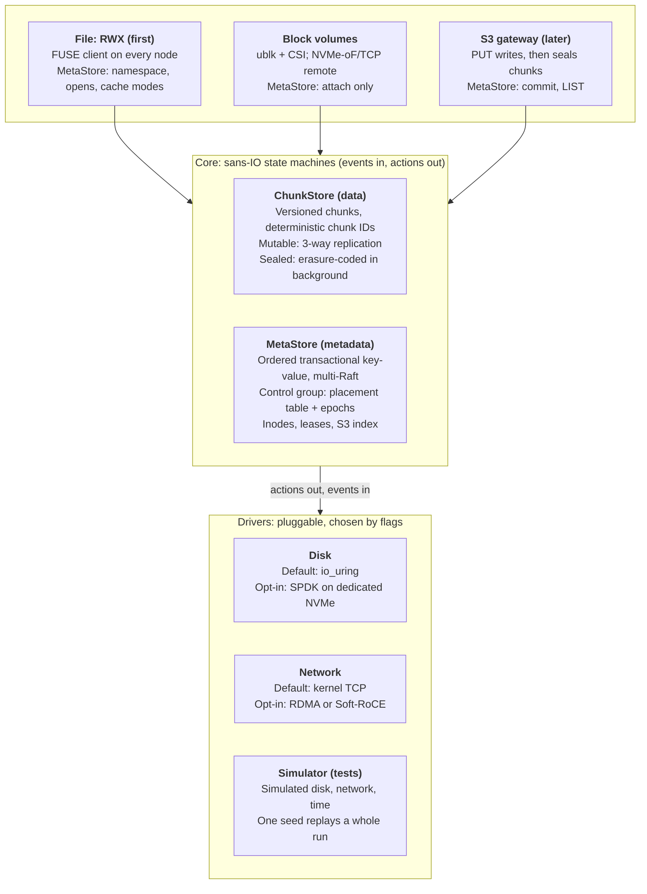
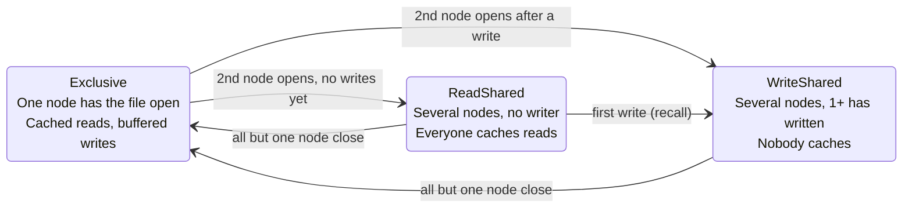
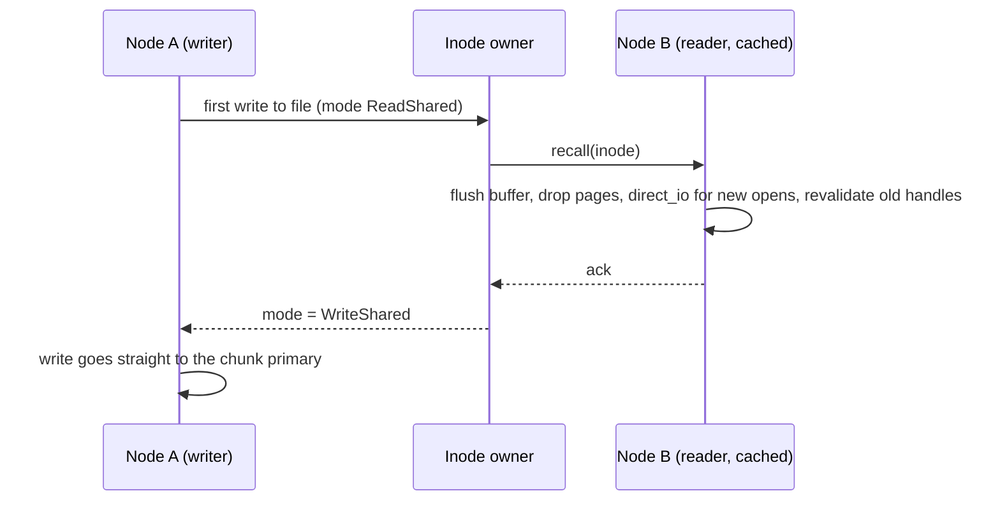

# Rust Distributed Storage — Project Design

Oct 16, 2026 · Nguyễn Văn Cao Nguyên · [Source doc](https://claude.ai/artifact/41wqGFeeytop1GeYZLiHph)

## Goals

Build a distributed storage system in Rust whose headline feature is **ReadWriteMany (RWX) shared filesystems** for a 3 to 10 node homelab Kubernetes cluster: many pods on many nodes mounting one directory, with no NFS gateway in the path, caching that stays correct when files are shared, and Longhorn-level ease of install. Block volumes come from the same core, at near-raw NVMe latency.

**Target user:** homelab and small-cluster Kubernetes operators. They have several NVMe or SATA solid-state drives per node, 10 to 25 Gigabit Ethernet (GbE), and some nodes with Remote Direct Memory Access (RDMA) capable cards. For RWX today they choose between a Network File System (NFS) server (single server, fragile), Longhorn RWX (an NFS server pod in front of each volume), JuiceFS (needs an external metadata database and object store) and CephFS (heavy on RAM, CPU and operator knowledge).

**Product goals, in priority order**

1. **RWX filesystem** (`volumeMode: Filesystem`, `ReadWriteMany`): a Filesystem in Userspace (FUSE) client on every node, talking straight to the storage nodes, with close-to-open consistency first and automatic per-file cache coherence next.
2. **Block volumes**: ReadWriteOnce (RWO) Persistent Volume Claims (PVCs), plus RWX block for KubeVirt live migration.
3. **S3** later, on the same core.
4. **Easy to run:** a single binary (one daemon per node, which also serves as the FUSE client) plus a Container Storage Interface (CSI) driver. No hugepages, pinned cores or external database to get started.
5. **Low CPU per operation**, so storage does not eat the cluster.
6. **Permissive license** (Apache 2.0).

**Performance targets.** Stated as round trips, because absolute numbers depend on the network and drives.

| Operation | Target cost |
| --- | --- |
| Read of a cached file (one writer, or readers only) | Page-cache speed: no FUSE or network trip (0.3 µs per 4K measured) |
| Read or write of a file being written from two or more nodes | One network round trip to the chunk primary, plus about 5 to 20 µs of FUSE overhead |
| `stat`, `lookup` within the cache timeout | Local |
| `stat`, `lookup` after a cache miss | One round trip to the MetaStore shard leader (lease read, no disk write) |
| `create`, `unlink`, same-directory `rename` | One Raft commit on one shard |
| `open` of a file | One round trip to the inode's owner (memory only, no disk write) |
| Block 4K write at queue depth 1 | Around 0.1 ms (Vitastor class) on drives with power-loss protection; Ceph is around 1 ms |

**Learning goals:** Rust, the Storage Performance Development Kit (SPDK), the Data Plane Development Kit (DPDK) and RDMA, extended Berkeley Packet Filter (eBPF) tracing, plus distributed-systems correctness testing.

**Non-goals for v1:** Server Message Block (SMB) file sharing for macOS and Windows clients, GPU-cluster scale, shared-writable `mmap` across nodes, cross-directory hard links, and a custom kernel module.

## Landscape and positioning

The open gap is **RWX without a gateway**: every client reads and writes the storage nodes directly, caches aggressively while it is safe, and stops caching automatically when it is not. It installs like Longhorn and is licensed like SeaweedFS.

| System | What it covers | Why it doesn't fill the gap |
| --- | --- | --- |
| Longhorn | Easy Kubernetes block; RWX through a share-manager pod running NFS-Ganesha | All RWX traffic goes through one pod per volume: a bottleneck and a failover pause |
| [JuiceFS](https://github.com/juicedata/juicefs) | FUSE file system, CSI driver, Apache 2.0 | Needs an external metadata engine (Redis, TiKV, SQL) and an object store; close-to-open consistency only |
| CephFS | POSIX file system with full client capabilities | Around 1 ms writes, heavy CPU and RAM, steep operations learning curve |
| [SeaweedFS](https://github.com/seaweedfs/seaweedfs) | Single binary, S3, FUSE mount, CSI driver | Built around objects; no cache-coherence protocol for shared writes |
| [Vitastor](https://vitastor.io) | Ceph-like block, file, S3 at around 0.1 ms | Solo project; server under a GPL-based network-copyleft license that deters adopters |
| [OpenEBS Mayastor](https://github.com/openebs/mayastor) | Rust + SPDK + NVMe over Fabrics (NVMe-oF) block | Block only; requires hugepages and dedicated cores |
| [Weka](https://docs.weka.io/weka-system-overview/weka-client-and-mount-modes), DAOS, [DeepSeek 3FS](https://github.com/deepseek-ai/3fs) | AI-cluster file systems with kernel bypass | Built for GPU clusters; commercial or heavy to deploy |
| [MinIO](https://github.com/minio/minio), [RustFS](https://github.com/rustfs/rustfs), Garage | S3 | Object storage only |

**Takeaways**

- Homelab RWX today means NFS somewhere in the path. Removing it is the visible win.
- Weka shows that per-file cache-mode switching gives most of the benefit of full client capabilities with a much smaller protocol. Our spike shows it can be done on FUSE, without a kernel module (see [FUSE coherence spike](#appendix-fuse-coherence-spike)).
- Vitastor proves one person can get a 10x latency win over Ceph without DPDK, by shortening the code path. The same lean core serves block.
- Trust is the adoption gate. Storage people wait years before trusting a new system, so correctness work is the product.

## Strategy

Win on a short code path, correct caching and low CPU per operation. Kernel bypass is an opt-in fast path, never a requirement.

On homelab hardware the network caps throughput before the kernel does:

```
one NVMe Gen4 drive:  ~7 GB/s sequential, 4K write in ~0.04 ms (into its write cache)
10 GbE link:          ~1.2 GB/s
25 GbE link:          ~3 GB/s
kernel TCP stack:     saturates 10-25 GbE with one or two cores
```

So DPDK buys almost no throughput here. The latency gap between the disk and Ceph is almost all software path, which is what we attack. One caveat: a *durable* write is bounded by the drive's flush latency. Consumer NVMe drives without power-loss protection can take a millisecond or more to flush, so the 0.1 ms block target applies to drives with power-loss protection.

**Principles**

1. **RWX first:** the file frontend and its coherence protocol are the first usable product. Block and S3 reuse the same core.
2. **Lean data path:** client → chunk primary in one hop → journal append in parallel with sends to replicas → acknowledge. Every frontend uses it.
3. **Cache where safe, never where unsafe:** a file is cached on a node only while no other node writes it. Correctness never depends on timeouts alone.
4. **Defaults that need no tuning:** `io_uring` for disk, kernel TCP for network, FUSE for the file client. No hugepages, pinned cores or kernel modules just to try it.
5. **Opt-in fast paths:** SPDK for dedicated drives, RDMA for nodes with capable cards. DPDK stays a learning experiment.
6. **Correctness before features:** deterministic simulation from day one, including the coherence protocol.
7. **Apache 2.0** to stand apart from Vitastor's network-copyleft license.

## Architecture overview

The system is a two-part core (ChunkStore for data, MetaStore for metadata) under three protocol frontends, over pluggable input/output drivers.



*Three frontends share one core; they differ only in how much metadata they need.*

The same daemon runs on every node. On storage nodes it serves chunks and MetaStore shards; on every node, including compute-only ones, it is also the FUSE client for RWX mounts. The core never touches real I/O, so the simulator can stand in for every driver.

## Data layer: ChunkStore

The ChunkStore is dumb, fast and versioned. It knows nothing about files, buckets or volumes.

```rust
trait ChunkStore {
    async fn write(&self, c: ChunkId, off: u32, data: &[u8], expect_ver: Option<u64>) -> Result<u64>;
    async fn read(&self, c: ChunkId, off: u32, len: u32, at_ver: Option<u64>) -> Result<Bytes>;
    async fn seal(&self, c: ChunkId) -> Result<()>;      // now immutable -> eligible for erasure coding
    async fn flush(&self, cs: &[ChunkId]) -> Result<()>; // durability barrier
}
```

**Deterministic chunk IDs.** `chunk_id = (volume_or_inode_id, offset / CHUNK_SIZE)` is computed, never looked up. The hot path needs no metadata.

**Versions.** Every write returns a new version. `expect_ver` gives compare-and-set on data, and snapshots fall out as frozen versions with copy-on-write.

**Single order per chunk.** Each chunk has one primary that applies writes in one order. This is what makes RWX block and uncached shared files correct without any client-side protocol.

**Redundancy rule: mutable chunks are replicated, sealed chunks may be erasure-coded.** A 4K overwrite in a 4 data + 2 parity stripe costs 3 reads plus 3 cross-node writes, and risks the write hole on crash:

```
stripe = [d0 d1 d2 d3 | p0 p1], overwrite d1:
  read old_d1, p0, p1
  delta = old_d1 ^ new_d1
  p0' = p0 ^ gf_mul(coef[0][1], delta)
  p1' = p1 ^ gf_mul(coef[1][1], delta)
  write new_d1, p0', p1'      // must land together on 3 nodes
```

Three-way replication costs 3 writes and 0 reads. Files being written and block volumes stay replicated. Cold file data and S3 objects are sealed, and a background job then erasure-codes them.

**Placement groups.** Chunks are not placed one by one. Each chunk hashes into one of a fixed number of placement groups (PGs), as in Ceph, and placement is decided per PG:

```
chunk_id = (volume_or_inode_id, offset / CHUNK_SIZE)   // computed
pg       = hash(chunk_id) % PG_COUNT                   // computed
replicas = placement_table[pg]                         // [primary, r1, r2], in-memory
```

The hash spreads a volume's consecutive chunks over many PGs, and so over every disk in the cluster. A volume is therefore not bounded by any one drive; see [Volume size and capacity](#volume-size-and-capacity). The PG is also the unit of recovery and rebalancing: adding a disk moves whole PGs onto it, never individual chunks.

`PG_COUNT` is a power of two, sized for the largest expected cluster (around 100 PGs per disk, so 4096 for 40 disks). It can grow later by doubling, where each PG splits in two along the next hash bit, as Ceph does.

**Placement table.** The table maps each PG to its replica set and carries an epoch number. Its size depends on `PG_COUNT` and not on how much data is stored: 4096 PGs × 3 replicas × a 4-byte disk ID is about 48 KiB, whether the cluster holds 1 GB or 100 TB. So it is **not sharded**. It lives in the single control-plane Raft group, every node caches a full copy, and it changes only on disk and node events, never on the I/O path. Any change (disk added, node failed, rebalance) bumps the epoch, and nodes reject requests carrying a stale epoch. Recovery and rebalancing while writes are in flight is where the hardest correctness bugs live.

What does grow with data lives elsewhere. Each disk keeps its own local index of the chunks it holds, and file-to-inode metadata lives in the sharded MetaStore.

### Volume size and capacity

A volume, block or file, can be larger than any single drive. Its chunks are spread across every disk through placement groups, so the limit is the cluster's usable capacity:

| Data | Redundancy | Usable / raw |
| --- | --- | --- |
| Block volumes, files being written | 3-way replication | 1/3 |
| Sealed cold file data, S3 objects | Erasure coding, e.g. 4 data + 2 parity | 2/3 |

- **Thin provisioning.** A chunk exists only after its first write, so creating a volume allocates nothing. Whether the sum of volume sizes may exceed free capacity (overcommit) is an open question.
- **Wider blast radius.** A volume spread over every disk is affected by any failure, anywhere in the cluster, that takes out every replica of one PG. Placement must keep each PG's replicas in distinct failure domains (node at minimum), and recovery must re-replicate a degraded PG before a second failure arrives.

**Fencing.** Each write carries the client's session ID. When a client session expires (see [Sessions and fencing](#sessions-and-fencing)), the control plane publishes it as fenced and chunk primaries reject its writes. This stops a paused or partitioned client from writing after its locks and cache rights are gone.

**Integrity.** Each 4K block carries a checksum, which catches bit rot, torn writes and misdirected writes.

## Metadata layer: MetaStore

The MetaStore is an ordered, transactional key-value store, sharded into many small Raft groups, each with its own leader. Consensus is needed per key, not globally.

```rust
trait MetaStore {
    async fn txn(&self, ops: Vec<Op>) -> Result<()>;   // compare-and-set, put, delete, all-or-nothing
    async fn scan(&self, prefix: &[u8], after: &[u8], limit: usize) -> Result<Vec<(Key, Val)>>;
}
```

**Why consensus is unavoidable.** Leases, atomic rename and S3 `if-not-exists` are compare-and-set (CAS) operations, and agreeing on one CAS winner among replicas that can crash is consensus. Dynamo-style quorums and conflict-free replicated data types (CRDTs) scale without a leader but cannot do CAS: two racing lock grabs would both succeed.

**Sharding (multi-Raft).** The key space is split into ranges, each its own 3-replica Raft group, with leaders spread across nodes:

```rust
async fn txn(ops: Vec<Op>) -> Result<()> {
    let shards: HashSet<ShardId> = ops.iter().map(|o| shard_map.route(&o.key)).collect();
    if shards.len() == 1 { shard(shards[0]).propose(ops).await }  // fast path: one Raft round
    else { two_phase_commit(ops, shards).await }                 // slow path: rare by design
}
```

**Key layout: the design goal is single-shard for almost everything.**

| Data | Key | Shard rule |
| --- | --- | --- |
| Placement table, membership, fenced sessions | `ctl/...` | One dedicated control-plane Raft group, not sharded; small because it maps placement groups, not chunks |
| Directory entries and inodes | `dir/{parent}/{name}`, `inode/{id}` | New inode IDs allocated from the parent's shard, so create stays single-shard |
| Orphans (unlinked while open) | `orphan/{inode}` | Same shard as the inode |
| flock and whole-file locks | `lock/{inode}` | Same shard as the inode |
| Block volume attach | `volume/{id}/attach` | Any shard; touched only at attach and detach |
| S3 index | `s3/{bucket}/{key}` | Range sharding, never hash, so `LIST prefix` is a sequential scan |

**Inode owner.** The leader of an inode's shard is that inode's *owner*. Besides serving its keys, it keeps in-memory state for open files: who has the file open, who has written, and the current cache mode (see [Cache coherence](#cache-coherence-tiers)). This state is soft. It is not written to the Raft log, so `open` costs one round trip and no disk write. After a leader change, clients re-register their open files during a short grace period, as in NFS version 4.

**Cross-shard transactions (CockroachDB style, no global timestamp service):**

1. Coordinator writes a transaction record `{id: T, status: PENDING}` in shard X.
2. Each touched shard gets an "intent": a provisional value tagged T, written in parallel.
3. Flip T's record to COMMITTED. This single key is the atomic commit point.
4. Intents are resolved into real values asynchronously. A reader that meets an intent checks T's record, so anyone can finish or abort T after a coordinator crash.

Cross-directory `rename` is the main file operation that takes this path.

**Group commit.** Each leader batches whatever arrived during the last round into one log entry, one fsync and one network round:

```rust
loop {
    let batch = inbox.drain_up_to(1024);
    let entry = encode(&batch);
    tokio::join!(wal.append_and_fsync(&entry), replicate_to_followers(&entry));
    wait_for_majority().await;
    for t in batch { apply(&t); t.reply_ok(); }
}
```

**Thread-per-core.** Each core owns a set of shards outright: their Raft state, write-ahead log and storage engine, with no locks between them.

**Reads.** Served by the leader under a time-based lease, so there is no extra round trip. Follower reads with the read-index check come later, if leaders get hot.

**Embedding.** The single-binary goal means Raft plus an ordered storage engine inside the daemon. Candidates are `openraft` for consensus and `redb` or `fjall` for the engine.

**Deferred:** leaderless consensus (Egalitarian Paxos, Accord). Leader-per-shard already removes the single-leader bottleneck.

## File frontend: RWX filesystem

This is the first product. Many pods on many nodes mount one POSIX directory: shared media, uploads, CI caches, datasets, app data. The data path is the shared ChunkStore path. The hard part is keeping each node's cache of pages, attributes and directory entries correct.

### Client design

Every node runs the daemon, which mounts RWX volumes through FUSE. Three rules come straight from the [FUSE spike](#appendix-fuse-coherence-spike):

1. **The kernel page cache is used for reads only.** We never enable FUSE's `writeback_cache`. It is a mount-wide switch, it hides writes from the daemon until the kernel flushes them, and it disables the kernel's automatic invalidation on attribute changes. With it on, the daemon could not stop a node from caching a shared file.
2. **Write-back buffering lives in the daemon.** Every `write()` reaches the daemon as a FUSE request (about 5 µs). While the file is not shared, the daemon buffers writes in its own memory and acknowledges at once. It flushes to the ChunkStore on `fsync`, `close`, memory pressure or a recall. The daemon therefore always knows when a file has been written, and can flush it on demand.
3. **Whether a handle is cached is decided at `open` and cannot change.** The kernel fixes a handle's direct-I/O flag when the file is opened. So the daemon chooses it per open, from the file's cache mode at that moment. Handles that are already open and cached are made coherent by other means (see Tier 2).

**Write path**

```
FUSE write(inode, off, data)
  file not shared: buffer in daemon, acknowledge         // flushed later, in order
  file shared:     chunk_id = (inode, off / CHUNK_SIZE)
                   → ChunkStore.write via the chunk primary → acknowledge
                   → if the write extends the file: MetaStore size = max(size, end)
close() / fsync()  → flush buffered chunks → MetaStore.txn([set size, mtime])
```

**Read path**

```
cached handle:   kernel page cache → on a miss, FUSE read → daemon → ChunkStore.read
uncached handle: FUSE read every time → daemon → ChunkStore.read via the chunk primary
```

**Namespace operations** (`create`, `mkdir`, `unlink`, `rename`, `setattr`) are MetaStore transactions, single-shard except for cross-directory rename.

### Cache coherence tiers

Coherence ships in tiers. Each tier is correct for the workloads in its row, and each one is a usable release.

| Tier | What | Correct for | Effort |
| --- | --- | --- | --- |
| 0 | RWX block: multi-attach, no daemon-side cache, fencing | KubeVirt live migration, cluster-aware apps | Small |
| 1 | Close-to-open consistency, short attribute and directory-entry timeouts, flock, unlink and rename of open files, fencing | One writer per file at a time: media, configs, uploads, datasets, CI caches | Medium |
| 2 | Per-file cache mode switch: cache while one node holds the file or all are readers; uncached once two or more nodes share it and one has written | Concurrent writers on a file, automatically, with no tuning | Medium |
| 3 | Byte-range locks, directory caching with pushed invalidations | SQLite-style apps that lock byte ranges; large directory trees | Large |

Tier 1 already beats Longhorn RWX: there is no NFS pod per volume, so no single-server bottleneck or single point of failure.

**Tier 1: close-to-open**

- **On `open`:** the daemon registers the open with the inode's owner and gets current attributes. If the file changed since this node last cached it, the open is returned without `keep_cache`, and the kernel drops the stale pages.
- **On `close` and `fsync`:** the daemon flushes buffered writes and commits size and mtime. The next open on any node sees them.
- **Metadata:** attributes and directory entries are cached for 1 second by default. A `strict` mount option sets the timeouts to 0.
- **flock and whole-file `fcntl` locks:** MetaStore keys owned by the client's session.
- **Unlink and rename-over of open files:** if anyone still has the inode open, unlink moves it to `orphan/{inode}` instead of freeing it. The owner frees an orphan once no node has it open, and only after any failover grace period. This replaces NFS's `.nfsXXXX` silly rename. It is in Tier 1 because temp files, log rotation and "write a temp file, then rename it over the original" are common.

**Tier 2: the per-file cache mode switch**

Weka caches file data in the page cache by default. When several servers access a file and at least one writes, it bypasses the page cache and sends all I/O to the backend. We do the same, and the inode's owner tracks the mode:

```rust
enum CacheMode {
    Exclusive { client: ClientId },          // one node: cache reads, daemon buffers writes
    ReadShared { readers: Set<ClientId> },   // several nodes, none has written: everyone caches reads
    WriteShared { members: Set<ClientId> },  // several nodes, one or more has written: nobody caches
}
```

The mode is computed from the open registry. A node counts as writing after its first write to the file, whatever flags it passed to `open()`. The daemon sees every write, because the kernel does no write-back.



*Caching turns off only while a file is write-shared, and turns back on when only one node still has it open.*

**Entering WriteShared.** The owner sends a recall to every other member and waits for every acknowledgment, or for that member's session to expire and be fenced. The writing node's write waits for this too. A recall does four things on the receiving node:

1. **Flush:** write the daemon's buffered writes for the file to the ChunkStore.
2. **Drop cached pages:** `notify_inval_inode` (a few µs).
3. **Uncache new opens:** from now on, open the file with `direct_io`.
4. **Revalidate old handles:** a one-time drop is not enough, because an already-open cached handle refills the page cache on its next read (spike test T3). So while the file is WriteShared, the daemon answers every attribute request for it with a new change counter in the mtime field, with an attribute timeout of 0. With `auto_inval_data` on, the kernel then drops the cached pages before each `read()` on an old handle and fetches fresh data (spike T5c, about 15 µs per read locally). No extra network trip is needed.



**While WriteShared:**

- **Data:** every read and write goes to the chunk primary, which orders them. That costs one network round trip per I/O, tens of microseconds on 10 GbE with kernel TCP. Write-sharing is rare in homelab workloads, so this is acceptable.
- **File size:** a write that extends the file updates the size in the MetaStore before it is acknowledged, so readers on other nodes can read past the old end of file. Writes inside the file don't touch the MetaStore.
- **Appends** (`O_APPEND`) from several nodes use a MetaStore compare-and-set on the size.
- **mmap:** FUSE does not tell the daemon when a file is mapped, and mapped pages are not revalidated on access (spike T5b). So after each write it commits, the writing node tells the other members' daemons, and each calls `notify_inval_inode` on its own kernel. Mapped readers then see the write within one message delay, not instantly. Shared-writable `mmap` across nodes stays a non-goal.

**Leaving WriteShared.** When all but one node have closed the file, the owner returns it to Exclusive. No recall is needed, since no other node is caching. New opens on the remaining node are cached again.

### Sessions and fencing

Each client daemon holds a session with a lease, renewed with the inode owners it talks to. Its locks, open registrations and cache rights all belong to the session.

- A client stops writing at `lease_expiry - clock_skew_margin`.
- When a session expires, the control plane records it as fenced. Chunk primaries reject writes carrying a fenced session ID, and owners release its locks and open registrations.
- A fenced client must start a new session and reopen its files. Its applications get errors, never silently stale data.

This is the same machinery for flock (Tier 1), recalls (Tier 2) and RWX block (Tier 0).

### Kubernetes integration for RWX

- **CSI:** advertise `ReadWriteMany` for `volumeMode: Filesystem`. The node plugin asks the local daemon to mount the volume with `allow_other`, then bind-mounts it into each pod.
- **fsGroup:** advertise the CSI `VOLUME_MOUNT_GROUP` node capability. Kubelet then passes the pod's fsGroup to the driver instead of recursively changing ownership of every file, which would stall mounts of large volumes.
- **Compute-only nodes** run the daemon in client-only mode: no disks, no shards, just FUSE.
- **Daemon restart and upgrade:** if the FUSE daemon exits, every pod using its mounts gets "Transport endpoint is not connected". The plan is to pass the `/dev/fuse` file descriptors to the new daemon process across a restart, so mounts survive upgrades. The fallback is one mount process per volume, as JuiceFS does with mount pods. This is an open question to resolve before the first release.

### What is not free

- File metadata speed is bounded by MetaStore round trips, so small-file workloads never match a local disk. Every shared POSIX system pays this. Tier 3's pushed directory invalidations let caches live longer.
- While a file is write-shared, its reported mtime changes on every `stat` (a side effect of revalidation). Tools that compare mtimes on a file that another node is actively writing may notice.
- SMB for macOS and Windows clients would be a Samba gateway over the file frontend, and is out of scope for v1.

## Block frontend

Block volumes use the same ChunkStore path and never touch the MetaStore on the hot path.

**Block 4K write**

```
pod write() → kernel block layer → userspace block device (ublk) in node daemon
  → chunk_id = (volume_id, offset / CHUNK_SIZE)    // computed
  → pg = hash(chunk_id) % PG_COUNT                 // computed
  → placement_table[pg] → primary                  // in-memory, epoch-versioned
  → primary: journal append ‖ send to 2 replicas → acks → done
```

**RWO:** a single-writer attach record is taken in the MetaStore at attach. It prevents two nodes from mounting one volume and corrupting it. Remote clients use NVMe over Fabrics over TCP (NVMe-oF/TCP) instead of ublk.

**RWX block (Tier 0):** several nodes attach one raw device; the homelab user is KubeVirt live migration. The changes are a multi-writer attach record and no caching in the daemon, so every I/O goes to the chunk primary. The kernel's own cache for the block device is the application's choice: KubeVirt opens shared disks with `cache=none` (direct I/O), which is what makes live migration safe.

## S3 frontend (later)

```
stream body → fresh chunk ids → ChunkStore.write (once each) → seal → background erasure coding
  → MetaStore.txn([put "bucket/key" → chunk list, if-not-exists or version check])
LIST → MetaStore.scan(prefix)
```

The object becomes visible atomically in that one transaction.

## Frontend comparison

|  | File (RWX) | Block | Object (S3) |
| --- | --- | --- | --- |
| Write pattern | Byte-range writes, appends | 4K overwrites in place | Whole object, written once |
| Writers | Many, coordinated per file by cache mode | One (RWO), or many with app coordination (RWX block) | Many, atomic per key |
| Metadata | Heavy: directories, rename, stat, opens | Almost none | Sorted key index |
| MetaStore on hot path | Open, close, fsync, namespace operations; extending writes while write-shared | Never (attach only) | Once per PUT commit, and on LIST |
| Redundancy | Replicated, sealed when cold | Replicated | Sealed on PUT, then erasure-coded |
| Hot cost | Metadata round trips | Latency at queue depth 1 | Throughput, listing |

## Modularity: sans-IO core, pluggable drivers

All protocol and replication logic, including the coherence protocol, is written as pure state machines that take events and return actions. They never call a syscall, tokio, SPDK or a clock. This one decision makes deterministic simulation possible and makes every input/output (I/O) backend swappable.

```rust
impl ChunkReplica {
    fn on_event(&mut self, now: Tick, ev: Event) -> Vec<Action> { ... }
}
enum Event  { NetRecv(NodeId, Msg), DiskDone(IoId, Result<()>), Timer(TimerId) }
enum Action { NetSend(NodeId, Msg), DiskWrite(IoId, Lba, Bytes), DiskFsync(IoId), SetTimer(TimerId, Tick) }
```

A driver executes `Action`s and feeds back `Event`s:

| Slot | Default driver | Opt-in fast driver | Test driver |
| --- | --- | --- | --- |
| Disk | `io_uring` on a file or raw device | SPDK on a dedicated NVMe drive | Simulated disk with fault model |
| Network | Kernel TCP | RDMA (real ConnectX or Soft-RoCE); DPDK as an experiment | Simulated network |
| Clock and timers | Monotonic clock | Same | Simulated time |
| Frontend | FUSE client; ublk + CSI driver | NVMe-oF/TCP for remote block clients | Simulated clients with a model page cache that record histories |

**Crate layout (proposed)**

- `core`: state machines for ChunkStore replicas, placement, Raft shards, sessions and leases. No I/O dependencies.
- `meta`: MetaStore shard logic, key layout, cross-shard transactions, and the inode owner (open registry, cache modes, recalls).
- `drivers-uring`, `drivers-tcp`, `drivers-spdk`, `drivers-rdma`: one crate per backend, behind feature flags so the default build needs no SPDK.
- `sim`: deterministic simulator, fault models and invariant checkers.
- `frontend-file`, `frontend-block`, `frontend-s3`: protocol adapters onto `ChunkStore` and `MetaStore`.
- `daemon`: the single binary that wires the drivers and frontends picked by flags.
- `csi`: Kubernetes CSI driver.

**Transport negotiation.** Each node pair picks RDMA if both ends support it, otherwise TCP, so mixed clusters work without configuration.

## Testing strategy

Most bugs live in interleavings that a real cluster hits rarely and can't reproduce. So most testing happens in deterministic simulation, and real hardware confirms what simulation can't model.

| Layer | What it catches | Tools |
| --- | --- | --- |
| 1. Deterministic simulation testing (DST) | Interleaving bugs across crashes, partitions, disk faults and lost recalls; reproducible from a seed | Own simulator over the sans-IO core |
| 2. Protocol model checking | Design bugs in the epoch protocol, sessions and fencing, cache-mode recalls, cross-shard commit | `stateright` (models in plain Rust) |
| 3. Consistency checking | Reads that no valid ordering could produce; close-to-open violations | Porcupine (Go), Jepsen Elle |
| 4. Real-cluster fault injection | Kernel, FUSE, firmware, fsync and RDMA behavior | device-mapper, SPDK error/delay bdevs, eBPF error injection (`bpf_override_return`), `tc netem`, `nftables`, `kill -9`, power cuts |
| 5. Heterogeneous matrix and property tests | Placement and rebalance bugs on mixed hardware | Generated matrix, `proptest` |
| 6. Conformance suites | POSIX and protocol compatibility gaps | `pjdfstest`, `fsx` (single and multi-client), `csi-sanity`, Kubernetes storage end-to-end tests, Ceph `s3-tests` |
| 7. Performance regression | Latency, CPU and recovery regressions | `fio` and metadata benchmarks nightly → VictoriaMetrics → Grafana; eBPF off-CPU and latency profiles to explain regressions |

**1. Deterministic simulation.** All nodes, disks, clients and the network run in one thread from one seeded random number generator. The simulator drops, delays, reorders and duplicates messages, and crashes and restarts nodes. A failing seed replays exactly. Run thousands of seeds per commit in continuous integration (CI), and millions overnight on idle homelab machines.

The simulated disk models:

- torn writes (only some 4K sectors of a larger write land);
- loss of all unflushed data on crash;
- silent bit flips and misdirected writes;
- fail-slow: a disk 100x slower that never errors.

Simulated FUSE clients model the kernel behavior the spike measured: a page cache that refills on reads, direct-I/O fixed at open, and mapped pages that are not revalidated.

Simulation faults for coherence: lost or delayed recalls, clients paused past their lease, clock skew, owner failover in the middle of a recall.

Invariants checked after every step:

- every acknowledged write is readable;
- every chunk reaches its replica count across distinct nodes once recovery settles;
- at most one lock holder per lock; at most one writer per RWO volume;
- no client reads stale data from a file in WriteShared mode, and no fenced session's write is applied;
- an orphaned inode is never freed while a live session has it open;
- epochs never go backwards on any node.

**3. Consistency checking.** Record every client operation as `(invoke_time, complete_time, op, result)`, from simulation and real clusters alike. For write-shared files the checker searches for a linearizable order. For other files it checks close-to-open: an open that starts after another node's close sees that close's data.

**4. Real cluster.** Run Jepsen-style nemesis schedules nightly: random kills, partitions, disk errors and slow disks during a multi-node file workload, checked at the end.

- **FUSE behavior** is pinned by the spike harness in [spikes/fuse-coherence](../spikes/fuse-coherence/), run in CI against each supported kernel.
- **Power cuts** via the Intelligent Platform Management Interface (IPMI) or a smart power strip are the only honest fsync test. Write checksummed patterns with `fio --verify=crc32c`, cut power, boot, verify. Some consumer NVMe drives acknowledge flushes they haven't done.
- **Soft-RoCE (`rdma_rxe`)** runs the RDMA code path on any ordinary network card, and `tc netem` can inject faults under it.
- device-mapper can't see SPDK I/O, so the SPDK path uses SPDK's own error and delay bdev modules.

**5. Test matrix.**

```
transport:  TCP-only | RDMA-only | mixed
disks/node: 1 | 4 | mixed sizes | mixed speed (NVMe + SATA SSD + HDD)
cluster:    3 nodes | 5 nodes | add node mid-run | remove disk mid-run
clients:    storage nodes only | plus compute-only nodes
backend:    io_uring | SPDK
```

Property tests on placement: after any random add, remove and failure sequence, every placement group keeps its replica count across failure domains, no disk exceeds a set fill margin above average, and chunks moved stay near the minimum.

**7. Performance.** Track metadata operations per second (create, stat, rename), cached and write-shared read latency, 4K block latency at queue depth 1, CPU per operation, and 99.9th-percentile latency during recovery. A 20% overnight regression is treated as a bug.

**Starting hardware.** One big machine is enough at first: a few virtual machines, QEMU's emulated NVMe devices (SPDK runs against them for correctness, not speed), and Soft-RoCE between the virtual machines.

## Alternatives considered

Each choice below favors a short hot path, a single binary and testable correctness over peak features. Where a choice is still open, the leaning is marked.

| Decision | Chosen | Alternatives weighed | Why the chosen one |
| --- | --- | --- | --- |
| First product | RWX filesystem | Block first; S3 first | RWX is where homelab users have no good option; block alone competes with Longhorn v2 and Mayastor |
| Language | Rust | Go; C++ (Ceph, 3FS) | A learning goal; no garbage-collector pauses in tail latency; memory safety; SPDK and RDMA are C libraries, reached through bindgen without cgo overhead |
| File client | FUSE | Own kernel module (Weka, CephFS); NFS gateway pod (Longhorn RWX) | The spike shows FUSE can do per-file cache switching. FUSE is safe to iterate on, and a crash doesn't take down the kernel. A gateway funnels all traffic through one pod |
| Where write-back lives | In the daemon | FUSE `writeback_cache` (kernel page cache) | The kernel option is mount-wide, hides writes from the daemon and can't be revoked per file, so write-shared mode couldn't be enforced (spike T9) |
| Coherence | Tiers 1 → 2 → 3 | Close-to-open only (NFS, JuiceFS); full capabilities from the start (CephFS); caching left to the user (DAOS) | Ships useful RWX early; the Weka-style mode switch gets most of the benefit of capabilities with three states and one message type |
| Open-file state | Soft state at the inode owner, rebuilt after failover | Durable open records in Raft | Keeps `open` to one round trip with no fsync, which matters for small-file workloads |
| Kernel bypass | Opt-in flag | Mandatory DPDK and SPDK (Weka, Mayastor, Longhorn v2) | Homelab links are network-bound, so bypass buys latency, not throughput. Mandatory hugepages and pinned cores break "plug and play" |
| Core abstraction | Two narrow primitives: ChunkStore + MetaStore (Tectonic, Colossus, 3FS) | One rich object layer (Ceph RADOS) | Each frontend pays only for the metadata it needs |
| Metadata store | Embedded multi-Raft | External FoundationDB (3FS), TiKV, Redis (JuiceFS), etcd | The single-binary goal rules out a second system to operate. An external etcd remains an option for early prototypes |
| Consensus shape | Leader per shard, one shard at first | Single global Raft group; leaderless Egalitarian Paxos or Accord; quorum or CRDT with no consensus (Garage) | CAS is required for locks and rename, which rules out quorums and CRDTs. Per-shard leaders already remove the single-leader bottleneck |
| Cross-shard transactions | Transaction record plus intents (CockroachDB style) | Percolator with a central timestamp oracle (TiKV); a central sequencer (FoundationDB) | No extra central service; the commit point rides on one shard's Raft |
| Redundancy | Replicate mutable chunks, erasure-code sealed ones | Erasure-code everything with redirect-on-write (Weka); replication only | Avoids read-modify-write and the write hole without needing garbage collection |
| Replication protocol | Primary fans out to replicas in parallel (Ceph, Vitastor) | Chain replication or CRAQ (3FS); leaderless quorum writes | One added hop instead of one per chain link; the primary also gives each chunk a single write order |
| Placement | Chunks hashed into placement groups; table of PG → replicas plus epochs (leaning) | Per-chunk table; computed placement (Ceph CRUSH; Weka's algorithmic ownership) | Placement groups keep the table small (tens of KiB) whatever the data size, so it needs no sharding. Epochs are easier to reason about and test in simulation; computed placement scales better. Still open |
| Block frontend | ublk locally, NVMe-oF/TCP remotely | NBD (single-threaded overhead); iSCSI (old, heavy) | ublk rides io\_uring with little overhead; NVMe-oF is the native remote protocol for NVMe |
| Simulation | Own simulator over a sans-IO core | turmoil or madsim; Jepsen-only testing | We need a detailed disk and page-cache fault model, which those crates don't cover. Jepsen alone can't reproduce failures |
| License | Apache 2.0 | AGPL (MinIO); network copyleft (Vitastor) | Copyleft with a network clause deters adopters |

## Roadmap and open questions

Build order puts the simulator before any real driver and ships RWX file storage as the first usable product. Each phase ends with something that runs and is tested.

1. **Sans-IO core and simulator.** Single-node ChunkStore state machine, simulated disk with the full fault model, invariant checker.
2. **Protocol models.** `stateright` models of placement epochs, sessions and fencing, and cache-mode recalls, before writing the real protocols.
3. **Replication and placement.** Primary-based 3-way replication, placement groups and a placement table with epochs, recovery per placement group. Fault-injected in simulation from the first commit.
4. **Embedded MetaStore.** Raft with group commit, one shard only, with the sharded API from day one. Inodes, directory entries, sessions and locks.
5. **Default drivers.** `io_uring` and kernel TCP behind the `Action` interface.
6. **File frontend with Tier 1: first usable product.** FUSE client with daemon-side write-back, close-to-open, flock, orphans, fencing. CSI driver with RWX and fsGroup delegation. Passes `pjdfstest`, single and multi-client `fsx`, and `csi-sanity`. Nightly nemesis runs and power-cut tests.
7. **Tier 2.** Inode owner with open registry and cache modes, recalls, revalidation of old handles, mmap invalidations. Simulated FUSE clients and the spike harness in CI.
8. **Block frontend.** ublk plus CSI for RWO, then RWX block (Tier 0).
9. **Opt-in fast drivers.** SPDK and RDMA behind the same `Action` interface; Soft-RoCE lab on virtual machines.
10. **S3 frontend.** Seal plus MetaStore transactions; erasure coding for sealed chunks; Ceph `s3-tests`.
11. **Scale-out and Tier 3.** Range splitting and leader balancing across nodes; byte-range locks; directory caching with pushed invalidations.

**Open questions**

- [ ] `CHUNK_SIZE`: bigger chunks mean fewer local index entries and longer sequential I/O; smaller ones mean finer-grained write ordering and less data rewritten when sealing. 4 MiB (Ceph RBD's default object size) is a starting point to benchmark.
- [ ] Thin provisioning: allow overcommit (sum of volume sizes above free capacity)? If so, what happens to writes when the cluster fills: fail with `ENOSPC`, or reserve space per volume?
- [ ] FUSE daemon restarts: pass `/dev/fuse` file descriptors to the new process, or run one mount process per volume?
- [ ] Owner failover: how long a grace period for clients to re-register open files and cache modes, and what blocks during it?
- [ ] mmap readers of a write-shared file get invalidations after each write, not instantly. Is that acceptable, or should mapping a write-shared file switch to synchronous invalidations?
- [ ] Daemon write-back buffer: size limits per file and per node, and flush policy under memory pressure.
- [ ] Chunk size: what balances placement-table size against rebalance granularity (for example 4 MB versus 64 MB)?
- [ ] Exact key encoding for directories, inodes and S3 objects, and how the inode ID allocator stays co-located with the parent's shard.
- [ ] Placement algorithm: a table computed by the control plane, or a CRUSH-style hash function every node evaluates?
- [ ] On-disk format for the ChunkStore: journal plus in-place data, or log-structured with compaction? Includes the version format for upgrades.
- [ ] Flush latency of common consumer NVMe drives, which bounds durable write latency on homelab hardware. Measure with eBPF on the `nvme_setup_cmd` and `nvme_complete_rq` tracepoints.
- [ ] Raft and storage engine: `openraft` maturity for multi-Raft, `redb` versus `fjall`.
- [ ] Name and license confirmation (Apache 2.0 assumed).

## Learning project

Each learning track starts with a small throwaway exercise, then lands as a real component, so learning time also builds the project. The order follows the roadmap: correctness tools first, kernel-bypass hardware last.

| Track | Warm-up exercise | Lands in the project as | Roadmap phase |
| --- | --- | --- | --- |
| Rust for systems code | Write a sans-IO echo state machine plus a tiny simulator that drops and reorders messages | `core` and `sim` crates | 1 |
| Correctness and consensus | Fly.io Gossip Glomers challenges on Maelstrom, through to the linearizable key-value one; then Raft from the paper | MetaStore shards, Raft with group commit | 2, 4 |
| Model checking | A `stateright` model of a 3-node lease: prove at most one holder per epoch | Models of placement epochs, sessions, cache-mode recalls | 2 |
| Consistency checking | Feed a recorded history from your simulator into Porcupine (Go) | History recorder plus checker in CI | 1, 3 |
| io\_uring | Raw-device read/write benchmark with the `io-uring` crate, compared against fio | Default disk driver | 5 |
| FUSE | Extend the coherence spike: add a second inode and directory-entry invalidation | `frontend-file` | 6, 7 |
| eBPF | bpftrace: a flush-latency histogram for your NVMe drives; count FUSE reads served by the daemon versus the page cache during spike tests T3 and T5 | Answer to the flush-latency open question; kernel-side checks in the spike CI; tracing and fault-injection tooling in Rust with `aya`. eBPF stays out of the data path: the verifier's limits make it the wrong home for storage logic | 1 (spike), 6 onward |
| Kubernetes storage | A toy CSI driver that provisions directories, run through `csi-sanity` | `csi` crate | 6 |
| SPDK | Run SPDK's NVMe perf tool and hello\_bdev against a QEMU emulated NVMe; then call one bdev from Rust via bindgen, studying Mayastor's Rust bindings | Opt-in SPDK disk driver | 9 |
| RDMA | rdma-core's ibv\_rc\_pingpong over Soft-RoCE between two virtual machines; then a Rust RDMA write-and-completion loop | Opt-in RDMA network driver, transport negotiation | 9 |
| DPDK | DPDK's l2fwd or testpmd on a spare port or virtual function; measure the busy-poll core cost. Compare with AF_XDP, which skips most of the kernel network stack without hugepages or a dedicated card | Side experiment only; informs the opt-in decision | Any |
| Performance work | Profile one hot path with perf and flame graphs; count CPU per operation | Nightly performance tracking | 6 onward |

**Done-when checkpoints**

- [ ] Simulator replays a failing seed exactly, and finds a bug planted in a toy replication protocol.
- [ ] Raft passes the Maelstrom linearizable key-value workload under partitions.
- [ ] Same `ChunkStore` test suite passes on the simulated disk, io\_uring and SPDK.
- [ ] Two pods on two nodes share an RWX PVC, one node is power-cut mid-write, and every file that was closed before the cut verifies after recovery.
- [ ] Two nodes write one file concurrently under `fsx` with Tier 2 on, and the consistency checker finds no stale read.
- [ ] RDMA and TCP drivers pass the same network test suite; a mixed 3-node cluster negotiates per pair.

## Appendix: FUSE coherence spike

**Question.** Can a FUSE daemon stop a node from serving stale cached data for a file that another node is writing, including through handles that were already open, without a kernel module?

**Setup.** Linux 6.17, libfuse 3.14. Two FUSE mounts (nodes A and B) serve one backing file, standing in for two clients over shared storage. A control channel triggers invalidations and changes open and attribute policy at runtime. Findings were checked against the kernel source (`fs/fuse/file.c`, `inode.c`). Code and raw output: [spikes/fuse-coherence](../spikes/fuse-coherence/).

| Test | Result |
| --- | --- |
| T1: B has the file cached, A writes | B reads stale data. A coherence protocol is needed |
| T2: daemon sends `notify_inval_inode` to B | B's next read is fresh. Cost: 2 to 25 µs |
| T3: B reads again, then A writes again | **Stale.** The old handle refills the page cache, so one recall at the mode switch is not enough |
| T4: new opens get `direct_io`; an old cached handle stays open | New handle fresh, **old handle stale**. The direct-I/O flag is fixed at open (`file.c`: `ff->open_flags`) |
| T5: `auto_inval_data` + attribute timeout 0 + data version as mtime | Old cached handle fresh on `read()`. One attribute request per read (about 5 to 6.5 µs locally) |
| T5b: same, but read through `mmap` | **Stale** until `notify_inval_inode`. Mapped pages are not revalidated |
| T5c: daemon reports a new change counter on every attribute request | Old cached handle always fresh, with no version lookup. About 15 to 17 µs per 4K read locally |
| T6: open without `keep_cache` | Stale pages dropped at open. Close-to-open works |
| T7: 4K read cost on B | Cached 0.3 µs; `direct_io` 5.4 to 6.7 µs; revalidated as in T5c, 15 to 17 µs (local daemon, no network) |
| T9: B mounted with `writeback_cache` | B's writes don't reach the daemon until flushed. `notify_inval_inode` forces them out (40 to 190 µs). `auto_inval_data` has no effect on regular files in this mode, so B stays stale |

**Conclusions** (applied in [File frontend](#file-frontend-rwx-filesystem))

- FUSE is enough for Tier 2; a kernel module is not needed.
- Never enable `writeback_cache`; buffer writes in the daemon.
- A recall must drop pages, switch new opens to `direct_io`, and put old handles into per-read revalidation.
- mmap readers need an invalidation after each write.
